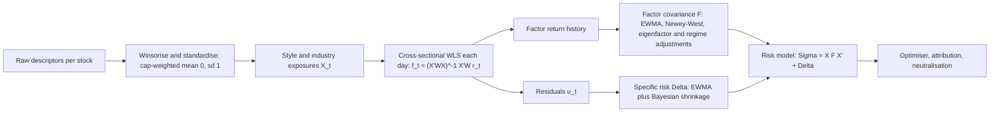

# Cross-Sectional Factor Models

## TL;DR

- A linear factor model writes $r_t = X_t f_t + u_t$ with exposures $X$ ($N\times K$), factor returns $f$ and uncorrelated specific returns $u$, so $\Sigma = XFX^\top + \Delta$; for 1,000 stocks and 13 factors that is 14,091 parameters instead of 500,500.
- Three families: time-series models (factor returns known, betas estimated), fundamental or Barra-style models (exposures known from characteristics, factor returns estimated each period by cross-sectional WLS), statistical models (both latent, from PCA).
- The WLS estimate $\hat f_t = (X^\top WX)^{-1}X^\top W r_t$ is the return of $K$ pure factor portfolios, the rows of $(X^\top WX)^{-1}X^\top W$, each with unit exposure to its own factor and zero to every other.
- Fama-MacBeth: run a cross-sectional regression every period, then average the slopes; the standard error is the time-series standard deviation over $\sqrt T$, robust to cross-sectional correlation but not to autocorrelation or estimated-beta errors (Shanken correction).
- Risk decomposition $h^\top\Sigma h = x^\top Fx + h^\top\Delta h$ with $x = X^\top h$ tells you which bets you are actually running; neutralisation removes the ones you did not intend.

## Learning objectives

- Run Fama-MacBeth regressions and interpret factor premia.
- Explain fundamental (Barra-style) versus statistical factor models.
- Use a factor model for risk decomposition and neutralisation.
- Estimate factor returns by WLS and explain the weights, the pure factor portfolios and specific risk.

## Core concepts

### The linear factor model

For $N$ assets and $K$ factors at time $t$:

$$
r_{t} = X_t f_t + u_t, \qquad E[u_t] = 0,\ \text{Cov}(u_t) = \Delta = \text{diag}(\sigma_1^2,\dots,\sigma_N^2),\ \text{Cov}(f_t, u_t) = 0,
$$

so the covariance is

$$
\Sigma = X F X^\top + \Delta.
$$

The point is dimension reduction: $NK + K(K+1)/2 + N$ parameters instead of $N(N+1)/2$, and a matrix that is well conditioned and invertible even when $T < N$ ([PCA and Factor Structure](../03-Linear-Algebra-and-Optimization/05-PCA-and-Factor-Structure.md)).
The diagonal $\Delta$ is the key assumption: everything common must be in the factors.

| Family | Known | Estimated | Example |
| :--- | :--- | :--- | :--- |
| Time-series (macro or traded factors) | factor returns $f_t$ | betas $X$ by time-series regression per asset | CAPM, Fama-French three factor |
| Fundamental (cross-sectional) | exposures $X_t$ from characteristics | factor returns $f_t$ by cross-sectional regression per period | Barra, Axioma fundamental models |
| Statistical | nothing | both, from the return covariance (PCA) | asymptotic PCA, Axioma statistical models |

### Time-series models and Fama-French

Fama and French (1993) build traded factors from double sorts: SMB and HML come from six portfolios formed on size (NYSE median) and book-to-market (NYSE 30th and 70th percentiles), with HML the average of the two value portfolios minus the average of the two growth portfolios.
Each asset's betas come from the time-series regression $r_{it} - r_{ft} = a_i + b_i\text{MKT}_t + s_i\text{SMB}_t + h_i\text{HML}_t + e_{it}$, and a correctly specified model has all $a_i = 0$, which the Gibbons, Ross and Shanken (1989) GRS test checks jointly.
Time-series models need traded factor returns; they suit performance attribution and asset pricing tests more than daily risk forecasting for thousands of stocks.

### Fundamental models: cross-sectional WLS

At each date the exposures $X_t$ are known characteristics: industry dummies, and style scores (size, value, momentum, volatility, liquidity) standardised cross-sectionally.
The factor returns are the slopes of a cross-sectional regression of that period's returns on the exposures.
Specific variances differ across stocks, so generalised least squares with $W = \Delta^{-1}$ is efficient:

$$
\hat f_t = \arg\min_f\ (r_t - X_tf)^\top W (r_t - X_tf) = (X_t^\top W X_t)^{-1} X_t^\top W r_t, \qquad \text{Cov}(\hat f_t - f_t) = (X_t^\top\Delta^{-1}X_t)^{-1}.
$$

$\Delta$ is unknown when you run the regression, so practitioners use a proxy: Barra models weight by the square root of market capitalisation, because specific variance falls with size and the square root keeps mega-caps from dominating.

**Pure factor portfolios.** Write $H_t = (X_t^\top WX_t)^{-1}X_t^\top W$.
Then $\hat f_t = H_t r_t$, so each estimated factor return is the return of a portfolio whose weights are a row of $H_t$, and $H_tX_t = I$: the factor-$k$ portfolio has unit exposure to factor $k$ and zero to every other factor.
With industry dummies and no intercept, a style portfolio is dollar neutral inside every industry, and an industry portfolio is net long 1 in its own industry and net zero in all others.
These factor-mimicking portfolios are the tradable objects behind every factor return a risk vendor publishes.

**Barra-style details (USE4, Menchero, Orr and Wang 2011).**

- Descriptors (for example several measures of value) are standardised to cap-weighted mean 0 and equal-weighted standard deviation 1, winsorised, and combined into style exposures.
- The factor set is one country factor, 60 industries and 12 styles: Beta, Momentum, Size, Earnings Yield, Residual Volatility, Growth, Dividend Yield, Book-to-Price, Leverage, Liquidity, Non-linear Size and Non-linear Beta; the estimation universe is the MSCI USA IMI.
- A country factor (intercept) sits beside the industry dummies; the two are collinear, so the regression adds the constraint that cap-weighted industry factor returns sum to zero, which makes the country factor approximately the cap-weighted market.
- The factor covariance $F$ is estimated from the factor-return history with exponential weighting, a Newey-West adjustment for serial correlation, an eigenfactor risk adjustment that corrects the underprediction of risk for optimised portfolios, and a volatility regime adjustment.
- Specific risk comes from the residuals' history, with Bayesian shrinkage toward size-bucket averages and a structural model for names with short histories.

### Fama-MacBeth regressions

Fama and MacBeth (1973) estimate risk premia in two passes:

1. If exposures are betas, estimate them by time-series regressions (on rolling past windows); if they are characteristics, use them directly.
2. At every date run the cross-sectional regression $r_{it} = \gamma_{0t} + \sum_k \gamma_{kt}X_{ikt} + \varepsilon_{it}$.
3. The premium estimate is $\bar\gamma_k = \frac1T\sum_t\hat\gamma_{kt}$ with standard error $\text{sd}(\hat\gamma_{kt})/\sqrt T$ and $t = \bar\gamma_k\sqrt T/\text{sd}(\hat\gamma_{kt})$.

Why it works: each $\hat\gamma_{kt}$ is the return on a pure factor portfolio, so the time series of slopes is a return series and its mean and standard error are those of a portfolio.
Cross-sectional correlation of residuals is absorbed into the period-by-period variation of $\hat\gamma_{kt}$, which is why the method was adopted.

What it does not handle:

- Autocorrelated slopes (persistent characteristics, overlapping returns) understate the standard error; use Newey-West on the $\hat\gamma_{kt}$ series (Petersen 2009 compares the options).
- Estimated betas in pass 1 create errors-in-variables: slopes are biased toward zero and the standard errors are too small; Shanken (1992) scales the residual-driven part of the variance by $1 + \lambda^\top\Sigma_f^{-1}\lambda$ (the squared Sharpe ratio of the factors) and adds $\Sigma_f/T$ for the sampling error of the factors themselves, and the original paper used portfolios to shrink the beta errors.
- The premium measures the realised average return of the factor portfolio over the sample, not the population premium; with 120 months and a factor Sharpe of 0.2 a month the expected $t$ is only $0.2\sqrt{120} = 2.19$.

### Statistical factor models

PCA of the return covariance (or of the $T\times T$ matrix $RR^\top/N$ when $N \gg T$, the asymptotic PCA of Connor and Korajczyk 1986) gives factors and loadings with no fundamental input.
Strengths: captures whatever drives comovement now, including themes no vendor has a factor for, and needs only returns.
Weaknesses:

- Factors are identified only up to rotation, so they have no names and their loadings drift.
- Weak factors (small variance relative to idiosyncratic noise) sit inside the noise bulk and are not recovered.
- Choosing $K$ is hard: the Marchenko-Pastur edge assumes equal idiosyncratic variances, and heteroskedastic noise pushes extra eigenvalues above it; Bai and Ng (2002) information criteria are the standard alternative.

Practitioners often run both: a fundamental model for attribution and constraints, and a statistical model as a check for risk the fundamental model misses.
The eigenvalue noise and its cleaning are developed in [Covariance Estimation and Shrinkage](11-Covariance-Estimation-and-Shrinkage.md).

### Risk decomposition and neutralisation

For holdings $h$, factor exposures are $x = X^\top h$ and

$$
\sigma_p^2 = x^\top F x + h^\top\Delta h, \qquad \text{contribution of factor } k = \frac{x_k (Fx)_k}{\sigma_p^2},
$$

the Euler decomposition, whose factor contributions plus the specific share sum to one.
A signal-weighted book usually carries large unintended factor bets; you remove them either by residualising the signal on the unwanted exposures ([Signals, Features and Alpha Decay](03-Signals-Features-and-Alpha-Decay.md)) or by constraints $X_B^\top h = 0$ in the optimiser ([Mean-Variance Portfolio Construction](10-Mean-Variance-Portfolio-Construction.md)).

### Specific risk

Specific variance is estimated from regression residuals.
For normal residuals the relative standard error of a volatility estimated from $T$ observations is about $1/\sqrt{2T}$, so 120 months give about 6.5% error per name, which is why vendors shrink toward size or industry averages.

### Validating a risk model

The standard test is the bias statistic: for a test portfolio, standardise each period's realised return by its ex-ante forecast volatility, $z_t = r_t/\hat\sigma_t$, and take $b = \text{sd}(z_t)$ over $T$ periods.
A well-calibrated model gives $b \approx 1$, and for normal returns the sampling band is roughly $1 \pm \sqrt{2/T}$; $b > 1$ means risk is underforecast, which is what the eigenfactor adjustment targets for optimised portfolios.
Run it on many portfolios (factor-mimicking, random, and especially optimised ones), because a model can be calibrated for the market and badly wrong for the long-short books an optimiser builds.

## Worked examples

All numbers come from [factor_models.py](code/factor_models.py): 1,000 stocks, 120 months, 10 industries (no intercept, so industries carry the market) and three styles with known true factor returns.
Style factor volatilities are 1.5%, 1.5% and 2.0% a month, specific volatility is $0.09e^{-0.25\,\text{size}}$, and market cap is $e^{1.2\,\text{size}}$.

### 1. Recovering factor returns: OLS versus WLS

RMSE of the estimated monthly style factor returns against the truth:

| Factor | OLS | WLS, $1/\sigma_i^2$ | WLS, $\sqrt{\text{cap}}$ |
| :--- | ---: | ---: | ---: |
| size | 0.308% | 0.263% | 0.264% |
| value | 0.281% | 0.253% | 0.255% |
| momentum | 0.290% | 0.256% | 0.257% |

- WLS cuts estimation error relative to OLS by about 14.4% (size), 10.1% (value) and 11.8% (momentum).
- Here $\sqrt{\text{cap}} = e^{0.6\,\text{size}}$ and $1/\sigma_i^2 \propto e^{0.5\,\text{size}}$, so the Barra proxy is almost the efficient weight by construction; in real data it is a reasonable but imperfect proxy.
- The theoretical WLS standard error $\sqrt{[(X^\top\Delta^{-1}X)^{-1}]_{kk}}$ for value averages 0.269%, consistent with the simulated 0.253% over 120 months.
- Correlation of estimated and true value factor returns: about 0.987; for an industry factor about 0.988.

### 2. Fama-MacBeth premia

| Factor | Population mean | Realised mean of true $f$ | FM estimate | FM $t$ |
| :--- | ---: | ---: | ---: | ---: |
| size | $-0.100\%$ | $-0.163\%$ | $-0.149\%$ | $-1.04$ |
| value | 0.300% | 0.349% | 0.376% | 2.59 |
| momentum | 0.500% | 0.684% | 0.677% | 3.56 |

The FM estimate tracks the realised factor returns of this sample, not the population premium.
The value premium is real by construction, yet its expected $t$-stat over 120 months is only $0.003/0.015\times\sqrt{120} = 2.19$; this sample happened to be kind, and size (a true premium of $-0.10\%$) is not significant at all.

### 3. Pure factor portfolios

From the last month's WLS:

- $\max|HX - I| < 10^{-10}$ (machine precision): unit own exposure, zero to every other factor.
- The value portfolio's return equals the estimated value factor return to machine precision, its net weight is zero inside every industry, and its gross weight is 0.814 (about 41% long and 41% short per unit of value exposure).
- The industry-0 portfolio has net weight 1.0000, all of it inside industry 0.

### 4. Specific risk

Estimated over true specific volatility across the 1,000 names: mean 0.993, cross-sectional standard deviation 0.065, matching $1/\sqrt{2\times120} = 0.065$.

### 5. What a signal-weighted book is really betting on

Signal $= 0.5\,\text{value} + 0.3\,\text{momentum} + 0.8\cdot\mathbb 1\{\text{industry }0\} + \text{noise}$; book proportional to the demeaned signal, 100% long and 100% short; $F$ is the sample covariance of the estimated factor returns.

| Share of variance | Raw book | Value only (neutral to the rest) | Fully neutral |
| :--- | ---: | ---: | ---: |
| industries | 0.048 | 0.000 | 0.000 |
| size | 0.005 | 0.000 | 0.000 |
| value | 0.455 | 0.836 | 0.000 |
| momentum | 0.399 | 0.000 | 0.000 |
| specific | 0.093 | 0.164 | 1.000 |
| total vol per month | 2.50% | 1.89% | 0.77% |

The raw book's value exposure is 1.036 and its momentum exposure 0.732: 40% of its risk is a momentum bet nobody asked for.
Residualising on industries, size and momentum keeps a value exposure of 1.088 with every other exposure zero to machine precision (below $10^{-10}$); residualising on everything leaves a pure specific-risk book.

### 6. A statistical model on the same data

- The Marchenko-Pastur upper edge for the dual matrix is 0.01680 and 16 eigenvalues exceed it, although there are 13 true factors.
- Control: pure noise with the same heteroskedastic specific volatilities puts about 3.95 eigenvalues above the edge on average, which explains the overcount.
- The first PC alone explains 17.0% of total variance and spans the market: mean $R^2$ of the industry factors on it is 0.833, while value and momentum get 0.002 and 0.000.

| PCs kept | industries (mean $R^2$) | size | value | momentum |
| ---: | ---: | ---: | ---: | ---: |
| 1 | 0.833 | 0.037 | 0.002 | 0.000 |
| 10 | 0.884 | 0.471 | 0.570 | 0.787 |
| 13 | 0.893 | 0.523 | 0.605 | 0.841 |

Even with the right number of components the weak style factors are only partly recovered, which is why statistical models complement rather than replace fundamental ones.

### 7. Parameter count

A sample covariance of 1,000 stocks has $1000\times1001/2 = 500{,}500$ free parameters; a 13-factor model has $13{,}000 + 91 + 1{,}000 = 14{,}091$.

## Pitfalls

- Treating a Fama-MacBeth $t$-stat as robust to autocorrelation: persistent characteristics need Newey-West on the slope series.
- Ignoring errors-in-variables when the regressors are estimated betas.
- Including an intercept and a full set of industry dummies with no constraint: the design is singular.
- Using equal-weighted OLS on a universe with microcaps, which lets the noisiest names dominate the factor returns.
- Reading a pure factor portfolio's return as investable: it ignores costs, borrow and the extreme weights a near-collinear design can produce.
- Standardising exposures with full-sample statistics or with today's universe (look-ahead; see [Point-in-Time Data and Survivorship](02-Point-in-Time-Data-and-Survivorship.md)).
- Counting factors with the Marchenko-Pastur edge when idiosyncratic variances differ widely.
- Assuming a fundamental model captures all common risk: crowded-trade and thematic factors appear first in the residuals.

## Interview questions

> [!question]- alpha-fm-three-families | Name the three families of factor models and what each treats as known.
> Time-series (factor returns known, betas estimated per asset), fundamental (exposures known from characteristics, factor returns estimated per period by cross-sectional regression) and statistical (both latent, from PCA).
> Barra and Axioma fundamental models are cross-sectional; Fama-French regressions are time-series.

> [!question]- alpha-fm-param-count | Why use a factor model for the covariance of 1,000 stocks?
> It cuts parameters from 500,500 to about 14,000 (for 13 factors) and gives a well-conditioned, invertible matrix even when $T < N$.
> $\Sigma = XFX^\top + \Delta$ needs $NK + K(K+1)/2 + N$ numbers.

> [!question]- alpha-fm-wls-solution | Write the cross-sectional WLS estimate of factor returns and its error covariance.
> $\hat f = (X^\top WX)^{-1}X^\top Wr$; with $W = \Delta^{-1}$ the error covariance is $(X^\top\Delta^{-1}X)^{-1}$.
> GLS is efficient because specific variances differ across stocks.

> [!question]- alpha-fm-sqrt-cap | Why do Barra models weight the cross-sectional regression by the square root of market cap?
> It proxies inverse specific variance, which falls with size, without letting mega-caps dominate.
> Equal weights let noisy small caps drive the estimates; cap weights would make the regression a handful of names.

> [!question]- alpha-fm-pure-factor-portfolio | What is a pure factor portfolio and what property does it have?
> A row of $H = (X^\top WX)^{-1}X^\top W$; its return is the estimated factor return.
> $HX = I$, so it has unit exposure to its own factor and zero exposure to every other factor in the model.

> [!question]- alpha-fm-country-constraint | A model has a country factor and a full set of industry dummies. What breaks and how is it fixed?
> The design is singular because the industry dummies sum to the intercept.
> Barra USE4 adds the constraint that cap-weighted industry factor returns sum to zero, which makes the country factor roughly the cap-weighted market.

> [!question]- alpha-fm-fama-macbeth | Describe the Fama-MacBeth procedure.
> Run a cross-sectional regression of returns on exposures each period, then average the slopes over time.
> The standard error is the time-series standard deviation of the slopes over $\sqrt T$, because each slope is a portfolio return.

> [!question]- alpha-fm-fm-robust | What is the Fama-MacBeth standard error robust to, and what not?
> Robust to cross-sectional correlation of residuals in a given period.
> Not robust to autocorrelation of the slopes (persistent characteristics or overlapping returns) or to errors in estimated betas; use Newey-West and the Shanken correction respectively.

> [!question]- alpha-fm-shanken | What problem does the Shanken (1992) correction address?
> Errors-in-variables when pass-one betas are estimated: premia are biased toward zero and naive standard errors are too small.
> It scales the residual-driven part of the variance of the premia by $1 + \lambda^\top\Sigma_f^{-1}\lambda$ and adds $\Sigma_f/T$ for factor sampling error.

> [!question]- alpha-fm-t-stat-numeric | A factor has a true premium of 0.3% a month and volatility 1.5% a month. What $t$-stat do 10 years of Fama-MacBeth deliver on average?
> About 2.19.
> $t \approx (\mu/\sigma)\sqrt T = 0.2\sqrt{120}$; a real premium is only borderline significant over a decade.

> [!question]- alpha-fm-hml | How is the Fama-French HML factor constructed?
> From six portfolios double-sorted on size (NYSE median) and book-to-market (NYSE 30th and 70th percentiles).
> HML is the average of the small and big value portfolios minus the average of the small and big growth portfolios.

> [!question]- alpha-fm-grs | In a time-series factor regression, what does a correct model imply for the intercepts, and how is it tested?
> All alphas are zero.
> The Gibbons, Ross and Shanken (1989) test checks them jointly, accounting for the correlation of residuals across assets.

> [!question]- alpha-fm-pca-weaknesses | What are the weaknesses of a statistical (PCA) factor model?
> Rotation ambiguity (unnamed, unstable factors), failure to recover weak factors that sit inside the noise bulk, and a hard choice of the number of factors.
> In the note's simulation 13 PCs recovered only about 52% to 84% of the style factors' variance.

> [!question]- alpha-fm-mp-overcount | Why can the Marchenko-Pastur edge overcount factors in stock returns?
> It assumes equal idiosyncratic variances; heteroskedastic noise spreads the noise bulk past the edge.
> In the simulation pure heteroskedastic noise put about 4 eigenvalues above the edge, and the data showed 16 for 13 true factors.

> [!question]- alpha-fm-euler-decomposition | How do you decompose a portfolio's variance into factor contributions?
> With $x = X^\top h$, $\sigma^2 = x^\top Fx + h^\top\Delta h$, and factor $k$ contributes $x_k(Fx)_k$.
> These Euler contributions and the specific share sum to total variance, so they show which bets drive risk.

> [!question]- alpha-fm-hidden-bet | A value signal's book shows 40% of its risk in momentum. What do you do?
> Decide whether the momentum bet is intended; if not, neutralise it by residualising the signal on momentum (and industries, size) or by an exposure constraint in the optimiser.
> In the note's example neutralisation leaves value exposure intact and removes the unintended share.

> [!question]- alpha-fm-specific-risk-noise | How precise is a specific volatility estimated from 120 monthly residuals?
> About 6.5% relative standard error, $1/\sqrt{2T}$.
> That is why vendors shrink specific risk toward size or industry averages.

> [!question]- alpha-fm-ts-vs-cs | Why does a time-series regression on Fama-French factors not give you a daily risk model for 3,000 stocks?
> It needs a long history per stock to estimate betas and gives stale, noisy loadings that ignore changing characteristics.
> A fundamental model re-reads exposures from current characteristics each day and estimates only $K$ factor returns per period.

> [!question]- alpha-fm-fm-premium-meaning | Does a Fama-MacBeth premium estimate the population risk premium?
> Only noisily: it is the realised average return of the factor portfolio over the sample.
> In the simulation the value estimate was 0.376% against a realised 0.349% and a population 0.300%.

> [!question]- alpha-fm-bias-statistic | How do you test whether a risk model's volatility forecasts are calibrated?
> With the bias statistic: the standard deviation of $r_t/\hat\sigma_t$ over $T$ periods for each test portfolio, which should be 1 within roughly $1 \pm \sqrt{2/T}$.
> Run it on optimised long-short portfolios as well as the market, since sample-based models underforecast the risk of the portfolios an optimiser builds.

## In this repo and SDE-Interview-Prep

- Code: [factor_models.py](code/factor_models.py) reproduces every number above.
- Related notes: [Signals, Features and Alpha Decay](03-Signals-Features-and-Alpha-Decay.md), [Covariance Estimation and Shrinkage](11-Covariance-Estimation-and-Shrinkage.md), [Linear Regression OLS](../02-Statistics-and-Econometrics/04-Linear-Regression-OLS.md), [Risk Factor Modelling](../11-Risk-and-Trading/10-Risk-Factor-Modelling.md), [Statistical Arbitrage and Pairs Trading](06-Statistical-Arbitrage-and-Pairs-Trading.md).

## Further reading

- Fama and French (1993), Common Risk Factors in the Returns on Stocks and Bonds
- Fama and MacBeth (1973), Risk, Return, and Equilibrium: Empirical Tests
- Grinold and Kahn, *Active Portfolio Management*
- Menchero, Orr and Wang (2011), The Barra US Equity Model (USE4) Methodology Notes, MSCI.
- Shanken (1992), On the Estimation of Beta-Pricing Models, Review of Financial Studies.
- Connor and Korajczyk (1986), Performance Measurement with the Arbitrage Pricing Theory, Journal of Financial Economics.
- Bai and Ng (2002), Determining the Number of Factors in Approximate Factor Models, Econometrica.
