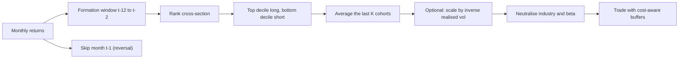

# Momentum, Mean Reversion and Carry

## TL;DR

- Cross-sectional momentum buys the past 12-month winners and shorts the losers relative to each other, skipping the most recent month because one-month returns reverse; Jegadeesh and Titman (1993) hold overlapping cohorts for $K$ months to cut turnover.
- Time-series momentum (Moskowitz, Ooi and Pedersen 2012) goes long or short each instrument on the sign of its own 12-month excess return, with positions scaled to a constant ex-ante volatility, and diversifies across asset classes.
- Short-term reversal (Jegadeesh 1990, Lehmann 1990) is the mirror image at one month or less: high gross alpha, very high turnover, so it lives or dies on costs.
- Carry is the return you earn if prices do not move, $C = (S - F)/F$ for a futures position (Koijen, Moskowitz, Pedersen and Vrugt 2018): rate differentials in FX, dividend yield minus rates in equities, roll yield in commodities, yield over funding plus roll-down in bonds.
- Momentum crashes in sharp rebounds after bear markets, when the loser leg is high beta (Daniel and Moskowitz 2016); carry crashes in risk-off unwinds and has negative skew (Brunnermeier, Nagel and Pedersen 2008); both are priced risk premia as much as anomalies.

## Learning objectives

- Explain time-series and cross-sectional momentum and short-term reversal.
- Explain carry across asset classes and its crash risk.
- Know the evidence for and against each anomaly.
- Construct each strategy precisely: formation and skip windows, overlapping holdings, volatility scaling, and carry definitions per asset class.

## Core concepts

### Cross-sectional momentum

Jegadeesh and Titman (1993) sort US stocks on their past $J$-month return, buy the top decile and short the bottom decile, and hold for $K$ months, with $J, K \in \{3, 6, 9, 12\}$.
Over 1965 to 1989 the strategies earned roughly 1% a month.
Construction details that matter:

- **Formation and skip.** The standard academic signal (Carhart 1997, the UMD factor) is the return from month $t-12$ to $t-2$, the "12-1" signal; month $t-1$ is skipped because the most recent month's return reverses.
- **Overlapping cohorts.** With $K > 1$, each month you hold the average of the portfolios formed in the last $K$ months, so only $1/K$ of the book is re-formed each month; this cuts turnover roughly in proportion and smooths the return.
- **Weighting and universe.** Equal-weighted deciles are dominated by small, illiquid names; value weighting, excluding microcaps, and industry or factor neutralisation change the numbers materially.
- **Risk scaling.** Barroso and Santa-Clara (2015) scale the momentum portfolio by the inverse of its recent realised volatility and report a large reduction in crash risk.

Explanations split into behavioural (underreaction to news, then overreaction) and risk-based stories; the evidence is broad: Asness, Moskowitz and Pedersen (2013) find momentum in individual stocks in several countries, country indices, bonds, currencies and commodities, negatively correlated with value everywhere.

### Momentum crashes

The long-short portfolio's beta is time-varying: after a bear market the losers are the stocks that fell most with the market, so they are high beta, and the winners are low beta.
WML then carries a negative market beta, and a sharp market rebound produces a large loss.
Daniel and Moskowitz (2016) show momentum's worst months cluster in such "panic states", after market declines and in high volatility, when markets rebound, and propose a dynamic strategy that scales exposure by forecast mean and variance.
The arithmetic is simple: with winners at beta 0.6 and losers at 1.6, WML has beta $-1.0$, and a $+20\%$ rebound costs about 20% from beta alone.

### Time-series momentum

Moskowitz, Ooi and Pedersen (2012) study 58 liquid futures and forwards (equity indices, bonds, currencies, commodities).
For each instrument $s$:

$$
r^{\text{TSMOM}}_{t,t+1} = \text{sign}\big(r^s_{t-12,t}\big)\,\frac{40\%}{\sigma^s_t}\,r^s_{t,t+1},
$$

where $r^s_{t-12,t}$ is the past 12-month excess return and $\sigma^s_t$ an ex-ante annualised volatility from an exponentially weighted moving average of squared daily returns with center of mass 60 days, $\delta/(1-\delta) = 60$.
The 40% target makes each instrument's position comparable; the diversified portfolio averages the instruments.
They find significant predictability from the past 12 months, partial reversal at longer horizons, and the best TSMOM returns in extreme up and extreme down markets, a "smile" that makes trend following resemble a long straddle on the market.
Difference from cross-sectional momentum: TSMOM can be net long or net short everything at once; cross-sectional momentum is a relative bet and is dollar neutral by construction.

Practical systematic trend following uses several lookbacks (for example EWMA crossovers), continuous rather than sign signals, volatility targeting at the portfolio level, and cost-aware position buffering (Carver, *Systematic Trading*).

### Short-term reversal

Stocks with the worst returns over the past week or month tend to outperform over the next one (Jegadeesh 1990, Lehmann 1990).
The usual reading is liquidity provision: you are paid for absorbing price pressure from liquidity-driven trades.
The trade is fast, so turnover is close to the maximum and the alpha is concentrated in small, illiquid, high-volatility names where costs are highest; residual reversal (reversal of returns after removing industry and factor moves) is the version practitioners usually run.
Statistical arbitrage generalises it ([Statistical Arbitrage and Pairs Trading](06-Statistical-Arbitrage-and-Pairs-Trading.md)).

### Carry

Koijen, Moskowitz, Pedersen and Vrugt (2018) define carry as the futures return when the spot price stays the same.
For a fully collateralised futures position with spot $S_t$ and futures price $F_t$,

$$
C_t = \frac{S_t - F_t}{F_t},
$$

and the return decomposes as carry plus expected price change plus surprise.

| Asset | Carry of a long position | Intuition |
| :--- | :--- | :--- |
| FX (long investment currency) | $(1 + r^*)/(1 + r) - 1 \approx r^* - r$ | interest differential, from covered interest parity |
| Equity index | $\approx d - r$ | dividend yield minus the financing rate |
| Commodity | $(F_{\text{near}} - F_{\text{far}})/F_{\text{far}}$, annualised | roll yield; positive in backwardation |
| Government bond | $\approx (y - r_{\text{repo}}) + \text{roll-down}$ | yield over funding plus price gain as the bond rolls down the curve |

They find carry predicts returns within every asset class they study and that a diversified carry strategy has a high Sharpe ratio, but with large losses in global recessions and liquidity crises.
Currency carry in particular has negatively skewed returns: high-interest currencies "go up by the stairs and down by the elevator" when carry trades unwind (Brunnermeier, Nagel and Pedersen 2008).
Fixed-income carry and roll-down are developed further in [Forwards, Futures and Carry](../05-Derivatives-and-Volatility/01-Forwards-Futures-and-Carry.md) and [FX Markets and Interest Rate Parity](../06-Fixed-Income-and-Asset-Classes/07-FX-Markets-and-Interest-Rate-Parity.md).

### Evidence for and against

- For: momentum, carry and trend appear across asset classes and decades, out of sample relative to their original papers.
- Against: anomaly returns shrink after publication; McLean and Pontiff (2016) find portfolio returns of published predictors about 26% lower out of sample and about 58% lower post-publication.
- Crashes: both momentum and carry have fat left tails, so short samples overstate their Sharpe and volatility-based risk models understate their risk.
- Costs: momentum and especially reversal are turnover-heavy; equal-weight academic returns are not what a capacity-constrained book earns ([Transaction Costs and Turnover](13-Transaction-Costs-and-Turnover.md)).

## Worked examples

All numbers come from [momentum_carry.py](code/momentum_carry.py).
The stock simulation has 500 names over 600 months: returns are $\beta_i m_t + \mu_{it} + \ell_{it} - 0.3\,\ell_{i,t-1} + \varepsilon_{it}$, with a persistent expected-return component $\mu$ (AR(1) coefficient 0.95, standard deviation 0.6% a month), liquidity shocks $\ell$ (3% a month) that partly reverse next month, betas with standard deviation 0.5 and idiosyncratic noise of 8% a month.

### 1. Why skip the last month

| Strategy (equal-weight deciles) | Mean per month | Sharpe |
| :--- | ---: | ---: |
| WML on 12-1 return, hold 1 month | 0.38% | 0.51 |
| WML on 12-0 return, hold 1 month | 0.15% | 0.20 |
| WML on 12-1, $K = 6$ overlapping cohorts | 0.38% | 0.58 |

Including month $t-1$ loads the signal on the liquidity shock that will reverse, and gives back $0.23$ of the $0.38$ points a month.

### 2. Turnover and break-even cost

Traded value per month as a multiple of gross exposure, and the one-way cost per unit traded that would wipe out the mean return:

| Strategy | Traded / gross per month | Break-even cost |
| :--- | ---: | ---: |
| Momentum, $K = 1$ | 0.604 | 31.4 bp |
| Momentum, $K = 6$ | 0.231 | 83.2 bp |
| One-month reversal | 1.815 | 21.3 bp |

The reversal strategy earns 0.77% a month with Sharpe 1.10 gross, higher than momentum, but turns over almost the whole book every month, so its break-even cost is the lowest.
Overlapping cohorts raise momentum's cost tolerance by a factor of $83.2/31.4 = 2.65$ at no loss of mean return.

### 3. The crash mechanism

- In the 124 months that follow a 12-month market decline worse than $-10\%$, the WML portfolio's ex-ante beta averages $-0.51$, against $+0.15$ otherwise.
- In those bear-state months when the market then rises more than 5%, WML loses about 5.04% on average.
- Back-of-envelope: winners at beta 0.6 and losers at 1.6 give WML beta $-1.0$, so a $+20\%$ rebound costs 20.0% from beta alone.

The fix is to hedge the conditional beta, scale down after high-volatility bear markets, or both.

### 4. Time-series momentum with volatility scaling

24 synthetic futures in four asset classes with annual volatilities of 15%, 6%, 10% and 25%, a persistent trend component, 30 years of daily data.

- EWMA with center of mass 60 days: $\delta = 60/61 = 0.98361$, half-life $\ln 0.5/\ln\delta = 41.9$ days.
- After scaling to 40% ex-ante volatility, realised volatility per instrument averages 0.413 and ranges from 0.359 to 0.440, regardless of the instrument's raw volatility.
- Average single-instrument Sharpe: about 0.24; the equal-weight portfolio: about 1.18 with volatility about 8.4% a year.
- The instrument strategies are nearly uncorrelated (average pairwise correlation about 0.000), so the diversification multiplier $\sqrt{N/(1 + (N-1)\rho)}$ is 4.91, and $0.24\times4.91 \approx 1.18$.

Without volatility scaling the high-volatility commodities would dominate the risk and the diversification would mostly disappear.

### 5. Carry in four asset classes

- FX: investment-currency rate 5%, funding rate 1%, one-year forward by CIP: $(S - F)/F = 1.05/1.01 - 1 = 3.96\%$.
- Equity index: $S = 5000$, $r = 4\%$, dividend yield 1.5%, $F = 5000(1 + 0.04 - 0.015) = 5125$; carry $= -125/5125 = -2.44\%$, roughly $d - r$.
- Commodity: nearby future 80, contract one year later 76; a long deferred position earns $4/76 = 5.26\%$ if the curve does not move.
- Bond: a 10-year 4% annual-coupon bond at par, 9-year yield 3.8%, repo 3%; if the curve is unchanged the bond is worth 101.50 in a year, so the return over funding is 2.50%: 1.00% of coupon minus repo and 1.50% of roll-down.

### 6. What crash risk does to a Sharpe ratio

A carry-like monthly stream: 0.7% mean and 2% volatility in normal months, a $-10\%$ crash with probability 2% a month, 600 months.

- 15 crash months; the annualised Sharpe is about 0.57, versus about 1.22 excluding the crash months.
- Skewness about $-1.71$, kurtosis about 9.44, worst month about $-13.4\%$.

A 10-year sample with no crash in it would report roughly the second Sharpe; the probabilistic Sharpe ratio penalises exactly this skew and kurtosis ([Overfitting and Deflated Sharpe](08-Overfitting-and-Deflated-Sharpe.md)).

## Pitfalls

- Forming momentum on the 12-0 return and attributing the drag to "momentum decay" rather than to short-term reversal.
- Reporting equal-weight decile returns from a universe full of microcaps, where costs and borrow make them unattainable.
- Ignoring the time-varying beta of WML: a "market-neutral" momentum book is not neutral after a bear market.
- Running TSMOM without volatility scaling, so one asset class dominates.
- Using look-ahead volatility (the realised volatility of the holding month) to scale positions.
- Treating carry as free money: it is compensation for crash and liquidity risk, and the history used to measure it may not contain the crash.
- Computing commodity carry from the front contract alone, ignoring the roll schedule and seasonality (natural gas, agriculturals).
- Comparing pre-publication backtest returns with what a strategy earns today.

## Interview questions

> [!question]- alpha-mom-jt-construction | Describe the Jegadeesh-Titman momentum strategy.
> Rank stocks on their past $J$-month return, buy the top decile, short the bottom decile, hold for $K$ months, and hold $K$ overlapping cohorts so only $1/K$ of the book is re-formed each month.
> Over 1965 to 1989 the strategies earned roughly 1% a month.

> [!question]- alpha-mom-skip-month | Why does the standard momentum signal skip the most recent month?
> Because one-month returns reverse (short-term reversal), so including month $t-1$ loads the signal on a component that predicts the opposite sign.
> In the note's simulation the 12-0 signal earned 0.15% a month against 0.38% for 12-1.

> [!question]- alpha-mom-overlapping | What do overlapping holding cohorts buy you?
> Lower turnover at the same signal: only $1/K$ of the book changes each month.
> With $K = 6$ the simulated traded/gross fell from 0.604 to 0.231 and the break-even cost rose from 31.4 bp to 83.2 bp.

> [!question]- alpha-mom-crash-mechanism | Why does momentum crash in market rebounds after bear markets?
> After a decline the losers are high-beta stocks and the winners low-beta, so WML has a negative market beta; a sharp rebound then hits it hard.
> Daniel and Moskowitz (2016) show the worst momentum months cluster in such panic states.

> [!question]- alpha-mom-crash-numeric | Winners have beta 0.6, losers 1.6, and the market rallies 20%. What does WML lose from beta alone?
> About 20%.
> WML beta is $0.6 - 1.6 = -1.0$, so $-1.0\times20\% = -20\%$.

> [!question]- alpha-mom-tsmom-definition | Define time-series momentum as in Moskowitz, Ooi and Pedersen (2012).
> For each instrument, position $= \text{sign}(\text{past 12-month excess return})\times40\%/\sigma_t$, held one month, averaged across instruments.
> $\sigma_t$ is an EWMA volatility of daily returns with center of mass 60 days, so every instrument runs at a similar risk.

> [!question]- alpha-mom-ts-vs-cs | How does time-series momentum differ from cross-sectional momentum?
> TSMOM bets on each instrument's own trend and can be net long or short everything; cross-sectional momentum bets on relative performance and is dollar neutral.
> TSMOM therefore carries market direction risk and earns its "smile" in extreme markets.

> [!question]- alpha-mom-com-half-life | An EWMA has center of mass 60 days. What are its decay factor and half-life?
> $\delta = 60/61 = 0.98361$ and half-life $\ln 0.5/\ln\delta = 41.9$ days.
> Center of mass $\delta/(1-\delta)$ is the mean age of the weights; half-life is where the weight halves.

> [!question]- alpha-mom-vol-scaling | Why scale TSMOM positions by inverse volatility?
> So each instrument contributes similar risk; otherwise the most volatile markets dominate and diversification disappears.
> It also cuts exposure when volatility spikes, which tends to reduce drawdowns.

> [!question]- alpha-mom-diversification | 24 nearly uncorrelated trend strategies each have Sharpe 0.24. What is the portfolio Sharpe?
> About 1.18.
> With pairwise correlation $\rho$, Sharpe scales by $\sqrt{N/(1 + (N-1)\rho)}$, which is 4.91 here.

> [!question]- alpha-mom-reversal | What is short-term reversal and why is it hard to harvest?
> Last week's or month's losers outperform the winners next period, usually read as payment for liquidity provision.
> Turnover is near the maximum and the effect is strongest in small illiquid names; in the simulation it earned 0.77% a month gross but broke even at only 21.3 bp per unit traded.

> [!question]- alpha-mom-carry-definition | Define carry for a futures position.
> $C = (S - F)/F$: the return earned if the spot price does not change (Koijen, Moskowitz, Pedersen and Vrugt 2018).
> It equals the interest differential in FX, dividend yield minus rates in equities and roll yield in commodities.

> [!question]- alpha-mom-fx-carry | Investment-currency rate 5%, funding rate 1%. Carry of a one-year long forward?
> About 3.96%.
> By CIP $F = S(1.01)/(1.05)$, so $(S - F)/F = 1.05/1.01 - 1$, approximately the 4% rate differential.

> [!question]- alpha-mom-bond-carry | A 10-year 4% bond at par, 9-year yield 3.8%, repo 3%. One-year carry plus roll-down?
> About 2.50%: 1.00% of coupon over repo plus 1.50% of roll-down.
> If the curve is unchanged the bond reprices as a 9-year at 3.8%, worth 101.50.

> [!question]- alpha-mom-equity-carry | What is the carry of a long equity index future?
> About the dividend yield minus the financing rate.
> With $F = S(1 + r - d)$, $(S - F)/F \approx d - r$; with $r = 4\%$ and $d = 1.5\%$ it is $-2.44\%$.

> [!question]- alpha-mom-carry-crash | Why is carry described as "up the stairs, down the elevator"?
> Carry returns are steady in calm markets and crash when crowded carry trades unwind in risk-off episodes, giving negative skew.
> Brunnermeier, Nagel and Pedersen (2008) link currency crashes to carry-trade unwinds and funding liquidity.

> [!question]- alpha-mom-skew-sharpe | A carry stream shows Sharpe 1.2 over a decade with no crash. Why distrust it?
> Rare crashes may simply be missing from the sample.
> In the note's simulation a 2% monthly crash probability turns a no-crash Sharpe of about 1.22 into about 0.57 with skew about $-1.7$.

> [!question]- alpha-mom-post-publication | What happens to anomaly returns after publication?
> They shrink: McLean and Pontiff (2016) find about 26% lower returns out of sample and about 58% lower post-publication.
> The gap between the two is consistent with investors trading on the published result.

> [!question]- alpha-mom-value-momentum | How do value and momentum relate across asset classes?
> Both appear across stocks, country indices, bonds, currencies and commodities, and they are negatively correlated with each other (Asness, Moskowitz and Pedersen 2013).
> Combining them gives a much higher Sharpe than either alone.

## In this repo and SDE-Interview-Prep

- Code: [momentum_carry.py](code/momentum_carry.py) reproduces every number above.
- Related notes: [Signals, Features and Alpha Decay](03-Signals-Features-and-Alpha-Decay.md), [Cross-Sectional Factor Models](04-Cross-Sectional-Factor-Models.md), [Commodities and Futures Curves](../06-Fixed-Income-and-Asset-Classes/09-Commodities-and-Futures-Curves.md), [Drawdowns and Risk Limits](../11-Risk-and-Trading/05-Drawdowns-and-Risk-Limits.md).
- SDE-Interview-Prep mean-reversion example: [bollinger_bands.py](https://github.com/shreejitverma/SDE-Interview-Prep/blob/main/05-Quantitative-Finance/03-Algo-Trading/Strategies/Mean-Reversion/bollinger_bands.py).

## Further reading

- Jegadeesh and Titman (1993), Returns to Buying Winners and Selling Losers
- Robert Carver, *Systematic Trading*
- Moskowitz, Ooi and Pedersen (2012), Time Series Momentum, Journal of Financial Economics.
- Asness, Moskowitz and Pedersen (2013), Value and Momentum Everywhere, Journal of Finance.
- Daniel and Moskowitz (2016), Momentum Crashes, Journal of Financial Economics.
- Koijen, Moskowitz, Pedersen and Vrugt (2018), Carry, Journal of Financial Economics.
- Brunnermeier, Nagel and Pedersen (2008), Carry Trades and Currency Crashes, NBER Macroeconomics Annual.
- McLean and Pontiff (2016), Does Academic Research Destroy Stock Return Predictability?, Journal of Finance.
