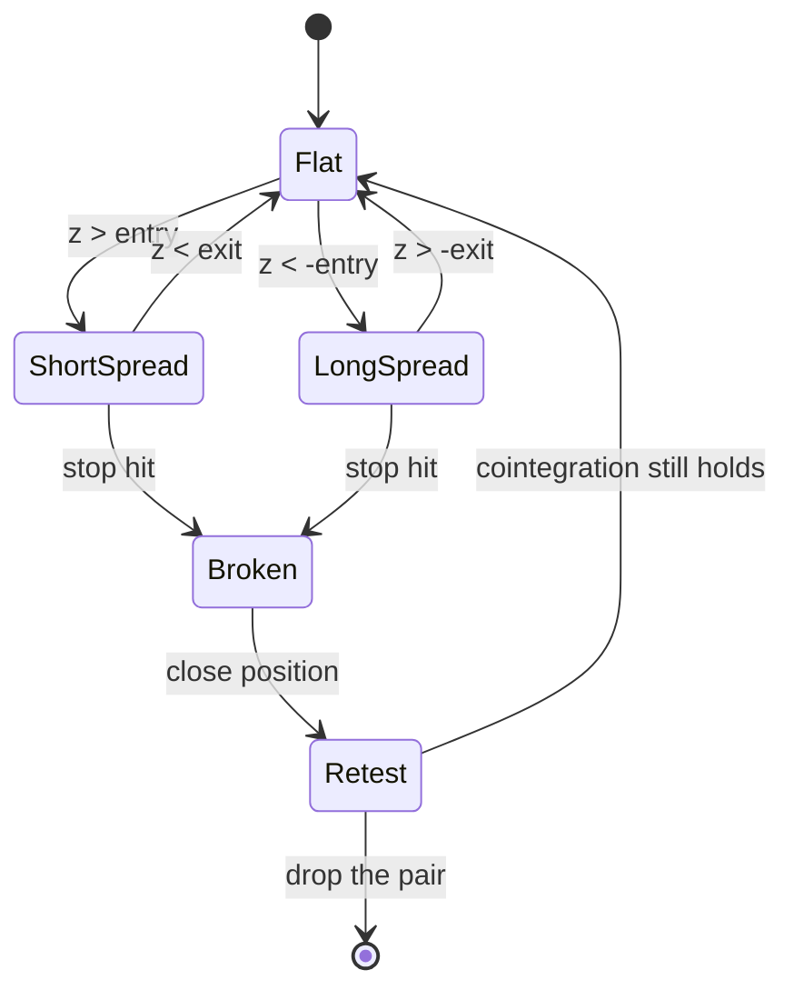

# Statistical Arbitrage and Pairs Trading

## TL;DR

- A pair is tradable when a linear combination of log prices, the spread $s_t = \log A_t - \beta\log B_t$, is stationary (cointegration), not when the prices are merely correlated; regressing one random walk on another gives "significant" slopes about 90% of the time.
- Engle-Granger: estimate $\beta$ by OLS, then test the residual for a unit root with critical values that are more negative than plain Dickey-Fuller (about $-3.36$ versus $-2.87$ at 5% for $T = 500$); Johansen tests the rank of a VECM and handles more than two assets symmetrically.
- Model the spread as an Ornstein-Uhlenbeck process fitted by AR(1): $b = e^{-\kappa\Delta t}$, half-life $\ln 2/\kappa$, equilibrium standard deviation $\sigma_{\text{eq}} = \sigma_\varepsilon/\sqrt{1-b^2}$; trade the z-score $(s - \mu)/\sigma_{\text{eq}}$ between entry and exit bands.
- Wider entry bands earn more per round trip but trade less often; with costs, the best band is where marginal frequency loss equals marginal profit gain.
- Avellaneda-Lee (2010) scale the idea to the whole market: regress each stock on PCA or sector-ETF factors, model the cumulative residual as OU, and trade its s-score with open at $|s| > 1.25$, close shorts at $s < 0.75$ and longs at $s > -0.50$.

## Learning objectives

- Select pairs by distance, cointegration and fundamentals.
- Model the spread as an OU process and set entry and exit thresholds.
- Scale to residual (PCA or factor) statistical arbitrage.
- Know the statistical traps: spurious regression, Engle-Granger critical values, hedge-ratio asymmetry and noisy half-lives.

## Core concepts

### Correlation is not cointegration

Two price series can have highly correlated returns and still drift apart forever; two others can have modest return correlation and a spread that always comes back.
What a pairs trade needs is a stationary spread.
Regressing one independent random walk on another produces large $R^2$ and large naive $t$-stats (the spurious regression of Granger and Newbold), because the residual is itself a random walk and the OLS standard errors assume it is not.
Cointegration theory is developed in [Cointegration and VAR](../02-Statistics-and-Econometrics/10-Cointegration-and-VAR.md) and stationarity tests in [Time-Series Stationarity and ARMA](../02-Statistics-and-Econometrics/08-Time-Series-Stationarity-and-ARMA.md).

### Pair selection

| Method | Rule | Strength | Weakness |
| :--- | :--- | :--- | :--- |
| Distance (Gatev, Goetzmann and Rouwenhorst 2006) | normalise prices to 1, pick pairs with the smallest sum of squared deviations over a 12-month formation period | model-free, simple, robust | implicit hedge ratio of 1, no stationarity test |
| Cointegration | Engle-Granger or Johansen test on log prices | explicit hedge ratio and stationarity evidence | multiple testing across thousands of candidate pairs |
| Fundamental | same industry, same business, share classes, ADR and local line, parent and subsidiary | economic reason for the link to persist | fewer candidates; the link can still break (mergers, divergence) |

Gatev, Goetzmann and Rouwenhorst trade the selected pairs for the following 6 months, opening when the normalised prices diverge by two historical standard deviations and closing when they cross, and report annualised excess returns of up to about 11% for portfolios of top pairs over 1962 to 2002.
In practice the three methods are combined: a fundamental prefilter, a statistical test, and a stability check across subperiods, because testing every pair among $N$ stocks is $N(N-1)/2$ hypotheses (780 for 40 stocks, about 125,000 for 500).

### Engle-Granger

1. Estimate $\log A_t = \alpha + \beta\log B_t + s_t$ by OLS.
2. Run the Dickey-Fuller regression $\Delta\hat s_t = \gamma\hat s_{t-1} + u_t$ (with lagged differences added for the augmented version) and compute the $t$-stat of $\gamma$.
3. Compare it with Engle-Granger critical values, not Dickey-Fuller ones: OLS picks the $\beta$ that makes the residual look as stationary as possible, so the null distribution is shifted left.
   MacKinnon's response-surface tables give about $-3.34$ asymptotically at 5% for two variables with a constant; the plain Dickey-Fuller value is about $-2.86$.

Caveats: the result depends on which variable is on the left, since $\hat\beta_{A|B}\hat\beta_{B|A} = R^2$, so $1/\hat\beta_{B|A} \ne \hat\beta_{A|B}$ unless the fit is perfect; total least squares or Johansen remove the asymmetry.
OLS $\hat\beta$ is superconsistent under cointegration, but in finite samples with a slowly reverting spread it is noticeably biased.

### Johansen

Johansen (1991) writes the vector of log prices as a VECM,

$$
\Delta y_t = \Pi y_{t-1} + \sum_{i=1}^{p-1}\Gamma_i\Delta y_{t-i} + \varepsilon_t, \qquad \Pi = \alpha\beta^\top,
$$

where the rank $r$ of $\Pi$ is the number of cointegrating vectors (columns of $\beta$) and $\alpha$ holds the speeds at which each asset corrects.
The eigenvalues of a reduced-rank regression give the trace test (null: rank at most $r$) and the maximum-eigenvalue test (null: rank $r$ against $r+1$).
It treats all assets symmetrically, finds several cointegrating vectors at once (baskets, curve trades), and estimates hedge ratios jointly; it needs more data and is sensitive to the lag length and deterministic-trend specification.

### The spread as an Ornstein-Uhlenbeck process

$$
ds_t = \kappa(\mu - s_t)\,dt + \sigma\,dW_t .
$$

Sampled every $\Delta t$ it is exactly an AR(1):

$$
s_{t+\Delta t} = a + b\,s_t + \varepsilon_t, \qquad b = e^{-\kappa\Delta t},\ a = \mu(1 - b),\ \text{Var}(\varepsilon) = \frac{\sigma^2}{2\kappa}(1 - b^2).
$$

So fit the AR(1) by OLS and read off

$$
\kappa = -\frac{\ln b}{\Delta t}, \qquad \mu = \frac{a}{1 - b}, \qquad \sigma_{\text{eq}} = \sqrt{\frac{\text{Var}(\varepsilon)}{1 - b^2}} = \frac{\sigma}{\sqrt{2\kappa}}, \qquad \text{half-life} = \frac{\ln 2}{\kappa}.
$$

The half-life sets the holding period and should be short relative to the estimation window, or a few unlucky years of drift dominate the fit.
The OU background is in [Stochastic Differential Equations](../04-Stochastic-Calculus/03-Stochastic-Differential-Equations.md).

### Entry, exit and stops

Trade the z-score $z_t = (s_t - \mu)/\sigma_{\text{eq}}$:

- Enter short the spread when $z > z_{\text{in}}$, long when $z < -z_{\text{in}}$.
- Exit when $z$ returns to $\pm z_{\text{out}}$ (often 0 or 0.5).
- Stop out if $|z|$ exceeds a stop level or the position is held much longer than a few half-lives: both are evidence the relationship has broken, and averaging down into a broken pair is how pairs books blow up.

Profit per round trip is roughly $(z_{\text{in}} - z_{\text{out}})\sigma_{\text{eq}}$ minus costs (more, in practice, because the spread overshoots the band between observations), while the number of round trips per year falls quickly as $z_{\text{in}}$ rises.
The position is "long 1 dollar of A, short $\beta$ dollars of B" in log-spread units; dollar neutrality and beta neutrality are different choices and should be stated.

### Residual statistical arbitrage (Avellaneda and Lee 2010)

Pairs do not scale; residuals do.
Avellaneda and Lee model each stock's return as factor returns plus an idiosyncratic part whose cumulative sum is OU:

$$
\frac{dS_i}{S_i} = \alpha_i\,dt + \sum_j\beta_{ij}F_j + dX_i, \qquad dX_i = \kappa_i(m_i - X_i)\,dt + \sigma_i\,dW_i .
$$

Their procedure, as implemented in this note's script:

1. Factors: eigenportfolios from PCA of the stocks' correlation matrix over the past 252 days (weights $v_j/\sigma_i$), or sector ETFs.
2. Each day, regress each stock's last 60 daily returns on the factor returns; cumulate the residuals to get $X_k$.
3. Fit $X_{k+1} = a + bX_k + \zeta$; $\kappa = -252\ln b$, $m = a/(1-b)$, $\sigma_{\text{eq}} = \sqrt{\text{Var}(\zeta)/(1-b^2)}$.
4. Keep only fast reverters, $\kappa > 252/30 = 8.4$ (mean-reversion time under 30 days, half the window).
5. s-score $s = (X - m)/\sigma_{\text{eq}}$; open long at $s < -1.25$, open short at $s > 1.25$, close shorts at $s < 0.75$, close longs at $s > -0.50$.
6. Hold each stock against its factor hedge, so the book is factor neutral by construction.

This is short-term residual reversal ([Momentum, Mean Reversion and Carry](05-Momentum-Mean-Reversion-and-Carry.md)) with a model for when to trade.
Its risk is crowding: in August 2007 many quantitative equity funds running similar books suffered sharp simultaneous losses as positions were unwound, which Khandani and Lo (2011) analyse with a simple contrarian strategy.

## Worked examples

All numbers come from [pairs_stat_arb.py](code/pairs_stat_arb.py).

### 1. Spurious regression and the right critical values

4,000 pairs of independent random walks of length 500:

- The naive OLS slope has $|t| > 1.96$ in 89.5% of cases and the mean $R^2$ is 0.241: correlation of levels means nothing.
- Simulated 5% and 1% critical values of the Engle-Granger residual Dickey-Fuller $t$-stat: $-3.36$ and $-3.93$; the plain (demeaned) Dickey-Fuller 5% value is $-2.87$.

Using $-2.87$ for a residual-based test rejects "no cointegration" far too often.

### 2. Fitting a cointegrated pair

Simulated: $\log B$ a random walk with 1.5% daily volatility, $\log A = 0.2 + 1.3\log B + s$, $s$ an AR(1) with $b = 0.95$ and innovation volatility 0.5%; 1,000 days to fit.

- Hedge ratio $A$ on $B$: 1.305; the inverse of $B$ on $A$: 1.308, because the product of the two slopes is $R^2 = 0.998$, not 1.
- ADF $t$-stat of the fitted spread: $-4.78$, well beyond $-3.36$.
- AR(1): $\hat b = 0.9545$, so the estimated half-life is 14.89 days against a true 13.51 ($\ln 2/(-\ln 0.95)$); $\hat\kappa = 11.7$ per year.
- Equilibrium standard deviation: estimated 0.0167 against a true $0.005/\sqrt{1 - 0.95^2} = 0.0160$.

Even with 1,000 days the half-life is off by 10%; with a year of data expect much worse, so treat it as an order of magnitude.

### 3. Choosing the entry band

Out of sample on 25,000 further days, exit at $z = 0$, cost 10 bp per unit of spread traded:

| Entry $z$ | Round trips per year | Gross PnL per round trip ($\sigma_{\text{eq}}$) | Gross per year (log units) | Net per year (log units) | Days in a position |
| ---: | ---: | ---: | ---: | ---: | ---: |
| 1.0 | 5.0 | 1.36 | 0.113 | 0.103 | 66.8% |
| 1.5 | 2.8 | 1.85 | 0.087 | 0.081 | 48.3% |
| 2.0 | 1.5 | 2.33 | 0.057 | 0.054 | 30.9% |
| 2.5 | 0.7 | 2.82 | 0.034 | 0.032 | 16.5% |

Profit per round trip exceeds $z_{\text{in}} - z_{\text{out}}$ because daily observations overshoot the bands.
With this cheap cost and a well-specified spread, the tightest band earns the most per year; the classic "enter at 2" rule is about protecting against model error and costs, not about maximising PnL on a true OU process.

### 4. Distance method

40 stocks sharing a market factor, with 5 planted pairs whose gap is an AR(1); 252-day formation, 126-day trading.

- There are 780 candidate pairs; the 5 smallest sums of squared deviations are exactly the 5 planted pairs.
- Trading them at 2 formation standard deviations with exit at the crossing earns 0.446 in normalised price units over the trading period.

### 5. Avellaneda-Lee on a simulated market

100 stocks, 3 factors, residual OU components with mean-reversion times of 5 to 40 days plus non-reverting idiosyncratic noise of 1.2% a day, 1,500 days.

- About 35.2 positions open on average and about 3.56 new positions a day.
- Gross Sharpe about 3.12; net of 10 bp per position change about 1.81.
- The $\kappa$ filter passes about 99.4% of stocks, and a control shows why: cumulative residuals of a regression with an intercept are pinned to zero at both ends of the 60-day window, so even pure noise passes the filter 99.0% of the time.

The filter is therefore weak on its own; a longer window, out-of-window validation of $\kappa$ or a minimum $R^2$ for the AR(1) fit is needed to separate real reverters from artefacts.

## Pitfalls

- Selecting pairs on return correlation or price-level $R^2$.
- Using Dickey-Fuller critical values for an Engle-Granger residual test, and testing thousands of pairs without a multiple-testing correction.
- Estimating $\beta$, $\mu$ and $\sigma_{\text{eq}}$ on the same window you then trade (look-ahead in the bands).
- Trusting a half-life estimated from a few hundred observations to better than a factor of two.
- No stop: a pair that has stopped cointegrating looks exactly like a great entry signal.
- Ignoring borrow costs, short availability and recall risk on the short leg.
- Assuming the hedge is static: hedge ratios drift with business mix, index events and corporate actions; re-estimate on a rolling window or with a Kalman filter ([State-Space Models and Kalman Filter](../02-Statistics-and-Econometrics/11-State-Space-Models-and-Kalman-Filter.md)).
- Crowding: residual-reversal books at different firms hold similar positions and suffer together when one unwinds.

## Interview questions

> [!question]- alpha-pairs-corr-vs-coint | What is the difference between correlation and cointegration for a pairs trade?
> Correlation is about co-movement of returns; cointegration means a linear combination of price levels is stationary.
> A pairs trade needs the spread to revert, which only cointegration delivers; highly correlated stocks can drift apart indefinitely.

> [!question]- alpha-pairs-spurious | What happens if you regress one independent random walk on another and use the OLS $t$-stat?
> You find a "significant" slope most of the time; in the note's simulation $|t| > 1.96$ in 89.5% of cases with mean $R^2$ 0.24.
> The residual is non-stationary, so OLS standard errors are invalid (spurious regression).

> [!question]- alpha-pairs-eg-steps | Describe the Engle-Granger test.
> Regress $\log A$ on $\log B$ by OLS, then run a (augmented) Dickey-Fuller test on the residual.
> Use Engle-Granger critical values (about $-3.34$ at 5% asymptotically for two variables), not Dickey-Fuller ones.

> [!question]- alpha-pairs-eg-critical | Why are Engle-Granger critical values more negative than Dickey-Fuller ones?
> OLS chooses $\beta$ to minimise residual variance, which makes the residual look as stationary as possible even under the null.
> The test must correct for that search; simulated 5% values at $T = 500$ are $-3.36$ versus $-2.87$.

> [!question]- alpha-pairs-asymmetry | Regress $A$ on $B$ and $B$ on $A$. Are the hedge ratios reciprocal?
> No: $\hat\beta_{A|B}\hat\beta_{B|A} = R^2$, so $1/\hat\beta_{B|A} = \hat\beta_{A|B}/R^2$.
> They agree only when the fit is perfect; total least squares or Johansen give a symmetric answer.

> [!question]- alpha-pairs-johansen | When would you use Johansen instead of Engle-Granger?
> With more than two assets, when several cointegrating vectors may exist, or when you want a test that does not depend on which asset is the dependent variable.
> It estimates the rank of $\Pi$ in a VECM with trace and maximum-eigenvalue tests.

> [!question]- alpha-pairs-ou-ar1 | How do you get OU parameters from an AR(1) fit $s_{t+1} = a + bs_t + \varepsilon$?
> $\kappa = -\ln b/\Delta t$, $\mu = a/(1-b)$, $\sigma_{\text{eq}} = \sqrt{\text{Var}(\varepsilon)/(1-b^2)}$, half-life $\ln 2/\kappa$.
> The exact discretisation of the OU SDE is an AR(1) with $b = e^{-\kappa\Delta t}$.

> [!question]- alpha-pairs-half-life-numeric | A daily spread has AR(1) coefficient 0.95. Half-life?
> About 13.5 days.
> $\ln 2/(-\ln 0.95) = 0.693/0.0513 = 13.51$.

> [!question]- alpha-pairs-sigma-eq | Daily AR(1) coefficient 0.95 and innovation volatility 0.5%. Equilibrium standard deviation of the spread?
> About 1.60%.
> $0.005/\sqrt{1 - 0.95^2} = 0.005/0.312 = 0.0160$.

> [!question]- alpha-pairs-band-tradeoff | What is the trade-off in choosing the entry threshold?
> Wider bands earn more per round trip (about $z_{\text{in}} - z_{\text{out}}$ in $\sigma_{\text{eq}}$) but trade much less often.
> In the note's OU simulation, moving entry from 1.0 to 2.5 raised gross per trade from 1.36 to 2.82 $\sigma_{\text{eq}}$ but cut round trips from 5.0 to 0.7 a year.

> [!question]- alpha-pairs-stop | Why does a pairs strategy need a stop-loss or a time stop?
> Because a broken relationship looks exactly like an extreme entry signal, and the mean-reversion strategy will add to it.
> Exit when $|z|$ passes a stop level or the trade has lasted several half-lives, then retest the pair.

> [!question]- alpha-pairs-ggr | Describe the Gatev-Goetzmann-Rouwenhorst distance method.
> Normalise prices to 1 over a 12-month formation period, pick pairs with the smallest sum of squared deviations, trade them for 6 months, opening at a 2-standard-deviation divergence and closing when prices cross.
> They report annualised excess returns of up to about 11% for top-pair portfolios over 1962 to 2002.

> [!question]- alpha-pairs-multiple-testing | Why is testing every pair in a 500-stock universe for cointegration dangerous?
> It is about 125,000 tests, so at a 5% level thousands of pairs pass by chance.
> Use fundamental prefilters, multiple-testing control and out-of-sample stability checks.

> [!question]- alpha-pairs-al-procedure | Summarise the Avellaneda-Lee residual stat arb procedure.
> Regress each stock's last 60 daily returns on PCA or ETF factors, cumulate the residuals, fit an AR(1) to get $\kappa$, $m$ and $\sigma_{\text{eq}}$, and trade the s-score $(X - m)/\sigma_{\text{eq}}$ against the factor hedge.
> Open at $|s| > 1.25$, close shorts at $s < 0.75$ and longs at $s > -0.50$, only for stocks with $\kappa > 252/30$.

> [!question]- alpha-pairs-al-kappa | What does the Avellaneda-Lee condition $\kappa > 252/30$ mean, and what is its weakness?
> Mean-reversion time under 30 trading days, half the 60-day estimation window.
> Cumulative residuals of an intercept regression are pinned to zero at both window ends, so in the note's control 99% of pure-noise series pass it.

> [!question]- alpha-pairs-hedge-units | You are long the spread $\log A - 1.3\log B$. What positions do you hold?
> Long 1 dollar of A and short 1.3 dollars of B per unit of spread.
> Log-spread changes are then (approximately) the PnL per dollar of A; state whether the book is dollar or beta neutral.

> [!question]- alpha-pairs-crowding | What was the August 2007 quant event and what does it teach a stat arb researcher?
> Many quantitative equity funds holding similar long-short books suffered sharp simultaneous losses as positions were rapidly unwound (Khandani and Lo 2011).
> Crowding is a risk factor: stress-test the book for a correlated deleveraging, not only for idiosyncratic spread blowouts.

> [!question]- alpha-pairs-half-life-noise | You estimate a 15-day half-life from 1,000 daily observations. How much do you trust it?
> Only roughly: in the note's simulation with a true half-life of 13.5 days, 1,000 days gave 14.9.
> With shorter samples the error is larger and AR coefficients near 1 are biased; use it to size holding periods, not as a precise parameter.

## In this repo and SDE-Interview-Prep

- Code: [pairs_stat_arb.py](code/pairs_stat_arb.py) reproduces every number above; [pairs_trading_stat_arb.ipynb](code/pairs_trading_stat_arb.ipynb) is an exploratory notebook.
- Related notes: [Cointegration and VAR](../02-Statistics-and-Econometrics/10-Cointegration-and-VAR.md), [Cross-Sectional Factor Models](04-Cross-Sectional-Factor-Models.md), [Transaction Costs and Turnover](13-Transaction-Costs-and-Turnover.md).
- SDE-Interview-Prep mean-reversion example: [bollinger_bands.py](https://github.com/shreejitverma/SDE-Interview-Prep/blob/main/05-Quantitative-Finance/03-Algo-Trading/Strategies/Mean-Reversion/bollinger_bands.py).

## Further reading

- Gatev, Goetzmann and Rouwenhorst (2006), Pairs Trading: Performance of a Relative-Value Arbitrage Rule
- Ernest Chan, *Algorithmic Trading: Winning Strategies and Their Rationale*
- Engle and Granger (1987), Co-integration and Error Correction, Econometrica.
- Johansen (1991), Estimation and Hypothesis Testing of Cointegration Vectors in Gaussian Vector Autoregressive Models, Econometrica.
- MacKinnon (2010), Critical Values for Cointegration Tests, Queen's Economics Department Working Paper.
- Avellaneda and Lee (2010), Statistical Arbitrage in the US Equities Market, Quantitative Finance.
- Khandani and Lo (2011), What Happened to the Quants in August 2007?, Journal of Financial Markets.
