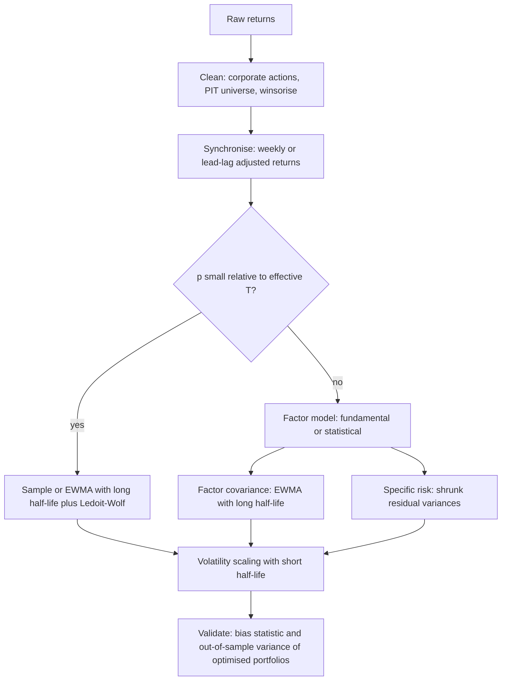

# Covariance Estimation and Shrinkage

## TL;DR

- With $p$ assets and $T$ observations the sample covariance has $p(p+1)/2$ parameters and is singular once $p \ge T$; even for pure noise its eigenvalues spread over the Marchenko-Pastur interval $[(1-\sqrt q)^2, (1+\sqrt q)^2]$ with $q = p/T$, and the optimiser bets on the spuriously small ones.
- The plug-in minimum-variance portfolio looks about $1-q$ times as risky as the true optimum in sample and is about $1/(1-q)$ times as risky out of sample: at $q = 0.4$, 0.60 and 1.68 in simulation.
- Ledoit-Wolf shrinkage $\hat\Sigma = \delta F + (1-\delta)S$ picks $\delta$ to minimise expected Frobenius loss; the optimal intensity is $\big[\sum\text{Var}(s_{ij}) - \text{Cov}(f_{ij}, s_{ij})\big]/\sum E(f_{ij}-s_{ij})^2$, which decays like $1/T$ and has closed-form estimators for the scaled-identity and constant-correlation targets.
- Factor models $\Sigma = BFB^\top + D$ cut the parameter count from 5,050 to 1,155 at $p = 100$, $k = 10$, and in the simulated factor market they beat every shrinkage estimator out of sample; eigenvalue clipping at the Marchenko-Pastur edge is a data-driven version of the same idea.
- EWMA with decay $\lambda$ has half-life $\ln 0.5/\ln\lambda$ and effective sample size $(1+\lambda)/(1-\lambda)$: RiskMetrics' 0.94 is an 11.2-day half-life and only about 32 effective observations, so it is a volatility estimator, not a correlation estimator for a large book.

## Learning objectives

- Apply Ledoit-Wolf shrinkage and factor-model covariances.
- Choose estimation windows and half-lives.
- Explain sample covariance noise with the Marchenko-Pastur law and clean a correlation matrix by eigenvalue clipping.
- Derive the optimal linear shrinkage intensity and implement it for the identity and constant-correlation targets.
- Compare estimators by the out-of-sample variance of the portfolios they produce, not by in-sample fit.

## Core concepts

### Why the sample covariance is the wrong input

For returns $x_t \in \mathbb R^p$, $t = 1, \dots, T$, the sample covariance $S = \frac1T\sum_t (x_t - \bar x)(x_t - \bar x)^\top$ is unbiased (up to the $T$ versus $T-1$ divisor) entry by entry, but a portfolio optimiser does not use entries; it uses $S^{-1}$.
Three facts make $S^{-1}$ bad:

- **Too many parameters.** $p(p+1)/2$ entries from $pT$ numbers; for $p = 3000$ stocks that is 4,501,500 parameters.
- **Rank.** $S$ has rank at most $T-1$, so for $p \ge T$ it is singular and the unconstrained minimum-variance portfolio does not exist.
- **Eigenvalue spreading.** Sample eigenvalues are more dispersed than the true ones: the largest are biased up, the smallest biased down.
  The optimiser loves the small ones, because $\Sigma^{-1} = \sum_k d_k^{-1}v_kv_k^\top$, so the noise is amplified exactly where it does the most damage ([Mean-Variance Portfolio Construction](10-Mean-Variance-Portfolio-Construction.md)).

**Marchenko-Pastur.** If the true covariance is $\sigma^2 I$ and $p, T \to \infty$ with $p/T \to q \in (0, 1]$, the empirical distribution of the eigenvalues of $S$ converges to the Marchenko-Pastur law with support

$$
\lambda_\pm = \sigma^2\big(1 \pm \sqrt q\big)^2 .
$$

At $q = 0.4$ the edges are 0.135 and 2.665 although every true eigenvalue is 1, and the condition number of a single draw with $p = 100$, $T = 250$ is about 20 instead of 1.
Eigenvalues of a sample correlation matrix above $\lambda_+$ are candidate signal (market, sectors, styles); those inside the bulk are indistinguishable from noise.
A true factor is only visible if it is strong enough: a spike in the population covariance separates from the bulk only above a threshold (the Baik-Ben Arous-Peche phase transition, at $1 + \sqrt q$ in units of the noise variance), so weak factors are absorbed into the noise.

**What noise does to the minimum-variance portfolio.**
With $w_S = S^{-1}\mathbf 1/(\mathbf 1^\top S^{-1}\mathbf 1)$ and $\sigma^2_{\min}$ the true minimum variance, the large-dimensional approximations are

$$
w_S^\top S\, w_S \approx (1-q)\,\sigma^2_{\min}, \qquad w_S^\top\Sigma\, w_S \approx \frac{\sigma^2_{\min}}{1-q}.
$$

The in-sample risk understates the truth and the realised risk overstates the optimum, so the ratio of realised to predicted variance is about $1/(1-q)^2$: 2.78 at $q = 0.4$, and about 2.80 in the simulation below.
A risk team's bias statistic (realised over predicted volatility of test portfolios, ideally 1) picks this up, and a sample-covariance optimiser fails it systematically.

### Linear shrinkage: the general derivation

Choose a structured target $F$ (few parameters, biased, low variance) and blend:

$$
\hat\Sigma(\delta) = \delta F + (1-\delta)S, \qquad \delta \in [0, 1].
$$

Minimise the expected squared Frobenius loss $\sum_{ij}E\big[(\delta f_{ij} + (1-\delta)s_{ij} - \sigma_{ij})^2\big]$.
Write each term as $E\big[(\delta(f_{ij} - s_{ij}) + (s_{ij} - \sigma_{ij}))^2\big]$ and differentiate in $\delta$:

$$
\delta^* = \frac{\sum_{ij}\big[\text{Var}(s_{ij}) - \text{Cov}(f_{ij}, s_{ij})\big]}{\sum_{ij}E\big[(f_{ij} - s_{ij})^2\big]}.
$$

The numerator is the estimation noise in $S$ (less the part the target shares); the denominator is how far the target is from the sample, which includes the target's misspecification.
Since $\text{Var}(s_{ij}) = O(1/T)$ while the misspecification does not vanish, $\delta^* \approx \kappa/T$ with $\kappa = (\pi - \rho)/\gamma$ in Ledoit and Wolf's notation:

- $\pi = \sum_{ij}\text{AsyVar}(\sqrt T s_{ij})$, estimated by $\hat\pi_{ij} = \frac1T\sum_t\big[(x_{it} - \bar x_i)(x_{jt} - \bar x_j) - s_{ij}\big]^2$.
- $\rho = \sum_{ij}\text{AsyCov}(\sqrt T f_{ij}, \sqrt T s_{ij})$, the part of the noise the target shares.
- $\gamma = \sum_{ij}(\phi_{ij} - \sigma_{ij})^2$, the misspecification of the target's population value, estimated by $\sum_{ij}(f_{ij} - s_{ij})^2$.

The estimate is truncated to $[0, 1]$.
Shrinkage is a bias-variance trade: the target is wrong but stable, the sample is right on average but noisy, and the formula weighs the two using only the data.

### Target 1: scaled identity (Ledoit and Wolf 2004, JMVA)

$F = mI$ with $m = \text{tr}(S)/p$, the average variance.
With $d^2 = \|S - mI\|_F^2$, $\bar b^2 = \frac{1}{T^2}\sum_t\|y_ty_t^\top - S\|_F^2$ for demeaned $y_t$, and $b^2 = \min(\bar b^2, d^2)$:

$$
\hat\Sigma = \frac{b^2}{d^2}\, mI + \Big(1 - \frac{b^2}{d^2}\Big)S .
$$

It pulls every eigenvalue toward the mean eigenvalue, keeps the eigenvectors of $S$, and is always well conditioned.
It is the right default when there is no natural structure (a mixed multi-asset book), and it works for $p > T$.
For equities with a strong market factor the identity is far from $\Sigma$, so $d^2$ is large and the intensity small: about 0.08 at $p = 100$, $T = 150$ in the simulation below, yet still enough to lift the tiny eigenvalues and cut the out-of-sample variance of the minimum-variance portfolio from about 2.98 to about 1.69 times the optimum.
(The paper normalises the Frobenius norm by $1/p$; the ratio $b^2/d^2$ is unaffected.)

### Target 2: constant correlation (Ledoit and Wolf 2004, JPM)

Keep the sample variances and replace every correlation by the average $\bar r$:

$$
f_{ii} = s_{ii}, \qquad f_{ij} = \bar r\sqrt{s_{ii}s_{jj}}, \qquad \bar r = \frac{2}{p(p-1)}\sum_{i<j}\frac{s_{ij}}{\sqrt{s_{ii}s_{jj}}}.
$$

Because $f_{ii} = s_{ii}$, the diagonal contributes $\pi_{ii}$ to $\rho$, and the off-diagonal terms need the covariance of $s_{ij}$ with $s_{ii}$ and $s_{jj}$:

$$
\hat\rho = \sum_i\hat\pi_{ii} + \sum_{i\ne j}\frac{\bar r}{2}\Big(\sqrt{s_{jj}/s_{ii}}\,\hat\vartheta_{ii,ij} + \sqrt{s_{ii}/s_{jj}}\,\hat\vartheta_{jj,ij}\Big),
$$

with $\hat\vartheta_{ii,ij} = \frac1T\sum_t\big[(x_{it}-\bar x_i)^2 - s_{ii}\big]\big[(x_{it}-\bar x_i)(x_{jt}-\bar x_j) - s_{ij}\big]$.
Then $\hat\delta = \max\big(0, \min(\hat\kappa/T, 1)\big)$ with $\hat\kappa = (\hat\pi - \hat\rho)/\hat\gamma$.
For equities this target resembles a one-factor model in which every stock has the same correlation with the factor, and its intensity is larger (about 0.44 at $T = 150$) because it is closer to the truth.
Ledoit and Wolf (2003) also shrink toward a single-index (market model) covariance; the recipe is the same with a different $\rho$.
The implementation in [covariance_shrinkage.py](code/covariance_shrinkage.py) is checked against explicit loops over $(i, j, t)$ to machine precision.

**Beyond linear.** Linear shrinkage moves every sample eigenvalue toward the target with one intensity.
Nonlinear shrinkage (Ledoit and Wolf 2020, analytical formula) keeps the sample eigenvectors and replaces each eigenvalue by its own optimal value, which matters most for $q$ near or above 1.

### Factor-model covariance

$$
\Sigma = BFB^\top + D, \qquad B \in \mathbb R^{p\times k}, \ F \in \mathbb R^{k\times k}, \ D = \text{diag}(\sigma^2_{\epsilon,i}),
$$

has $pk + k(k+1)/2 + p$ parameters: 1,155 instead of 5,050 for $p = 100$, $k = 10$, and 184,830 instead of 4,501,500 for $p = 3000$, $k = 60$.
It is positive definite whenever $D > 0$, and its inverse is cheap by Woodbury.

- **Fundamental (Barra-style):** $B$ is observed (industry dummies, style z-scores), factor returns come from cross-sectional regressions each day, $F$ from their time series and $D$ from the regression residuals ([Cross-Sectional Factor Models](04-Cross-Sectional-Factor-Models.md)).
- **Statistical:** $B$ from the top $k$ principal components of $S$, $D$ from the diagonal of what is left ([PCA and Factor Structure](../03-Linear-Algebra-and-Optimization/05-PCA-and-Factor-Structure.md)).
  The number of factors can be chosen as the count of correlation eigenvalues above $\lambda_+$.
- A factor model is itself shrinkage: it sets the residual correlations to zero, a target with zero estimation noise in those entries and a misspecification that is small if the factors are right.

### Random matrix cleaning

Laloux, Cizeau, Bouchaud and Potters (1999) showed that most eigenvalues of a large equity correlation matrix sit inside the Marchenko-Pastur bulk.
**Eigenvalue clipping:** diagonalise the sample correlation $C = \sum_k\lambda_kv_kv_k^\top$; keep the $\lambda_k > \lambda_+$; replace all others by their average (so the trace, $p$, is preserved); rebuild, rescale to a unit diagonal and convert back with the sample volatilities.
It is a statistical factor model whose number of factors is chosen by the data.
Refinements: estimate the noise level as $\sigma^2 = 1 - \lambda_{\max}/p$ so the market mode does not inflate the bulk, or use the optimal rotationally invariant estimators surveyed by Bun, Bouchaud and Potters (2017).

### Windows, half-lives and EWMA

The exponentially weighted estimator (RiskMetrics 1996) is

$$
\hat\Sigma_t = \lambda\hat\Sigma_{t-1} + (1-\lambda)\,x_tx_t^\top ,
$$

with weights $(1-\lambda)\lambda^k$ on the observation $k$ periods ago.

| Quantity | Formula | $\lambda = 0.94$ | half-life 60 |
| :--- | :--- | ---: | ---: |
| Half-life | $h = \ln 0.5/\ln\lambda$ | 11.2 | 60 |
| Decay for a half-life | $\lambda = 0.5^{1/h}$ | 0.94 | 0.98851 |
| Effective sample size | $(\sum w)^2/\sum w^2 = (1+\lambda)/(1-\lambda)$ | 32.3 | 173.1 |
| Mean age | $\lambda/(1-\lambda)$ | 15.7 | 86.1 |

The trade-off is adaptivity against noise:

- Volatility moves fast and has only $p$ parameters, so short half-lives (weeks) work; this is what GARCH formalises ([Volatility Models and GARCH](../02-Statistics-and-Econometrics/09-Volatility-Models-GARCH.md)).
- Correlations need $p(p-1)/2$ parameters and an effective sample well above $p$, so they get long half-lives (many months to years) or a factor structure; commercial risk models commonly use a shorter half-life for volatilities than for correlations.
- A covariance with effective sample size $n_{\text{eff}} < p$ is nearly singular in practice: an EWMA with $\lambda = 0.94$ on 500 stocks is badly conditioned however long the history, because about 32 effective observations carry the weight.
- In a stationary world EWMA simply throws data away: with half-life 60 days on $T = 150$ the minimum-variance portfolio was about 3.17 times the optimum, worse than the plain sample.
  You pay that only if the regime really changes.

**Data hygiene that matters more than the estimator:**

- Asynchronous closes (Asia, Europe, US) bias daily correlations down; use weekly or overlapping multi-day returns, or lead-lag (Newey-West style) corrections.
  The same effect within a market at high frequency is the Epps effect (Epps 1979): measured correlations fall as the sampling interval shrinks.
- Winsorise or clip extreme returns before estimation; one data error moves every eigenvalue.
- Use returns adjusted for corporate actions and point-in-time membership ([Point-in-Time Data and Survivorship](02-Point-in-Time-Data-and-Survivorship.md)).
- Missing data: pairwise-complete estimates are not positive semi-definite; fill through a factor model instead.

### How practitioners use this

- Equity risk models (fundamental, statistical, or a blend) are factor models with EWMA-weighted factor covariances, shrunk or Bayesian-adjusted specific risks, and volatility regime adjustments; they are validated by bias statistics (realised over predicted volatility of many test portfolios should be near 1).
- Statistical arbitrage desks often run a statistical factor model on a few hundred days of returns and shrink the residual covariance; the goal is a covariance whose inverse is stable day to day, since turnover is cost ([Transaction Costs and Turnover](13-Transaction-Costs-and-Turnover.md)).
- Multi-asset allocators with $p$ in the tens use Ledoit-Wolf on weekly data and long windows.
- The right loss is the one the portfolio cares about: Frobenius loss on $\Sigma$ is a convenient proxy, but the test that matters is the realised variance of the portfolios the estimator produces, measured out of sample.

## Worked examples

All numbers come from [covariance_shrinkage.py](code/covariance_shrinkage.py) (seeded; simulation figures are quoted as "about").

### 1. EWMA bookkeeping

"RiskMetrics uses $\lambda = 0.94$ on daily data: what does that mean in days?"

- Half-life: $\ln 0.5/\ln 0.94 = 11.20$ days.
- Effective sample size: $(1 + 0.94)/(1 - 0.94) = 32.3$ observations (summing the weights numerically gives the same 32.3333).
- Mean age of the data: $0.94/0.06 = 15.7$ days.
- For a 60-day half-life, $\lambda = 0.5^{1/60} = 0.98851$ and $n_{\text{eff}} = 173.1$.

So a 0.94 EWMA cannot estimate a 100-asset correlation matrix: it has about 32 effective observations for 4,950 correlations.

### 2. Marchenko-Pastur on pure noise

$p = 100$, $T = 250$, true covariance $I$, so every true eigenvalue is 1 and the minimum-variance portfolio is $1/N$ with variance $1/p$.

- Edges: $(1 \pm \sqrt{0.4})^2 = 0.135$ and 2.665.
- One draw: smallest sample eigenvalue about 0.13, largest about 2.66, condition number about 20.3.
- Over 200 draws the plug-in minimum-variance portfolio has in-sample variance about 0.60 times the optimum ($1-q = 0.6$) and true variance about 1.68 times the optimum ($1/(1-q) = 1.667$).

"So with 250 days of data and 100 stocks, the optimiser promises 40% less risk than is achievable and delivers 68% more."

### 3. The constant-correlation target by hand

Vols $(20\%, 30\%, 25\%)$, correlations $\rho_{12} = 0.5$, $\rho_{13} = 0.3$, $\rho_{23} = 0.4$.

- $\bar r = (0.5 + 0.3 + 0.4)/3 = 0.4$.
- Target entry $f_{12} = 0.4\times0.20\times0.30 = 0.0240$ against $s_{12} = 0.0300$.
- With $\delta = 0.3$: $0.3\times0.024 + 0.7\times0.030 = 0.0282$, a correlation of 0.47; $\rho_{13}$ moves from 0.30 to 0.33.

Every correlation moves 30% of the way to the average; variances are untouched.

### 4. Out-of-sample horse race

True market: $p = 100$ stocks, one market factor (betas uniform on $[0.5, 1.5]$), four sector factors with volatility 0.6, specific volatilities uniform on $[1, 2]$ (daily, in percent).
For each estimator, build the minimum-variance portfolio and compute its true variance $w^\top\Sigma w$, divided by the true optimum; 200 samples per row.

| Estimator | $T = 150$ ($q = 0.67$) | $T = 500$ ($q = 0.2$) |
| :--- | ---: | ---: |
| Sample covariance | 2.98 | 1.25 |
| Ledoit-Wolf, scaled identity | 1.69 | 1.22 |
| Ledoit-Wolf, constant correlation | 1.41 | 1.18 |
| PCA factor model, $k = 5$ | 1.14 | 1.05 |
| Eigenvalue clipping (MP edge) | 1.18 | 1.08 |
| EWMA, half-life 60 days | 3.17 | 1.69 |
| Equal weight $1/N$ | 3.56 | 3.56 |

How to read it in an interview:

- The sample covariance lands on $1/(1-q)$: about 2.98 against 3.0, and 1.25 against 1.25.
  Its in-sample variance was about 0.34 and 0.80 of the optimum, close to $1-q$.
- Average intensities: identity target about 0.08 and 0.02, constant-correlation target about 0.44 and 0.18; both fall as $T$ grows, as $\kappa/T$ predicts.
- The PCA model wins because the market truly has five factors and we told it $k = 5$.
  Clipping picks $k$ from the data and found on average about 3.25 (at $T = 150$) and 4.00 (at $T = 500$) eigenvalues above the edge: the weak sector factors fall below the detection threshold, yet clipping is within a few percent of the oracle-$k$ model.
- EWMA loses in a stationary market; its value is tracking regime changes, which this simulation does not have.

### 5. Choosing the factor count and parameter budget

"You have 3,000 stocks and 2 years of daily data: can you use the sample covariance?"
No: $q = 3000/504 = 5.95$, so $S$ has rank at most 503, some long-short portfolios have zero sample variance, and the optimiser returns huge offsetting positions.
A 60-factor model has 184,830 parameters against 4,501,500, is full rank because $D > 0$, and its factor covariance ($60\times60$) is estimated with $q = 60/504 = 0.119$, where sampling noise is modest.

## Pitfalls

- Judging an estimator by in-sample fit or by Frobenius distance to the sample: the sample covariance always wins those and loses out of sample.
- Inverting a sample covariance with $p$ close to $T$, or computing an EWMA with $(1+\lambda)/(1-\lambda) < p$ and feeding it to an optimiser.
- Shrinking the covariance of returns with very different volatilities toward the scaled identity: the target then mostly flattens variances, which are the best-estimated quantities; standardise first or use the constant-correlation target.
- Mixing divisor conventions: the Ledoit-Wolf intensity formulas are written for the $1/T$ sample covariance; mixing in a $1/(T-1)$ estimate makes $\hat\pi$ and $\hat\gamma$ inconsistent.
- Estimating correlations from daily closes across time zones, which biases them toward zero.
- Using pairwise-complete covariances with missing data, which are not positive semi-definite.
- Counting eigenvalues above $\lambda_+$ with the raw formula when a dominant market mode compresses the bulk; adjust the noise variance first.
- Treating EWMA as a free lunch: in a stable regime it only reduces the effective sample.
- Forgetting that the minimum-variance portfolio built from any estimator still needs constraints and cost-aware rebalancing ([Black-Litterman, Risk Parity and HRP](12-Black-Litterman-Risk-Parity-and-HRP.md)).

## Interview questions

> [!question]- alpha-cov-param-count | How many parameters does a covariance matrix of 3,000 stocks have, and how many does a 60-factor model have?
> 4,501,500 versus 184,830.
> Full: $p(p+1)/2$; factor model: $pk$ loadings, $k(k+1)/2$ factor covariances and $p$ specific variances.

> [!question]- alpha-cov-singular | When is the sample covariance singular, and what does that do to the minimum-variance portfolio?
> When $p \ge T$ (rank is at most $T-1$ after demeaning).
> There is then a long-short combination with zero sample variance, so the unconstrained minimum-variance problem has no well-defined solution and the optimiser returns arbitrarily large weights.

> [!question]- alpha-cov-mp-edges | Pure-noise returns, 100 assets, 250 observations: over what range do the sample eigenvalues fall?
> About 0.135 to 2.665, although every true eigenvalue is 1.
> Marchenko-Pastur edges $(1\pm\sqrt q)^2$ with $q = 0.4$.

> [!question]- alpha-cov-gmv-bias | With $q = p/T$, how do the in-sample and true variances of the plug-in minimum-variance portfolio compare with the optimum?
> In sample about $(1-q)$ times the optimum; true variance about $1/(1-q)$ times.
> At $q = 0.4$ a simulation gives 0.60 and 1.68, so realised over predicted variance is about 2.8.

> [!question]- alpha-cov-lw-intensity-derive | Derive the optimal linear shrinkage intensity toward a target $F$.
> $\delta^* = \sum_{ij}[\text{Var}(s_{ij}) - \text{Cov}(f_{ij}, s_{ij})]/\sum_{ij}E(f_{ij} - s_{ij})^2$.
> Write the loss as $E[(\delta(f-s) + (s-\sigma))^2]$, differentiate in $\delta$, use $E s = \sigma$; numerator is sampling noise, denominator is distance to the target.

> [!question]- alpha-cov-lw-rate | How does the optimal shrinkage intensity scale with sample length, and why?
> Like $1/T$: $\delta^* \approx \kappa/T$ with $\kappa = (\pi - \rho)/\gamma$.
> Sampling variance of $s_{ij}$ is $O(1/T)$ while the target's misspecification $\gamma$ does not shrink, so with more data you trust the sample more.

> [!question]- alpha-cov-identity-target | Describe the Ledoit-Wolf identity-target estimator and when you would use it.
> $\hat\Sigma = (b^2/d^2)mI + (1 - b^2/d^2)S$ with $m = \text{tr}S/p$, $d^2 = \|S - mI\|^2$, $b^2 = \min(\frac1{T^2}\sum_t\|y_ty_t^\top - S\|^2, d^2)$.
> It keeps eigenvectors, pulls eigenvalues to their mean and is always invertible; use it without a natural structure or when $p > T$.

> [!question]- alpha-cov-constcorr-target | What is the constant-correlation target and why is it popular for equities?
> Sample variances on the diagonal, $\bar r\sqrt{s_{ii}s_{jj}}$ off it, with $\bar r$ the average sample correlation.
> It keeps the best-estimated quantities (variances), resembles a one-factor market model, and so needs less shrinkage misspecification than the identity.

> [!question]- alpha-cov-small-intensity | The Ledoit-Wolf identity intensity on a 100-stock sample is only 0.08. Can it still matter?
> Yes: in the simulation it cut the out-of-sample minimum-variance variance from about 2.98 to about 1.69 times the optimum.
> The smallest sample eigenvalues are tiny, so adding even 8% of the average variance raises them by a large factor and removes the spurious near-riskless spreads.

> [!question]- alpha-cov-ewma-halflife | What half-life and effective sample size does an EWMA with $\lambda = 0.94$ have on daily data?
> Half-life 11.2 days, effective sample size about 32.
> $h = \ln 0.5/\ln 0.94$; $n_{\text{eff}} = (\sum w)^2/\sum w^2 = (1+\lambda)/(1-\lambda)$.

> [!question]- alpha-cov-ewma-lambda | Which decay gives a 60-day half-life?
> $\lambda = 0.5^{1/60} = 0.98851$.
> Its effective sample size is $(1+\lambda)/(1-\lambda) = 173$.

> [!question]- alpha-cov-vol-vs-corr-halflife | Why do risk models use shorter half-lives for volatilities than for correlations?
> Volatility changes fast and needs only $p$ estimates; correlations need $p(p-1)/2$ estimates and an effective sample well above $p$.
> A short half-life for correlations makes the matrix noisy or singular; a long one for volatilities misses regime shifts.

> [!question]- alpha-cov-rmt-clipping | How does eigenvalue clipping clean a correlation matrix?
> Keep eigenvalues above the Marchenko-Pastur edge $\lambda_+ = (1+\sqrt q)^2$, replace the rest by their average to preserve the trace, rebuild and rescale to a unit diagonal.
> It is a statistical factor model whose number of factors is chosen by the data.

> [!question]- alpha-cov-weak-factor | True returns have 5 factors, but only about 3 eigenvalues exceed the Marchenko-Pastur edge. Why?
> Weak factors sit below the detectability threshold and are absorbed into the noise bulk.
> A population spike separates from the bulk only above about $1 + \sqrt q$ in noise units (Baik-Ben Arous-Peche); more data (smaller $q$) reveals them.

> [!question]- alpha-cov-factor-as-shrinkage | In what sense is a factor model a shrinkage estimator?
> It shrinks all residual correlations to zero.
> That target has no sampling noise in those entries and small misspecification if the factors are right, which is why it beat linear shrinkage in the simulated factor market.

> [!question]- alpha-cov-async | Why are daily correlations between a Tokyo stock and a New York stock biased, and how do you fix it?
> Closes are not synchronous, so news after Tokyo's close shows up in the next Tokyo day: same-day correlation is biased toward zero.
> Use weekly or multi-day returns, or add lead-lag covariances (a Newey-West style adjustment).

> [!question]- alpha-cov-ewma-stationary | When does EWMA lose to the equal-weighted sample covariance?
> When the true covariance is stable: down-weighting old data only shrinks the effective sample.
> In the simulation with $p = 100$, $T = 150$, a 60-day half-life gave about 3.17 times the optimal variance against about 2.98 for the sample.

> [!question]- alpha-cov-evaluate | How should you compare two covariance estimators for a portfolio desk?
> By the realised out-of-sample variance (and bias statistic) of the portfolios each one produces, especially minimum-variance and optimised books.
> In-sample likelihood or distance to $S$ always favours the sample covariance, which is the worst choice out of sample.

> [!question]- alpha-cov-gmv-risk-shares | Why are the risk contributions of the minimum-variance portfolio proportional to its weights?
> At the optimum $\Sigma w = \sigma^2_p\mathbf 1$, so $w_i(\Sigma w)_i = \sigma_p^2 w_i$.
> Every asset has the same marginal risk, which is the first-order condition of minimising variance under a budget constraint.

## In this repo and SDE-Interview-Prep

- Code: [covariance_shrinkage.py](code/covariance_shrinkage.py) implements both Ledoit-Wolf estimators, eigenvalue clipping, the PCA factor model and EWMA, and runs the out-of-sample comparison.
- Related notes: [Mean-Variance Portfolio Construction](10-Mean-Variance-Portfolio-Construction.md), [Black-Litterman, Risk Parity and HRP](12-Black-Litterman-Risk-Parity-and-HRP.md), [Cross-Sectional Factor Models](04-Cross-Sectional-Factor-Models.md), [Covariance Matrices and PSD](../03-Linear-Algebra-and-Optimization/04-Covariance-Matrices-and-PSD.md), [PCA and Factor Structure](../03-Linear-Algebra-and-Optimization/05-PCA-and-Factor-Structure.md), [Volatility Models and GARCH](../02-Statistics-and-Econometrics/09-Volatility-Models-GARCH.md).

## Further reading

- Ledoit and Wolf (2004), Honey, I Shrunk the Sample Covariance Matrix
- Michael Isichenko, *Quantitative Portfolio Management*
- Ledoit and Wolf (2004), A Well-Conditioned Estimator for Large-Dimensional Covariance Matrices, Journal of Multivariate Analysis.
- Ledoit and Wolf (2003), Improved Estimation of the Covariance Matrix of Stock Returns with an Application to Portfolio Selection, Journal of Empirical Finance.
- Ledoit and Wolf (2020), Analytical Nonlinear Shrinkage of Large-Dimensional Covariance Matrices, Annals of Statistics.
- Laloux, Cizeau, Bouchaud and Potters (1999), Noise Dressing of Financial Correlation Matrices, Physical Review Letters.
- Bun, Bouchaud and Potters (2017), Cleaning Large Correlation Matrices: Tools from Random Matrix Theory, Physics Reports.
- J.P. Morgan and Reuters (1996), RiskMetrics Technical Document, 4th edition.
- Grinold and Kahn, *Active Portfolio Management*, 2nd edition, chapter 3 (risk models).
