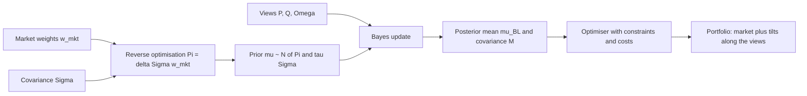
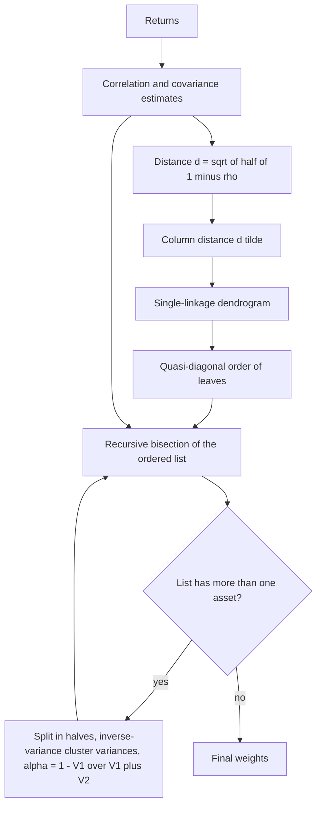

# Black-Litterman, Risk Parity and HRP

## TL;DR

- Black-Litterman replaces noisy expected returns with a Bayesian posterior: prior $\mu \sim N(\Pi, \tau\Sigma)$ centred on the equilibrium returns $\Pi = \delta\Sigma w_{\text{mkt}}$ implied by market weights, views $P\mu = Q + \varepsilon$ with $\varepsilon \sim N(0, \Omega)$, and posterior mean $\mu_{BL} = \Pi + \tau\Sigma P^\top(P\tau\Sigma P^\top + \Omega)^{-1}(Q - P\Pi)$.
- With no views BL returns the market portfolio; with views the unconstrained weights are $w_{\text{mkt}} + \frac\tau\delta P^\top(P\tau\Sigma P^\top + \Omega)^{-1}(Q - P\Pi)$, a tilt only along the view portfolios, and with $\Omega = P\tau\Sigma P^\top$ each view moves its portfolio's expected return exactly halfway from the prior to $Q$.
- Equal risk contribution (risk parity) sets $w_i(\Sigma w)_i$ equal for all assets; with two assets $w_i \propto 1/\sigma_i$ whatever the correlation, in general it is the unique solution of the convex program $\min \tfrac12 y^\top\Sigma y - \tfrac1N\sum\ln y_i$, and its volatility sits between the minimum-variance and $1/N$ portfolios.
- Hierarchical risk parity (Lopez de Prado 2016) clusters assets on the correlation distance $\sqrt{\tfrac12(1-\rho)}$, reorders them so similar assets are adjacent, then splits capital top-down by inverse cluster variance; it never inverts $\Sigma$, so it works even when the sample covariance is singular.
- None of these is free alpha: in the simulated block market the plug-in minimum-variance portfolio beats HRP once $T$ is large, HRP behaves like inverse variance, and HRP's real advantages are stability, no inversion and no shorts.

## Learning objectives

- Blend views with equilibrium returns in Black-Litterman.
- Build risk-parity and hierarchical risk parity portfolios.
- Derive the Black-Litterman posterior and show the precision-weighted and update forms are equal.
- Compute risk contributions by Euler decomposition and solve for equal risk contribution weights.
- Implement HRP (distance, linkage, quasi-diagonalisation, recursive bisection) and evaluate allocation methods out of sample.

## Core concepts

### The problem all three solve

Mean-variance weights $w^* = (\lambda\Sigma)^{-1}\mu$ are dominated by estimation error in $\mu$ and amplified by $\Sigma^{-1}$ ([Mean-Variance Portfolio Construction](10-Mean-Variance-Portfolio-Construction.md)).
Three responses:

| Method | What it does with $\mu$ | What it does with $\Sigma^{-1}$ |
| :--- | :--- | :--- |
| Black-Litterman | Shrinks it toward equilibrium returns, moved only by explicit views | Still inverts $\Sigma$ (use a good estimate, [Covariance Estimation and Shrinkage](11-Covariance-Estimation-and-Shrinkage.md)) |
| Risk parity (ERC) | Ignores it | Uses $\Sigma$ only through marginal risks; no inversion |
| HRP | Ignores it | Replaces inversion by a tree and inverse-variance splits |

### Black-Litterman: the prior from reverse optimisation

If the market portfolio $w_{\text{mkt}}$ is mean-variance optimal for a representative investor with risk aversion $\delta$, the first-order condition $\Pi - \delta\Sigma w_{\text{mkt}} = 0$ gives the implied excess returns

$$
\Pi = \delta\,\Sigma\, w_{\text{mkt}}, \qquad \delta = \frac{\Pi_m}{\sigma_m^2} = \frac{SR_m}{\sigma_m}.
$$

These are the returns that make today's market weights optimal: a neutral, internally consistent starting point, unlike historical means.
Black and Litterman (1992) put a prior on the unknown mean centred there:

$$
\mu \sim N(\Pi, \tau\Sigma),
$$

where $\tau$ says the uncertainty about the mean is a small fraction of the uncertainty of one period's return.
The original paper says only that $\tau$ is close to zero; Idzorek (2005) uses 0.025, $1/T$ (so that $\tau\Sigma$ is the variance of a sample mean, the squared standard error) is another common choice, and some authors set $\tau = 1$ with a correspondingly rescaled $\Omega$, so there is no single standard value.

### Views and the posterior

$K$ views are linear statements about $\mu$ with Gaussian errors:

$$
P\mu = Q + \varepsilon, \qquad \varepsilon \sim N(0, \Omega),
$$

with $P$ a $K \times N$ matrix of view portfolios (a row $(1, -1, 0, 0)$ is "A outperforms B"; a row $(0, 0, 1, 0)$ is an absolute view on C), $Q$ the view returns and $\Omega$ (usually diagonal) the view uncertainty.

**Derivation.** Treat the views as observations.
The log posterior is, up to a constant,

$$
-\tfrac12(\mu - \Pi)^\top(\tau\Sigma)^{-1}(\mu - \Pi) - \tfrac12(P\mu - Q)^\top\Omega^{-1}(P\mu - Q),
$$

a quadratic in $\mu$, so the posterior is Gaussian.
Collecting the quadratic and linear terms in $\mu$:

$$
M^{-1} = (\tau\Sigma)^{-1} + P^\top\Omega^{-1}P, \qquad \mu_{BL} = M\big[(\tau\Sigma)^{-1}\Pi + P^\top\Omega^{-1}Q\big].
$$

This is the precision-weighted average of prior and views, the same algebra as Theil and Goldberger's (1961) mixed estimation and as the Gaussian conjugate update in [Bayesian Inference](../02-Statistics-and-Econometrics/07-Bayesian-Inference.md).
Applying the Woodbury identity to $M$ gives the update form

$$
\mu_{BL} = \Pi + \tau\Sigma P^\top\big(P\tau\Sigma P^\top + \Omega\big)^{-1}(Q - P\Pi),
$$

which reads like a Kalman update: the surprise $Q - P\Pi$ (view minus what equilibrium already implies) times a gain.
Only the surprise moves anything; a view that agrees with equilibrium changes nothing.
The script checks the two forms agree to machine precision.

**Posterior covariance.** $M$ is the covariance of the estimate of the mean; the predictive covariance of next period's return is $\Sigma + M$ (He and Litterman 1999).

### What the weights do

Unconstrained mean-variance weights with the posterior mean and $\Sigma$:

$$
w_{BL} = (\delta\Sigma)^{-1}\mu_{BL} = w_{\text{mkt}} + \frac{\tau}{\delta}P^\top\big(P\tau\Sigma P^\top + \Omega\big)^{-1}(Q - P\Pi).
$$

So BL weights are market weights plus a combination of the view portfolios: assets not mentioned in any view keep their market weight, even though their posterior expected returns move through correlation.
With the predictive covariance $\Sigma + M$, He and Litterman show $w = \frac{1}{1+\tau}(w_{\text{mkt}} + P^\top\Lambda)$ for a vector $\Lambda$ of view tilts: the same structure, scaled by $1/(1+\tau)$ because estimation risk adds to return risk.

### Choosing $\Omega$ and $\tau$

- **He-Litterman:** $\Omega = \text{diag}(P\tau\Sigma P^\top)$, the view's uncertainty equal to the prior uncertainty of the view portfolio.
  Then $\tau$ cancels out of $\mu_{BL}$, and for a single view the posterior expected return of the view portfolio lands exactly halfway between $P\Pi$ and $Q$.
- **Confidence scaling:** for one view with prior variance $s = P\tau\Sigma P^\top$, the posterior moves the fraction $s/(s + \omega)$ of the way from $P\Pi$ to $Q$; $\omega = s/4$ gives 80%, $\omega = 4s$ gives 20%.
  Idzorek (2005) inverts this to let users state a confidence in percent.
- **From an alpha model:** a systematic fund turns a signal into $Q$ through IC-scaled forecasts ($\alpha = \text{IC}\cdot\sigma\cdot z$, [Signals, Features and Alpha Decay](03-Signals-Features-and-Alpha-Decay.md)) and sets $\Omega$ from the forecast's error variance; the equilibrium prior then acts as the shrinkage target for every asset the signal does not cover.
- $\tau$ matters only through its ratio to $\Omega$ for the mean, and through $\Sigma + M$ for the predictive covariance; state the convention you use, since published examples differ.

In practice the BL posterior mean is fed to a constrained optimiser (long-only, tracking error, turnover limits), so the clean "tilt along $P^\top$" structure holds only for the unconstrained solution.

### Risk contributions

Portfolio volatility $\sigma(w) = \sqrt{w^\top\Sigma w}$ is homogeneous of degree one, so Euler's theorem decomposes it exactly:

$$
\sigma(w) = \sum_i w_i\frac{\partial\sigma}{\partial w_i} = \sum_i\frac{w_i(\Sigma w)_i}{\sigma(w)}, \qquad \text{RC}_i = \frac{w_i(\Sigma w)_i}{\sigma(w)}.
$$

The risk share $w_i(\Sigma w)_i/\sigma^2$ sums to one.
A share can be negative (a hedge).
For the minimum-variance portfolio $\Sigma w = \sigma^2\mathbf 1$, so risk shares equal weights.
The same decomposition drives risk budgeting and attribution in [Risk Decomposition and Attribution](../11-Risk-and-Trading/13-Risk-Decomposition-and-Attribution.md).

### Equal risk contribution

ERC requires $w_i(\Sigma w)_i = w_j(\Sigma w)_j$ for all $i, j$, with $w \ge 0$ and $\sum w_i = 1$.

- **Two assets:** $w_1(\sigma_1^2w_1 + \rho\sigma_1\sigma_2w_2) = w_2(\sigma_2^2w_2 + \rho\sigma_1\sigma_2w_1)$ simplifies to $w_1\sigma_1 = w_2\sigma_2$, so $w_i \propto 1/\sigma_i$ whatever $\rho$.
- **Equal pairwise correlations:** inverse volatility again.
- **General case:** no closed form; Spinu (2013) solves the strictly convex program

$$
\min_{y > 0}\ \tfrac12 y^\top\Sigma y - \sum_i b_i\ln y_i ,
$$

whose first-order condition $(\Sigma y)_i = b_i/y_i$ is exactly $y_i(\Sigma y)_i = b_i$; normalising $w = y/\sum y$ keeps the risk shares equal to the budgets $b_i$ ($b_i = 1/N$ for ERC).
The solution exists and is unique for any positive definite $\Sigma$, and Newton's method converges in a handful of steps.

**Ordering.** Maillard, Roncalli and Teiletche (2010) show $\sigma_{\text{MV}} \le \sigma_{\text{ERC}} \le \sigma_{1/N}$: ERC is a compromise between the minimum-variance portfolio (equal marginal risks) and $1/N$ (equal weights).

**Leverage.** Unlevered ERC is dominated by low-volatility assets (bonds), so its return is low; risk-parity funds lever it to a volatility target.
Asness, Frazzini and Pedersen (2012) argue that leverage-averse investors overweight high-beta assets, making low-risk assets offer higher risk-adjusted returns, which a levered risk-parity portfolio harvests.
The costs are funding, margin and the assumption that correlations, especially stock-bond, stay where they were estimated.

### Hierarchical risk parity

Lopez de Prado (2016) attacks "Markowitz's curse": the more correlated the assets, the more diversification matters and the more unstable $\Sigma^{-1}$ becomes.
HRP replaces the inversion by three steps.

1. **Tree clustering.** Correlation distance $d_{ij} = \sqrt{\tfrac12(1 - \rho_{ij})}$, a proper metric in $[0, 1]$.
   Then a distance between the columns of that matrix, $\tilde d_{ij} = \sqrt{\sum_k(d_{ki} - d_{kj})^2}$, which compares how each pair relates to the whole universe.
   Agglomerate with single linkage (merge the two clusters with the smallest minimum pairwise $\tilde d$).
2. **Quasi-diagonalisation.** Read the leaves of the dendrogram in order, recursively replacing each cluster by its two children, and reorder the covariance so that similar assets sit next to each other and large covariances concentrate near the diagonal.
3. **Recursive bisection.** Start with the ordered list and weight 1 on every asset.
   Split each list into two halves (by position, not by the tree), compute for each half the variance $V$ of its inverse-variance portfolio, and scale the halves by $\alpha = 1 - V_1/(V_1 + V_2)$ and $1 - \alpha$.
   Repeat until every list has one asset.

Properties:

- Weights are positive and sum to one, and the splits use covariance sub-blocks but never an inverse: HRP runs when $S$ is singular ($N > T$).
- Capital is split top-down, so one cluster cannot absorb the book, and weights depend smoothly on variances and within-cluster covariances, and on correlations also through the ordering, which makes them more stable than unconstrained optimiser weights.
- Splitting by halves rather than along the dendrogram is a known weakness: a split can cut through a cluster; variants that bisect along the tree exist.
- Single linkage chains, so one asset correlated with two groups can glue them together.

### How practitioners use these

- Multi-asset and asset-allocation teams use BL to anchor to a benchmark and add a small number of tactical views; equity quant teams more often shrink alphas directly with IC scaling, the same idea as BL with a zero-alpha (benchmark) prior.
- Risk parity is a standard multi-asset product and a building block for risk budgets across strategies or desks (allocate risk, not capital).
- HRP and other tree-based allocators are used where covariance estimates are poor (many assets, short histories, crypto, strategy allocation) and where weight stability matters more than theoretical optimality.
- In all cases the decision is validated out of sample with costs, and against simple benchmarks ($1/N$, inverse volatility), which are hard to beat.

## Worked examples

All numbers come from [bl_risk_parity_hrp.py](code/bl_risk_parity_hrp.py).
The four-asset market: volatilities A 16%, B 18%, C 6%, D 20%; correlations $\rho_{AB} = 0.8$, $\rho_{AC} = \rho_{BC} = 0.1$, $\rho_{AD} = \rho_{BD} = 0.3$, $\rho_{CD} = 0$; market weights $(0.4, 0.3, 0.2, 0.1)$; $\delta = 2.5$, $\tau = 0.05$.

### 1. Reverse optimisation

- Market volatility $\sqrt{w^\top\Sigma w} = 12.16\%$; implied market excess return $\delta\sigma_m^2 = 3.70\%$; implied Sharpe $\delta\sigma_m = 0.304$.
- $\Pi = \delta\Sigma w_{\text{mkt}} = (4.576\%, 5.058\%, 0.357\%, 2.770\%)$.

B is expected to beat A by 0.48% in equilibrium, because B is riskier and highly correlated with A.

### 2. One relative view

View: A outperforms B by 2% ($P = (1, -1, 0, 0)$, $Q = 2\%$), with He-Litterman $\Omega = P\tau\Sigma P^\top$.

- Surprise: $Q - P\Pi = 2\% - (-0.48\%) = 2.48\%$.
- Posterior: $\mu_{BL} = (4.843\%, 4.084\%, 0.345\%, 2.645\%)$; both forms agree to machine precision.
- The view portfolio's posterior return is 0.76%, exactly halfway between $-0.48\%$ and 2%.
- Weights $(\delta\Sigma)^{-1}\mu_{BL} = (0.8164, -0.1164, 0.2000, 0.1000)$: A gains 0.4164, B loses 0.4164, C and D keep their market weights although their expected returns moved (C from 0.357% to 0.345%, D from 2.770% to 2.645%).
- Tighter view, $\Omega = s/4$: the view portfolio moves 80% of the way; looser, $\Omega = 4s$: 20%.
- Raising $\tau$ tenfold, from 0.05 to 0.5, with $\Omega = P\tau\Sigma P^\top$ leaves $\mu_{BL}$ unchanged (difference below $10^{-12}$, machine precision).
- With the predictive covariance $\Sigma + M$ the weights sum to $1/(1+\tau) = 0.9524$, and $(1+\tau)w - w_{\text{mkt}}$ is zero in C and D and sums to zero over A and B: a pure tilt along $P^\top$.

Why the tilt is so large: A and B are 0.8 correlated, so the A-minus-B spread has low risk and a 1.24-point posterior change on it buys a lot of position.
Contrast with naive mean-variance: adding $+1\%$ to A's and $-1\%$ to B's equilibrium return (an estimation error well inside the standard error of any mean) gives weights $(1.1433, -0.3510, 0.1971, 0.0974)$.
BL produces large tilts only when you ask for them, with a stated confidence.

### 3. Two-asset risk parity

Volatilities 10% and 20%, correlation 0.5: ERC weights $(2/3, 1/3)$.
With correlation $-0.5$ the answer is the same $(2/3, 1/3)$: in the two-asset case the condition reduces to $w_1\sigma_1 = w_2\sigma_2$.

### 4. Four-asset ERC versus alternatives

| Portfolio | Weights (A, B, C, D) | Risk shares (A, B, C, D) | Volatility |
| :--- | :--- | :--- | ---: |
| Market | 0.40, 0.30, 0.20, 0.10 | 0.4952, 0.4105, 0.0193, 0.0749 | 12.16% |
| Inverse volatility | 0.1867, 0.1660, 0.4979, 0.1494 | 0.3056, 0.3056, 0.1667, 0.2222 | |
| ERC | 0.1494, 0.1328, 0.5681, 0.1496 | 0.25 each (to machine precision, below $10^{-10}$) | 7.28% |
| Minimum variance | 0.0687, $-0.0005$, 0.8683, 0.0634 | equal to weights | 5.65% |
| $1/N$ | 0.25 each | | 10.97% |

- The market portfolio puts 70% of capital but 91% of risk in A and B.
- Inverse volatility over-allocates risk to the correlated pair (30.6% each), so ERC shifts capital to C and D.
- Ordering $5.65\% \le 7.28\% \le 10.97\%$ as Maillard, Roncalli and Teiletche prove.
- Running ERC at a 10% volatility target needs leverage $10/7.28 = 1.37$.
- A risk budget of one half in C and one sixth elsewhere solves to the stated shares to machine precision (below $10^{-10}$) with the same Newton code.

### 5. HRP by hand

- $d_{AB} = \sqrt{0.5\times0.2} = 0.316$.
- Single linkage on $\tilde d$: A and B merge at 0.447, then D joins them at 0.882, then C at 1.006.
- Quasi-diagonal order: C, D, A, B.
- First bisection by halves: left $\{C, D\}$, right $\{A, B\}$ (note it does not follow the tree, which would split C from the rest).
  Inverse-variance cluster variances $V_{CD} = 0.003303$, $V_{AB} = 0.02566$, so $\alpha = 1 - 0.003303/(0.003303 + 0.02566) = 0.8860$ to $\{C, D\}$.
- Inside $\{C, D\}$: C gets $1 - 0.0036/(0.0036 + 0.04) = 0.9174$; inside $\{A, B\}$: A gets $1 - 0.0256/(0.0256 + 0.0324) = 0.5586$.
- HRP weights $(0.0637, 0.0503, 0.8128, 0.0732)$, volatility 5.73%, against 5.65% for the unconstrained minimum-variance portfolio.

HRP lands close to minimum variance here because the low-volatility asset is nearly uncorrelated with the rest, without inverting anything and without the tiny short in B.

### 6. Out-of-sample comparison

True market: 50 assets in 5 blocks, correlation 0.6 within and 0.1 across blocks, volatilities uniform on $[10\%, 40\%]$.
Each method is estimated from $T$ observations; we record the true variance $w^\top\Sigma w$ divided by the true minimum, and the L1 weight change between two independent samples (a turnover proxy); 100 repetitions.
For reference, the true minimum-variance portfolio has 27 short positions, the long-only true minimum is 1.96 times the unconstrained one, inverse variance with the true volatilities is 3.67 and $1/N$ is 6.20.

| Method | Var, $T = 60$ | Var, $T = 120$ | Var, $T = 520$ | L1 change, $T = 60$ | L1 change, $T = 520$ |
| :--- | ---: | ---: | ---: | ---: | ---: |
| Minimum variance (sample) | 6.28 | 1.70 | 1.11 | 5.62 | 0.81 |
| Minimum variance, long-only | 2.40 | 2.15 | 2.00 | 0.97 | 0.31 |
| Inverse variance | 3.71 | 3.69 | 3.67 | 0.20 | 0.06 |
| ERC | 4.88 | 4.84 | 4.82 | 0.26 | 0.08 |
| HRP | 3.73 | 3.71 | 3.67 | 0.43 | 0.33 |

All values are seeded simulation averages; read them as "about".
The interview answer:

- With $T = 60$ for 50 assets the plug-in minimum-variance portfolio is wrecked by noise (6.28, worse than every heuristic) and its weights change by 5.62 of gross between windows; with $T = 520$ it is the best by far.
- HRP's true variance tracks inverse variance at every $T$ in this market (3.73 against 3.71, 3.71 against 3.69, 3.67 against 3.67), and at $T = 60$ its weights move less than either optimiser's (L1 change 0.43 against 0.97 long-only and 5.62 unconstrained), though more than inverse variance or ERC.
- HRP does not beat long-only minimum variance, the fair long-only competitor, at any $T$ here; at $T = 520$ long-only minimum variance is also slightly more stable (0.31 against 0.33).
- With $T = 40 < N = 50$ the sample covariance has rank 39, the minimum-variance portfolio is undefined, and HRP still returns a portfolio with about 3.57 times the optimal variance.
- Lopez de Prado's (2016) Monte Carlo, with a different data-generating process, finds HRP beating the critical-line minimum-variance portfolio out of sample; the lesson is that the ranking depends on the market and the sample length, so test on your own data with a shrunk covariance as a baseline.

## Pitfalls

- Feeding historical mean returns into BL as the prior instead of the equilibrium $\Pi$; the whole point is a neutral anchor.
- Mixing units: annual $Q$ with a daily $\Sigma$, or $\Pi$ computed with one $\delta$ and weights inverted with another.
- Quoting BL results without stating the $\tau$ and $\Omega$ conventions; with $\Omega \propto \tau$ the mean ignores $\tau$, with a fixed $\Omega$ it does not.
- Being surprised that a view on two highly correlated assets produces a huge long-short tilt: the spread is low risk, so the optimiser sizes it up; scale $\Omega$ or constrain.
- Believing assets outside the views keep their expected returns: their means move through correlation, only their unconstrained weights stay put.
- Computing risk contributions as $w_i\sigma_i$: that ignores correlation; use $w_i(\Sigma w)_i$.
- Solving ERC with a generic nonlinear least-squares routine and accepting a local stationary point; the Spinu convex formulation has a unique solution.
- Running unlevered risk parity and comparing it with a 60/40 portfolio at different volatility.
- Implementing HRP with the tree split instead of the halves split (or the reverse) and calling it Lopez de Prado's HRP; state which.
- Assuming HRP's out-of-sample win is universal; compare with shrunk-covariance minimum variance and long-only minimum variance.

## Interview questions

> [!question]- alpha-bl-reverse-optimisation | How does Black-Litterman get its prior expected returns?
> By reverse optimisation: $\Pi = \delta\Sigma w_{\text{mkt}}$, the excess returns that make market weights mean-variance optimal.
> $\delta = SR_m/\sigma_m$ is the market's risk aversion; with $\delta = 2.5$ and market volatility 12.16% the implied market excess return is 3.70%.

> [!question]- alpha-bl-posterior-mean | Write the Black-Litterman posterior mean in both forms.
> $\mu_{BL} = [(\tau\Sigma)^{-1} + P^\top\Omega^{-1}P]^{-1}[(\tau\Sigma)^{-1}\Pi + P^\top\Omega^{-1}Q] = \Pi + \tau\Sigma P^\top(P\tau\Sigma P^\top + \Omega)^{-1}(Q - P\Pi)$.
> The first is a precision-weighted average from Bayes with a Gaussian prior and Gaussian view likelihood; Woodbury turns it into the second.

> [!question]- alpha-bl-derivation | Sketch the derivation of the Black-Litterman posterior.
> Prior $\mu \sim N(\Pi, \tau\Sigma)$, views $P\mu = Q + \varepsilon$ with $\varepsilon \sim N(0, \Omega)$; the log posterior is the sum of two quadratics in $\mu$.
> Completing the square gives precision $(\tau\Sigma)^{-1} + P^\top\Omega^{-1}P$ and mean equal to that inverse times $(\tau\Sigma)^{-1}\Pi + P^\top\Omega^{-1}Q$.

> [!question]- alpha-bl-no-views | What portfolio does Black-Litterman give with no views?
> The market portfolio.
> With no views $\mu_{BL} = \Pi$, and $(\delta\Sigma)^{-1}\Pi = w_{\text{mkt}}$ by construction.

> [!question]- alpha-bl-weight-tilt | How do Black-Litterman weights differ from market weights?
> Only along the view portfolios: $w_{BL} = w_{\text{mkt}} + \frac\tau\delta P^\top(P\tau\Sigma P^\top + \Omega)^{-1}(Q - P\Pi)$.
> Assets in no view keep their market weight even though their posterior means move through correlation.

> [!question]- alpha-bl-halfway | With $\Omega = P\tau\Sigma P^\top$ and one view, where does the posterior expected return of the view portfolio land?
> Exactly halfway between the prior $P\Pi$ and the view $Q$.
> The gain is $s/(s + \omega)$ with $s = P\tau\Sigma P^\top$; $\omega = s$ gives one half (in the example, from $-0.48\%$ and 2% to 0.76%).

> [!question]- alpha-bl-tau | Does $\tau$ matter in Black-Litterman?
> For the posterior mean, only through its ratio to $\Omega$: with He-Litterman $\Omega = \text{diag}(P\tau\Sigma P^\top)$ it cancels exactly.
> It still matters for the posterior covariance $M$ and the predictive covariance $\Sigma + M$, and conventions differ across papers, so always state it.

> [!question]- alpha-bl-correlated-view | A view that A beats B by 2% moves A's weight by over 0.4 when A and B are 0.8 correlated. Bug or feature?
> Feature of mean-variance: the A-minus-B spread has low variance, so a modest change in its expected return justifies a large position.
> Control it with a wider $\Omega$, a tracking-error or position constraint, or a better covariance estimate.

> [!question]- alpha-rp-euler | Define the risk contribution of an asset and show the contributions sum to portfolio volatility.
> $\text{RC}_i = w_i(\Sigma w)_i/\sigma(w)$.
> Volatility is homogeneous of degree one in $w$, so Euler's theorem gives $\sigma = \sum_i w_i\,\partial\sigma/\partial w_i$ with $\partial\sigma/\partial w_i = (\Sigma w)_i/\sigma$.

> [!question]- alpha-rp-two-asset | Two assets with 10% and 20% volatility: equal risk contribution weights, and how do they depend on correlation?
> $(2/3, 1/3)$, independent of correlation.
> Equal contributions reduce to $w_1\sigma_1 = w_2\sigma_2$ because the cross term $w_1w_2\rho\sigma_1\sigma_2$ appears in both contributions.

> [!question]- alpha-rp-solve | How do you compute ERC weights for $N$ assets robustly?
> Minimise the strictly convex $\tfrac12y^\top\Sigma y - \tfrac1N\sum_i\ln y_i$ over $y > 0$ (Spinu 2013) with Newton, then normalise $w = y/\sum y$.
> The first-order condition $y_i(\Sigma y)_i = 1/N$ is exactly equal risk contribution, and the solution is unique.

> [!question]- alpha-rp-ordering | Rank the volatilities of the minimum-variance, ERC and $1/N$ portfolios.
> $\sigma_{\text{MV}} \le \sigma_{\text{ERC}} \le \sigma_{1/N}$ (Maillard, Roncalli and Teiletche 2010).
> In the four-asset example: 5.65%, 7.28% and 10.97%.

> [!question]- alpha-rp-leverage | Why are risk-parity portfolios usually levered, and what are the risks?
> Unlevered ERC is dominated by low-volatility assets and has low expected return, so it is levered to a volatility target (1.37 times to reach 10% in the example).
> Risks: funding and margin costs, forced deleveraging, and correlations (especially stock-bond) changing from their estimated values.

> [!question]- alpha-hrp-steps | List the steps of hierarchical risk parity.
> Correlation distance $\sqrt{\tfrac12(1-\rho)}$ and the column distance between its rows; single-linkage clustering; quasi-diagonal reordering of assets by the dendrogram; recursive bisection of the ordered list with inverse-variance splits.
> Each split gives $\alpha = 1 - V_1/(V_1 + V_2)$ to the first half, with $V$ the variance of the half's inverse-variance portfolio.

> [!question]- alpha-hrp-distance | Why is $\sqrt{\tfrac12(1-\rho)}$ used as the distance, and what are its values at $\rho = 1, 0, -1$?
> It is a proper metric (it is proportional to the Euclidean distance between standardised return vectors), with values 0, 0.707 and 1.
> Using $1 - \rho$ directly would violate the triangle inequality.

> [!question]- alpha-hrp-singular | Can HRP be computed when there are more assets than observations?
> Yes.
> It needs correlations for the tree and each cluster's covariance block for the splits (the variance of its inverse-variance portfolio), never $\Sigma^{-1}$; with 50 assets and 40 observations the sample covariance has rank 39 and minimum variance is undefined.

> [!question]- alpha-hrp-bisection-halves | In Lopez de Prado's HRP, does the recursive bisection follow the dendrogram?
> No: it splits the quasi-diagonally ordered list into halves by position.
> In the four-asset example the tree joins C last, yet the first split is $\{C, D\}$ versus $\{A, B\}$; tree-following variants exist.

> [!question]- alpha-hrp-oos-judgement | A colleague claims HRP always beats minimum variance out of sample. How do you respond?
> It depends on the market and the sample length.
> In a simulated 50-asset block market HRP's variance was about 3.7 times optimal at every $T$, while the sample minimum-variance portfolio went from 6.28 at $T = 60$ to 1.11 at $T = 520$, and long-only minimum variance beat HRP throughout; HRP's robust advantages are stability, positivity and no inversion.

## In this repo and SDE-Interview-Prep

- Code: [black_litterman_model.ipynb](code/black_litterman_model.ipynb).
- Code: [bl_risk_parity_hrp.py](code/bl_risk_parity_hrp.py) implements the BL posterior, the Spinu ERC solver, long-only minimum variance by an active-set method, HRP from scratch, and the out-of-sample comparison.
- Related notes: [Mean-Variance Portfolio Construction](10-Mean-Variance-Portfolio-Construction.md), [Covariance Estimation and Shrinkage](11-Covariance-Estimation-and-Shrinkage.md), [Transaction Costs and Turnover](13-Transaction-Costs-and-Turnover.md), [Bayesian Inference](../02-Statistics-and-Econometrics/07-Bayesian-Inference.md), [Quadratic Programming and Portfolio Solvers](../03-Linear-Algebra-and-Optimization/09-Quadratic-Programming-and-Portfolio-Solvers.md).

## Further reading

- Black and Litterman (1992), Global Portfolio Optimization
- Marcos Lopez de Prado (2016), Building Diversified Portfolios that Outperform Out of Sample
- He and Litterman (1999), The Intuition Behind Black-Litterman Model Portfolios, Goldman Sachs working paper.
- Idzorek (2005), A Step-by-Step Guide to the Black-Litterman Model.
- Maillard, Roncalli and Teiletche (2010), The Properties of Equally Weighted Risk Contribution Portfolios, Journal of Portfolio Management.
- Spinu (2013), An Algorithm for Computing Risk Parity Weights, SSRN.
- Thierry Roncalli, *Introduction to Risk Parity and Budgeting* (CRC, 2013).
- Asness, Frazzini and Pedersen (2012), Leverage Aversion and Risk Parity, Financial Analysts Journal.
- Marcos Lopez de Prado, *Advances in Financial Machine Learning* (2018), chapter 16.
