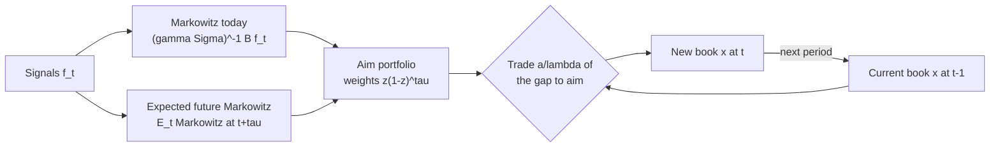

# Transaction Costs and Turnover Optimization

## TL;DR

- Cost per unit traded is half-spread plus fees plus impact, with impact roughly $Y\sigma\sqrt{Q/V}$; in dollars that is a linear term plus a term in $|Q|^{3/2}$, and the shape of the cost curve decides the shape of the optimal trading rule.
- Linear costs give a no-trade band, quadratic costs give partial adjustment $w = (\lambda\Sigma + C)^{-1}(\alpha + Cw_0)$, a matrix-weighted average of the frictionless target and the current book; $3/2$-power costs sit in between and need a numerical solve.
- Splitting an order over $n$ days cuts square-root impact by $1/\sqrt n$ but loses alpha to decay; with a 5-day alpha half-life and 10% of ADV to trade, working the order over 4 days roughly doubles the net capture versus trading at once.
- Garleanu and Pedersen (2013): with quadratic costs $\Lambda = \lambda\Sigma$, the optimal book is $x_t = (1 - a/\lambda)x_{t-1} + (a/\lambda)\,\text{aim}_t$; trade partway toward an aim portfolio that is a weighted average of today's and expected future Markowitz portfolios, so persistent signals get more weight.
- Rebalancing all the way to the frictionless Markowitz book every period can turn a positive-alpha signal into a loser: in the worked example it delivers $-2.41$ times the frictionless utility, while the Garleanu-Pedersen rule keeps 0.67 of it.

## Learning objectives

- Include linear and impact costs in the objective.
- Trade toward a target portfolio optimally (partial adjustment).
- Decompose implementation shortfall and calibrate a per-trade cost model.
- Choose an execution horizon by trading impact against alpha decay.
- State and use the Garleanu-Pedersen trading rate and aim portfolio, and explain why they beat full rebalancing.

## Core concepts

### Anatomy of a trading cost

Perold (1988) defines implementation shortfall as the gap between a paper portfolio traded instantly at the decision price and the real portfolio.
It decomposes into:

- **Explicit costs:** commissions, exchange and regulatory fees, taxes.
- **Half-spread:** crossing from mid to the touch.
- **Market impact:** the price move your own trading causes; temporary impact decays after you stop, permanent impact stays.
- **Delay cost:** the price drift between decision and order arrival, which for a real signal is alpha leaking away.
- **Opportunity cost:** alpha forgone on the part of the order you never fill.

A standard per-unit model for an order of $Q$ dollars in a name with daily volume $V$ and daily volatility $\sigma$ is

$$
c(Q) = \tfrac12 s + f + Y\sigma\sqrt{Q/V},
$$

with half-spread $\tfrac12 s$, fees $f$ and $Y$ an impact coefficient of order one (square-root law; Almgren et al. 2005 estimate a temporary-impact exponent of about 0.6, close to it; more in [Market Impact Models](../07-Market-Microstructure/06-Market-Impact-Models.md)).
The dollar cost $Q\,c(Q)$ is a linear term plus a term proportional to $|Q|^{3/2}$.

### Three cost shapes and the rules they produce

| Dollar cost of a trade $\Delta$ | Where it comes from | Optimal rule |
| :--- | :--- | :--- |
| $c\,\lvert\Delta\rvert$ (linear) | half-spread, fees | no-trade band; outside it trade to the nearest edge |
| $\tfrac12\kappa\Delta^2$ (quadratic) | linear temporary impact (Almgren-Chriss), Garleanu-Pedersen | partial adjustment toward the target, closed form |
| $k\lvert\Delta\rvert^{3/2}$ | square-root impact | partial adjustment, no closed form; solve numerically |

Splitting a trade into $n$ equal pieces on separate days (impact resetting in between) changes total cost by a factor $n\cdot(1/n) = 1$ for linear, $n\cdot(1/n)^{3/2} = 1/\sqrt n$ for $3/2$-power and $n\cdot(1/n)^2 = 1/n$ for quadratic cost.
So only impact rewards patience; spread and fees do not.

Units must match: alpha over the holding horizon against cost per round trip, or alpha per period against cost amortised over the expected holding period.
Turnover conventions (one-sided versus two-sided) are in [Performance Metrics and the Fundamental Law](09-Performance-Metrics-and-Fundamental-Law.md).

### Alpha decay and the cost of delay

If the remaining alpha of a signal decays geometrically by a factor $\delta$ per day, a piece traded $k$ days late earns $A\delta^k$ instead of $A$.
Working an order of $q = Q/V$ of ADV evenly over $n$ days then nets about

$$
\text{net}(n) = A\,\frac{1-\delta^n}{n(1-\delta)} - Y\sigma\sqrt{q/n}.
$$

The first term falls with $n$ (alpha decays), the second falls with $n$ too (smaller daily participation), so there is an interior optimum.
This is the same trade-off that Almgren and Chriss (2001) solve with risk aversion in place of alpha decay ([Optimal Execution Almgren-Chriss](../07-Market-Microstructure/07-Optimal-Execution-Almgren-Chriss.md)).
Signal decay itself is measured with IC decay curves ([Signals, Features and Alpha Decay](03-Signals-Features-and-Alpha-Decay.md)).

### Single-period optimisation with costs

Maximise expected return minus risk minus cost over the new weights $w$, given current weights $w_0$:

$$
\max_w\ \alpha^\top w - \frac\lambda2 w^\top\Sigma w - \text{TC}(w - w_0).
$$

**Linear cost.** The KKT condition gives the no-trade band of [Mean-Variance Portfolio Construction](10-Mean-Variance-Portfolio-Construction.md): do not trade asset $i$ while $|\alpha_i - \lambda(\Sigma w)_i| \le c_i$.

**Quadratic cost** $\text{TC} = \tfrac12(w-w_0)^\top C(w-w_0)$.
The first-order condition $\alpha - \lambda\Sigma w - C(w - w_0) = 0$ gives

$$
w = (\lambda\Sigma + C)^{-1}(\alpha + Cw_0) = (\lambda\Sigma + C)^{-1}\big(\lambda\Sigma\,w^* + C\,w_0\big), \qquad w^* = (\lambda\Sigma)^{-1}\alpha,
$$

a matrix-weighted average of the frictionless target $w^*$ and the current book.
For one asset with $C = \kappa$ the new weight is $w_0 + \frac{\lambda\sigma^2}{\lambda\sigma^2 + \kappa}(w^* - w_0)$: trade a fixed fraction of the gap every period, which is exponential smoothing of the target.

**$3/2$-power cost** $k|w - w_0|^{3/2}$.
The marginal cost $\tfrac32k\sqrt{|\Delta|}$ is zero at $\Delta = 0$, so there is no band, but it rises steeply for small trades.
Calibrated to equal a quadratic cost at one trade size, it is more expensive than quadratic below that size and cheaper above it.

In practice the cost term carries a multiplier ("cost aversion") tuned in out-of-sample backtests, and hard limits on turnover, participation and position size sit on top.
A hard turnover cap is crude: it binds hardest exactly when the signal changes most, which is when trading is most valuable.

### Multi-period: Garleanu and Pedersen (2013)

**Model.** Returns are predicted by signals $f_t$: $r_{t+1} = Bf_t + u_{t+1}$ with $\text{Var}(u) = \Sigma$, and signals mean-revert, $\Delta f_{t+1} = -\Phi f_t + \varepsilon_{t+1}$.
Trading $\Delta x_t$ shares costs $\tfrac12\Delta x_t^\top\Lambda\Delta x_t$ with $\Lambda = \lambda\Sigma$.
The investor solves

$$
\max\ E\sum_{t\ge0}\Big[(1-\rho)^{t+1}\big(x_t^\top r_{t+1} - \tfrac\gamma2 x_t^\top\Sigma x_t\big) - \tfrac{(1-\rho)^t}{2}\Delta x_t^\top\Lambda\Delta x_t\Big],
$$

with risk aversion $\gamma$ and discount rate $\rho$.

**Result.** The optimal policy is

$$
x_t = \Big(1 - \frac a\lambda\Big)x_{t-1} + \frac a\lambda\,\text{aim}_t, \qquad a = \frac{-\big(\gamma(1-\rho) + \lambda\rho\big) + \sqrt{\big(\gamma(1-\rho) + \lambda\rho\big)^2 + 4\gamma\lambda(1-\rho)^2}}{2(1-\rho)},
$$

$$
\text{aim}_t = (\gamma\Sigma)^{-1}B\Big(I + \frac{a}{\gamma}\Phi\Big)^{-1}f_t = \sum_{\tau\ge0} z(1-z)^\tau\,E_t\big[\text{Markowitz}_{t+\tau}\big], \qquad z = \frac{\gamma}{\gamma + a},
$$

where $\text{Markowitz}_t = (\gamma\Sigma)^{-1}Bf_t$ is the frictionless optimum.
With $\rho = 0$ the rate simplifies to $a = \tfrac12\big(-\gamma + \sqrt{\gamma^2 + 4\gamma\lambda}\big)$.

**Derivation sketch (one asset, one signal).**
Guess a quadratic value function in the state (previous position $y$, signal $f$); maximising the Bellman equation over $x$ gives a linear rule $x = c_y y + c_f f$.
Matching the $y^2$ coefficient at the fixed point gives $c_y = 1 - a/\lambda$ with $a$ the positive root of

$$
(1-\rho)a^2 + \big(\gamma(1-\rho) + \lambda\rho\big)a - \gamma\lambda(1-\rho) = 0,
$$

which is the formula above.
For one signal with $E_t f_{t+\tau} = (1-\phi)^\tau f_t$, the weighted sum $\sum_\tau z(1-z)^\tau(1-\phi)^\tau = \gamma/(\gamma + a\phi)$, so the aim is the current Markowitz position scaled by $1/(1 + a\phi/\gamma)$.
The script verifies the closed form against value iteration, the aim identity by direct summation, and optimality by searching over all linear rules.

**The three lessons.**

1. **Trade partially.** The rate $a/\lambda$ falls as costs $\lambda$ rise and rises with risk aversion $\gamma$ (being away from the aim is risky as well as costly).
2. **Aim in front of the target.** Because you will hold today's trade for a while, the aim discounts fast-decaying signals: a signal's loading is divided by $1 + a\phi_k/\gamma$, so slow signals keep most of their Markowitz weight and fast ones lose much of it.
3. **Costs proportional to risk** ($\Lambda = \lambda\Sigma$) are what make the solution closed form; with a general $\Lambda$ the same linear structure holds but must be computed numerically.

### How practitioners use this

- Equity stat-arb desks run a cost model per name (spread, fees, impact coefficient calibrated on their own fills) inside the daily optimiser, with participation caps as a fraction of ADV.
- Blending signals with horizon-aware weights, scaling fast signals down by how much of their alpha decays while the position is held, is the practical form of the aim-portfolio idea.
- Novy-Marx and Velikov (2016) show that the high-turnover published anomalies lose most of their profitability after realistic trading costs, while low-turnover ones survive; turnover is the first number to check on any backtest.

## Worked examples

All numbers are printed and asserted by [costs_turnover.py](code/costs_turnover.py).

### 1. Cost of one order

Half-spread 2 bp, fees 0.5 bp, daily volatility 1.5%, $Y = 1$.

- At 1% of ADV: impact $1.5\%\times\sqrt{0.01} = 15$ bp, total 17.50 bp; a \$5m order costs \$8,750.
- At 10% of ADV: impact $1.5\%\times\sqrt{0.1} = 47.4$ bp, total 49.93 bp.

### 2. Splitting an order

Trading 8% of ADV in one day costs $1.5\%\times\sqrt{0.08} = 42.43$ bp of impact; 2% of ADV on each of 4 days costs 21.21 bp per day on a quarter of the size.
Relative to trading at once, 4 days cost 1.0 times as much under linear cost, 0.5 under $3/2$-power and 0.25 under quadratic.

### 3. Execution horizon against alpha decay

Total alpha 60 bp with a half-life of 5 days ($\delta = 0.5^{1/5} = 0.8706$, so 12.94% of the remaining alpha leaks per day of delay); the order is 10% of ADV and $Y\sigma = 1.5\%$.

| Days $n$ | Alpha captured (bp) | Impact (bp) | Net (bp) |
| ---: | ---: | ---: | ---: |
| 1 | 60.00 | 47.43 | 12.57 |
| 4 | 49.32 | 23.72 | 25.61 |
| 10 | 34.76 | 15.00 | 19.76 |

The optimum over 1 to 30 days is $n = 4$, about double the immediate net capture.

### 4. One asset, three cost shapes

$\mu = 5\%$, $\sigma = 20\%$, $\lambda = 5$, so $\lambda\sigma^2 = 0.2$ and the frictionless target is 0.25.
Costs: linear $c = 1\%$, quadratic $\kappa = 0.2$, $3/2$-power $k = 0.05$ (the last two cost the same 0.00625 for a trade of 0.25).

| Start $w_0$ | Linear | Quadratic | $3/2$-power |
| ---: | ---: | ---: | ---: |
| 0 | 0.2000 | 0.1250 | 0.1201 |
| 0.27 | 0.2700 | 0.2600 | 0.2678 |

- From 0, linear cost buys to the band edge $(\mu - c)/(\lambda\sigma^2) = 0.20$; quadratic trades the fraction $0.2/(0.2 + 0.2) = 0.5$ of the gap.
- From 0.27, inside the band $[0.20, 0.30]$, linear cost does nothing; quadratic still trades half the gap; the $3/2$-power rule trades only 0.0022 because small trades are relatively expensive under it.
- The script confirms every entry by brute-force maximisation of the objective.

### 5. Three assets with quadratic costs

Volatilities 20%, 25%, 30%, all correlations 0.3, $\alpha = (3\%, 1\%, -2\%)$, $\lambda = 5$, $C = \text{diag}(0.1, 0.2, 0.4)$, current book $w_0 = (0.1, 0.1, 0)$.

- Frictionless target $w^* = (0.1812, 0.0193, -0.0855)$, turnover $\sum|w^* - w_0| = 0.2475$.
- Cost-aware $w = (0.1345, 0.0486, -0.0442)$, turnover 0.1301.
- Net utility (alpha minus risk minus cost): staying put 6.87 bp, jumping to $w^*$ 12.26 bp, cost-aware 23.59 bp.

Jumping to the frictionless target beats doing nothing, but the cost-aware book nearly doubles its net utility with about half the turnover.

### 6. Garleanu-Pedersen in numbers

One asset, $\sigma^2 = 1$, $\gamma = 1$, $\lambda = 50$, $b = 0.1$, a unit-variance signal with a 20-period half-life ($\phi = 0.0341$), periods read as days.

- $\rho = 0$: $a = 6.5887$, trading rate $a/\lambda = 0.1318$; with $\rho = 0.01$ the rate is 0.1272.
  Value iteration on the Bellman equation reproduces both rates and the signal loadings to $10^{-8}$.
- Markowitz loading $b/(\gamma\sigma^2) = 0.1$; aim loading $0.1/(1 + a\phi/\gamma) = 0.0817$; $z = \gamma/(\gamma + a) = 0.1318$, and $\sum_\tau z(1-z)^\tau\,0.1\,(1-\phi)^\tau = 0.0817$.
- Trading rate at $\lambda = 10, 50, 200$: 0.2702, 0.1318, 0.0683.
- Aim loading as a fraction of Markowitz: 0.5397 for a 5-day signal half-life, 0.9565 for 100 days.
- A direct search over every rule of the form $x_t = (1-c)x_{t-1} + c\,k f_t$ finds the best $(c, k) = (0.1318, 0.0817)$: the closed form.

### 7. Full rebalancing versus partial adjustment, simulated

Same model; utility per period is $E[x_t r_{t+1}] - \tfrac\gamma2\sigma^2E[x_t^2] - \tfrac\lambda2\sigma^2E[\Delta x_t^2]$, reported as a multiple of the frictionless Markowitz utility $b^2/(2\gamma\sigma^2) = 0.005$.
Exact values come from the stationary moments of each linear rule; the simulation uses 400,000 periods with seed 13.

| Rule | Exact utility ratio | Simulated ratio | Net Sharpe (ann.) | Gross Sharpe (ann.) | Mean $\lvert\Delta x\rvert$ |
| :--- | ---: | ---: | ---: | ---: | ---: |
| No trading | 0 | 0 | - | - | 0 |
| Full rebalance to Markowitz | -2.4064 | about -2.37 | about -1.06 | about 1.61 | about 0.0209 |
| Rate 0.1318 toward Markowitz | 0.6334 | about 0.67 | about 1.29 | about 1.46 | about 0.0050 |
| Garleanu-Pedersen | 0.6670 | about 0.70 | about 1.32 | about 1.46 | about 0.0040 |

Why full rebalancing loses: its gross utility is $b^2/(2\gamma\sigma^2)$, its cost is $\tfrac\lambda2\sigma^2E[\Delta x^2] = \lambda b^2\phi/(\gamma^2\sigma^2)$ because $E[\Delta f^2] = 2\phi$, so cost over gross is $2\lambda\phi/\gamma = 3.41$ and the net ratio is $1 - 3.41 = -2.41$.
The best rate when you insist on trading toward Markowitz (not the aim) is 0.1069 with ratio 0.6412; with one signal the aim adds a few points, and with several signals of different speeds it matters more because it reweights them.

## Pitfalls

- Charging costs in the backtest but not in the optimiser, so the optimiser keeps trading toward a frictionless target and the backtest just records the damage.
- Mixing horizons: annual alpha against a per-trade cost, or daily alpha against a round-trip cost, without amortising over the holding period.
- Using one flat bp cost for every name and trade size; impact grows with participation and differs by an order of magnitude across liquidity buckets.
- Calibrating impact on someone else's fills or on small trades, then running at a larger size where the square-root curve is much higher.
- Assuming splitting always helps: it does nothing for spread and fees and it pays alpha decay.
- Using a hard turnover cap as the only cost control; it binds hardest when the signal moves most.
- Rebalancing toward today's Markowitz portfolio at a tuned rate and calling it optimal; the aim should already discount fast signals.
- Forgetting that published anomalies are reported gross; high-turnover ones often vanish after costs (Novy-Marx and Velikov 2016).

## Interview questions

> [!question]- alpha-tc-shortfall-components | What are the components of implementation shortfall?
> Explicit costs, half-spread, market impact, delay cost and opportunity cost.
> Implementation shortfall (Perold 1988) is the gap between a paper portfolio traded instantly at the decision price and the real one; delay is alpha decaying before you trade, opportunity cost is alpha lost on unfilled size.

> [!question]- alpha-tc-order-cost-number | Half-spread 2 bp, fees 0.5 bp, daily vol 1.5%, impact coefficient 1. One-way cost of trading 1% of ADV?
> 17.5 bp.
> Impact $Y\sigma\sqrt{Q/V} = 1.5\%\times\sqrt{0.01} = 15$ bp, plus 2 bp and 0.5 bp.

> [!question]- alpha-tc-splitting-ratios | You split a trade into 4 equal daily pieces. How does total cost change under linear, square-root-impact and linear-impact models?
> Unchanged, halved and quartered.
> Dollar cost scales as $|Q|$, $|Q|^{3/2}$ and $Q^2$, so $n$ pieces cost $n(1/n)^p$ of the original: 1, $1/\sqrt n$ and $1/n$.

> [!question]- alpha-tc-shape-to-rule | Which cost shape produces a no-trade band and which produces partial adjustment?
> Linear costs give a no-trade band; quadratic (and $3/2$-power) costs give partial adjustment.
> A linear cost has a kink at zero, so small deviations are not worth paying for; a smooth convex cost has zero marginal cost at zero, so you always trade a little, more the further you are from target.

> [!question]- alpha-tc-quadratic-closed-form | Derive the optimal weights with quadratic trading cost $\tfrac12(w-w_0)^\top C(w-w_0)$.
> $w = (\lambda\Sigma + C)^{-1}(\alpha + Cw_0)$.
> The first-order condition of $\alpha^\top w - \tfrac\lambda2w^\top\Sigma w - \tfrac12(w-w_0)^\top C(w-w_0)$ is $\alpha - \lambda\Sigma w - C(w-w_0) = 0$; it is a matrix-weighted average of $w^* = (\lambda\Sigma)^{-1}\alpha$ and $w_0$.

> [!question]- alpha-tc-partial-fraction | One asset, $\lambda\sigma^2 = 0.2$, quadratic cost coefficient 0.2, target 0.25, current weight 0. New weight?
> 0.125.
> The trade fraction is $\lambda\sigma^2/(\lambda\sigma^2 + \kappa) = 0.5$ of the gap.

> [!question]- alpha-tc-32-small-trade | A $3/2$-power and a quadratic cost agree for a trade of 0.25. Starting 0.02 above target, which rule trades more and why?
> The quadratic one: it trades 0.01, the $3/2$-power rule only about 0.0022.
> Below the calibration size $k|\Delta|^{3/2}$ exceeds $\tfrac12\kappa\Delta^2$, and its marginal cost $\tfrac32k\sqrt{|\Delta|}$ is far larger than $\kappa|\Delta|$ for small trades.

> [!question]- alpha-tc-delay-cost | A signal's remaining alpha has a 5-day half-life. What fraction leaks per day of delay?
> About 12.9%.
> $1 - 0.5^{1/5} = 0.1294$.

> [!question]- alpha-tc-exec-horizon | Alpha 60 bp with a 5-day half-life, order of 10% of ADV, $Y\sigma = 1.5\%$. Trade now or over 4 days?
> Over 4 days: about 25.6 bp net versus 12.6 bp.
> Now: $60 - 1.5\%\sqrt{0.1} = 60 - 47.4$. Over 4 days the average piece captures 49.3 bp of alpha and pays $1.5\%\sqrt{0.025} = 23.7$ bp of impact; 4 days is the optimum.

> [!question]- alpha-tc-gp-rule | State the Garleanu-Pedersen optimal trading rule.
> $x_t = (1 - a/\lambda)x_{t-1} + (a/\lambda)\,\text{aim}_t$ with $\text{aim}_t = (\gamma\Sigma)^{-1}B(I + a\Phi/\gamma)^{-1}f_t$.
> Trade a constant fraction $a/\lambda$ of the way toward an aim portfolio, under quadratic costs $\Lambda = \lambda\Sigma$, returns $Bf_t$ and mean-reverting signals.

> [!question]- alpha-tc-gp-a-formula | Give $a$ in the Garleanu-Pedersen rule, and its value when the discount rate is zero.
> $a = \big[-(\gamma(1-\rho) + \lambda\rho) + \sqrt{(\gamma(1-\rho) + \lambda\rho)^2 + 4\gamma\lambda(1-\rho)^2}\big]/(2(1-\rho))$; at $\rho = 0$, $a = \tfrac12(-\gamma + \sqrt{\gamma^2 + 4\gamma\lambda})$.
> It is the positive root of $(1-\rho)a^2 + (\gamma(1-\rho) + \lambda\rho)a - \gamma\lambda(1-\rho) = 0$; with $\gamma = 1$, $\lambda = 50$ it is 6.589, a trading rate of 0.132.

> [!question]- alpha-tc-gp-comparative-statics | How does the Garleanu-Pedersen trading rate move with costs and risk aversion?
> It falls as costs rise and rises with risk aversion.
> With $\gamma = 1$: $a/\lambda = 0.270$, 0.132 and 0.068 at $\lambda = 10$, 50 and 200; a more risk-averse trader pays more to close the gap because sitting away from the aim is risky.

> [!question]- alpha-tc-gp-aim-persistence | How does the aim portfolio treat a fast signal versus a slow one?
> It scales each signal's Markowitz loading by $1/(1 + a\phi_k/\gamma)$, so fast-decaying signals are cut more.
> With $a = 6.59$ and $\gamma = 1$, a 5-day half-life signal keeps 0.54 of its loading and a 100-day one keeps 0.96: you will hold today's trade for a while, so trade on what will still be true.

> [!question]- alpha-tc-gp-aim-average | Express the aim portfolio as an average of Markowitz portfolios.
> $\text{aim}_t = \sum_{\tau\ge0} z(1-z)^\tau E_t[\text{Markowitz}_{t+\tau}]$ with $z = \gamma/(\gamma + a)$.
> For one signal with $E_t f_{t+\tau} = (1-\phi)^\tau f_t$ the sum is $\gamma/(\gamma + a\phi)$ times today's Markowitz position, matching $(I + a\Phi/\gamma)^{-1}$.

> [!question]- alpha-tc-full-rebalance-loss | Signal half-life 20 periods, $\lambda/\gamma = 50$. Why does rebalancing to Markowitz every period lose money net?
> Its cost is 3.41 times its gross utility.
> Gross utility is $b^2/(2\gamma\sigma^2)$; cost is $\tfrac\lambda2\sigma^2E[\Delta x^2] = \lambda b^2\phi/(\gamma^2\sigma^2)$ since $E[\Delta f^2] = 2\phi$; the ratio is $2\lambda\phi/\gamma = 2\times50\times0.0341 = 3.41$, so net utility is $-2.41$ times frictionless, while the Garleanu-Pedersen rule keeps 0.67 of it.

> [!question]- alpha-tc-gp-closed-form-assumption | Which assumption makes the Garleanu-Pedersen solution closed form?
> Trading costs proportional to the return covariance, $\Lambda = \lambda\Sigma$, with quadratic costs and linear-Gaussian signal dynamics.
> The problem is then linear-quadratic, so the policy is linear in $(x_{t-1}, f_t)$ and the Riccati fixed point reduces to a scalar quadratic in $a$.

> [!question]- alpha-tc-units | Alpha is 4% a year and the round-trip cost is 40 bp. What else must you know to decide whether the trade pays?
> The expected holding period.
> Amortise the round trip over the holding period: held a year, the 0.4% costs 0.10 of the 4% alpha; turned over weekly, each 0.4% round trip earns only one week of alpha, 0.077%, so cost is 5.2 times alpha.

> [!question]- alpha-tc-turnover-cap-judgement | Why prefer a cost penalty in the objective to a hard turnover cap?
> A penalty prices each trade by its cost and benefit; a cap rations trading blindly.
> The cap binds hardest exactly when the signal changes most, which is when trading is most valuable, and it treats a cheap liquid trade like an expensive illiquid one.

## In this repo and SDE-Interview-Prep

- Code: [costs_turnover.py](code/costs_turnover.py) backs every number in this note (cost model, execution horizon, cost shapes, quadratic-cost optimiser, Garleanu-Pedersen with value iteration and simulation).
- Related notes: [Mean-Variance Portfolio Construction](10-Mean-Variance-Portfolio-Construction.md) for the linear-cost no-trade band, [Signals, Features and Alpha Decay](03-Signals-Features-and-Alpha-Decay.md) for turnover from signal autocorrelation and capacity, [Market Impact Models](../07-Market-Microstructure/06-Market-Impact-Models.md), [Optimal Execution Almgren-Chriss](../07-Market-Microstructure/07-Optimal-Execution-Almgren-Chriss.md).

## Further reading

- Grinold and Kahn, *Active Portfolio Management*
- Michael Isichenko, *Quantitative Portfolio Management*
- Garleanu and Pedersen (2013), Dynamic Trading with Predictable Returns and Transaction Costs, Journal of Finance.
- Perold (1988), The Implementation Shortfall: Paper Versus Reality, Journal of Portfolio Management.
- Almgren and Chriss (2001), Optimal Execution of Portfolio Transactions, Journal of Risk.
- Almgren, Thum, Hauptmann and Li (2005), Direct Estimation of Equity Market Impact, Risk.
- Novy-Marx and Velikov (2016), A Taxonomy of Anomalies and Their Trading Costs, Review of Financial Studies.
