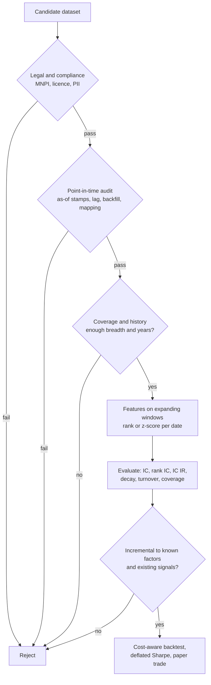

# Alternative Data and Feature Engineering

## TL;DR

- Alternative data is any non-traditional source (card transactions, web and app activity, satellite and geolocation, text); its value lies in being earlier or more granular than reported numbers, and its risks are legal (MNPI, licence, personal data) and point-in-time (lags, backfill, mapping, panel drift).
- Join every record on its knowledge time, not its event time: a feature published 3 days late in the worked example keeps only 32% of the correlation the naive event-date join shows.
- Normalise with expanding or rolling windows only; a full-sample z-score of a feature that tracks the price level produces a Sharpe of about 0.3 from pure noise.
- Evaluate with the IC time series (mean, sd, IC IR, $t$-stat), rank IC, decay and half-life, autocorrelation and turnover, coverage, and incremental IC over known factors.
- Fundamental law: $\text{IR} = \text{IC}\sqrt{\text{BR}}$ from $\text{IR}^2 = \sum_i\alpha_i^2/\sigma_i^2$; bets whose scores and residuals share a common component have correlation $\rho_z\rho_e$, which collapses breadth, and demeaning the scores restores it.

## Learning objectives

- Evaluate an alternative dataset: coverage, history, point-in-time integrity, cost.
- Engineer features robustly and avoid leakage.
- Derive the fundamental law $\text{IR} = \text{IC}\sqrt{\text{BR}}$ and compute effective breadth for correlated bets.
- Quantify publication-lag, backfill and normalisation leaks by simulation.

## Core concepts

### What alternative data is

Kolanovic and Krishnamachari (2017) sort alternative data by how it is generated:

| Generated by | Examples | Typical use |
| :--- | :--- | :--- |
| Individuals | social media, product reviews, web search, news and text | sentiment, attention, nowcasting demand |
| Business processes | credit and debit card transactions, email receipts, supply-chain and shipping records, job postings | nowcasting revenue before earnings, supply-chain links |
| Sensors | satellite imagery, geolocation foot traffic, ship and aircraft tracking | store traffic, commodity inventories, activity indices |

Text processing (filings, transcripts, news) is covered in [NLP and LLMs for Finance](../10-Machine-Learning-for-Finance/09-NLP-and-LLMs-for-Finance.md).
Most alt-data alpha in equities is a nowcast of a fundamental (revenue, same-store sales, subscribers) that the market learns later at the earnings release, so the edge is time and the signal is usually a surprise versus consensus, not a level.

### Evaluating a dataset before buying it

| Question | Why it matters |
| :--- | :--- |
| Coverage: which tickers, what share of the investable universe by count and by capitalisation? | Breadth, and so IR, scales with $\sqrt{\text{coverage}}$. |
| History length versus signal horizon | A $t$-stat of $t$ at annual IR needs $(t/\text{IR})^2$ years. |
| Point-in-time integrity: are as-of snapshots stored, or only the latest revised history? | Restated history leaks the future into the backtest. |
| Publication lag and delivery time | Defines the knowledge timestamp and the usable horizon. |
| Panel construction: how users, merchants or devices enter and leave | Panel drift creates spurious trends. |
| Entity mapping: brands and merchants to point-in-time tickers | Mapping errors add noise and look-ahead (mergers, renames). |
| Cost, exclusivity and how many funds already buy it | Widely sold data decays faster as it gets arbitraged. |
| Legal and compliance review | See below; a failed review ends the evaluation. |

### Licensing and compliance

- **Material nonpublic information.** In the US, insider-trading liability rests on Section 10(b) of the Securities Exchange Act of 1934 and SEC Rule 10b-5; under the misappropriation theory (United States v. O'Hagan, 1997) trading on information obtained in breach of a duty of confidence is illegal even without a duty to the issuer's shareholders.
  Funds therefore diligence how a vendor obtained its data and whether anyone breached a confidentiality obligation to provide it.
- **Personal data.** Regimes such as the EU General Data Protection Regulation and the California Consumer Privacy Act govern personal data; funds typically require aggregated or de-identified delivery and assess re-identification risk.
- **Collection method.** Web-scraped data raises contract (terms of service) and computer-access law questions, which is why scraping programmes go through legal review.
- **Licence terms.** Permitted use, redistribution, rights in derived data and models, and what happens to signals built on the data after the licence ends.

Compliance practice varies by firm; the point for an interview is that legal review comes first and can veto a dataset with a great backtest.

### Point-in-time traps specific to alternative data

General point-in-time discipline is in [Point-in-Time Data and Survivorship](02-Point-in-Time-Data-and-Survivorship.md); alt data adds its own failure modes.

- **Publication lag.** A panel describing week $w$ arrives days later; the knowledge time is the delivery time, and the backtest must join on it.
- **Revisions and reweighting.** Vendors re-weight panels and restate history; without stored as-of snapshots you test on numbers nobody had.
- **Vendor backfill.** A dataset launched today with ten years of "history" usually reconstructed that history for the names it covers today, which skews toward survivors and winners.
- **Entity mapping.** Merchant strings, apps and brands map to parent companies through acquisitions and renames; the mapping table itself must be point-in-time.
- **Panel drift.** Growth in the underlying user or device panel looks like growth in the company; normalise by panel size or use same-panel growth.

### Feature engineering without leakage

Standard transformations, each computed using only data known at the decision time:

- Growth rates year on year (removes seasonality) and surprises versus consensus or versus the company's own guidance.
- Cross-sectional rank or z-score per date, then winsorise, so units and scale drift do not matter ([Signals, Features and Alpha Decay](03-Signals-Features-and-Alpha-Decay.md)).
- Time-series normalisation with expanding or rolling means and volatilities, never full-sample ones.
- Smoothing (exponential moving averages) when the raw feature is noisy and the underlying driver is persistent.
- Neutralisation against sector and style factors before measuring IC.

Leaks to rule out: full-sample normalisation or winsorisation thresholds, feature selection on whole-sample IC, labels that overlap the training window, and timestamps that are event times rather than knowledge times.
Purging and embargo for overlapping labels are in [Time-Series Cross-Validation, Purging and Embargo](../10-Machine-Learning-for-Finance/02-Time-Series-Cross-Validation-Purging-Embargo.md).

### Signal evaluation

For a cross-sectional signal $s_{i,t}$ and next-period returns, the evaluation sheet is:

- **IC and rank IC** per date, then their mean, standard deviation, IC IR $= \overline{\text{IC}}/\text{sd}(\text{IC})$, $t$-stat $\text{IC IR}\times\sqrt{n_{\text{dates}}}$ and fraction of positive dates.
- **Decay:** $\text{IC}(k) = \text{corr}(s_t, r_{t+k})$ for $k = 1, 5, 10, 20$; with geometric decay at rate $\rho$ the half-life is $\ln 2/\ln(1/\rho)$.
- **Autocorrelation and turnover:** a signal-proportional book with standardised Gaussian scores trades about $\sqrt{2(1 - \text{ac})}$ of gross per rebalance.
- **Coverage:** the fraction of the universe with a value; IC IR scales roughly with $\sqrt{\text{coverage}}$ at fixed IC.
- **Incremental IC:** IC of the residual after regressing the signal on known factors and on signals you already trade ([Cross-Sectional Factor Models](04-Cross-Sectional-Factor-Models.md)).

### The fundamental law of active management

**Ex-ante derivation (Grinold 1989).**
Take $N$ assets with uncorrelated residual returns of volatility $\sigma_i$, standardised scores $z_i$ and alphas $\alpha_i = \text{IC}\,\sigma_iz_i$.
The unconstrained mean-variance active portfolio has squared information ratio

$$
\text{IR}^2 = \alpha^\top\Omega^{-1}\alpha = \sum_i\frac{\alpha_i^2}{\sigma_i^2} = \text{IC}^2\sum_i z_i^2 \approx \text{IC}^2 N,
$$

so $\text{IR} \approx \text{IC}\sqrt{\text{BR}}$ with breadth BR the number of independent bets per year (assets times independent rebalances).

**Realised version.**
Let standardised residual returns be $r_i/\sigma_i = \text{IC}\,z_i + \sqrt{1 - \text{IC}^2}\,e_i$ with $z_i, e_i$ iid standard normal, and hold $h_i \propto z_i/\sigma_i$.
The period return $R = \sum_i z_i r_i/\sigma_i$ has mean $\text{IC}\,N$ and variance $\text{IC}^2\cdot2N + (1 - \text{IC}^2)N = N(1 + \text{IC}^2)$, so

$$
\text{IR} = \frac{\text{IC}\sqrt N}{\sqrt{1 + \text{IC}^2}},
$$

which is $\text{IC}\sqrt N$ to first order for small IC.

**Correlated bets.**
Suppose scores share a common component, $z_i = \sqrt{\rho_z}\,h + \sqrt{1-\rho_z}\,\zeta_i$, and so do residuals, $e_i = \sqrt{\rho_e}\,g + \sqrt{1-\rho_e}\,\eta_i$.
The bet outcomes $z_ie_i$ then have pairwise correlation $E[z_iz_j]E[e_ie_j] = \rho_z\rho_e$, and $N$ bets with pairwise correlation $\rho$ behave like

$$
N_{\text{eff}} = \frac{N}{1 + (N-1)\rho}
$$

independent ones.
Either factor alone is harmless: random scores on correlated residuals, or correlated scores on independent residuals, keep full breadth.
Demeaning the scores each period removes $h$, which removes the common residual factor's contribution as well, and restores breadth at the cost of the small amount of IC carried by the common component.

## Worked examples

All numbers are printed and asserted by [alt_data_signal_eval.py](code/alt_data_signal_eval.py).

### 1. The fundamental law by simulation

$N = 500$, IC 0.02, independent bets, 20,000 simulated periods.

- $\text{IC}\sqrt N = 0.4472$ per period; the exact $\text{IC}\sqrt N/\sqrt{1 + \text{IC}^2} = 0.4471$; the simulation gives about 0.45.
- With 12 independent rebalances a year, $\text{IR} = 0.02\sqrt{6000} = 1.5492$, the same figure as in [Performance Metrics and the Fundamental Law](09-Performance-Metrics-and-Fundamental-Law.md).
- History needed: $t = \text{IR}\sqrt{Y}$, so a $t$-stat of 3 at annual IR 1.55 needs 3.75 years, and $t = 2$ at IR 0.5 needs 16 years; a 5-year alt dataset can only validate high-breadth signals.

### 2. Correlated bets and neutralisation

Same book, but scores share a common component with $\rho_z = 0.25$ (for example a sector tilt) and residuals with $\rho_e = 0.20$.

- Bet correlation $\rho_z\rho_e = 0.05$, so $N_{\text{eff}} = 500/(1 + 499\times0.05) = 19.27$.
- Heuristic $\text{IC}\sqrt{N_{\text{eff}}} = 0.0878$; exact $\text{IC}\,N/\sqrt{\text{IC}^2\cdot2N(1 + (N-1)\rho_z^2) + (1-\text{IC}^2)N(1 + (N-1)\rho_z\rho_e)} = 0.0878$; simulated about 0.084.
- Demeaning the scores each period: exact $\text{IC}\sqrt{(N-1)(1-\rho_z)/(2\text{IC}^2(1-\rho_z) + (1-\text{IC}^2)(1-\rho_e))} = 0.4325$, simulated about 0.41.

An IR improvement of 4.93 times from one line of code; this is why signals are neutralised before anything else.

### 3. The full-sample z-score leak

A feature tracks the log price level plus noise and has no predictive power; the strategy goes long when its z-score is negative ("below average, buy") and earns the next day's return.
Across 200 simulated 10-year paths (seed 7):

- Full-sample z-score: mean annualised Sharpe about 0.31, positive on about 88% of paths.
- Expanding-window z-score: mean Sharpe about 0.01.

The full-sample mean is the average of the whole path, so a level below it must on average rise toward it: the normalisation itself encodes the future.

### 4. Event date versus knowledge date

News $y_t$ is absorbed into prices over 5 days through other channels with weights $(0.40, 0.25, 0.15, 0.12, 0.08)$ plus noise of sd 2; the alt-data feature is $x_t = y_t + \text{noise}$ but is delivered 3 days after the event.

- Joined on event date, $\text{corr}(x_t, r_{t+1}) = 0.25/(\sqrt2\times2.065) = 0.0856$.
- Joined on knowledge date, the latest usable value is $x_{t-3}$, and $\text{corr}(x_{t-3}, r_{t+1}) = 0.08/(\sqrt2\times2.065) = 0.0274$.
- Only 0.32 of the apparent signal is real; the simulation gives about 0.084 and 0.024.

### 5. Vendor backfill

2,000 names with iid monthly returns (mean 0.8%, sd 10%) and no signal at all; the vendor launches after 10 years and reconstructs history only for names whose 10-year cumulative return is above the median.

- Analytic bias: $\sigma\sqrt{2/\pi}/\sqrt{120}\times12 = 8.74\%$ a year of covered-minus-universe return in the backfilled years.
- Simulated: about 8.8% a year in the backfilled years and about 0.2% in the 5 live years.

Any backtest on "covered names" during the backfilled period inherits that 8.7% a year of pure selection.

### 6. A tear sheet for a noisy alt-data feature

1,000 names, 1,500 days; a latent driver $f$ follows an AR(1) with coefficient 0.95, next-day return $= 0.05f + \varepsilon$, and the feature is $x = f + \text{noise}$ with equal signal and noise variance.

| Metric | Analytic | Simulated |
| :--- | ---: | ---: |
| IC(1) | 0.0353 | about 0.036 |
| sd of daily IC | $1/\sqrt{1000} = 0.0316$ | about 0.031 |
| IC IR (daily) | - | about 1.15 |
| $t$-stat | - | about 43.7 |
| Rank IC | - | about 0.034 |
| Fraction of positive days | - | about 0.87 |
| IC(5), IC(10), IC(20) | 0.0288, 0.0223, 0.0133 | about 0.029, 0.023, 0.014 |
| IC half-life (days) | 13.51 | - |
| Feature autocorrelation | 0.475 | about 0.475 |
| Turnover per day, $\sqrt{2(1-\text{ac})}$ | 1.0247 | - |

The IC IR is far above anything real because the synthetic residuals are independent; real cross-sections have factor structure that inflates $\text{sd}(\text{IC})$ ([Signals, Features and Alpha Decay](03-Signals-Features-and-Alpha-Decay.md)).

**Feature engineering pays twice.**
An exponential moving average with weight 0.2 on the newest value averages away the iid noise while keeping the persistent driver: IC(1) rises from 0.0353 to 0.0432 (simulated about 0.044), autocorrelation from 0.475 to 0.971, and turnover from 1.02 to 0.241 of gross per day.
Smoothing helps only because the driver is slower than the noise; on a fast driver it would destroy IC.

**Coverage.** Keeping a random 40% of names leaves IC unchanged but cuts IC IR by a factor of about 0.64, close to $\sqrt{0.4} = 0.632$.

## Pitfalls

- Joining alt data on the period it describes instead of when it was delivered.
- Testing on the vendor's current, revised history instead of stored as-of snapshots.
- Backtesting the backfilled years of a newly launched dataset as if they were live.
- Normalising, winsorising or selecting features with full-sample statistics.
- Mapping merchants or apps to tickers with today's corporate structure.
- Reading panel growth as company growth.
- Reporting IC without its decay, turnover and coverage, or without neutralising against known factors, so the "alt-data alpha" is a sector or momentum bet.
- Treating the fundamental law as a forecast; correlated bets and time-varying IC make realised IR far lower.
- Buying data before legal review; a compliance failure cannot be fixed by a better backtest.

## Interview questions

> [!question]- alpha-alt-categories | How can alternative data be categorised, with an example of each?
> By what generates it: individuals (social media, reviews, search), business processes (card transactions, email receipts, supply-chain records) and sensors (satellite imagery, geolocation, ship tracking).
> This is the Kolanovic and Krishnamachari (2017) taxonomy; most equity uses nowcast a fundamental the market learns later.

> [!question]- alpha-alt-due-diligence | What do you check before buying an alternative dataset?
> Legal and compliance, coverage, history length, point-in-time integrity, publication lag, panel construction, entity mapping, cost and crowding.
> Then measure incremental IC over known factors; legal review comes first because it can veto everything else.

> [!question]- alpha-alt-mnpi | Why do funds diligence how a vendor obtained its data?
> To avoid trading on material nonpublic information obtained in breach of a duty.
> Under Rule 10b-5 and the misappropriation theory (O'Hagan, 1997), trading on information taken in breach of a duty of confidence is illegal even if you owe no duty to the issuer.

> [!question]- alpha-alt-personal-data | What do privacy rules mean for consumer alt data?
> Funds usually require aggregated or de-identified delivery and assess re-identification risk.
> Regimes such as GDPR and the CCPA govern personal data, so raw individual-level records are a legal liability.

> [!question]- alpha-alt-publication-lag | A feature describes day $t$ but arrives 3 days later. How much of the event-date correlation survives in the example?
> About 32%: 0.0274 versus 0.0856.
> At decision time $t$ you only know $x_{t-3}$; with news absorbed over 5 days, its link to $r_{t+1}$ is the fifth absorption weight 0.08, not the second weight 0.25.

> [!question]- alpha-alt-backfill | A vendor launches with ten years of history reconstructed for the names it covers today. What goes wrong?
> Backfill bias: the covered names are today's survivors and winners, so their reconstructed history outperforms.
> In the example, picking the top half by 10-year return builds in $\sigma\sqrt{2/\pi}/\sqrt{120}\times12 = 8.7\%$ a year of covered-minus-universe return with no signal at all.

> [!question]- alpha-alt-entity-mapping | Why must the merchant-to-ticker mapping be point-in-time?
> Acquisitions, spin-offs and renames change which listed company owns a brand.
> Mapping history with today's structure attributes past sales to the wrong ticker and can leak the outcome of a later merger.

> [!question]- alpha-alt-full-sample-zscore | A feature that tracks the price level is z-scored with full-sample mean and sd and traded contrarian. What happens on pure noise?
> A spurious Sharpe of about 0.3, positive on most paths.
> The full-sample mean is the path's own average, so a value below it must on average rise toward it; with expanding windows the Sharpe is about zero.

> [!question]- alpha-alt-fl-derivation | Derive the fundamental law of active management.
> $\text{IR} \approx \text{IC}\sqrt{\text{BR}}$.
> With uncorrelated residuals and $\alpha_i = \text{IC}\,\sigma_iz_i$, the optimal active portfolio has $\text{IR}^2 = \sum_i\alpha_i^2/\sigma_i^2 = \text{IC}^2\sum_iz_i^2 \approx \text{IC}^2N$; breadth counts independent bets per year.

> [!question]- alpha-alt-fl-exact | With $r_i/\sigma_i = \text{IC}\,z_i + \sqrt{1-\text{IC}^2}\,e_i$ and weights $z_i/\sigma_i$, what is the exact per-period IR?
> $\text{IC}\sqrt N/\sqrt{1 + \text{IC}^2}$.
> The return $\sum z_i(\text{IC}\,z_i + \sqrt{1-\text{IC}^2}e_i)$ has mean $\text{IC}\,N$ and variance $2\text{IC}^2N + (1-\text{IC}^2)N = N(1+\text{IC}^2)$.

> [!question]- alpha-alt-bet-correlation | Scores share a common component with weight 0.25 and residuals one with weight 0.2. Effective breadth of 500 bets?
> About 19.
> Bet outcomes $z_ie_i$ have correlation $\rho_z\rho_e = 0.05$, and $500/(1 + 499\times0.05) = 19.27$, cutting IR from 0.45 to about 0.09 per period at IC 0.02.

> [!question]- alpha-alt-neutralise-breadth | In that setup, what does demeaning the scores each period do?
> It restores most of the breadth: exact IR rises from 0.088 to 0.43 per period.
> Demeaned scores sum to zero, so the common residual factor drops out of the PnL; only the small IC carried by the common score component is lost.

> [!question]- alpha-alt-coverage | A dataset covers 40% of your universe with the same IC. What happens to IC IR?
> It falls by about $\sqrt{0.4} = 0.63$.
> sd(IC) scales like $1/\sqrt{N}$ for independent names, so fewer names mean a noisier daily IC; the simulation gives 0.64.

> [!question]- alpha-alt-history-length | How many years of history do you need for a $t$-stat of 2 on a strategy with annual IR 0.5?
> 16 years.
> $t = \text{IR}\sqrt{Y}$, so $Y = (2/0.5)^2$; short alt-data histories can only validate high-IR, high-breadth signals.

> [!question]- alpha-alt-smoothing | When does smoothing a noisy alt-data feature raise its IC, and what else does it change?
> When the underlying driver is persistent and the noise is not; it also cuts turnover.
> In the example an EMA with weight 0.2 lifts IC from 0.035 to 0.043 and autocorrelation from 0.475 to 0.971, so turnover drops from 1.02 to 0.24 of gross per day.

> [!question]- alpha-alt-ic-half-life | The latent driver of a signal has daily autocorrelation 0.95. What is the IC half-life?
> About 13.5 days.
> $\text{IC}(k) \propto 0.95^{k-1}$, so the half-life is $\ln2/\ln(1/0.95) = 13.51$.

> [!question]- alpha-alt-incremental-ic | Why measure IC after regressing the alt-data signal on known factors?
> To credit the dataset only with information you do not already have.
> Card-spend growth may simply proxy momentum or a sector tilt; the residual IC, and its correlation with your existing book, decide whether it adds IR.

> [!question]- alpha-alt-panel-drift | A card panel grows 20% a year. What goes wrong if you use raw spend as revenue growth?
> Panel growth masquerades as company growth.
> Normalise by panel size or use same-panel (constant cohort) growth, and check that the vendor's panel reweighting is stored point-in-time.

## In this repo and SDE-Interview-Prep

- Code: [alt_data_signal_eval.py](code/alt_data_signal_eval.py) backs every number in this note.
- Related notes: [Signals, Features and Alpha Decay](03-Signals-Features-and-Alpha-Decay.md), [Performance Metrics and the Fundamental Law](09-Performance-Metrics-and-Fundamental-Law.md), [Point-in-Time Data and Survivorship](02-Point-in-Time-Data-and-Survivorship.md), [Time-Series Cross-Validation, Purging and Embargo](../10-Machine-Learning-for-Finance/02-Time-Series-Cross-Validation-Purging-Embargo.md), [NLP and LLMs for Finance](../10-Machine-Learning-for-Finance/09-NLP-and-LLMs-for-Finance.md).

## Further reading

- Marcos Lopez de Prado, *Advances in Financial Machine Learning*
- Kolanovic and Krishnamachari (2017), Big Data and AI Strategies: Machine Learning and Alternative Data Approach to Investing, J.P. Morgan.
- Denev and Amen, *The Book of Alternative Data* (Wiley 2020).
- Grinold (1989), The Fundamental Law of Active Management, Journal of Portfolio Management.
- Grinold and Kahn, *Active Portfolio Management*
- Michael Isichenko, *Quantitative Portfolio Management*
