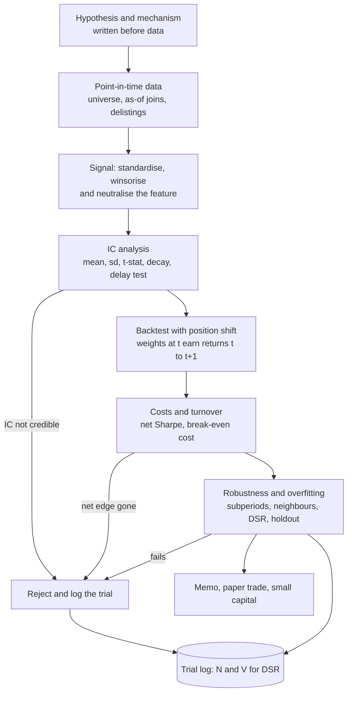

# Alpha Research Case Studies

## TL;DR

- A take-home is graded on process, not on the Sharpe: hypothesis first, point-in-time data, a neutralised signal, IC analysis, a shifted backtest, costs, then an honest account of how many things you tried.
- Case A (residual reversal, 500 stocks, 5 years daily): rank IC 0.019 with $t = 5.1$, gross Sharpe 2.43, but 65% daily turnover takes it to 1.19 at 5 bp; the break-even cost is 9.8 bp per unit traded.
- Case B (time-series momentum, 24 futures, 30 years monthly): volatility scaling halves the risk share of the four most volatile contracts (0.39 to 0.19), and the best of 24 lookbacks survives deflation (DSR 0.9999).
- Case C (critique): on data with no alpha, a missing position shift gives a Sharpe of 26.2, full-sample normalisation 2.13, survivorship turns $-0.74$ into 0.05, and the best of 96 noise variants shows 0.69 with PSR(0) 0.98 but DSR 0.27.
- The deflated Sharpe ratio is only as good as its inputs: trials that differ by design (not by noise) inflate $V$ and make it conservative; report the pre-registered result and treat the search as a robustness check.

## Learning objectives

- Work research case studies end to end as in a take-home or onsite.
- Critique a flawed backtest and a flawed signal.
- Quantify how much each classic flaw (look-ahead, survivorship, full-sample normalisation, parameter search) inflates a backtest.
- Compute and interpret the deflated Sharpe ratio for a selected strategy, including when its inputs mislead.
- Write the result up as a short research memo a portfolio manager would act on.

## Core concepts

### What the grader is looking for

A research take-home (a dataset, a few days, "find something and tell us about it") is a simulation of the job.
Interviewers at systematic funds read it for judgement more than for the number at the end.
The answer that scores is one that would survive the firm's own review: every input is point-in-time, the backtest is causal, costs are charged, and the reported Sharpe comes with the count of what was tried.
A Sharpe of 3 with no cost model and no trial count is a red flag, not a win; a Sharpe of 0.8 with a clean pipeline and a clear statement of what could break it is a hire.

### The research template



1. **Hypothesis.** State the economic mechanism and the predicted sign before touching the data ([Research Process and Hypothesis Discipline](01-Research-Process-and-Hypothesis-Discipline.md)).
   "Liquidity providers absorb idiosyncratic order-flow shocks and are paid by the subsequent partial reversal" predicts a negative sign on recent residual returns, a horizon of days, and a stronger effect in less liquid names.
2. **Data.** Point-in-time universe including dead names and delisting returns, every field joined as of its knowledge time ([Point-in-Time Data and Survivorship](02-Point-in-Time-Data-and-Survivorship.md)).
3. **Signal.** Standardise cross-sectionally, winsorise, and neutralise against the factors you do not want to bet on ([Signals, Features and Alpha Decay](03-Signals-Features-and-Alpha-Decay.md), [Cross-Sectional Factor Models](04-Cross-Sectional-Factor-Models.md)).
4. **IC analysis.** Time series of daily rank IC: mean, standard deviation, $t$-stat, fraction positive, decay by lag, and a delay test.
5. **Backtest.** Weights decided with information to $t$ earn returns from $t$ to $t+1$ ([Backtesting Methodology and Pitfalls](07-Backtesting-Methodology-and-Pitfalls.md)).
6. **Costs.** Turnover times cost per unit traded, plus borrow and financing; report the break-even cost ([Transaction Costs and Turnover](13-Transaction-Costs-and-Turnover.md)).
7. **Robustness and overfitting.** Subperiods, parameter neighbourhoods, a holdout that was never touched, and the deflated Sharpe ratio across every logged trial ([Overfitting and Deflated Sharpe](08-Overfitting-and-Deflated-Sharpe.md)).

### Why synthetic data in a study guide

Real data never tells you the right answer, so you cannot check whether a method found it.
Every case below simulates a market with a known truth (a real but small reversal, a real trend, or nothing at all), then runs the standard pipeline and compares what the pipeline reports with what is true.
All numbers come from [research_case_studies.py](code/research_case_studies.py), which prints and asserts each one; the simulations use fixed seeds, so quoted values are "about" in the sense of one draw.

### Deflated Sharpe in four lines

From [Overfitting and Deflated Sharpe](08-Overfitting-and-Deflated-Sharpe.md), with every Sharpe per period:

$$
SR_0 = \sqrt{V}\Big[(1-\gamma)\Phi^{-1}\big(1-\tfrac1N\big) + \gamma\,\Phi^{-1}\big(1-\tfrac{1}{Ne}\big)\Big], \qquad
\text{DSR} = \Phi\left[\frac{(\widehat{SR}-SR_0)\sqrt{T-1}}{\sqrt{1-\hat\gamma_3\widehat{SR}+\frac{\hat\gamma_4-1}{4}\widehat{SR}^2}}\right].
$$

The script's implementation reproduces note 08's worked example exactly (bracket 2.5306 for $N = 100$, $SR_0$ 1.265 annualised, DSR 0.9375) before it is used on the cases.

```python
from statistics import NormalDist
ND, G = NormalDist(), 0.5772156649015329

def expected_max(n):            # E[max of n iid N(0,1)], Bailey and Lopez de Prado (2014)
    return (1 - G) * ND.inv_cdf(1 - 1 / n) + G * ND.inv_cdf(1 - 1 / (n * 2.718281828459045))

def psr(sr, sr_star, t, skew, kurt):   # per-period Sharpe, kurt non-excess
    return ND.cdf((sr - sr_star) * (t - 1) ** 0.5 / (1 - skew * sr + (kurt - 1) / 4 * sr**2) ** 0.5)

def dsr(selected, trial_sharpes):       # sharpe and skew_kurt as defined in the script
    sr0 = trial_sharpes.std(ddof=1) * expected_max(len(trial_sharpes))
    return psr(sharpe(selected), sr0, len(selected), *skew_kurt(selected))
```

### The flaw catalogue

Each flaw below was switched on alone against a clean baseline in Case C, so the inflation is attributable to it.

| Flaw | Clean result | Flawed result | Mechanism |
| :--- | :--- | :--- | :--- |
| Missing position shift (12-month momentum, no alpha) | Sharpe 0.34 | 26.2 | The portfolio is formed on the returns it is then credited with |
| Full-sample time-series normalisation (contrarian, no alpha) | $-0.21$ | 2.13 | The full-sample mean contains the future, leaking an IC of about $\sqrt{12}/T$ |
| Survivors-only universe (buy losers, delistings at $-30\%$) | $-0.74$ | 0.05 | Losers that later delist, with their delisting returns, are missing |
| Best of 96 variants on noise (10 years monthly) | DSR 0.27 | Sharpe 0.69, PSR(0) 0.98 | Selection: the maximum of many noisy Sharpes is biased up |

## Worked examples

### Case A: short-term residual reversal in US-style equities

**Prompt.** "Here are five years of daily returns for 500 stocks with sector labels and betas. Find a signal, backtest it, and tell us whether you would trade it."

**1. Hypothesis.**
Short-term reversal is one of the oldest documented anomalies (Jegadeesh 1990 at the monthly horizon, Lehmann 1990 at the weekly horizon).
The mechanism is liquidity provision: an idiosyncratic order-flow shock pushes a price away from value and the provider of liquidity is paid by the partial reversal.
Predictions written down before looking: negative sign on the recent residual return, horizon of days, the effect lives in the residual and not in sector or market moves.
Pre-registered specification: signal $= -$(5-day cumulative residual return).

**2. Data and point-in-time checks.**
Returns are close to close; the signal at the close of day $t$ trades at that close or later and earns returns from $t$ to $t+1$.
In a real take-home check here that the universe includes names that left it (with delisting returns), that sector labels and betas are as-of (not today's classification applied to history), and that prices are adjusted for splits and dividends without using future adjustment factors.
The synthetic panel has a constant universe, so the checks pass by construction; Case C shows what happens when they do not.

**3. Signal construction and neutralisation.**
Each day, regress the cross-section of returns on 10 sector dummies and beta and keep the residual, $e_t = M r_t$ with $M = I - X(X^\top X)^{-1}X^\top$.
Signal $s_{i,t} = -\sum_{j=0}^{4} e_{i,t-j}$, z-scored across stocks, winsorised at $\pm3$, projected through $M$ again, and scaled to unit gross: $w_t = z_t/\sum_i|z_{i,t}|$.
Because the final step is a projection, the book's net beta and net sector exposures are zero to machine precision (largest absolute net beta $1.42\times10^{-16}$).

**4. IC analysis.**
Daily rank IC of the signal against next-day residual returns:

| Statistic | Value |
| :--- | :--- |
| Mean rank IC | 0.0191 |
| Standard deviation of daily IC | 0.1341 |
| Annualised IC information ratio $\overline{\text{IC}}/\text{sd}\times\sqrt{252}$ | 2.26 |
| $t$-stat $\overline{\text{IC}}/\text{sd}\times\sqrt{n}$ | 5.1 |
| Fraction of days with positive IC | 0.55 |

IC decay by lag (signal at $t$, residual return on day $t+h$): 0.0191, 0.0176, 0.0142, 0.0122, 0.0097 for $h = 1,\dots,5$.
It decays smoothly, consistent with the mechanism; an IC concentrated at $h = 1$ and gone at $h = 2$ would point to a timing artefact.
Note the IC is 0.019 with a daily standard deviation seven times larger: a typical daily equity signal, right only 55% of days.

**5. Backtest with the position shift.**
$\text{pnl}_{t+1} = w_t^\top r_{t+1}$, never $w_t^\top r_t$.
Gross: Sharpe 2.43, 16.0% a year on unit gross (6.37 bp a day), close to the annualised IC information ratio of 2.26 as [Signals, Features and Alpha Decay](03-Signals-Features-and-Alpha-Decay.md) predicts.
Delay test: trading one day late gives a gross Sharpe of 2.36, so the edge is not a one-bar artefact.

**6. Costs and turnover.**
Two-sided daily turnover is 0.647 of gross.
The day-to-day cross-sectional autocorrelation of the signal is 0.787, and note 03's rule $\sqrt{2(1-\rho)}$ gives 0.653, so the turnover is what a 5-day sum of nearly independent daily residuals should produce.
Break-even cost: $6.37/0.647 = 9.8$ bp per unit traded.
At 5 bp per unit traded the net Sharpe is 1.19; the cost model is now the most important assumption in the study, and the memo must say what participation rate 5 bp implies.

**7. Neutralisation choices.**

| Book | Gross Sharpe | Net at 5 bp |
| :--- | :--- | :--- |
| Raw returns, demeaned only | 2.46 | - |
| Sector and beta neutral (pre-registered) | 2.43 | 1.19 |
| Sector, beta and five style factors neutral | 3.11 | 1.57 |

Sector and beta neutralisation alone did not change the Sharpe here (2.46 raw versus 2.43, book volatility 6.8% versus 6.6%), because the simulated sector and market returns have no serial correlation, so the raw book's factor tilts are pure noise of small size.
That is not a reason to skip it: in real data those tilts are unintended bets that can dominate a bad month.
Neutralising also against five style exposures (the kind a Barra-style risk model provides) raised the mean IC to 0.0220, cut its daily standard deviation to 0.1158 and lifted the gross Sharpe to 3.11: unremoved common factors are what make daily IC noisy, so the risk model you neutralise against matters more than the sector dummies.

**8. Search and deflation.**
After the pre-registered test, the lookback was varied from 1 to 10 days, with and without neutralisation: 20 trials, all net of 5 bp.

| Lookback (days) | 1 | 2 | 3 | 4 | 5 | 6 | 7 | 8 | 9 | 10 |
| :--- | ---: | ---: | ---: | ---: | ---: | ---: | ---: | ---: | ---: | ---: |
| Neutral, net Sharpe | $-1.62$ | 0.13 | 0.71 | 1.12 | 1.19 | 1.41 | 1.53 | 1.64 | 1.59 | 1.38 |
| Raw, net Sharpe | $-1.54$ | 0.08 | 0.63 | 1.07 | 1.26 | 1.49 | 1.60 | 1.63 | 1.54 | 1.30 |

- The best trial is lookback 8, neutral, net Sharpe 1.64.
- Its deflated Sharpe ratio is only 0.33, with $SR_0$ = 1.84 annualised.
- Pre-registered 5-day test, a single trial: PSR(0) = 0.9960.
- Holdout: picking on the first 3 years selects lookback 8 (raw) with in-sample net Sharpe 1.83; on the last 2 years it earns 1.32.

How to read this.
The DSR of 0.33 does not say the reversal is fake: the truth contains a real reversal and the pre-registered test found it with PSR 0.996.
It says the step from 1.19 to 1.64 is not distinguishable from what picking the best of 20 would produce.
And its $SR_0$ is inflated, because $V$ (the cross-trial variance of Sharpes) is dominated by the 1- and 2-day lookbacks, which differ by design (they pay three to five times the costs), not by noise.
DSR assumes the trials are exchangeable draws; when they are not, it is conservative.
The defensible report is: "pre-registered 5-day signal, net Sharpe about 1.2 at 5 bp; the 5 to 9 day neighbourhood is a plateau between 1.2 and 1.6, so the result is not a knife-edge; the holdout degraded from 1.83 to 1.32, in line with selection".

**9. Verdict as written in the memo.**
Trade it small, as a component of a larger book, with a cost model calibrated on our own fills, because at 9.8 bp break-even a cost overrun of a few bp erases it.
Next steps: condition on liquidity (the mechanism predicts a stronger effect in less liquid names, where costs are also higher), smooth or trade partially toward target to cut turnover, and paper trade for one quarter.

### Case B: volatility-scaled time-series momentum on futures

**Prompt.** "Thirty years of monthly returns on 24 futures across asset classes. Build a trend-following strategy."

**1. Hypothesis.**
Moskowitz, Ooi and Pedersen (2012) document time-series momentum: an instrument's own past 12-month excess return predicts its next-month return, across equity index, bond, currency and commodity futures.
Their construction, which the case copies: position sign from the trailing 12-month return, one-month holding, and each position scaled to 40% annualised ex-ante volatility so that a low-volatility bond future and a high-volatility commodity contribute comparable risk (they estimate ex-ante volatility with an exponentially weighted average of squared daily returns).
The synthetic market has a persistent drift (AR(1) with coefficient 0.95 per month) under noise, annual volatilities from 5% to 40%, and a common factor with correlation 0.2.

**2. Point-in-time detail.**
Ex-ante volatility at month end $j$ uses months $j-23,\dots,j$ only; with daily data you would use an EWMA, never a full-sample volatility.
In real futures data the return series must be built from rolled contracts with the roll on a pre-set schedule, using excess (collateral-free) returns; a back-adjusted price series is fine for returns but not for levels.

**3. Results.**

| Construction | Annualised Sharpe | Risk share of the 4 most volatile contracts |
| :--- | :--- | :--- |
| Sign only, equal notional | 0.74 | 0.39 |
| Sign times 40% / ex-ante vol | 0.80 | 0.19 |

The scaled portfolio's annualised volatility is 10.2%.
Without scaling, the four most volatile of 24 contracts (one sixth of the book) carry 39% of the risk, so the strategy is mostly a bet on those four; scaling brings them close to their one-sixth share.

**4. Lookback search and deflation.**
Sharpe by lookback in months:

| Lookback | 1 | 2 | 3 | 4 | 5 | 6 | 7 | 8 | 9 | 10 | 11 | 12 |
| :--- | ---: | ---: | ---: | ---: | ---: | ---: | ---: | ---: | ---: | ---: | ---: | ---: |
| Sharpe | 0.45 | 0.74 | 0.73 | 0.83 | 0.64 | 0.62 | 0.71 | 0.85 | 0.79 | 0.91 | 0.76 | 0.80 |

| Lookback | 13 | 14 | 15 | 16 | 17 | 18 | 19 | 20 | 21 | 22 | 23 | 24 |
| :--- | ---: | ---: | ---: | ---: | ---: | ---: | ---: | ---: | ---: | ---: | ---: | ---: |
| Sharpe | 0.77 | 0.80 | 0.95 | 0.90 | 0.98 | 0.96 | 0.99 | 0.92 | 0.91 | 0.85 | 0.84 | 0.88 |

- Best: 19 months, Sharpe 0.99; across the 24 trials $SR_0$ = 0.25 annualised and DSR = 0.9999.
- Holdout: selecting on the first 15 years picks 24 months (the edge of the grid), which earns 0.70 on the last 15.

Here deflation passes easily, because the cross-trial dispersion of Sharpes is small (every lookback captures the same persistent drift) and 30 years is long.
The lesson from the table is not "use 19 months": every lookback from 2 to 24 earns between 0.62 and 0.99, a broad plateau, which is the signature of a real effect.
A selection that lands on the edge of the grid (24) is a warning to widen the grid or, better, to blend several lookbacks, which is what most trend followers do.

**5. What the memo adds.**
Costs are small at monthly rebalancing on liquid futures, but roll costs and the vol-scaling trades must be charged.
The risk to disclose is regime dependence: trend strategies lose in choppy markets with sharp reversals, and correlation across contracts rises in crises, so the realised portfolio volatility exceeds the 10.2% average in exactly the months that matter.

### Case C: critique a flawed backtest

**Prompt.** "A junior researcher shows you a stock-selection backtest with a Sharpe of 2. What do you check?"

Answer with the pre-flight checklist from [Backtesting Methodology and Pitfalls](07-Backtesting-Methodology-and-Pitfalls.md), but quantify each flaw.
Two synthetic panels: C1 has 1,000 stock slots over 21 years monthly (one warm-up year, a 20-year backtest) with performance-related delistings; C2 has 1,000 stocks over 14 years monthly (4 warm-up years, a 10-year backtest) with no cross-sectional alpha at all.

**Flaw 1: survivorship (C1).**
Stocks whose trailing 12-month log return is below $-0.5$ delist with probability 1% a month (0.1% otherwise) with a final return of $-30\%$; each delisting is replaced by a new listing, so 1,519 stocks are listed over the sample to fill 1,000 slots.
The $-30\%$ echoes Shumway (1997), who argued that missing performance-related delisting returns in CRSP should be filled with a large negative value rather than dropped.
Strategy: long the 10% worst 12-month performers, short the 10% best, monthly.

- Point-in-time universe, delisting returns included: Sharpe $-0.74$.
- Survivors-only database (only stocks alive at the end): Sharpe 0.05.
- Return bias of the long-short: 4.4% a year; bias of the equal-weight universe return itself: 1.5% a year.

The bias concentrates where delistings concentrate: in the losers leg of contrarian and deep-value strategies.
Check: does the universe at each date include names that later disappeared, and are delisting returns present rather than dropped?

**Flaw 2: missing position shift (C2).**
Twelve-month momentum on data with no alpha has a Sharpe of 0.34 when the decile portfolio formed at $t$ earns month $t+1$ (pure noise).
Credit it with month $t$, the last month of its own formation window, and the Sharpe is 26.2.
Check: lag the signal one extra period; a real signal degrades gracefully (Case A's delay test), a look-ahead bug collapses.

**Flaw 3: full-sample normalisation (C2).**
"Contrarian relative to the stock's own average": signal $= -(\text{trailing 12-month return} - 12\hat\mu_i)$, where $\hat\mu_i$ is the stock's mean monthly return.

- Full-sample $\hat\mu_i$ (computed over the whole 120-month backtest): Sharpe 2.13.
- Expanding-window $\hat\mu_i$ (data to $t$ only): Sharpe $-0.21$.

The full-sample mean contains next month's return with weight $1/T$, so $\text{cov}(s_t, r_{t+1}) = 12\sigma^2/T$ while $\text{var}(s_t) \approx 12\sigma^2$, giving a leaked IC of about $\sqrt{12}/T = 0.0289$ for $T = 120$; the simulation measures 0.0274.
An IC of 0.03 across 1,000 stocks is a strong signal, and it was manufactured by one `mean()` call.
The same leak comes from full-sample z-scores, full-sample PCA or factor loadings, and scalers fit before a train/test split ([Time-Series Cross-Validation, Purging and Embargo](../10-Machine-Learning-for-Finance/02-Time-Series-Cross-Validation-Purging-Embargo.md)).

**Flaw 4: parameter search over noise (C2).**
Lookbacks 1 to 24 months, with or without skipping the latest month, momentum or contrarian: 96 variants on data with no alpha.

- Best: 8-month momentum skipping the latest month, Sharpe 0.69 over 10 years.
- Naive PSR(0) of that winner: 0.98, which would read as "98% confident the Sharpe is positive".
- Deflated: bracket 2.52 for $N = 96$, $SR_0$ = 0.89 annualised, DSR 0.27.

Including both signs doubles the trial count for free and guarantees a positive winner; the trial log must count it.
Here $N = 96$ overstates the number of independent trials (neighbouring lookbacks are highly correlated), which raises $SR_0$; estimate the effective $N$ by clustering trial returns, as note 08 recommends.

**Other checks to name (not simulated).**
Costs and borrow (Case A shows a 2.43 gross Sharpe becoming 1.19); fills at the signal's own close price; restated fundamentals joined by fiscal period instead of announcement date; index membership applied with today's constituents; a Sharpe driven by a few days or names; and a "holdout" that was looked at during development.

### Writing the memo

One page, in this order: question and mechanism; data and point-in-time handling; signal definition; IC table; gross and net Sharpe with turnover and the cost assumption; break-even cost; robustness (subperiods, neighbours, delay, cost doubled); number of trials and DSR; capacity estimate; recommendation and what would change your mind.
State what you would do with another week, which is how interviewers distinguish a researcher from a backtester.

## Pitfalls

- Opening with the best backtest instead of the hypothesis and the pre-registered test.
- Reporting gross Sharpe for a daily-rebalanced book; with 65% daily turnover, costs are the whole story.
- Measuring IC against raw returns when the book is neutralised, so factor luck is credited to the signal.
- Neutralising against sectors only and concluding the residual is clean; unremoved style factors make daily IC noisy and can carry the PnL.
- Forgetting to count discarded variants, sign flips and the neutral or raw choice as trials.
- Computing DSR with a trial set dominated by structurally different variants and reading the low value as "the effect is fake", or with near-duplicate variants counted as independent.
- Treating the best lookback as a discovery instead of looking for a plateau; a winner on the edge of the grid means the grid is wrong.
- Using any full-sample statistic (mean, volatility, z-score, PCA loadings, winsorisation bounds) inside a signal.
- Testing on a survivors-only database, especially for contrarian, distress or small-cap strategies.
- Declaring a holdout after peeking at it; a holdout used twice is training data.

## Interview questions

> [!question]- alpha-case-takehome-order | In what order should a research take-home be presented?
> Hypothesis and mechanism, data and point-in-time handling, signal definition, IC analysis, causal backtest, costs and turnover, robustness and trial count, recommendation.
> The grader is checking process and judgement; the Sharpe at the end is worth little without the steps before it.

> [!question]- alpha-case-preregister | Why pre-register one specification before searching?
> It gives one test with no selection bias, so its PSR or $t$-stat means what it says.
> In Case A the pre-registered 5-day reversal had PSR(0) 0.996, while the best of 20 searched variants had DSR 0.33; the search can only be judged as a robustness plateau.

> [!question]- alpha-case-reversal-mechanism | What economic mechanism justifies short-term reversal, and what does it predict?
> Liquidity provision: idiosyncratic order-flow shocks push prices away from value and are partly reversed, paying the liquidity provider.
> It predicts a negative sign on recent residual (not factor) returns, a horizon of days, and a stronger effect in less liquid names.

> [!question]- alpha-case-ic-numbers | Mean daily rank IC 0.019 with standard deviation 0.134 over 5 years. Is it significant, and what Sharpe should a signal-weighted book have?
> Yes, $t \approx 5.1$, and the book's gross Sharpe should be near the annualised IC information ratio, 2.26.
> $t = 0.019/0.134\times\sqrt{1259}$; a signal-weighted book's daily return is proportional to that day's IC, and the simulated book earned 2.43.

> [!question]- alpha-case-breakeven | A book earns 6.37 bp a day gross with 0.647 two-sided turnover. Break-even cost per unit traded?
> About 9.8 bp.
> Break-even cost is daily alpha over daily turnover, $6.37/0.647$.

> [!question]- alpha-case-turnover-rho | Why does a 5-day sum of daily residual returns turn over about 65% of gross a day?
> Consecutive 5-day sums share 4 of 5 terms, so the signal's autocorrelation is about 0.8 and turnover is about $\sqrt{2(1-\rho)}$.
> Measured: $\rho = 0.787$, implied 0.653, realised 0.647.

> [!question]- alpha-case-net-sharpe | A reversal book has gross Sharpe 2.43 and break-even cost 9.8 bp. At 5 bp, roughly what net Sharpe do you expect?
> About half the gross, 1.2.
> Net mean is about $(1 - 5/9.8)$ of gross mean with almost unchanged volatility; the simulation gives 1.19.

> [!question]- alpha-case-delay-test | Case A's gross Sharpe falls from 2.43 to 2.36 when trading one day late. What does that tell you?
> The edge is spread over several days, consistent with the IC decay (0.019, 0.018, 0.014, ...), so it is not a timing artefact.
> A look-ahead bug or a latency-dependent effect would collapse with one bar of delay.

> [!question]- alpha-case-style-neutral | Why did neutralising against style factors raise the reversal's Sharpe from 2.43 to 3.11 when sector and beta neutralisation changed nothing?
> Unremoved common factors were the main source of day-to-day IC noise.
> The signal's past residuals contained style-factor moves that are unrelated to next-day idiosyncratic returns; removing them raised mean IC from 0.019 to 0.022 and cut its daily standard deviation from 0.134 to 0.116.

> [!question]- alpha-case-dsr-low-real | Case A's best variant has DSR 0.33 although the reversal is real. Reconcile.
> DSR tests whether the winner beats the best of $N$ trials, not whether any effect exists.
> Its benchmark uses the cross-trial variance of Sharpes, which here is inflated by 1- and 2-day lookbacks that differ by design (much higher costs), so it is conservative; the pre-registered test (PSR 0.996) is the right evidence for the effect.

> [!question]- alpha-case-dsr-exchangeable | What assumption about trials makes DSR's $SR_0$ meaningful?
> The trials are exchangeable noisy estimates of similar true Sharpes, so their dispersion measures noise.
> Structurally different trials inflate $V$ and $SR_0$; near-duplicates counted as independent inflate $N$; estimate effective $N$ by clustering trial returns.

> [!question]- alpha-case-plateau | Your lookback grid shows net Sharpes 1.19, 1.41, 1.53, 1.64, 1.59 for lookbacks 5 to 9. Which do you trade?
> Something in the plateau, ideally a blend, not the single maximum.
> A broad plateau is evidence of a real effect; the peak at 8 is partly selection noise, and blending neighbours is more robust to it.

> [!question]- alpha-case-holdout | The in-sample pick earned 1.83 on 3 years and 1.32 on the next 2. Is that a failure?
> No, a degradation of that size is what selection plus noise produce.
> The holdout is informative only if it was never looked at during development; then "positive and of the same order" is the pass criterion.

> [!question]- alpha-case-tsmom-construction | Describe the Moskowitz, Ooi and Pedersen (2012) time-series momentum construction.
> For each futures contract, go long if its trailing 12-month excess return is positive and short otherwise, hold one month, and scale each position to 40% annualised ex-ante volatility.
> Ex-ante volatility comes from an exponentially weighted average of past squared daily returns, so every input is known at the trade date.

> [!question]- alpha-case-vol-scaling | Why scale each futures position by inverse volatility?
> So contracts contribute comparable risk instead of the most volatile ones dominating.
> In Case B the four most volatile of 24 contracts carried 39% of the risk unscaled and 19% scaled, close to their one-sixth share.

> [!question]- alpha-case-grid-edge | Your in-sample optimum is the longest lookback in the grid. What do you do?
> Treat it as a warning: widen the grid, look for a plateau, or blend lookbacks rather than trade the edge value.
> An optimum at a boundary means the search did not bracket the maximum, and the chosen value is the most selection-biased point.

> [!question]- alpha-case-tsmom-dsr-pass | Why does the best of 24 TSMOM lookbacks pass deflation easily (DSR 0.9999) while the best of 96 noise variants fails (0.27)?
> In TSMOM every lookback captures the same persistent drift, so cross-trial Sharpe dispersion is small and the winner sits far above $SR_0$ (0.99 versus 0.25) over 30 years.
> On noise the winner (0.69) is below $SR_0$ (0.89), because its Sharpe is exactly the kind of maximum that 96 trials produce.

> [!question]- alpha-case-no-shift | A 12-month momentum backtest on data with no alpha shows Sharpe 26. What is the bug?
> The portfolio formed at $t$ is credited with month $t$'s return, which is part of its own ranking window.
> With the correct shift the same backtest gives 0.34, which is noise; always compute weights at $t$ and multiply by returns from $t$ to $t+1$.

> [!question]- alpha-case-full-sample-leak | A signal subtracts each stock's full-sample mean return from its trailing return. Why does it look profitable on data with no alpha?
> The full-sample mean contains future returns, so a trailing return below it implies higher future returns.
> $\text{cov}(s_t, r_{t+1}) = 12\sigma^2/T$ and $\text{var}(s_t) \approx 12\sigma^2$, so IC $\approx \sqrt{12}/T = 0.029$ for $T = 120$; the backtest showed Sharpe 2.13 versus $-0.21$ with an expanding mean.

> [!question]- alpha-case-leak-scaling | How does the full-sample-mean leak scale with sample length, and why does that make it dangerous?
> Leaked IC is about $\sqrt{12}/T$, so it shrinks with longer samples but is never zero.
> Short-history stocks (new listings) get the largest leak, and an IC of 0.03 across a broad cross-section produces a large Sharpe, so the bug looks like a strong small-cap effect.

> [!question]- alpha-case-survivorship-direction | Which strategies are most inflated by survivorship bias?
> Contrarian, deep-value, distress and small-cap strategies, whose long legs hold the stocks most likely to delist.
> In Case C1 a losers-minus-winners book went from Sharpe $-0.74$ with delisting returns to 0.05 on a survivors-only database, a 4.4% a year return bias.

> [!question]- alpha-case-delisting-return | Why is including dead stocks not enough to fix survivorship bias?
> Their delisting returns must be included too; a stock that drops out of the data without its final return silently earns zero instead of a large loss.
> Shumway (1997) showed performance-related delisting returns are often missing in CRSP and argued for filling them with a large negative value.

> [!question]- alpha-case-psr-vs-dsr | The best of 96 variants has PSR(0) 0.98. Why is that misleading?
> PSR(0) treats the winner as the only strategy tested.
> The expected maximum Sharpe of 96 zero-skill trials is about 2.52 standard deviations of the trial Sharpes, which here is 0.89 annualised, above the winner's 0.69, so DSR is 0.27.

> [!question]- alpha-case-sign-flip | Why do momentum-or-contrarian variants count as two trials each?
> On noise they are mirror images, so including both guarantees a positive winner.
> Trying both signs is a free doubling of the search; the trial log and DSR must include it.

> [!question]- alpha-case-junior-sharpe2 | A junior shows a stock-selection backtest with Sharpe 2. Name the first five things you check.
> Position shift (lag the signal one more bar), point-in-time universe with delisting returns, full-sample statistics inside the signal, costs and borrow at a realistic participation, and how many variants were tried.
> Each is quantified in Case C or Case A; any one of them can create a Sharpe of 2 from nothing.

> [!question]- alpha-case-memo-contents | What must a one-page research memo contain?
> Mechanism, data handling, signal definition, IC table, gross and net Sharpe with turnover and cost assumption, break-even cost, robustness checks, trial count and DSR, capacity, and a recommendation with kill criteria.
> A PM decides from the memo, so the assumptions that could flip the decision (costs, regime, crowding) must be explicit.

> [!question]- alpha-case-synthetic-truth | Why test a research pipeline on synthetic data with a known answer?
> It is the only way to verify that the pipeline recovers a planted effect and reports nothing when there is none.
> Run it on pure noise first: any Sharpe it finds there is a bug or selection, as Case C shows.

## In this repo and SDE-Interview-Prep

- Code: [research_case_studies.py](code/research_case_studies.py) runs all three cases and asserts every number in this note; run it with `uv run --no-project --with numpy python 09-Alpha-Research-and-Portfolio/code/research_case_studies.py`.
- Code: [simple_event_driven.py](code/simple_event_driven.py) is the event-driven counterpart of the vectorised backtests here, and [performance_metrics.py](code/performance_metrics.py) computes the reporting metrics.
- Related notes: [Research Process and Hypothesis Discipline](01-Research-Process-and-Hypothesis-Discipline.md), [Point-in-Time Data and Survivorship](02-Point-in-Time-Data-and-Survivorship.md), [Signals, Features and Alpha Decay](03-Signals-Features-and-Alpha-Decay.md), [Cross-Sectional Factor Models](04-Cross-Sectional-Factor-Models.md), [Momentum, Mean Reversion and Carry](05-Momentum-Mean-Reversion-and-Carry.md), [Statistical Arbitrage and Pairs Trading](06-Statistical-Arbitrage-and-Pairs-Trading.md), [Backtesting Methodology and Pitfalls](07-Backtesting-Methodology-and-Pitfalls.md), [Overfitting and Deflated Sharpe](08-Overfitting-and-Deflated-Sharpe.md), [Performance Metrics and the Fundamental Law](09-Performance-Metrics-and-Fundamental-Law.md), [Transaction Costs and Turnover](13-Transaction-Costs-and-Turnover.md), [Alternative Data and Feature Engineering](14-Alternative-Data-and-Feature-Engineering.md), [Time-Series Cross-Validation, Purging and Embargo](../10-Machine-Learning-for-Finance/02-Time-Series-Cross-Validation-Purging-Embargo.md).
- SDE-Interview-Prep: [event_driven_backtester.py](https://github.com/shreejitverma/SDE-Interview-Prep/blob/main/05-Quantitative-Finance/03-Algo-Trading/Backtesting/event_driven_backtester.py).

## Further reading

- Michael Isichenko, *Quantitative Portfolio Management* (2021).
- Marcos Lopez de Prado, *Advances in Financial Machine Learning* (2018), chapters 7, 11, 12 and 14.
- Grinold and Kahn, *Active Portfolio Management*, 2nd edition (1999).
- Bailey and Lopez de Prado (2014), The Deflated Sharpe Ratio, Journal of Portfolio Management.
- Moskowitz, Ooi and Pedersen (2012), Time Series Momentum, Journal of Financial Economics.
- Jegadeesh (1990), Evidence of Predictable Behavior of Security Returns, Journal of Finance.
- Lehmann (1990), Fads, Martingales, and Market Efficiency, Quarterly Journal of Economics.
- Shumway (1997), The Delisting Bias in CRSP Data, Journal of Finance.
