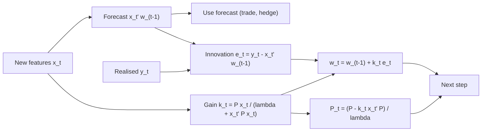

# Online Learning and Linear Models at Scale

## TL;DR

- Recursive least squares (RLS) updates a ridge fit in $O(p^2)$ per observation with the Sherman-Morrison identity and gives exactly the batch ridge answer at every step; a forgetting factor $\lambda < 1$ turns it into exponentially weighted ridge.
- A forgetting factor $\lambda$ has memory $1/(1-\lambda)$, half-life $\ln 0.5/\ln\lambda$ and effective sample size $(1+\lambda)/(1-\lambda)$: for $\lambda = 0.99$ that is 100, 68.97 and 199 observations.
- For a random-walk coefficient the best forgetting factor balances noise $r(1-\lambda)/(1+\lambda)$ against lag $q\lambda^2/(1-\lambda^2)$, giving $1-\lambda \approx \sqrt{q/r}$, the steady-state Kalman gain; RLS is the Kalman filter with a fixed gain schedule.
- SGD on squared loss (LMS) is stable only for step $\eta < 2/\lambda_{\max}$ of the feature covariance, converges at a rate set by $\lambda_{\min}$, so standardise features; a constant step leaves an excess error of about $\eta\sigma^2\,\mathrm{tr}(R)/2$.
- Linear models win in production because at financial signal-to-noise ratios variance dominates, and they are cheap to refit online, shardable through sufficient statistics, easy to constrain and attribute, and fail in visible ways.

## Learning objectives

- Use recursive least squares and online gradient methods for drifting relationships.
- Explain why simple linear models often win in production.
- Derive the RLS update from Sherman-Morrison and show it equals batch ridge.
- Choose a forgetting factor or window from the drift-noise trade-off and relate it to the Kalman filter.
- State the stability and convergence conditions for SGD on a linear model and the regret guarantee of online gradient descent.

## Core concepts

### Batch ridge as the reference

Ridge minimises $\sum_{s}(y_s - x_s^\top w)^2 + \delta\lVert w\rVert^2$ with solution $w = (X^\top X + \delta I)^{-1}X^\top y$ (ESL section 3.4).
Everything below is a way to get this answer, or a weighted version of it, one observation at a time.
The fit only needs the sufficient statistics $A = X^\top X$ ($p \times p$) and $b = X^\top y$ ($p$), never the raw rows.

### Recursive least squares from Sherman-Morrison

Let $A_t = A_{t-1} + x_tx_t^\top$ and $P_t = A_t^{-1}$, with $P_0 = I/\delta$.
Sherman-Morrison gives the inverse of a rank-one update without a new inversion:

$$
P_t = P_{t-1} - \frac{P_{t-1}x_tx_t^\top P_{t-1}}{1 + x_t^\top P_{t-1}x_t}.
$$

Define the gain $k_t = P_{t-1}x_t/(1 + x_t^\top P_{t-1}x_t)$, which equals $P_tx_t$.
Then $w_t = P_tb_t = P_t(b_{t-1} + x_ty_t)$, and substituting $P_t = P_{t-1} - k_tx_t^\top P_{t-1}$ gives

$$
w_t = w_{t-1} + k_t\,(y_t - x_t^\top w_{t-1}).
$$

The new estimate is the old one plus a gain times the one-step-ahead prediction error, the same innovation form as the Kalman filter.
Cost per step is $O(p^2)$ against $O(p^3)$ to re-solve, and the result is not an approximation: it equals the batch ridge fit with penalty $\delta$ at every $t$.

### Forgetting factors

To track a drifting relationship, discount old squared errors geometrically: minimise $\sum_{s \le t}\lambda^{t-s}(y_s - x_s^\top w)^2 + \lambda^t\delta\lVert w\rVert^2$.
The recursion changes in two places: the gain denominator becomes $\lambda + x_t^\top P_{t-1}x_t$ and $P_t$ is divided by $\lambda$.
Equivalently, keep exponentially weighted sufficient statistics $A_t = \lambda A_{t-1} + x_tx_t^\top$ and $b_t = \lambda b_{t-1} + x_ty_t$ and solve when a forecast is needed.
The prior penalty decays as $\lambda^t\delta$, so after a burn-in the forgetting fit is essentially unregularised; add an explicit, non-decaying penalty if you want ridge shrinkage to persist.

| Quantity | Formula | $\lambda = 0.99$ | $\lambda = 0.995$ |
| :--- | :--- | ---: | ---: |
| Memory (sum of weights) | $1/(1-\lambda)$ | 100.0 | 200.0 |
| Half-life (observations) | $\ln 0.5/\ln\lambda$ | 68.97 | 138.28 |
| Effective sample size | $(\sum w)^2/\sum w^2 = (1+\lambda)/(1-\lambda)$ | 199.0 | 399.0 |
| Mean age of a weight | $\lambda/(1-\lambda)$ | 99.0 | 199.0 |

A rolling window of $W$ observations has effective sample size $W$ and mean age $(W-1)/2$, so $\lambda = 0.99$ is comparable to a 199-observation window on both counts.
Exponential weights fade observations out instead of dropping them, so the estimate does not jump when a large old observation leaves the window.

### The drift-noise trade-off, and the Kalman filter

Model the coefficient as a random walk, $\beta_t = \beta_{t-1} + u_t$ with $\text{Var}(u_t) = q$, observed through $y_t = \beta_tx_t + \varepsilon_t$ with $\text{Var}(\varepsilon_t) = r$ and $E[x_t^2] = 1$.
For the local-level analogue ($x_t \equiv 1$) the exponentially weighted estimate $\hat\beta_t = (1-\lambda)\sum_j\lambda^jy_{t-j}$ has two error sources:

- noise: $(1-\lambda)^2\sum_j\lambda^{2j}r = r\,\dfrac{1-\lambda}{1+\lambda}$, which falls as $\lambda \to 1$;
- lag: $\beta_t - (1-\lambda)\sum_j\lambda^j\beta_{t-j} = \sum_{i \ge 1}\lambda^iu_{t-i+1}$, with variance $q\,\dfrac{\lambda^2}{1-\lambda^2}$, which rises as $\lambda \to 1$.

With $\varepsilon = 1 - \lambda$ small the sum is about $r\varepsilon/2 + q/(2\varepsilon)$, minimised at $\varepsilon^* = \sqrt{q/r}$ with error about $\sqrt{qr}$.
The Kalman filter for this state-space model is the optimal linear tracker; its steady-state prior variance solves $P^2 - qP - qr = 0$ and its gain is $K = P/(P + r) \approx \sqrt{q/r}$.
So a forgetting factor is a hand-set Kalman gain, and $\lambda^* \approx 1 - K$: the Kalman filter is what you get when you estimate $q$ instead of guessing $\lambda$ (see [State-Space Models and the Kalman Filter](../02-Statistics-and-Econometrics/11-State-Space-Models-and-Kalman-Filter.md), where $Q = 0$ reduces the filter to RLS).
In practice the drift variance is unknown and itself changes, which is why desks often run a few forgetting factors side by side or pick $\lambda$ by out-of-sample forecast error on a later block.

### LMS and SGD on squared loss

Stochastic gradient descent on $\tfrac12(y_t - x_t^\top w)^2$ is the least-mean-squares (LMS) rule

$$
w_t = w_{t-1} + \eta\,(y_t - x_t^\top w_{t-1})\,x_t.
$$

It is RLS with the matrix gain $P_{t-1}$ replaced by the scalar $\eta$: $O(p)$ per step, but blind to the scale and correlation of the features.
Taking expectations with $R = E[xx^\top]$, the mean error evolves as $E[w_t - w^*] = (I - \eta R)\,E[w_{t-1} - w^*]$, so along eigenvector $i$ it contracts by $1 - \eta\lambda_i$ per step:

- stability in the mean needs $0 < \eta < 2/\lambda_{\max}$;
- the slowest mode contracts by $1 - \eta\lambda_{\min}$, so the number of steps scales with the condition number $\kappa = \lambda_{\max}/\lambda_{\min}$;
- with a constant step the weights never settle: they jitter around $w^*$ and add an excess squared error of about $\eta\sigma^2\,\mathrm{tr}(R)/2$ for small $\eta$ (the LMS misadjustment), so the step size trades tracking speed against steady-state noise exactly as $\lambda$ does for RLS.

Standardising features (or whitening them) is therefore not cosmetic for SGD: it is what makes a single learning rate work.
Per-coordinate step sizes (AdaGrad, Duchi, Hazan and Singer 2011) and second-order methods (RLS itself) are the two standard fixes when features cannot be put on one scale.

### Online convex optimisation and regret

Online learning is analysed without a data distribution: at each step the learner picks $w_t$, the adversary reveals a convex loss $\ell_t$, and performance is regret against the best fixed weight in hindsight, $\sum_t\ell_t(w_t) - \min_w\sum_t\ell_t(w)$.
Online gradient descent with projection onto a set of diameter $D$, gradients bounded by $G$ and steps $\eta_t = D/(G\sqrt t)$ has regret at most $\tfrac32GD\sqrt T$ (Zinkevich 2003; Hazan 2016, chapter 3), so average regret vanishes as $1/\sqrt T$.
For strongly convex losses (squared loss with a ridge term), steps $\eta_t \propto 1/t$ improve this to $O(\log T)$.
Follow-the-regularised-leader with an L1 term and per-coordinate rates (FTRL-Proximal) is the large-scale workhorse for sparse online logistic regression described by McMahan et al. (2013).
Regret against a fixed comparator is the wrong yardstick when the target drifts; that is what forgetting factors, constant step sizes and the Kalman filter handle.

### Linear models at scale

- Sufficient statistics shard: compute $X_k^\top X_k$ and $X_k^\top y_k$ on each shard or day, sum them and solve once; the answer equals the single-machine fit, and an exponentially weighted version just decays the running sums.
- Updating is cheap and deterministic: a daily refit of a $p = 500$ ridge model costs one $500 \times 500$ solve; there is no random seed, early stopping or architecture choice to drift between runs.
- Feature hashing maps an unbounded vocabulary (tickers crossed with event types, text tokens) into $m$ buckets without a dictionary (Weinberger et al. 2009); collisions add noise, so size $m$ from the collision rate.
- Constraints and attribution are direct: a coefficient is an exposure, so sign constraints, neutrality to factors and risk attribution are linear algebra, and a bad coefficient is visible.

### Why simple linear models often win in production

- At daily-return signal-to-noise ratios the variance term dominates the error decomposition (see [ML Fundamentals and Generalization](01-ML-Fundamentals-and-Generalization.md)); a shrunk linear model has the fewest effective parameters for the information available.
- Non-stationarity favours models that can be refit often and cheaply, and whose refit is stable: RLS and EW ridge move smoothly, while a retrained boosted model can change many predictions at once.
- Cross-sectional signals are usually already engineered to be roughly monotone (ranks, z-scores), which removes much of what a nonlinear learner would add.
- Failure modes are legible: a coefficient that flips sign or explodes is easy to monitor (see [ML in Production: Serving and Monitoring](10-ML-Production-and-Monitoring.md)), and the model has no hidden state to corrupt.
- Nonlinear models still earn their place where there are many observations per parameter and genuine interactions, such as high-frequency order-book features; there the usual pattern is a linear core with a few interaction or tree-derived features.

## Worked examples

All numbers come from [online_linear_models.py](code/online_linear_models.py); simulation results are seeded and quoted as "about".

### Example 1: RLS by hand

One feature, $\delta = 1$, no forgetting, observations $(x, y) = (1, 2), (2, 3), (1, 1)$.
Start at $w_0 = 0$, $P_0 = 1$.

- Step 1: $k = 1/(1 + 1) = 1/2$, $w_1 = 0 + \tfrac12(2 - 0) = 1$, $P_1 = 1/2$.
- Step 2: $k = (\tfrac12 \cdot 2)/(1 + 4 \cdot \tfrac12) = 1/3$, $w_2 = 1 + \tfrac13(3 - 2) = 4/3 = 1.3333$, $P_2 = (1 - \tfrac23)\tfrac12 = 1/6$.
- Step 3: $k = (1/6)/(1 + 1/6) = 1/7$, $w_3 = \tfrac43 + \tfrac17(1 - \tfrac43) = 9/7 = 1.2857$, $P_3 = 1/7$.

Check against batch ridge: $\sum xy/(1 + \sum x^2) = 9/7$ and $P_3 = 1/(1 + \sum x^2) = 1/7$.
For 8 features and 500 observations the script finds RLS and batch ridge (and, with $\lambda = 0.98$, exponentially weighted ridge) agree to better than $10^{-10}$ at every checked step.

### Example 2: picking a forgetting factor for a drifting beta

A beta follows a random walk with step variance $q = 10^{-4}$, the regressor has unit variance and the noise variance is $r = 1$.
The rule $1 - \lambda \approx \sqrt{q/r}$ suggests $\lambda = 0.99$; exactly, the steady-state Kalman gain is 0.00995, so $1 - K = 0.990$, and minimising the local-level error formula over $\lambda$ also gives 0.990.
Simulating 60,000 steps (seed 2024) and scoring the mean squared error of the beta estimate after a 2,000-step burn-in:

| Estimator | Simulated MSE $\times 10^3$ | Local-level formula $\times 10^3$ |
| :--- | ---: | ---: |
| Kalman filter with the true $q$ | 10.46 | 9.95 |
| RLS, $\lambda = 0.95$ | 27.74 | 26.57 |
| RLS, $\lambda = 0.98$ | 13.00 | 12.53 |
| RLS, $\lambda = 0.99$ | 10.49 | 9.95 |
| RLS, $\lambda = 0.995$ | 13.20 | 12.43 |
| RLS, $\lambda = 0.999$ | 49.31 | 50.43 |
| Expanding OLS ($\lambda = 1$) | 421.07 | - |
| Rolling window 100 | 13.91 | - |
| Rolling window 200 | 12.47 | - |
| Rolling window 400 | 17.17 | - |

$\lambda = 0.99$ is the best forgetting factor on the grid and only about 0.3% worse than the Kalman filter that knows $q$.
Expanding OLS is about 40.1 times worse: it estimates the average beta of the whole history, not today's.
The formula column, derived for a constant regressor, tracks the simulation to within 6.2% across the grid.
A control run that changes only the regressor to a constant $x_t = 1$ gives about 9.86 for $\lambda = 0.99$, within 0.9% of the formula, so the remaining gap comes from the randomness of the regressor.
The rolling window with about the same effective sample size (200) is worse than $\lambda = 0.99$, about 12.47 against 10.49.

### Example 3: SGD on an ill-conditioned design

Two uncorrelated features with variances 1 and 100.
The stability bound is $\eta < 2/100 = 0.02$; take $\eta = 0.01$.
The fast mode contracts by $1 - 0.01 \times 100 = 0$ in one step, but the slow mode contracts by only 0.99 per step, so cutting its error by a factor of 1,000 takes $\ln(10^{-3})/\ln 0.99 = 687.3$, that is 688 steps.
After standardising both variances to 1, $\eta = 0.5$ contracts both modes by 0.5 per step and the same reduction takes 10 steps.
The same arithmetic is why unscaled features (a price level next to a return) make SGD look like it "does not converge".

### Example 4: the cost of a constant step

Five unit-variance independent features, noise variance 1 and $\eta = 0.01$.
The small-step misadjustment formula predicts an excess squared error of $\eta\sigma^2\,\mathrm{tr}(R)/2 = 0.025$ on top of the noise.
Running LMS for 400,000 steps (seed 11) gives about 0.0259; the formula is a first-order approximation in $\eta$ and slightly understates the jitter.
Halving $\eta$ halves the jitter but doubles the time to adapt to a change in $w^*$.

### Example 5: sizing a hash space

Hash 100,000 distinct features into $2^{20}$ buckets.
A given feature shares its bucket with at least one other with probability $1 - (1 - 2^{-20})^{99{,}999} = 0.0910$; a simulated hashing (seed 5) puts about 0.0905 of features in shared buckets.
About 9% of features are therefore blended with a stranger; that is tolerable for sparse text features with L1 or ridge, and not for a handful of important dense features, which should bypass the hash.

### Example 6: sharded fit

Split 40,000 rows with 20 features into 4 shards, sum each shard's $X^\top X$ and $X^\top y$, and solve the ridge system once.
The script finds the coefficients agree with the single-pass fit to better than $10^{-10}$, so a daily or per-node accumulation of sufficient statistics loses nothing.

## Pitfalls

- Forgetting that the RLS prior $P_0 = I/\delta$ is a ridge penalty that decays as $\lambda^t$ under forgetting; with $\lambda < 1$ the long-run fit is unregularised unless you add a persistent penalty.
- Covariance windup: with $\lambda < 1$ and a feature that stops moving (a dummy that stays 0, a regime with no variation), $P$ grows like $\lambda^{-t}$ in that direction and the next observation causes a huge jump; bound $P$, add a persistent ridge term or switch to a Kalman filter with explicit $q$.
- Letting $P$ drift from symmetric and positive definite after millions of updates; symmetrise, use a square-root or QR form, or periodically re-solve from the sufficient statistics.
- Choosing $\lambda$ or a window by in-sample fit; the in-sample error always prefers the shortest memory, so choose by one-step-ahead out-of-sample error.
- Running SGD on unscaled features and blaming the model when it diverges or crawls; the step size must respect $2/\lambda_{\max}$ and the speed is set by $\lambda_{\min}$.
- Comparing an online model with a batch model fit on the full sample; the batch fit has seen the future, so give both the same information set at every date.
- Treating a regret bound as a performance forecast; it is relative to the best fixed weight in hindsight, which may itself lose money.
- Hashing a few critical dense features together with millions of sparse ones; collisions silently corrupt the coefficients that matter.

## Interview questions

> [!question]- ml-online-rls-update | Derive the recursive least squares update.
> $k_t = P_{t-1}x_t/(\lambda + x_t^\top P_{t-1}x_t)$, $w_t = w_{t-1} + k_t(y_t - x_t^\top w_{t-1})$, $P_t = (P_{t-1} - k_tx_t^\top P_{t-1})/\lambda$.
> It is Sherman-Morrison applied to the rank-one update $A_t = \lambda A_{t-1} + x_tx_t^\top$ of the normal-equation matrix, with $P_t = A_t^{-1}$.

> [!question]- ml-online-rls-equals-ridge | What does RLS with $P_0 = I/\delta$ and no forgetting compute after $t$ observations?
> Exactly the batch ridge estimate $(X^\top X + \delta I)^{-1}X^\top y$ on the first $t$ rows, not an approximation.
> Sherman-Morrison is an identity, so the recursion reproduces the inverse; numerically the two agree to rounding error.

> [!question]- ml-online-rls-by-hand | One feature, $\delta = 1$, data $(1, 2), (2, 3), (1, 1)$. What are the RLS estimates after each step?
> $1$, $4/3$ and $9/7 \approx 1.2857$.
> Each equals the ridge fit $\sum xy/(1 + \sum x^2)$: $2/2$, $8/6$, $9/7$; the final $P$ is $1/(1 + \sum x^2) = 1/7$.

> [!question]- ml-online-forgetting-memory | For a forgetting factor $\lambda = 0.99$, give the memory, half-life and effective sample size.
> Memory $1/(1-\lambda) = 100$, half-life $\ln 0.5/\ln 0.99 = 68.97$ observations, effective sample size $(1+\lambda)/(1-\lambda) = 199$.
> The effective sample size is $(\sum w)^2/\sum w^2$ for weights $\lambda^j$.

> [!question]- ml-online-optimal-lambda | A beta follows a random walk with step variance $q$; noise variance is $r$. Which forgetting factor do you choose?
> About $1 - \lambda = \sqrt{q/r}$.
> Error is noise $r(1-\lambda)/(1+\lambda)$ plus lag $q\lambda^2/(1-\lambda^2)$, about $r\varepsilon/2 + q/(2\varepsilon)$ with $\varepsilon = 1 - \lambda$, minimised at $\varepsilon = \sqrt{q/r}$; this is the steady-state Kalman gain.

> [!question]- ml-online-rls-vs-kalman | How is RLS with forgetting related to the Kalman filter?
> Both update by gain times innovation; the Kalman filter with a random-walk state and process variance $Q$ chooses the gain optimally, and RLS replaces $Q$ with a fixed forgetting factor.
> With $Q = 0$ the Kalman filter is RLS without forgetting; in steady state $1 - \lambda$ plays the role of the gain $K \approx \sqrt{q/r}$.

> [!question]- ml-online-expanding-ols-drift | Why is an expanding-window OLS beta a bad hedge ratio when the true beta drifts?
> It estimates the average beta over all history, and its lag error grows with the window while its noise term has already vanished.
> In the note's random-walk simulation it was about 40.1 times worse than RLS with $\lambda = 0.99$.

> [!question]- ml-online-lms-stability | When does LMS / SGD on squared loss converge in the mean?
> When $0 < \eta < 2/\lambda_{\max}(R)$ with $R = E[xx^\top]$.
> The mean error obeys $e_t = (I - \eta R)e_{t-1}$, so each eigen-mode needs $|1 - \eta\lambda_i| < 1$.

> [!question]- ml-online-conditioning | Feature variances are 1 and 100. How many SGD steps to cut the slow-mode error 1000-fold at $\eta = 0.01$, and after standardising?
> About 688 steps unscaled (the slow mode contracts by 0.99 per step) against 10 after standardising with $\eta = 0.5$.
> The step is capped by the largest eigenvalue and the speed is set by the smallest, so the condition number sets the iteration count.

> [!question]- ml-online-misadjustment | What does a constant SGD step cost in steady state?
> An excess squared error of about $\eta\sigma^2\,\mathrm{tr}(R)/2$ for small $\eta$ (LMS misadjustment), because the weights keep jittering around $w^*$.
> The step trades adaptation speed against this jitter, the same trade-off as the forgetting factor.

> [!question]- ml-online-rls-vs-sgd | RLS or SGD for an online linear model with 50 features?
> RLS: an $O(p^2)$ update is trivial at $p = 50$, it is invariant to feature scaling and gives the exact (weighted) ridge answer.
> SGD's $O(p)$ cost only wins with very large or sparse $p$ (text, hashed features), where per-coordinate rates such as AdaGrad or FTRL fix its scaling problem.

> [!question]- ml-online-ogd-regret | State the regret bound of online gradient descent.
> At most $\tfrac32GD\sqrt T$ with steps $D/(G\sqrt t)$, for convex losses with gradients bounded by $G$ on a set of diameter $D$ (Zinkevich 2003; Hazan 2016).
> Average regret falls as $1/\sqrt T$; strong convexity improves it to $O(\log T)$.

> [!question]- ml-online-regret-drift | Why is regret against the best fixed weight the wrong metric for a drifting market?
> The best fixed weight in hindsight is itself a poor predictor when the relationship moves, so low regret can still mean poor forecasts.
> Track the moving target instead: dynamic regret, or a state-space model with explicit drift.

> [!question]- ml-online-windup | What is covariance windup in RLS with forgetting, and how do you prevent it?
> In a direction with no excitation, $P$ is divided by $\lambda$ every step and grows like $\lambda^{-t}$, so the next informative observation causes a huge coefficient jump.
> Bound $P$ or its trace, add a persistent ridge penalty, or use a Kalman filter with explicit process noise.

> [!question]- ml-online-sufficient-stats | How do you fit a ridge regression on data spread across 100 machines?
> Each machine computes $X_k^\top X_k$ and $X_k^\top y_k$; sum them and solve $(\sum X_k^\top X_k + \delta I)w = \sum X_k^\top y_k$ once.
> It is exact, communication is $O(p^2)$ per machine, and exponential decay of the running sums gives an online version.

> [!question]- ml-online-window-vs-ew | Rolling window or exponential weights for a drifting beta?
> Exponential weights, usually: they fade old data instead of dropping it, so the estimate does not jump when a big observation leaves the window.
> In the note's simulation $\lambda = 0.99$ (effective sample size 199) beat a 200-observation window, about 10.49 against 12.47 MSE $\times 10^3$.

> [!question]- ml-online-hashing | You hash 100,000 features into $2^{20}$ buckets. What fraction collide?
> About 9%: a feature shares its bucket with probability $1 - (1 - 2^{-20})^{99{,}999} = 0.0910$.
> Fine for sparse text features with regularisation; keep important dense features out of the hash.

> [!question]- ml-online-linear-wins | Why do simple linear models often beat complex ones in production trading?
> At low signal-to-noise, variance dominates and a shrunk linear model has the fewest effective parameters; it also refits cheaply and stably under drift.
> It is easy to constrain (neutrality, sign) and attribute, and its failures are visible in its coefficients.

> [!question]- ml-online-lambda-in-sample | You pick the forgetting factor that minimises in-sample squared error. What happens?
> You get the shortest memory on the grid, because a shorter memory always fits the recent past better in sample.
> Choose $\lambda$ by one-step-ahead out-of-sample error, which is what the innovation sequence of RLS gives you for free.

## In this repo and SDE-Interview-Prep

- Code: [online_linear_models.py](code/online_linear_models.py) prints and asserts every number in this note (scalar RLS by hand, RLS against batch and weighted ridge, forgetting factor arithmetic, LMS stability and misadjustment, the drifting-beta tracking study, sharded sufficient statistics and hashing collisions).
- Related: [State-Space Models and the Kalman Filter](../02-Statistics-and-Econometrics/11-State-Space-Models-and-Kalman-Filter.md), [Regularization: Ridge and Lasso](../02-Statistics-and-Econometrics/06-Regularization-Ridge-Lasso.md), [ML Fundamentals and Generalization](01-ML-Fundamentals-and-Generalization.md).

## Further reading

- Kevin Murphy, *Probabilistic Machine Learning: An Introduction* (MIT Press 2022), chapter 8 (optimisation and SGD) and chapter 11 (linear regression).
- Hastie, Tibshirani and Friedman, *The Elements of Statistical Learning* (2nd ed., 2009), section 3.4 (shrinkage methods).
- Simon Haykin, *Adaptive Filter Theory* (5th ed., Pearson 2014), the LMS and RLS chapters (stability, misadjustment, tracking).
- Martin Zinkevich (2003), Online Convex Programming and Generalized Infinitesimal Gradient Ascent, ICML.
- Elad Hazan (2016), Introduction to Online Convex Optimization, *Foundations and Trends in Optimization* 2(3-4), chapter 3.
- Duchi, Hazan and Singer (2011), Adaptive Subgradient Methods for Online Learning and Stochastic Optimization, *JMLR* 12.
- McMahan et al. (2013), Ad Click Prediction: a View from the Trenches, KDD.
- Weinberger, Dasgupta, Langford, Smola and Attenberg (2009), Feature Hashing for Large Scale Multitask Learning, ICML.
