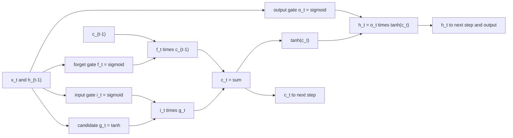

# Neural Networks and Sequence Models

## TL;DR

- Backpropagation is the chain rule applied in reverse topological order: each layer passes back $\partial L/\partial(\text{its output})$ and multiplies by its local Jacobian; for a tanh unit the local factor is $1 - h^2$.
- On low signal-to-noise data capacity is the enemy: a 1,000-unit network fitted without regularisation had train $R^2$ 0.363 and test $R^2$ $-0.539$ on data whose best attainable $R^2$ is about 0.05; weight decay, early stopping on a later block and seed ensembles are what make a net usable.
- Vanilla RNN gradients multiply $T$ Jacobians and vanish (or explode); the LSTM cell state $c_t = f_t \odot c_{t-1} + i_t \odot g_t$ gives an additive path whose gradient is the product of forget gates, so memory lasts as long as $f_t$ stays near 1.
- Attention computes $\mathrm{softmax}(QK^\top/\sqrt{d_k})V$; the $\sqrt{d_k}$ keeps logits at unit scale (unscaled dot products have standard deviation $\sqrt{d_k}$), and a causal mask is what stops a sequence model from reading the future.
- In finance, deep models earn their keep where data is plentiful and structured (order books, text, very large cross-sections) and lose to shrunk linear models on small, noisy panels; evaluate them with walk-forward splits, report the spread across seeds and always against a linear baseline.

## Learning objectives

- Train MLPs, LSTMs and transformers and know their failure modes on market data.
- Regularise and evaluate deep models honestly.
- Derive backpropagation for a small network by hand and verify it with a finite-difference gradient check.
- Explain vanishing and exploding gradients, and how LSTM gating and attention address them.
- Count parameters for MLP, LSTM and transformer layers and relate capacity to the information in the data.

## Core concepts

### The multilayer perceptron

A one-hidden-layer network computes $\hat y = W_2^\top\phi(W_1^\top x + b_1) + b_2$ with an elementwise nonlinearity $\phi$ (tanh, ReLU).
With enough hidden units it can approximate any continuous function on a compact set (Cybenko 1989; Hornik, Stinchcombe and White 1989), so the question is never "can it fit" but "what does it fit with the data available".
Parameter count for widths $d_0, d_1, \dots, d_L$ is $\sum_\ell (d_{\ell-1} + 1)d_\ell$: a 10-16-1 net has 193 parameters, a 5-8-1 net 57.

### Backpropagation

Write the forward pass as $z = W_1^\top x + b_1$, $h = \tanh(z)$, $\hat y = W_2^\top h + b_2$, $L = \tfrac12(\hat y - y)^2$.
The backward pass reuses the forward quantities:

$$
\frac{\partial L}{\partial \hat y} = \hat y - y, \quad
\frac{\partial L}{\partial W_2} = h\,\frac{\partial L}{\partial \hat y}, \quad
\frac{\partial L}{\partial h} = W_2\,\frac{\partial L}{\partial \hat y}, \quad
\frac{\partial L}{\partial z} = \frac{\partial L}{\partial h} \odot (1 - h^2), \quad
\frac{\partial L}{\partial W_1} = x\Big(\frac{\partial L}{\partial z}\Big)^\top.
$$

For a batch, the same formulas hold with matrices, and the gradient of the mean loss divides by $n$.
Backprop costs about the same as a forward pass (reverse-mode differentiation, Rumelhart, Hinton and Williams 1986); finite differences would cost one forward pass per parameter.
Always verify a hand-written backward pass with central differences, $(L(\theta + \epsilon) - L(\theta - \epsilon))/(2\epsilon)$, whose truncation error is $O(\epsilon^2)$; scale the error by the largest gradient, not entry by entry, because tiny gradient entries are dominated by rounding.

### Training and regularisation

- Initialisation: weights with variance $1/\text{fan-in}$ (LeCun, and Glorot for tanh) or $2/\text{fan-in}$ (He, for ReLU) keep activations and gradients at a stable scale through depth.
- Optimiser: Adam (Kingma and Ba 2015) keeps running means of the gradient and its square ($\beta_1 = 0.9$, $\beta_2 = 0.999$ by default) and scales each coordinate's step; it is forgiving of poor scaling, and because each step is normalised, even a tiny gradient moves a weight by up to about the learning rate.
- Weight decay adds $\tfrac{\lambda}{2}\lVert W\rVert^2$, the network analogue of ridge.
- Early stopping keeps the parameters at the epoch with the lowest validation loss; with a fixed learning rate, stopping early limits how far the weights travel from their small initial values, which acts like an L2 penalty (Goodfellow et al., section 7.8).
- Dropout, batch or layer normalisation, and ensembling over seeds are the other standard tools; on financial data ensembling is usually the cheapest reliable gain.

### Why low signal-to-noise changes everything

With daily-return $R^2$ in the low single-digit percent at best, a network with thousands of parameters can memorise noise long before it learns the signal.
The decomposition in [ML Fundamentals and Generalization](01-ML-Fundamentals-and-Generalization.md) applies with full force: variance dominates, so capacity must be paid for with regularisation, and the validation block must come after the training block in time.
Gu, Kelly and Xiu (2020) found trees and neural networks the strongest predictors of monthly US stock returns in a large panel, with their shallower networks doing at least as well as deeper ones; the gains over penalised linear models came from nonlinearities and interactions among a few predictors, not from depth.

### Recurrent networks and vanishing gradients

A vanilla RNN updates $h_t = \tanh(Wh_{t-1} + Ux_t + b)$.
Backpropagation through time multiplies Jacobians:

$$
\frac{\partial h_T}{\partial h_0} = \prod_{t=1}^{T}\mathrm{diag}(1 - h_t^2)\,W.
$$

If the largest singular value of $W$ times the largest $1 - h_t^2$ is below 1 the product shrinks geometrically (vanishing), and if the linearised factor exceeds 1 it can explode (Bengio, Simard and Frasconi 1994).
For a scalar RNN with $|w| = 0.9$ the bound after 50 steps is $0.9^{50} = 0.00515$, and the saturation factors $1 - h_t^2$ make the realised value far smaller.
Exploding gradients are handled by clipping the gradient norm (Pascanu, Mikolov and Bengio 2013); vanishing gradients need a different architecture.

### LSTM gating

The LSTM (Hochreiter and Schmidhuber 1997) adds a cell state with an additive update; the forget gate was added by Gers, Schmidhuber and Cummins (2000) and is part of every modern LSTM:

$$
\begin{aligned}
i_t &= \sigma(W_i[x_t, h_{t-1}] + b_i), \quad f_t = \sigma(W_f[x_t, h_{t-1}] + b_f), \quad o_t = \sigma(W_o[x_t, h_{t-1}] + b_o),\\
g_t &= \tanh(W_g[x_t, h_{t-1}] + b_g), \quad c_t = f_t \odot c_{t-1} + i_t \odot g_t, \quad h_t = o_t \odot \tanh(c_t).
\end{aligned}
$$

- The input gate $i_t$ decides how much new content $g_t$ to write, the forget gate $f_t$ how much old memory to keep, the output gate $o_t$ how much memory to expose.
- Along the cell path, $\partial c_t/\partial c_{t-1} = \mathrm{diag}(f_t)$ with no squashing, so the direct gradient from $c_T$ to $c_0$ is $\prod_t f_t$: memory survives as long as the network learns to hold $f_t$ near 1.
- Initialising the forget-gate bias to 1 (Jozefowicz, Zaremba and Sutskever 2015) starts $f_t$ at $\sigma(1) = 0.7311$, which still forgets quickly over 50 steps; the network must learn larger values for long memory.
- Parameter count: four gates, each mapping $[x_t, h_{t-1}, 1]$ to $h$ units, so $4h(d + h + 1)$; for $d = 10$ inputs and $h = 32$ that is 5,504.
- The GRU (Cho et al. 2014) merges the input and forget gates and drops the separate cell, with three gate blocks instead of four.

### Attention and transformers

Scaled dot-product attention (Vaswani et al. 2017) maps queries $Q$, keys $K$ and values $V$ to

$$
\mathrm{Attention}(Q, K, V) = \mathrm{softmax}\!\Big(\frac{QK^\top}{\sqrt{d_k}}\Big)V.
$$

- If query and key entries are independent with unit variance, $q \cdot k$ has variance $d_k$; without the $1/\sqrt{d_k}$ the logits for $d_k = 64$ have standard deviation 8, the softmax saturates on one key and its gradients vanish.
- Every position attends to every other in one step, so path length between distant time steps is 1 rather than $T$; the price is $O(T^2)$ memory and compute in sequence length.
- Attention is permutation-invariant, so order enters only through positional encodings; a causal mask (scores set to $-\infty$ above the diagonal) makes position $t$ depend only on positions $\le t$, which is mandatory for forecasting.
- A transformer layer has $4d^2$ attention weights ($Q, K, V$, output) and $8d^2$ feed-forward weights with the usual $4d$ hidden width, about $12d^2$ per layer before biases and norms: 49,152 for $d = 64$.

### Failure modes on market data

| Failure | How it shows up | Fix |
| :--- | :--- | :--- |
| Capacity far above information | Train $R^2$ of tens of percent on returns | Smaller nets, weight decay, early stopping, ensembles |
| Look-ahead in architecture | Bidirectional RNN, non-causal convolution or attention on a forecast | Causal masks and padding; test by perturbing future inputs |
| Look-ahead in preprocessing | Scaler or PCA fitted on the full sample; centred rolling windows | Fit every transform inside each training fold |
| Leaky validation | Random split of overlapping windows | Walk-forward or purged splits, validation after training in time |
| Seed and hyperparameter mining | Best of many runs reported | Report the distribution over seeds; count every trial (see [Overfitting and Deflated Sharpe](../09-Alpha-Research-and-Portfolio/08-Overfitting-and-Deflated-Sharpe.md)) |
| Non-stationarity | Good validation, decaying live performance | Retrain schedule, monitoring, simpler models (see [ML in Production](10-ML-Production-and-Monitoring.md)) |
| Scale drift | Inputs move outside the training range; tanh units saturate | Normalise with rolling, point-in-time statistics; clip |

Where deep models do well in finance is where the data is large and has structure a linear model cannot use: limit order book sequences (Sirignano and Cont 2019 trained an LSTM on order-book data pooled across many stocks), text (see [NLP and LLMs for Finance](09-NLP-and-LLMs-for-Finance.md)), and very wide cross-sections with interactions.

## Worked examples

All numbers come from [nn_backprop_lstm.py](code/nn_backprop_lstm.py); simulation results are seeded and quoted as "about".

### Example 1: backprop by hand

One input $x = 1$, target $y = 1$, weights $w_1 = 0.5$, $w_2 = 2$, zero biases, $L = \tfrac12(\hat y - y)^2$.

- Forward: $z = 0.5$, $h = \tanh 0.5 = 0.4621$, $\hat y = 2h = 0.9242$, $L = 0.00287$.
- Backward: $\partial L/\partial\hat y = -0.0758$; $\partial L/\partial w_2 = -0.0758 \times 0.4621 = -0.0350$; $\partial L/\partial h = -0.0758 \times 2 = -0.1515$; local tanh factor $1 - h^2 = 0.7864$; $\partial L/\partial w_1 = -0.1515 \times 0.7864 \times 1 = -0.1192$.
- A step with learning rate 0.5 moves $w_1$ from 0.5 to 0.5596.

Central differences agree with both derivatives to better than $10^{-9}$.
For a 5-8-1 tanh MLP with weight decay, and for an LSTM unrolled over 12 steps, the script finds the largest gap between analytic and finite-difference gradients is below $10^{-7}$ of the largest gradient entry.

### Example 2: a weak nonlinear signal

Ten standard normal features, target $y = 0.2x_1x_2 + 0.1x_3 + \varepsilon$ with unit noise, so the true function has population $R^2 = 0.05/1.05 = 0.0476$ and the best linear model only $0.01/1.05 = 0.0095$.
Train on 3,000 rows, validate on the next 1,000, test on 20,000 (seed 42); $R^2$ is measured against a zero forecast.

| Model | Train $R^2$ | Test $R^2$ |
| :--- | ---: | ---: |
| True function (sample) | - | 0.0529 |
| Ridge (linear) | 0.0141 | 0.0017 |
| Random-feature net, 1,000 tanh units, least squares | 0.363 | -0.539 |
| Same, ridge penalty 1,000 on the output layer | 0.063 | 0.018 |
| 10-16-1 MLP, weight decay $10^{-3}$, early stopping, mean of 5 seeds | - | 0.016 |
| Average of the 5 seeds' predictions | - | 0.027 |

The unregularised wide network fits a third of the training variance and destroys value out of sample.
Regularised, the same features beat the linear model because they can represent the $x_1x_2$ interaction.
The five seeds of the small MLP range from about 0.013 to 0.022: the seed alone moves the result by a factor of about 1.76, which is why a single run proves little.
Averaging the five seeds' forecasts gives about 0.027, more than any single seed.
The random-feature net's output layer is a convex least-squares fit, so its numbers do not depend on the optimiser or the starting point.

### Example 3: vanishing gradients, RNN against LSTM

A scalar tanh RNN with recurrent weight 0.9 driven by noise inputs: the bound is $0.9^{50} = 0.00515$, and the realised $|\partial h_{50}/\partial h_0|$ is about $9.11 \times 10^{-12}$ because every step also multiplies by $1 - h_t^2 < 1$.
Raising the weight to 1.5 does not make the gradient explode here: the units saturate and $|\partial h_{50}/\partial h_0|$ is about $2.40 \times 10^{-10}$.
An LSTM (3 inputs, 8 units, small random weights) with forget-gate bias 1 has $f_t \approx \sigma(1) = 0.7311$; over 50 steps the product of one unit's forget gates is about $1.63 \times 10^{-7}$ and the full derivative $\partial c_{50}/\partial c_0$ about $7.31 \times 10^{-7}$.
With forget-gate bias 5, $f_t \approx 0.9933$, the product of forget gates is about 0.709 and the full derivative about 1.31: fifty steps later, the cell still carries the initial memory.
The full derivative exceeds the direct product because the perturbation also flows through $h_t$ into later gates and candidates.

### Example 4: why divide by $\sqrt{d_k}$

With $d_k = 64$ and unit-variance entries, the simulated standard deviation of $q \cdot k$ is about 8.0, as theory says.
Over 16 keys the largest softmax weight averages about 0.853 with raw logits and about 0.245 after dividing by $\sqrt{64}$: unscaled attention is close to a hard argmax with near-zero gradients for the other keys.

### Example 5: proving a model is causal

Take a 10-step sequence, change inputs 6 to 9 by large random amounts, and compare outputs 0 to 5.
With a causal mask the largest change is 0.0, exactly; without the mask it is about 9.93.
The same perturbation test catches look-ahead in any sequence pipeline (bidirectional layers, centred normalisation, non-causal convolutions) and belongs in its unit tests.

### Example 6: counting parameters

- MLP 10-16-1: $(10 + 1)16 + (16 + 1)1 = 193$.
- LSTM with $d = 3$, $h = 8$: $4 \cdot 8 \cdot (3 + 8 + 1) = 384$; with $d = 10$, $h = 32$: 5,504.
- Transformer layer, $d = 64$: $4d^2 + 8d^2 = 49{,}152$ weights before biases and norms.

With 3,000 noisy training rows, even the 384-parameter LSTM has a high ratio of parameters to effective information; size the model to the signal, not the sample count.

## Pitfalls

- Fitting a scaler, PCA or vocabulary on the full sample and then splitting; the network learns test-period statistics.
- Using a bidirectional RNN or unmasked attention for forecasting; it reads the future and scores brilliantly offline.
- Building overlapping input windows and splitting them randomly; neighbouring windows share almost all inputs and labels.
- Reporting the best of many seeds or architectures as "the" result; report the spread and count the trials.
- Training far past the validation optimum; the model drifts into memorising noise while the training loss keeps improving.
- Comparing a tuned network with an untuned linear baseline; give the baseline the same effort (feature scaling, ridge penalty, the same splits).
- Gradient checking with a relative error per entry; tiny entries are dominated by rounding, so normalise by the largest gradient.
- Assuming an LSTM remembers long histories because it can; check the learned forget gates or the gradient over the horizon you need.

## Interview questions

> [!question]- ml-nn-backprop-chain-rule | What is backpropagation, and why is it efficient?
> Reverse-mode application of the chain rule: each layer receives $\partial L/\partial(\text{output})$, multiplies by its local Jacobian and passes $\partial L/\partial(\text{input})$ back, reusing forward activations.
> It costs a small constant times one forward pass for all parameters, while finite differences cost one pass per parameter.

> [!question]- ml-nn-tiny-net | $x = 1$, $y = 1$, $h = \tanh(w_1x)$, $\hat y = w_2h$, $w_1 = 0.5$, $w_2 = 2$, $L = \frac12(\hat y - y)^2$. Find $\partial L/\partial w_1$.
> About $-0.1192$.
> $h = 0.4621$, $\hat y = 0.9242$, $\partial L/\partial\hat y = -0.0758$, $\partial L/\partial h = -0.1515$, times $1 - h^2 = 0.7864$ and $x = 1$.

> [!question]- ml-nn-tanh-derivative | Derivative of tanh and of the sigmoid in terms of their outputs?
> $\tanh' = 1 - h^2$ and $\sigma' = \sigma(1 - \sigma)$.
> Both are at most 1 (tanh) and 0.25 (sigmoid), and near zero when saturated, which is the root of vanishing gradients.

> [!question]- ml-nn-gradient-check | How do you verify a hand-written backward pass?
> Compare with central differences $(L(\theta + \epsilon) - L(\theta - \epsilon))/(2\epsilon)$ in float64, with $\epsilon$ around $10^{-5}$ to $10^{-6}$.
> Scale the worst absolute gap by the largest gradient; a correct implementation gives $10^{-7}$ or better, a bug gives order 1.

> [!question]- ml-nn-param-count-mlp | How many parameters does a 10-16-1 MLP have?
> 193.
> $(10 + 1) \times 16 + (16 + 1) \times 1$, counting biases.

> [!question]- ml-nn-lstm-params | How many parameters does an LSTM layer with $d$ inputs and $h$ units have?
> $4h(d + h + 1)$: four gate blocks, each a map from $[x_t, h_{t-1}, 1]$ to $h$ units.
> For $d = 10$, $h = 32$ that is 5,504.

> [!question]- ml-nn-vanishing-rnn | Why do gradients vanish in a vanilla RNN?
> $\partial h_T/\partial h_0$ is a product of $T$ Jacobians $\mathrm{diag}(1 - h_t^2)W$; if their norms are below 1 it decays geometrically.
> With $|w| = 0.9$ the bound after 50 steps is $0.9^{50} = 0.00515$, and saturation makes it far smaller.

> [!question]- ml-nn-exploding | How do you deal with exploding gradients?
> Clip the gradient norm (Pascanu, Mikolov and Bengio 2013), lower the learning rate, and use architectures with bounded recurrences.
> Clipping changes the step size, not its direction, so training stays stable without changing the minimiser.

> [!question]- ml-nn-lstm-gates | Write the LSTM cell update and say what each gate does.
> $c_t = f_t \odot c_{t-1} + i_t \odot g_t$, $h_t = o_t \odot \tanh(c_t)$, gates sigmoid of an affine map of $[x_t, h_{t-1}]$.
> Input gate writes, forget gate keeps, output gate exposes; the forget gate came from Gers, Schmidhuber and Cummins (2000), not the 1997 paper.

> [!question]- ml-nn-lstm-why-works | Why does the LSTM mitigate vanishing gradients?
> The cell update is additive, so $\partial c_t/\partial c_{t-1} = \mathrm{diag}(f_t)$ with no squashing nonlinearity.
> The direct gradient over $T$ steps is $\prod f_t$, which stays near 1 when the forget gates are near 1.

> [!question]- ml-nn-forget-bias | Why initialise the LSTM forget-gate bias to 1, and is that enough for long memory?
> It starts $f_t$ near $\sigma(1) = 0.7311$ instead of 0.5, so early gradients survive more steps (Jozefowicz, Zaremba and Sutskever 2015).
> It is not enough by itself: $0.73^{50}$ is tiny, so memory over 50 steps needs learned forget gates close to 1.

> [!question]- ml-nn-attention-scaling | Why divide by $\sqrt{d_k}$ in attention?
> With unit-variance entries $q \cdot k$ has variance $d_k$; dividing keeps logits at unit scale.
> Unscaled, with $d_k = 64$, the logits have standard deviation 8, the softmax becomes nearly one-hot and gradients to the other keys vanish.

> [!question]- ml-nn-causal-mask | How does a transformer avoid using future data, and how do you test it?
> A causal mask sets scores above the diagonal to $-\infty$, so position $t$ attends only to positions $\le t$.
> Test it: perturb future inputs and assert past outputs do not change at all.

> [!question]- ml-nn-transformer-params | Roughly how many weights in one transformer layer with model width $d$?
> About $12d^2$: $4d^2$ for the query, key, value and output projections and $8d^2$ for a feed-forward block with hidden width $4d$.
> For $d = 64$ that is 49,152, before biases and normalisation parameters.

> [!question]- ml-nn-attention-vs-rnn | What does attention buy over an RNN, and at what cost?
> Every pair of positions is one step apart, so long-range dependencies need no long gradient path, and computation parallelises over time.
> Cost is $O(T^2)$ in sequence length, no built-in notion of order (positional encodings are needed) and much more capacity to overfit.

> [!question]- ml-nn-low-snr | You fit a wide unregularised network to daily returns and get a train $R^2$ of 36%. What now?
> It is memorising noise; plausible daily $R^2$ is a few percent at most, and out of sample it will lose to a zero forecast (the note's example: test $R^2$ $-0.539$).
> Shrink the model, add weight decay and early stopping on a later block, ensemble seeds, and compare with a ridge baseline.

> [!question]- ml-nn-seed-variance | Your network's test result changes a lot with the random seed. What do you report?
> The distribution across seeds (mean and range), and use an ensemble of seeds in production.
> In the note's example five seeds ranged from about 0.013 to 0.022 test $R^2$ and their average forecast scored about 0.027.

> [!question]- ml-nn-early-stopping-reg | Why is early stopping a regulariser?
> With small initial weights and a bounded number of steps, the weights cannot travel far, which behaves like an L2 penalty (Goodfellow et al., section 7.8).
> In finance the validation block must lie after the training block in time, or early stopping selects on leaked information.

> [!question]- ml-nn-when-deep | When does a deep model earn its keep in trading?
> When there is a lot of structured data with nonlinear interactions: order-book sequences, text, very large cross-sections.
> On small, noisy panels a shrunk linear model or shallow tree ensemble usually matches it at a fraction of the risk.

> [!question]- ml-nn-scaler-leak | You z-score features with the full-sample mean and standard deviation before a walk-forward test. Is that a problem?
> Yes: every training window uses statistics that include the future, which leaks level and volatility information.
> Fit the scaler inside each training window (or with expanding, point-in-time statistics) and apply it forward.

## In this repo and SDE-Interview-Prep

- Code: [nn_backprop_lstm.py](code/nn_backprop_lstm.py) prints and asserts every number in this note (hand backprop, MLP and LSTM gradient checks, the low signal-to-noise study, RNN and LSTM gradient decay, attention scaling and the causal-mask test).
- Code: [lstm_price_prediction.ipynb](code/lstm_price_prediction.ipynb) is a PyTorch LSTM on a noiseless sine wave; it shows the mechanics, not a realistic financial result (a deterministic periodic series is perfectly predictable).
- Related: [Tree Ensembles and Gradient Boosting](03-Tree-Ensembles-and-Gradient-Boosting.md), [Time-Series Cross-Validation: Purging and Embargo](02-Time-Series-Cross-Validation-Purging-Embargo.md).
- SDE-Interview-Prep: [Perceptron](https://github.com/shreejitverma/SDE-Interview-Prep/blob/main/03-Data-Structures-Algorithms/01-Topics/Machine-Learning-Basics/Perceptron/README.md), [The Transformer From Scratch](https://github.com/shreejitverma/SDE-Interview-Prep/blob/main/13-Agentic-AI/Agentic_AI_Zero_to_Godhood/Volume_01_LLM_Foundations/Chapter_02_The_Transformer_From_Scratch.md).

## Further reading

- Goodfellow, Bengio and Courville, *Deep Learning* (MIT Press 2016), chapters 6 (feedforward networks and backprop), 7 (regularisation), 8 (optimisation) and 10 (sequence models).
- Rumelhart, Hinton and Williams (1986), Learning Representations by Back-Propagating Errors, *Nature* 323.
- Hochreiter and Schmidhuber (1997), Long Short-Term Memory, *Neural Computation* 9(8).
- Gers, Schmidhuber and Cummins (2000), Learning to Forget: Continual Prediction with LSTM, *Neural Computation* 12(10).
- Bengio, Simard and Frasconi (1994), Learning Long-Term Dependencies with Gradient Descent is Difficult, *IEEE Transactions on Neural Networks* 5(2).
- Pascanu, Mikolov and Bengio (2013), On the Difficulty of Training Recurrent Neural Networks, ICML.
- Jozefowicz, Zaremba and Sutskever (2015), An Empirical Exploration of Recurrent Network Architectures, ICML.
- Cho et al. (2014), Learning Phrase Representations using RNN Encoder-Decoder for Statistical Machine Translation, EMNLP.
- Vaswani et al. (2017), Attention Is All You Need, NeurIPS.
- Kingma and Ba (2015), Adam: A Method for Stochastic Optimization, ICLR.
- Cybenko (1989), Approximation by Superpositions of a Sigmoidal Function, *Mathematics of Control, Signals and Systems* 2(4); Hornik, Stinchcombe and White (1989), Multilayer Feedforward Networks are Universal Approximators, *Neural Networks* 2(5).
- Gu, Kelly and Xiu (2020), Empirical Asset Pricing via Machine Learning, *Review of Financial Studies* 33(5).
- Sirignano and Cont (2019), Universal Features of Price Formation in Financial Markets: Perspectives from Deep Learning, *Quantitative Finance* 19(9).
