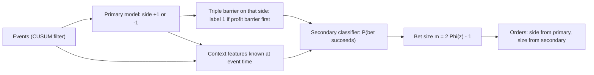

# Labeling: Triple Barrier and Meta-Labeling

## TL;DR

- Fixed-horizon labels $\mathrm{sign}(r_{t,t+h})$ with a fixed threshold ignore volatility and the path: with a 1% threshold on 5-day returns, 0.371 of labels are non-zero at 0.5% daily vol and 0.823 at 2% daily vol, so the label mostly encodes the regime.
- The triple-barrier method (Lopez de Prado 2018, section 3.4) labels each event by the first of three barriers touched: profit-taking at $+k_{\text{pt}}\sigma_t$, stop-loss at $-k_{\text{sl}}\sigma_t$, and a vertical time barrier, so labels match how positions are actually managed and scale with volatility.
- Barrier geometry sets the base rate: with no edge, barriers at $+2$ and $-4$ are hit upper-first two-thirds of the time and the expected payoff is still zero; hit rate without payoff size is meaningless.
- Meta-labeling (section 3.6) splits the problem: a primary model picks the side, and a secondary binary model predicts whether that bet will hit its profit barrier; the secondary probability filters and sizes bets, trading recall for precision.
- Size from the probability, not just a 0/1 filter: $m = 2\Phi(z) - 1$ with $z = (p - \tfrac12)/\sqrt{p(1-p)}$ (section 10.3); in the note's simulation sizing reached a per-event Sharpe of about 0.329 against 0.308 for the best fixed filter threshold on a fine grid.

## Learning objectives

- Label with fixed horizons versus the triple-barrier method.
- Use meta-labeling to size bets from a primary model.
- Compute triple-barrier label probabilities exactly for a lattice walk and relate them to gambler's ruin.
- Explain the precision-recall trade-off in meta-labeling and why F1 is not the trading objective.
- Account for the variable length and overlap of triple-barrier labels in sample weights and cross-validation.

## Core concepts

### Events: when to label

Labeling every bar produces heavily overlapping, mostly uninformative samples.
Lopez de Prado (2018, section 2.5.2) samples events with a symmetric CUSUM filter (the CUSUM idea goes back to Page 1954): keep running sums $S^+_t = \max(0, S^+_{t-1} + r_t)$ and $S^-_t = \min(0, S^-_{t-1} + r_t)$, and record an event and reset the sum whenever $S^+_t > h$ or $S^-_t < -h$.
An event therefore means "price has moved by about $h$ since the last event", which adapts the sampling rate to activity.
On 100,000 iid standard normal returns (seed 1) the filter fires about 41.93 times per 100 bars at $h = 1$ standard deviation, 19.75 at $h = 2$ and 7.45 at $h = 4$; these are seeded simulation values, good to about one percent.

### Fixed-horizon labels and their problems

The textbook label is $y_t = \mathrm{sign}(r_{t,t+h})$ if $|r_{t,t+h}| > \tau$, else 0.

- Heteroskedasticity: with Gaussian returns of daily volatility $\sigma$, $P(|r_{t,t+h}| > \tau) = 2\big(1 - \Phi(\tau/(\sigma\sqrt h))\big)$, which for $\tau = 1\%$ and $h = 5$ is 0.371 at $\sigma = 0.5\%$ and 0.823 at $\sigma = 2\%$; a classifier can score well by predicting the volatility regime.
- Path blindness: a position that would have hit its stop on day 2 is labelled a winner if price recovers by day $h$; no risk manager would hold it.
- Fixed clock: in calendar time, labels pack many information events into busy days and almost none into quiet ones.

A first fix is a dynamic threshold $\tau_t = k\,\hat\sigma_t\sqrt h$ from a point-in-time volatility estimate (Lopez de Prado, section 3.3); at $k = 1$ the theoretical non-zero fraction is $2(1 - \Phi(1)) = 0.317$ in every regime.

### The triple-barrier method

For an event at $t_0$ with volatility estimate $\hat\sigma_{t_0}$ (an exponentially weighted standard deviation of past returns, known at $t_0$):

- upper (profit-taking) barrier at $+k_{\text{pt}}\hat\sigma_{t_0}$ in return terms;
- lower (stop-loss) barrier at $-k_{\text{sl}}\hat\sigma_{t_0}$;
- vertical barrier at $t_0 + h$.

The label is $+1$ or $-1$ by whichever horizontal barrier is touched first; if the vertical barrier comes first, the label is either the sign of the return at $t_0 + h$ or 0, a choice that must be stated.
The touch time $t_1$ is stored with the label: it defines the label's information interval $[t_0, t_1]$, which drives purging, embargo and uniqueness weights (see [Time-Series Cross-Validation: Purging and Embargo](02-Time-Series-Cross-Validation-Purging-Embargo.md)).
Barriers can be switched off: no vertical barrier gives pure take-profit/stop-loss labels, no horizontal barriers gives fixed-horizon labels again, and side-specific barriers are used once a side is known.
With a known side $s \in \{-1, +1\}$ the barriers are applied to the side-adjusted return $s\,r$, so for a short the profit-taking barrier sits below the entry price and the stop above it, and $k_{\text{pt}}$ and $k_{\text{sl}}$ may differ (Lopez de Prado, section 3.5).

### Exact label probabilities: gambler's ruin

For a $\pm1$ lattice walk with up-probability $p$, barriers at $+a$ and $-b$ and no vertical barrier, the probability of hitting $+a$ first is

$$
P(+a \text{ first}) = \frac{1 - (q/p)^b}{1 - (q/p)^{a+b}}, \qquad q = 1 - p,
$$

which tends to $b/(a + b)$ as $p \to \tfrac12$ (Feller, chapter 14), and the symmetric walk's expected hitting time is $ab$.
With a vertical barrier the distribution is computed exactly by dynamic programming over the interior states, propagating probability mass one step at a time and collecting what crosses each barrier.
For Brownian motion with drift $\mu$ and volatility $\sigma$ the same scale-function argument gives $P(+a \text{ first}) = \dfrac{1 - e^{2\mu b/\sigma^2}}{e^{-2\mu a/\sigma^2} - e^{2\mu b/\sigma^2}}$.

The no-edge case carries the key lesson: with $p = \tfrac12$, barriers at $+2$ and $-4$ are hit upper-first with probability $4/6 = 0.6667$, and the expected payoff $2 \times \tfrac23 - 4 \times \tfrac13$ is exactly zero.
A strategy with tight profit targets and wide stops has a high hit rate by construction; only the payoff-weighted hit rate measures skill.

### Meta-labeling

Meta-labeling (Lopez de Prado 2018, sections 3.6 and 3.7) separates the side of a bet from its size:

1. A primary model (rules, fundamental view or ML) proposes a side $s_t \in \{-1, +1\}$ at each event.
2. Triple-barrier labels are computed for that side; the meta-label is 1 if the bet reached its profit barrier (or ended positive) and 0 otherwise.
3. A secondary binary classifier, using the primary signal plus features describing context (volatility, liquidity, trend, the primary model's own confidence), predicts $P(\text{meta-label} = 1)$.
4. The probability decides whether to act and how much to bet.

Why it helps:

- The secondary model solves an easier problem (when is this signal reliable) than predicting direction from scratch.
- The primary model can be a transparent or discretionary view; ML only filters and sizes, which limits how much it can overfit side selection.
- It targets F1: build a primary model with high recall, then use meta-labeling to raise precision on the bets it proposes (Lopez de Prado's stated motivation, section 3.7).
- Side and size can use different information sets and be monitored separately.

### Precision, recall and F1 for meta-labels

Treat "the primary bet succeeds" as the positive class.
Taking every primary bet gives recall 1 and precision equal to the primary hit rate; filtering with the meta model lowers recall and, if the model has skill, raises precision.

$$
\text{precision} = \frac{TP}{TP + FP}, \qquad \text{recall} = \frac{TP}{TP + FN}, \qquad F_1 = \frac{2\,\text{precision}\cdot\text{recall}}{\text{precision} + \text{recall}}.
$$

$F_1$ is the harmonic mean of precision and recall (equal to $1 - E$ for van Rijsbergen's 1979 effectiveness measure $E$ with equal weights); it treats a missed winner and a taken loser alike; P&L does not, because a taken loser costs money and a missed winner costs only opportunity.
Select the meta threshold on out-of-sample risk-adjusted P&L net of costs, not on $F_1$ or accuracy.

### Bet sizing from probabilities

Lopez de Prado (2018, section 10.3) maps the predicted probability $p$ of a two-class outcome to a size by testing $H_0: p = \tfrac12$:

$$
z = \frac{p - \tfrac12}{\sqrt{p(1-p)}}, \qquad m = 2\Phi(z) - 1 \in (-1, 1).
$$

Sizes are small near $p = \tfrac12$ and grow smoothly: $p = 0.55$ gives 0.0801, $p = 0.6$ gives 0.1617 and $p = 0.7$ gives 0.3375.
The signed position is the primary side times the size, $s_t\,m$.
In meta-labeling $p$ is the probability that the primary side wins, so $m < 0$ (that is, $p < \tfrac12$) means skip the bet, not reverse it: the meta model was never trained to pick the opposite side, and the simulation below sets the size to zero when $p \le \tfrac12$.
In practice sizes from overlapping bets are averaged and discretised to avoid churning on tiny changes in $p$ (sections 10.4 and 10.5).

### Sample weights for variable-length labels

Triple-barrier labels end at different times, so concurrency varies and labels overlap.
Uniqueness weights (sections 4.3 and 4.4) average $1/c_t$ over each label's interval, where $c_t$ counts labels alive at bar $t$; fixed $h$-day labels on every bar have uniqueness $1/h$ away from the sample edges, while triple-barrier labels that stop out early are shorter and therefore more unique.
The same intervals drive purging: a training label whose $[t_0, t_1]$ overlaps the test period must go (section 7.4).
Lopez de Prado also uses average uniqueness to set the bootstrap sample size in bagging and proposes a sequential bootstrap that favours unique samples (section 4.5), and scales weights by attributed absolute return (section 4.6).

## Worked examples

All numbers come from [triple_barrier_meta_labeling.py](code/triple_barrier_meta_labeling.py); simulation results are seeded and quoted as "about".

### Example 1: CUSUM events by hand

Daily returns (%) $0.5, 0.4, 0.3, -0.2, -0.9, -0.4, 0.1$ with threshold 1.0.
$S^+$ runs $0.5, 0.9, 1.2$: event on day 3, reset.
$S^-$ is 0 until day 4, then $-0.2, -1.1$: event on day 5, reset; the last two days take $S^-$ to $-0.4$ and $-0.3$, and $S^+$ never gets above 0.1 again.
Two events, on days 3 and 5.

### Example 2: exact triple-barrier probabilities

A $\pm1$ walk with barriers at $\pm3$ steps and a 10-step vertical barrier:

| Up-probability | $P(\text{upper})$ | $P(\text{lower})$ | $P(\text{vertical})$ | Expected holding period |
| :--- | ---: | ---: | ---: | ---: |
| 0.50 | 0.3418 | 0.3418 | 0.3164 | 6.785 |
| 0.55 | 0.4497 | 0.2463 | 0.3039 | 6.710 |

Enumerating all $2^{10} = 1{,}024$ step sequences reproduces every entry of the table to $10^{-12}$.
Without the vertical barrier, gambler's ruin gives $P(\text{upper}) = 0.5000$ and 0.6461 for the two cases, and running the DP to a horizon of 4,000 steps reproduces both to $10^{-12}$; the symmetric walk's expected hitting time comes out at 9.00, matching $ab = 9$.
A Monte Carlo of 200,000 drifted paths (seed 2) gives $P(\text{upper})$ of about 0.449 against the exact 0.4497.
With a 10-step vertical barrier almost a third of events end on the clock, so how vertical touches are labelled matters as much as the horizontal barriers.

### Example 3: fixed against volatility-scaled labels

Simulate 200,000 days alternating in 2,000-day blocks between 0.5% and 2% daily volatility (seed 3), label 5-day forward returns, and use an EWMA volatility (span 100) known at the event date.

| Labeling rule | Non-zero fraction, low vol | Non-zero fraction, high vol |
| :--- | ---: | ---: |
| Fixed 1% threshold, closed form | 0.371 | 0.823 |
| Fixed 1% threshold, simulated | 0.372 | 0.819 |
| Threshold $1\cdot\hat\sigma_t\sqrt5$, EWMA volatility, simulated | 0.297 | 0.325 |
| Threshold $1\cdot\sigma_t\sqrt5$, true volatility (control), simulated | 0.318 | 0.314 |
| Threshold $1\cdot\hat\sigma_t\sqrt5$, EWMA, first 300 days of each block dropped (control) | 0.318 | 0.317 |
| Triple barrier at $\pm\hat\sigma_t\sqrt5$, 5-day vertical, horizontal touch | 0.411 | 0.448 |

The fixed threshold more than doubles the labelled fraction in the high-volatility regime; scaling by point-in-time volatility brings the two regimes close.
The control row changes only the volatility input, from the EWMA estimate to the true value, and lands both regimes near the theoretical 0.317, so the remaining gap in the EWMA row comes from the estimate itself.
A second control keeps the EWMA estimate but drops the first 300 days of each 2,000-day block: the fractions become 0.318 and 0.317, so the gap is the estimate's lag after each regime switch (too wide just after vol falls, too narrow just after it rises).
The triple barrier labels more events than the fixed-horizon rule at the same width, because every fixed-horizon non-zero label is also a barrier touch (a path that ends beyond the barrier must have crossed it) and some paths touch and come back.
The path matters: about 3.2% of the barrier touches have a 5-day return of the opposite sign (stopped out and then recovered, or the reverse), so a fixed-horizon label would call them the other way.
About 0.570 of events end at the vertical barrier and get label 0 under this rule.
The mean holding period of these triple-barrier labels is about 4.27 days, the average concurrency is the same 4.27 (one label starts per bar, so mean concurrency equals mean length), and the average uniqueness is about 0.238 against 0.200 for fixed 5-day labels run through the same routine.

### Example 4: meta-labeling a weak primary model

A primary model is right with probability $\sigma(0.1 + z)$, where $z$ is a context feature known at the event; barriers are symmetric and there is no vertical barrier, so each bet pays $+1$ or $-1$ in side-adjusted units ($+1$ when the profit barrier on the primary's side is hit first, whether that side is long or short).
The meta model is a logistic regression on $z$ and an irrelevant feature, fitted on 20,000 events and tested on the next 20,000 (seed 4); it estimates the coefficient on $z$ at about 1.021 (true 1.0) and on the noise feature at about 0.037.

| Rule | Bets taken | Precision | Recall | $F_1$ | PnL per bet | Per-event Sharpe |
| :--- | ---: | ---: | ---: | ---: | ---: | ---: |
| Primary, take every bet | 1.000 | 0.521 | 1.000 | 0.685 | 0.043 | 0.043 |
| Meta threshold 0.5 | 0.547 | 0.679 | 0.712 | 0.695 | 0.358 | 0.275 |
| Meta threshold 0.6 | 0.387 | 0.735 | 0.545 | 0.626 | 0.470 | 0.306 |
| Meta threshold 0.7 | 0.237 | 0.787 | 0.357 | 0.491 | 0.573 | 0.290 |
| Meta, size $2\Phi(z) - 1$ when $p > 0.5$ | 0.547 | - | - | - | - | 0.329 |
| Oracle filter, true $p > 0.5$ | - | - | - | - | - | 0.278 |

Per-event Sharpe is the mean over the standard deviation of P&L per event, counting skipped events as zero.
Going from the primary to a 0.5 threshold barely moves $F_1$ (0.685 to 0.695) but multiplies the per-event Sharpe by about 6.4 as precision rises from 0.521 to 0.679; with symmetric unit barriers the P&L per bet is exactly $2 \times \text{precision} - 1$, which reproduces the table from the unrounded precisions (0.52145 gives 0.043 and 0.78653 gives 0.573; the rounded 0.521 and 0.787 would give 0.042 and 0.574).
Raising the threshold keeps raising precision and P&L per bet, but among the three thresholds the per-event Sharpe peaks at 0.6 and falls back to about 0.290 at 0.7 as recall drops; scanning thresholds from 0.30 to 0.895 in steps of 0.005 puts the best filter at 0.635 with about 0.308.
An oracle filter that knows the true probability does no better: about 0.278 at 0.5 and about 0.308 at its best threshold.
Continuous sizing (mean size about 0.332 when betting) reaches about 0.329, above every filter including the oracle ones, because it puts more capital on events with a higher predicted success probability.
For $\pm1$ payoffs, mean over standard deviation of $s \cdot \text{P\&L}$ is maximised by a size proportional to $E[\text{P\&L} \mid p] = 2p - 1$ (Cauchy-Schwarz); doing that with the true $p$ (betting only when $p > \tfrac12$) gives about 0.331, so the $2\Phi(z) - 1$ rule with an estimated $p$ comes close to that ceiling.

### Example 5: a high hit rate with no edge

Symmetric random walk, profit target 2 ticks, stop 4 ticks, no time limit.
$P(\text{target first}) = 4/6 = 0.6667$ and the expected payoff is $2(0.6667) - 4(0.3333) = 0.0000$.
Any claim of "67% winners" from such a strategy says nothing about skill; compare the hit rate with the barrier-implied base rate $b/(a + b)$.

## Pitfalls

- Estimating $\hat\sigma_t$ with data after $t$ (a centred window, or a full-sample volatility); barrier widths then leak future volatility.
- Labelling from close prices only when barriers could be touched intraday; the label misses touches and both barriers can be crossed within one bar, which needs a stated tie rule.
- Training the meta model on the primary model's in-sample signals; if the primary is itself fitted, use its out-of-sample (cross-validated, purged) predictions, or the meta model learns that the primary is always right.
- Forgetting $t_1$: triple-barrier labels have variable intervals, and purging, embargo and uniqueness all need them.
- Comparing hit rates across strategies with different barrier geometry; the base rate $b/(a + b)$ differs.
- Choosing the meta threshold by $F_1$ or accuracy; choose by out-of-sample risk-adjusted P&L after costs.
- Ignoring costs in the label: a bet that touches a 1-sigma profit barrier can still lose after spread and fees on liquid-but-wide instruments; put costs into the barrier or the label.
- Calling a classifier good because it predicts the label well when labels are mostly a volatility-regime indicator (fixed thresholds).

## Interview questions

> [!question]- ml-label-fixed-horizon-flaws | What is wrong with labelling by the sign of the $h$-day return above a fixed threshold?
> It ignores volatility (the share of non-zero labels moves with the regime: 0.371 at 0.5% daily vol against 0.823 at 2% for a 1% threshold on 5-day returns) and ignores the path (a stopped-out trade can be labelled a winner).
> Use volatility-scaled thresholds and path-dependent barriers.

> [!question]- ml-label-triple-barrier-def | Define the triple-barrier label.
> For an event at $t_0$: profit barrier $+k_{\text{pt}}\hat\sigma_{t_0}$, stop barrier $-k_{\text{sl}}\hat\sigma_{t_0}$, vertical barrier $t_0 + h$; the label is the sign of the first horizontal barrier touched, and on a vertical touch either the sign of the return or 0.
> The touch time $t_1$ is stored for purging and weighting.

> [!question]- ml-label-gamblers-ruin | A symmetric random walk starts at 0 with barriers at $+a$ and $-b$. Probability of hitting $+a$ first, and expected time?
> $b/(a + b)$, and $ab$.
> $S_t$ is a martingale, so $a\,P + (-b)(1 - P) = 0$; $S_t^2 - t$ is a martingale, so $E[T] = a^2P + b^2(1 - P) = ab$.

> [!question]- ml-label-drifted-ruin | A $\pm1$ walk with up-probability 0.55 has barriers at $\pm3$. Probability of the upper one first?
> 0.6461.
> $(1 - r^3)/(1 - r^6)$ with $r = 0.45/0.55$; equivalently $1/(1 + r^3)$.

> [!question]- ml-label-hit-rate-trap | A strategy with a 2-tick target and 4-tick stop wins 67% of trades. Is it skilful?
> No evidence of skill: a driftless walk hits $+2$ before $-4$ with probability $4/6$, and the expected payoff $2 \cdot \tfrac23 - 4 \cdot \tfrac13 = 0$.
> Compare with the base rate $b/(a + b)$ and look at payoff-weighted results.

> [!question]- ml-label-vertical-share | Barriers at $\pm3$ steps and a 10-step clock on a symmetric walk: how often does the clock end the trade?
> About 31.64% of the time (exact DP: 0.3164).
> So the rule for labelling vertical touches (sign of return or 0) changes a third of the labels.

> [!question]- ml-label-dynamic-threshold | How do you make labels comparable across volatility regimes?
> Scale the threshold or barriers by a point-in-time volatility estimate, $\tau_t = k\hat\sigma_t\sqrt h$.
> At $k = 1$ about $2(1 - \Phi(1)) = 0.317$ of Gaussian returns are labelled in every regime; the estimate must use data up to $t$ only.

> [!question]- ml-label-cusum | What does the symmetric CUSUM filter do in event sampling?
> It accumulates positive and negative return runs and records an event when either exceeds a threshold $h$, then resets that sum.
> Events then mean "a move of about $h$ since the last event", so sampling adapts to activity instead of the clock.

> [!question]- ml-label-meta-def | What is meta-labeling?
> A secondary binary model that predicts whether a primary model's proposed bet will succeed (hit its profit barrier), given the primary signal and context features.
> The primary model sets the side; the secondary probability filters and sizes the bet.

> [!question]- ml-label-meta-why | Why use meta-labeling rather than one model that predicts direction?
> The secondary task (when is the signal reliable) is easier and lower-dimensional than direction, ML cannot overfit the side choice, and a discretionary or white-box primary can be kept.
> It also lets you build a high-recall primary and recover precision with the meta model.

> [!question]- ml-label-precision-recall | In meta-labeling, what happens to precision and recall as you raise the meta threshold?
> Precision rises and recall falls; in the note's simulation thresholds 0.5, 0.6 and 0.7 gave precision 0.679, 0.735, 0.787 and recall 0.712, 0.545, 0.357.
> Taking every primary bet is the recall-1 corner with precision equal to the primary hit rate.

> [!question]- ml-label-f1-objective | Should you choose the meta-labeling threshold to maximise F1?
> No; F1 weights a missed winner like a taken loser, but only the loser costs money.
> In the note's simulation F1 barely moved from the primary (0.685) to the 0.5 threshold (0.695) while per-event Sharpe rose about 6.4 times; choose on out-of-sample risk-adjusted P&L after costs.

> [!question]- ml-label-f1-calc | Precision 0.6, recall 0.5: what is F1?
> 0.5455.
> $2 \cdot 0.6 \cdot 0.5/(0.6 + 0.5) = 0.6/1.1$.

> [!question]- ml-label-bet-size | How does Lopez de Prado map a predicted probability to a bet size, and what size does $p = 0.6$ get?
> $z = (p - \tfrac12)/\sqrt{p(1-p)}$, $m = 2\Phi(z) - 1$; for $p = 0.6$, $z = 0.2041$ and $m = 0.1617$.
> Sizes are near zero for $p$ near one half and grow smoothly, then are averaged across active bets and discretised.

> [!question]- ml-label-size-vs-filter | Why can continuous bet sizing beat any 0/1 meta filter?
> It puts more capital on events with higher predicted success and less on marginal ones, instead of treating every accepted bet the same.
> In the note's simulation sizing gave per-event Sharpe about 0.329 against about 0.308 for the best threshold on a fine grid, and about 0.308 even for a filter that knows the true probability.

> [!question]- ml-label-meta-leak | Your meta model looks excellent in backtest. The primary is an ML model fitted on the same period. What is the likely bug?
> The meta model was trained on the primary's in-sample signals, which are overconfident and mostly right, so it learns nothing about real reliability.
> Generate the primary's signals out of sample (purged cross-validation or walk-forward) before fitting the meta model.

> [!question]- ml-label-uniqueness | Why do triple-barrier labels need uniqueness weights, and how do they compare with fixed-horizon labels?
> Labels overlap in time, so samples are not independent; weighting by average $1/c_t$ over each label's interval down-weights crowded samples.
> Fixed $h$-day labels on every bar have uniqueness $1/h$ away from the sample edges; in the note's simulation triple-barrier labels with a 5-day clock averaged about 0.238 (mean length about 4.27 bars) because many stop out early.

> [!question]- ml-label-intrabar | You build triple-barrier labels from daily closes. What can go wrong?
> Intraday touches are missed, and both barriers can be crossed within a day with no way to know which came first.
> Use higher-frequency data for the path, or state a conservative tie rule (count the stop first).

> [!question]- ml-label-short-side | The primary model says short. Where do the profit-taking and stop-loss barriers go, and what is the meta-label?
> Apply the barriers to the side-adjusted return $s\,r$ with $s = -1$: profit-taking is a fall of $k_{\text{pt}}\hat\sigma$ below entry and the stop a rise of $k_{\text{sl}}\hat\sigma$ above it.
> The meta-label is 1 if the side-adjusted return at the first touch is positive (the short made money) and 0 otherwise, so one binary model serves long and short bets.

> [!question]- ml-label-vol-leak | Your barrier width uses a 20-day volatility centred on the event date. Problem?
> It uses ten future days, so the label width depends on future volatility and leaks information into features that correlate with it.
> Use a trailing (EWMA) estimate known at the event time.

## In this repo and SDE-Interview-Prep

- Code: [triple_barrier_meta_labeling.py](code/triple_barrier_meta_labeling.py) prints and asserts every number in this note (CUSUM events, exact lattice barrier probabilities with gambler's-ruin, path-enumeration and Monte Carlo checks, fixed against scaled labels across regimes with two controls, uniqueness with a brute-force check, and the meta-labeling study with a threshold scan and bet sizing).
- Related: [Time-Series Cross-Validation: Purging and Embargo](02-Time-Series-Cross-Validation-Purging-Embargo.md) for $t_1$-based purging, [Feature Importance and Interpretability](07-Feature-Importance-and-Interpretability.md) for what the secondary model uses, [Kelly Criterion and Position Sizing](../11-Risk-and-Trading/01-Kelly-Criterion-and-Position-Sizing.md) for sizing from an edge.

## Further reading

- Marcos Lopez de Prado, *Advances in Financial Machine Learning* (Wiley 2018): section 2.5.2 (event-based sampling and the CUSUM filter), chapter 3 (fixed-time horizon labels 3.2, dynamic thresholds 3.3, the triple-barrier method 3.4, learning side and size 3.5, meta-labeling 3.6 and 3.7), chapter 4 (concurrency and average uniqueness 4.3 and 4.4, sequential bootstrap 4.5), section 7.4 (purged k-fold cross-validation and embargo) and chapter 10 (bet sizing from predicted probabilities 10.3, averaging active bets 10.4, size discretization 10.5).
- William Feller, *An Introduction to Probability Theory and Its Applications*, Vol. 1 (3rd ed., Wiley 1968), chapter 14 (random walk and ruin problems).
- E. S. Page (1954), Continuous Inspection Schemes, *Biometrika* 41(1-2).
- C. J. van Rijsbergen, *Information Retrieval* (2nd ed., Butterworths 1979), chapter 7 (evaluation and the effectiveness measure $E$, of which $F_1 = 1 - E$ with equal weights).
