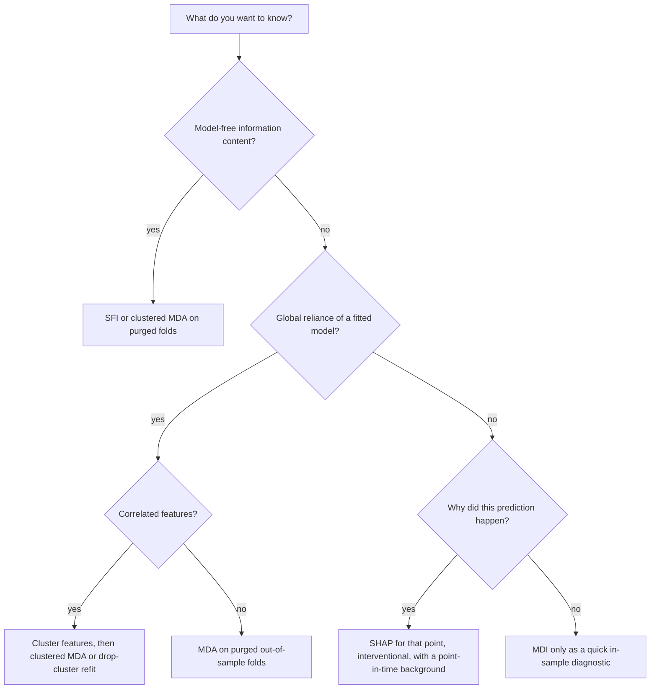

# Feature Importance and Interpretability

## TL;DR

- MDI (mean decrease impurity) sums each feature's in-sample split gains; it is cheap but in-sample, biased toward continuous and high-cardinality features, and normalised to sum to one, so it ranks features even when nothing is predictable.
- MDA (permutation importance) is the drop in an out-of-sample score when one feature is shuffled; it works for any model, but with correlated features the model leans on the substitute and each feature looks less important than it is.
- The substitution effect: with $x_2$ a near copy of $x_1$, MDI splits their credit, MDA understates both, drop-column importance is close to zero for each, and only importance measured on the cluster (or a single-feature model) shows the information they carry.
- SHAP values are Shapley values of the game "prediction with a subset of features known": they are the unique attribution with efficiency, symmetry, dummy and additivity; for a linear model with independent features they are $w_i(x_i - E[x_i])$.
- Use importance for research (which features carry information, and whether that is stable across time and clusters), not as proof of alpha: importance is model-relative, not causal, and says nothing about trading after costs.

## Learning objectives

- Compare MDI, MDA and SHAP and their substitution effects.
- Use importance for research, not as proof of alpha.
- Compute exact Shapley values for a small game and for a model by enumerating coalitions.
- Remove substitution effects with clustered importance, single-feature importance or orthogonalised features.
- Explain why permutation importance must be computed on purged out-of-sample data in finance.

## Core concepts

### Three questions, three kinds of importance

| Question | Method | Computed on | Substitution effect |
| :--- | :--- | :--- | :--- |
| Which splits did the fitted trees use? | MDI | Training data | Dilutes credit across correlated features |
| How much does the fitted model rely on this column? | MDA (permutation) | Held-out data | Understates each of a correlated group |
| Does the model need this feature given the others? | Drop-column (refit) | Held-out data | Close to zero for redundant features |
| How much information does this feature carry alone? | SFI (single-feature model) | Held-out data | None, but misses interactions |
| How does each feature move this prediction? | SHAP | Any points | Splits credit between correlated features |

Lopez de Prado (2018, chapter 8) groups these into methods with substitution effects (MDI, MDA) and without (SFI, and importance on orthogonalised PCA features), and argues that feature importance, not repeated backtesting, is the research tool.

### MDI: mean decrease impurity

Every split in a tree reduces the training impurity (squared error for regression, Gini or entropy for classification) by $\Delta_{\text{node}}$, weighted by the number of samples in the node.
MDI credits that decrease to the split feature, sums over the tree, normalises each tree's total to one, and averages over trees (Breiman 2001).

- It is computed on the training data, so it measures what the model used to fit, including fitted noise.
- Features with many possible split points (continuous, high cardinality) get more chances to produce a lucky gain, so pure noise of that kind gets positive MDI (Strobl et al. 2007); a binary noise feature gets less.
- Because each tree's importances sum to one, MDI always ranks something first, even on a pure-noise target.
- Random feature subsets at each split ($m < p$) force the trees to use substitutes, so correlated features share the credit.

### MDA: permutation importance

Fit once, then for each feature $j$ shuffle column $j$ in the test data and record the drop in the test score (Breiman 2001):

$$
\mathrm{MDA}_j = S(f, X_{\text{test}}) - S(f, X_{\text{test}}^{(\pi_j)}).
$$

- It is out of sample and model-agnostic, and a value near zero or negative is honest evidence of no reliance.
- In finance the test folds must be purged and embargoed, or the score reflects leakage (see [Time-Series Cross-Validation: Purging and Embargo](02-Time-Series-Cross-Validation-Purging-Embargo.md)); Lopez de Prado computes MDA on purged k-fold with log-loss or accuracy.
- Shuffling one of two correlated features creates combinations never seen in training (a large $x_1$ with a small $x_2$), so the model is evaluated off its data manifold (Hooker, Mentch and Zhou 2021).
- If the model splits on both members of a correlated pair, shuffling one leaves the other, so each looks only partly important.

### Drop-column and clustered importance

Drop-column importance refits the model without feature $j$ and measures the score loss; it answers "is this feature needed given the rest", which for a redundant feature is close to zero.
Clustered feature importance (Lopez de Prado 2020, chapter 6) first clusters features by correlation, then permutes (or drops) whole clusters with a single shared permutation, so substitutes cannot cover for each other.
Single-feature importance (SFI) fits a model on each feature alone; it has no substitution effect, but it misses features that matter only through interactions.

### Shapley values and SHAP

Treat features as players and a coalition $S$ as "these features are known".
With $v(S)$ the model's expected output when only the features in $S$ are known, the Shapley value (Shapley 1953) of feature $i$ is

$$
\phi_i = \sum_{S \subseteq N\setminus\{i\}}\frac{|S|!\,(p - |S| - 1)!}{p!}\big(v(S \cup \{i\}) - v(S)\big),
$$

the average marginal contribution of $i$ over all orders in which features can be added.
It is the only attribution satisfying efficiency ($\sum_i\phi_i = v(N) - v(\varnothing)$), symmetry, dummy (a feature that never changes $v$ gets 0) and additivity.
Lundberg and Lee (2017) showed that SHAP values are the unique additive feature attribution with local accuracy, missingness and consistency, and gave KernelSHAP (a weighted regression estimator) and Linear SHAP; Lundberg et al. (2020) gave TreeSHAP, which computes them exactly for tree ensembles in polynomial time.

- Interventional (marginal) SHAP sets $v(S) = E_{X_{\bar S}}[f(x_S, X_{\bar S})]$, averaging the missing features over a background sample as if independent; it explains the model, and gives zero to features the model never uses.
- Observational (conditional) SHAP uses $E[f(X) \mid X_S = x_S]$; it explains the data-generating relationship, and can credit a feature the model never uses because it is correlated with one it does (Janzing, Minorics and Bloebaum 2020 argue for the interventional version).
- For $f(x) = w^\top x + b$ with independent features, interventional SHAP is exactly $\phi_i = w_i(x_i - E[x_i])$.
- Global importance is usually summarised as mean $|\phi_i|$ over many points; SHAP's advantage over permutation is the per-prediction view: why this name, on this day, got this forecast.

### Importance is research, not proof of alpha

- Importance is relative to a model and a score: a feature can be important to an overfit model and useless out of sample, which is why MDI alone proves nothing.
- Importance is not causation: a feature can be important because it proxies for the true driver, and the relationship can break when the proxy relationship does.
- Importance is not P&L: a feature that improves log-loss on rare, illiquid events may be untradeable after costs.
- What importance is good for: deciding which features to investigate, checking that the model relies on economically sensible inputs, detecting leakage (a feature that is "too important", such as one built with future data), and monitoring drift in what the model relies on.
- Stability is the evidence: importance that persists across time periods, purged folds, model classes and clustering choices is worth more than a single high score.

## Worked examples

All numbers come from [feature_importance.py](code/feature_importance.py), which fits its own numpy random forest (60 trees, depth 6, minimum leaf 20, 3 of 6 features tried at each split); simulation results are seeded and quoted as "about".

### Example 1: Shapley values by hand

Two players with $v(\varnothing) = 0$, $v(\{1\}) = 2$, $v(\{2\}) = 1$, $v(\{1, 2\}) = 5$.
Player 1's marginal contributions are $2 - 0$ (joining first) and $5 - 1$ (joining second), so $\phi_1 = \tfrac12(2 + 4) = 3$; similarly $\phi_2 = \tfrac12(1 + 3) = 2$.
They sum to $v(\{1, 2\}) = 5$ (efficiency) and split the interaction surplus $5 - 2 - 1 = 2$ equally.
For a linear model, enumerating all coalitions with a 40-row background reproduces $w_i(x_i - \bar x_i)$ to $10^{-12}$.

### Example 2: the substitution effect

Simulate $y = 0.5x_1 + 0.5x_3 + \varepsilon$ with $x_2 = x_1 + 0.2\,\text{noise}$ (correlation about 0.981), continuous noise features $x_4$ and $x_6$, and binary noise $x_5$; the true $R^2$ is $0.5/1.5 = 0.333$.
Train on 3,000 rows and test on 3,000 (seed 42); the forest's test $R^2$ is about 0.319.
$x_1$ (with its copy $x_2$) and $x_3$ carry equal information by construction.

| Feature | MDI | MDA (test $R^2$ drop) | Drop-column | SFI (test $R^2$ alone) | Mean $\lvert\text{SHAP}\rvert$ |
| :--- | ---: | ---: | ---: | ---: | ---: |
| $x_1$ | 0.277 | 0.121 | 0.005 | 0.146 | 0.233 |
| $x_2$ (copy of $x_1$) | 0.202 | 0.051 | 0.005 | 0.146 | 0.141 |
| $x_3$ | 0.458 | 0.312 | 0.165 | 0.150 | 0.438 |
| $x_4$ (noise) | 0.028 | -0.002 | 0.003 | -0.004 | 0.014 |
| $x_5$ (binary noise) | 0.004 | 0.000 | 0.003 | -0.002 | 0.003 |
| $x_6$ (noise) | 0.031 | 0.000 | 0.002 | -0.017 | 0.015 |

- MDI splits the credit: $x_1$ and $x_2$ get 0.277 and 0.202, each well below $x_3$'s 0.458, though together they get 0.479.
- MDA understates both: 0.121 and 0.051 against 0.312 for $x_3$; permuting the pair together gives about 0.323, in line with $x_3$.
- Drop-column refits say neither is needed (about 0.005 each) because the other covers; dropping the pair costs about 0.161, again in line with $x_3$'s 0.165.
- SFI has no substitution effect: $x_1$, $x_2$ and $x_3$ each score about 0.146 to 0.150 alone.
- SHAP splits the credit like MDI: 0.233 and 0.141, while the mean absolute sum of the pair's SHAP values is about 0.372.
- Continuous noise ($x_4$, $x_6$) gets MDI of about 0.028 and 0.031 against 0.004 for binary noise, while every out-of-sample measure gives all three noise features about zero.

The exact Shapley values come from enumerating all 64 coalitions for 100 test points with a 50-row background; their sum matches $f(x) - E[f]$ to $10^{-10}$.

### Example 3: importance on pure noise

Replace the target with pure noise and refit (seed 99).
The forest's test $R^2$ is about $-0.006$, yet MDI still sums to 1.000 and gives the top feature about 0.234; the largest MDA is about 0.002.
A ranked MDI chart is not evidence that anything is predictable; an out-of-sample importance near zero is the honest answer.

## Pitfalls

- Reading MDI as evidence of predictive power; it is in-sample, sums to one by construction and favours continuous features.
- Dropping a feature because its MDA is small when it has a correlated twin; the pair may be the most important thing in the model.
- Computing permutation importance on training data or on unpurged folds; overlap and autocorrelation inflate it.
- Using SHAP with a background drawn from a different period (or from the future); the baseline $E[f]$ and every attribution shift with it.
- Mixing up interventional and conditional SHAP; they answer different questions and disagree when features are correlated.
- Selecting features by importance and then reporting the backtest of the selected model without counting the selection; importance-driven selection is still a search (see [Overfitting and Deflated Sharpe](../09-Alpha-Research-and-Portfolio/08-Overfitting-and-Deflated-Sharpe.md)).
- Treating an important feature as causal and sizing up when its regime changes; check stability across periods.
- Ignoring a suspiciously dominant feature; it is often a leak (a timestamp, a restated value, a feature computed with the label's window).

## Interview questions

> [!question]- ml-fi-mdi-def | How is MDI computed for a random forest?
> For each split, the weighted decrease in training impurity is credited to the split feature; sum per tree, normalise each tree to one, average over trees.
> It is in-sample and essentially free, but measures what the model fitted, including noise.

> [!question]- ml-fi-mdi-bias | Why does MDI favour continuous and high-cardinality features?
> They offer many candidate split points, so even pure noise produces some split with a positive in-sample gain (Strobl et al. 2007).
> In the note's simulation continuous noise got MDI about 0.028 and 0.031 against 0.004 for binary noise.

> [!question]- ml-fi-mdi-noise | You fit a forest to a pure-noise target. What does MDI show, and what does MDA show?
> MDI still sums to one and ranks features (top feature about 0.234 in the note's run); MDA is about zero for every feature (largest about 0.002).
> MDI's normalisation guarantees a winner; only an out-of-sample measure can say "nothing here".

> [!question]- ml-fi-mda-def | Define permutation importance (MDA) and its main advantage.
> The drop in an out-of-sample score when one feature's column is shuffled, breaking its link to the target.
> It is model-agnostic and out of sample, so a value near zero is real evidence of no reliance.

> [!question]- ml-fi-substitution | What is the substitution effect in feature importance?
> When features are correlated, the model can use either, so importance measured one feature at a time is shared or masked.
> With a near copy, MDI dilutes, MDA understates and drop-column importance is near zero for each feature of the pair.

> [!question]- ml-fi-correlated-mda | $x_2$ is a 0.981-correlated copy of $x_1$. Permuting $x_1$ drops test $R^2$ by 0.121 and $x_2$ by 0.051, while an equally informative $x_3$ drops it by 0.312. What do you conclude?
> That the pair shares credit, not that $x_1$ is weak: permuting both together drops $R^2$ by about 0.323 in the note's simulation, matching $x_3$.
> Cluster correlated features and measure importance per cluster.

> [!question]- ml-fi-drop-column | What does drop-column importance measure, and why can it be near zero for an important feature?
> The loss in out-of-sample score after refitting without the feature: whether the model needs it given the others.
> A redundant feature scores near zero because a substitute takes over (about 0.005 for each of the twins in the note's example).

> [!question]- ml-fi-clustered | How does clustered feature importance remove substitution effects?
> Cluster features by correlation, then permute (or drop) each cluster as a block with one shared permutation (Lopez de Prado 2020).
> Substitutes are removed together, so the cluster's importance reflects the information it carries.

> [!question]- ml-fi-sfi | What is single-feature importance, and what does it miss?
> The out-of-sample score of a model fitted on one feature at a time; it has no substitution effect.
> It misses features that matter only through interactions, and it ignores redundancy (two copies both score high).

> [!question]- ml-fi-shapley-formula | Write the Shapley value of feature $i$.
> $\phi_i = \sum_{S \subseteq N\setminus\{i\}}\frac{|S|!(p - |S| - 1)!}{p!}(v(S \cup \{i\}) - v(S))$.
> It is the average marginal contribution of $i$ over all $p!$ orderings of the features.

> [!question]- ml-fi-shapley-game | Two players: $v(\{1\}) = 2$, $v(\{2\}) = 1$, $v(\{1,2\}) = 5$, $v(\varnothing) = 0$. Shapley values?
> 3 and 2.
> Player 1 adds 2 when first and 4 when second; player 2 adds 1 and 3; each averages over the two orders, and the interaction surplus of 2 is split equally.

> [!question]- ml-fi-shap-axioms | Which properties single out Shapley values?
> Efficiency (attributions sum to $v(N) - v(\varnothing)$), symmetry, dummy (no effect means zero) and additivity across games.
> Lundberg and Lee (2017) restate these for model explanation as local accuracy, missingness and consistency.

> [!question]- ml-fi-linear-shap | What are the SHAP values of a linear model?
> $\phi_i = w_i(x_i - E[x_i])$ under the interventional definition (features treated as independent).
> They sum to $f(x) - E[f(X)]$.

> [!question]- ml-fi-interventional-vs-conditional | Interventional or conditional SHAP?
> Interventional averages missing features over their marginal distribution and explains the model; conditional uses $E[f \mid x_S]$ and explains the data, crediting correlated features the model may not use.
> For debugging and monitoring a model, interventional is the usual choice.

> [!question]- ml-fi-shap-cost | Exact Shapley values need how many coalition evaluations, and how do libraries avoid that?
> $2^p$ coalitions, each an expectation over a background set.
> TreeSHAP computes exact values for trees in polynomial time; KernelSHAP samples coalitions and solves a weighted regression.

> [!question]- ml-fi-not-alpha | A feature has the highest SHAP importance in your return model. Is it alpha?
> Not by itself: importance is relative to a possibly overfit model, is not causal, and ignores costs and capacity.
> Check stability across periods and purged folds, the economic rationale, and the net P&L of a strategy that uses it.

> [!question]- ml-fi-leak-detector | One feature dominates every importance measure by a mile. What should you suspect first?
> Leakage: a timestamp, a restated fundamental, a feature computed over a window that overlaps the label, or an identifier that encodes survivorship.
> Genuine financial predictors are rarely dominant; inspect how that feature is built and when it was known.

> [!question]- ml-fi-purged-mda | Why must MDA be computed on purged folds in finance?
> With overlapping labels and autocorrelated features, an unpurged test row has near copies in training, so permuting a feature that encodes "where in time we are" destroys a leak and looks important.
> Purging and embargo make the drop reflect generalisable reliance.

## In this repo and SDE-Interview-Prep

- Code: [feature_importance.py](code/feature_importance.py) prints and asserts every number in this note (a numpy random forest, MDI, MDA, drop-column, clustered MDA, SFI, exact interventional Shapley values with the efficiency check, Linear SHAP, and the pure-noise control).
- Related: [Tree Ensembles and Gradient Boosting](03-Tree-Ensembles-and-Gradient-Boosting.md), [Labeling: Triple Barrier and Meta-Labeling](06-Labeling-Triple-Barrier-and-Meta-Labeling.md), [PCA and Factor Structure](../03-Linear-Algebra-and-Optimization/05-PCA-and-Factor-Structure.md) for orthogonalised features.

## Further reading

- Marcos Lopez de Prado, *Advances in Financial Machine Learning* (Wiley 2018), chapter 8 (MDI, MDA, SFI, orthogonal features).
- Marcos Lopez de Prado, *Machine Learning for Asset Managers* (Cambridge Elements 2020), chapter 6 (clustered feature importance).
- Leo Breiman (2001), Random Forests, *Machine Learning* 45(1).
- Strobl, Boulesteix, Zeileis and Hothorn (2007), Bias in Random Forest Variable Importance Measures, *BMC Bioinformatics* 8.
- Lloyd Shapley (1953), A Value for n-Person Games, in *Contributions to the Theory of Games II*, Annals of Mathematics Studies 28.
- Scott Lundberg and Su-In Lee (2017), A Unified Approach to Interpreting Model Predictions, NeurIPS.
- Lundberg et al. (2020), From Local Explanations to Global Understanding with Explainable AI for Trees, *Nature Machine Intelligence* 2.
- Janzing, Minorics and Bloebaum (2020), Feature Relevance Quantification in Explainable AI: A Causal Problem, AISTATS.
- Hooker, Mentch and Zhou (2021), Unrestricted Permutation Forces Extrapolation, *Statistics and Computing* 31.
