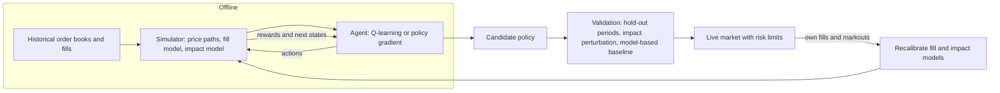

# Reinforcement Learning for Trading and Execution

## TL;DR

- An MDP is states, actions, transition probabilities, rewards and a discount; the optimal value satisfies the Bellman optimality equation $V^*(s) = \max_a E[r + \gamma V^*(s') \mid s, a]$, solved by backward induction when the model is known and by sampling (Q-learning, policy gradients) when it is not.
- Execution is a finite-horizon MDP with state (time left, inventory left, market features), action (shares to trade or where to place orders) and reward minus cost and risk; Almgren-Chriss is its linear-quadratic special case with a closed-form $\sinh$ schedule.
- Market making is an MDP with state (inventory, time, market features) and action (bid and ask offsets); the optimal policy skews quotes against inventory, which Avellaneda-Stoikov derive analytically and value iteration reproduces on a grid.
- Tabular Q-learning, $Q \leftarrow Q + \alpha(r + \gamma\max_{a'}Q(s', a') - Q)$, converges to $Q^*$ with enough exploration and decaying steps, but the max over noisy estimates is biased upward; double Q-learning removes most of that bias.
- RL is hard in markets because the data is one non-stationary path, rewards are mostly noise, historical replay cannot react to your own orders, and exploration costs money; when a good model exists, solve the control problem directly and use RL only where the dynamics are too complex for closed forms.

## Learning objectives

- Formulate execution and market making as MDPs.
- Explain why RL is hard with non-stationary markets and simulators.
- Write the Bellman expectation and optimality equations and solve a small execution problem by backward induction.
- Implement tabular Q-learning, state its convergence conditions and explain maximisation bias and double Q-learning.
- Quantify the cost of a simulator that mis-specifies market impact.

## Core concepts

### Markov decision processes

An MDP is a tuple $(\mathcal S, \mathcal A, P, R, \gamma)$: from state $s$ the agent takes action $a$, receives reward $r$ and moves to $s'$ with probability $P(s' \mid s, a)$ (Sutton and Barto, chapter 3).
A policy $\pi(a \mid s)$ has value $V^\pi(s) = E_\pi\big[\sum_t\gamma^tr_{t+1} \mid s_0 = s\big]$ and action value $Q^\pi(s, a)$.
The Bellman expectation equation and the Bellman optimality equation are

$$
V^\pi(s) = \sum_a\pi(a \mid s)\sum_{s', r}P(s', r \mid s, a)\big[r + \gamma V^\pi(s')\big], \qquad
Q^*(s, a) = \sum_{s', r}P(s', r \mid s, a)\big[r + \gamma\max_{a'}Q^*(s', a')\big].
$$

For a finite horizon $N$ the value depends on time as well, $V_k(x)$, and backward induction from $V_N$ solves the problem exactly in one sweep (chapter 4).
For an infinite horizon with $\gamma < 1$ the Bellman operator is a $\gamma$-contraction in the sup norm, so value iteration converges geometrically from any start.
The Markov property is a modelling choice: the state must contain everything relevant to the future (inventory, time, and whatever market features predict the next fills and prices), or the problem is only partially observed.

### Execution as an MDP

Sell $X$ shares over $N$ periods.

- State: $(k, x_k)$, the period and shares left, plus market features (spread, volatility, order-book imbalance) in richer versions.
- Action: shares $n_k$ to sell now (or, in limit-order versions, where to place and when to cross).
- Cost of a step: temporary impact $\eta n_k^2$ plus a risk penalty on what is still held, $\lambda\sigma^2x_{k+1}^2$; the reward is minus the cost.
- Terminal condition: $x_N = 0$.

With continuous quantities this is the linear-quadratic problem of Almgren and Chriss (2001); the first-order conditions $x_{k-1} - 2x_k + x_{k+1} = (\lambda\sigma^2/\eta)\,x_k$ give

$$
x_k = X\,\frac{\sinh(\kappa(N - k))}{\sinh(\kappa N)}, \qquad \cosh\kappa = 1 + \frac{\lambda\sigma^2}{2\eta},
$$

front-loading sales more as risk aversion rises relative to impact (see [Optimal Execution: Almgren-Chriss](../07-Market-Microstructure/07-Optimal-Execution-Almgren-Chriss.md)).
With integer lots, limit orders, fill uncertainty or state-dependent costs there is no closed form, but backward induction still solves a discretised model exactly, and RL becomes relevant only when even the model is unknown.

### Market making as an MDP

- State: inventory $q$ (and time, volatility, order-book features).
- Action: bid and ask offsets $(\delta^b, \delta^a)$ from a reference price, or a skew and width.
- Transition: each side fills with a probability that falls with its offset, often $Ae^{-k\delta}$.
- Reward: spread captured on fills, plus inventory mark-to-market, minus an inventory penalty $\phi q^2$ (or a terminal liquidation cost).

Avellaneda and Stoikov (2008) solve the continuous-time version through its HJB equation: the reservation price shifts against inventory and the optimal spread depends on risk aversion and fill intensity (see [Inventory Risk and Avellaneda-Stoikov](../08-Market-Making/03-Inventory-Risk-and-Avellaneda-Stoikov.md)).
A discrete version is a small MDP that value iteration solves on a grid, and it reproduces the same qualitative policy: quote aggressively on the side that reduces inventory and defensively on the side that adds to it.

### Learning without a model: Q-learning

When $P$ is unknown but episodes can be sampled, Q-learning (Watkins and Dayan 1992; Sutton and Barto, section 6.5) updates after each transition

$$
Q(s, a) \leftarrow Q(s, a) + \alpha_t\big(r + \gamma\max_{a'}Q(s', a') - Q(s, a)\big).
$$

- It is off-policy: it learns $Q^*$ while behaving with an exploratory policy (for example $\varepsilon$-greedy).
- Tabular Q-learning converges to $Q^*$ with probability 1 if every state-action pair is visited infinitely often and the steps satisfy $\sum\alpha_t = \infty$, $\sum\alpha_t^2 < \infty$ (Watkins and Dayan 1992).
- SARSA uses the action actually taken next instead of the max (on-policy); policy-gradient and actor-critic methods (chapter 13) parameterise the policy directly and handle continuous actions.
- With function approximation (deep Q-networks, Mnih et al. 2015), bootstrapping and off-policy learning together can diverge: Sutton and Barto's "deadly triad" (section 11.3).

### Maximisation bias and double Q-learning

$E[\max_a\hat Q(s, a)] \ge \max_aE[\hat Q(s, a)]$: the max of noisy, unbiased estimates is biased upward (Sutton and Barto, section 6.7).
For ten actions whose estimates are independent $N(0, 1)$ errors around the same true value, the expected max is 1.5388 standard errors above it.
Double Q-learning (van Hasselt 2010) keeps two tables, selects the best next action with one and evaluates it with the other, so the selection noise and evaluation noise are independent.
In trading, where rewards are dominated by price noise, this bias makes a learned policy look more profitable than it is and favours actions with noisy payoffs.

### Why RL is hard in markets

| Problem | Why it bites | Mitigation |
| :--- | :--- | :--- |
| One non-stationary path | Episodes are not repeatable; the environment drifts | Short horizons, regime features, frequent retraining, conservative policies |
| Low signal-to-noise rewards | Price noise swamps the effect of actions; credit assignment is slow | Reward shaping with expected costs, control variates, model-based components |
| Simulator gap | Historical replay cannot react to your orders: no impact on others, no queue dynamics, no adverse selection from your own flow | Impact models calibrated to your own fills, agent-based simulators, validation on live child orders |
| Exploration costs money | Random actions pay spread and impact | Explore within risk limits, start from a model-based policy, off-policy evaluation |
| Partial observability | Hidden liquidity and other agents' intentions | Richer state, recurrent policies, robust objectives |
| Overfitting the simulator | The policy exploits simulator artefacts | Hold-out periods and instruments, stress tests, parameter perturbation |

Nevmyvaka, Feng and Kearns (2006) applied RL to execution on historical limit order book data with state built from time and inventory remaining plus market variables, the template for most later work; Hambly, Xu and Yang (2023) survey the field.
The practical lesson from the execution and market-making literature is that model-based control (Almgren-Chriss, Avellaneda-Stoikov, Cartea, Jaimungal and Penalva 2015) supplies strong baselines, and RL earns its place where fills, queue positions and order types make the dynamics too rich for closed forms.

## Worked examples

All numbers come from [rl_execution_q_learning.py](code/rl_execution_q_learning.py); simulation results are seeded and quoted as "about".
The execution examples use impact $\eta = 1$ and risk penalty $\lambda\sigma^2 = 0.5$ per share squared.

### Example 1: Bellman by hand

Sell $X = 2$ shares in 2 periods; the step cost is $n^2 + 0.5x^2$ on the shares $x$ still held.
Selling $n_1$ now leaves $2 - n_1$ for the last period:

- $n_1 = 0$: $0 + 0.5 \times 4 + 4 = 6.00$;
- $n_1 = 1$: $1 + 0.5 \times 1 + 1 = 2.50$;
- $n_1 = 2$: $4 + 0 + 0 = 4.00$.

$V_0(2) = 2.50$ by selling one share in each period; the backward recursion $V_k(x) = \min_n[n^2 + 0.5(x - n)^2 + V_{k+1}(x - n)]$ with $V_2(0) = 0$ gives the same.

### Example 2: optimal execution of 10 shares over 5 periods

Backward induction over integer sales gives the schedule $(5, 3, 1, 1, 0)$ with expected cost 51.00.

| Schedule | Expected cost |
| :--- | ---: |
| Sell everything now | 100.00 |
| TWAP, 2 per period | 80.00 |
| DP optimum, integers: $(5, 3, 1, 1, 0)$ | 51.00 |
| Almgren-Chriss, continuous: $(5.015, 2.522, 1.290, 0.704, 0.469)$ | 50.15 |

Here $\cosh\kappa = 1 + 0.5/2 = 1.25$, so $\kappa = \ln 2 = 0.6931$, and the closed form matches a direct solve of the tridiagonal first-order conditions to $10^{-12}$.
The integer restriction costs 1.7% over the continuous optimum.
TWAP is 56.9% dearer than the optimum: it pays less impact (20.00 against 36.00) but far more risk cost (60.00 against 15.00) because it holds more inventory for longer.

### Example 3: learning the schedule by Q-learning

Simulate 200,000 episodes (seed 5) in which the risk cost of a step is $0.5\,(x_{k+1}\Delta P)^2$ with $\Delta P \sim N(0, 1)$, whose expectation is the $0.5x_{k+1}^2$ of Example 2, and learn with $\varepsilon = 0.2$ exploration and step $1/\text{visits}$.
The greedy policy of the learned table is $(5, 3, 1, 1, 0)$, the DP optimum, and its start-state value is within about 0.08 of $-51.00$; double Q-learning also recovers the optimum, within about 0.05.
The agent used 200,000 simulated episodes to learn what a single backward-induction sweep computes from the model: model-free learning pays for not knowing the dynamics.

### Example 4: maximisation bias

The expected maximum of 10 independent $N(0, 1)$ draws is 1.5388 (numerical integration of $10x\varphi(x)\Phi(x)^9$; 200,000 simulated draws give about 1.538).
In Sutton and Barto's Example 6.7, going "left" from state A leads to ten actions with rewards $N(-0.1, 1)$ and is a bad choice; an $\varepsilon$-greedy agent with $\varepsilon = 0.1$ should go left only 5% of the time.
Over the first 300 episodes, averaged over 2,000 runs (seed 7, $\alpha = 0.1$), Q-learning goes left about 0.378 of the time and double Q-learning about 0.117.

### Example 5: the simulator gap

Train (here: solve exactly) in a simulator with impact $\eta = 1$, then trade in a market whose true impact is $\eta = 2$.
The simulator-optimal schedule $(5, 3, 1, 1, 0)$ costs 87.00 in the true market, against 80.50 for the true optimum $(4, 2, 2, 1, 1)$: 8.1% excess cost from one mis-specified parameter, with a perfect learner.
No amount of training in the wrong simulator fixes this; calibrating impact to your own fills does.

### Example 6: a market-making MDP

Inventory between $-3$ and $+3$, offsets of 0.5, 1.0 or 1.5 ticks on each side, fill probability $e^{-\delta}$ per side per period, reward equal to the offset earned on each fill minus $0.1q^2$, discount 0.99; value iteration converges to a sup-norm change below $10^{-11}$.

| Inventory | $-3$ | $-2$ | $-1$ | $0$ | $+1$ | $+2$ | $+3$ |
| :--- | ---: | ---: | ---: | ---: | ---: | ---: | ---: |
| Bid offset | 0.5 | 0.5 | 0.5 | 1.0 | 1.5 | 1.5 | not quoted |
| Ask offset | not quoted | 1.5 | 1.5 | 1.0 | 0.5 | 0.5 | 0.5 |

When short the policy bids aggressively and asks defensively; when long it does the reverse; flat it quotes symmetrically.
The value of being flat exceeds the value of holding $+3$ by about 2.439, the price of inventory risk in this model.

## Pitfalls

- Training on historical replay and assuming your orders would have been filled at the same prices; replay ignores your impact and your queue position.
- Using a simulator with a single impact parameter and trusting the learned policy in production; the policy is only as good as the cost model (Example 5).
- Reading the learned Q-value of the start state as expected P&L; the max over noisy estimates is biased upward.
- Ignoring the Markov property: a state without the features that drive fills and prices makes the problem partially observed and the Bellman equation wrong.
- Letting an RL agent explore with real money and no risk limits; exploration pays spread and impact.
- Comparing an RL policy with TWAP only; the baseline should be the model-based optimum (Almgren-Chriss, Avellaneda-Stoikov) under the same cost model.
- Evaluating an RL policy on the same period used to fit the simulator; that is in-sample.
- Rewarding raw P&L without risk or inventory terms; the agent learns to take directional bets the strategy was not meant to take.

## Interview questions

> [!question]- ml-rl-mdp-def | Define a Markov decision process and the Markov property.
> A tuple of states, actions, transition probabilities $P(s' \mid s, a)$, rewards and a discount $\gamma$.
> Markov: given the current state and action, the next state and reward do not depend on the earlier history, so the state must contain every relevant feature.

> [!question]- ml-rl-bellman-optimality | Write the Bellman optimality equation for $Q^*$.
> $Q^*(s, a) = E[r + \gamma\max_{a'}Q^*(s', a') \mid s, a]$.
> The optimal action value is the immediate reward plus the discounted value of acting optimally from the next state.

> [!question]- ml-rl-two-period | Sell 2 shares in 2 periods with step cost $n^2 + 0.5x^2$ on shares $x$ still held. What is optimal?
> Sell 1 and 1, cost 2.50.
> Selling 0 first costs $0 + 2 + 4 = 6$, selling 1 costs $1 + 0.5 + 1 = 2.5$, selling 2 costs 4.

> [!question]- ml-rl-execution-mdp | How do you formulate optimal execution as an MDP?
> State: time left, inventory left and market features; action: shares to trade now (or order placement); reward: minus impact cost minus a risk penalty on inventory; terminal constraint: inventory zero.
> The linear-quadratic case is Almgren-Chriss with a closed-form $\sinh$ schedule; anything richer is solved by DP or learned.

> [!question]- ml-rl-ac-kappa | In discrete Almgren-Chriss with unit period, $\lambda\sigma^2/\eta = 0.5$. What is $\kappa$ and what does the schedule look like?
> $\cosh\kappa = 1.25$, so $\kappa = \ln 2 = 0.6931$, and $x_k = X\sinh(\kappa(N - k))/\sinh(\kappa N)$.
> For 10 shares over 5 periods the trades are 5.015, 2.522, 1.290, 0.704 and 0.469: heavily front-loaded.

> [!question]- ml-rl-mm-mdp | How do you formulate market making as an MDP, and what does the optimal policy do?
> State: inventory, time and market features; action: bid and ask offsets; transitions: fills with probability decreasing in offset; reward: spread captured plus inventory P&L minus an inventory penalty.
> The optimal policy skews quotes against inventory: aggressive on the side that flattens, defensive on the side that adds.

> [!question]- ml-rl-q-update | Write the Q-learning update and say why it is off-policy.
> $Q(s, a) \leftarrow Q(s, a) + \alpha(r + \gamma\max_{a'}Q(s', a') - Q(s, a))$.
> The target uses the greedy action at $s'$, not the action the behaviour policy will actually take, so it learns $Q^*$ while exploring.

> [!question]- ml-rl-q-convergence | When does tabular Q-learning converge to $Q^*$?
> When every state-action pair is visited infinitely often and the step sizes satisfy $\sum\alpha_t = \infty$ and $\sum\alpha_t^2 < \infty$ (Watkins and Dayan 1992).
> In practice: enough exploration and decaying learning rates, which is exactly what one market history cannot provide.

> [!question]- ml-rl-max-bias | What is maximisation bias, and how large is it for 10 equal actions with unit-variance estimates?
> The max of noisy unbiased estimates is biased upward; for 10 independent $N(0, 1)$ errors the expected max is 1.5388.
> Q-learning's target takes such a max at every step, so values and the attractiveness of noisy actions are overstated.

> [!question]- ml-rl-double-q | How does double Q-learning fix maximisation bias?
> Two tables: one selects $\arg\max_{a'}Q_A(s', a')$, the other evaluates it with $Q_B$, so selection and evaluation errors are independent (van Hasselt 2010).
> In Sutton and Barto's Example 6.7 the share of bad "left" actions over the first 300 episodes fell from about 0.378 to 0.117 in the note's run (optimal 0.05).

> [!question]- ml-rl-deadly-triad | What is the deadly triad?
> Function approximation, bootstrapping and off-policy learning together, which can make value estimates diverge (Sutton and Barto, section 11.3).
> Deep Q-learning has all three, hence target networks, replay buffers and careful tuning.

> [!question]- ml-rl-sim-gap | Your execution agent was trained in a simulator with impact half the true value. What happens live?
> It trades too fast and pays more than the optimum; in the note's example the simulator-optimal schedule cost 8.1% more than the true optimum.
> Calibrate impact on your own fills and stress-test the policy over a range of impact parameters.

> [!question]- ml-rl-why-hard | Give four reasons RL is harder in trading than in games.
> One non-stationary history (episodes are not repeatable); rewards dominated by price noise; historical replay cannot react to your orders (impact, queue position, adverse selection); exploration costs real money.
> Add partial observability and the risk of the agent exploiting simulator artefacts.

> [!question]- ml-rl-replay-flaw | Why is replaying historical order books an imperfect environment for an execution agent?
> Other participants do not react to your orders, so impact, queue position and adverse selection from your own flow are missing or assumed.
> The agent learns to take liquidity that would have vanished or moved had it really traded.

> [!question]- ml-rl-model-vs-rl | When would you use dynamic programming instead of RL for execution?
> Whenever you can write down a credible model of costs and dynamics: DP or the Almgren-Chriss closed form is exact, instant and interpretable.
> In the note's example Q-learning needed 200,000 episodes to recover the schedule backward induction computes directly.

> [!question]- ml-rl-twap-vs-optimal | Selling 10 shares over 5 periods with impact $n^2$ and risk $0.5x^2$, how does TWAP compare with the optimum?
> TWAP costs 80.00 against 51.00 for the integer optimum $(5, 3, 1, 1, 0)$.
> With meaningful risk aversion, holding inventory is expensive, so the optimum front-loads.

> [!question]- ml-rl-reward-design | What goes wrong if you reward an execution or market-making agent with raw P&L?
> It learns directional bets and inventory accumulation, because price moves dominate P&L and look like skill in sample.
> Reward implementation shortfall or spread capture with explicit inventory and risk penalties, and mark inventory to a fair value.

> [!question]- ml-rl-value-contraction | Why does value iteration converge for a discounted MDP?
> The Bellman optimality operator is a $\gamma$-contraction in the sup norm, so iterates converge geometrically to its unique fixed point $V^*$.
> The error after $k$ sweeps is at most $\gamma^k$ times the initial error.

## In this repo and SDE-Interview-Prep

- Code: [rl_execution_q_learning.py](code/rl_execution_q_learning.py) prints and asserts every number in this note (Bellman by hand, the execution DP against TWAP and Almgren-Chriss, Q-learning and double Q-learning, maximisation bias, the simulator gap, and the market-making value iteration).
- Related: [Optimal Execution: Almgren-Chriss](../07-Market-Microstructure/07-Optimal-Execution-Almgren-Chriss.md), [Inventory Risk and Avellaneda-Stoikov](../08-Market-Making/03-Inventory-Risk-and-Avellaneda-Stoikov.md), [Market Impact Models](../07-Market-Microstructure/06-Market-Impact-Models.md).

## Further reading

- Richard Sutton and Andrew Barto, *Reinforcement Learning: An Introduction* (2nd ed., MIT Press 2018): chapter 3 (finite MDPs), chapter 4 (dynamic programming), chapter 6 (temporal-difference learning, Q-learning in section 6.5, maximisation bias and double learning in section 6.7), section 11.3 (the deadly triad) and chapter 13 (policy gradient methods).
- Christopher Watkins and Peter Dayan (1992), Q-learning, *Machine Learning* 8.
- Hado van Hasselt (2010), Double Q-learning, NeurIPS.
- Robert Almgren and Neil Chriss (2001), Optimal Execution of Portfolio Transactions, *Journal of Risk* 3(2).
- Marco Avellaneda and Sasha Stoikov (2008), High-Frequency Trading in a Limit Order Book, *Quantitative Finance* 8(3).
- Alvaro Cartea, Sebastian Jaimungal and Jose Penalva, *Algorithmic and High-Frequency Trading* (Cambridge University Press 2015), the stochastic control, optimal execution and market-making chapters.
- Yuriy Nevmyvaka, Yi Feng and Michael Kearns (2006), Reinforcement Learning for Optimized Trade Execution, ICML.
- Volodymyr Mnih et al. (2015), Human-Level Control through Deep Reinforcement Learning, *Nature* 518.
- Ben Hambly, Renyuan Xu and Huining Yang (2023), Recent Advances in Reinforcement Learning in Finance, *Mathematical Finance* 33(3).
