# NLP and LLMs for Finance

## TL;DR

- Text becomes a signal in four steps: get documents with true availability timestamps, turn them into numbers (dictionary counts, tf-idf, embeddings or LLM outputs), aggregate per asset and time with decay and novelty, and test like any other signal (IC, decay, costs, purged validation).
- Dictionaries must be domain-specific: in 10-Ks from 1994 to 2008, Loughran and McDonald (2011) found that almost three-fourths (73.8%) of the negative word counts under the Harvard dictionary come from words that are typically not negative in financial contexts (tax, cost, capital, board, liability, foreign, vice), and built finance word lists that are now standard.
- Bag-of-words similarity measures topic, not direction: "guidance raised on strong demand" and "guidance cut on weak demand" are closer in tf-idf space than two positive stories about different topics, so sentiment needs a model of polarity, not just overlap.
- Embeddings and LLMs read context and negation, but they bring new leakage: a model pre-trained on text up to its cutoff knows how the story ended, so backtests over that period are contaminated; pin model versions, test on post-cutoff data and anonymise entities.
- Timestamps are the first thing to audit in any text backtest: aligning news by date instead of by publication time puts the announcement jump inside the backtest; in the note's simulation that inflates the IC from about 0.046 to 0.457.

## Learning objectives

- Build text signals from news, filings and transcripts.
- Use embeddings and LLMs with point-in-time discipline.
- Compute dictionary tone, tf-idf weights and cosine similarities by hand, and know what each measures.
- Identify the leakage channels specific to text: timestamps, revisions, vocabulary fitting and pre-training look-ahead.
- Design an evaluation of an LLM-based signal that a sceptical portfolio manager would accept.

## Core concepts

### Sources and what they are good for

| Source | Typical signal | Timing issues |
| :--- | :--- | :--- |
| Newswires and articles | Event sentiment, novelty, attention | Vendor timestamp versus first public availability; updates and corrections reuse the story id |
| Regulatory filings (10-K, 10-Q, 8-K) | Tone, uncertainty, year-over-year change in language | Filing acceptance time versus period end; amendments; filing-date databases that are backfilled |
| Earnings call transcripts | Management tone, analyst question tone, evasiveness | Transcript publication lags the call; the call itself is the event |
| Social media | Retail attention and sentiment | Bots, deletions, survivorship of accounts, API sampling |
| Analyst reports | Tone and revisions | Licensing; distribution timing differs by client |

Tetlock (2007) showed that media pessimism in a Wall Street Journal market column predicts downward pressure on prices followed by reversion; Tetlock, Saar-Tsechansky and Macskassy (2008) found that the share of negative words in firm-specific news predicts low earnings and that prices briefly underreact to it; Cohen, Malloy and Nguyen (2020) found that firms whose annual and quarterly reports change language from the previous year subsequently underperform.

### From words to numbers

- Dictionary counts: tone $=(P - N)/(P + N)$ (positive means bullish; set to 0 when no listed word appears) or the negative-word share $N/\text{words}$, from fixed word lists.
  Loughran and McDonald (2011) built six finance lists (negative, positive, uncertainty, litigious, strong modal and weak modal) and showed general-purpose lists misclassify ordinary accounting words; some misclassified words (mine, cancer, crude, tire, capital) mostly identify an industry, so they can bias tone by sector rather than just add noise.
  They also showed that term weighting (a log-scaled tf times idf) dampens high-frequency misclassified words, after which the Harvard and finance negative lists give broadly similar results.
  Dictionaries are transparent, cheap and hard to overfit, but mostly blind to negation and context: Loughran and McDonald negate only positive words (one of no, not, none, neither, never, nobody within three words before it), so "did not decline" still counts as negative.
- Tf-idf: weight a term's count by $\log(N/\mathrm{df})$, so words in every document get zero weight and rare words dominate; document similarity is the cosine of the weighted vectors.
  Variants use $1 + \log \mathrm{tf}$ instead of the raw count and base-10 logs (Jurafsky and Martin, chapter 11); the log base multiplies every idf by the same constant, so it never changes a cosine, while the tf scaling does.
- Supervised word weights: learn which words predict returns, as in the sentiment-scoring model of Ke, Kelly and Xiu (2019), instead of trusting a list; this needs strict out-of-sample discipline because the vocabulary is huge.
- Embeddings: dense vectors from word2vec (Mikolov et al. 2013) or transformer encoders such as BERT (Devlin et al. 2019) and finance-tuned variants such as FinBERT (Araci 2019, and a separate model of the same name by Huang, Wang and Yang 2023, which beat the Loughran-McDonald dictionary on hand-labelled analyst-report sentences); documents are pooled token vectors or a dedicated sentence embedding, and a small supervised head maps them to sentiment or returns.
- Generative LLMs: prompt for a label, score or structured extraction (guidance numbers, risk factors, who said what); Lopez-Lira and Tang (2023) map ChatGPT's YES, UNKNOWN and NO answers on whether a headline is good for the stock to scores 1, 0 and -1 and find that the scores predict subsequent daily returns, on headlines from October 2021 to December 2022, chosen to start after the model's September 2021 training cutoff; BloombergGPT (Wu et al. 2023) is a large language model trained on a mix of financial and general text.

### Similarity: what cosine does and does not measure

Cosine similarity $\cos(a, b) = a^\top b/(\lVert a\rVert\lVert b\rVert)$ on count or tf-idf vectors measures shared vocabulary.
That is right for detecting duplicates and for measuring change in a filing's language year over year, where a low similarity means the company rewrote the section (the "lazy prices" signal).
It is wrong for polarity: a story and its opposite share most words.
For random isotropic vectors the cosine concentrates near zero with standard deviation $1/\sqrt d$ (exactly, for Gaussian vectors), so against that null a cosine of 0.2 in 768 dimensions is far outside chance, while the same number between tf-idf vectors of short texts is ordinary.
Trained embeddings are not isotropic: Ethayarajh (2019) found contextual representations from BERT, ELMo and GPT-2 anisotropic in every layer, so unrelated texts can have large positive cosines and the null must be measured on the space actually used.

### Building the signal

- Entity mapping: map each story to the right security with point-in-time identifiers (tickers change and are reused).
- Novelty: drop or down-weight near duplicates (Jaccard or cosine above a threshold within a window); the tenth rewrite of a story is not news.
- Aggregation: combine items per asset with exponential decay, $S_t = \sum_i s_i e^{-\lambda(t - t_i)}$ with $\lambda = \ln 2/\text{half-life}$, and normalise cross-sectionally because coverage varies by firm size.
- Timing: the signal at time $t$ may use only items published (and received by you) before $t$; the trade happens after that.
- Sign conventions used throughout: a score $s > 0$ is good news, the position is $+s$ (long on good news, short on bad), returns are simple returns that are positive when the price rises, and a positive IC means good news precedes rising prices; decay weights $e^{-\lambda(t - t_i)}$ with $\lambda > 0$ and $t \ge t_i$ shrink as an item ages and never flip its sign.
- Evaluation: IC by horizon (text signals often decay within days), turnover and costs, coverage, and performance conditional on no-news days.
- Incremental value: regress the signal's returns on what the news already reports (earnings surprise, analyst revisions, price momentum, the announcement return itself); much news tone restates the surprise, and only the residual is new alpha.

### Leakage channels specific to text

- Timestamps: date-only joins treat a story published at 14:00 as known at the previous close; vendor timestamps may record the last update, not first publication.
- Revisions: articles and filings get corrected; a database that stores only the final text leaks the correction.
- Fitting on the full sample: vocabulary, idf weights, topic models and embedding fine-tuning must be fitted on training data only, or the representation encodes test-period language.
- Pre-training look-ahead: an LLM trained on text up to its cutoff has read about outcomes after any backtest date before the cutoff; it may "predict" by recognising the company and remembering what happened.
  Glasserman and Lin (2023) assess this by trading on GPT sentiment from original and anonymised headlines.
  In sample the anonymised headlines did better, which they attribute to a distraction effect (general knowledge of a company interfering with reading the headline's sentiment) outweighing look-ahead bias, strongest for large firms; out of sample, look-ahead bias is not a concern but distraction can remain.
- Model drift: hosted LLMs are updated, so the same prompt can return different answers next month; a backtest is reproducible only with a pinned model version and stored outputs.

```mermaid
flowchart LR
    A["Raw documents with first-seen timestamps"] --> B["Entity mapping with point-in-time identifiers"]
    B --> C["Deduplicate and score novelty"]
    C --> D["Represent: dictionary, tf-idf, embedding or pinned LLM version"]
    D --> E["Aggregate per asset with decay, normalise cross-sectionally"]
    E --> F["Signal at time t uses items seen before t"]
    F --> G["Evaluate: IC by horizon, costs, post-cutoff test, anonymised control"]
    G --> H["Store prompts, model version and raw outputs for replay"]
```

### Using LLMs responsibly in research

- Backtest only on data after the model's training cutoff, or use an open model whose cutoff and corpus are known; treat pre-cutoff results as in-sample.
- Anonymise company names, tickers and dates in prompts as a control; named prompts beating anonymised ones in sample but not out of sample is a warning sign of memorisation, and the reverse gap points to distraction (Glasserman and Lin 2023).
- Fix the prompt, the model version and the decoding settings, store every raw response, and measure the label agreement between repeated runs.
- Prefer extraction and classification with a small, auditable output space (a score from a fixed scale, a number with its source sentence) to free-form generation, and verify extracted numbers against the document.
- Long filings exceed or dilute a context window: split them into sections (risk factors, MD&A), score each section, and keep the section and sentence that drove the score.
- Compare against cheap baselines (finance dictionaries, a fine-tuned encoder) on the same timestamps; the LLM must beat them after its cost and latency.

## Worked examples

All numbers come from [text_signals.py](code/text_signals.py); simulation results are seeded and quoted as "about".
The word lists in Example 1 are toy lists for illustration, not the published dictionaries.

### Example 1: dictionary tone and the "liability" problem

Sentence (17 words): "Revenue growth exceeded guidance and margins improved, while the tax liability rose and one impairment was recorded."
With a finance list, the positives are growth, exceeded and improved and the only negative is impairment: tone $(3 - 1)/(3 + 1) = 0.50$ and negative share $1/17 = 0.059$.
A general-purpose list that also flags tax and liability counts three negatives: tone $(3 - 3)/6 = 0.00$ and negative share $3/17 = 0.176$.
A good quarter reads as neutral because of two ordinary accounting words, the misclassification Loughran and McDonald document.

### Example 2: tf-idf and why similarity is not sentiment

Three headlines: (1) "guidance raised on strong demand", (2) "guidance cut on weak demand", (3) "dividend raised on strong cash flow".
With $N = 3$: "on" appears in all three, so $\mathrm{idf} = \ln(3/3) = 0.000$; "guidance" in two, $\ln 1.5 = 0.405$; "cut" in one, $\ln 3 = 1.099$.
Raw-count cosine between (1) and (2) is $3/5 = 0.600$ (three shared words out of five in each).
Tf-idf removes "on" and gives $\cos(1, 2) = 0.245$ and $\cos(1, 3) = 0.204$: the opposite-news pair is still the most similar, because similarity measures topic.
Check by hand: with $a = \ln 1.5$ and $b = \ln 3$, headline 1 has four weights $a$ and headline 2 shares two of them and adds two weights $b$, so $\cos(1, 2) = 2a^2/\sqrt{4a^2(2a^2 + 2b^2)} = 0.245$.
Recomputing with base-10 logs gives the same 0.245, since the base rescales every idf equally.

### Example 3: language change in a filing

Last year's risk section: "we face competition and regulation and currency risk"; this year's adds "and litigation risk and supply risk".
The term-count cosine is $16/\sqrt{10 \times 32} = 0.894$, down from 1 for an unchanged section; ranking firms by this drop (one minus similarity) is the lazy-prices signal, and whether 0.894 is a large change is judged only against the cross-section of other firms' similarities.
With sublinear weights $1 + \ln \mathrm{tf}$ the same pair scores 0.905, because damping the repeated "and" (2 to 4) and "risk" (1 to 3) shrinks the measured change: fix one weighting scheme across firms and years.

### Example 4: duplicates and novelty

"Acme beats estimates and raises full-year guidance" and "Acme raises full-year guidance and beats estimates" have Jaccard similarity 1.00 on word sets: one story, counted once.
"Acme beats estimates but cuts full-year guidance" scores 0.56 against the first headline, below any sensible duplicate threshold, though it is opposite news.

### Example 5: how close is close in embedding space?

For random 768-dimensional Gaussian vectors, theory gives a cosine standard deviation of $1/\sqrt{768} = 0.0361$; 20,000 simulated pairs (seed 10) give about 0.0360, and the 99th percentile of $|\cos|$ is about 0.093.
Similarity thresholds must be calibrated against such a null in the space actually used, since trained embeddings are not isotropic.

### Example 6: decayed aggregation

Sentiment $+0.8$ on day 0 and $-0.5$ on day 3, half-life 2 days, scored on day 4: $0.8e^{-\ln 2 \cdot 2} - 0.5e^{-\ln 2 \cdot 0.5} = 0.2 - 0.354 = -0.154$.
The recent negative story dominates the older positive one.

### Example 7: timestamp leakage

Simulate 20,000 news items (seed 11): sentiment $s \sim N(0, 1)$ moves the price by $1\% \times s$ at publication during the trading day and adds a drift of $0.1\% \times s$ over the next day, with 2% daily noise.
The only difference between the two backtests is when the position is assumed to be taken.

Pooling items, the IC is the correlation of $s$ with $as + \sigma\varepsilon$, which is $a/\sqrt{a^2 + \sigma^2}$ with $a$ the move per unit sentiment and $\sigma = 2\%$.
The P&L of a position of size $s$ is $s(as + \sigma\varepsilon)$, with mean $a$ and variance $2a^2 + \sigma^2$ (since $\mathrm{Var}(s^2) = 2$); the Sharpe column scales that per-item ratio by $\sqrt{252}$, treating each item as one day's P&L.

| Alignment | Theoretical IC | Simulated IC | Theoretical Sharpe | Simulated Sharpe |
| :--- | ---: | ---: | ---: | ---: |
| Date-level join: enter at the prior close | 0.447 | 0.457 | 6.5 | 6.6 |
| Publication time: enter after the story | 0.050 | 0.046 | 0.8 | 0.7 |

Simulated and theoretical values differ by sampling error: the standard error of the annualised Sharpe estimate is roughly $\sqrt{252/20{,}000} = 0.11$, and that of an IC estimate is about $(1 - \mathrm{IC}^2)/\sqrt{20{,}000}$, 0.006 and 0.007 for the two rows; every simulated value is within two standard errors of its theory.

The date-level join earns the announcement jump that no one could trade; the honest signal keeps only the post-news drift.
A text backtest with a Sharpe ratio like the first row is a timestamp bug until proved otherwise.

## Pitfalls

- Joining news to returns by date; use publication timestamps (in exchange time zone) and assume a realistic processing delay.
- Using a database's final article text or amended filing; store versions as first seen.
- Fitting the vocabulary, idf weights, topic model or fine-tuned embeddings on the full sample before splitting.
- Backtesting a pre-trained LLM over its own pre-training period and calling it out of sample.
- Calling a hosted LLM in a backtest without pinning and recording the model version; the result cannot be reproduced.
- Treating cosine similarity of bag-of-words vectors as sentiment; it measures shared topic.
- Counting syndicated rewrites as separate signals; deduplicate and score novelty.
- Ignoring coverage: news-heavy large caps dominate a raw sum; normalise per asset and test on no-news days.
- Trusting numbers an LLM extracted without checking them against the source text.

## Interview questions

> [!question]- ml-nlp-lm-dictionary | Why not use a general-purpose sentiment dictionary on 10-Ks?
> Many of its negative words are neutral in finance: Loughran and McDonald (2011) found almost three-fourths (73.8%) of Harvard-negative word counts in 10-Ks come from words not typically negative in financial contexts (tax, cost, capital, board, liability).
> Some (mine, cancer, crude) mostly identify an industry, so they bias tone by sector, not just add noise.
> Use finance-specific lists, or learn word weights from returns out of sample.

> [!question]- ml-nlp-tone-calc | A 17-word sentence has 3 positive and 1 negative finance words; a general list also flags "tax" and "liability". Tones?
> Finance list: $(3 - 1)/(3 + 1) = 0.50$; general list: $(3 - 3)/6 = 0.00$.
> Negative shares are $1/17 = 0.059$ and $3/17 = 0.176$.

> [!question]- ml-nlp-tfidf | Define tf-idf and compute the idf of a word in 1 of 3 documents.
> Weight $= \mathrm{tf} \times \log(N/\mathrm{df})$; for $N = 3$, $\mathrm{df} = 1$: $\ln 3 = 1.099$.
> A word in every document gets weight 0, so common words stop dominating similarity.

> [!question]- ml-nlp-cosine-topic | "Guidance raised on strong demand" against "guidance cut on weak demand": are they similar?
> In bag-of-words space yes: raw-count cosine 0.600 and tf-idf cosine 0.245, higher than against a different positive story (0.204).
> Cosine on word vectors measures shared topic, not polarity; sentiment needs a polarity model.

> [!question]- ml-nlp-lazy-prices | What is the "lazy prices" signal?
> Firms whose 10-K or 10-Q language changes a lot from the prior filing subsequently underperform (Cohen, Malloy and Nguyen 2020).
> Measure it as one minus the similarity of consecutive filings' sections, computed on filings available at the time.

> [!question]- ml-nlp-embedding-null | In 768-dimensional embedding space, is a cosine of 0.1 between two documents meaningful?
> Against random isotropic vectors, yes: the null standard deviation is about $1/\sqrt{768} = 0.0361$ and the 99th percentile of $|\cos|$ about 0.093.
> But trained embeddings are anisotropic, so calibrate the null on your own embeddings of unrelated documents.

> [!question]- ml-nlp-timestamp-leak | Your news-sentiment backtest has an IC of 0.45 and a Sharpe of 6. What is the first thing you check?
> Timestamp alignment: a date-level join enters before intraday news and books the announcement jump.
> In the note's simulation moving to publication-time alignment cut the IC from about 0.457 to 0.046 and the Sharpe from 6.6 to 0.7.

> [!question]- ml-nlp-pretraining-lookahead | Why is backtesting a pre-trained LLM's sentiment over 2015-2020 problematic?
> If its training data runs past 2020, the model has read what happened after each date and may recognise companies and outcomes.
> Test only after the training cutoff, use anonymised prompts as a control (Glasserman and Lin 2023), or use a model with a known earlier cutoff.

> [!question]- ml-nlp-vocab-leak | You fit the tf-idf vocabulary on all documents, then split into train and test by date. Problem?
> Yes: the idf weights and vocabulary encode which words appear in the test period, a mild but real leak, and for learned representations (topics, fine-tuned embeddings) a severe one.
> Fit every text transform inside the training window and apply it forward.

> [!question]- ml-nlp-novelty | Why deduplicate news before building a signal?
> Syndication and rewrites repeat one event many times, overweighting it and making the signal track coverage rather than information.
> Cluster near-duplicates (Jaccard or cosine above a threshold within a time window) and keep the first-seen item.

> [!question]- ml-nlp-decay | Sentiment +0.8 on day 0 and -0.5 on day 3, half-life 2 days. Aggregate score on day 4?
> About $-0.154$.
> The day-0 item has decayed by two half-lives, $0.8 \times 0.25 = 0.2$; the day-3 item by half a half-life, $-0.5 \times 2^{-1/2} = -0.354$.

> [!question]- ml-nlp-negation | What does a bag-of-words dictionary get wrong that an embedding model can get right?
> Negation and context: "did not decline" counts as negative (Loughran and McDonald negate only positive words), and "beat lowered expectations" is scored word by word, losing that the beat was against a lowered bar.
> Contextual encoders (BERT-style) represent words in their sentence, at the cost of opacity and more ways to overfit.

> [!question]- ml-nlp-llm-reproducibility | How do you make an LLM-based signal reproducible?
> Pin the model version, fix prompts and decoding settings, store every raw input and output with timestamps, and measure agreement between repeated runs.
> Hosted models change silently, so an unpinned backtest cannot be rerun.

> [!question]- ml-nlp-llm-eval | How would you evaluate an LLM headline-sentiment signal convincingly?
> Use only post-cutoff headlines with first-seen timestamps, trade after publication, report IC by horizon and net-of-cost performance, compare with a finance dictionary and a fine-tuned encoder, and add an anonymised-entity control.
> Check that results hold across sectors, market caps and periods.

> [!question]- ml-nlp-filing-timing | Which timestamp do you use for a 10-K?
> The time the filing became public (the EDGAR acceptance time, or later if your feed lags), not the fiscal period end or the filing date in a backfilled database.
> Amendments are separate events with their own timestamps.

> [!question]- ml-nlp-idf-base | Does switching tf-idf from natural logs to base-10 logs change document similarities?
> No: $\log_{10} x = \ln x/\ln 10$, so every idf, and every weight, is scaled by the same constant, and cosine is scale-invariant.
> In the note's three-headline example both bases give 0.245.
> Changing tf from raw counts to $1 + \ln \mathrm{tf}$ does change cosines in general, because it rescales terms unequally: the filing pair in Example 3 moves from 0.894 to 0.905 (in the headlines every count is 1, so nothing changes there).

> [!question]- ml-nlp-distraction | Glasserman and Lin anonymised company names in headlines before asking GPT for sentiment. What did they find, and what does it mean?
> In sample the anonymised headlines produced better trading performance than the originals, especially for large firms.
> They read this as a distraction effect (the model's general knowledge of the company interfering with the headline's sentiment) outweighing look-ahead bias; out of sample look-ahead is not a concern, but distraction can remain, so anonymisation helps both backtests and live use.

> [!question]- ml-nlp-ic-formula | Sentiment $s \sim N(0, 1)$ moves returns by $a s$ plus independent noise of volatility $\sigma$. What is the IC, and what is it for $a = 0.1\%$, $\sigma = 2\%$?
> $\mathrm{IC} = a/\sqrt{a^2 + \sigma^2}$, here $0.001/\sqrt{0.001^2 + 0.02^2} = 0.050$.
> With $a = 1\%$ (a same-day jump a date-level join wrongly captures) it is 0.447: the IC is driven by the move per unit signal relative to noise.

> [!question]- ml-nlp-coverage-bias | Why normalise text signals cross-sectionally?
> Coverage scales with firm size and attention, so raw sums make large caps dominate and turn the signal into a size or attention factor.
> Normalise per asset (or within size buckets) and check performance on firms with little news.

> [!question]- ml-nlp-extraction-check | An LLM extracts next year's revenue guidance from transcripts. What can go wrong and how do you guard it?
> It can hallucinate or mis-scale numbers (millions versus billions) and confuse ranges with points.
> Require the source sentence with each number, validate it against the transcript automatically, and route mismatches to review.

## In this repo and SDE-Interview-Prep

- Code: [text_signals.py](code/text_signals.py) prints and asserts every number in this note (dictionary tone, tf-idf checked against a hand-derived closed form and for log-base invariance, filing similarity with raw and sublinear tf, Jaccard deduplication, the random-embedding null, decayed aggregation and the timestamp-leakage experiment against its closed-form IC and Sharpe, within two standard errors).
- Related: [Alternative Data and Feature Engineering](../09-Alpha-Research-and-Portfolio/14-Alternative-Data-and-Feature-Engineering.md), [Point-in-Time Data and Survivorship](../09-Alpha-Research-and-Portfolio/02-Point-in-Time-Data-and-Survivorship.md), [Neural Networks and Sequence Models](05-Neural-Networks-and-Sequence-Models.md).
- SDE-Interview-Prep: [Embeddings](https://github.com/shreejitverma/SDE-Interview-Prep/blob/main/13-Agentic-AI/Agentic_AI_Zero_to_Godhood/Volume_02_Working_With_LLMs/Chapter_05_Embeddings.md), [RAG and Knowledge Systems](https://github.com/shreejitverma/SDE-Interview-Prep/blob/main/13-Agentic-AI/Agentic-AI-Interview-Prep/03-RAG-and-Knowledge-Systems.md).

## Further reading

- Tim Loughran and Bill McDonald (2011), When Is a Liability Not a Liability? Textual Analysis, Dictionaries, and 10-Ks, *Journal of Finance* 66(1).
- Paul Tetlock (2007), Giving Content to Investor Sentiment: The Role of Media in the Stock Market, *Journal of Finance* 62(3).
- Tetlock, Saar-Tsechansky and Macskassy (2008), More Than Words: Quantifying Language to Measure Firms' Fundamentals, *Journal of Finance* 63(3).
- Lauren Cohen, Christopher Malloy and Quoc Nguyen (2020), Lazy Prices, *Journal of Finance* 75(3).
- Zheng Tracy Ke, Bryan Kelly and Dacheng Xiu (2019), Predicting Returns with Text Data, NBER Working Paper 26186.
- Dan Jurafsky and James Martin, *Speech and Language Processing* (3rd ed. draft of August 19, 2026), chapter 5 (Embeddings) and chapter 11 (Information Retrieval and RAG, which defines tf-idf and BM25); earlier drafts covered both in chapter 6.
- Mikolov et al. (2013), Distributed Representations of Words and Phrases and their Compositionality, NeurIPS; Devlin et al. (2019), BERT, NAACL; Dogu Araci (2019), FinBERT, arXiv 1908.10063.
- Allen Huang, Hui Wang and Yi Yang (2023), FinBERT: A Large Language Model for Extracting Information from Financial Text, *Contemporary Accounting Research* 40(2).
- Kawin Ethayarajh (2019), How Contextual are Contextualized Word Representations? Comparing the Geometry of BERT, ELMo, and GPT-2 Embeddings, EMNLP-IJCNLP.
- Wu et al. (2023), BloombergGPT: A Large Language Model for Finance, arXiv 2303.17564.
- Alejandro Lopez-Lira and Yuehua Tang (2023), Can ChatGPT Forecast Stock Price Movements? Return Predictability and Large Language Models, SSRN working paper.
- Paul Glasserman and Caden Lin (2023), Assessing Look-Ahead Bias in Stock Return Predictions Generated by GPT Sentiment Analysis, arXiv 2309.17322.
