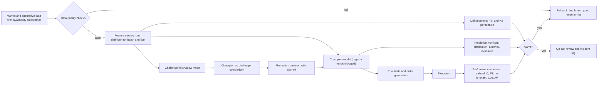

# ML in Production: Serving and Monitoring

## TL;DR

- Training-serving skew is a classic production ML bug: compute every feature with one definition and one code path, join with as-of semantics on availability time, and test parity by replaying live inputs through the training pipeline.
- Monitor in layers: data quality (schema, nulls, staleness, counts), input and prediction drift (PSI, KS), realised performance (IC, hit rate, P&L against expectation) and system health (latency, errors); performance is the only layer that proves the model works, and it arrives with a lag.
- PSI thresholds must be calibrated to sample size: with no drift and 10 bins its mean is about $9(1/n + 1/m)$, so the usual 0.1 alarm fires 35.7% of the time at $n = m = 200$ and never notices a 0.1 sd mean shift at $n = m = 5000$, which a KS test catches 99% of the time and a PSI threshold calibrated to the sample size 95% of the time: the fixed threshold is the problem, not PSI.
- Dead signals are slow to detect: when daily IC over 200 names falls from 0.05 to 0, a CUSUM with a 2.9% chance of a false alarm in 500 healthy days needed a median 24 days and a 60-day rolling-mean rule 59 days; tune any rule by simulating false alarms against delay, and cap capital on new or weakening models.
- Every deployment needs a way back: versioned data, code, config and model artifacts, shadow or canary runs against the champion, capital limits on new models, and an automatic fallback to the last known good model or to flat.

## Learning objectives

- Keep training and serving features identical.
- Monitor drift, decay and data breaks; roll back safely.
- Implement point-in-time (as-of) joins that respect publication delays.
- Compute PSI and the two-sample KS statistic, and calibrate their alarm thresholds to sample size.
- Design a monitoring and rollback architecture for a trading model and justify each component.

## Core concepts

### Training-serving skew

The model learned a function of features as they were computed in research; in production it sees features computed by another pipeline, at another time, from other data.
Typical skews in trading:

- Different code: a pandas rolling window in research and a hand-written incremental update in the live system, with different warm-up, missing-data or inclusive-window rules.
- Different data: research uses cleaned end-of-day closes, production the last trade at 15:50; research uses adjusted prices, production unadjusted.
- Different time: research joins a feature by date, production only has it after a publication delay.
- Different units: one pipeline stores returns in percent, the other in decimals.

Fixes are architectural: one feature definition executed by the same library in batch and streaming (a feature store or a shared feature module), as-of joins on availability timestamps (Kleppmann, chapter 11, discusses the time dependence of stream joins), and a parity test that replays yesterday's live inputs through the research pipeline and requires identical features and predictions within a tolerance.
Sculley et al. (2015) describe how glue code, pipeline jungles and undeclared consumers accumulate in ML systems; Breck et al. (2017) turn production readiness into a checklist of data, model, infrastructure and monitoring tests.

### Point-in-time joins

An as-of join attaches to each query time the latest feature value whose availability time is at or before it.
Availability time is the event time plus every delay before your system could use it (vendor publication, network, batch schedules).
A join on event time instead of availability time is look-ahead, however small the delay.

### Versioning and reproducibility

A prediction is reproducible only if you can recover the exact data snapshot, feature code version, model artifact, configuration, library versions and random seeds.
Store them in a model registry keyed by a hash, log the model version with every prediction and order, and make retraining a deterministic job rather than a notebook.
Then a bad day can be replayed, and a rollback is a configuration change, not a rebuild.

### What to monitor

| Layer | Examples | Alarm logic | Latency to detect |
| :--- | :--- | :--- | :--- |
| Data quality | Schema, nulls, stale timestamps, row counts, out-of-range values, corporate-action jumps | Hard rules, block the run | Immediate |
| Input drift | PSI or KS of each feature against a reference window | Thresholds calibrated to sample size | Same day |
| Prediction drift | Distribution of scores, turnover, gross and net exposure | PSI, limits on turnover and exposure | Same day |
| Performance | Realised IC, hit rate, P&L against forecast, by bucket | CUSUM or rolling tests | Days to weeks |
| System | Latency, error rates, fallbacks used, queue depth | SLOs | Immediate |

Covariate drift (inputs move) does not imply the model is wrong, and concept drift (the input-output relation changes) can happen with no input drift at all (Gama et al. 2014); only performance monitoring catches the second, which is why it matters despite its lag.

### PSI

For bins with reference proportions $e_i$ and current proportions $a_i$,

$$
\mathrm{PSI} = \sum_i(a_i - e_i)\ln\frac{a_i}{e_i},
$$

the symmetrised Kullback-Leibler (Jeffreys) divergence $\mathrm{KL}(a\Vert e) + \mathrm{KL}(e\Vert a)$: the two KL terms are $\sum_i a_i\ln(a_i/e_i)$ and $\sum_i e_i\ln(e_i/a_i)$, and their sum collects to $\sum_i(a_i - e_i)\ln(a_i/e_i)$.
Each term is non-negative and the index is symmetric in $a$ and $e$, so swapping the reference and current windows does not change its value; the orientation matters only because the bin edges (and the floor below) come from the reference window.
For small differences $\ln(a/e) \approx (a - e)/e$, so $\mathrm{PSI} \approx \sum_i(a_i - e_i)^2/e_i$, a chi-square distance (the next term is of third order in $a - e$).
If both samples come from the same distribution, each $a_i - e_i$ has variance about $e_i(1 - e_i)(1/n + 1/m)$, so $\frac{nm}{n + m}\mathrm{PSI}$ behaves like the two-sample chi-square homogeneity statistic and is approximately $\chi^2_{B-1}$ for $B$ bins; hence

$$
E[\mathrm{PSI}] \approx (B - 1)\Big(\frac1n + \frac1m\Big).
$$

A common credit-scoring rule of thumb reads PSI below 0.1 as stable, 0.1 to 0.25 as a moderate shift and above 0.25 as a major shift; du Pisanie et al. (2023) trace the index and these constants to Lewis (1994), and Yurdakul (2018) notes that they are used without reference to Type I or Type II error rates.
Those fixed thresholds ignore sample size: at small $n$ noise alone crosses 0.1, and at large $n$ a shift that matters for a trading model stays far below it.
Set thresholds from the null distribution at your sample sizes (the 5% threshold is the $\chi^2_{B-1}$ 95% quantile times $1/n + 1/m$), or from the size of shift that would change positions.
Empty bins make $\ln(a/e)$ infinite, so implementations floor proportions at a small value; state the floor (the script uses $10^{-4}$, and no bin in its examples is empty).

### The Kolmogorov-Smirnov test

The two-sample statistic is $D = \sup_x|F_a(x) - F_b(x)|$ over the empirical CDFs (Smirnov 1948 tabulates its limiting distribution; Massey 1951 gives exact small-sample distributions).
Under the null and for continuous data, $\sqrt{nm/(n + m)}\,D$ has the Kolmogorov distribution asymptotically, $P(K > \lambda) = 2\sum_{j \ge 1}(-1)^{j-1}e^{-2j^2\lambda^2}$, whose upper 5% point is $c = 1.358$, so the critical value is $c\sqrt{(n + m)/(nm)}$.
KS is binning-free and distribution-free under the null; for a mean shift $\delta$ of a normal variable the population distance is $2\Phi(\delta/2) - 1$, attained at $x = \delta/2$.
It is most sensitive near the median and weak in the tails, so a shift confined to the tails is better caught by a tail-weighted test or by PSI with tail bins.
With thousands of observations it flags shifts too small to matter, so pair the p-value with an effect size (the distance itself, or the shift in mean predicted position).

### Detecting a dead signal

Here the daily IC is the cross-sectional correlation between the model's forecasts and the next day's returns, positive when the signal works, so a dead signal shows up as a fall in its mean.
Performance is noisy: with 200 names the daily cross-sectional IC has standard error about $1/\sqrt{200} = 0.0707$, so a true IC of 0.05 is invisible day by day.
Page's (1954) CUSUM for a fall in the mean accumulates evidence, $S_t = \max(0, S_{t-1} + k - \mathrm{IC}_t)$, with reference value $k$ halfway between the healthy and dead means, and alarms when $S_t > h$.
With Gaussian IC of known standard deviation $\sigma$ the log-likelihood ratio of a dead day against a healthy one is $\frac{\mu_0 - \mu_1}{\sigma^2}(k - \mathrm{IC}_t)$ with $k = (\mu_0 + \mu_1)/2$, so this recursion is the likelihood-ratio CUSUM in rescaled units.
For independent observations with known pre- and post-change densities, Lorden (1971) showed it is asymptotically optimal and Moustakides (1986) that it is exactly optimal: among all stopping rules whose mean time to a false alarm is at least a given bound, it minimises Lorden's criterion, the worst case over change times and pre-change histories of the expected detection delay.
The threshold $h$ trades false alarms against delay through the average run lengths: $\mathrm{ARL}_0$, the mean time to a false alarm with no change, and $\mathrm{ARL}_1$, the mean time to detection when the change is present from the start.
Both come from simulation, from tables, or from the Brook and Evans (1972) Markov chain that discretises $S_t$ on $[0, h]$ and solves $(I - Q)L = \mathbf{1}$ for the expected run length $L$ from each state.
A rolling-mean rule is simpler, but its window must be long to avoid false alarms, which makes it slow.
If the real decay is smaller than the design change, CUSUM still detects it but more slowly; if the IC's standard deviation is underestimated (cross-sectional correlation inflates it above $1/\sqrt{N}$), every run length in the design is optimistic.

### Rollback and safe deployment

- Shadow mode: the challenger computes predictions on live data without trading; compare its features, predictions and paper P&L with the champion's.
- Canary: trade the challenger with a small capital allocation and hard risk limits before full rollout.
- Kill switch: automatic fallback to the last known good model, to a simpler baseline or to flat when data-quality checks fail, predictions leave their historical range or performance alarms fire.
- Retraining policy: scheduled retrains are themselves deployments and go through the same validation; never let a retrain auto-promote without comparison against the champion.
- Governance: for US banks, SR 11-7 (Federal Reserve and OCC, April 2011) was superseded on 17 April 2026 by SR 26-2, Revised Guidance on Model Risk Management (Federal Reserve, FDIC and OCC; status as of 2026-10).
  SR 26-2 keeps conceptual soundness, outcomes analysis (including back-testing) and ongoing monitoring as components of validation, keeps effective challenge and a model inventory, asks for practices tailored to the bank's model risk profile, and puts generative and agentic AI models outside its scope (see [Model Governance](../18-Pricing-and-Risk-Systems/15-Model-Governance.md)).

## Worked examples

All numbers come from [drift_monitoring.py](code/drift_monitoring.py); simulation results are seeded and quoted as "about".

### Example 1: an as-of join with a publication delay

A feature updates at 09:00, 09:30 and 10:15 with values 1.0, 1.5 and 0.8; the model queries at 09:10, 09:30, 10:00 and 10:20.

| Query time | Value, no delay | Value, 5-minute publication delay |
| :--- | ---: | ---: |
| 09:10 | 1.0 | 1.0 |
| 09:30 | 1.5 | 1.0 |
| 10:00 | 1.5 | 1.5 |
| 10:20 | 0.8 | 0.8 |

At 09:30 the 09:30 update is not yet usable once the 5-minute publication delay is respected; a backtest that uses 1.5 there has looked ahead.

### Example 2: PSI by hand

Reference proportions $(0.25, 0.25, 0.25, 0.25)$, current $(0.20, 0.25, 0.25, 0.30)$:
$\mathrm{PSI} = (-0.05)\ln 0.8 + 0.05\ln 1.2 = 0.0203$, and the chi-square approximation $\sum(a - e)^2/e$ gives 0.0200.

### Example 3: PSI under no drift

Ten decile bins from the reference sample, both samples standard normal, 2,000 simulated pairs for $n \le 1000$ and 400 for $n = 100{,}000$ (seed 12); the theory columns use $\chi^2_9$ (95% quantile 16.919).

| $n = m$ | Mean, theory | Mean, simulated | 95% quantile, theory | 95% quantile, simulated | $P(\mathrm{PSI} > 0.1)$ |
| ---: | ---: | ---: | ---: | ---: | ---: |
| 200 | 0.090 | 0.091 | 0.169 | 0.173 | 0.357 |
| 1,000 | 0.018 | 0.018 | 0.034 | 0.033 | 0.000 |
| 100,000 | 0.00018 | 0.00018 | 0.00034 | 0.00034 | 0.000 |

With 200 observations per window the 0.1 rule raises a false alarm on about 35.7% of days; with 100,000 the noise floor is three orders of magnitude below it.

### Example 4: PSI against KS for a small shift

The population PSI of a mean shift on decile bins is 0.0096 for 0.1 sd, 0.0598 for 0.25 sd and 0.2377 for 0.5 sd: even a half-standard-deviation shift is only "moderate" by the rule of thumb.
For $n = m = 5000$ the KS 5% critical value is $1.358\sqrt{2/5000} = 0.0272$, while a 0.1 sd shift has population KS distance $2\Phi(0.05) - 1 = 0.0399$.
In 400 simulated pairs of samples with a 0.1 sd shift (seed 13), KS rejected about 0.990 of the time and PSI never exceeded 0.1 (detection rate 0.000, mean PSI about 0.013).
The control is a PSI threshold calibrated like the KS test: $16.919 \times 2/5000 = 0.0068$, the 5% point under no drift.
On the same samples it detected the shift about 0.950 of the time, and on 1,000 pairs with no shift (seed 113) it fired about 0.049 of the time against 0.040 for KS.
So the blindness comes from the fixed 0.1 threshold; KS keeps a modest power edge for a pure location shift.

### Example 5: a unit bug

A linear model is trained on three features, two of them returns in decimals (20,000 training and 2,000 live rows, seed 14).
On a healthy live day the PSI of the prediction distribution is about 0.011.
When the serving pipeline starts sending the first feature in percent (100 times larger), the PSI of the predictions jumps to about 0.84 and the PSI of the feature itself to about 4.62.
Prediction-distribution monitoring catches the bug on its first day, long before realised performance could.

### Example 6: detecting that a signal has died

Daily IC is $N(0.05, 0.0707^2)$ for 500 days and $N(0, 0.0707^2)$ afterwards, simulated on 10,000 paths of 1,200 days (seed 15).
CUSUM uses $k = 0.025$; the rolling rule alarms when the trailing mean IC falls below zero.
Delays are medians over paths with no false alarm before day 500, counted so that an alarm on the first dead day is a delay of 0.
The Markov-chain column is an independent computation of the CUSUM false-alarm probability (Brook and Evans chain with 400 cells), and the script asserts that each simulated share lies within four standard errors of it.
The run lengths come from the same chain; the script checks each $\mathrm{ARL}_1$ against a separate simulation of 4,000 runs with the signal dead from day 0 (seed 16), again within four standard errors.

| Rule | False-alarm share in 500 healthy days, simulated | Same, Markov chain | Median detection delay (days) | $\mathrm{ARL}_0$ (days) | $\mathrm{ARL}_1$ (days) |
| :--- | ---: | ---: | ---: | ---: | ---: |
| CUSUM, $h = 0.5$ | 0.310 | 0.311 | 15 | 1,320 | 19.3 |
| CUSUM, $h = 0.75$ | 0.026 | 0.029 | 24 | 16,400 | 29.3 |
| CUSUM, $h = 1.0$ | 0.002 | 0.002 | 34 | 200,000 | 39.3 |
| Rolling 20-day mean $< 0$ | 0.111 | | 19 | | |
| Rolling 40-day mean $< 0$ | 0.001 | | 38.5 | | |
| Rolling 60-day mean $< 0$ | 0.000 | | 59 | | |

The run lengths start from $S = 0$ and count the alarm day; $\mathrm{ARL}_0$ is given to three significant figures.
CUSUM with $h = 0.75$ has fewer false alarms than the 20-day rule (0.026 against 0.111) at a cost of a few days' delay, and the 60-day rule takes 59 days: about three months of trading a dead signal.
Raising $h$ by 0.25 adds about 10 days to $\mathrm{ARL}_1$ but multiplies $\mathrm{ARL}_0$ by about 12: false-alarm protection grows exponentially in $h$ while delay grows linearly, the standard CUSUM trade-off.
No rule detects a dead signal in less than a few weeks at this noise level, which is why capital limits on a new or weakening model matter more than clever tests.

## Pitfalls

- Re-implementing features for production instead of sharing the research code; skew appears in warm-up, missing data and window boundaries.
- Joining features on event time instead of availability time; the backtest uses data the live system will not have.
- Using fixed PSI thresholds for every feature and sample size; they are noise at small $n$ and blind at large $n$.
- Alerting on every KS p-value below 0.05 with large samples; pair tests with effect sizes or alerts will be ignored.
- Monitoring only inputs; concept drift leaves inputs unchanged and only shows up in performance.
- Retraining automatically on a schedule and promoting the new model without comparing it to the champion.
- Having no tested rollback path; the first time you need it is the worst time to build it.
- Logging predictions without the model and feature versions that produced them; incidents cannot be replayed.

## Interview questions

> [!question]- ml-prod-skew | What is training-serving skew, and how do you prevent it?
> A difference between features (or preprocessing) in training and in production: different code, data, timing or units.
> Use one feature definition executed by the same code in batch and live, as-of joins on availability time, and a daily parity test replaying live inputs through the training pipeline.

> [!question]- ml-prod-asof | A feature updates at 09:30 and is published 5 minutes later. What value may a model use at 09:30?
> The previous value: the 09:30 update becomes available at 09:35.
> As-of joins must use availability time (event time plus every delay), not event time.

> [!question]- ml-prod-psi-def | Define PSI and its small-shift approximation.
> $\mathrm{PSI} = \sum(a_i - e_i)\ln(a_i/e_i)$, the symmetrised KL divergence between binned distributions.
> For small shifts it is about $\sum(a_i - e_i)^2/e_i$, a chi-square distance.

> [!question]- ml-prod-psi-calc | Reference bins $(0.25, 0.25, 0.25, 0.25)$, current $(0.20, 0.25, 0.25, 0.30)$. PSI?
> 0.0203.
> $-0.05\ln 0.8 + 0.05\ln 1.2$; the chi-square approximation gives 0.0200.

> [!question]- ml-prod-psi-null | What PSI do you expect with no drift, 10 bins and 1,000 observations in each window?
> About $9(1/1000 + 1/1000) = 0.018$, with a 95% quantile near 0.034.
> $\frac{nm}{n + m}\mathrm{PSI}$ is approximately $\chi^2_{B-1}$ under no drift.

> [!question]- ml-prod-psi-threshold | Why is "PSI above 0.1 means drift" a bad universal rule?
> Its null distribution scales with $1/n$: with 200 observations a window crosses 0.1 about 35.7% of the time from noise, while with 5,000 a 0.1 sd shift gives PSI of about 0.013 and is never flagged.
> Calibrate thresholds to sample size and to the shift that matters for positions.

> [!question]- ml-prod-ks | Define the two-sample KS test and its 5% critical value.
> $D = \sup|F_a - F_b|$; reject at 5% when $D > 1.358\sqrt{(n + m)/(nm)}$.
> For $n = m = 5000$ that is 0.0272, below the 0.0399 distance of a 0.1 sd mean shift.

> [!question]- ml-prod-ks-vs-psi | KS or PSI for drift detection?
> KS is binning-free, has a calibrated null and good power for location shifts; PSI is interpretable and handles categorical bins but depends on binning and needs sample-size-aware thresholds.
> In the note's simulation KS caught a 0.1 sd shift 99% of the time and PSI > 0.1 never did, but PSI with a threshold calibrated to the sample size caught it 95% of the time: the fixed threshold, not PSI, was the problem.
> With large samples report an effect size alongside either.

> [!question]- ml-prod-covariate-vs-concept | Covariate drift versus concept drift: which one does input monitoring miss?
> Concept drift, a change in the relation between inputs and target with unchanged inputs.
> Only realised-performance monitoring catches it, with a lag set by the noise in the performance metric.

> [!question]- ml-prod-cusum | How does Page's CUSUM detect a fall in a signal's IC?
> Accumulate $S_t = \max(0, S_{t-1} + k - \mathrm{IC}_t)$ with $k$ halfway between the healthy and dead means; alarm when $S_t > h$.
> It is the likelihood-ratio CUSUM for a Gaussian mean shift; for a known change size it minimises Lorden's worst-case expected delay among rules with the same mean time to false alarm (Moustakides 1986).
> $h$ sets the trade-off between false alarms ($\mathrm{ARL}_0$) and delay ($\mathrm{ARL}_1$).

> [!question]- ml-prod-ic-noise | Daily IC over 200 names is noisy. What is its standard error, and how long to see an IC of 0.05 vanish?
> About $1/\sqrt{200} = 0.0707$ per day, so weeks: in the note's simulation a CUSUM with a 2.9% chance of a false alarm in 500 healthy days needed a median of 24 days and a 60-day rolling rule 59 days.
> Hence capital limits on new or weakening models.

> [!question]- ml-prod-arl | A CUSUM has ARL0 of 16,400 days and ARL1 of 29.3 days. What do these mean, and how would you raise ARL0?
> $\mathrm{ARL}_0$ is the mean time to a false alarm when nothing changes; $\mathrm{ARL}_1$ the mean time to an alarm when the change is present from the start.
> Raise $h$: in the note's IC example going from $h = 0.75$ to $h = 1.0$ multiplies $\mathrm{ARL}_0$ by about 12 (to 200,000 days) and adds about 10 days to $\mathrm{ARL}_1$ (to 39.3), since false-alarm protection grows exponentially in $h$ and delay linearly.

> [!question]- ml-prod-unit-bug | How would you catch a feature suddenly arriving in percent instead of decimals?
> Range checks on each feature and drift monitoring on features and on the prediction distribution.
> In the note's example the prediction PSI jumped from about 0.011 to 0.84 on the first day.

> [!question]- ml-prod-rollback | Describe a safe rollout for a new trading model.
> Shadow mode against the champion, then a canary with a small allocation and hard limits, then gradual scaling with automated kill switches.
> Every step uses registry-versioned artifacts, so rollback is a configuration change to the last known good model or to flat.

> [!question]- ml-prod-reproducibility | What must you store to reproduce a prediction made three months ago?
> The data snapshot (as of that time), feature code version, model artifact hash, configuration, library versions and seeds.
> Log the model and feature versions with every prediction and order.

> [!question]- ml-prod-monitor-layers | What would you monitor for a daily equity alpha model?
> Data quality (schema, nulls, staleness, counts, corporate actions), input drift per feature, prediction distribution, turnover and exposures, realised IC and P&L against forecast, and system health.
> Data quality blocks the run; drift and performance alarms trigger review or fallback.

> [!question]- ml-prod-retrain | Should a model retrain and redeploy automatically every week?
> Retraining can be scheduled, but promotion should not be automatic: compare the new model with the champion on the same out-of-sample period, check parity and stability, and record the decision.
> An automatic retrain can silently absorb a data bug or a leak.

> [!question]- ml-prod-sr117 | What did SR 11-7 expect of model validation, and what governs it now?
> SR 11-7 (2011) asked for evaluation of conceptual soundness, ongoing monitoring and outcomes analysis, with effective challenge and a model inventory.
> It was superseded on 17 April 2026 by SR 26-2 (Federal Reserve, FDIC and OCC), which keeps those validation components, effective challenge and the inventory, asks for risk-based tailoring, and excludes generative and agentic AI (as of 2026-10).
> For ML trading models this maps to independent review, drift and performance monitoring, and backtesting against realised outcomes.

## In this repo and SDE-Interview-Prep

- Code: [drift_monitoring.py](code/drift_monitoring.py) prints and asserts every number in this note (as-of joins, PSI by hand and under the null, KS critical values and power against fixed and calibrated PSI thresholds, the unit-bug example, and the CUSUM study with its Markov-chain run lengths).
- Related: [System Design for Trading](../12-Quant-Development/06-System-Design-for-Trading.md), [Model Governance](../18-Pricing-and-Risk-Systems/15-Model-Governance.md), [Point-in-Time Data and Survivorship](../09-Alpha-Research-and-Portfolio/02-Point-in-Time-Data-and-Survivorship.md), [Online Learning and Linear Models at Scale](04-Online-Learning-and-Linear-Models-at-Scale.md).
- SDE-Interview-Prep: [Evals, Reliability and Observability](https://github.com/shreejitverma/SDE-Interview-Prep/blob/main/13-Agentic-AI/Agentic-AI-Interview-Prep/04-Evals-Reliability-Observability.md).

## Further reading

- Martin Kleppmann, *Designing Data-Intensive Applications* (O'Reilly 2017), chapter 10 (batch processing) and chapter 11 (stream processing).
- D. Sculley et al. (2015), Hidden Technical Debt in Machine Learning Systems, NeurIPS.
- Eric Breck, Shanqing Cai, Eric Nielsen, Michael Salib and D. Sculley (2017), The ML Test Score: A Rubric for ML Production Readiness and Technical Debt Reduction, IEEE Big Data.
- Joao Gama, Indre Zliobaite, Albert Bifet, Mykola Pechenizkiy and Abdelhamid Bouchachia (2014), A Survey on Concept Drift Adaptation, *ACM Computing Surveys* 46(4).
- E. S. Page (1954), Continuous Inspection Schemes, *Biometrika* 41(1-2), 100-115.
- Gary Lorden (1971), Procedures for Reacting to a Change in Distribution, *Annals of Mathematical Statistics* 42(6); George V. Moustakides (1986), Optimal Stopping Times for Detecting Changes in Distributions, *Annals of Statistics* 14(4), 1379-1387.
- D. Brook and D. A. Evans (1972), An Approach to the Probability Distribution of CUSUM Run Length, *Biometrika* 59(3).
- N. Smirnov (1948), Table for Estimating the Goodness of Fit of Empirical Distributions, *Annals of Mathematical Statistics* 19(2), 279-281; Frank J. Massey Jr. (1951), The Distribution of the Maximum Deviation Between Two Sample Cumulative Step Functions, *Annals of Mathematical Statistics* 22(1), 125-128.
- Bilal Yurdakul (2018), Statistical Properties of Population Stability Index, PhD dissertation, Western Michigan University; Johan du Pisanie, James Allison, Christian Budde and Jaco Visagie (2023), A Critical Review of Existing and New Population Stability Testing Procedures in Credit Risk Scoring, arXiv 2303.01227.
- Board of Governors of the Federal Reserve System, FDIC and OCC, SR 26-2: Revised Guidance on Model Risk Management (17 April 2026), which supersedes SR 11-7: Guidance on Model Risk Management (4 April 2011).
