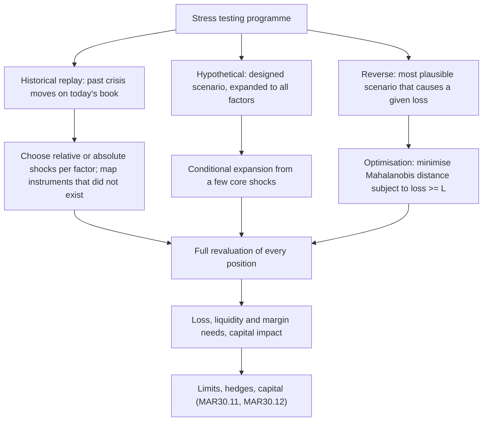

# Stress Testing and Scenario Analysis

## TL;DR

- A stress test revalues today's book under a specified joint move of risk factors; it answers "how much do we lose if this happens", where VaR answers "how much do we lose on a bad but ordinary day".
- Three kinds: historical replay (apply a past crisis move to today's book), hypothetical (a designed scenario, expanded to every factor coherently), and reverse (find the most plausible scenario that produces a given loss).
- Reverse stress testing is an optimisation: minimise the Mahalanobis distance $x^\top\Sigma^{-1}x$ subject to a loss of at least $L$; for a linear book the answer is $x^* = -L\,\Sigma\delta/(\delta^\top\Sigma\delta)$ at distance $L/\sigma_P$, and for an option book it must be solved numerically with a global search.
- Scenarios must be revalued in full and coherently: linear sensitivities misprice options (a put overlay turns a doubling of the scenario into a 39% larger loss, not 100%), and a hypothetical that ignores correlations can be 4.8 conditional standard deviations away from what the primary shocks imply.
- Banks on internal models must run a rigorous stress testing programme at desk and bank level and feed it into limits and capital (MAR30.11, MAR30.12, MAR30.19 to MAR30.23); the US supervisory programme projects capital over nine quarters under a baseline and a severely adverse scenario.

## Learning objectives

- Differentiate Value at Risk (VaR) from stress testing and explain why VaR underestimates tail losses during systemic dislocations.
- Construct historical replay scenarios with appropriate asset re-indexing and tenor alignment.
- Formulate hypothetical macroeconomic stress scenarios incorporating conditional co-movements across asset classes.
- Execute reverse stress testing to uncover the minimal shock vector that breaches capital or liquidity thresholds.
- Model transmission channels: correlation breakdown ("correlations go to 1"), market illiquidity, and margin call feedback loops.
- Comply with institutional regulatory stress testing frameworks, including CCAR, DFAST, and Basel guidelines.
- Measure the plausibility of a scenario with the Mahalanobis distance and say what probability statement it supports.

## Core concepts

### Why VaR is not enough

VaR and ES are statistics of a loss distribution estimated from a window of data under a model.
They fail in crises for identifiable reasons:

- the window may not contain a crisis, so the estimated tails are those of a calm market;
- correlations estimated in calm periods are not the correlations of a crisis (MAR30.23(2) notes correlations "approaching the extreme values of 1 or -1 for several days at the height of the disturbance");
- linear or delta-gamma models misprice option books on large moves;
- they assume positions can be held or exited at the marked price, while in stress liquidity disappears and margin calls force sales.

A stress test removes the probability model from the loss calculation: it fixes the moves and revalues the book.
The probability question comes back only when someone asks how plausible the scenario is.

### The taxonomy

### Historical replay

Take the factor moves over a crisis window and apply them to today's book.
Basel lists examples a bank's programme could include: the 1987 equity crash, the ERM crises of 1992 and 1993, the first-quarter 1994 rate rise, the 1998 Russian crisis, the 2000 technology bubble, the 2007-08 subprime crisis and the 2011-12 euro area crisis (MAR30.23(2)).
More recent examples with sourced data: the Cboe VIX closed at a record 82.69 on 16 March 2020 (Cboe daily VIX history), and the NYMEX WTI May 2020 contract settled at -$37.63 on 20 April 2020 (CFTC staff interim report, November 2020), a move that no price model with a lognormal floor at zero can replay.

The mechanical choices matter as much as the episode:

- relative or absolute shocks: equity, FX and commodity moves are usually replayed as returns, rates and spreads as basis-point changes, but a rate move from a 4% level replayed at 1% matters. A 150bp fall from 4% replayed absolutely takes a 1% yield to $-0.5\%$; replayed relatively ($1\% \times 2.5/4$) it is a 37.5bp fall to 0.625%;
- horizon: one day, the worst ten days, or the whole episode; a ten-day replay of a crisis without the liquidity of that period understates the loss of a book that could not be cut;
- mapping: products that did not exist (a new benchmark, a new index) must be mapped to proxies whose behaviour in the episode is defensible;
- volatility surfaces and correlations must move with spot, or the replay prices options with crisis spots and calm vols.

### Hypothetical scenarios and conditional expansion

A designed scenario specifies a few core factors (equity down, rates up, oil up, spreads wider) and must be extended to the thousands of factors a bank holds.
Under a joint normal model with covariance $\Sigma$, the expected move of secondary factors $x_2$ given core shocks $x_1 = s$ is

$$E[x_2 \mid x_1 = s] = \Sigma_{21}\Sigma_{11}^{-1}s, \qquad \text{Cov}(x_2 \mid x_1) = \Sigma_{22} - \Sigma_{21}\Sigma_{11}^{-1}\Sigma_{12}.$$

The conditional covariance says how uncertain the expansion is; a scenario that sets a secondary factor many conditional standard deviations from its conditional mean is asserting a correlation break, which may be the point of the scenario but should be explicit.
Plausibility of the whole scenario is measured by the Mahalanobis distance $d = \sqrt{x^\top\Sigma^{-1}x}$; under a normal model $d^2$ is chi-square with as many degrees of freedom as factors.
This is the plausibility measure used by Breuer, Jandacka, Rheinberger and Summer (2009), who search for the worst loss over an ellipsoid $d \le k$.

### Reverse stress testing as an optimisation

The question "what is the most plausible way to lose $L$?" is

$$\min_x\ x^\top\Sigma^{-1}x \quad \text{subject to} \quad \Delta V(x) \le -L.$$

Linear book, $\Delta V = \delta^\top x$.
The Lagrangian gives $\Sigma^{-1}x = \lambda\delta$, so $x^* \propto \Sigma\delta$, and the constraint fixes the scale:

$$x^* = -L\,\frac{\Sigma\delta}{\delta^\top\Sigma\delta}, \qquad d^* = \frac{L}{\sqrt{\delta^\top\Sigma\delta}} = \frac{L}{\sigma_P}.$$

The most plausible loss scenario moves every factor in proportion to its covariance with the portfolio, and its distance is the loss measured in portfolio standard deviations.
Two probability statements follow, and they are different: $P(\Delta V \le -L) = \Phi(-d^*)$ for the one-dimensional portfolio P&L, while $P(\chi^2_n > d^{*2})$ is the probability that a random scenario lies outside the ellipsoid through $x^*$, which is much larger in many dimensions.

Nonlinear book.
The constraint surface is curved and can have several local optima (a short straddle loses on both a crash and a rally).
At an optimum the whitened scenario $y = L_\Sigma^{-1}x$ (with $\Sigma = L_\Sigma L_\Sigma^\top$) is parallel to the gradient of the loss, which suggests a fixed-point iteration: take the gradient direction at the current point, find the radius along that ray where the loss reaches $L$, repeat.
Because it finds local optima, run it from several starts and compare with a brute-force search over directions when the dimension allows; [stress_testing.py](code/stress_testing.py) does both.

### Liquidity, margin and feedback

Economic P&L and cash are different things in stress.
A desk long uncollateralised OTC calls hedged with short futures pays variation margin daily on the futures but receives no cash on the calls: on a 10% rally in the worked example below the futures cost 5.25m of cash while the calls gain 6.68m of mark-to-market, so the desk is up 1.43m and short 5.25m of liquidity.
Second-round effects (forced selling by leveraged holders, margin increases at clearing houses, funding withdrawal) amplify the initial move; a stress programme should state which of them it models, and MAR30.21 asks for both market risk and liquidity aspects of market disturbances.

Correlation stress is the cheapest second-order effect to quantify: ten equally weighted assets at 20% vol have portfolio vol 12.17% at correlation 0.3 and 19.08% at 0.9, so a correlation stress alone multiplies VaR by 1.568.

### Governance and regulation

- Basel internal models: a "routine and rigorous programme of stress testing" whose results are reviewed at least monthly by senior management, used in the internal assessment of capital adequacy and reflected in limits (MAR30.11); prompt mitigating action where tests reveal a vulnerability (MAR30.12); desk-level and bank-wide programmes covering linear and nonlinear positions (MAR30.19, MAR30.20); quantitative and qualitative elements including liquidity (MAR30.21); supervisory, historical and bank-designed scenarios (MAR30.23).
- Basel principles: the 2009 sound stress testing principles were superseded by the October 2018 "Stress testing principles" (d450), whose consolidated version defines reverse stress tests as exploring scenarios that could lead a bank to fail.
- United States (as of 2026-10): the Federal Reserve's supervisory stress test projects losses and capital over a nine-quarter horizon; it publishes a baseline and a severely adverse scenario, the separate adverse scenario having been removed from the 2020 cycle; results set each large bank's stress capital buffer, which first applied on 1 October 2020; a final rule announced on 30 September 2026 averages the results of the two most recent annual tests, starting in 2028. Details change with each cycle; see [Stress Testing: CCAR, DFAST and EBA](../17-Regulatory-Capital-Basel-and-FRTB/17-Stress-Testing-CCAR-DFAST-and-EBA.md).

## Worked examples

All numbers are printed and asserted by `python 11-Risk-and-Trading/code/stress_testing.py`; positions, covariances and scenarios are labelled teaching inputs.

### Example 1: a stagflation scenario on a multi-asset fund

Book: $200m of equities at beta 1.15, Treasuries with DV01 $110k per bp, 500,000 barrels of crude at $80, and $42k CS01 of sold CDX HY protection.
Scenario: S&P 500 $-18\%$, 10-year Treasury $+85$bp, crude $+35\%$, HY spreads $+140$bp.

1. Equity: $200\text{m} \times 1.15 \times (-0.18) = -41.40$m.
2. Rates: $-110{,}000 \times 85 = -9.35$m.
3. Oil: $40\text{m} \times 0.35 = +14.00$m.
4. Credit: $-42{,}000 \times 140 = -5.88$m.
5. Total: $-42.63$m.

How plausible is it?
With one-month vols of 4.5%, 25bp, 9% and 40bp and the labelled correlation matrix in the script, the z-scores are $-4.0$, 3.4, 3.9 and 3.5, but the joint Mahalanobis distance is 8.19 because the scenario pairs an equity fall with an oil rally against a positive equity-oil correlation; under the normal model only $0.95 \times 10^{-13}$ of one-month moves lie that far out.
The book's one-month P&L sd is 12.53m, so the loss is 3.40 standard deviations: a portfolio-level 3.4 sd loss reached through an 8.2 sd scenario, which means there are much more plausible ways to lose this much (example 2).

Is it coherent?
Conditioning on the equity and rates shocks alone, the expected oil move is $-5.8\%$ with conditional sd 8.5%, and the expected HY move is $+93.8$bp with conditional sd 28.3bp: the scenario's oil rally is 4.79 conditional sds from what the core shocks imply, a deliberate correlation break that should be stated.

Nonlinearity.
Add long 3-month 90%-strike index puts on $200m notional (vol 18%), revalued in full with vol $+15$ points per unit of severity:

| Severity | Linear book | Puts | Total |
| :--- | ---: | ---: | ---: |
| 0.5x | $-21.31$m | $+5.54$m | $-15.78$m |
| 1x | $-42.63$m | $+18.34$m | $-24.29$m |
| 2x | $-85.26$m | $+51.48$m | $-33.78$m |

Doubling the scenario doubles the linear loss but increases the hedged loss by only 39%: stress tests must revalue options in full and at several severities.

### Example 2: reverse stress tests

Linear book (the same four exposures).
The most plausible scenario losing 40m is $x^* = -40\text{m}\cdot\Sigma\delta/(\delta^\top\Sigma\delta)$: equity $-13.5\%$, 10-year $-10.1$bp, oil $-15.3\%$, HY $+93.6$bp, at distance $d^* = 40/12.53 = 3.19$.
It is a risk-off scenario with oil falling, not the stagflation of example 1, and it is far more plausible ($d = 3.19$ against 8.19).
2,000 random scenarios scaled to the same loss all lie further out, as the closed form says.
Probability statements: $P(\text{P\&L} \le -40\text{m}) = \Phi(-3.19) = 7.05 \times 10^{-4}$ under the normal model, while the share of scenarios outside the ellipsoid through $x^*$ is $P(\chi^2_4 > 3.19^2) = 0.0373$.

Option book.
A desk is short 100,000 one-month 95-puts and 100,000 105-calls (vol 20%), stock-hedged; factors are the 10-day equity log return (sd 3.98%) and the change in implied vol (sd 3 points), correlation $-0.7$; loss threshold 1.0m, full revaluation.

1. Linear (delta-vega) answer: the hedged book has almost no delta (0.048m per unit log return) and vega $-1.079$m per unit vol, so the linear solution needs equity $-86\%$ and vol $+89$ points, distance 29.6, where full revaluation loses 5.31m. The linear model is useless here.
2. Brute force over 1,440 whitened directions: the most plausible 1.0m loss is a rally of $+15.4\%$ with vol $-8.1$ points, distance 3.875.
3. Fixed-point solver from three starts: one start finds the rally (3.875, matching brute force), two find a crash of $-17.1\%$ with vol $+9.1$ points at distance 4.285, a local optimum.

The rally wins because the negative spot-vol correlation makes "up and vol down" a likely direction, and the short call loses on the way up even with lower vol.
Single-start local solvers would have reported the crash, which is the scenario everyone expects and the wrong answer.

### Example 3: cash against P&L on a rally

A desk is long 1m uncollateralised 3-month ATM calls (vol 25%, delta 0.5249) and short the delta in futures.
On a +10% day: calls $+6.676$m mark-to-market, futures $-5.249$m variation margin, economic P&L $+1.427$m.
The stress test must report the 5.25m cash outflow beside the gain, because the gain is not cash and the margin call is.

## Pitfalls

- Applying linear sensitivities to large scenarios: option books, mortgages and structured credit are nonlinear exactly where stress tests look.
- Replaying rates as absolute moves at very different levels, or equity moves as index points instead of returns, without thinking about which is defensible.
- Moving spot in a scenario but leaving implied vols and correlations at calm levels.
- Designing hypothetical scenarios without checking them against the covariance: incoherent scenarios are either deliberate correlation breaks (say so) or mistakes.
- Calling a scenario "plausible" without a measure; quote the Mahalanobis distance and the model it assumes.
- Confusing $\Phi(-d)$ with the chi-square tail when stating how likely a reverse-stress scenario is.
- Running a reverse stress optimisation from one start on a nonlinear book; it finds a local optimum.
- Reporting P&L without liquidity: margin calls, collateral and funding can kill a book whose economic loss is small.
- Treating the portfolio as static over long horizons while also assuming no management action, or the opposite, without stating which.
- Using only historical episodes: products, market structure and positions change, and the next crisis rarely matches the last.

## Interview questions

> [!question]- risk-var-vs-stress-testing | Why can a financial institution with acceptable daily VaR still fail during a market crisis?
> VaR is a quantile of a modelled loss distribution estimated from a window that may contain no crisis; it says nothing about losses beyond the quantile, assumes calm-period correlations and usually normal liquidity.
> In a crisis the window is wrong, correlations move toward $\pm1$ (MAR30.23(2)), option books behave nonlinearly and positions cannot be cut at marked prices.
> A stress test fixes the moves and revalues the book, so it measures exactly the losses VaR averages away.

> [!question]- risk-reverse-stress-testing-concept | What is Reverse Stress Testing, and how does it differ from traditional forward stress testing?
> Forward: choose the scenario, compute the loss. Reverse: choose the loss (capital depletion, a liquidity shortfall, a limit) and find the scenarios that cause it.
> Done quantitatively it is an optimisation: minimise the Mahalanobis distance $x^\top\Sigma^{-1}x$ subject to $\Delta V(x) \le -L$, which returns the most plausible failure scenario.
> The Basel stress testing principles (d450, 2018) describe reverse stress tests as exploring scenarios that could lead a bank to fail.

> [!question]- risk-correlation-breakdown-crisis | Explain the phenomenon "in a crisis, all correlations go to 1" from a structural and liquidity perspective.
> Leveraged holders facing margin calls and redemptions sell what they can, not what they want, so unrelated assets are sold together and their returns co-move.
> The common factor (funding and risk appetite) dominates idiosyncratic drivers, and dealers' balance sheets cannot absorb the flow.
> Quantitatively it destroys diversification: ten 20%-vol assets have portfolio vol 12.17% at correlation 0.3 and 19.08% at 0.9, a 1.568 multiplier on VaR.

> [!question]- risk-historical-replay-limitations | What are the primary drawbacks of relying exclusively on historical crisis replays (e.g., 2008 Lehman or 2020 COVID) for stress testing?
> The next crisis will differ in cause, markets and positions; products and benchmarks that matter now may not have existed, so replays need proxies.
> Mechanical choices (relative or absolute shocks, horizon, how vols and correlations move) change the answer a lot: a 150bp fall from 4% replayed at a 1% level gives $-0.5\%$ absolutely and 0.625% relatively.
> Replays are a floor for the programme, complemented by hypothetical and reverse scenarios (MAR30.23).

> [!question]- risk-conditional-scenario-expansion | How does conditional scenario expansion propagate shocks from a few primary market drivers to thousands of portfolio risk factors?
> Under a joint normal model the secondary factors get $E[x_2 \mid x_1 = s] = \Sigma_{21}\Sigma_{11}^{-1}s$, with residual uncertainty $\Sigma_{22} - \Sigma_{21}\Sigma_{11}^{-1}\Sigma_{12}$.
> In the stagflation example, equity $-18\%$ and 10-year $+85$bp imply oil $-5.8\%$ (sd 8.5%) and HY $+93.8$bp (sd 28.3bp).
> The expansion uses calm-period correlations, so stressed scenarios often overwrite it deliberately; state when you do.

> [!question]- risk-ccar-severely-adverse-scenario | What is the purpose of the US Federal Reserve's CCAR "Severely Adverse" scenario?
> It is the hypothetical recession and market shock against which the Fed projects each large bank's losses, revenues and capital over a nine-quarter horizon (as of 2026-10).
> The Fed publishes a baseline and a severely adverse scenario; the adverse scenario was removed from the 2020 cycle.
> The projected capital decline sets the bank's stress capital buffer, first applied on 1 October 2020; a final rule of 30 September 2026 averages the two most recent tests starting in 2028.

> [!question]- risk-liquidity-adjusted-stress-testing | Why must stress testing include market liquidity adjustments rather than pure mark-to-market valuations?
> In stress, bid-ask spreads widen and depth vanishes, so exiting a position costs far more than the mid mark implies, and the longer exit horizon exposes the book to further moves.
> Margin and collateral calls require cash now, whatever the economic P&L.
> MAR30.21 asks for both market risk and liquidity aspects of market disturbances; a stress result should state exit horizons and liquidation costs explicitly.

> [!question]- risk-cash-margin-drain-in-stress | How can a delta-hedged options portfolio experience terminal distress during a market shock even if its net economic loss is small?
> The hedge and the option may sit under different collateral terms: futures pay daily variation margin while an uncollateralised OTC option pays nothing until expiry.
> In the worked example, long 1m calls hedged with futures gain 1.43m economically on a +10% day but pay 5.25m of variation margin in cash.
> If the cash buffer is smaller than the margin call, the desk is forced to sell at the worst time; stress tests must project cash, not just P&L.

> [!question]- risk-non-linear-payoff-stress-testing | Why do linear risk factor sensitivities (Delta) fail to predict stress test losses for portfolios containing options and mortgage-backed securities?
> Losses on options and prepayable mortgages are curved in the factor move: gamma, vega that changes with spot, and prepayment behaviour all change with size.
> In the stagflation example a put overlay turns a doubling of severity into a 39% larger loss (24.29m to 33.78m) instead of a doubled one.
> In reverse stress tests the failure is worse: the linear model of a hedged short strangle needed a 86% fall and an 89-point vol rise to lose 1m, while full revaluation finds a 15% rally.

> [!question]- risk-macro-scenario-feedback-loops | What are secondary feedback loops in macroeconomic stress testing?
> Reactions to the first shock that move prices again: margin calls and forced sales, wider haircuts and funding withdrawal, credit tightening that raises defaults, and rule-based de-risking by many holders at once.
> They make the second-round loss depend on who holds what, which a factor scenario does not capture by itself.
> A programme should state which feedbacks it models (for example fire-sale price impact on its own and peers' positions) and test the liquidity consequences separately.

> [!question]- risk-reverse-stress-linear-closed-form | Derive the most plausible scenario that makes a linear portfolio lose L.
> Minimise $x^\top\Sigma^{-1}x$ subject to $\delta^\top x = -L$: the first-order condition $\Sigma^{-1}x = \lambda\delta$ gives $x^* = -L\,\Sigma\delta/(\delta^\top\Sigma\delta)$.
> The distance is $d^* = L/\sqrt{\delta^\top\Sigma\delta} = L/\sigma_P$, the loss in portfolio standard deviations.
> For the four-factor fund and $L = 40$m, $d^* = 3.19$ with equity $-13.5\%$, rates $-10.1$bp, oil $-15.3\%$ and HY $+93.6$bp.

> [!question]- risk-reverse-stress-nonlinear-local-optima | How would you solve a reverse stress test for an option book, and what goes wrong?
> Whiten the factors, then iterate: at the optimum the scenario is parallel to the loss gradient, so step along the gradient direction to the radius where the loss equals $L$, and repeat; or use a constrained optimiser with full revaluation.
> The loss surface has several local optima: for a hedged short strangle the rally solution is at distance 3.875 and the crash solution at 4.285, and two of three starts converged to the crash.
> Use multiple starts and a brute-force check where the dimension allows.

> [!question]- risk-scenario-plausibility-mahalanobis | How do you measure the plausibility of a multi-factor stress scenario?
> Mahalanobis distance $d = \sqrt{x^\top\Sigma^{-1}x}$ under a chosen covariance; under joint normality $d^2 \sim \chi^2_n$.
> The stagflation scenario has single-factor z-scores of 3.4 to 4.0 but $d = 8.19$, because it pairs an equity fall with an oil rally against their correlation.
> Plausibility depends on the covariance (calm or stressed) and the normal assumption, so quote both.

> [!question]- risk-relative-vs-absolute-replay | You replay a historical 150bp fall in a 10-year yield from 4% onto today's 1% curve. What do you get?
> Absolute replay: $1\% - 1.5\% = -0.5\%$. Relative replay: $1\% \times 2.5/4 = 0.625\%$, a 37.5bp fall.
> Neither is right in general: absolute shifts fit regimes where rate vol does not scale with the level, relative ones where it does, and near zero the choice dominates the result.
> Choose per factor, document it, and test both when the level has changed a lot.

> [!question]- risk-stress-scenario-coherence-check | A risk committee proposes equity -18%, rates +85bp, oil +35%, HY +140bp. How do you check it is coherent?
> Condition the other factors on the core shocks: given equity and rates, the model expects oil $-5.8\%$ (sd 8.5%) and HY $+93.8$bp (sd 28.3bp).
> The proposed oil rally is 4.79 conditional sds away: the scenario is a deliberate correlation break (a supply shock), which is fine if stated.
> Report the joint Mahalanobis distance too (8.19), and revalue in full.

> [!question]- risk-stress-put-overlay-scaling | Why should a stress test be run at several severities?
> Because losses are not linear in severity for books with options: with a put overlay, the stagflation loss is 15.78m at half severity, 24.29m at full and 33.78m at double.
> One severity hides whether the book is convex (protected) or concave (short tails) beyond it.
> A severity ladder also shows where hedges stop working, for example puts that expire or barriers that knock out.

> [!question]- risk-mar30-stress-requirements | What does the Basel internal models framework require of a bank's stress testing programme?
> A routine and rigorous programme whose results senior management reviews at least monthly, which feeds the internal capital assessment and is reflected in limits (MAR30.11), with prompt mitigation of revealed vulnerabilities (MAR30.12).
> It must run at desk and bank-wide level, cover linear and nonlinear positions and include liquidity aspects (MAR30.19 to MAR30.21).
> Scenarios combine supervisory ones, historical periods (MAR30.23(2) lists 1987, 1992-93, 1994, 1998, 2000, 2007-08, 2011-12) and bank-designed ones (MAR30.23(3)).

> [!question]- risk-ellipsoid-vs-one-d-tail | The most plausible 40m-loss scenario is at Mahalanobis distance 3.19 in four factors. How likely is a 40m loss?
> Under the normal model the portfolio P&L is one-dimensional, so $P(\text{loss} \ge 40\text{m}) = \Phi(-3.19) = 7.05 \times 10^{-4}$.
> The share of scenarios outside the ellipsoid through $x^*$ is $P(\chi^2_4 > 3.19^2) = 0.0373$, about 53 times larger, because most of those scenarios do not lose 40m.
> Use the first for loss probabilities and the second only as a plausibility label for scenarios.

> [!question]- risk-reverse-stress-linear-proxy-failure | Why can a reverse stress test on Greeks give a nonsensical scenario for a hedged option book?
> A delta-hedged book has nearly zero first-order spot exposure, so the linear model can only lose through vega and needs absurd moves: equity $-86\%$ and vol $+89$ points (distance 29.6) for a 1m loss in the strangle example.
> The real risk is curvature: full revaluation finds a 1m loss at a 15.4% rally with vol down 8.1 points, distance 3.875.
> Reverse stress tests on nonlinear books need full revaluation (or at least delta-gamma with cross terms) inside the optimisation.

## Further reading

- Basel Committee on Banking Supervision, Basel Framework MAR30, paragraphs 30.11, 30.12 and 30.19 to 30.23 (version effective 1 January 2023).
- Basel Committee on Banking Supervision, *Stress testing principles*, October 2018 (d450), replacing *Principles for sound stress testing practices and supervision*, May 2009 (BCBS 155).
- T. Breuer, M. Jandacka, K. Rheinberger and M. Summer, "How to find plausible, severe, and useful stress scenarios", *International Journal of Central Banking* 5(3), 205-224, 2009.
- P. Jorion, *Value at Risk: The New Benchmark for Managing Financial Risk*, 3rd edition, McGraw-Hill 2007, chapter 14 (stress testing).
- Board of Governors of the Federal Reserve System, 2026 stress test scenarios and 2026 Dodd-Frank Act stress test results (federalreserve.gov), and the press release of 30 September 2026 on averaging stress capital buffer requirements.

## In this repo and SDE-Interview-Prep

- [stress_testing.py](code/stress_testing.py): scenario P&L, Mahalanobis plausibility, conditional expansion, reverse stress tests (closed form, brute force, multi-start fixed point), margin and correlation stress; every number above.
- Loss quantiles and tails: [VaR and Expected Shortfall](03-VaR-and-Expected-Shortfall.md); generating the scenarios: [Scenario Generation](11-Scenario-Generation.md).
- Covariance and factor structure: [Risk Factor Modelling](10-Risk-Factor-Modelling.md); revaluation methods: [Sensitivities and Revaluation](12-Sensitivities-and-Revaluation.md).
- Supervisory programmes in detail: [Stress Testing: CCAR, DFAST and EBA](../17-Regulatory-Capital-Basel-and-FRTB/17-Stress-Testing-CCAR-DFAST-and-EBA.md); production systems: [Risk Engine](../18-Pricing-and-Risk-Systems/07-Risk-Engine.md).
