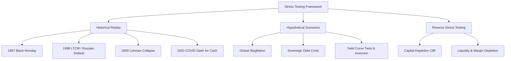

# Stress Testing and Scenario Analysis

## TL;DR

Value at Risk (VaR) and Expected Shortfall (ES) quantify losses under normal market regimes but systematically fail during severe financial crises due to non-linear payoff structures, fat-tailed distributions, and extreme correlation breakdowns.
Stress testing evaluates portfolio vulnerability against severe, plausible tail shocks that standard historical distributions do not adequately sample.
Approaches encompass historical crisis replay (e.g., 1987 Black Monday, 2008 Lehman collapse, 2020 COVID shock), hypothetical macroeconomic scenarios (e.g., stagflation, yield curve inversions, geopolitical crises), and reverse stress testing.
Reverse stress testing inverts traditional risk assessment by determining which specific combinations of factor shocks cause firm insolvency, exposing hidden portfolio vulnerabilities and funding cliffs.
Rigorous stress testing models secondary feedback loops, including liquidity dry-up, margin call cash drains, and forced liquidation cascades.

## Learning objectives

- Differentiate Value at Risk (VaR) from stress testing and explain why VaR underestimates tail losses during systemic dislocations.
- Construct historical replay scenarios with appropriate asset re-indexing and tenor alignment.
- Formulate hypothetical macroeconomic stress scenarios incorporating conditional co-movements across asset classes.
- Execute reverse stress testing to uncover the minimal shock vector that breaches capital or liquidity thresholds.
- Model transmission channels: correlation breakdown ("correlations go to 1"), market illiquidity, and margin call feedback loops.
- Comply with institutional regulatory stress testing frameworks, including CCAR, DFAST, and Basel guidelines.

## Core concepts

### Why VaR Fails in Financial Crises

Statistical risk measures like Value at Risk evaluate portfolio losses over a specified confidence interval (e.g., 99% 1-day or 10-day VaR) under stationary distribution assumptions.
While effective for daily risk monitoring and capital allocation during orderly markets, VaR suffers from fatal blind spots during tail events:

- **Stationarity Fallacy:** Historical sample windows (e.g., 250 or 500 days) often capture calm, low-volatility regimes. When structural breaks occur, historical percentiles drastically underestimate the magnitude of future moves.
- **Correlation Breakdown:** In benign regimes, diversified portfolios benefit from low or negative cross-asset correlations. In systemic panics, asset correlations converge toward +1, as distressed investors liquidate winning positions to meet cash margin calls, causing portfolio diversification to evaporate.
- **Payoff Non-Linearity:** Portfolios with deep out-of-the-money options, credit tranches, or embedded prepayment options exhibit severe negative gamma. A 1-standard-deviation move produces minimal loss, but a 4-standard-deviation move generates catastrophic, non-linear losses.
- **Liquidity Evaporation:** VaR assumes positions can be liquidated at prevailing bid-ask spreads over a 1-day or 10-day horizon. In stress events, market depth collapses, widening bid-ask spreads by orders of magnitude and creating market impact losses that exceed mark-to-market changes.

### Taxonomy of Stress Scenarios

A comprehensive stress testing program combines three complementary methodologies:

#### 1. Historical Scenarios
Historical stress tests apply the exact joint factor shocks observed during past financial crises to the current portfolio:
- **October 1987 (Black Monday):** S&P 500 dropped 20.5% in a single trading session, accompanied by massive volatility spikes and equity futures basis dislocations.
- **Autumn 1998 (LTCM and Russian Default):** Swap spreads widened drastically, emerging market debt defaulted, and relative value fixed income pairs diverged sharply.
- **September-October 2008 (Lehman Brothers Insolvency):** Global equity indices plunged 30-40%, investment grade credit spreads expanded by 300+ bps, interbank lending (Libor-OIS) froze, and flight-to-safety drove sovereign bond yields down.
- **March 2020 (COVID-19 Pandemic):** Equities dropped 30%+ in three weeks, oil futures turned negative, VIX surged to 82, and even US Treasury bonds sold off temporarily during an acute "dash for cash" margin crisis.

Historical replay guarantees that the simulated joint movements were economically realized and co-occurred in real markets.
However, historical testing suffers from hindsight bias: future crises rarely duplicate past shocks, and new financial products (e.g., crypto, post-LIBOR SOFR swaps) did not exist during historical benchmarks.

#### 2. Hypothetical Scenarios
Hypothetical stress tests model plausible future macro-financial shocks conceived through forward-looking economic analysis:
- **Stagflation Shock:** Central banks aggressively hike short rates (+250 bps) while growth stalls, equities fall 25%, commodity prices jump 40%, and sovereign curves flatten or invert.
- **Geopolitical Conflict:** Energy infrastructure disruptions cause oil and natural gas prices to surge 60%, defense equities rally, airline and transport equities collapse, and safe-haven currencies (USD, CHF) appreciate sharply.
- **Credit Contagion:** A systemic private credit or commercial real estate default wave widens high-yield spreads by +500 bps, triggers credit rating downgrades, and causes bank equities to sell off 35%.

#### 3. Reverse Stress Testing
Traditional stress testing asks: *"Given shock vector $\Delta \mathbf{x}$, what is portfolio loss $\Delta V$?"*
Reverse stress testing inverts this inquiry: *"What plausible combination of market shocks $\Delta \mathbf{x}$ will cause the firm to fail (e.g., wipe out regulatory capital or trigger terminal liquidity exhaustion)?"*

Mathematically, reverse stress testing solves a constrained optimization problem:

$$\min_{\Delta \mathbf{x}} \quad \Delta \mathbf{x}^T \mathbf{\Sigma}^{-1} \Delta \mathbf{x} \quad \text{subject to} \quad \Delta V(\Delta \mathbf{x}) \le -L_{\text{critical}}$$

where $\mathbf{\Sigma}$ is the historical risk factor covariance matrix, $\Delta \mathbf{x}^T \mathbf{\Sigma}^{-1} \Delta \mathbf{x}$ measures the statistical plausibility (Mahalanobis distance) of the shock vector, and $L_{\text{critical}}$ is the insolvency threshold.
Reverse stress testing forces risk managers to confront vulnerability combinations that would never be identified by forward-looking guessing.

### Conditional Scenario Expansion

When designing hypothetical scenarios, risk managers typically specify shocks for only a subset of primary factors (e.g., S&P 500 down 20%, 10y Treasury up 50 bps).
To price complex multi-asset portfolios, shocks must be coherently propagated across thousands of secondary risk factors (e.g., individual stock volatilities, cross-currency basis, commodity curves).
Under multivariate normality, the conditional expectation of secondary factors $\mathbf{x}_2$ given primary shocks $\mathbf{x}_1 = \mathbf{s}_1$ is obtained from the partitioned covariance matrix:

$$\mathbb{E}[\Delta \mathbf{x}_2 \mid \Delta \mathbf{x}_1 = \mathbf{s}_1] = \mathbf{\Sigma}_{21} \mathbf{\Sigma}_{11}^{-1} \mathbf{s}_1$$

However, linear conditional expansion understates tail co-movement.
Advanced desks apply quantile regression or copula conditioning to allow secondary factors to experience amplified co-movement during severe primary stress.

### Regulatory Stress Testing: CCAR, DFAST, and Basel

Major banking institutions operate under mandated regulatory stress testing regimes:
- **CCAR (Comprehensive Capital Analysis and Review):** The US Federal Reserve evaluates whether the largest bank holding companies maintain adequate Common Equity Tier 1 (CET1) capital under baseline, adverse, and severely adverse macroeconomic scenarios across a 9-quarter projection horizon.
- **DFAST (Dodd-Frank Act Stress Testing):** Standardized supervisory stress testing providing transparent, comparable capital adequacy disclosures across peer institutions.
- **Basel Principles for Sound Stress Testing:** Mandates board-level oversight, integration of stress testing into daily limit setting, and rigorous reverse stress testing.

## Worked examples

### Example 1: Multi-Asset Hypothetical Stagflation Scenario

A hedge fund holds a multi-asset portfolio with the following exposures:
- Equities: $\$200,000,000$ market value, equity beta $\beta = 1.15$ relative to S&P 500.
- Fixed Income: $\$150,000,000$ Treasury portfolio with $\text{DV01} = \$110,000$ per bp.
- Crude Oil Futures: Long 500 contracts ($500,000$ barrels) trading at $\$80.00/\text{bbl}$ ($\$40,000,000$ notional).
- Corporate Credit: Short $\$100,000,000$ notional of CDX HY protection, $\text{CS01} = \$42,000$ per bp.

The risk committee defines a **Severe Stagflation Scenario**:
- S&P 500 falls by $-18.0\%$.
- 10-year Treasury yield rises by $+85$ basis points.
- Crude oil prices surge by $+35.0\%$.
- CDX HY credit spreads widen by $+140$ basis points.

Compute the predicted portfolio loss under this stress scenario.

**Solution:**

Step 1: Equity Leg P&L:

$$\Delta S_{\text{equity}} = -0.180 \times 1.15 = -0.207 \quad (-20.7\%)$$

$$\text{P\&L}_{\text{equity}} = \$200,000,000 \times (-0.207) = -\$41,400,000$$

Step 2: Fixed Income Leg P&L:
Treasury yields rise by $+85$ bps:

$$\text{P\&L}_{\text{rates}} = -\text{DV01} \times 85 = -\$110,000 \times 85 = -\$9,350,000$$

Step 3: Commodity Leg P&L:
Crude oil price jumps by $+35.0\%$ ($+\$28.00/\text{bbl}$):

$$\text{P\&L}_{\text{commodity}} = 500,000 \text{ bbl} \times \$80.00 \times (+0.350) = \$40,000,000 \times (+0.350) = +\$14,000,000$$

Step 4: Corporate Credit Leg P&L:
The fund is short protection (long credit risk), so spread widening creates losses:

$$\text{P\&L}_{\text{credit}} = -\text{CS01} \times 140 = -\$42,000 \times 140 = -\$5,880,000$$

Step 5: Total Portfolio Stress Loss:

$$\Delta \text{P\&L}_{\text{total}} = -\$41,400,000 - \$9,350,000 + \$14,000,000 - \$5,880,000 = -\$42,630,000$$

The oil hedge offset $\$14\text{M}$ of losses, but simultaneous equity decline, bond sell-off, and credit widening resulted in a $\$42.63\text{M}$ drawdown (21.3% of the $\$200\text{M}$ equity book's market value).

### Example 2: Reverse Stress Testing a Relative Value Book

A statistical arbitrage pairs trading book holds long and short positions across 20 liquid tech stocks.
The fund has $\$20,000,000$ in capital and a maximum allowable loss limit of $\$5,000,000$ (25% capital breach).
Under normal conditions, the portfolio is market-neutral ($\beta_{\text{net}} \approx 0.0$).
However, the long portfolio has an average idiosyncratic correlation to momentum of $+0.65$, while the short portfolio is concentrated in value/low-momentum stocks.
A quant runs reverse stress testing to find the minimum market and factor shock that causes a $\$5,000,000$ loss.

The analytical P&L function conditioned on market return $R_m$ and momentum factor return $F_{\text{mom}}$ is:

$$\text{P\&L}(R_m, F_{\text{mom}}) = \$500,000 \cdot R_m + \$18,000,000 \cdot F_{\text{mom}} - \$40,000,000 \cdot (F_{\text{mom}})^2$$

Setting $\text{P\&L} = -\$5,000,000$ with $R_m = 0$ (market neutral):

$$-40,000,000 \cdot F_{\text{mom}}^2 + 18,000,000 \cdot F_{\text{mom}} + 5,000,000 = 0$$

Dividing by $-1,000,000$:

$$40 F_{\text{mom}}^2 - 18 F_{\text{mom}} - 5 = 0$$

Solving the quadratic equation:

$$F_{\text{mom}} = \frac{18 \pm \sqrt{18^2 - 4(40)(-5)}}{80} = \frac{18 \pm \sqrt{324 + 800}}{80} = \frac{18 \pm \sqrt{1124}}{80} = \frac{18 \pm 33.526}{80}$$

Taking the negative root (momentum crash):

$$F_{\text{mom}} = \frac{18 - 33.526}{80} = \frac{-15.526}{80} \approx -0.194 \quad (-19.4\%)$$

Reverse stress testing reveals that a $-19.4\%$ momentum factor crash (such as the March 2009 or November 2020 factor rotations) completely breaches the fund's $\$5\text{M}$ capital limit, even if the broad market index remains completely flat.

## Pitfalls

- **The Hindsight Bias of Historical Scenarios:** Believing that passing a 2008 Lehman replay guarantees solvency in the next crisis ignores structural changes in market plumbing, such as the growth of private credit and automated algorithmic market making.
- **Linear Scaling Errors:** Doubling the shock size does not double the loss in options or credit books due to negative gamma and jump-to-default cliffs.
- **Ignoring Margin and Collateral Feedback:** A stress test that reports a surviving P&L but fails to check intraday variation margin liquidity can result in bankruptcy via margin call liquidation before prices recover.
- **Assuming Static Portfolios:** In long-horizon stress tests (e.g., 9-quarter CCAR), assuming portfolios do not de-risk or rebalance produces unrealistic cumulative loss estimates.
- **Uncorrelated Residual Fallacy:** Assuming that idiosyncratic residuals remain uncorrelated during a macro shock understates tail risk when crowd liquidation causes across-the-board selling.

## Interview questions

> [!question]- risk-var-vs-stress-testing | Why can a financial institution with acceptable daily VaR still fail during a market crisis?
> VaR is a percentile metric calibrated to historical data under normal market conditions, typically over a 99% confidence level. It does not measure the severity of losses in the 1% tail (tail risk), assumes continuous liquidity to execute hedges, and relies on correlation stability. In a crisis, liquidity evaporates, assets move in non-linear jumps, and correlations converge toward 1, generating losses far exceeding statistical VaR projections.

> [!question]- risk-reverse-stress-testing-concept | What is Reverse Stress Testing, and how does it differ from traditional forward stress testing?
> Traditional stress testing applies a predetermined set of shocks (e.g., equities down 20%, yields up 100 bps) and calculates portfolio loss. Reverse stress testing starts from a predefined terminal failure state (e.g., capital depletion, breach of regulatory ratios, or liquidity exhaustion) and solves backward to identify the most plausible combination of market shocks that causes that failure.

> [!question]- risk-correlation-breakdown-crisis | Explain the phenomenon "in a crisis, all correlations go to 1" from a structural and liquidity perspective.
> During market panics, leveraged funds face severe variation margin calls and investor redemption notices. To generate immediate cash, managers are forced to liquidate whatever assets are most liquid, regardless of fundamentals. This synchronized selling pressure across unrelated asset classes overwhelms dealer balance sheets, causing previously uncorrelated or negatively correlated assets to plunge together.

> [!question]- risk-historical-replay-limitations | What are the primary drawbacks of relying exclusively on historical crisis replays (e.g., 2008 Lehman or 2020 COVID) for stress testing?
> Historical scenarios suffer from hindsight bias and lookback limitations: market structure, regulatory environments, and trading instruments evolve continuously. Products that dominate modern portfolios (e.g., zero-day options, private credit, SOFR derivatives) did not exist in historical crises, and future dislocations will inevitably stem from novel catalysts and institutional vulnerabilities.

> [!question]- risk-conditional-scenario-expansion | How does conditional scenario expansion propagate shocks from a few primary market drivers to thousands of portfolio risk factors?
> Conditional scenario expansion partitions the joint covariance matrix into primary factors $\mathbf{x}_1$ and secondary factors $\mathbf{x}_2$. Under a linear regression framework, conditional expected shocks are computed as $\mathbb{E}[\Delta \mathbf{x}_2 \mid \Delta \mathbf{x}_1 = \mathbf{s}_1] = \mathbf{\Sigma}_{21} \mathbf{\Sigma}_{11}^{-1} \mathbf{s}_1$, preserving historical statistical covariance while ensuring portfolio-wide pricing consistency.

> [!question]- risk-ccar-severely-adverse-scenario | What is the purpose of the US Federal Reserve's CCAR "Severely Adverse" scenario?
> CCAR evaluates whether major US bank holding companies have sufficient Common Equity Tier 1 (CET1) capital to absorb losses, continue lending, and meet obligations during a severe hypothetical recession. The Severely Adverse scenario features severe global economic contraction, elevated unemployment, commercial real estate collapses, and acute stress in financial markets over a 9-quarter projection horizon.

> [!question]- risk-liquidity-adjusted-stress-testing | Why must stress testing include market liquidity adjustments rather than pure mark-to-market valuations?
> In severe crises, market depth shrinks and bid-ask spreads widen dramatically. Attempting to liquidate large positions incurs substantial price impact and liquidation slippage. A position marked at mid-price under normal liquidity may suffer an additional 10-30% haircut when liquidated in a distressed market, transforming a manageable paper loss into actual insolvency.

> [!question]- risk-cash-margin-drain-in-stress | How can a delta-hedged options portfolio experience terminal distress during a market shock even if its net economic loss is small?
> While positive gamma delta-hedged portfolios may experience long-term economic gains, extreme price moves trigger massive immediate variation margin calls on short futures or exchange-cleared hedges. If the fund exhausts its unencumbered cash reserves and collateral buffers before the trade settles, clearing brokers liquidate the position at the worst possible time, locking in catastrophic failure.

> [!question]- risk-non-linear-payoff-stress-testing | Why do linear risk factor sensitivities (Delta) fail to predict stress test losses for portfolios containing options and mortgage-backed securities?
> Portfolios containing options or MBS exhibit strong non-linearity (gamma and negative convexity). For small shocks, linear delta provides an accurate approximation. For large shocks (e.g., 4-6 standard deviations), higher-order terms dominate: option deltas shift rapidly, MBS prepayments surge or dry up completely, and losses expand quadratically or exponentially rather than linearly.

> [!question]- risk-macro-scenario-feedback-loops | What are secondary feedback loops in macroeconomic stress testing?
> Secondary feedback loops occur when an initial market shock triggers institutional reactions that amplify the original shock. Examples include margin call liquidations driving asset prices down further, bank credit tightening inducing corporate defaults, and risk-limit-triggered automated selling cascades (e.g., portfolio insurance in 1987 or volatility-targeting fund deleveraging in 2020).

## Further reading

- Philippe Jorion, *Value at Risk: The New Benchmark for Managing Financial Risk*, Chapter 14: "Stress Testing".
- Basel Committee on Banking Supervision (2018), "Principles for Sound Stress Testing Practices and Supervision".
- Board of Governors of the Federal Reserve System, "Comprehensive Capital Analysis and Review (CCAR) Summary Instructions".
- Bruce Tuckman and Angel Serrat, *Fixed Income Securities: Tools for Today's Markets*, Chapter 15: "Risk Management and Stress Testing".
- Darrell Duffie (2010), *How Big Banks Fail and What to Do About It*.

## In this repo and SDE-Interview-Prep

- Value at Risk and Expected Shortfall foundations: [VaR and Expected Shortfall](03-VaR-and-Expected-Shortfall.md).
- Python reference implementation of scenario generation and stress testing: [risk_analytics.py](code/risk_analytics.py).
- Risk factor taxonomy and covariance modeling: [Risk Factor Modelling](10-Risk-Factor-Modelling.md).
- Greek risk attribution and Taylor approximations: [P&L Attribution and Greek Risk](06-PnL-Attribution-and-Greek-Risk.md).
