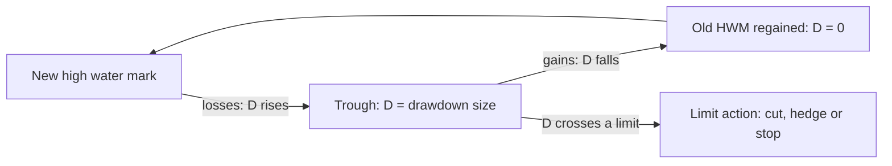
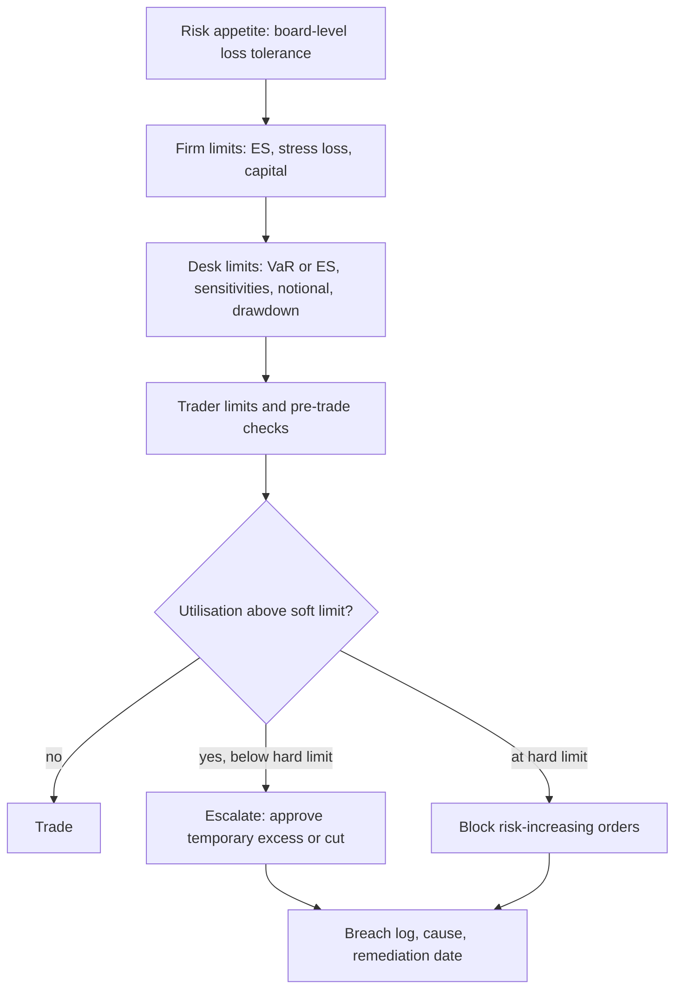

# Drawdowns and Risk Limits

## TL;DR

- Drawdown is the fall from the running peak, $D_t = M_t - X_t$ in log equity; the maximum drawdown $\text{MDD}_T$ is its worst value over $[0, T]$, and it is the number that stops strategies, triggers redemptions and closes desks.
- For log equity $X_t = \mu t + \sigma W_t$, $\text{MDD}_T / \sigma$ depends only on the Sharpe ratio $S = \mu/\sigma$ and $T$; at zero drift $E[\text{MDD}_T] = \sqrt{\pi/2}\,\sigma\sqrt{T} \approx 1.2533\,\sigma\sqrt{T}$, and with positive drift it grows only like $\frac{\sigma^2}{2\mu}\ln T$ (Magdon-Ismail et al. 2004).
- The large-$T$ formula $\frac{2\sigma^2}{\mu}\left(\tfrac14\ln x + 0.49088\right)$, $x = \mu^2 T / (2\sigma^2)$, is an asymptote: at Sharpe 1.5, 10% vol and 3 years it gives 10.60% against an exact 11.20%.
- Two drift identities every risk manager should know: the long-run average drawdown is $\sigma^2/(2\mu) = \sigma/(2S)$, and the probability of ever losing $h$ from today is $e^{-2\mu h/\sigma^2}$.
- A drawdown limit is a hypothesis test with a false-alarm rate: a Sharpe-1, 10%-vol strategy has a 33% chance of a 10% drawdown within a year, so a 10% stop kills good strategies a third of the time.
- Cutting risk after losses (ladders, CPPI, drawdown floors) caps the loss but costs expected return and slows recovery, and only works if positions can be cut faster than the market gaps.

## Learning objectives

- Formulate portfolio High Water Mark (HWM), continuous drawdown $DD(t)$, and Maximum Drawdown $MDD(T)$.
- Compute expected maximum drawdown as an analytical function of annual Sharpe ratio, volatility, and time horizon.
- Evaluate risk-adjusted return metrics based on tail drawdowns: the Calmar ratio, Sterling ratio, and Burke ratio.
- Structure institutional risk limit hierarchies across intraday stops, trailing drawdown triggers, VaR limits, and leverage caps.
- Analyze the de-risking dilemma: mathematically quantify how cutting exposure after losses impairs recovery velocity and introduces whipsaw drag.
- Implement adaptive capital allocation frameworks, including volatility targeting, Constant Proportion Portfolio Insurance (CPPI), and drawdown-adjusted Kelly scaling.
- Compute the full distribution of the maximum drawdown, not just its mean, and use it to calibrate a stop so that its false-alarm rate is known.
- Check that a desk's VaR limit, drawdown limit and target Sharpe are mutually consistent.

## Core concepts

### Definitions

Let $V_t$ be equity and $X_t = \ln V_t$.
The high water mark is $M_t = \sup_{s \le t} X_s$ (in log units) or $\text{HWM}_t = \sup_{s \le t} V_s$.

$$D_t = M_t - X_t \ge 0, \qquad \text{MDD}_T = \sup_{t \le T} D_t$$

In percentage terms the drawdown is $1 - V_t/\text{HWM}_t = 1 - e^{-D_t}$, so log and percentage drawdowns agree to first order and the percentage one is smaller: a log drawdown of 0.10 is a 9.52% fall.
Other descriptors:

- time to trough: from the peak to the lowest point of a drawdown;
- time to recovery (underwater period): from the peak until $V$ first regains the old HWM;
- drawdown frequency: how often $D_t$ crosses a threshold.

### The model and the scaling law

Model log equity as arithmetic Brownian motion, $X_t = \mu t + \sigma W_t$, with $\mu$ the log drift (for a fund with arithmetic mean return $m$, $\mu = m - \sigma^2/2$) and Sharpe ratio $S = \mu/\sigma$ at zero rates.
Since $X = \sigma(S t + W_t)$, every drawdown statistic scales with $\sigma$ at fixed $S$:

$$\text{MDD}_T(\mu, \sigma) \overset{d}{=} \sigma \cdot \text{MDD}_T(S, 1)$$

Doubling leverage doubles $\sigma$ and $\mu$, keeps $S$, and doubles every drawdown in log units.
So drawdowns should always be quoted in units of $\sigma$, and the only free parameters are $S$ and $T$.

### The exact distribution

$D_t$ is a Brownian motion with drift $-\mu$, reflected at 0 (the running maximum pushes it back up from 0).
$\text{MDD}_T < h$ means $D$ has not reached $h$ by time $T$, so $u(t, x) = P_x(D \text{ stays below } h \text{ until } t)$ solves

$$u_t = \tfrac12 \sigma^2 u_{xx} - \mu u_x \text{ on } (0, h), \qquad u_x(0) = 0, \qquad u(h) = 0, \qquad u(0, x) = 1.$$

Separating variables with $\phi(x) = e^{cx}\psi(x)$, $c = \mu/\sigma^2$, removes the first-order term: the eigenfunctions are $\psi = \cos kx - (c/k)\sin kx$ with $kh\cos kh = ch\sin kh$ and eigenvalue $-\tfrac12\sigma^2 k^2 - \mu^2/(2\sigma^2)$, plus one hyperbolic mode when $ch > 1$.
Expanding the initial condition in this basis gives $P(\text{MDD}_T < h)$ as a rapidly convergent series, and $E[\text{MDD}_T] = \int_0^\infty P(\text{MDD}_T \ge h)\,dh$ is a one-dimensional integral.
This is the route Magdon-Ismail, Atiya, Pratap and Abu-Mostafa (2004) take; [drawdowns.py](code/drawdowns.py) implements it independently, checks the closed-form coefficients against quadrature, and checks the zero-drift result to $10^{-9}$.

The paper writes the mean as

$$E[\text{MDD}_T] = \begin{cases} \frac{2\sigma^2}{\mu} Q_p\!\left(\frac{\mu^2 T}{2\sigma^2}\right) & \mu > 0 \\ \sqrt{\pi/2}\,\sigma\sqrt{T} & \mu = 0 \\ -\frac{2\sigma^2}{\mu} Q_n\!\left(\frac{\mu^2 T}{2\sigma^2}\right) & \mu < 0 \end{cases}$$

with $Q_p(x) \to \tfrac14\ln x + 0.49088$ and $Q_n(x) \to x + \tfrac12$ as $x \to \infty$, and $Q_p(x), Q_n(x) \approx \sqrt{\pi/8}\sqrt{2x}$ as $x \to 0$.
Interpretation:

- zero drift: $\sqrt{\pi/2} \approx 1.2533$, against $\sqrt{2/\pi} \approx 0.7979$ for the expected maximum of the same Brownian motion;
- positive drift: logarithmic growth, $E[\text{MDD}_T] \approx \frac{\sigma^2}{2\mu}\left(\ln\frac{\mu^2 T}{2\sigma^2} + 1.96352\right) = \frac{\sigma}{2S}\left(\ln(2S^2T) + \gamma_E\right)$, since $4 \times 0.49088 = 1.96352$ and $(\ln 4 + \gamma_E)/4 = 0.490878$ agrees with the paper's constant to the five digits it quotes;
- negative drift: $E[\text{MDD}_T] \approx |\mu| T + \sigma^2/|\mu|$, the whole expected loss plus a constant.

How good is the asymptote?
The exact $Q_p$ against $\tfrac14\ln x + 0.49088$:

| $x$ | 1 | 10 | 100 | 1000 |
| :--- | ---: | ---: | ---: | ---: |
| exact $Q_p(x)$ | 0.5877 | 1.0875 | 1.6457 | 2.2183 |
| asymptote | 0.4909 | 1.0665 | 1.6422 | 2.2178 |

The asymptote always undershoots: the gap is 0.021 at $x = 10$, 0.0035 at $x = 100$ and 0.0005 at $x = 1000$, and $x = 100$ already means $S^2 T = 200$, far longer than any track record.
Further out the exact $Q_p(x) - \tfrac14\ln x$ is 0.49094 at $x = 10^4$ and 0.490885 at $x = 10^5$, falling toward $(\ln 4 + \gamma_E)/4 = 0.490878$.

### Expected maximum drawdown in units of $\sigma$

Exact $E[\text{MDD}_T]/\sigma$ (log units):

| Sharpe | $T = 1$ | $T = 3$ | $T = 10$ |
| :--- | ---: | ---: | ---: |
| 0.0 | 1.253 | 2.171 | 3.963 |
| 0.5 | 1.069 | 1.663 | 2.525 |
| 1.0 | 0.925 | 1.336 | 1.855 |
| 2.0 | 0.727 | 0.969 | 1.252 |

Read it as: a Sharpe-1 strategy run at 10% vol should expect a worst drawdown of about 13% over three years, and a Sharpe-0.5 strategy about 17%.

The mean understates what a limit-setter needs; the tail matters.
Exact probabilities with $\sigma = 10\%$:

| Sharpe | $P(\text{MDD}_{1y} \ge 10\%)$ | $P(\text{MDD}_{3y} \ge 20\%)$ |
| :--- | ---: | ---: |
| 0.0 | 0.629 | 0.495 |
| 0.5 | 0.476 | 0.242 |
| 1.0 | 0.331 | 0.089 |
| 2.0 | 0.126 | 0.006 |

### Two identities from the drift

Long-run drawdown.
For $\mu > 0$ the reflected process $D$ has a stationary law, exponential with rate $2\mu/\sigma^2$, because the density $p$ of a reflected drifted Brownian motion solves $\tfrac12\sigma^2 p'' + \mu p' = 0$ with zero flux at 0.
So at a random time far in the future the expected drawdown is $\sigma^2/(2\mu) = \sigma/(2S)$ and $P(D > h) = e^{-2\mu h/\sigma^2}$: a Sharpe-1, 10%-vol strategy spends on average 5% below its peak and 13.5% of its time more than 10% below it (both in log units).
An independent check that uses no time grid: draw $X_T$, then the running maximum from its exact conditional law given the endpoint (a Brownian bridge, by the reflection principle); at $T = 20$ years 400,000 such draws give a mean drawdown of about 0.0501 and $P(D_T > 10\%)$ of about 0.1357.

Ruin-type probabilities.
$e^{-2\mu X_t/\sigma^2}$ is a martingale, so by optional stopping the probability that $X$ ever falls $h$ below its starting value is

$$P\left(\inf_t X_t \le -h\right) = e^{-2\mu h/\sigma^2} = e^{-2Sh/\sigma}.$$

For $S = 1$, $\sigma = 10\%$ and $h = 0.20$ this is $e^{-4} = 0.0183$.
The same exponent is the [gambler's ruin](../01-Probability/11-Random-Walks-and-Gamblers-Ruin.md) result in continuous time, and it is the cleanest statement of why Sharpe and not return controls survival.

### Discrete monitoring

Daily marks miss intraday extremes, so a simulated or historical MDD from daily data is biased low.
With $S = 1.5$, $\sigma = 10\%$, $T = 3$: the exact mean is 0.1120, daily Monte Carlo gives about 0.1049, ten-times-finer steps about 0.1092, and extrapolating linearly in $\sqrt{\Delta t}$ recovers about 0.1112.
The bias is larger in the tail: daily monitoring gives $P(\text{MDD}_{3y} \ge 15\%)$ of about 0.105 against the exact 0.131.
The $\sqrt{\Delta t}$ scaling is the same one behind the continuity correction for discretely monitored barrier options (Broadie, Glasserman and Kou 1997).

### Drawdown-based performance ratios

The Calmar ratio is annualised return over maximum drawdown, as introduced by Young (1991) on a 36-month window.
Because $\text{MDD}$ grows with the window length (about $\ln T$ for good strategies, $\sqrt{T}$ for bad ones), Calmar ratios are only comparable at the same window and the same sampling frequency.
Sterling and Burke ratios replace the single maximum by an average of large drawdowns or a root sum of squared drawdowns; definitions differ between sources, so state the formula whenever you quote one.
All of them inherit the small-sample problem of a single extreme: a three-year MDD is essentially one observation.

### The limit framework

A trading firm turns its risk appetite into a hierarchy of limits, each catching a different failure:

| Limit type | Measures | Catches | Blind spot |
| :--- | :--- | :--- | :--- |
| VaR or ES | loss quantile or tail mean at a horizon | aggregate market risk under normal correlations | regime changes, liquidity, tails beyond the window |
| Stress loss | loss under named scenarios | crisis co-movements, nonlinearity | scenarios nobody wrote down |
| Sensitivities | DV01 by bucket, CS01, vega by expiry and strike, gamma | concentration on one factor, hedgeable exposures | correlation between factors |
| Notional, gross and net | position size, gross and net leverage | balance-sheet use, funding, crowding | risk per unit notional differs wildly |
| Liquidity | position against average daily volume, days to exit | positions that cannot be cut | liquidity in stress, not normal days |
| Stop-loss and drawdown | realised P&L from start or from the HWM | model failure and broken strategies that the other limits did not see | cuts good strategies on noise |

Operational rules that make a framework work:

- hard limits block risk-increasing trades pre-trade; soft limits trigger escalation, a documented excess approval and a remediation deadline;
- utilisation is monitored intraday for fast books, and every breach is logged with cause and resolution;
- limits must be consistent with each other (next section) and reviewed when volatility regimes change;
- for banks using internal models, stress test results must be reflected in the policies and limits set by management and the board (Basel MAR30.11(3)).

### Making limits consistent

A 1% one-day 99% VaR limit on a normal P&L allows a daily sd of $0.01/2.3263 = 0.43\%$, about 6.82% a year.
At that vol, a Sharpe-1 strategy hits a 10% drawdown within a year with probability 0.080, and a zero-Sharpe strategy with probability 0.286.
So a 10% annual drawdown stop beside a 1% VaR limit fires on about one good strategy in twelve: the two limits are consistent only if the firm accepts that false-alarm rate.

### Drawdown limits as hypothesis tests

A stop is a sequential test of "the strategy still has its edge".
Its size (false alarm) is $P(\text{MDD} \ge h \mid S = S_{\text{claimed}})$ and its power is $P(\text{MDD} \ge h \mid S = 0)$.
With $\sigma = 10\%$ and a one-year 10% stop, the size is 0.331 at $S = 1$ and the power only 0.629 at $S = 0$: the test cannot tell a good strategy from a dead one in a year, which is the drawdown version of the statement that Sharpe ratios are hard to estimate (see [Overfitting and Deflated Sharpe](../09-Alpha-Research-and-Portfolio/08-Overfitting-and-Deflated-Sharpe.md)).
Wider stops at longer horizons separate better: over three years a 20% stop has size 0.089 at $S = 1$ and power 0.495 at $S = 0$.

### De-risking: what a ladder costs and buys

Recovery is asymmetric: after a fall of $D$ the gain needed to recover is $1/(1 - D) - 1$.

| Drawdown | 10% | 20% | 30% | 50% | 75% | 90% |
| :--- | ---: | ---: | ---: | ---: | ---: | ---: |
| Gain to recover | 11.1% | 25.0% | 42.9% | 100% | 300% | 900% |

Cutting risk after losses makes recovery slower: after a 20% loss, halving the position and then earning the 25% the full position needed leaves equity at $0.8 \times 1.125 = 0.90$.

The trade-off, measured.
[drawdowns.py](code/drawdowns.py) runs the same 20,000 one-year daily paths at 20% vol with and without the ladder of worked example 2 (full risk below 5%, 70% to 10%, 40% to 15%, stop at 15%):

| | Sharpe 1, no ladder | Sharpe 1, ladder | Sharpe 0, no ladder | Sharpe 0, ladder |
| :--- | ---: | ---: | ---: | ---: |
| Mean return | about 22.2% | about 16.7% | about 0 | about 0 |
| Mean MDD | about 15.9% | about 12.2% | about 21.3% | about 13.8% |
| $P(\text{MDD} \ge 20\%)$ | about 0.217 | 0 | about 0.499 | 0 |
| Share stopped out | 0 | about 0.180 | 0 | about 0.454 |

The ladder removes every 20% drawdown, costs a good strategy about 5.6 points of expected return, and stops 18% of good strategies; for a dead strategy it leaves the mean return at about zero and cuts the average maximum drawdown from about 21.3% to 13.8%.
Whether that is worth it depends on what a 20% drawdown costs the business (redemptions, funding, the franchise), not on the strategy's Sharpe.

### Drawdown control by construction: CPPI and the Grossman-Zhou floor

CPPI (Black and Perold 1992) holds risky exposure $m(V_t - F)$ against a fixed floor $F$; Grossman and Zhou (1993) solve the optimal investment problem under the constraint $V_t \ge \alpha \sup_{s \le t} V_s$ and the optimal risky holding is proportional to the cushion $V_t - \alpha\,\text{HWM}_t$, a CPPI whose floor ratchets up with the high water mark.
In continuous time the floor is never breached, because exposure goes to zero as the cushion does.
In practice the guarantee fails if the market gaps by more than $1/m$ between rebalances: with $m = 4$ a 25% gap wipes the whole cushion.
Simulated with daily rebalancing ($m = 4$, $\alpha = 0.8$, risky asset with 8% drift and 20% vol, 5 years, 4,000 paths), the worst $V/\text{HWM}$ on any path is about 0.800 without gaps; with one -30% day it is 0.76 on the worst paths and every path breaches, since the loss is $4 \times 0.30 = 1.2$ times the cushion.

Volatility targeting, $w_t = \sigma_{\text{target}}/\hat\sigma_t$, is the other common rule: it keeps the ex-ante risk constant rather than reacting to realised losses, so it cuts exposure when volatility rises, which often precedes drawdowns, but it does nothing against a loss that arrives without a volatility spike.

## Worked examples

All numbers are printed and asserted by `python 11-Risk-and-Trading/code/drawdowns.py`.

### Example 1: expected maximum drawdown at Sharpe 1.5

A market-neutral fund has log drift $\mu = 15\%$ and vol $\sigma = 10\%$, so $S = 1.5$.
What maximum drawdown should the investor expect over 3 and 10 years?

1. $x = \mu^2 T/(2\sigma^2) = 0.0225 \times 3/0.02 = 3.375$ for $T = 3$, and 11.25 for $T = 10$.
2. Asymptote: $\frac{2\sigma^2}{\mu}(\tfrac14 \ln x + 0.49088) = 0.1060$ at 3 years and 0.1461 at 10 years; the equivalent form $\frac{\sigma}{2S}(\ln(2S^2T) + \gamma_E)$ gives the same numbers.
3. Exact (series): 0.1120 at 3 years and 0.1487 at 10 years. At 3 years the asymptote is 0.60 percentage points (about 5%) too low, because $x = 3.375$ is far from the large-$x$ regime.
4. In percentage terms, $E[1 - e^{-\text{MDD}}] = 10.54\%$ at 3 years and 13.75% at 10 years.
5. The tail: the 95% quantile of the 3-year MDD is 0.1799 (and 0.2234 at 10 years), and $P(\text{MDD}_{3y} \ge 15\%) = 0.131$.

What to say in the interview: "The expected 3-year drawdown is about 11%, a one-in-twenty bad case is 18%, and anyone who sizes a stop at 11% will be stopped out about half the time by a perfectly healthy strategy."

### Example 2: a drawdown ladder after a 12% loss

A $100m fund runs this ladder: full risk below a 5% drawdown, 70% from 5% to 10%, 40% from 10% to 15%, liquidate at 15%.
It falls to $88m (a 12% drawdown), and the underlying models then return +15%.

1. The drawdown is in the 10% to 15% band, so the multiplier is 0.40.
2. The fund earns $0.40 \times 15\% = 6\%$: equity $88 \times 1.06 = 93.28$m.
3. It is still 6.72% below the HWM and needs another 7.20% to recover.
4. Unthrottled it would have reached $88 \times 1.15 = 101.2$m, a new high.

The cost is real but so is the protection: the measured comparison in the core concepts shows the ladder removing every 20% drawdown at the price of about 5.6 points of expected annual return for a Sharpe-1 strategy.

### Example 3: is the stop consistent with the VaR limit?

A desk has a 1% one-day 99% VaR limit, targets Sharpe 1, and has a 10% one-year drawdown stop.

1. Allowed daily sd: $1\%/2.3263 = 0.43\%$, annualised $0.43\% \times \sqrt{252} = 6.82\%$.
2. $P(\text{MDD}_{1y} \ge 10\%)$ at $\sigma = 6.82\%$, $S = 1$: 0.080.
3. At $S = 0$ it is 0.286.

The desk will hit the stop in about one year in twelve even if it is as good as claimed, and will survive a year with probability 0.714 even if it has no edge; if management wants a sharper test, it must lengthen the horizon, not tighten the stop.

## Pitfalls

- Quoting drawdowns without the volatility: MDD scales with $\sigma$ at fixed Sharpe, so "a 20% drawdown" means nothing until you know whether vol is 5% or 30%.
- Using the large-$T$ asymptote for short track records: at $x = 3.375$ it understates the mean by about 5%, and the mean itself understates the tail.
- Measuring drawdowns from daily or monthly marks and comparing them with a continuous-time formula: discrete monitoring always misses part of the drawdown.
- Mixing log and percentage drawdowns, or arithmetic and log drift ($\mu_{\log} = m - \sigma^2/2$).
- Setting a stop by intuition rather than by its false-alarm rate: a tight stop is a test with huge size and little power.
- Treating a de-risking ladder as free: it cuts expected return and the probability of recovering quickly, and the measured cost should be weighed against what the drawdown would cost the business.
- Trusting CPPI or a drawdown floor through gaps: the guarantee assumes you can rebalance before the cushion is gone.
- Comparing Calmar ratios computed over different windows or sampling frequencies.
- Judging drawdown risk from the surviving funds or strategies only: survivorship removes exactly the paths that breached limits.
- Ignoring the gross book: a market-neutral portfolio with large gross leverage can have small VaR and large drawdowns from factor or crowding moves that the VaR window has not seen.

## Interview questions

> [!question]- risk-expected-mdd-vs-sharpe | How does expected maximum drawdown scale with the Sharpe ratio and time horizon for a continuous drift-diffusion process?
> At zero drift exactly $\sqrt{\pi/2}\,\sigma\sqrt{T} \approx 1.2533\,\sigma\sqrt T$; with positive drift it grows only logarithmically, $E[\text{MDD}] \approx \frac{\sigma}{2S}\left(\ln(2S^2T) + \gamma_E\right)$ for large $S^2T$ (Magdon-Ismail et al. 2004).
> At fixed Sharpe, MDD is proportional to $\sigma$, because $X = \sigma(St + W_t)$.
> The log form is an asymptote: its constant 0.49088 is only reached for $\mu^2T/(2\sigma^2)$ in the hundreds; at $x = 1000$ the exact $Q_p$ is 2.2183 against 2.2178.

> [!question]- risk-calmar-ratio-definition | Define the Calmar ratio and explain why institutional investors often prefer it over the Sharpe ratio.
> Annualised return divided by maximum drawdown, originally over 36 months (Young 1991).
> It prices the path, not just the dispersion: two strategies with the same Sharpe can have very different worst peak-to-trough losses, and that loss is what triggers redemptions.
> Its weakness: MDD is one extreme observation and grows with the window, so Calmar ratios are noisy and comparable only at the same window and sampling frequency.

> [!question]- risk-de-risking-dilemma-explanation | What is the "de-risking dilemma" faced by quantitative hedge fund risk managers during severe drawdowns?
> Cutting risk after a loss protects against a dead strategy but, if the strategy is still good, it shrinks the dollars earned on the rebound and lengthens the time underwater.
> Measured on 20,000 one-year paths at 20% vol, a 5/10/15% ladder removed every 20% drawdown but cut a Sharpe-1 strategy's mean return from about 22.2% to 16.7% and stopped 18% of good strategies.
> The right ladder depends on the cost of a deep drawdown to the business and on how quickly a dead strategy can be detected, not on the strategy's average return.

> [!question]- risk-recovery-return-asymmetry | Why does a 50% drawdown require a 100% return to break even, and what are the implications for position sizing?
> Recovery needs $1/(1 - D) - 1$: from 50, gaining 50 is 100% of the remaining base.
> The required gain is 11.1% after 10%, 25% after 20%, 42.9% after 30% and 900% after 90%, so deep drawdowns are effectively permanent.
> In log terms losses and gains are symmetric, which is why sizing should target the log-growth rate and its drawdowns (fractional Kelly) rather than arithmetic return.

> [!question]- risk-trailing-vs-hard-drawdown-stops | Contrast a hard stop-loss limit with a trailing drawdown limit.
> A hard stop triggers on cumulative loss from a fixed reference (start of year or inception capital); a trailing limit triggers on the fall from the running high water mark and moves up with every new high.
> The trailing limit protects accrued profits but fires more often: its trigger variable is $M_t - X_t$, which is always at least the loss from the start.
> Calibrate either one from the distribution of the variable it monitors, not from intuition.

> [!question]- risk-cppi-mechanism | Explain the operational mechanism of Constant Proportion Portfolio Insurance (CPPI).
> Hold risky exposure $m(V - F)$ against a floor $F$, with the rest in cash; as $V$ falls toward $F$ the exposure shrinks to zero, so in continuous time the floor holds (Black and Perold 1992).
> With a ratcheting floor $\alpha \cdot \text{HWM}$ it becomes the drawdown-control policy of Grossman and Zhou (1993).
> The guarantee breaks if the risky asset gaps by more than $1/m$ between rebalances, and the rule is pro-cyclical: it sells after falls and buys after rises.

> [!question]- risk-volatility-targeting-drawdown-mitigation | How does volatility targeting dynamically stabilize drawdowns during market panics?
> It sets exposure to $\sigma_{\text{target}}/\hat\sigma_t$, so when realised volatility rises the position shrinks and ex-ante risk stays roughly constant.
> It helps when large losses arrive together with rising volatility, which is common in stress, and it is mechanical, so it avoids discretionary hesitation.
> It does not help against a loss that arrives without a vol spike (a gap or a slow bleed), it lags because $\hat\sigma$ is estimated from the past, and it raises turnover.

> [!question]- risk-underwater-period-significance | What is an underwater period, and why is drawdown duration often more damaging to hedge funds than drawdown magnitude?
> The time from a high water mark until it is regained; for a positive-drift strategy the time spent far below the peak is governed by the stationary law $P(D > h) = e^{-2\mu h/\sigma^2}$.
> While underwater, a fund charging incentive fees above a high water mark earns no performance fee, so staff costs are paid out of management fees and talent may leave.
> Investors judge managers by time since the last high as much as by depth, so long shallow drawdowns can do as much commercial damage as short deep ones.

> [!question]- risk-gross-vs-net-leverage-limits | Why do prime brokers and risk committees enforce separate limits on gross leverage and net leverage?
> Net leverage measures directional exposure ($\text{Long} - \text{Short}$), gross leverage the balance sheet ($\text{Long} + \text{Short}$).
> A market-neutral book can have zero net and ten times gross, and its risk sits in the spread between longs and shorts: factor rotations, short squeezes, borrow recalls and crowded unwinds, none of which net leverage sees.
> Gross also drives financing and margin needs, which is what the prime broker cares about.

> [!question]- risk-psychological-drawdown-limits | What is the case for a mandatory cooling-off halt after consecutive losing sessions, and what does it cost?
> It is a pre-committed control for the period when judgement is least reliable: after losses, decision-makers tend to escalate risk to win it back, and a halt forces a review of positions, models and data before new risk is taken.
> It costs the same as any stop: it fires on noise as well as on broken strategies, and missed rebounds are real money.
> Set it as part of the limit framework with an explicit false-alarm rate, and make the review (not just the pause) the point.

> [!question]- risk-probability-ever-losing-h | A strategy has Sharpe 1 and 10% annual vol. What is the probability that it ever falls 20% (in log terms) below today's level?
> $e^{-2\mu h/\sigma^2} = e^{-2 \times 0.10 \times 0.20/0.01} = e^{-4} = 0.0183$.
> Proof: $e^{-2\mu X_t/\sigma^2}$ is a martingale, so by optional stopping $P(\text{hit } -h) \cdot e^{2\mu h/\sigma^2} + P(\text{never}) \cdot 0 = 1$.
> The exponent is $2Sh/\sigma$: survival depends on Sharpe times the loss measured in vols.
> A Monte Carlo over 100 years with yearly steps and the exact Brownian-bridge crossing probability between steps gives about 0.0182 on 200,000 paths, consistent with it.

> [!question]- risk-mdd-zero-drift-closed-form | What is the expected maximum drawdown of a driftless Brownian motion with volatility sigma over T, and how does it compare with the expected maximum?
> $E[\text{MDD}_T] = \sqrt{\pi/2}\,\sigma\sqrt T \approx 1.2533\,\sigma\sqrt T$, against $E[\max_{t \le T} W_t] = \sqrt{2/\pi}\,\sigma\sqrt T \approx 0.7979\,\sigma\sqrt T$.
> The drawdown is larger because it can start from any interior peak, not just from 0.
> So a zero-edge strategy at 10% vol should expect a 12.5% drawdown in its first year and about 21.7% over three years.

> [!question]- risk-stationary-drawdown-mean | For a strategy with positive drift, what is the long-run average drawdown and why?
> $\sigma^2/(2\mu) = \sigma/(2S)$: the drawdown is a reflected Brownian motion with drift $-\mu$, whose stationary law is exponential with rate $2\mu/\sigma^2$.
> A Sharpe-1, 10%-vol strategy averages 5% below its peak and spends $e^{-2} = 13.5\%$ of its time more than 10% below it.
> Halving the Sharpe doubles the typical drawdown in units of $\sigma$.
> Check without the stationary argument: sampling the exact joint law of the 20-year endpoint and running maximum gives a mean drawdown of about 0.0501.

> [!question]- risk-mdd-discrete-monitoring-bias | You estimate maximum drawdown from daily marks of a simulated strategy. Is the estimate biased, and how would you fix it?
> Biased low: the path between marks can go lower than either mark, so daily monitoring misses part of every drawdown.
> At Sharpe 1.5, 10% vol, 3 years: exact mean 0.1120, daily Monte Carlo about 0.1049, ten-times-finer steps about 0.1092.
> The error shrinks like $\sqrt{\Delta t}$, so a two-step-size extrapolation (about 0.1112 here) or a Brownian-bridge correction removes most of it.

> [!question]- risk-drawdown-stop-as-hypothesis-test | A strategy claims Sharpe 1 at 10% vol. The risk manager proposes a 10% drawdown stop over the first year. Critique it.
> It is a test with size 0.331 (the chance a true Sharpe-1 strategy hits it) and power 0.629 (the chance a zero-Sharpe strategy hits it): it stops a third of good strategies and lets a third of dead ones through.
> A year of data cannot separate Sharpe 1 from Sharpe 0 at any reasonable error rates.
> Better: a wider stop over a longer horizon (a 20% three-year stop has size 0.089 and power 0.495), plus monitoring of what the strategy is supposed to be earning from, not just its P&L.

> [!question]- risk-var-limit-drawdown-consistency | A desk has a 1% one-day 99% VaR limit and a 10% annual drawdown stop and targets Sharpe 1. Are the limits consistent?
> The VaR limit allows a daily sd of $1\%/2.3263 = 0.43\%$, about 6.82% a year.
> At that vol a Sharpe-1 strategy hits a 10% drawdown within a year with probability 0.080, and a zero-Sharpe strategy with probability 0.286.
> So the stop fires on about one good year in twelve; consistent if management accepts that, otherwise widen the stop or lower the VaR limit.

> [!question]- risk-cppi-gap-risk | A CPPI with multiplier 4 rebalances daily. What one-day move breaks its floor, and what happens on a -30% day?
> Any fall larger than $1/m = 25\%$ before rebalancing: the loss $m \times \text{move} \times \text{cushion}$ then exceeds the cushion.
> On a -30% day the loss is 1.2 times the cushion, so with a floor at 80% of the high water mark and a full 20% cushion, equity ends at $0.8 - 0.2 \times 0.2 = 0.76$ of the HWM.
> Higher multipliers give more upside participation and a smaller gap tolerance; the gap risk is what option-based insurance sells.

> [!question]- risk-magdon-asymptote-accuracy | A colleague uses E[MDD] = (sigma/2S)(ln(2S^2 T) + 0.5772) for a Sharpe 1.5, 10% vol, 3-year track record. Is that accurate?
> It gives 10.60%, while the exact expectation is 11.20%: the formula is the large-$T$ asymptote of Magdon-Ismail et al., and here $x = \mu^2T/(2\sigma^2) = 3.375$ is not large.
> The asymptote always undershoots; the gap in $Q_p$ is still 0.0035 at $x = 100$.
> Use the exact series (or a fine-step simulation) for real track records, and quote the tail (95% quantile 18.0% here), not just the mean.

> [!question]- risk-limit-framework-hierarchy | Design the limit set for a new options market-making desk. Which limits, and what does each one catch?
> VaR or ES for aggregate normal-market risk; stress-loss limits on named crash, vol-spike and rates scenarios for nonlinearity; sensitivity limits (delta, gamma, vega by expiry and strike bucket, rho) for concentration; notional and liquidity limits against average volume; a stop-loss or drawdown limit as the backstop for model failure.
> Make them consistent (the stop's false-alarm rate at the VaR-implied vol), define hard limits as pre-trade blocks and soft limits as escalation with a documented excess and remediation date.
> Review them when the vol regime changes, since a fixed vega limit means very different risk at 15 and at 40 vol.

> [!question]- risk-log-vs-percent-drawdown | A fund's log drawdown is 0.10. What is the percentage fall, and why does the distinction matter?
> $1 - e^{-0.10} = 9.52\%$; percentage drawdowns are always smaller than log ones and the gap grows with depth.
> Formulas for Brownian motion give log drawdowns, while investors see percentage ones: at Sharpe 1.5, 10% vol and 3 years the expected MDD is 11.20% in log units but 10.54% in percentage terms.
> Also check the drift convention: the log drift is the arithmetic mean return minus $\sigma^2/2$.

## In this repo and SDE-Interview-Prep

- [drawdowns.py](code/drawdowns.py): exact MDD distribution by eigenfunction expansion (checked against quadrature, the zero-drift closed form and a step-extrapolated Monte Carlo), the Magdon-Ismail asymptotes, exact endpoint-and-maximum sampling of the stationary drawdown, the ladder and drawdown-floor simulations; every number above.
- Optimal sizing and growth: [Kelly Criterion and Position Sizing](01-Kelly-Criterion-and-Position-Sizing.md).
- Tail risk metrics: [VaR and Expected Shortfall](03-VaR-and-Expected-Shortfall.md).
- Stress testing and extreme scenarios: [Stress Testing and Scenario Analysis](04-Stress-Testing-and-Scenarios.md).
- Reflection principle and running maxima: [Brownian Motion](../04-Stochastic-Calculus/01-Brownian-Motion.md); discrete analogue: [Random Walks and Gambler's Ruin](../01-Probability/11-Random-Walks-and-Gamblers-Ruin.md).
- Pre-trade limit systems: [Intraday Risk and Pre-Trade Limits](../18-Pricing-and-Risk-Systems/08-Intraday-Risk-and-Pre-Trade-Limits.md).

## Further reading

- M. Magdon-Ismail, A. F. Atiya, A. Pratap and Y. S. Abu-Mostafa, "On the maximum drawdown of a Brownian motion", *Journal of Applied Probability* 41(1), 147-161, 2004: the series solution and the $Q_p$, $Q_n$ functions and asymptotics.
- M. Magdon-Ismail and A. F. Atiya, "Maximum drawdown", *Risk* 17(10), 99-102, 2004: the practitioner version, including drawdown-based ratios.
- S. J. Grossman and Z. Zhou, "Optimal investment strategies for controlling drawdowns", *Mathematical Finance* 3(3), 241-276, 1993.
- F. Black and A. F. Perold, "Theory of constant proportion portfolio insurance", *Journal of Economic Dynamics and Control* 16(3-4), 403-426, 1992.
- J. P. Lehoczky, "Formulas for stopped diffusion processes with stopping times based on the maximum", *Annals of Probability* 5(4), 601-607, 1977: the drawdown stopping time.
- T. W. Young, "Calmar ratio: a smoother tool", *Futures*, October 1991.
- M. Lopez de Prado, *Advances in Financial Machine Learning*, Wiley 2018, chapter 14 (backtest statistics, including drawdown and time under water).
- M. Broadie, P. Glasserman and S. Kou, "A continuity correction for discrete barrier options", *Mathematical Finance* 7(4), 325-349, 1997: the $\sqrt{\Delta t}$ bias of discretely monitored extremes.
