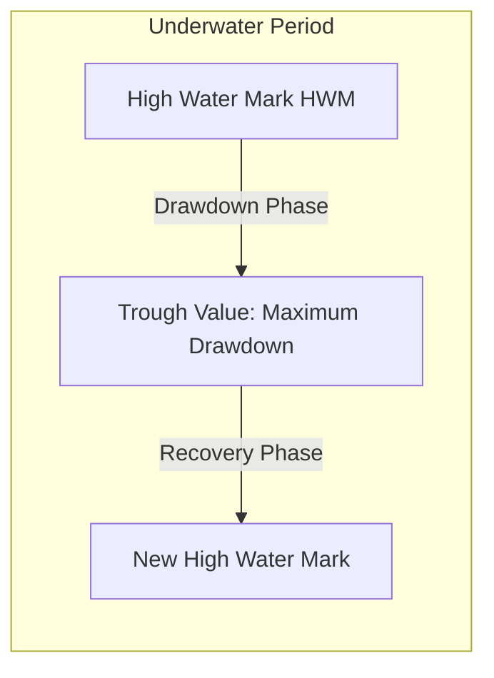

# Drawdowns and Risk Limits

## TL;DR

Drawdown measures the peak-to-trough percentage decline in portfolio equity over a specific evaluation window.
Maximum Drawdown (MDD) is the primary real-world risk metric evaluated by capital allocators and risk committees, as consecutive drawdowns trigger investor redemptions, margin liquidation, or desk closure long before theoretical asymptotic long-run returns materialize.
For a strategy following a Brownian motion with annual Sharpe ratio $S$ and volatility $\sigma$, the expected maximum drawdown over horizon $T$ scales analytically with $\sqrt{T}$ or logarithmically when drift dominates.
Risk limits enforce operational survival via hard stop-loss thresholds, trailing drawdown throttles, leverage constraints, and factor concentration caps.
However, dynamic de-risking entails a fundamental trade-off: cutting risk during a drawdown protects against terminal ruin, but locks in realized losses and impairs recovery capacity if the strategy rebounds.

## Learning objectives

- Formulate portfolio High Water Mark (HWM), continuous drawdown $DD(t)$, and Maximum Drawdown $MDD(T)$.
- Compute expected maximum drawdown as an analytical function of annual Sharpe ratio, volatility, and time horizon.
- Evaluate risk-adjusted return metrics based on tail drawdowns: the Calmar ratio, Sterling ratio, and Burke ratio.
- Structure institutional risk limit hierarchies across intraday stops, trailing drawdown triggers, VaR limits, and leverage caps.
- Analyze the de-risking dilemma: mathematically quantify how cutting exposure after losses impairs recovery velocity and introduces whipsaw drag.
- Implement adaptive capital allocation frameworks, including volatility targeting, Constant Proportion Portfolio Insurance (CPPI), and drawdown-adjusted Kelly scaling.

## Core concepts

### Drawdown Definitions and Mathematical Formulation

Let $V(t)$ represent the total portfolio equity value at time $t \ge 0$.
The High Water Mark (HWM) represents the peak cumulative portfolio value achieved up to time $t$:

$$\text{HWM}(t) = \sup_{0 \le s \le t} V(s)$$

The drawdown at time $t$, denoted $DD(t)$, is the percentage decline from the historical high water mark:

$$DD(t) = \frac{V(t) - \text{HWM}(t)}{\text{HWM}(t)} \in (-\infty, 0]$$

Drawdown is commonly expressed as a positive loss percentage:

$$D(t) = -DD(t) = \frac{\text{HWM}(t) - V(t)}{\text{HWM}(t)} \in [0, 1)$$

Key drawdown characteristics:
- **Maximum Drawdown (MDD):** The worst observed peak-to-trough loss over a specified evaluation period $[0, T]$:

$$\text{MDD}(T) = \sup_{0 \le t \le T} D(t) = \sup_{0 \le t \le T} \left[ \frac{\text{HWM}(t) - V(t)}{\text{HWM}(t)} \right]$$

- **Drawdown Duration (Underwater Period):** The continuous time elapsed between a new high water mark and the date when portfolio equity fully recovers to that prior peak:

$$\tau_{\text{recovery}} = \inf \{ t > t_{\text{peak}} \mid V(t) \ge V(t_{\text{peak}}) \} - t_{\text{peak}}$$

- **Time to Trough:** The elapsed duration from the high water mark to the point of maximum loss.

### Expected Maximum Drawdown Analytics

Assuming portfolio log-equity follows an arithmetic Brownian motion with annualized drift $\mu$ and annualized volatility $\sigma$:

$$dX(t) = \mu \, dt + \sigma \, dW(t)$$

The annual Sharpe ratio is $S = \mu / \sigma$.
Malik Magdon-Ismail and Amir Atiya derived closed-form analytical approximations for the expected maximum drawdown $\mathbb{E}[\text{MDD}(T)]$:

#### 1. Zero-Drift Limit ($\mu = 0$):
When the strategy has zero directional edge, the expected maximum drawdown scales with the square root of time:

$$\mathbb{E}[\text{MDD}(T)] \approx \sqrt{\frac{\pi}{2}} \cdot \sigma \sqrt{T} \approx 1.2533 \cdot \sigma \sqrt{T}$$

#### 2. Positive-Drift Regime ($\mu > 0$, Large $T$):
When drift is positive, the trajectory trends upward, preventing drawdowns from growing indefinitely with $\sqrt{T}$.
For large $T$, expected maximum drawdown scales logarithmically with the evaluation horizon:

$$\mathbb{E}[\text{MDD}(T)] \approx \frac{\sigma^2}{2\mu} \left[ \ln\left( \frac{2\mu^2 T}{\sigma^2} \right) + \gamma \right] = \frac{\sigma}{2S} \left[ \ln(2 S^2 T) + \gamma \right]$$

where $\gamma \approx 0.5772$ is the Euler-Mascheroni constant.
This is the large-$T$ limit $Q_p(x) \to \frac{1}{4}\ln x + 0.49088$ of Magdon-Ismail and Atiya's $\mathbb{E}[\text{MDD}] = \frac{2\sigma^2}{\mu} Q_p\left(\frac{\mu^2 T}{2\sigma^2}\right)$, since $0.49088 \times 4 - \ln 4 \approx \gamma$.
This analytical result reveals that:
- Expected maximum drawdown is inversely proportional to the Sharpe ratio $S$.
- Doubling strategy volatility doubles the expected dollar drawdown.
- Over realistic multi-year horizons (e.g., 5-10 years), even high-Sharpe strategies ($S = 1.5$) reliably experience drawdowns equal to about $1.23$ times (5 years) to $1.46$ times (10 years) their annual standard deviation.

### Performance Metrics Based on Drawdowns

Standard Sharpe ratios treat upside and downside volatility symmetrically.
Investors and allocators evaluate asymmetric drawdown-adjusted ratios:

#### 1. Calmar Ratio
The Calmar ratio measures annualized compound return relative to the maximum drawdown over a rolling 3-year or 5-year window:

$$\text{Calmar Ratio} = \frac{\text{Annualized Return}}{\text{Maximum Drawdown}(T)}$$

A Calmar ratio above $1.0$ is generally considered acceptable in systematic trading, while ratios exceeding $2.0$ represent elite risk-managed performance.

#### 2. Sterling Ratio
The Sterling ratio replaces the single maximum drawdown with the average of annual maximum drawdowns plus an arbitrary buffer (historically 10%):

$$\text{Sterling Ratio} = \frac{\text{Annualized Return}}{\frac{1}{N}\sum_{i=1}^N \text{MDD}_i + 0.10}$$

#### 3. Burke Ratio
The Burke ratio penalizes both the frequency and severity of drawdowns by taking the square root of the sum of squared drawdowns:

$$\text{Burke Ratio} = \frac{\text{Annualized Return}}{\sqrt{\sum_{k=1}^M D_k^2}}$$

### Institutional Risk Limits Architecture

Quantitative hedge funds and proprietary trading desks enforce multi-layered limit structures to prevent catastrophic loss:

1. **Intraday Stop-Loss Limits:** If cumulative daily trading loss exceeds threshold $L_{\text{daily}}$ (e.g., 1% of allocated equity), the automated execution system freezes new risk-increasing orders and systematically hedges delta to cash.
2. **Monthly / Trailing Drawdown Throttles:** If rolling monthly drawdown breaches threshold $L_{\text{month}}$ (e.g., 5%), portfolio leverage is automatically scaled down by 50%. If drawdown reaches 10%, the desk is completely liquidated and suspended pending risk audit.
3. **VaR and Expected Shortfall Limits:** Daily 99% 1-day VaR cannot exceed a set percentage of capital (e.g., 2.5% of AUM).
4. **Gross and Net Leverage Caps:**
   - Gross Leverage $= (\sum |L_i| + \sum |S_i|) / \text{Equity} \le \text{Cap}_{\text{gross}}$ (e.g., $4.0\times$ for equities, $20\times$ for fixed income relative value).
   - Net Leverage $= (\sum L_i - \sum S_i) / \text{Equity} \le \text{Cap}_{\text{net}}$ (e.g., $\pm 20\%$).
5. **Factor and Liquidity Concentration Limits:** No single risk factor (e.g., tech momentum, energy beta, 10y rates) may account for more than 25% of total portfolio variance.

### The De-Risking Dilemma and Recovery Asymmetry

When a fund incurs a significant drawdown, risk managers face a difficult operational dilemma:
**Should capital allocation be reduced to prevent further losses, or should risk be maintained to recover quickly?**

#### 1. The Mathematical Recovery Asymmetry
Losses compound non-linearly:

$$\text{Required Return to Recover} = \frac{1}{1 - D} - 1$$

| Drawdown ($D$) | Required Gain to Break Even |
| :--- | :--- |
| 10% | 11.1% |
| 20% | 25.0% |
| 30% | 42.9% |
| 50% | 100.0% |
| 75% | 300.0% |
| 90% | 900.0% |

#### 2. The Cost of Dynamic De-Risking (Whipsaw Drag)
Suppose a fund reduces its position sizing by 50% after suffering a 20% drawdown.
If the strategy subsequently generates the exact sequence of returns required to recover under full sizing (+25%), the de-risked fund only gains:

$$\text{De-risked Return} = 0.50 \times 25\% = +12.5\%$$

The portfolio equity recovers to only $0.80 \times 1.125 = 0.90$ (down 10%), rather than returning to par ($1.00$).
The fund now requires an additional $+11.1\%$ gain to reach its high water mark.
De-risking protects against the absorbing boundary of ruin (zero capital), but locks in drawdowns and impairs the expected time to recovery if the strategy maintains positive edge.

### Adaptive Sizing: Volatility Targeting and CPPI

To balance survival against recovery drag, systematic funds implement rule-based dynamic sizing:

- **Volatility Targeting:** Position sizes are scaled inversely to prevailing market volatility:

$$w_t = w_{\text{base}} \times \frac{\sigma_{\text{target}}}{\hat{\sigma}_t}$$

When market volatility spikes during a drawdown, exposure naturally contracts, preserving capital without discretionary intervention.

- **Constant Proportion Portfolio Insurance (CPPI):** Equity exposure is dynamically scaled based on the dollar distance (cushion $C_t$) above a guaranteed floor value $F$:

$$\text{Exposure}_t = m \cdot (\text{Equity}_t - F)$$

where $m$ is a leverage multiplier. As equity approaches the floor, exposure automatically shrinks to zero, guaranteeing that the capital floor is not breached.

## Worked examples

### Example 1: Calculating Expected Maximum Drawdown

A quantitative equity market-neutral hedge fund operates with an annualized return of $\mu = 15.0\%$ and annualized volatility of $\sigma = 10.0\%$.
The strategy has an annual Sharpe ratio of $S = 1.50$.
Compute the expected maximum drawdown over a 3-year trading horizon ($T = 3.0$).

**Solution:**

Step 1: Compute model parameters:

$$S = \frac{0.15}{0.10} = 1.50$$

$$\frac{\sigma}{2S} = \frac{0.10}{2 \times 1.50} = \frac{0.10}{3.00} \approx 0.03333 \quad (3.33\%)$$

Step 2: Compute logarithmic term:

$$2 S^2 T = 2 \times 1.50^2 \times 3.0 = 2 \times 2.25 \times 3.0 = 13.50$$

$$\ln(2 S^2 T) = \ln(13.50) \approx 2.60269$$

Step 3: Add the Euler-Mascheroni constant:

$$\text{Bracket Sum} = 2.60269 + 0.57722 = 3.17991$$

Step 4: Compute Expected Maximum Drawdown:

$$\mathbb{E}[\text{MDD}] \approx 0.03333 \times 3.17991 \approx 0.1060 \quad (10.60\%)$$

Over a 3-year horizon, a Sharpe 1.5 fund with 10% volatility should expect a maximum peak-to-trough drawdown of approximately $10.6\%$.
If the evaluation window extends to $T = 10$ years:

$$2 S^2 T = 2 \times 2.25 \times 10 = 45.0 \implies \ln(45.0) \approx 3.80666$$

$$\mathbb{E}[\text{MDD}_{10y}] \approx 0.03333 \times (3.80666 + 0.57722) = 0.03333 \times 4.38388 \approx 0.1461 \quad (14.61\%)$$

Even an exceptional Sharpe 1.5 strategy faces a 14.6% expected drawdown over a decade.

### Example 2: Drawdown-Triggered De-Risking Mechanics

A multi-strategy fund manages $\$100,000,000$.
The mandate enforces the following drawdown limit ladder:
- Level 0 (Normal): Drawdown $< 5\% \implies 100\%$ risk allocation.
- Level 1 (Warning): $5\% \le \text{Drawdown} < 10\% \implies$ Cut gross leverage by $30\%$ (run at $70\%$ risk).
- Level 2 (De-risk): $10\% \le \text{Drawdown} < 15\% \implies$ Cut gross leverage by $60\%$ (run at $40\%$ risk).
- Level 3 (Hard Stop): $\text{Drawdown} \ge 15\% \implies$ Complete portfolio liquidation to cash.

The fund suffers a sequence of daily losses totaling $12.0\%$ drawdown (fund equity falls to $\$88,000,000$).
1. Determine the active risk allocation multiplier.
2. If the underlying alpha models subsequently generate a $+15.0\%$ cumulative gross rebound return, calculate the final portfolio equity and determine whether the fund has reclaimed its high water mark.

**Solution:**

Step 1: Determine Active Risk Allocation:
Current drawdown is $12.0\%$, which falls into **Level 2** ($10\% \le DD < 15\%$).
The risk allocation multiplier is $40\%$ ($0.40$).

Step 2: Evaluate Rebound Performance:
The alpha models generate a $+15.0\%$ return on capital.
Because the fund is operating at $40\%$ risk weighting:

$$\text{Effective Portfolio Return} = 0.40 \times 15.0\% = +6.0\%$$

Step 3: Compute Final Portfolio Equity:

$$\text{Final Equity} = \$88,000,000 \times (1 + 0.060) = \$88,000,000 \times 1.060 = \$93,280,000$$

Step 4: Check High Water Mark Recovery:
Initial HWM was $\$100,000,000$.
Current equity is $\$93,280,000$, leaving an ongoing drawdown of:

$$\text{Remaining Drawdown} = \frac{\$93,280,000 - \$100,000,000}{\$100,000,000} = -6.72\%$$

Under unthrottled risk, the $+15\%$ rebound would have produced $\$88\text{M} \times 1.15 = \$101.2\text{M}$, fully restoring the high water mark and generating $\$1.2\text{M}$ in net profit.
Due to de-risking, the fund remains underwater at $\$93.28\text{M}$.
This illustrates the mathematical cost of de-risking: risk reduction prevents terminal ruin at the expense of locking in losses during market reversals.

## Pitfalls

- **Confusing Drawdown with Volatility:** A strategy can exhibit low annualized volatility (e.g., a carry trade with a Sharpe of 2.0) but experience catastrophic sudden drawdowns of 40%+ when market regimes shift.
- **Procyclical Stop-Loss Whipsaw:** Setting tight intraday or weekly stop-loss limits on mean-reverting alpha strategies causes the system to systematically buy high and sell low at the bottom of temporary noise fluctuations.
- **Ignoring Compounding Recovery Asymmetry:** Assuming that recovering from a 50% loss requires only a 50% gain leads to severe undercapitalization and reckless leverage scaling.
- **Lookback Window Truncation:** Evaluating a strategy's maximum drawdown over a 2-year sample period that excluded 2008, 2020, or 2022 severely misrepresents true strategy tail risk.
- **Survivorship Bias in Historical Drawdown Reporting:** Tracking only funds or models that currently exist ignores all historical peers that were liquidated after breaching maximum drawdown limits.

## Interview questions

> [!question]- risk-expected-mdd-vs-sharpe | How does expected maximum drawdown scale with the Sharpe ratio and time horizon for a continuous drift-diffusion process?
> For a process with positive drift, expected maximum drawdown scales inversely with the Sharpe ratio: $\mathbb{E}[\text{MDD}] \propto \frac{\sigma}{2S} \ln(S^2 T)$. Higher Sharpe ratios compress drawdown magnitude, but drawdowns still grow logarithmically with evaluation time $T$. In zero-drift regimes, expected drawdown scales with the square root of time: $\mathbb{E}[\text{MDD}] \approx 1.2533 \sigma \sqrt{T}$.

> [!question]- risk-calmar-ratio-definition | Define the Calmar ratio and explain why institutional investors often prefer it over the Sharpe ratio.
> The Calmar ratio is the ratio of annualized compound return to the maximum drawdown observed over a specified window (typically 36 months): $\text{Calmar} = \text{Return} / \text{MDD}$. Allocators prefer the Calmar ratio because it measures return against actual severe peak-to-trough capital loss rather than symmetric standard deviation, directly penalizing crash risk and tail clustering.

> [!question]- risk-de-risking-dilemma-explanation | What is the "de-risking dilemma" faced by quantitative hedge fund risk managers during severe drawdowns?
> When a fund suffers a drawdown, cutting leverage protects capital against terminal ruin if performance continues to deteriorate. However, if the underlying alpha strategy has positive edge and rebounds, the reduced position size generates proportionally smaller dollar profits, permanently locking in realized losses and prolonging the time required to regain the high water mark.

> [!question]- risk-recovery-return-asymmetry | Why does a 50% drawdown require a 100% return to break even, and what are the implications for position sizing?
> If capital drops from 100 to 50, the base against which future percentage gains are measured is halved. To return to 100, the fund must generate 50 points of profit on a 50-point base, which is $50/50 = 100\%$. This non-linear asymmetry implies that position sizing must be constrained conservatively (e.g., via fractional Kelly) to avoid large drawdowns where recovery becomes mathematically improbable.

> [!question]- risk-trailing-vs-hard-drawdown-stops | Contrast a hard stop-loss limit with a trailing drawdown limit.
> A hard stop-loss limit triggers when cumulative portfolio loss from inception reaches a fixed dollar or percentage threshold (e.g., $-10\%$ of initial capital). A trailing drawdown limit triggers when portfolio equity declines by a specified percentage from its peak high water mark, locking in accrued profits and resetting dynamically as the portfolio reaches new equity peaks.

> [!question]- risk-cppi-mechanism | Explain the operational mechanism of Constant Proportion Portfolio Insurance (CPPI).
> CPPI dynamically allocates capital between a risky asset and a risk-free reserve based on the cushion: $\text{Exposure} = m \cdot (\text{Equity} - \text{Floor})$, where $m > 1$ is the multiplier and $\text{Floor}$ is the capital threshold that must never be breached. As equity drops toward the floor, the cushion shrinks, automatically forcing risk exposure down to zero before the floor is violated.

> [!question]- risk-volatility-targeting-drawdown-mitigation | How does volatility targeting dynamically stabilize drawdowns during market panics?
> Volatility targeting sets position size inversely proportional to rolling realized volatility: $w_t = w_{\text{base}} \times (\sigma_{\text{target}} / \hat{\sigma}_t)$. During market panics, asset volatility surges by $2\times$ to $5\times$. The rule-based engine automatically sells assets and scales back gross leverage as volatility expands, systematically capping dollar losses without relying on ad-hoc discretionary stops.

> [!question]- risk-underwater-period-significance | What is an underwater period, and why is drawdown duration often more damaging to hedge funds than drawdown magnitude?
> The underwater period is the total time elapsed between setting a high water mark, reaching a trough, and fully recovering back to that peak. Extended underwater periods demoralize trading talent, prevent managers from earning performance fees (due to high water mark covenants), and trigger investor redemptions, frequently causing hedge fund closures even if ultimate insolvency is avoided.

> [!question]- risk-gross-vs-net-leverage-limits | Why do prime brokers and risk committees enforce separate limits on gross leverage and net leverage?
> Net leverage measures directional market beta exposure ($\text{Long} - \text{Short}$), while gross leverage measures total balance sheet exposure ($\text{Long} + \text{Short}$). A market-neutral book can have zero net leverage while running $10\times$ gross leverage. High gross leverage exposes the fund to factor rotation, short squeezes, borrow cost spikes, and margin liquidation risks that net leverage metrics completely hide.

> [!question]- risk-psychological-drawdown-limits | Why do proprietary trading desks implement mandatory "cooling-off" desk halts after consecutive losing sessions?
> Following severe drawdowns, human and algorithmic traders are prone to tilt, behavioral loss aversion, and reckless risk escalation (gambler's fallacy or "revenge trading") to rapidly recover losses. Mandatory cooling-off periods enforce emotional de-escalation, mandate trade reconciliation, and ensure model assumptions are re-verified before fresh capital is committed.

## Further reading

- Malik Magdon-Ismail and Amir F. Atiya (2004), "Maximum Drawdown", *Risk Magazine*.
- Robert Carver, *Systematic Trading: A Unique New Method for Designing Trading and Investing Systems*, Chapter 8: "Managing Risk".
- Agustin Lebron, *The Laws of Trading: A Trader's Guide to Better Decision-Making for Everyone*, Chapter 4: "The Law of Risk".
- Marcos Lopez de Prado, *Advances in Financial Machine Learning*, Chapter 14: "Backtest Statistics and Maximum Drawdown".
- E. B. Derman, *Models.Behaving.Badly: Why Confusing Illusion with Reality Can Lead to Disaster, on Wall Street and in Life*.

## In this repo and SDE-Interview-Prep

- Optimal sizing and risk of ruin: [Kelly Criterion and Position Sizing](01-Kelly-Criterion-and-Position-Sizing.md).
- Tail risk metrics: [VaR and Expected Shortfall](03-VaR-and-Expected-Shortfall.md).
- Stress testing and extreme scenario modeling: [Stress Testing and Scenario Analysis](04-Stress-Testing-and-Scenarios.md).
- Python reference implementation of risk analytics and scenarios: [risk_analytics.py](code/risk_analytics.py).
