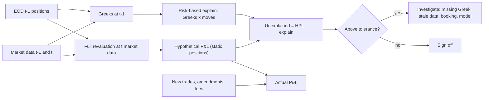

# P&L Attribution and Greek Risk

## TL;DR

- Risk-based P&L explain is a Taylor expansion: $\Delta\Pi \approx \Delta\,\delta S + \tfrac12\Gamma\,\delta S^2 + \Theta\,\delta t + \mathcal V\,\delta\sigma + \text{Vanna}\,\delta S\,\delta\sigma + \tfrac12\text{Volga}\,\delta\sigma^2 + \rho\,\delta r$; the unexplained term is full revaluation minus that sum, and it is third order in the move.
- Under Black-Scholes, $\Theta + \tfrac12\sigma^2S^2\Gamma + rS\Delta - rV = 0$; with $r = 0$ a delta-hedged option earns $\tfrac12\Gamma S^2\left((\delta S/S)^2 - \sigma^2\delta t\right)$ per step, so the daily break-even move is $\sigma S\sqrt{\delta t}$ ($\sigma S/16$ per trading day).
- Hedged at implied vol, the cumulative P&L is $\tfrac12\int \Gamma S^2(\sigma_{\text{real}}^2 - \sigma_{\text{imp}}^2)\,dt$, path dependent; hedged at the realised vol it converges to $V(\sigma_{\text{real}}) - V(\sigma_{\text{imp}})$ (Ahmad and Wilmott 2005).
- Discrete hedging adds noise with standard deviation about $\sqrt{\pi/4}\,\mathcal V\sigma/\sqrt N$ for $N$ rebalances (Kamal and Derman 1999); simulation confirms it to within 4% at $N = 21$.
- Full-revaluation "waterfall" attribution has no unexplained term but depends on the order of factors; on an earnings gap the order moved 20,930 of P&L between the spot and vol buckets.
- Regulators run the same check: the FRTB PLA test compares risk-theoretical P&L with hypothetical P&L by Spearman correlation and KS distance (MAR32.34 to MAR32.42), and a desk whose model misses a material factor goes red.

## Learning objectives

- Formulate the full multi-factor Taylor series P&L attribution equation across first, second, and cross-order Greeks.
- Derive the relationship between Theta and Gamma under the Black-Scholes partial differential equation.
- Compute the daily break-even asset move for a delta-hedged long options position.
- Relate delta-hedged options P&L to the variance spread $(\sigma_{\text{realized}}^2 - \sigma_{\text{implied}}^2)$.
- Attribute higher-order volatility surface risks: Vanna ($\partial \Delta / \partial \sigma$), Volga ($\partial \mathcal{V} / \partial \sigma$), and Charm ($\partial \Delta / \partial t$).
- Identify and troubleshoot the primary sources of unexplained residual P&L ($\epsilon$), including discrete rebalancing latency and bid-ask friction.
- Construct actionable daily risk ladder reports and matrix revaluations for options market making.
- Compare risk-based (Taylor) and revaluation-based (waterfall) attribution and choose between them.
- Explain the HPL, RTPL and APL definitions and the PLA test metrics of MAR32.

## Core concepts

### Two ways to explain a day

Let $\Pi(S, \sigma, t, r)$ be the book value and let a day move every input.
There are two standard decompositions.

Risk-based explain multiplies yesterday's Greeks by today's moves:

$$\Delta\Pi_{\text{explained}} = \Delta\,\delta S + \tfrac12\Gamma\,\delta S^2 + \Theta\,\delta t + \mathcal V\,\delta\sigma + \text{Vanna}\,\delta S\,\delta\sigma + \tfrac12\text{Volga}\,\delta\sigma^2 + \rho\,\delta r$$

$$\epsilon = \Delta\Pi_{\text{full reval}} - \Delta\Pi_{\text{explained}}$$

Revaluation-based (waterfall or step) explain moves one factor at a time and reprices in full:

$$\text{spot} = \Pi(S_1, \sigma_0, t_0) - \Pi(S_0, \sigma_0, t_0), \quad \text{vol} = \Pi(S_1, \sigma_1, t_0) - \Pi(S_1, \sigma_0, t_0), \quad \text{time} = \Pi(S_1, \sigma_1, t_1) - \Pi(S_1, \sigma_1, t_0)$$

The waterfall sums exactly to the full P&L, so it has no unexplained term, but the cross effects land in whichever bucket comes later, and a different order gives different buckets.
Risk-based explain is order independent and links P&L to the risk numbers the desk is managed on, which is why the unexplained term is useful: it measures how well the risk model describes the book.

| | Risk-based (Taylor) | Waterfall (full reval) |
| :--- | :--- | :--- |
| Sums to actual | no, leaves $\epsilon$ | yes |
| Order dependence | none | cross terms move with the order |
| Cost | one Greek run | one reprice per step |
| Diagnoses | missing Greeks, model or data problems | which factor moved the book |
| Fails on | large moves, gaps, barriers | nothing, but explains less |

### The PDE identity and the break-even move

Black-Scholes says that a self-financing delta-hedged option earns the risk-free rate:

$$\Theta + \tfrac12\sigma^2S^2\Gamma + rS\Delta - rV = 0.$$

With $r = 0$, $\Theta = -\tfrac12\sigma^2S^2\Gamma$: long gamma pays theta rent and short gamma collects it.
With $r > 0$ theta also carries financing: for a 6-month ATM call at 20% vol and $r = 5\%$, theta is $-8.116$ a year, of which $-5.472$ is the gamma rent $-\tfrac12\sigma^2S^2\Gamma$ and $-2.644$ is financing $-rS\Delta + rV$.

Over one step of a delta-hedged position with $r = 0$:

$$\delta\Pi \approx \tfrac12\Gamma\,\delta S^2 + \Theta\,\delta t = \tfrac12\Gamma S^2\left(\left(\tfrac{\delta S}{S}\right)^2 - \sigma^2\delta t\right).$$

So the position breaks even when $|\delta S| = \sigma S\sqrt{\delta t}$.
At 40% vol and $S = 100$ that is 2.520 per trading day ($\delta t = 1/252$; the rule of 16 gives 2.500) or 2.094 per calendar day ($\delta t = 1/365$).
Whether a desk's theta is quoted per trading day or per calendar day matters: weekends carry calendar theta with no trading-day variance, and mixing conventions shows up as unexplained P&L every Monday.
Full revaluation of the delta-hedged straddle of worked example 1 gives break-evens of $+2.541$ and $-2.478$ per trading day: the asymmetry is consistent with the third-order term, since the speed $\partial\Gamma/\partial S$ of an at-the-money straddle is negative and $\tfrac16\,\partial\Gamma/\partial S\,\delta S^3$ then lowers the P&L of up moves and raises that of down moves.

### Realised against implied variance

Summing the step P&L over the life of an option hedged at implied vol:

$$\text{P\&L} = \tfrac12\int_0^T \Gamma_t^{\text{imp}} S_t^2\left(\sigma_{\text{real}}^2(t) - \sigma_{\text{imp}}^2\right)dt.$$

This is the variance trade inside every option (Carr and Madan 1998): the option buys realised variance and sells implied variance, weighted by dollar gamma $\tfrac12\Gamma S^2$ along the path, so the P&L depends on where the stock was when it was volatile.
Hedging at the realised vol instead locks in $V(\sigma_{\text{real}}) - V(\sigma_{\text{imp}})$ path by path in the continuous limit (Ahmad and Wilmott 2005), but you need to know the realised vol to do it.
Measured on a 1-month ATM call bought at 20% when the stock realises 25%, with 1,000 rebalances and 4,000 paths:

| Hedge vol | Mean P&L | Sd of P&L |
| :--- | ---: | ---: |
| 25% (realised) | about 0.5742 | about 0.0797 |
| 20% (implied) | about 0.5775 | about 0.2531 |

Both means are close to $V(25\%) - V(20\%) = 0.5755$; the implied-vol hedge is about 3.2 times noisier, and its path-by-path P&L has correlation about 0.9992 with the gamma-weighted variance sum above.

### Discrete hedging error

Rebalancing $N$ times instead of continuously adds a zero-mean error.
Kamal and Derman (1999) give its standard deviation for an at-the-money option as approximately

$$\sigma_{\text{hedge}} \approx \sqrt{\pi/4}\;\frac{\mathcal V\,\sigma}{\sqrt N},$$

with $\mathcal V$ the vega per unit volatility.
For the 1-month ATM call at 20% ($\mathcal V = 11.512$), simulation against the formula:

| $N$ | Monte Carlo sd | Formula | Ratio |
| ---: | ---: | ---: | ---: |
| 21 | about 0.4289 | 0.4452 | about 0.963 |
| 84 | about 0.2165 | 0.2226 | about 0.973 |
| 252 | about 0.1260 | 0.1285 | about 0.980 |

The formula is a leading-order result and slightly overstates the error at small $N$; quadrupling the hedge frequency halves the noise but multiplies transaction costs by four.

### Higher-order Greeks a desk watches

- Vanna $= \partial^2V/\partial S\partial\sigma = -\phi(d_1)d_2/\sigma$, the same for a call and a put of the same strike: positive for out-of-the-money calls ($d_2 < 0$) and negative for out-of-the-money puts. When spot falls and vol rises together, vanna changes the delta that must be re-hedged.
- Volga $= \partial^2V/\partial\sigma^2 = \mathcal V d_1 d_2/\sigma$: slightly negative at the money-forward ($d_1 > 0 > d_2$), positive in the wings; long wings gain from a vol explosion beyond what vega predicts.
- Charm $= \partial\Delta/\partial t$: deltas drift with time even if spot does not, toward 1 or 0 for in- and out-of-the-money options, so a book that is flat on Friday is not flat on Monday.
- Speed $= \partial\Gamma/\partial S$ and zomma $= \partial\Gamma/\partial\sigma$: the third-order terms that dominate the unexplained P&L on gap days; ATM gamma rises as vol falls, so a vol crush increases the gamma P&L earned on the same move.

### Where unexplained P&L comes from

- Size of the move: the remainder is third order, so it grows about eightfold when the move doubles.
- Missing Greeks: cross-gamma between underlyings, vanna and volga, skew moves that a single vega misses (bucket the vega by expiry and strike).
- Theta conventions (calendar against trading days) and double-counted carry: if the pricing theta includes financing and the desk also books funding separately, the carry is counted twice.
- Discrete events: dividends, borrow-rate changes, corporate actions, expiries and exercises.
- Data and booking: stale or mismatched market data between the risk and P&L systems, trades booked late or amended, wrong conventions.
- Different models: risk Greeks from one model and P&L from another (the exact problem the PLA test targets).

### The regulatory version: PLA (MAR32)

For banks on the FRTB internal models approach, every desk runs a profit and loss attribution test (MAR32.20 to MAR32.45):

- HPL: revalue the positions held at the end of the previous day at today's market data, so no intraday trading or new deals (MAR32.25);
- RTPL: the daily P&L produced by the risk management model's valuation engine with only the risk factors in that model (MAR32.22);
- APL: actual P&L, including intraday trading, new and modified deals and valuation adjustments that are updated less often (MAR32.25 to MAR32.27); fees and commissions are excluded from both APL and HPL (MAR32.26);
- metrics on the most recent 250 days: Spearman correlation of RTPL and HPL and the two-sample Kolmogorov-Smirnov statistic, with each empirical CDF stepping by 0.004 (MAR32.34 to MAR32.41);
- zones: green if the correlation is above 0.80 and KS below 0.09, red if the correlation is below 0.70 or KS above 0.12, amber otherwise (MAR32.42); red desks move to the standardised approach (MAR32.43) and amber desks pay a capital surcharge (MAR32.44, MAR33.43).

The quoted p-values 0.264 and 0.055 for KS thresholds 0.09 and 0.12 (MAR32.42) are the asymptotic Kolmogorov tail at $\lambda = D\sqrt{250 \cdot 250/500}$: 0.2634 and 0.0546.
Because KS with 250 observations moves in steps of 0.004, "below 0.09" means at most 0.088; the exact two-sample probabilities are $P(D \ge 0.088) = 0.2881$, $P(D \ge 0.092) = 0.2409$ and $P(D \ge 0.120) = 0.0546$.
The test is covered in depth in [FRTB Backtesting and PLA Testing](../17-Regulatory-Capital-Basel-and-FRTB/12-FRTB-Backtesting-and-PLA-Testing.md).

## Worked examples

All numbers are printed and asserted by `python 11-Risk-and-Trading/code/pnl_attribution.py`.

### Example 1: earnings night on a delta-hedged long straddle

The desk is long 100,000 one-month 100-strike calls and 100,000 puts (Black-Scholes, $S = 100$, vol 40%, $r = 0$), hedged with 4,572 shares short.
Book: value 914,484; gamma 6,946 per unit spot; vega 2,283,707 per unit vol (22,837 per vol point); theta $-5{,}557{,}020$ a year; vanna 11,419; volga $-18{,}770$.
Overnight the stock gaps from 100 to 105 and implied vol is crushed from 40% to 30%; one calendar day passes.

1. Delta: 0 (hedged).
2. Gamma: $\tfrac12 \times 6{,}946 \times 5^2 = +86{,}828$.
3. Theta: $-5{,}557{,}020/365 = -15{,}225$.
4. Vega: $2{,}283{,}707 \times (-0.10) = -228{,}371$.
5. Vanna: $11{,}419 \times 5 \times (-0.10) = -5{,}709$; volga: $\tfrac12 \times (-18{,}770) \times 0.01 = -94$.
6. Explained: $-162{,}570$. Full revaluation: $-134{,}085$. Unexplained: $+28{,}485$, 21% of the day's P&L.

Why so large: the third-order terms.
Holding time fixed and scaling the (spot, vol) move by 0.25, 0.5, 1 and 2, the unexplained is 321, 2,683, 23,286 and 196,525, growing about $2^3$ per doubling (ratios 8.4, 8.7, 8.4).
Computing the four third-order terms with no time step shows which one: zomma $\tfrac12\,\partial\Gamma/\partial\sigma\,\delta S^2\delta\sigma = +21{,}778$, speed $\tfrac16\,\partial\Gamma/\partial S\,\delta S^3 = -2{,}171$, and the two vol-cubed terms under 10 each; together 19,613 of the 23,286 no-time-step unexplained.
The vol crush raised the straddle's gamma, so the 5-point move earned more than yesterday's gamma predicts.

The same day by waterfall:

| Order | Spot | Vol | Time |
| :--- | ---: | ---: | ---: |
| spot, then vol, then time | 83,468 | $-207{,}527$ | $-10{,}026$ |
| vol, then spot, then time | 104,398 | $-228{,}457$ | $-10{,}026$ |

Both sum to $-134{,}085$, but the order moves 20,930 between the spot and vol buckets: the interaction of a vol crush with a spot move has no natural owner.
In the interview, say: "Taylor tells me my risk model is missing 28k of convexity on gap days, mostly zomma; the waterfall tells me the vol crush cost about 208k to 228k depending on order; I report both and add the missing Greek or full revaluation for gap days."

### Example 2: discrete hedging error

A trader delta-hedges ATM options with total vega 100,000 per unit vol (1,000 per vol point) on a stock with 30% vol, once a day for a month ($N = 21$).

$$\sigma_{\text{hedge}} \approx \sqrt{\pi/4}\times\frac{100{,}000 \times 0.30}{\sqrt{21}} = 5{,}802.$$

Hedging four times a day ($N = 84$) gives 2,901, half the noise for four times the trades.
The simulation above suggests the formula is a few percent high at these frequencies.

### Example 3: a PLA test with a missing factor

A desk is short 50,000 three-month 100-strike calls and long 80,000 95-strike puts (vol 25%), delta-hedged.
Over 250 simulated days, spot moves 1.5% a day and implied vol 1 point a day with correlation $-0.7$; HPL is full revaluation of spot and vol.

| RTPL model | Spearman | KS | Zone |
| :--- | ---: | ---: | :--- |
| full revaluation (same as HPL) | 1.0000 | 0.0000 | green |
| delta-gamma-vega-vanna-volga | 0.9995 | 0.0160 | green |
| full revaluation, implied vol held fixed | 0.3090 | 0.4040 | red |

A good Taylor approximation passes easily; a model that omits a material factor fails both metrics, which is what the test is for.

## Pitfalls

- Reporting a waterfall as if its buckets were unique: the cross effects depend on the order, so fix and document the order, or use symmetric (averaged) attribution.
- Using one parallel vega for a book spread across strikes and expiries: skew and term-structure moves land in unexplained.
- Mixing theta conventions (per trading day or per calendar day, with or without financing) between the risk and P&L systems.
- Double counting carry: pricing theta that includes funding plus a separate funding line.
- Computing Greeks and P&L from different models or market data snapshots; the PLA test exists because this is common.
- Treating unexplained as noise: persistent unexplained of one sign is a missing risk, a booking error or a data problem.
- Believing a delta-hedged long option profits whenever realised vol exceeds implied: it profits on average, but the P&L depends on where the stock realised its variance relative to the strike.
- Forgetting that the discrete hedging error scales with vega, not gamma: long-dated books have large hedging noise even at low gamma.
- Assuming the morning delta holds through a gap: with gamma the effective delta during the move is the average of the start and end deltas.

## Interview questions

> [!question]- risk-pnl-attribution-equation | State the second-order Taylor expansion P&L attribution equation for an equity options portfolio.
> $\Delta\Pi \approx \Delta\,\delta S + \tfrac12\Gamma\,\delta S^2 + \Theta\,\delta t + \mathcal V\,\delta\sigma + \text{Vanna}\,\delta S\,\delta\sigma + \tfrac12\text{Volga}\,\delta\sigma^2 + \rho\,\delta r + \epsilon$, with yesterday's Greeks and today's moves.
> $\epsilon$ is full revaluation minus the sum; it is third order in the move (speed, zomma, ultima and friends) plus anything the model does not see.
> For multi-asset books add cross-gammas $\Gamma_{ij}\,\delta S_i\,\delta S_j$ and bucket vega by expiry and strike.

> [!question]- risk-theta-gamma-pde-relationship | What is the relationship between Theta and Gamma in the Black-Scholes model for a delta-neutral portfolio?
> $\Theta + \tfrac12\sigma^2S^2\Gamma + rS\Delta - rV = 0$; with $r = 0$, $\Theta = -\tfrac12\sigma^2S^2\Gamma$.
> Long gamma pays theta rent, short gamma collects it, and a delta-hedged book earns the difference between realised and implied variance weighted by $\tfrac12\Gamma S^2$.
> With rates, theta also carries financing: for a 6-month ATM call at 20% and $r = 5\%$, theta of $-8.116$ a year splits into $-5.472$ gamma rent and $-2.644$ financing.

> [!question]- risk-daily-breakeven-move-rule | Derive the daily break-even asset move for a delta-hedged options position using the Rule of 16.
> Set $\tfrac12\Gamma\,\delta S^2 + \Theta\,\delta t = 0$ with $\Theta = -\tfrac12\sigma^2S^2\Gamma$: $|\delta S| = \sigma S\sqrt{\delta t}$.
> Per trading day $\sqrt{1/252} \approx 1/15.87 \approx 1/16$: at 40% vol and $S = 100$ the break-even is 2.520 (rule of 16: 2.50).
> Per calendar day it is 2.094; the convention must match how theta is accrued.

> [!question]- risk-variance-spread-pnl | How does the cumulative P&L of a delta-hedged option relate to realized and implied volatility?
> Hedged at implied vol: $\tfrac12\int\Gamma^{\text{imp}}_tS_t^2(\sigma_{\text{real}}^2 - \sigma_{\text{imp}}^2)\,dt$, a dollar-gamma-weighted variance spread that depends on the path.
> Hedged at realised vol it converges to $V(\sigma_{\text{real}}) - V(\sigma_{\text{imp}})$ (Ahmad and Wilmott 2005).
> In simulation (1-month ATM call, implied 20%, realised 25%) both hedges average about 0.575, but the implied-vol hedge has three times the dispersion (sd about 0.253 against 0.080).

> [!question]- risk-vanna-economic-meaning | What is Vanna ($\partial^2 V / \partial S \partial \sigma$), and why is it critical during market sell-offs?
> $\partial\Delta/\partial\sigma = \partial\mathcal V/\partial S = -\phi(d_1)d_2/\sigma$, identical for a call and a put of the same strike.
> Out-of-the-money puts have negative vanna, so when spot falls and vol rises a long OTM put's delta becomes more negative and a delta-neutral holder must buy more stock than gamma alone predicts.
> In P&L explain the vanna term $\text{Vanna}\,\delta S\,\delta\sigma$ is large exactly on days when spot and vol move together.

> [!question]- risk-volga-economic-meaning | What is Volga (Vomma), and which options positions benefit from it?
> $\partial^2V/\partial\sigma^2 = \mathcal V d_1 d_2/\sigma$: slightly negative at the money-forward, positive in the wings, largest for out-of-the-money options.
> Long wings (strangles, risk reversals' long leg) gain more than vega predicts when vol explodes; sellers of wings are short this convexity.
> It is why a smile has to price wings above a flat vol: someone has to be paid for being short volga.

> [!question]- risk-charm-delta-decay | What is Charm, and why must market makers re-hedge over non-trading weekends?
> Charm is $\partial\Delta/\partial t$: the delta drifts with time even if spot is unchanged, toward 1 for in-the-money and toward 0 for out-of-the-money options.
> Over a weekend two to three calendar days pass with no trading, so a book flat on Friday has a predictable delta on Monday open.
> Desks pre-hedge the expected charm on Friday rather than discover it in the Monday gap.

> [!question]- risk-unexplained-pnl-root-causes | What are the three most common causes of high unexplained P&L ($\epsilon$) on an equity options desk?
> First, large moves: the remainder is third order (speed, zomma), so a gap day leaves large unexplained even with correct Greeks.
> Second, missing risk dimensions: skew and term-structure vol moves, cross-gammas, dividends or borrow changes that the Greek set does not include.
> Third, operational mismatches: Greeks and P&L from different models, snapshots or theta conventions, and late or amended bookings.

> [!question]- risk-derman-kamal-hedging-error | According to the Derman-Kamal formula, how does discrete hedging error scale with rebalancing frequency?
> Standard deviation about $\sqrt{\pi/4}\,\mathcal V\sigma/\sqrt N$ (Kamal and Derman 1999): it falls like $1/\sqrt N$.
> Doubling the frequency cuts it by $1 - 1/\sqrt2 = 29\%$; quadrupling halves it.
> Simulated for a 1-month ATM call at 20% vol, the formula is within 4% at $N = 21$ (0.445 against about 0.429) and within 2% at $N = 252$.

> [!question]- risk-ladder-risk-reports | What is a Greek ladder risk report, and why is it superior to scalar Greek summary metrics?
> It revalues the book in full on a grid of spot moves (for example $\pm 2\%, \pm 5\%, \pm 10\%$) crossed with vol shifts, and shows P&L and Greeks at each node.
> Scalar Greeks are slopes at one point; the ladder shows where gamma flips sign, where barriers or strikes concentrate risk, and how vanna changes the delta in a sell-off.
> It is a small stress test, so it catches exactly the third-order effects that leave unexplained P&L on gap days.

> [!question]- risk-pnl-explain-earnings-gap | A delta-hedged long straddle (gamma 6,946, vega 2.28m per unit vol, theta -15,225 a day) sees spot +5 and vol 40% to 30% overnight. Explain the P&L.
> Gamma $+86{,}828$, theta $-15{,}225$, vega $-228{,}371$, vanna $-5{,}709$, volga $-94$: explained $-162{,}570$.
> Full revaluation gives $-134{,}085$, so the unexplained is $+28{,}485$.
> The vol crush raised the ATM gamma: the zomma term $\tfrac12\,\partial\Gamma/\partial\sigma\,\delta S^2\delta\sigma$ alone is $+21{,}778$, so on gap days the third-order terms matter.

> [!question]- risk-unexplained-third-order-scaling | Your P&L explain is clean on quiet days and bad on big days. How do you prove the cause is truncation and not a missing factor?
> Scale the day's moves by $k$ and reprice: Taylor truncation error grows like $k^3$, a missing first-order factor like $k$.
> For the straddle the unexplained at scales 0.25, 0.5, 1, 2 was 321, 2,683, 23,286, 196,525: ratios about 8 per doubling, so truncation.
> Then add the missing third-order Greek (here zomma) or switch to full revaluation for large moves.

> [!question]- risk-waterfall-order-dependence | Why does a full-revaluation waterfall attribution depend on the order of the factors, and what do you do about it?
> Each step reprices at the factors already moved, so interaction effects land in whichever factor comes later.
> On the earnings example, spot-first gives the spot bucket 83,468 and vol-first gives 104,398: the order moved 20,930.
> Fix the order and document it, or average over orders (a symmetric or Shapley split), and report the interaction explicitly.

> [!question]- risk-hedge-at-realized-vs-implied | You know realised vol will be 25% and implied is 20%. Which vol should you hedge an option at?
> Hedging at the realised vol locks in $V(25\%) - V(20\%)$ path by path in the continuous limit; hedging at implied gives the same mean but a path-dependent P&L.
> Simulated on a 1-month ATM call: both average about 0.575, but the sd is about 0.080 at the realised vol and 0.253 at implied.
> In practice you do not know realised vol, and hedging at implied keeps the mark-to-market P&L smooth, so desks usually hedge at implied and accept the path dependence.

> [!question]- risk-pla-test-thresholds | State the FRTB PLA test metrics and zone thresholds.
> Over the last 250 days, the Spearman rank correlation of RTPL and HPL and the two-sample KS statistic between their empirical distributions (MAR32.34 to MAR32.41).
> Green: correlation above 0.80 and KS below 0.09; red: correlation below 0.70 or KS above 0.12; amber otherwise (MAR32.42).
> Red desks go to the standardised approach (MAR32.43); amber desks stay on the IMA with a capital surcharge (MAR32.44).

> [!question]- risk-pla-missing-risk-factor | A desk's risk model holds implied vol fixed. What happens in the PLA test?
> In the simulated desk (short calls, long puts, delta-hedged, spot 1.5% and vol 1 point a day, correlation $-0.7$), RTPL without the vol factor has Spearman 0.309 and KS 0.404: red on both metrics.
> A delta-gamma-vega-vanna-volga RTPL on the same days scores 0.9995 and 0.016: green.
> The test rewards a model that covers the material factors, even approximately, over an exact model of fewer factors.

> [!question]- risk-ks-discreteness-pla | The PLA green threshold is KS below 0.09. What KS values can occur with 250 observations, and what are the real p-values?
> The empirical CDFs step by $1/250 = 0.004$, so KS is a multiple of 0.004 and "below 0.09" means at most 0.088.
> Exact two-sample tail probabilities: $P(D \ge 0.088) = 0.288$, $P(D \ge 0.092) = 0.241$, $P(D \ge 0.120) = 0.0546$.
> The p-values quoted in MAR32.42 (0.264, 0.055) match the asymptotic Kolmogorov tail at $\lambda = D\sqrt{125}$ (0.2634, 0.0546).

> [!question]- risk-theta-financing-term | Why is theta not equal to minus one half sigma squared S squared gamma on a real desk?
> Because of rates and dividends: Black-Scholes gives $\Theta = -\tfrac12\sigma^2S^2\Gamma - rS\Delta + rV$ with $r > 0$.
> For a 6-month ATM call at 20% and $r = 5\%$, theta $-8.116$ a year is $-5.472$ gamma rent plus $-2.644$ financing.
> If the P&L system also books funding on the hedge, theta-with-financing double counts carry.

> [!question]- risk-hpl-vs-rtpl-vs-apl | Define HPL, RTPL and APL and say which one the PLA test uses.
> HPL revalues yesterday's end-of-day positions at today's market data with front-office pricing (static positions, MAR32.25); RTPL is the same day's P&L from the risk model's valuation engine and risk factors (MAR32.22); APL is actual P&L including intraday trading and new deals (MAR32.25).
> PLA compares RTPL with HPL (MAR32.24); backtesting uses both APL and HPL against VaR (MAR32.18).
> Fees and commissions are excluded from APL and HPL (MAR32.26), and HPL and APL must use the same pricing models as the reported daily P&L (MAR32.29).

> [!question]- risk-theta-calendar-vs-trading-day | The desk's theta is per calendar day but its gamma P&L is earned per trading day. What does that do to Monday's explain?
> Friday to Monday accrues three calendar days of theta but only one trading day of variance, so explained P&L on Monday is dominated by three days of theta.
> The break-even move differs too: at 40% vol and $S = 100$ it is 2.520 per trading day but 2.094 per calendar day.
> Use one convention end to end, and treat weekend and holiday theta explicitly in the explain.

> [!question]- risk-breakeven-asymmetry | Full revaluation gives a delta-hedged straddle break-even moves of +2.541 and -2.478 per trading day, while sigma S sqrt(dt) gives 2.520. Why the asymmetry?
> The Taylor break-even keeps only gamma and theta; the third-order term $\tfrac16\,\partial\Gamma/\partial S\,\delta S^3$ is negative for up moves and positive for down moves because speed is negative at the money ($\partial\Gamma/\partial S = -\tfrac{\Gamma}{S}(1 + d_1/(\sigma\sqrt T))$ with $d_1 > 0$), so up moves earn slightly less convexity than down moves.
> So the position needs a bigger up move than down move to pay its theta.
> The effect grows with the size of the move relative to $\sigma\sqrt T$, which is why short-dated options show it most.

## Further reading

- Basel Committee on Banking Supervision, Basel Framework MAR32 (backtesting and PLA), paragraphs 32.20 to 32.45, version effective 1 January 2023.
- M. Kamal and E. Derman, "When you cannot hedge continuously: the corrections to Black-Scholes", Goldman Sachs Quantitative Strategies Research Notes, 1999.
- R. Ahmad and P. Wilmott, "Which free lunch would you like today, Sir?: Delta hedging, volatility arbitrage and optimal portfolios", *Wilmott Magazine*, November 2005, 64-79.
- P. Carr and D. Madan, "Towards a theory of volatility trading", in R. Jarrow (ed.), *Volatility*, Risk Books, 1998, 417-427.
- N. N. Taleb, *Dynamic Hedging: Managing Vanilla and Exotic Options*, Wiley, 1997.

## In this repo and SDE-Interview-Prep

- [pnl_attribution.py](code/pnl_attribution.py): analytic Greeks checked against finite differences, Taylor and waterfall explain, break-even search, hedging simulations, PLA metrics; every number above.
- Greek definitions and derivations: [The Greeks](../05-Derivatives-and-Volatility/05-The-Greeks.md); hedging mechanics: [Delta Hedging and Gamma Scalping](../05-Derivatives-and-Volatility/06-Delta-Hedging-and-Gamma-Scalping.md).
- The regulatory test in full: [FRTB Backtesting and PLA Testing](../17-Regulatory-Capital-Basel-and-FRTB/12-FRTB-Backtesting-and-PLA-Testing.md).
- Production P&L systems: [P&L Platform](../18-Pricing-and-Risk-Systems/09-PnL-Platform.md).
- Sensitivity computation and revaluation: [Sensitivities and Revaluation](12-Sensitivities-and-Revaluation.md); limits on Greeks: [Drawdowns and Risk Limits](05-Drawdowns-and-Risk-Limits.md).
