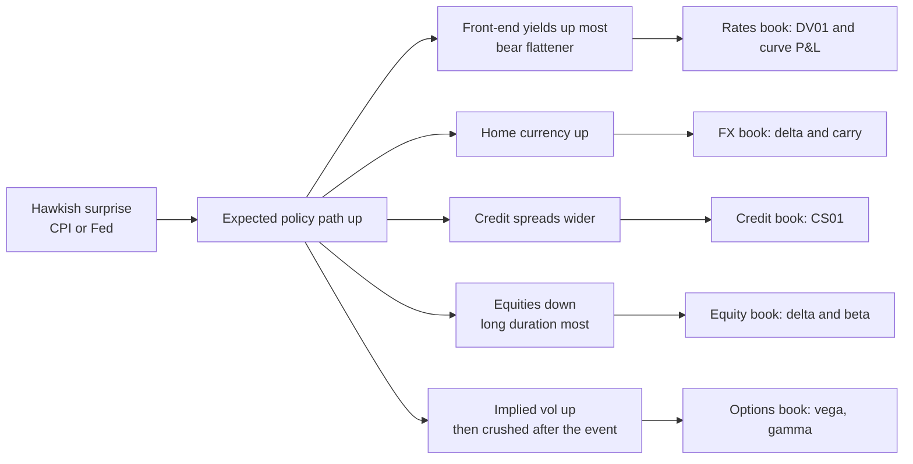

# Macro and Market Awareness

## TL;DR

- Central banks set an overnight rate; markets price the path of that rate (fed funds futures, OIS), and every other asset is repriced off the change in that expected path, not off the decision itself.
- Data releases (CPI, payrolls, GDP) matter through the surprise relative to consensus, and the front end of the yield curve reacts most to policy news: a hawkish surprise usually bear-flattens the curve, strengthens the currency, widens credit and hits long-duration equities.
- The trader's toolkit is a handful of first-order formulas: implied meeting probabilities, duration and convexity, DV01-neutral curve trades, covered interest parity, the credit triangle, equity duration $1/(r - g)$ and event volatility from the options term structure.
- To talk about current markets in an interview, state levels you can cite with a date, explain the mechanism, and say what would change your mind; never invent a number.

## Learning objectives

- Explain how central bank decisions, CPI and payrolls move rates, FX, equities and volatility.
- Talk intelligently about current markets in an interview.
- Turn a macro view into numbers: probabilities from futures, bond and curve P&L, FX forwards, credit hazard rates and implied event moves.
- Trace a macro shock through a multi-asset book.

## Core concepts

### Central bank mechanics

- The Federal Reserve's Federal Open Market Committee (FOMC) sets a target range for the federal funds rate at its eight regularly scheduled meetings a year, and can move between meetings.
- The Fed keeps the effective rate inside the range with administered rates: interest on reserve balances (IORB) is the main steering tool, and the overnight reverse repo (ON RRP) offering rate acts as a floor for non-bank lenders, in an ample-reserves system.
- The ECB steers money-market rates through its deposit facility rate; the Bank of England through Bank Rate; the Bank of Japan through its short-term policy rate.
- Balance-sheet policy (asset purchases, runoff) works on term premia and longer yields rather than the overnight rate.
- Forward guidance (statements, projections, speeches) moves the expected path, which is what longer rates price.

The target-range history from the Federal Reserve's open market operations page (retrieved 2026-10-17), with every move cross-checked against its FOMC statement:

| Period | Moves | Cumulative change | Upper bound after |
| :--- | :--- | ---: | ---: |
| 2020-03-16 | range set to 0-0.25% | | 0.25% |
| 2022-03-17 to 2023-07-27 | 11 hikes, four of them 75 bp | +525 bp | 5.50% |
| 2024-09-19 to 2025-12-11 | 6 cuts (one 50 bp) | -175 bp | 3.75% |
| 2026-09-17 | one 25 bp hike | +25 bp | 4.00% |

The dates are the effective dates the Fed page lists, one day after each decision: the 2026-09-17 entry is the 25 bp hike to 3-3/4 to 4 percent announced in the FOMC statement of 16 September 2026, and the 2020-03-16 entry follows the statement of 15 March 2020.
As of 2026-10-17 the target range is 3.75-4.00%; check the page before quoting it, because it can change at every meeting.

### How markets price policy

- 30-day fed funds futures settle at 100 minus the average daily effective federal funds rate (EFFR) over the contract month, so a futures price is an average-rate forecast.
- If the new rate applies from day $d$ of an $N$-day month (the day after the decision), $\bar r = \frac{(d - 1)r_0 + (N - d + 1)r_1}{N}$; solve for $r_1$ and divide the implied change by the move size to get a probability.
- OIS swaps price the same path over longer horizons; the 2-year yield is the market's policy rate over two years plus a small term premium, so it is the most policy-sensitive point on the curve.

### Data releases and surprises

- US CPI and the Employment Situation report (payrolls, unemployment rate, average hourly earnings) are published by the Bureau of Labor Statistics at 8:30 a.m. Eastern time; the FOMC statement is released at 2:00 p.m. Eastern on decision days.
- Markets move on the surprise, actual minus consensus, and on revisions, not on the level.
- The reaction scales with how much the release changes the expected policy path: when the central bank says it is data dependent, inflation and labour surprises move the front end most.
- Desks estimate sensitivities by regressing announcement-window moves on surprises; those betas drift with the regime, so treat any fixed number as a hypothesis.

### The yield curve

- Level, slope and curvature explain most curve moves.
- Bear flattener: yields rise, short end more (typical hawkish surprise); bull steepener: yields fall, short end more (typical easing or growth scare); bear steepener: long end sells off (term premium, supply, inflation risk); bull flattener: long end rallies (flight to quality, growth fears).
- A curve trade is weighted DV01-neutral so that it has no exposure to a parallel shift, only to the slope.
- Real yields (TIPS) and breakeven inflation split nominal yields: $1 + i = (1 + r)(1 + \pi^e)$, so breakeven $\approx i - r$.

See [Bonds, Duration and Convexity](../06-Fixed-Income-and-Asset-Classes/02-Bonds-Duration-and-Convexity.md), [Curve Risk and Hedging](../06-Fixed-Income-and-Asset-Classes/15-Curve-Risk-and-Hedging.md) and [Money Markets, Repo and Overnight Rates](../06-Fixed-Income-and-Asset-Classes/12-Money-Markets-Repo-and-Overnight-Rates.md).

### FX

- Covered interest parity pins the forward: $F = S\frac{1 + r_{quote}\tau}{1 + r_{base}\tau}$ for simple money-market rates, quoting $S$ as quote currency per unit of base.
- The forward is not a forecast; uncovered interest parity (the high-yielder depreciates by the rate gap) fails on average, which is why carry trades earn a premium and suffer crashes.
- A hawkish surprise raises the home currency through higher expected rates; risk-off moves favour funding and safe-haven currencies.

See [FX Markets and Interest Rate Parity](../06-Fixed-Income-and-Asset-Classes/07-FX-Markets-and-Interest-Rate-Parity.md).

### Credit and equities

- Credit triangle: hazard rate $\lambda \approx \frac{s}{1 - R}$; spreads widen with growth fears and tighter financial conditions, and a spread move hits price through spread duration.
- Equities: in the Gordon model $P = \frac{D}{r - g}$, so the duration with respect to the discount rate is $\frac{1}{r - g}$; long-duration (high growth, low payout) equities are the most rate-sensitive.
- Volatility: implied vol is bid into known events, and the event's own variance can be extracted from the term structure.

### Transmission to trading books

These are typical directions, not laws: a hawkish move that the market reads as reducing future inflation can bull-flatten the long end, and stagflationary shocks break the usual stock-bond correlation.

### Talking about markets in an interview

- Lead with a mechanism, not a prediction: "the market prices X; if Y happens the front end reprices first."
- Quote only levels you can source and date ("as of the last FOMC, the target range was ..."), and say where you would check.
- Have one view with a trade, a sizing, a risk and an exit, and know what data would prove you wrong.
- Read daily: the policy-rate path implied by futures or OIS, 2-year and 10-year yields and their spread, the dollar, credit spreads, equity index and VIX levels, the calendar of releases and central-bank meetings.

## Worked examples

All numbers are printed and asserted by [macro_awareness.py](code/macro_awareness.py); the FOMC history is the Federal Reserve's published data and every other input is hypothetical.

### Example 1: reading the policy cycle

From the Fed's table: 11 hikes from March 2022 to July 2023 add up to 525 bp, four of them 75 bp moves, taking the upper bound from 0.25% to 5.50%.
Six cuts from September 2024 to December 2025 total 175 bp, to an upper bound of 3.75%, and the September 2026 hike took it to 4.00%.
The script chains every move from the March 2020 range and asserts it lands on each published level.

### Example 2: a meeting probability from fed funds futures

EFFR is 3.88%, in a 30-day month the meeting's new rate applies from day 17 (16 days at the old rate, 14 at the new), and the contract trades at 96.165.
"Implied average 3.835%.
Solve $(16 \times 3.88 + 14r_1)/30 = 3.835$: $r_1 \approx 3.7836\%$, an implied cut of about 9.64 bp, so about a 38.57% probability of a 25 bp cut."
If the new rate applied only from day 28 the same price would imply a cut of 45 bp, which shows why late-month meetings make the current-month contract a poor signal and traders use the next month's contract.

### Example 3: a 25 bp sell-off in a 10-year bond

A 10-year 4% semi-annual bond at par has modified duration about 8.1757 and convexity about 78.90.
"Duration alone says $-8.1757 \times 0.0025 \approx -2.0439\%$; adding $\frac12 \times 78.90 \times 0.0025^2$ gives $-2.0193\%$, against the exact $-2.0195\%$."
Its DV01 is about 8.1757 cents per 100 face, about $\$8{,}175.72$ per $\$10$m.

### Example 4: a DV01-neutral steepener in a bear flattener

A 2-year 3.9% par bond has DV01 about 1.9062 cents per 100 face, so a steepener that is short $\$10$m 10-year needs about 4.2891 times that face in 2-year bonds.
A hawkish surprise moves the 2-year up 20 bp and the 10-year up 5 bp: the 2s10s spread flattens 15 bp and the steepener loses about $\$122{,}635.75$, which is $-\$8{,}175.72 \times 15$, as a DV01-neutral trade should.

### Example 5: FX forward, breakevens, credit and equity duration

EURUSD spot 1.1000, USD 4.0%, EUR 2.0%, 90 days act/360: the 3-month forward is about 1.105473, about 54.73 pips of forward points, and the carry of being long dollars against euros is 0.5% over the quarter; the trade loses if EURUSD ends above the forward.
A 4.2% nominal yield and a 1.9% real yield give a breakeven of 2.3% by subtraction and about 2.2571% by Fisher.
A 150 bp spread with 40% recovery implies a hazard rate of 2.5% and a 5-year survival probability of about 0.8825; a 50 bp widening on spread duration 4.5 costs 2.25%.
With $r = 8\%$ and $g = 4\%$, equity duration is 25: a 50 bp rise in $r$ costs about 11.11% exactly and 12.5% on the linear estimate.
Taylor's (1993) rule, $i = 2 + \pi + 0.5(\pi - 2) + 0.5\,\text{gap}$, gives 5.25% for inflation 3% and an output gap of $-0.5\%$; it is a benchmark for whether policy is tight or loose, not a forecast.

### Example 6: the implied move for CPI day

A 5-day option expiring after CPI trades at 22% implied vol and normal days price at 16%.
"Total variance is $0.22^2 \times 5/252$; four normal days account for $0.16^2 \times 4/252$; the rest is the event: an event-day sd of about 2.3537%, an expected absolute move of about 1.8779%."
A normal day at 16% is about 1.0079%, so the market prices CPI day at about 5.45 normal days of variance.
A simulation (seed 29) gives an expected absolute move of about 1.8769%.

### Example 7: a hawkish surprise through a book

A hypothetical desk's sensitivities and a hypothetical shock:

| Line | Sensitivity | Shock | P&L |
| :--- | ---: | ---: | ---: |
| 2y rates | $-\$50{,}000$ per bp | +15 bp | $-\$750{,}000$ |
| 10y rates | $-\$20{,}000$ per bp | +8 bp | $-\$160{,}000$ |
| Long EUR 20m vs USD | $\$220{,}000$ per 1% | $-0.8\%$ | $-\$176{,}000$ |
| Long equity index 30m | $\$300{,}000$ per 1% | $-1.2\%$ | $-\$360{,}000$ |
| Credit | $-\$20{,}000$ per bp | +5 bp | $-\$100{,}000$ |
| Long vega | $\$40{,}000$ per vol point | +2 | $+\$80{,}000$ |
| Total | | | $-\$1{,}466{,}000$ |

"Half the loss, about 51.16%, is the front end: the book was long duration where policy news hits hardest; the vega is the only hedge that worked."
If the desk's own regression said the 2-year moves 8 bp per 0.1 pp of core CPI surprise (a hypothetical beta), a 0.2 pp surprise would cost $\$800{,}000$ on the 2-year line alone.

## Pitfalls

- Reacting to the level of a release instead of the surprise against consensus and the revisions.
- Quoting a market level from memory; levels change daily, so cite a source and a date or leave the number out.
- Reading the current-month fed funds future for a meeting late in the month.
- Assuming the forward is a forecast, or that carry is free.
- Linear duration estimates for big moves in long-duration assets (Example 5: 12.5% versus 11.11%).
- Treating "hawkish means bear flattener, stronger currency, lower stocks" as a law; correlations flip with the regime.
- Netting a book's risk by asset class and missing that one macro factor drives most lines at once.

## Interview questions

> [!question]- risk-macro-ff-futures-settle | How do 30-day fed funds futures settle?
> At 100 minus the average daily effective federal funds rate over the contract month.
> So the price is a forecast of the month's average rate, which mixes the pre-meeting and post-meeting rates.

> [!question]- risk-macro-meeting-probability | EFFR 3.88%, the meeting's new rate applies from day 17 of a 30-day month, futures at 96.165. Implied probability of a 25 bp cut?
> About 39% (0.3857).
> Average 3.835%; $(16 \times 3.88 + 14r_1)/30 = 3.835$ gives $r_1 \approx 3.784\%$, a 9.64 bp implied cut.

> [!question]- risk-macro-late-meeting | Why is the current-month fed funds future a poor gauge of a meeting late in the month?
> Only a few days of the month carry the new rate, so a small price move implies a large rate change and noise dominates.
> Use the next month's contract, which is fully post-meeting.

> [!question]- risk-macro-hawkish-curve | A hawkish CPI surprise hits. What usually happens to the curve, and why?
> Bear flattening: front-end yields rise most because they price the policy path most directly.
> Longer yields rise less, partly because tighter policy lowers long-run inflation expectations.

> [!question]- risk-macro-duration-convexity | A 10-year par bond with modified duration 8.18 and convexity 78.9: price change for +25 bp?
> About $-2.02\%$.
> $-8.18 \times 0.0025 + \frac12 \times 78.9 \times 0.0025^2$; duration alone gives $-2.04\%$.

> [!question]- risk-macro-dv01-steepener | How do you build a 2s10s steepener, and what is its P&L in a bear flattener?
> Long 2-year, short 10-year, weighted so DV01s match (about 4.29 times the 10-year face in 2-years here).
> It loses DV01 times the flattening: 15 bp at about 8,176 dollars per bp is about 122,636 dollars.

> [!question]- risk-macro-cip-forward | EURUSD 1.1000, USD 4%, EUR 2%, 90 days act/360. Three-month forward?
> About 1.10547.
> $1.1 \times (1 + 0.04 \times 0.25)/(1 + 0.02 \times 0.25)$; the higher-yielding dollar trades at a forward discount, so EURUSD forward is higher.

> [!question]- risk-macro-carry-uip | Is the FX forward a forecast of the future spot rate?
> No: it is set by covered interest parity, an arbitrage.
> Uncovered parity fails on average, which is why carry trades earn a premium, with crash risk when risk appetite turns.

> [!question]- risk-macro-breakeven | Nominal 10-year 4.2%, real 1.9%. Breakeven inflation?
> About 2.3% by subtraction, 2.26% by the Fisher relation.
> $(1.042/1.019) - 1$; breakevens also embed inflation risk and liquidity premia.

> [!question]- risk-macro-credit-triangle | A 150 bp spread with 40% recovery implies what default intensity?
> 2.5% a year.
> $\lambda \approx s/(1 - R)$; 5-year survival $e^{-0.125} \approx 0.88$.

> [!question]- risk-macro-equity-duration | Why are growth stocks more rate-sensitive than value stocks?
> Their cash flows are further out, so their duration $\approx 1/(r - g)$ is long.
> With $r = 8\%$, $g = 4\%$, a 50 bp rise in $r$ cuts the Gordon price by about 11%.

> [!question]- risk-macro-event-vol | 5-day implied vol 22% across CPI, normal days 16%. Implied CPI-day move?
> About 2.35% sd, 1.88% expected absolute move.
> Event variance $= 0.22^2 \cdot 5/252 - 0.16^2 \cdot 4/252$; that is about 5.5 normal days of variance.

> [!question]- risk-macro-taylor | Write the Taylor (1993) rule and evaluate it for inflation 3% and output gap -0.5%.
> $i = r^* + \pi + 0.5(\pi - \pi^*) + 0.5\,\text{gap}$ with $r^* = \pi^* = 2$: 5.25%.
> A benchmark for the stance of policy, sensitive to the unobservable $r^*$ and output gap.

> [!question]- risk-macro-fed-tools | How does the Fed keep the effective fed funds rate inside its target range?
> With administered rates: interest on reserve balances and the overnight reverse repo offering rate.
> With ample reserves, banks will not lend overnight much below what the Fed pays them.

> [!question]- risk-macro-hiking-cycle | How large was the Fed's 2022-23 hiking cycle?
> 525 bp in 11 hikes from March 2022 to July 2023, four of them 75 bp, taking the target range to 5.25-5.50%.
> Source: the Federal Reserve's published target-range history.

> [!question]- risk-macro-book-shock | How do you assess what a macro surprise does to a multi-asset book?
> Map each line to its sensitivity (DV01, FX delta, beta, CS01, vega), apply a consistent shock vector for the scenario, and sum.
> Then look for the common factor: in a hawkish surprise rates, FX, credit and equities often lose together.

> [!question]- risk-macro-current-markets | An interviewer asks "what is going on in markets?" How do you answer?
> Give the policy backdrop with a dated, sourced level, the key mechanism the market is trading, one view with a trade, size and risk, and what would change your mind.
> Do not invent numbers; say you would check the level.

## In this repo and SDE-Interview-Prep

- Code: [macro_awareness.py](code/macro_awareness.py).
- Related: [Bonds, Duration and Convexity](../06-Fixed-Income-and-Asset-Classes/02-Bonds-Duration-and-Convexity.md), [FX Markets and Interest Rate Parity](../06-Fixed-Income-and-Asset-Classes/07-FX-Markets-and-Interest-Rate-Parity.md), [Credit and CDS](../06-Fixed-Income-and-Asset-Classes/06-Credit-and-CDS.md), [Inflation-Linked Products](../06-Fixed-Income-and-Asset-Classes/21-Inflation-Linked-Products.md), [Stress Testing and Scenario Analysis](04-Stress-Testing-and-Scenarios.md) and [Trading Intuition and Judgement](09-Trading-Intuition-and-Judgement.md).

## Further reading

- Board of Governors of the Federal Reserve System, Open Market Operations: target federal funds rate history (federalreserve.gov/monetarypolicy/openmarket.htm).
- CME Group, 30-Day Federal Funds futures contract specifications.
- John B. Taylor, "Discretion versus policy rules in practice", *Carnegie-Rochester Conference Series on Public Policy* 39, 195-214 (1993).
- John C. Hull, *Options, Futures, and Other Derivatives*, 11th edition, chapters 4 (interest rates), 5 (forwards and futures) and 24 (credit risk).
- Bruce Tuckman and Angel Serrat, *Fixed Income Securities*, 3rd edition (2011).
