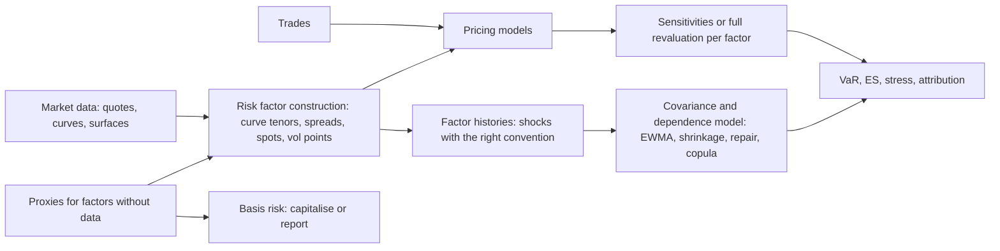

# Risk Factor Modelling

## TL;DR

- A risk model maps every position onto a finite set of risk factors (curve tenors, spreads, spots, vol-surface points), chooses a shock convention for each (log returns for prices, absolute changes for rates and spreads), and models the joint distribution of the shocks.
- Basel internal models must include every factor used in pricing and every standardised-approach factor, at least six yield-curve factors per major currency, separate spread factors, and proxies only where they have a track record and are limited and empirically justified (MAR31.2 to MAR31.9, MAR31.26(7)).
- Covariances are estimated with exponential weighting (RiskMetrics $\lambda = 0.94$ daily: half-life 11.2 days), shrinkage (Ledoit-Wolf) when the number of factors is large relative to the data, and repaired to the nearest valid correlation matrix (Higham) when built from inconsistent pieces.
- PCA compresses a curve to level, slope and curvature; in the hypothetical 10-tenor model here they carry 85.5%, 7.2% and 3.3% of the variance, and Litterman and Scheinkman (1991) found that three such factors explain most of the variation of Treasury returns.
- The silent killers are proxies and data: a beta proxy makes a beta-hedged stock position look riskless (a 366k one-day 99% VaR disappears), and non-synchronous closes cut a true correlation of 0.50 to a measured daily 0.34.

## Learning objectives

- Classify market variables across asset classes into standardized risk factor taxonomies.
- Apply the appropriate return transformation (arithmetic vs. relative/logarithmic) across rates, spreads, and asset prices.
- Execute Principal Component Analysis (PCA) to extract level, slope, and curvature drivers from term structures.
- Compute dynamic covariance matrices using Exponentially Weighted Moving Average (EWMA / RiskMetrics) and Ledoit-Wolf shrinkage.
- Repair non-positive-definite empirical covariance matrices using eigenvalue clipping and Higham's alternating projections.
- Model heavy-tailed marginal distributions and volatility clustering using Student-t innovations and GARCH processes.
- Map positions to factors (vertex mapping, beta proxies) and quantify the basis risk a proxy hides.

## Core concepts

### From positions to factors

| Asset class | Typical factors | Shock convention |
| :--- | :--- | :--- |
| Rates | zero or par rates at fixed tenors per curve (OIS, each IBOR tenor, inflation, cross-currency basis) | absolute change in bp |
| Credit | issuer and index spread curves at fixed tenors, bond and CDS curves separately | absolute change in bp (relative for some high-spread names) |
| Equity | spot per name or index, dividends, repo, vol surface | log return; vol in absolute points |
| FX | spot per currency against the reporting currency, vol surface | log return |
| Commodities | forward curve per commodity and location | log return per tenor |
| Volatility | implied vol at fixed expiries and moneyness (delta or strike buckets) | absolute or relative points |

The Basel internal models chapter sets minimum content (MAR31): all pricing factors (MAR31.2) and all standardised-approach factors (MAR31.3); nonlinearity, correlation and basis risks such as CDS-bond basis (MAR31.4); proxies only with "an appropriate track record" (MAR31.5); yield curves split into maturity segments with at least six factors per curve for material exposures in major currencies (MAR31.6); separate credit spread factors (MAR31.7); one factor per foreign currency (MAR31.8); at least a market-wide factor per equity market, with single names allowed as beta equivalents (MAR31.9); and a convenience-yield factor for active commodity traders (MAR31.10).
Beyond that, MAR31.26 sets data principles: idiosyncratic and general market risk must both be captured (principle two), volatility and correlation must not be understated by averaging or proxies (principle three), and proxies must be limited, empirically justified and similar to what they represent, with betas estimated rather than set by judgement (principle seven).

### Shock conventions

Prices that scale with their level (equity, FX, commodity forwards) use log returns, which add over time and keep the price positive.
Rates and spreads use absolute changes: relative changes explode near zero and are undefined below it.
A yield falling from 50bp to 5bp is a relative change of $-90\%$ but an absolute change of $-45$bp, and a "10% relative shock" is 50bp at a 5% level but 5bp at 0.5%.
Whichever convention is chosen must be used consistently in estimation, scenario generation and revaluation.

### EWMA covariance

RiskMetrics updates the covariance as

$$\Sigma_t = \lambda\Sigma_{t-1} + (1 - \lambda)r_{t-1}r_{t-1}^\top,$$

with $\lambda = 0.94$ for daily data and $0.97$ for monthly data (RiskMetrics Technical Document, 1996, section 5.3.2).
At 0.94 the weights halve every $\ln 0.5/\ln 0.94 = 11.2$ days, the effective number of observations (the Kish size $1/\sum_k w_k^2$ for the normalised weights $w_k = (1 - \lambda)\lambda^k$) is $(1 + \lambda)/(1 - \lambda) = 32.3$, and data older than 75 days carry $0.94^{75} = 0.97\%$ of the weight.
EWMA reacts to volatility changes and avoids the cliff when a large return leaves an equally weighted window, but 32 effective observations give a noisy correlation matrix in high dimension.

### Too many factors: noise, shrinkage and factor models

With $N$ factors and $T$ observations the sample covariance has rank at most $T - 1$, so it is singular when $N \ge T$ (50 factors from 40 days give rank 39).
Even when $T > N$, its eigenvalues are spread out by noise: for pure noise with $q = N/T$ the eigenvalues of the sample correlation matrix fill $[(1 - \sqrt q)^2, (1 + \sqrt q)^2]$ (Marchenko and Pastur 1967), which is $[0.25, 2.25]$ for 100 factors and 400 days.
Laloux, Cizeau, Bouchaud and Potters (1999) showed that most eigenvalues of equity correlation matrices lie in this band; only a few (the market and sector modes) stand out.
In a simulated one-factor market with pairwise correlation 0.25 the top eigenvalue is about 24.55 (population value $1 + 99 \times 0.25 = 25.75$) while the next is 1.69, inside the noise band.

Ledoit and Wolf (2004) shrink the sample covariance $S$ toward $mI$, $m = \text{tr}(S)/p$:

$$S^* = \frac{b^2}{d^2}\,mI + \left(1 - \frac{b^2}{d^2}\right)S, \qquad d^2 = \|S - mI\|^2, \quad b^2 = \min\left(\tfrac{1}{n^2}\textstyle\sum_k \|x_kx_k^\top - S\|^2,\ d^2\right),$$

with $\|A\|^2 = \text{tr}(AA^\top)/p$; the intensity $b^2/d^2$ estimates the share of $S$'s deviation from $mI$ that is noise.
On 200 simulated samples of 60 days for 50 assets from a one-factor covariance:

| | Sample | Ledoit-Wolf |
| :--- | ---: | ---: |
| Mean Frobenius error | about 0.891 | about 0.854 |
| Median condition number | about 2,975 | about 91.8 |
| True variance of the estimated minimum-variance portfolio / optimum | about 6.77 | about 1.62 |

The covariance looks only slightly better in Frobenius norm, but the portfolio built from it is four times less wrong, because the inverse amplifies exactly the small noisy eigenvalues that shrinkage lifts; mean intensity was about 0.16.
A factor model, $\Sigma = B\Sigma_fB^\top + D$, is the structural alternative: for 3,000 stocks and 50 factors it needs $NK + K(K+1)/2 + N = 154{,}275$ parameters instead of $N(N+1)/2 = 4{,}501{,}500$.

### Repairing a correlation matrix

Matrices assembled from pairwise estimates, different windows or overrides need not be positive semidefinite, and then Cholesky fails.
The matrix with correlations 0.9, 0.7 and 0.3 has determinant $-0.012$ and smallest eigenvalue $-0.0074$.

- Clip and rescale: set negative eigenvalues to a small floor, rebuild, rescale to unit diagonal; distance 0.01002 from the original.
- Higham (2002): alternate projections onto the PSD cone and the unit-diagonal set, with Dykstra's correction, converging to the nearest correlation matrix in Frobenius norm; distance 0.00973.

Higham's answer is never further away than any other correlation matrix, including the clipped one; for large matrices the difference grows, and weighted versions let trusted entries move less.

### PCA of a curve

For a curve covariance $\Sigma = V\Lambda V^\top$, each eigenvector is a curve shape and each eigenvalue its variance.
In a hypothetical 10-tenor model (0.25y to 30y, humped daily vols of 5 to 7bp, correlation $0.5 + 0.5e^{-0.05|T_i - T_j|}$):

| Component | Share of variance | Shape |
| :--- | ---: | :--- |
| PC1 | 85.5% | all loadings positive (level) |
| PC2 | 7.2% | one sign change (slope) |
| PC3 | 3.3% | two sign changes (curvature) |
| First three | 95.9% | |

The shapes follow from the decaying correlation structure; the shares depend on the inputs, so quote them for real data only from a real estimation.
A $+2$ sd PC2 shock moves the 2y by $-2.45$bp and the 10y by $+1.94$bp, a 4.40bp steepening, and is orthogonal to the level factor by construction.
Rounding eigenvectors for a slide breaks orthogonality: $(0.55, 0.60, 0.58)\cdot(-0.70, -0.10, 0.70) = -0.039$, so a "pure slope" shock built from rounded loadings carries some level.
PCA factors are allowed in Basel internal models as long as they derive from modellable factors (MAR31.26(1)(a)).

### Mapping and proxies

- Vertex mapping: a cash flow at 7y is split onto the 5y and 10y vertices, linearly 0.6 and 0.4, so PV01 is preserved; the 7y-versus-vertex basis disappears from the model.
- Beta proxies: a single stock mapped to its index as $\beta$ times the index (allowed by MAR31.9 as beta equivalents) loses its idiosyncratic risk.
  Long 10m of a stock with $\beta = 1.2$ and 25% idiosyncratic vol, short 12m of the index: the proxy model sees zero exposure and zero VaR, while the one-day 99% VaR including idiosyncratic risk is 366,365.
  Principle two of MAR31.26 requires both components to be captured.
- Missing history: new products are proxied by older ones; the basis is a risk factor in its own right, and under FRTB it is either modelled or charged as a non-modellable factor (MAR31.26(7)(b)).

### Data problems that look like risk

Markets close at different times, so a common shock that arrives after one market closes shows up in the next day's return there.
In a simulation where both assets load fully on a common factor (each with equal idiosyncratic variance) but one sees 60% of it on the day and 40% the day after, the synchronous correlation is 0.50 and the daily close-to-close correlation is 0.34.
Longer returns climb back toward 0.50: 0.43 at two days and 0.49 at ten.
Adding the lead-lag covariance to the numerator alone overshoots to 0.57, because the lagged asset's own lag-1 autocovariance is left out of its variance; adding the lag-1 autocovariances to both variances as well (a long-run covariance estimate) recovers 0.50.
Stale prices, holiday gaps, curve-building changes and spikes from bad ticks all distort covariances in the same silent way.

### Tails

Normal marginals understate tails: a Student $t$ with 5 degrees of freedom, scaled to unit variance, has excess kurtosis $6/(\nu - 4) = 6$ and 99% and 99.9% quantiles of 2.61 and 4.57, against 2.33 and 3.09 for the normal.
GARCH filtering (see [GARCH](../02-Statistics-and-Econometrics/09-Volatility-Models-GARCH.md)) removes much of the apparent fat tail by explaining it with time-varying volatility; extreme value theory (see [Heavy Tails and EVT](../02-Statistics-and-Econometrics/13-Heavy-Tails-and-Extreme-Value-Theory.md)) models what remains.

## Worked examples

All numbers are printed and asserted by `python 11-Risk-and-Trading/code/risk_factors.py`.

### Example 1: an EWMA update and its Cholesky factor

Yesterday's covariance of S&P 500 returns and 10-year yield changes is $\begin{pmatrix} 0.000100 & -0.000020 \\ -0.000020 & 0.000025 \end{pmatrix}$ (correlation $-0.40$); today the index falls 2.0% and the yield 6bp; $\lambda = 0.94$.

1. Outer product: $r r^\top = \begin{pmatrix} 0.000400 & 0.000012 \\ 0.000012 & 0.00000036 \end{pmatrix}$.
2. Update: $\Sigma_{11} = 0.94 \times 0.0001 + 0.06 \times 0.0004 = 0.000118$, $\Sigma_{12} = -0.00001808$, $\Sigma_{22} = 0.0000235216$.
3. Correlation moves from $-0.40$ to $-0.3432$: a day when stocks and yields fell together pulls it toward zero.
4. Cholesky: $L_{11} = \sqrt{0.000118} = 0.0108628$, $L_{21} = -0.00001808/0.0108628 = -0.0016644$, $L_{22} = \sqrt{0.0000235216 - 0.0016644^2} = 0.0045554$.

### Example 2: a slope shock from PCA

On the hypothetical 10-tenor model, PC2 has a standard deviation $\sqrt{\lambda_2}$ and shape running from about $-0.19$ at 3 months to $+0.64$ at 30 years.
A $+2$ sd PC2 shock moves the 2y by $-2.45$bp and the 10y by $+1.94$bp: a 4.40bp 2s10s steepener with no level component.
Use such shocks to stress curve trades, and remember that they are only as good as the covariance they came from.

### Example 3: what a beta proxy hides

A desk is long 10m of a stock ($\beta = 1.2$, idiosyncratic vol 25%, index vol 18%) and short 12m of the index.
Proxy model: exposure $1.2 \times 10 - 12 = 0$, so VaR is 0.
With idiosyncratic risk: daily sd $= 10\text{m} \times 0.25/\sqrt{252}$, one-day 99% VaR $= 2.3263 \times$ that $= 366{,}365$.
In the interview: "a proxy is a model of the basis being zero; I would either model the basis as its own factor or hold a reserve or capital against it."

## Pitfalls

- Relative shocks on rates or spreads near zero, or absolute shocks on prices across very different levels.
- Inverting or Cholesky-factorising a sample covariance with $N \ge T$, or with $N$ close to $T$ without shrinkage.
- Judging a covariance estimator by entry-wise error when it will be inverted: the minimum-variance example shows the inverse is where noise bites.
- Repairing a matrix by clipping and rescaling without checking how far it moved; use Higham, and weight the entries you trust.
- Using rounded PCA loadings as if they were orthogonal.
- Proxying single names by indices, or new products by old ones, without measuring the basis.
- Non-synchronous closes, stale prices and holidays biasing correlations toward zero.
- Ghost effects: an equally weighted window drops a crisis day all at once, and VaR falls overnight with no change in risk.
- Treating fat tails and volatility clustering as the same thing: filter first, then look at the residual tails.

## Interview questions

> [!question]- risk-return-conventions-rates-vs-equities | Why are equity risk factors modeled using geometric log returns while interest rate yields are modeled using arithmetic changes?
> Equity prices are positive and their moves scale with the level, so log returns are roughly stationary, add over time and keep prices positive.
> Yields can be near zero or negative, and their moves do not scale with the level: from 50bp to 5bp is $-90\%$ relative but $-45$bp absolute, and a 10% relative shock is 50bp at 5% but 5bp at 0.5%.
> Absolute bp shocks also match how rate risk is hedged and reported (PV01).

> [!question]- risk-pca-eigenvector-interpretation | In fixed income term structure analysis, what do the first three principal components represent economically?
> Level (all tenors the same sign), slope (one sign change) and curvature (two sign changes), the factors Litterman and Scheinkman (1991) found to explain most of the variation in Treasury returns.
> In a hypothetical exponential-correlation model of 10 tenors the shares are 85.5%, 7.2% and 3.3%; real shares depend on the market and the sample.
> The shapes come from the correlation decaying with tenor distance, which is why almost any curve gives the same three pictures.

> [!question]- risk-ewma-vs-sample-covariance | What are the primary advantages of an Exponentially Weighted Moving Average (EWMA) covariance matrix over an unweighted sample covariance matrix?
> It adapts quickly to volatility changes (at $\lambda = 0.94$ weights halve every 11.2 days) and it has no cliff when a large observation leaves a fixed window.
> The cost is a short effective sample, $(1 + \lambda)/(1 - \lambda) = 32.3$ observations, so correlations are noisy and the matrix is near singular in high dimension.
> Practitioners combine EWMA volatilities with longer-window or shrunk correlations.

> [!question]- risk-ledoit-wolf-shrinkage-rationale | Why is Ledoit-Wolf shrinkage necessary when estimating covariance matrices for large asset universes ($N > T$)?
> The sample covariance is singular when $N \ge T$ and badly conditioned when $N$ is close to $T$; its smallest eigenvalues are biased down and its largest up.
> Ledoit and Wolf (2004) shrink toward $mI$ with an estimated intensity $b^2/d^2$, which minimises expected Frobenius loss asymptotically and is always invertible.
> In a 50-asset, 60-day simulation it cut the median condition number from about 2,975 to 92 and the true variance of the estimated minimum-variance portfolio from 6.8 to 1.6 times the optimum.

> [!question]- risk-non-positive-definite-matrix-fix | What causes an empirical correlation matrix to become non-positive-definite, and how can it be repaired?
> Pairwise estimation on different samples, missing data, mixed sources and manual overrides; for example 0.9, 0.7 and 0.3 give determinant $-0.012$.
> Clip negative eigenvalues and rescale, or better, find the nearest correlation matrix by Higham's alternating projections with Dykstra's correction (distance 0.00973 against 0.01002 for clipping here).
> Then check how much the repair moved the entries that matter to the book.

> [!question]- risk-cholesky-decomposition-usage | How is the Cholesky factorization $\mathbf{\Sigma} = \mathbf{L} \mathbf{L}^T$ used in multi-factor Monte Carlo simulations?
> Draw $z \sim N(0, I)$ and set $x = Lz$: then $\text{Cov}(x) = LL^\top = \Sigma$.
> It needs $\Sigma$ positive definite; for PSD or near-singular matrices use an eigen-decomposition $V\Lambda^{1/2}$ or repair first.
> For two factors $L_{21} = \rho\sigma_2$ and $L_{22} = \sigma_2\sqrt{1 - \rho^2}$, as in the EWMA example.

> [!question]- risk-marchenko-pastur-distribution | What does the Marchenko-Pastur distribution tell quants about empirical correlation matrices?
> For pure noise with $q = N/T$ the sample correlation eigenvalues lie in $[(1 - \sqrt q)^2, (1 + \sqrt q)^2]$ as $N, T \to \infty$: $[0.25, 2.25]$ for 100 factors and 400 days.
> Eigenvalues inside the band are indistinguishable from noise; Laloux et al. (1999) found most equity correlation eigenvalues there.
> In a simulated one-factor market the top eigenvalue is about 24.55 and the next 1.69, so only one mode carries information.

> [!question]- risk-factor-model-dimension-reduction | How does an equity factor model (such as Barra or Fama-French) reduce the computational complexity of covariance estimation?
> It writes $\Sigma = B\Sigma_fB^\top + D$ with $K$ factors and diagonal specific variances.
> For 3,000 stocks and 50 factors that is $NK + K(K+1)/2 + N = 154{,}275$ parameters instead of 4,501,500, and the result is positive definite whenever $D > 0$.
> The price is structure: correlations not explained by the factors are assumed zero.

> [!question]- risk-volatility-surface-risk-factor-grids | How are continuous implied volatility surfaces discretized into standardized risk factors?
> As implied vols at fixed expiry tenors crossed with a moneyness axis (strike relative to forward, or delta buckets), interpolated from the market surface each day.
> Fixed moneyness keeps a factor's meaning stable as spot moves, while fixed strikes follow individual options; the choice decides whether a spot move also moves "vol" in the model.
> Basel internal models must model the volatility surface across both strike and tenor, with detailed specifications for large or complex option books (MAR33.11(2)).

> [!question]- risk-extreme-value-theory-fat-tails | Why do risk managers fit Generalized Pareto Distributions (GPD) to empirical risk factor tails instead of assuming normal distributions?
> Because the normal understates the tails of returns: a unit-variance $t_5$ has 99.9% quantile 4.57 against 3.09.
> For distributions in the domain of attraction of an extreme value law, excesses over a high threshold are approximately GPD (Pickands-Balkema-de Haan), so the tail can be modelled from the largest observations without assuming the body.
> Fit on GARCH-filtered residuals, and check the threshold choice, since the estimate rests on few points.

> [!question]- risk-proxy-beta-hidden-idio | A desk is long 10m of a stock with beta 1.2 and short 12m of the index. The risk model maps the stock to the index. What is the VaR?
> In the proxy model, zero: the beta-equivalent exposure is $1.2 \times 10 - 12 = 0$.
> With 25% idiosyncratic vol the one-day 99% VaR is $2.3263 \times 10\text{m} \times 0.25/\sqrt{252} = 366{,}365$.
> Basel requires both idiosyncratic and general market risk to be captured (MAR31.26 principle two) and proxies to be justified (principle seven).

> [!question]- risk-async-correlation-bias | Why do daily correlations between Asian and US equities look low, and how do you fix it?
> News after the Asian close appears in the next day's Asian return, so close-to-close returns are non-synchronous.
> In a simulation with a 60/40 split of the common factor across days, the daily correlation is 0.34 against a synchronous 0.50.
> Fix with multi-day returns (0.43 at two days, 0.49 at ten), a long-run covariance estimate that adds the lead-lag covariance and each asset's lag-1 autocovariance (recovers 0.50; adding the lead-lag term to the covariance alone overshoots to 0.57), or synchronised prices at a common time.

> [!question]- risk-ewma-half-life | What is the half-life and the effective sample size of a RiskMetrics EWMA with lambda 0.94?
> Half-life $\ln 0.5/\ln 0.94 = 11.2$ days; effective number of observations $1/\sum_k w_k^2 = (1 + \lambda)/(1 - \lambda) = 32.3$ for weights $w_k = (1 - \lambda)\lambda^k$.
> Only $0.94^{75} = 0.97\%$ of the weight is older than 75 days.
> RiskMetrics used 0.94 for daily and 0.97 for monthly data (Technical Document, 1996).

> [!question]- risk-pca-model-variance-shares | Someone quotes "PC1 explains 85% of curve variance" from a parametric correlation model. How should you read that?
> As a property of the model, not of the market: in a hypothetical model with correlation $0.5 + 0.5e^{-0.05|\Delta T|}$ the shares are 85.5%, 7.2% and 3.3%, and changing the decay or the floor changes them a lot.
> Real shares come from estimating on yield changes over a stated period, and they vary across currencies and regimes.
> The three shapes (level, slope, curvature) are robust; the numbers are not.

> [!question]- risk-mar31-risk-factor-requirements | What does Basel MAR31 require of the risk factors in an internal model?
> All factors used in pricing (MAR31.2) and all standardised-approach factors (MAR31.3), with nonlinearity, correlation and basis risk captured (MAR31.4).
> For rates, maturity segments and at least six factors per curve for material exposures in major currencies (MAR31.6), plus separate spread factors (MAR31.7); one factor per foreign currency (MAR31.8); market-wide equity factors with beta equivalents allowed (MAR31.9).
> Proxies need a track record (MAR31.5) and must be limited and empirically justified (MAR31.26 principle seven).

> [!question]- risk-higham-vs-clipping | Why prefer Higham's nearest correlation matrix to eigenvalue clipping?
> Higham's algorithm finds the closest correlation matrix in Frobenius norm, so it changes the input as little as possible; clipping and rescaling is valid but not closest.
> For the 3x3 example the distances are 0.00973 and 0.01002; on large matrices with many negative eigenvalues the gap grows.
> A weighted version lets well-estimated entries move less than poorly estimated ones.

> [!question]- risk-ledoit-wolf-min-variance | Shrinkage barely improves the Frobenius error of a 50x50 covariance from 60 days. Why use it?
> Because portfolios use the inverse, which amplifies the smallest, noisiest eigenvalues.
> In the simulation the Frobenius error moves from about 0.891 to 0.854, but the minimum-variance portfolio's true variance falls from about 6.77 to 1.62 times the optimum.
> Judge an estimator by the decision it feeds, not by entry-wise error.

> [!question]- risk-t-tail-quantiles | Compare the 99% and 99.9% quantiles of a unit-variance Student t with 5 degrees of freedom with the normal.
> $t_5$ scaled to unit variance: 2.61 and 4.57; normal: 2.33 and 3.09.
> The ratio grows with the confidence level, 1.12 at 99% but 1.48 at 99.9%, so normal-based tail measures fail more the further out you go.
> Excess kurtosis of $t_\nu$ is $6/(\nu - 4)$, which is 6 here.

> [!question]- risk-pv01-vertex-mapping | How do you map a 7y cash flow onto a curve with 5y and 10y vertices, and what does it hide?
> Linear interpolation puts 0.6 on 5y and 0.4 on 10y, preserving PV01 (variance-preserving schemes also exist).
> It hides the 7y point's own moves relative to the vertices: a 7y bond hedged with 5s and 10s looks flat even though curve shape changes can hurt it.
> Choose vertices dense enough where the book has risk, and test the residual with a finer curve.

## In this repo and SDE-Interview-Prep

- [risk_factors.py](code/risk_factors.py): conventions, EWMA and Cholesky, PCA, Ledoit-Wolf, Marchenko-Pastur, Higham, proxies, non-synchronous data, $t$ quantiles; every number above.
- Linear algebra behind it: [Covariance Matrices and PSD](../03-Linear-Algebra-and-Optimization/04-Covariance-Matrices-and-PSD.md), [PCA and Factor Structure](../03-Linear-Algebra-and-Optimization/05-PCA-and-Factor-Structure.md); estimation for portfolios: [Covariance Estimation and Shrinkage](../09-Alpha-Research-and-Portfolio/11-Covariance-Estimation-and-Shrinkage.md).
- Curve risk: [Curve Risk and Hedging](../06-Fixed-Income-and-Asset-Classes/15-Curve-Risk-and-Hedging.md); regulatory modellability: [FRTB Non-Modellable Risk Factors](../17-Regulatory-Capital-Basel-and-FRTB/11-FRTB-Non-Modellable-Risk-Factors.md).
- Using the factors: [Scenario Generation](11-Scenario-Generation.md), [Sensitivities and Revaluation](12-Sensitivities-and-Revaluation.md).

## Further reading

- Basel Committee on Banking Supervision, Basel Framework MAR31 (version effective 1 January 2023), paragraphs 31.1 to 31.11 and 31.26.
- J.P. Morgan and Reuters, *RiskMetrics Technical Document*, 4th edition, 1996, section 5.3.2.
- R. Litterman and J. Scheinkman, "Common factors affecting bond returns", *Journal of Fixed Income* 1(1), 54-61, 1991.
- O. Ledoit and M. Wolf, "A well-conditioned estimator for large-dimensional covariance matrices", *Journal of Multivariate Analysis* 88(2), 365-411, 2004.
- N. J. Higham, "Computing the nearest correlation matrix - a problem from finance", *IMA Journal of Numerical Analysis* 22(3), 329-343, 2002.
- V. A. Marchenko and L. A. Pastur, "Distribution of eigenvalues for some sets of random matrices", *Mathematics of the USSR-Sbornik* 1(4), 457-483, 1967; L. Laloux, P. Cizeau, J.-P. Bouchaud and M. Potters, "Noise dressing of financial correlation matrices", *Physical Review Letters* 83(7), 1467-1470, 1999.
- A. J. McNeil, R. Frey and P. Embrechts, *Quantitative Risk Management*, revised edition, Princeton 2015.
