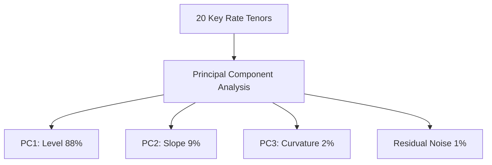

# Risk Factor Modelling

## TL;DR

Risk factor modelling translates thousands of complex financial contracts into a manageable, standardized set of primitive market drivers: equity prices, interest rate zero curves, credit spreads, FX rates, commodity forward curves, and implied volatility surfaces.
Selecting the appropriate return convention is essential: equities, FX, and commodities follow geometric (logarithmic) returns, whereas yields and credit spreads follow arithmetic (absolute basis point) differences.
To overcome the curse of dimensionality and estimation error in large portfolios ($N > T$), quants apply Principal Component Analysis (PCA) on curve structures and statistical factor models (e.g., Barra, Fama-French) on equity universes.
Covariance matrix estimation requires dynamic techniques, including Exponentially Weighted Moving Averages (EWMA) and Ledoit-Wolf shrinkage, paired with positive semi-definiteness repair algorithms to ensure Cholesky factorizability.

## Learning objectives

- Classify market variables across asset classes into standardized risk factor taxonomies.
- Apply the appropriate return transformation (arithmetic vs. relative/logarithmic) across rates, spreads, and asset prices.
- Execute Principal Component Analysis (PCA) to extract level, slope, and curvature drivers from term structures.
- Compute dynamic covariance matrices using Exponentially Weighted Moving Average (EWMA / RiskMetrics) and Ledoit-Wolf shrinkage.
- Repair non-positive-definite empirical covariance matrices using eigenvalue clipping and Higham's alternating projections.
- Model heavy-tailed marginal distributions and volatility clustering using Student-t innovations and GARCH processes.

## Core concepts

### Taxonomy of Market Risk Factors

Enterprise risk engines decompose complex derivative contracts and structured portfolios into standardized primitive risk factors $\mathbf{x} = [x_1, x_2, \dots, x_N]^T$:

| Asset Class | Risk Factor Representation | Transformation / Return Convention | Typical Tenors / Attributes |
| :--- | :--- | :--- | :--- |
| **Equities** | Spot price, index level | Geometric return: $r_t = \ln(S_t / S_{t-1})$ | Single stocks, Sector ETFs, Broad indices |
| **Interest Rates** | Zero yields, par yields | Arithmetic change: $\Delta y_t = y_t - y_{t-1}$ | Overnight, 1m, 3m, 6m, 1y, 2y, 5y, 10y, 30y |
| **Credit Spreads** | CDS par spreads, ASW | Arithmetic change: $\Delta s_t = s_t - s_{t-1}$ | 1y, 3y, 5y, 7y, 10y per rating / issuer |
| **Foreign Exchange** | Spot exchange rates ($S_{f/d}$) | Geometric return: $r_t = \ln(X_t / X_{t-1})$ | G10 crosses, EM currency pairs |
| **Commodities** | Futures curve contract prices | Geometric return: $r_t = \ln(F_t / F_{t-1})$ | Monthly delivery expiries, prompt spread |
| **Implied Volatility** | Black-Scholes implied vols | Absolute or relative shift: $\Delta \sigma_t$ | Strike $\times$ Expiry moneyness grid |

### Return Transformations: Arithmetic vs. Geometric

Applying an incorrect return transformation introduces severe distortions into risk forecasting and scenario generation:

#### 1. Geometric / Logarithmic Returns
For assets that cannot trade negative and whose price fluctuations scale proportionally with current price levels (equities, FX, commodities):

$$r_t = \ln\left( \frac{S_t}{S_{t-1}} \right) \approx \frac{S_t - S_{t-1}}{S_{t-1}}$$

Log returns compound additively over time ($\ln(S_T / S_0) = \sum_{t=1}^T r_t$) and remain invariant to price scale.

#### 2. Arithmetic Differences
For interest rate yields $y_t$ and credit spreads $s_t$:
Shifts are modeled in absolute basis points ($1 \text{ bp} = 0.0001$):

$$\Delta y_t = y_t - y_{t-1}$$

Using relative returns on yields ($y_t / y_{t-1}$) is mathematically dangerous when yields approach zero:
If a 10-year yield drops from 50 bps to 5 bps, relative return is $-90\%$, but absolute move is $-45$ bps.
Conversely, if yields are negative (as in Europe and Japan from 2014-2021), logarithmic returns are undefined.

### Dimension Reduction: Principal Component Analysis (PCA)

A sovereign yield curve with 20 key rate tenors exhibits massive cross-tenor multicollinearity.
Principal Component Analysis (PCA) projects the $N \times N$ covariance matrix $\mathbf{\Sigma}$ onto an orthogonal basis of eigenvectors:

$$\mathbf{\Sigma} = \mathbf{V} \mathbf{\Lambda} \mathbf{V}^T$$

where $\mathbf{\Lambda} = \text{diag}(\lambda_1, \lambda_2, \dots, \lambda_N)$ contains eigenvalues sorted in descending order ($\lambda_1 \ge \lambda_2 \ge \dots \ge \lambda_N$), and $\mathbf{V}$ contains corresponding orthonormal eigenvectors.
Any yield curve shock $\Delta \mathbf{y}$ can be represented as a linear combination of principal component scores $z_k$:

$$\Delta \mathbf{y} \approx \sum_{k=1}^K z_k \mathbf{v}_k \quad \text{where } K \ll N$$

In fixed income markets, the first three principal components explain over $98\%$ of total yield curve variance:
- **PC1 (Level, $\approx 85-90\%$ of variance):** All tenors shift in the same direction with roughly equal magnitude.
- **PC2 (Slope / Twist, $\approx 7-10\%$ of variance):** Short tenors move opposite to long tenors, steepening or flattening the curve.
- **PC3 (Curvature / Butterfly, $\approx 2-3\%$ of variance):** Short and long tenors move together while intermediate tenors flex in the opposite direction.

### Covariance Matrix Estimation and Repair

Calculating portfolio VaR, Expected Shortfall, or Monte Carlo scenarios requires estimating the risk factor covariance matrix $\mathbf{\Sigma}$.

#### 1. Sample Covariance Matrix
Given a matrix of historical returns $\mathbf{R} \in \mathbb{R}^{T \times N}$:

$$\mathbf{\Sigma}_{\text{sample}} = \frac{1}{T - 1} \sum_{t=1}^T (\mathbf{r}_t - \bar{\mathbf{r}})(\mathbf{r}_t - \bar{\mathbf{r}})^T$$

When the number of risk factors $N$ approaches or exceeds sample size $T$ ($N \ge T$), the sample covariance matrix is singular (rank deficient) and cannot be inverted or decomposed via Cholesky.
Even when $T > N$, sample covariance severely overfits sample noise, inflating extreme eigenvalues (Marchenko-Pastur distribution).

#### 2. Exponentially Weighted Moving Average (EWMA / RiskMetrics)
Financial volatility clusters over time (Mandelbrot's volatility clustering).
The EWMA model assigns exponentially decaying weights to historical observations:

$$\mathbf{\Sigma}_t = \lambda \mathbf{\Sigma}_{t-1} + (1 - \lambda) \mathbf{r}_{t-1} \mathbf{r}_{t-1}^T$$

where $\lambda \in (0, 1)$ is the decay parameter (RiskMetrics standard: $\lambda = 0.94$ for daily data, $\lambda = 0.97$ for monthly data).
EWMA adapts rapidly to volatility regime shifts without discarding historical data abruptly.

#### 3. Ledoit-Wolf Shrinkage
To eliminate sample covariance noise while avoiding subjective parameter choices, Ledoit and Wolf established an optimal linear shrinkage estimator:

$$\mathbf{\Sigma}_{\text{shrink}} = \delta \mathbf{F} + (1 - \delta) \mathbf{\Sigma}_{\text{sample}}$$

where $\mathbf{F}$ is a structured, well-conditioned target matrix (such as the identity matrix scaled by average variance, or a single-index factor covariance), and $\delta \in [0, 1]$ is the analytically optimal shrinkage intensity minimizing Frobenius risk.

#### 4. Positive Semi-Definiteness Repair
Empirical correlation matrices constructed from asynchronous data feeds or pairwise observations frequently possess negative eigenvalues, causing Cholesky decomposition ($\mathbf{\Sigma} = \mathbf{L}\mathbf{L}^T$) to crash.
Standard repair techniques include:
- **Eigenvalue Clipping:** Compute spectral decomposition $\mathbf{\Sigma} = \mathbf{V} \mathbf{\Lambda} \mathbf{V}^T$, replace negative eigenvalues $\lambda_i < 0$ with a small positive threshold $\epsilon = 10^{-7}$, and reconstruct $\tilde{\mathbf{\Sigma}} = \mathbf{V} \tilde{\mathbf{\Lambda}} \mathbf{V}^T$, followed by unit-diagonal rescaling.
- **Higham's Alternating Projections:** Solves for the mathematically closest positive semi-definite correlation matrix under the Frobenius norm.

## Worked examples

### Example 1: EWMA Covariance Update and Cholesky Factorization

Consider two risk factors: S&P 500 returns ($x_1$) and 10-year Treasury yield changes ($x_2$).
Yesterday's EWMA covariance matrix ($\lambda = 0.94$) was:

$$\mathbf{\Sigma}_{t-1} = \begin{pmatrix} 0.000100 & -0.000020 \\ -0.000020 & 0.000025 \end{pmatrix}$$

Today's realized market shocks are:
- S&P 500 return: $r_1 = -0.020$ ($-2.0\%$).
- 10-year Treasury yield change: $\Delta y = -0.0006$ ($-6$ bps).

Compute today's updated EWMA covariance matrix $\mathbf{\Sigma}_t$ and its lower triangular Cholesky factor $\mathbf{L}$.

**Solution:**

Step 1: Compute outer product of today's shock $\mathbf{r} \mathbf{r}^T$:

$$\mathbf{r} = \begin{pmatrix} -0.020 \\ -0.0006 \end{pmatrix}$$

$$\mathbf{r} \mathbf{r}^T = \begin{pmatrix} (-0.020)^2 & (-0.020)(-0.0006) \\ (-0.0006)(-0.020) & (-0.0006)^2 \end{pmatrix} = \begin{pmatrix} 0.000400 & 0.000012 \\ 0.000012 & 0.00000036 \end{pmatrix}$$

Step 2: Apply EWMA update equation ($\mathbf{\Sigma}_t = 0.94 \mathbf{\Sigma}_{t-1} + 0.06 \mathbf{r} \mathbf{r}^T$):

$$\mathbf{\Sigma}_t[0, 0] = 0.94(0.000100) + 0.06(0.000400) = 0.000094 + 0.000024 = 0.000118$$

$$\mathbf{\Sigma}_t[1, 1] = 0.94(0.000025) + 0.06(0.00000036) = 0.0000235 + 0.0000000216 \approx 0.00002352$$

$$\mathbf{\Sigma}_t[0, 1] = 0.94(-0.000020) + 0.06(0.000012) = -0.0000188 + 0.00000072 = -0.00001808$$

$$\mathbf{\Sigma}_t = \begin{pmatrix} 0.000118 & -0.00001808 \\ -0.00001808 & 0.00002352 \end{pmatrix}$$

Step 3: Cholesky decomposition $\mathbf{\Sigma}_t = \mathbf{L} \mathbf{L}^T$:

$$L_{00} = \sqrt{\mathbf{\Sigma}_t[0, 0]} = \sqrt{0.000118} \approx 0.0108628$$

$$L_{10} = \frac{\mathbf{\Sigma}_t[0, 1]}{L_{00}} = \frac{-0.00001808}{0.0108628} \approx -0.0016644$$

$$L_{11} = \sqrt{\mathbf{\Sigma}_t[1, 1] - L_{10}^2} = \sqrt{0.00002352 - (-0.0016644)^2} = \sqrt{0.00002352 - 0.00000277} = \sqrt{0.00002075} \approx 0.0045552$$

$$\mathbf{L} = \begin{pmatrix} 0.010863 & 0 \\ -0.001664 & 0.004555 \end{pmatrix}$$

The Cholesky factor enables direct generation of correlated risk factor shocks in Monte Carlo simulations via $\Delta \mathbf{x} = \mathbf{L} \mathbf{z}$.

### Example 2: PCA Yield Curve Factor Shocks

A quant performs PCA on a 3-tenor yield curve (2y, 5y, 10y).
The first two eigenvectors (normalized) are:
- Level ($\mathbf{v}_1$): $[0.55, 0.60, 0.58]^T$ with standard deviation $\sigma_1 = 12.0 \text{ bps} = 0.0012$.
- Slope ($\mathbf{v}_2$): $[-0.70, -0.10, +0.70]^T$ with standard deviation $\sigma_2 = 6.0 \text{ bps} = 0.0006$.

Generate a $+2$-standard-deviation curve slope shock ($z_1 = 0, z_2 = +2.0$) and calculate the resulting basis point yield change at each tenor.

**Solution:**

Step 1: Compute shock vector $\Delta \mathbf{y} = z_2 \cdot \sigma_2 \cdot \mathbf{v}_2$:

$$\Delta \mathbf{y} = 2.0 \times 0.0006 \times \begin{pmatrix} -0.70 \\ -0.10 \\ +0.70 \end{pmatrix} = 0.0012 \times \begin{pmatrix} -0.70 \\ -0.10 \\ +0.70 \end{pmatrix}$$

Step 2: Evaluate individual tenor shifts:
- 2-year yield: $\Delta y_2 = 0.0012 \times (-0.70) = -0.000840$ ($-8.4$ bps).
- 5-year yield: $\Delta y_5 = 0.0012 \times (-0.10) = -0.000120$ ($-1.2$ bps).
- 10-year yield: $\Delta y_{10} = 0.0012 \times (+0.70) = +0.000840$ ($+8.4$ bps).

Step 3: Analyze curve shape change:
The 2s10s curve spread ($y_{10} - y_2$) changes by:

$$\Delta(y_{10} - y_2) = +8.4 \text{ bps} - (-8.4 \text{ bps}) = +16.8 \text{ bps}$$

The orthogonal PCA slope factor produces an exact $16.8$ bp curve steepening with zero net parallel displacement.

## Pitfalls

- **Mixing Return Conventions Across Asset Classes:** Computing percentage returns on yield levels ($y_t / y_{t-1}$) produces distorted, explosive volatilities when yields are near zero.
- **Asynchronous Data Stale Prices:** In global multi-asset books, closing prices from Asian, European, and US markets are sampled at different UTC timestamps, artificially suppressing cross-market correlations.
- **Rank Deficiency in Cholesky Factorization:** Attempting Cholesky decomposition on a sample covariance matrix where the number of factors exceeds historical days ($N > T$) fails with a non-positive-definite error.
- **Static Covariance in Volatility Regimes:** Using an unweighted 3-year sample covariance matrix during a sudden market crisis severely underestimates risk by weighting calm historical periods equally with recent extreme turbulence.
- **Ghost Features in Historical Covariance Windows:** When an extreme market shock exits a moving rolling window, the sample covariance matrix suddenly drops discontinuously, creating an artificial risk drop known as a "ghost shock".

## Interview questions

> [!question]- return-conventions-rates-vs-equities | Why are equity risk factors modeled using geometric log returns while interest rate yields are modeled using arithmetic changes?
> Equity prices are strictly non-negative and scale multiplicatively, making logarithmic returns $\ln(S_t/S_{t-1})$ stationary and scale-invariant. Interest rate yields and credit spreads are already rates of return expressed in percentage or basis points; modeling them with relative percentage returns produces exploding volatilities near zero, fails when rates are negative, and misaligns with fixed income linear DV01 sensitivities.

> [!question]- pca-eigenvector-interpretation | In fixed income term structure analysis, what do the first three principal components represent economically?
> The first three principal components represent Level, Slope, and Curvature. Level (PC1) accounts for 85-90% of variance and reflects parallel shifts where all tenors move in tandem. Slope (PC2) accounts for 7-10% of variance and represents curve rotation where short and long yields move oppositely. Curvature (PC3) accounts for 2-3% of variance and captures butterfly bending where intermediate tenors flex relative to the wings.

> [!question]- ewma-vs-sample-covariance | What are the primary advantages of an Exponentially Weighted Moving Average (EWMA) covariance matrix over an unweighted sample covariance matrix?
> EWMA assigns geometrically decaying weights to past returns ($\lambda^{t}$), allowing the covariance estimate to adapt quickly to sudden volatility surges and clustering. Furthermore, EWMA eliminates "ghost features", where an extreme historical event abruptly drops out of an unweighted sample window after $N$ days and causes artificial discontinuous risk drops.

> [!question]- ledoit-wolf-shrinkage-rationale | Why is Ledoit-Wolf shrinkage necessary when estimating covariance matrices for large asset universes ($N > T$)?
> When the number of assets $N$ is large relative to sample size $T$, sample covariance matrices suffer from severe estimation noise, overstating large eigenvalues and understating small eigenvalues. Ledoit-Wolf shrinkage pulls the sample covariance matrix toward a well-conditioned structured target (e.g., identity or single-factor matrix) using an analytically optimal weighting that minimizes expected mean squared error.

> [!question]- non-positive-definite-matrix-fix | What causes an empirical correlation matrix to become non-positive-definite, and how can it be repaired?
> Non-positive-definiteness is caused by missing or asynchronous data, pairwise deletion of missing observations, or blending multiple data sources. It is repaired by eigenvalue clipping (setting negative eigenvalues to a tiny positive constant $\epsilon$ and scaling back to unit diagonals) or applying Higham's algorithm, which finds the mathematically closest positive semi-definite matrix under the Frobenius norm.

> [!question]- cholesky-decomposition-usage | How is the Cholesky factorization $\mathbf{\Sigma} = \mathbf{L} \mathbf{L}^T$ used in multi-factor Monte Carlo simulations?
> Cholesky factorization decomposes the symmetric positive-definite covariance matrix $\mathbf{\Sigma}$ into a lower triangular matrix $\mathbf{L}$. Given a vector of independent standard normal random draws $\mathbf{z} \sim \mathcal{N}(0, \mathbf{I})$, correlated risk factor shocks are generated via the linear transformation $\Delta \mathbf{x} = \mathbf{L} \mathbf{z}$, preserving the full cross-factor covariance structure: $\text{Cov}(\Delta \mathbf{x}) = \mathbf{L} \mathbf{I} \mathbf{L}^T = \mathbf{\Sigma}$.

> [!question]- marchenko-pastur-distribution | What does the Marchenko-Pastur distribution tell quants about empirical correlation matrices?
> The Marchenko-Pastur theorem defines the theoretical distribution of eigenvalues for a pure noise random matrix with ratio $q = N/T$. In empirical covariance matrices, eigenvalues falling inside the Marchenko-Pastur noise band represent purely random statistical noise rather than genuine economic co-movement, justifying eigenvalue filtering and PCA truncation.

> [!question]- factor-model-dimension-reduction | How does an equity factor model (such as Barra or Fama-French) reduce the computational complexity of covariance estimation?
> In an equity universe with $N = 3,000$ stocks, estimating a full covariance matrix requires $N(N+1)/2 \approx 4.5 \times 10^6$ parameters. A linear factor model decomposes stock returns into $K \ll N$ common factor exposures plus idiosyncratic risk: $r_i = \mathbf{\beta}_i^T \mathbf{f} + \epsilon_i$. This reduces estimation to a $K \times K$ factor covariance matrix and $N$ diagonal specific variances, reducing parameter count from millions to a few thousand.

> [!question]- volatility-surface-risk-factor-grids | How are continuous implied volatility surfaces discretized into standardized risk factors?
> Implied volatility surfaces are mapped onto a fixed grid parameterized by standardized option delta or moneyness (e.g., 10-delta put, 25-delta put, ATM, 25-delta call, 10-delta call) across fixed time-to-expiry buckets (e.g., 1m, 3m, 6m, 1y, 2y). This moneyness parameterization preserves stability as spot prices drift, preventing strike-drifting distortions.

> [!question]- extreme-value-theory-fat-tails | Why do risk managers fit Generalized Pareto Distributions (GPD) to empirical risk factor tails instead of assuming normal distributions?
> Financial asset returns exhibit fat tails and excess kurtosis that Gaussian models systematically underpredict. Extreme Value Theory (EVT) proves that for any well-behaved distribution, observations exceeding a sufficiently high threshold follow a Generalized Pareto Distribution (GPD), providing asymptotically sound estimates of extreme tail quantiles and tail risk.

## Further reading

- Philippe Jorion, *Value at Risk: The New Benchmark for Managing Financial Risk*, Chapters 8-11.
- Carol Alexander, *Market Risk Analysis, Volume II: Practical Financial Econometrics*, Chapters 2-4.
- Bruce Tuckman and Angel Serrat, *Fixed Income Securities: Tools for Today's Markets*, Chapter 15: "Factor Models and Principal Component Analysis".
- Olivier Ledoit and Michael Wolf (2004), "A Well-Conditioned Estimator for Large-Dimensional Covariance Matrices", *Journal of Multivariate Analysis*.
- Nick Higham (2002), "Computing the Nearest Correlation Matrix - A Problem from Finance", *IMA Journal of Numerical Analysis*.

## In this repo and SDE-Interview-Prep

- Yield curve risk and PCA decomposition: [Curve Risk and Hedging](../06-Fixed-Income-and-Asset-Classes/15-Curve-Risk-and-Hedging.md).
- Python reference implementation of Cholesky factorization and bump engine: [risk_analytics.py](code/risk_analytics.py).
- Scenario generation and simulation algorithms: [Scenario Generation](11-Scenario-Generation.md).
- Portfolio revaluation and sensitivities: [Sensitivities and Revaluation](12-Sensitivities-and-Revaluation.md).
