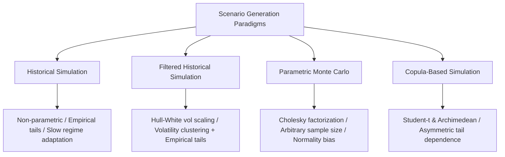

# Scenario Generation

## TL;DR

Scenario generation is the computational engine of market risk measurement, transforming estimated risk factor distributions into discrete simulated market states across which a portfolio is revalued.
The four principal generation paradigms are Unfiltered Historical Simulation, Filtered Historical Simulation (FHS), Parametric Monte Carlo, and Stress/Hypothetical scenarios.
While raw historical simulation preserves non-linear empirical copulas and heavy tails without parametric assumptions, it reflects historical rather than current volatility regimes.
Filtered Historical Simulation (Hull-White updating) resolves this limitation by standardizing historical returns by contemporaneous GARCH volatility and rescaling them by current prevailing volatility.
Parametric Monte Carlo leverages Cholesky factorization of the covariance matrix ($\Delta \mathbf{x} = \mathbf{L} \mathbf{z}$) to produce arbitrary sample sizes, enhanced by variance reduction techniques such as antithetic variates and Sobol low-discrepancy sequences.

## Learning objectives

- Contrast the four core scenario generation methodologies across statistical assumptions, computational complexity, and tail capture.
- Implement Filtered Historical Simulation (FHS) to capture empirical skewness and kurtosis while adapting dynamically to current volatility clustering.
- Generate correlated multivariate normal risk factor shocks using Cholesky factorization and Box-Muller transformations.
- Formulate non-Gaussian dependency sampling using copulas (Student-t, Clayton, Gumbel) with explicit tail dependence.
- Apply variance reduction techniques, including antithetic variates and quasi-Monte Carlo (Sobol sequences), to reduce estimator variance.
- Project multi-period scenarios incorporating mean-reversion drift and term structure evolution.

## Core concepts

### The Scenario Generation Spectrum

Risk engines evaluate portfolio distribution across $M$ simulated scenarios $\Delta \mathbf{x}_m = [\Delta x_{1, m}, \Delta x_{2, m}, \dots, \Delta x_{N, m}]^T$ for $m = 1, \dots, M$:

#### 1. Unfiltered Historical Simulation (HS)
Historical simulation takes observed daily market changes over a rolling historical window (typically $T = 250$ to $500$ days):

$$\Delta \mathbf{x}_m = \mathbf{x}_{t - m + 1} - \mathbf{x}_{t - m} \quad \text{for } m = 1, \dots, T$$

- **Advantages:** Completely non-parametric; requires no distributional assumptions; natively captures empirical correlations, fat tails, and cross-asset non-linearities.
- **Drawbacks:** Strictly backward-looking; cannot generate scenarios more extreme than the historical sample; treats an observation from 12 months ago with equal weight to yesterday; suffers from the "ghost feature" problem when an extreme shock rolls out of the window.

#### 2. Filtered Historical Simulation (FHS / Hull-White Volatility Updating)
Hull and White (1998) introduced volatility scaling to combine the empirical realism of historical simulation with the dynamic responsiveness of GARCH models.
Let $r_{\tau}$ be the historical return observed at day $\tau$ in the lookback window, $\sigma_{\tau}$ be the estimated volatility on day $\tau$, and $\sigma_{\text{current}}$ be the prevailing volatility at the valuation date.
The standardized historical innovation is scaled to current market conditions:

$$r_{\tau}^{\text{filtered}} = r_{\tau} \times \frac{\sigma_{\text{current}}}{\sigma_{\tau}}$$

If market volatility was calm when the historical event occurred ($\sigma_{\tau} \ll \sigma_{\text{current}}$), the historical return is scaled upward, generating realistically severe shocks reflecting current turbulence.
Conversely, if past volatility was elevated, historical returns are compressed to match a calm current environment.

#### 3. Parametric Monte Carlo (Multivariate Normal)
Parametric Monte Carlo assumes risk factor shocks follow a joint multivariate normal distribution $\Delta \mathbf{x} \sim \mathcal{N}(\mathbf{\mu}, \mathbf{\Sigma})$.
Using the lower triangular Cholesky factor $\mathbf{L}$ such that $\mathbf{\Sigma} = \mathbf{L} \mathbf{L}^T$:

$$\Delta \mathbf{x}_m = \mathbf{\mu} + \mathbf{L} \mathbf{z}_m \quad \text{where } \mathbf{z}_m \sim \mathcal{N}(0, \mathbf{I}_N)$$

- **Advantages:** Capable of generating millions of independent scenarios; facilitates pricing of path-dependent, multi-period instruments; enables analytical error bounds.
- **Drawbacks:** Multivariate normality severely underestimates tail risk and joint crash probabilities; requires explicit matrix repair when empirical covariance matrices lose positive semi-definiteness.

#### 4. Copula-Based Scenario Generation
To model fat-tailed marginal distributions while preserving realistic tail dependence:
By Sklar's Theorem, any multivariate cumulative distribution function $F(x_1, \dots, x_N)$ can be decomposed into its marginal distributions $F_i(x_i)$ and a copula $C$:

$$F(x_1, \dots, x_N) = C(F_1(x_1), \dots, F_N(x_N))$$

To generate a scenario under a Student-t copula with $\nu$ degrees of freedom and correlation matrix $\mathbf{R}$:
1. Sample a random scalar from a chi-squared distribution: $W \sim \chi^2(\nu)$.
2. Sample independent standard normals: $\mathbf{z} \sim \mathcal{N}(0, \mathbf{I}_N)$.
3. Generate correlated t-shocks: $\mathbf{y} = \sqrt{\frac{\nu}{W}} \mathbf{L} \mathbf{z}$, where $\mathbf{L} \mathbf{L}^T = \mathbf{R}$.
4. Transform through the univariate Student-t CDF: $u_i = t_{\nu}(y_i) \sim U(0, 1)$.
5. Invert through empirical or Generalized Pareto marginal distributions: $\Delta x_i = F_i^{-1}(u_i)$.

This framework captures non-zero asymptotic tail dependence: extreme market crashes occur simultaneously across assets even when correlation $\rho < 1$.

### Variance Reduction Techniques

Monte Carlo estimator standard error converges slowly at rate $O(1/\sqrt{M})$, requiring $10,000$ scenarios to reduce error by a factor of 10.
Variance reduction methods accelerate convergence without adding bias:

#### 1. Antithetic Variates
For every random normal draw $\mathbf{z}_m \sim \mathcal{N}(0, \mathbf{I})$, include its exact negative counterpart $-\mathbf{z}_m$:

$$\Delta \mathbf{x}_m^{(1)} = \mathbf{L} \mathbf{z}_m, \quad \Delta \mathbf{x}_m^{(2)} = -\mathbf{L} \mathbf{z}_m$$

The fair benchmark for one antithetic pair is the average of two independent draws, whose variance is $\frac{1}{2}\text{Var}(\Delta V)$:

$$\text{Var}\left(\frac{\Delta V(\mathbf{z}) + \Delta V(-\mathbf{z})}{2}\right) = \frac{1}{2}\text{Var}(\Delta V) + \frac{1}{2}\text{Cov}(\Delta V(\mathbf{z}), \Delta V(-\mathbf{z})) < \frac{1}{2}\text{Var}(\Delta V) \iff \text{Cov}(\Delta V(\mathbf{z}), \Delta V(-\mathbf{z})) < 0$$

The linear component of portfolio P&L is perfectly negatively correlated across the pair, so the covariance is negative whenever delta dominates; a pure even (gamma-only) payoff gives positive covariance and antithetics then increase variance.

#### 2. Quasi-Monte Carlo (Low-Discrepancy Sequences)
Pseudorandom number generators suffer from random clumping and empty gaps in multidimensional space.
Quasi-Monte Carlo replaces pseudo-random draws with deterministic, low-discrepancy sequences (e.g., Sobol, Halton) that fill the unit hypercube $[0, 1]^N$ uniformly.
QMC error converges asymptotically at rate $O((\ln M)^N / M) \approx O(1/M)$, dramatically outperforming standard Monte Carlo for moderate factor dimensions ($N \le 20$).

#### 3. Latin Hypercube Sampling (LHS)
Stratified sampling divides the cumulative probability range $[0, 1]$ for each risk factor into $M$ equally probable bins.
Exactly one draw is sampled randomly from each stratum and randomly permuted across factors, ensuring that the tails and center of each marginal distribution are sampled uniformly.

### Multi-Period Scenario Projection

For regulatory credit exposure (CCR), Initial Margin simulation (SIMM/MVA), or multi-year capital planning, risk engines project scenarios forward across multiple time steps $t_1, t_2, \dots, t_K$:

- **Compounding Geometric Asset Shocks:**

$$S(t_{k+1}) = S(t_k) \exp\left[ \left(\mu - \frac{1}{2}\sigma^2\right)\Delta t + \sigma \sqrt{\Delta t} \, z \right]$$

- **Mean-Reverting Term Structures (Vasicek / Hull-White):**
Rates do not diffuse indefinitely; mean reversion prevents long-horizon yields from exploding:

$$r(t_{k+1}) = r(t_k) + a(b - r(t_k))\Delta t + \sigma \sqrt{\Delta t} \, z$$

- **Path-Dependent State Tracking:**
As scenarios evolve, path-dependent contract events (e.g., American exercise, barrier knock-outs, credit rating migration, collateral calls) must be evaluated sequentially at each time node.

## Worked examples

### Example 1: Volatility-Scaled Filtered Historical Simulation (FHS)

A risk manager models a portfolio of tech equities on valuation date $T$.
On valuation date $T$, the prevailing EWMA daily volatility is $\sigma_{\text{current}} = 2.40\%$ ($0.0240$).
In the historical lookback window, day $\tau = 142$ corresponded to a calm market period where daily volatility was $\sigma_{\tau} = 1.10\%$ ($0.0110$).
On that historical day $\tau$, the observed return of the stock was $r_{\tau} = -2.20\%$ ($-0.0220$, a 2-sigma event relative to that period's volatility).

Compute the filtered historical scenario return $r_{\tau}^{\text{filtered}}$ to be applied to today's portfolio.

**Solution:**

Step 1: Compute the volatility scaling ratio:

$$\text{Scale Ratio} = \frac{\sigma_{\text{current}}}{\sigma_{\tau}} = \frac{0.0240}{0.0110} \approx 2.1818$$

Step 2: Apply the scaling ratio to the historical raw return:

$$r_{\tau}^{\text{filtered}} = r_{\tau} \times \left(\frac{\sigma_{\text{current}}}{\sigma_{\tau}}\right) = -0.0220 \times 2.1818 \approx -0.0480 \quad (-4.80\%)$$

Step 3: Analyze the economic outcome:
Under unscaled historical simulation, the scenario shock would have been only $-2.20\%$, which fails to reflect the reality that current markets are more than twice as volatile.
Filtered Historical Simulation scales the shock to $-4.80\%$, preserving the historical correlation structure and empirical tail shape while adapting dynamically to current turbulence.

### Example 2: Bivariate Correlated Monte Carlo Draw with Cholesky

Generate a single correlated pair of risk factor shocks for Equity ($S$) and Rates ($y$) using the reference engine in `code/risk_analytics.py`:
- Equity annualized volatility: $\sigma_S = 20.0\%$ (daily $\sigma_{S, d} = 0.20 / \sqrt{252} \approx 0.01260$).
- 10-year yield annualized volatility: $\sigma_y = 100 \text{ bps}$ (daily $\sigma_{y, d} = 0.0100 / \sqrt{252} \approx 0.000630$).
- Correlation: $\rho = -0.35$.
- Independent standard normal draws: $z_1 = +1.200$, $z_2 = -0.800$.

**Solution:**

Step 1: Construct the daily covariance matrix $\mathbf{\Sigma}$:

$$\mathbf{\Sigma}_{11} = \sigma_{S, d}^2 = (0.01260)^2 \approx 0.00015876$$

$$\mathbf{\Sigma}_{22} = \sigma_{y, d}^2 = (0.000630)^2 \approx 0.0000003969$$

$$\mathbf{\Sigma}_{12} = \rho \cdot \sigma_{S, d} \cdot \sigma_{y, d} = -0.35 \times 0.01260 \times 0.000630 \approx -0.0000027783$$

$$\mathbf{\Sigma} = \begin{pmatrix} 0.00015876 & -0.0000027783 \\ -0.0000027783 & 0.0000003969 \end{pmatrix}$$

Step 2: Compute Cholesky factor $\mathbf{L}$:

$$L_{11} = \sigma_{S, d} \approx 0.01260$$

$$L_{21} = \frac{\mathbf{\Sigma}_{12}}{L_{11}} = \rho \cdot \sigma_{y, d} = -0.35 \times 0.000630 \approx -0.0002205$$

$$L_{22} = \sqrt{\sigma_{y, d}^2 - L_{21}^2} = \sigma_{y, d} \sqrt{1 - \rho^2} = 0.000630 \times \sqrt{1 - (-0.35)^2} = 0.000630 \times \sqrt{0.8775} \approx 0.0005901$$

$$\mathbf{L} = \begin{pmatrix} 0.01260 & 0 \\ -0.0002205 & 0.0005901 \end{pmatrix}$$

Step 3: Compute correlated shocks $\Delta \mathbf{x} = \mathbf{L} \mathbf{z}$:

$$\Delta S = L_{11} z_1 = 0.01260 \times 1.200 = +0.01512 \quad (+1.51\%)$$

$$\Delta y = L_{21} z_1 + L_{22} z_2 = (-0.0002205 \times 1.200) + (0.0005901 \times -0.800) = -0.0002646 - 0.0004721 = -0.0007367 \quad (-7.37 \text{ bps})$$

The resulting shock pairs an equity gain of $+1.51\%$ with an interest rate rally of $-7.37$ bps, reflecting the negative correlation parameter.

## Pitfalls

- **Unscaled Historical Simulation in Volatility Transients:** Running unfiltered historical simulation immediately after a volatility spike results in severely lagging, understated risk forecasts until the high-volatility regime accumulates in the lookback window.
- **Multivariate Normality Blindness:** Using a pure Gaussian copula for multi-asset derivatives portfolios dramatically underpredicts simultaneous joint tail crashes (e.g., 2008 or March 2020).
- **Ignoring Cholesky Matrix Invalidation:** Randomly modifying correlations in stress tests without re-checking positive semi-definiteness leads to negative square roots and run-time simulation crashes.
- **Inconsistent Scenario Tenor Alignment:** Generating 10-day scenarios by simply scaling 1-day simulated returns by $\sqrt{10}$ assumes random walk independence, completely ignoring short-term momentum, mean reversion, and volatility clustering.
- **Overfitting Quasi-Monte Carlo Dimensions:** In high-dimensional portfolios ($N > 50$), low-discrepancy Sobol sequences suffer from high-dimensional projection correlation degradation, requiring Brownian bridge or PCA dimensionality reduction.

## Interview questions

> [!question]- risk-historical-vs-monte-carlo-scenarios | Compare Historical Simulation and Parametric Monte Carlo scenario generation in terms of computational cost, tail modeling, and sample size flexibility.
> Historical Simulation is non-parametric, requires no distribution fitting, and natively captures fat tails and non-linear cross-correlations, but is constrained to observed sample size $T$ and lags volatility shifts. Parametric Monte Carlo allows generating arbitrary scenario counts ($M = 100,000+$) and enables fast convergence via variance reduction, but relies on assumed distributions (often multivariate normal) that underestimate tail crashes and non-linear correlation clustering.

> [!question]- risk-filtered-historical-simulation-concept | How does Filtered Historical Simulation (FHS) solve the limitations of standard historical simulation?
> Standard historical simulation weights a calm historical return equally with a volatile one. FHS standardizes historical returns by the volatility prevailing on the date the return occurred ($r_t / \sigma_t$), creating independent standardized residuals. It then multiplies these residuals by current prevailing volatility ($\sigma_{\text{current}}$). This captures both empirical fat-tailed distributions and real-time volatility clustering.

> [!question]- risk-cholesky-generation-algorithm | Outline the mathematical algorithm to generate $M$ correlated multivariate normal scenarios given covariance matrix $\mathbf{\Sigma}$.
> 1. Compute the lower triangular Cholesky factor $\mathbf{L}$ such that $\mathbf{\Sigma} = \mathbf{L} \mathbf{L}^T$.
> 2. For each scenario $m = 1, \dots, M$, generate an $N$-dimensional vector $\mathbf{z}_m$ of independent standard normal random variables $\mathcal{N}(0, 1)$ using Box-Muller or inverse CDF transforms.
> 3. Compute correlated shocks $\Delta \mathbf{x}_m = \mathbf{\mu} + \mathbf{L} \mathbf{z}_m$.
> 4. Verify that $\frac{1}{M}\sum \Delta \mathbf{x} \Delta \mathbf{x}^T \to \mathbf{\Sigma}$ as $M \to \infty$.

> [!question]- risk-student-t-copula-advantage | Why is a Student-t copula superior to a Gaussian copula for generating multi-asset market risk scenarios?
> The Gaussian copula has zero asymptotic tail dependence: as events become more extreme, the probability of joint simultaneous default or crash approaches zero. The Student-t copula possesses positive symmetric tail dependence parameterized by degrees of freedom $\nu$. Even with moderate linear correlation, the Student-t copula generates joint clustered crashes across asset classes during tail events.

> [!question]- risk-antithetic-variates-variance-reduction | How do antithetic variates reduce estimator variance in Monte Carlo scenario generation?
> For each simulated random vector $\mathbf{z}$, the engine also computes the portfolio revaluation under its opposite $-\mathbf{z}$. Because linear Greek components (Delta) respond symmetrically ($\Delta V(-\mathbf{z}) \approx -\Delta V(\mathbf{z})$), the covariance between the antithetic pairs is strongly negative. Averaging the pairs cancels first-order variance, reducing standard error without increasing bias.

> [!question]- risk-sobol-sequences-vs-pseudorandom | Why do Sobol quasi-Monte Carlo sequences achieve faster convergence than pseudorandom numbers?
> Pseudorandom numbers cluster randomly, leaving large empty voids and dense clusters in the sampling space, yielding an error convergence rate of $O(1/\sqrt{M})$. Sobol sequences are deterministic low-discrepancy numbers engineered to maximize uniform coverage of the unit hypercube, achieving asymptotic error convergence of approximately $O(1/M)$ for low to moderate dimensions.

> [!question]- risk-latin-hypercube-sampling-principles | What is Latin Hypercube Sampling (LHS), and how does it guarantee tail representation?
> LHS divides the cumulative probability range $[0, 1]$ of each risk factor into $M$ equal strata of width $1/M$ and draws exactly one random point within each stratum. By randomly shuffling assignments across variables, LHS guarantees that every segment of the marginal distribution, including the extreme 1% tails, is sampled evenly across the simulation grid.

> [!question]- risk-square-root-of-time-scaling-limits | What are the statistical risks of scaling 1-day simulated scenarios to a 10-day horizon using $\sqrt{10}$?
> The $\sqrt{T}$ scaling rule strictly requires that daily returns be independent and identically distributed (i.i.d.) random variables. In real financial markets, returns exhibit strong autocorrelation, mean reversion in interest rates, and volatility clustering (GARCH). Scaling by $\sqrt{10}$ ignores compounding path dependency, underestimating risk during persistent trending panics and overestimating risk for mean-reverting curves.

> [!question]- risk-mean-reverting-scenario-drift | How must interest rate and commodity scenarios be modeled over long multi-year projection horizons?
> Over multi-year horizons, pure random walks allow interest rates and commodity prices to diffuse to unrealistically negative or astronomical levels. Long-horizon simulation engines incorporate mean reversion (e.g., Ornstein-Uhlenbeck or Hull-White drift $a(b - r_t)dt$), pulling simulated yields back toward macroeconomic equilibrium levels and preventing artificial variance explosion.

> [!question]- risk-scenario-ghost-features | What is a "ghost feature" in historical simulation, and how does it impact risk monitoring?
> A ghost feature occurs when an extreme market shock (e.g., a one-day 10% market crash) abruptly rolls out of a 250-day rolling historical window. On day 251, the calculated VaR drops discontinuously overnight, even though prevailing market risk has not changed. This creates an artificial illusion of safety and can trigger unwarranted portfolio risk expansion.

## Further reading

- Paul Glasserman, *Monte Carlo Methods in Financial Engineering*, Chapters 1-4.
- Carol Alexander, *Market Risk Analysis, Volume IV: Value at Risk Models*, Chapters 4-6.
- John Hull and Alan White (1998), "Incorporating Volatility Updating into the Historical Simulation Method for Value-at-Risk", *Journal of Risk*.
- Basel Committee on Banking Supervision, *MAR31: Internal Models Approach - Model Requirements*.
- McNeil, A. J., Frey, R., and Embrechts, P., *Quantitative Risk Management: Concepts, Techniques, and Tools*.

## In this repo and SDE-Interview-Prep

- Taxonomy and covariance estimation: [Risk Factor Modelling](10-Risk-Factor-Modelling.md).
- Python reference implementation of Cholesky and FHS: [risk_analytics.py](code/risk_analytics.py).
- Portfolio revaluation and Greek proxies: [Sensitivities and Revaluation](12-Sensitivities-and-Revaluation.md).
- Tail risk metrics: [VaR and Expected Shortfall](03-VaR-and-Expected-Shortfall.md).
