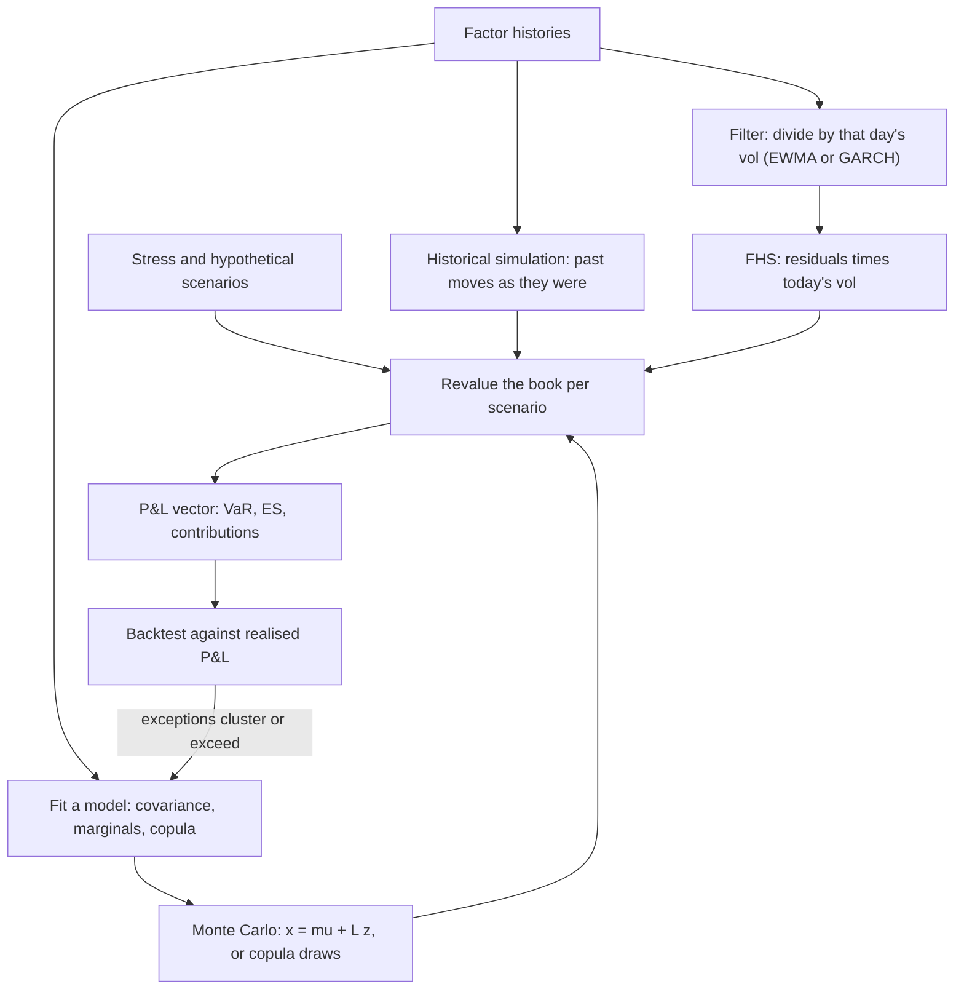

# Scenario Generation

## TL;DR

- A market risk engine is a scenario generator plus a revaluation engine: VaR and ES are quantiles and tail means of the P&L across scenarios, so the scenarios decide what the risk number can see.
- Historical simulation (HS) reuses past factor moves and keeps their fat tails and joint behaviour, but it reflects the volatility of the window, not today's; filtered historical simulation (FHS) divides each past move by the volatility of its day and multiplies by today's.
- On simulated data with a doubling of volatility, 99% HS VaR had exception rates of 7.2% in the first 20 days and 4.7% in days 21-60, against 3.5% and 1.2% for FHS; over a long stationary sample both had the same count (62 in 5,000 days), while a normal model with the same volatility had 97.
- Monte Carlo draws $x = \mu + Lz$ from a fitted model; copulas add tail dependence (a $t_4$ copula at $\rho = 0.5$ has $\lambda = 0.253$, a Gaussian copula zero), and variance reduction helps only where it fits the payoff (antithetics cut variance for a call to 0.63 but raise it to 1.90 for a straddle).
- Horizons need care: $\sqrt{10}$ scaling ignores volatility mean reversion and clustering, and Basel's 10-day ES may use overlapping observations (MAR33.4(7)).

## Learning objectives

- Contrast the four core scenario generation methodologies across statistical assumptions, computational complexity, and tail capture.
- Implement Filtered Historical Simulation (FHS) to capture empirical skewness and kurtosis while adapting dynamically to current volatility clustering.
- Generate correlated multivariate normal risk factor shocks using Cholesky factorization and Box-Muller transformations.
- Formulate non-Gaussian dependency sampling using copulas (Student-t, Clayton, Gumbel) with explicit tail dependence.
- Apply variance reduction techniques, including antithetic variates and quasi-Monte Carlo (Sobol sequences), to reduce estimator variance.
- Project multi-period scenarios incorporating mean-reversion drift and term structure evolution.
- Backtest a scenario model and read the Kupiec unconditional coverage test.

## Core concepts

### The paradigms

| Method | Keeps | Misses | Cost |
| :--- | :--- | :--- | :--- |
| Historical simulation | empirical tails and joint moves | today's volatility; anything not in the window | one revaluation per day of history |
| Filtered HS | empirical shape of residuals, today's volatility | dependence in volatility across factors unless filtered jointly | same, plus a filter per factor |
| Parametric Monte Carlo | any sample size, path dependence, multi-period | tails and dependence the model does not have | many revaluations |
| Copula Monte Carlo | chosen marginals and tail dependence | parameter uncertainty in tails | as Monte Carlo |

### Historical and filtered historical simulation

HS applies each of the last $T$ days' factor changes to today's book (with the same relative or absolute convention used in [risk factor modelling](10-Risk-Factor-Modelling.md)) and reads the loss quantile.
Its volatility is the window's volatility: after a calm year, VaR is low however turbulent today is, and when a crisis day leaves the window VaR drops overnight.

Hull and White (1998) rescale each historical return by the ratio of today's volatility to the volatility on its own day:

$$r_\tau^{\text{scaled}} = r_\tau\,\frac{\sigma_{\text{now}}}{\sigma_\tau}.$$

Barone-Adesi, Giannopoulos and Vosper (1999) formalised filtered historical simulation: fit a GARCH model (Bollerslev 1986) per factor, keep the standardised residuals $r_\tau/\sigma_\tau$, and bootstrap them through the volatility model, which also produces multi-day scenarios with volatility clustering.
The standardised residuals keep their joint ordering in time, so cross-factor dependence of the shocks is preserved without estimating a correlation matrix.

Regulatory note: for the FRTB trading desk VaR used in backtesting, volatility scaling that effectively shortens the observation period is not allowed at the bank's discretion; a bank may scale up the volatility of all observations of selected factors to reflect a recent stress period, after notifying the supervisor in advance (MAR32.18 FAQ1).

### What filtering buys: a controlled experiment

Two experiments in [scenario_generation.py](code/scenario_generation.py), each changing only the scenario method:

1. A 5,250-day GARCH(1,1) path with Student $t_5$ innovations (unconditional vol 1% a day), 99% one-day VaR from a 250-day window:

| Method | Exceptions in 5,000 days | Rate | Kupiec p-value |
| :--- | ---: | ---: | ---: |
| HS | 62 | 1.24% | 0.1002 |
| FHS (EWMA 0.94 filter) | 62 | 1.24% | 0.1002 |
| Normal with EWMA vol | 97 | 1.94% | below $10^{-8}$ |

Over a long stationary sample, filtering does not change the count; assuming normal tails does.

2. 2,000 paths of 250 days at 1% daily vol followed by 60 days at 2% (and the reverse), $t_5$ innovations:

| Regime change | HS days 1-20 | HS days 21-60 | FHS days 1-20 | FHS days 21-60 |
| :--- | ---: | ---: | ---: | ---: |
| calm to stressed | 7.2% | 4.7% | 3.5% | 1.2% |
| stressed to calm | 0.1% | 0.1% | 0.2% | 0.8% |

After a volatility shift, HS breaches seven times as often as it should for weeks, while FHS returns to about 1% once the EWMA has caught up; after a calm-down, HS is over-conservative.
This is the risk that backtesting over a long sample misses: the exceptions are not too many on average, they arrive together.

### Monte Carlo from a model

Factor the covariance $\Sigma = LL^\top$ (Cholesky, or $V\Lambda^{1/2}$ if only PSD), draw $z \sim N(0, I)$ by inverse CDF or Box-Muller (Box and Muller 1958), and set $x = \mu + Lz$.
The Monte Carlo error of a quantile matters as much as the model: the standard error of the empirical $p$-quantile from $N$ draws is about $\sqrt{p(1 - p)/N}/f(q_p)$, which for a 99% normal quantile and $N = 1{,}000$ is $0.118\sigma$, 5.1% of the VaR (1.6% at $N = 10{,}000$); a simulation of 2,000 such estimates gave a standard deviation of about $0.116\sigma$.

### Copulas and tail dependence

By Sklar's theorem a joint distribution is its marginals plus a copula; generating from a $t$ copula means drawing $y = Lz/\sqrt{W/\nu}$ with $W \sim \chi^2_\nu$ and mapping each $y_i$ through the $t_\nu$ CDF and then through the chosen marginal.
The coefficient of tail dependence, $\lambda = \lim_{q \to 0} P(U_2 \le q \mid U_1 \le q)$, is zero for a Gaussian copula with $\rho < 1$ and for a $t$ copula is $2\,t_{\nu+1}\!\left(-\sqrt{(\nu + 1)(1 - \rho)/(1 + \rho)}\right)$ (McNeil, Frey and Embrechts 2015, chapter 7): 0.253 for $\nu = 4$, $\rho = 0.5$ and 0.082 for $\nu = 10$.
Simulated with 2 million draws at $\rho = 0.5$:

| $q$ | Gaussian $P(\text{joint} \mid \text{one})$ | $t_4$ |
| ---: | ---: | ---: |
| 0.01 | about 0.132 | about 0.293 |
| 0.001 | about 0.052 | about 0.266 |

The Gaussian joint-crash probability keeps falling as the threshold moves out; the $t$ copula's settles near its $\lambda$.
Archimedean copulas (Clayton for lower-tail, Gumbel for upper-tail dependence) give asymmetric tails, at the cost of being hard to extend to many factors with different pairwise dependence.

### Variance reduction and low-discrepancy points

Antithetic variates pair $z$ with $-z$; the pair average beats two independent draws if and only if $\text{Cov}(f(z), f(-z)) < 0$.
Variance of the pair average relative to two independent draws (lognormal spot, 20% vol, 1 million draws):

| Payoff | $\text{corr}(f(z), f(-z))$ | Variance ratio |
| :--- | ---: | ---: |
| forward $S - 100$ | $-0.961$ | 0.039 |
| call $\max(S - 100, 0)$ | $-0.367$ | 0.632 |
| straddle $\lvert S - 100\rvert$ | $+0.899$ | 1.898 |

For an even payoff antithetics nearly double the variance: the method suits books dominated by delta, not by gamma.
Control variates, importance sampling toward the loss region, and stratification (Latin hypercube sampling stratifies each marginal) are covered in Glasserman (2003, chapter 4), and Glasserman, Heidelberger and Shahabuddin (2000) use the delta-gamma approximation as a control and an importance-sampling guide for VaR.

Quasi-Monte Carlo replaces random points with low-discrepancy sequences (Halton, Sobol); the Koksma-Hlawka inequality bounds the error by roughly $(\log N)^d/N$ for smooth integrands.
For $E[e^{0.2Z_1 + 0.3Z_2}] = e^{0.065}$ via Box-Muller on Halton points in bases 2 and 3, the error is $9.96 \times 10^{-4}$ at $N = 1{,}024$ and $7.66 \times 10^{-5}$ at $N = 16{,}384$, against a pseudo-random RMSE of $1.29 \times 10^{-2}$ and $2.98 \times 10^{-3}$: 13 and 39 times smaller.
The advantage shrinks with dimension and for discontinuous payoffs, which is why Sobol sequences are combined with Brownian-bridge or PCA orderings that put the important variance in the first coordinates (Glasserman 2003, chapter 5).

### Horizons

The square-root-of-time rule assumes i.i.d. returns.
Under GARCH with persistence 0.98 and long-run vol 1% a day, a day-ahead vol of 2% gives a 10-day vol of 6.12%, against $\sqrt{10} \times 2\% = 6.32\%$: the forecast mean-reverts (ratio 0.967); in the opposite case $\sqrt{10}$ understates.
For mean-reverting factors (Ornstein-Uhlenbeck with speed $a$), the variance over $h$ is $\sigma^2(1 - e^{-2ah})/(2a)$, i.e. a fraction $(1 - e^{-2ah})/(2ah)$ of the random-walk variance: 0.632 over a year at $a = 0.5$ but 0.980 over 10 days.
For multi-period exposure simulation (counterparty risk, margin, capital planning) factors are evolved step by step with their own dynamics and path-dependent events are evaluated at each date.

FRTB internal models compute ES at 97.5% (MAR33.3) on a 10-day base horizon scaled to longer liquidity horizons (MAR33.4), calibrated to a 12-month stress period (MAR33.5 to MAR33.7), and the 10-day changes may come from overlapping observations (MAR33.4(7)).
Overlapping windows reuse data, so they are correlated, but they still help: estimating the 10-day 97.5% ES of i.i.d. normal days from 259 days, 2,000 trials gave an estimator standard deviation of about 1.31 with 250 overlapping windows against 1.61 with 25 non-overlapping ones (true value 7.39; means about 6.92 and 6.23, both biased low on such short samples).

## Worked examples

All numbers are printed and asserted by `python 11-Risk-and-Trading/code/scenario_generation.py`.

### Example 1: one filtered historical scenario

Today's EWMA vol of a tech stock is 2.40% a day.
On a day in the window when vol was 1.10%, the stock fell 2.20%, a $-2.0$ standardised residual.

1. Scale: $0.024/0.011 = 2.1818$.
2. Filtered scenario: $-0.022 \times 2.1818 = -0.048$, a 4.8% fall.

Unfiltered HS would apply $-2.2\%$, a two-sigma day of a calm regime, to a book in a turbulent one.

### Example 2: one correlated draw

Equity vol 20% a year ($0.012599$ a day), 10-year yield vol 100bp a year (0.00062994 a day), correlation $-0.35$, independent normals $z = (1.2, -0.8)$.

1. $L_{11} = 0.012599$, $L_{21} = \rho\sigma_y = -0.00022048$, $L_{22} = \sigma_y\sqrt{1 - \rho^2} = 0.00059010$.
2. Equity: $0.012599 \times 1.2 = +1.512\%$.
3. Yield: $-0.00022048 \times 1.2 + 0.00059010 \times (-0.8) = -7.37$bp.

### Example 3: reading a backtest

A desk's 99% VaR had 62 exceptions in 5,000 days.
Kupiec's likelihood ratio, $-2\ln\frac{(1 - p)^{n - x}p^x}{(1 - \hat p)^{n - x}\hat p^x}$ with $\hat p = x/n$, is chi-square with one degree of freedom under correct coverage; here the p-value is 0.1002, so 1.24% is not significantly above 1%.
A normal model on the same path had 97 exceptions, p-value below $10^{-8}$: rejected.
Then look at timing: unconditional coverage cannot see that HS exceptions bunch after volatility shifts (example in the core concepts), which is what independence tests and the FRTB backtesting zones over 12 months are for.

## Pitfalls

- Running unfiltered HS straight after a volatility shift: exceptions cluster for weeks while the window catches up.
- Calling a long-sample backtest a pass when exceptions arrive in clusters.
- Normal or Gaussian-copula Monte Carlo for tail measures: the marginal tails and the joint crashes are both too thin.
- Antithetic variates on books dominated by gamma: variance goes up.
- Too few scenarios: with 1,000 normal draws the 99% quantile has a 5% standard error.
- $\sqrt{10}$ scaling when volatility is far from its long-run level or factors mean-revert.
- Filtering factors one at a time and assuming the cross-factor dependence of volatilities is preserved.
- Re-using random numbers inconsistently between base and bumped revaluations, which turns sensitivities into noise (use common random numbers).
- Quasi-Monte Carlo in high dimension without an ordering that front-loads the important variance.

## Interview questions

> [!question]- risk-historical-vs-monte-carlo-scenarios | Compare Historical Simulation and Parametric Monte Carlo scenario generation in terms of computational cost, tail modeling, and sample size flexibility.
> HS: no distributional model, keeps empirical tails and joint moves, cost fixed at one revaluation per historical day, but limited to the window and its volatility.
> Monte Carlo: any number of scenarios, paths and horizons, but only the tails and dependence the model contains; normal models understate both.
> On a simulated GARCH-$t$ path, HS had 62 exceptions in 5,000 days at 99% while a normal-EWMA model had 97.

> [!question]- risk-filtered-historical-simulation-concept | How does Filtered Historical Simulation (FHS) solve the limitations of standard historical simulation?
> Divide each historical move by the volatility of its day (EWMA or GARCH) and multiply by today's: $r\,\sigma_{\text{now}}/\sigma_\tau$ (Hull and White 1998; Barone-Adesi et al. 1999).
> The empirical shape of the residuals is kept, but the scale follows the current regime.
> After a simulated doubling of vol, HS breached 7.2% of the time in the first 20 days and FHS 3.5%; in days 21-60, 4.7% against 1.2%.

> [!question]- risk-cholesky-generation-algorithm | Outline the mathematical algorithm to generate $M$ correlated multivariate normal scenarios given covariance matrix $\mathbf{\Sigma}$.
> Factor $\Sigma = LL^\top$ (Cholesky, or $V\Lambda^{1/2}$ if only PSD); for each scenario draw $z \sim N(0, I)$ by inverse CDF or Box-Muller, and set $x = \mu + Lz$.
> Then $\text{Cov}(x) = LL^\top = \Sigma$.
> Check: with $\sigma_S = 0.012599$, $\sigma_y = 0.00062994$, $\rho = -0.35$ and $z = (1.2, -0.8)$, the draw is $+1.512\%$ equity and $-7.37$bp yield.

> [!question]- risk-student-t-copula-advantage | Why is a Student-t copula superior to a Gaussian copula for generating multi-asset market risk scenarios?
> It has tail dependence: $\lambda = 2t_{\nu+1}(-\sqrt{(\nu+1)(1-\rho)/(1+\rho)})$, 0.253 at $\nu = 4$, $\rho = 0.5$, while the Gaussian copula's is zero.
> Simulated: $P(\text{joint} \mid \text{one})$ at the 0.1% level is about 0.266 for $t_4$ and 0.052 for Gaussian.
> It is symmetric, though, so it also fattens joint rallies; asymmetric tails need other copulas or skewed $t$ variants.

> [!question]- risk-antithetic-variates-variance-reduction | How do antithetic variates reduce estimator variance in Monte Carlo scenario generation?
> Pair each $z$ with $-z$; the pair average has variance $\tfrac12\text{Var}f\,(1 + \text{corr}(f(z), f(-z)))$, below two independent draws iff the correlation is negative.
> It works for monotone payoffs: variance ratio 0.039 for a forward and 0.632 for a call in the simulation.
> It backfires for even payoffs (straddle: ratio 1.898), so check the correlation before using it.

> [!question]- risk-sobol-sequences-vs-pseudorandom | Why do Sobol quasi-Monte Carlo sequences achieve faster convergence than pseudorandom numbers?
> They fill the cube evenly by construction, so for smooth integrands the error is roughly $(\log N)^d/N$ (Koksma-Hlawka) against $1/\sqrt N$ for random points.
> With Halton points in two dimensions the error was 13 times smaller than the pseudo-random RMSE at $N = 1{,}024$ and 39 times at 16,384.
> The gain shrinks in high dimension and for discontinuous payoffs; order the inputs (Brownian bridge, PCA) so the first coordinates carry most of the variance.

> [!question]- risk-latin-hypercube-sampling-principles | What is Latin Hypercube Sampling (LHS), and how does it guarantee tail representation?
> Divide each marginal's probability range into $M$ equal strata, draw one point per stratum, and pair the strata across factors by random permutation.
> Every marginal is sampled evenly, including its outer strata, which removes the marginal part of the sampling noise.
> It does not stratify the joint distribution, so joint tails (both factors extreme together) are not guaranteed to be sampled.

> [!question]- risk-square-root-of-time-scaling-limits | What are the statistical risks of scaling 1-day simulated scenarios to a 10-day horizon using $\sqrt{10}$?
> It assumes i.i.d. returns; with volatility clustering the 10-day vol depends on where vol is relative to its long-run level.
> Under GARCH with persistence 0.98 and long-run vol 1%, a 2% day-ahead vol gives a 10-day vol of 6.12% against $\sqrt{10} \times 2\% = 6.32\%$; from below the long-run level, $\sqrt{10}$ understates.
> Mean-reverting factors and autocorrelated returns also break it; FRTB computes the 10-day ES directly, without scaling from a shorter horizon (MAR33.4(5)).

> [!question]- risk-mean-reverting-scenario-drift | How must interest rate and commodity scenarios be modeled over long multi-year projection horizons?
> With their own dynamics: mean reversion keeps rates and spreads from diffusing without limit, and the OU variance over $h$ is $\sigma^2(1 - e^{-2ah})/(2a)$.
> At $a = 0.5$ the variance over one year is 0.632 of a random walk's, but over 10 days 0.980, so the distinction matters only for long horizons.
> Long-horizon engines (exposure, margin, capital planning) evolve factors step by step and evaluate path-dependent events on the way.

> [!question]- risk-scenario-ghost-features | What is a "ghost feature" in historical simulation, and how does it impact risk monitoring?
> When a large move leaves an equally weighted window, VaR drops discontinuously on that day although nothing about today's risk changed.
> The same day entering the window raised VaR equally abruptly, so the series jumps twice on one event.
> Exponential weighting, filtering, or a stressed-period calibration (as in MAR33.5) smooth or remove the effect.

> [!question]- risk-fhs-regime-switch-backtest | Your 99% HS VaR passes its 5-year backtest. Why might a regulator still worry?
> Because unconditional coverage averages over time; in a simulated vol doubling, HS breached 7.2% of days in the first month and 4.7% in the next two, then fell back.
> Exceptions that cluster are what destroy capital and trigger backtesting zones within a 12-month window.
> Look at timing (independence tests, exception rates after vol changes), not just the count.

> [!question]- risk-kupiec-test | A 99% VaR has 62 exceptions in 5,000 days. Is it miscalibrated?
> Kupiec's unconditional coverage LR test gives a p-value of 0.1002, so 1.24% is not significantly above 1% at the usual 5% level.
> 97 exceptions (1.94%) in the same days gives a p-value below $10^{-8}$: rejected.
> The test ignores clustering; combine it with an independence test or look at exception timing.

> [!question]- risk-t-copula-tail-dependence-value | Compute the tail dependence of a t copula with nu = 4 and rho = 0.5. What happens as nu grows?
> $\lambda = 2t_5\!\left(-\sqrt{5 \times 0.5/1.5}\right) = 2t_5(-1.291) = 0.253$.
> At $\nu = 10$ it falls to 0.082, and as $\nu \to \infty$ it tends to 0, the Gaussian value.
> In simulation, $P(\text{joint} \mid \text{one})$ at the 0.1% level is about 0.266 for $\nu = 4$, close to the limit.

> [!question]- risk-antithetic-even-payoff | You use antithetic variates to price a delta-hedged straddle book in Monte Carlo. What happens?
> Variance goes up: $f(z)$ and $f(-z)$ are positively correlated for an even payoff ($+0.899$ for $|S - 100|$), and the pair average has 1.898 times the variance of two independent draws.
> Antithetics only cancel the odd (first-order) part of the payoff.
> Use control variates (the delta-gamma P&L) or stratification instead.

> [!question]- risk-overlapping-windows-es | Should a 10-day ES be estimated from overlapping or non-overlapping 10-day windows?
> FRTB allows overlapping observations (MAR33.4(7)); they are correlated but still add information.
> In 2,000 trials on 259 i.i.d. normal days, the estimator sd was about 1.31 with 250 overlapping windows and 1.61 with 25 non-overlapping ones; the non-overlapping 97.5% ES is just the single worst window.
> Both are biased low on short samples (means about 6.92 and 6.23 against 7.39).

> [!question]- risk-mc-var-standard-error | How many Monte Carlo scenarios do you need for a stable 99% VaR?
> The quantile's standard error is about $\sqrt{p(1-p)/N}/f(q_p)$: for a normal P&L, $0.118\sigma$ at $N = 1{,}000$ (5.1% of VaR) and $0.037\sigma$ at $N = 10{,}000$ (1.6%).
> A simulation of 2,000 estimates at $N = 1{,}000$ gave a standard deviation of about $0.116\sigma$.
> ES and higher confidence levels need more; importance sampling toward the loss region helps most.

> [!question]- risk-garch-ten-day-scaling | Today's day-ahead vol is 2% and the long-run vol is 1% under a GARCH with persistence 0.98. What is the 10-day vol?
> Sum the expected daily variances: $\sum_{k=1}^{10}\left(\bar\sigma^2 + 0.98^{k-1}(\sigma_1^2 - \bar\sigma^2)\right)$, giving a 10-day vol of 6.12%.
> $\sqrt{10} \times 2\% = 6.32\%$ overstates by 3.3% because the forecast decays toward 1%.
> When vol is below its long-run level, the same reasoning shows $\sqrt{10}$ understating.

> [!question]- risk-mar32-vol-scaling-faq | Can a bank volatility-scale returns in its FRTB backtesting VaR?
> Not at its own discretion in a way that effectively shortens the observation period (MAR32.18 FAQ1).
> It may scale up the volatility of all observations of selected risk factors to reflect a recent stress period, and use that for future VaR and ES, only after notifying the supervisor in advance.
> So FHS-style rescaling is a regulated choice, not a free modelling decision, for the regulatory measures.

> [!question]- risk-normal-ewma-fat-tails | A normal model with an EWMA volatility tracks volatility well. Why does it still fail its backtest?
> Tracking volatility fixes the scale, not the shape: with $t_5$ innovations, the normal quantile is too small, and on the simulated path it had 97 exceptions in 5,000 days (1.94%) against 62 for HS and FHS.
> FHS keeps the empirical residual shape and matched the 1% level as well as HS on the stationary sample.
> Fix the tails (FHS, $t$ or EVT residuals), not the volatility.

## Further reading

- J. Hull and A. White, "Incorporating volatility updating into the historical simulation method for value-at-risk", *Journal of Risk* 1(1), 5-19, 1998.
- G. Barone-Adesi, K. Giannopoulos and L. Vosper, "VaR without correlations for portfolios of derivative securities", *Journal of Futures Markets* 19(5), 583-602, 1999.
- P. Glasserman, *Monte Carlo Methods in Financial Engineering*, Springer 2003: chapter 2 (random variables), 4 (variance reduction), 5 (quasi-Monte Carlo), 9 (risk management).
- P. Glasserman, P. Heidelberger and P. Shahabuddin, "Variance reduction techniques for estimating value-at-risk", *Management Science* 46(10), 1349-1364, 2000.
- P. Kupiec, "Techniques for verifying the accuracy of risk measurement models", *Journal of Derivatives* 3(2), 73-84, 1995.
- A. J. McNeil, R. Frey and P. Embrechts, *Quantitative Risk Management*, revised edition, Princeton 2015, chapter 7 (copulas and dependence).
- Basel Committee on Banking Supervision, Basel Framework MAR32.18 (with FAQ1) and MAR33.1 to MAR33.12.

## In this repo and SDE-Interview-Prep

- [scenario_generation.py](code/scenario_generation.py): FHS and Cholesky examples, the HS/FHS/normal backtests, copula tail dependence, antithetics, Halton points, horizon scaling, overlapping windows, quantile error; every number above.
- Inputs: [Risk Factor Modelling](10-Risk-Factor-Modelling.md); volatility models: [GARCH](../02-Statistics-and-Econometrics/09-Volatility-Models-GARCH.md); Monte Carlo techniques in pricing: [Monte Carlo Pricing and Variance Reduction](../05-Derivatives-and-Volatility/10-Monte-Carlo-Pricing-and-Variance-Reduction.md).
- Using the scenarios: [VaR and Expected Shortfall](03-VaR-and-Expected-Shortfall.md), [Stress Testing and Scenario Analysis](04-Stress-Testing-and-Scenarios.md), [Sensitivities and Revaluation](12-Sensitivities-and-Revaluation.md); regulatory ES: [FRTB Internal Model Approach: ES](../17-Regulatory-Capital-Basel-and-FRTB/10-FRTB-Internal-Model-Approach-ES.md).
