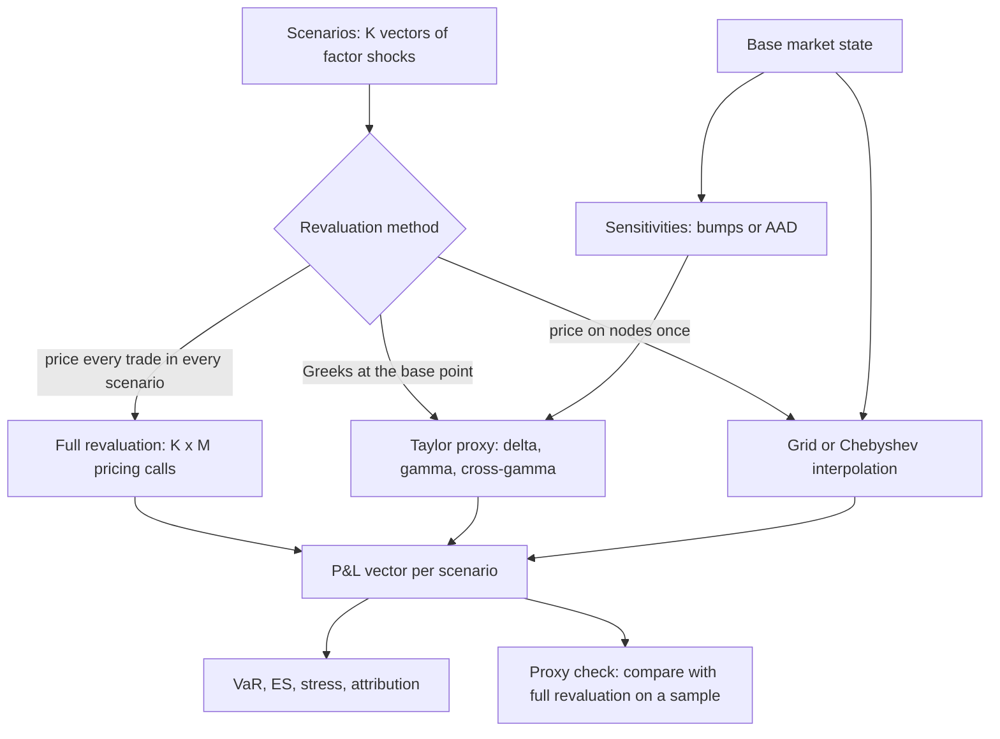

# Sensitivities and Revaluation

## TL;DR

- A risk engine turns scenarios into P&L either by full revaluation (one pricing call per trade per scenario), by a Taylor expansion in precomputed sensitivities, or by interpolating precomputed prices on a grid; each trades cost against accuracy in a different place.
- Finite differences have two errors: truncation ($O(h)$ forward, $O(h^2)$ central) and round-off ($\sim\varepsilon|V|/h$, or $/h^2$ for gamma); for the reference call the central delta error is $8.6 \times 10^{-5}$ at $h = 1$, $8.6 \times 10^{-9}$ at $h = 0.01$ and back up to between $10^{-8}$ and $10^{-5}$ at $h = 10^{-8}$.
- Bumping a Monte Carlo pricer needs common random numbers: with independent seeds the delta estimate had a standard deviation of about 7.07, with the same seeds about 0.0039.
- Adjoint algorithmic differentiation (AAD) gives every first-order sensitivity to machine precision for a few times the cost of one pricing (2.65 operations per pricing operation on Black-Scholes, 2.28 on a 30-pillar curve), against $2N$ pricings for central bumps.
- A full second-order proxy matched full-revaluation 99% VaR on an option book (5.50 against 5.50) but gave 8.84 against 8.68 when the shocks were doubled, and is wrong by construction across a barrier; Chebyshev grids are excellent for smooth payoffs and slow at kinks unless split there.

## Learning objectives

- Contrast Full Revaluation against Taylor series approximations across computational cost, memory bandwidth, and tail accuracy.
- Derive optimal step sizes for forward, backward, and central finite difference bumping.
- Construct the full Hessian matrix, distinguishing diagonal gamma from off-diagonal cross-gamma terms.
- Formulate the computational principles of Adjoint Algorithmic Differentiation (AAD) and explain why its cost relative to one pricing does not grow with the number of inputs.
- Quantify proxy approximation error using Mean Absolute Error (MAE), Root Mean Squared Error (RMSE), and maximum tail divergence.
- Implement Chebyshev polynomial grid revaluation and know when it fails.
- Bump Monte Carlo pricers correctly and know when pathwise (AAD) derivatives fail.

## Core concepts

### Three ways to get scenario P&L

For $M$ trades, $N$ factors and $K$ scenarios:

| Method | Cost | Exact where | Fails where |
| :--- | :--- | :--- | :--- |
| Full revaluation | $K \cdot M$ pricings | everywhere the pricer is right | compute budget, pricer noise (Monte Carlo pricers) |
| Delta proxy | $N$ sensitivities, then $K \cdot N$ multiply-adds | linear books | any optionality |
| Delta-gamma (with cross terms) | $O(N^2)$ second derivatives | small moves of smooth books | large moves, discontinuities, path dependence |
| Grid or Chebyshev | nodes $\times$ pricings, then cheap lookups | smooth functions of few factors | kinks, high dimension (tensor grids grow as $n^d$) |

With labelled hypothetical inputs of 500,000 trades, 10,000 scenarios and 10 microseconds a pricing call, full revaluation is 5 billion calls, about 13.9 CPU-hours a run; that is why banks mix methods by product and keep full revaluation for the books where the proxy check fails.

Full revaluation:

$$\Delta V_k = \sum_{i=1}^M \left[V_i(x_0 + \Delta x_k) - V_i(x_0)\right].$$

Second-order proxy with gradient $\delta$ and Hessian $\Gamma$:

$$\Delta V_k \approx \delta^\top \Delta x_k + \tfrac12 \Delta x_k^\top \Gamma\, \Delta x_k .$$

The diagonal of $\Gamma$ is gamma, volga and so on; the off-diagonal terms are cross-gammas (vanna is $\partial^2 V/\partial S\,\partial\sigma$).

### Finite differences: truncation against round-off

Taylor expansion gives the truncation errors:

$$\frac{V(x+h) - V(x)}{h} = V' + \tfrac{h}{2}V'' + O(h^2), \qquad \frac{V(x+h) - V(x-h)}{2h} = V' + \tfrac{h^2}{6}V''' + O(h^4),$$

$$\frac{V(x+h) - 2V(x) + V(x-h)}{h^2} = V'' + \tfrac{h^2}{12}V'''' + O(h^4).$$

Round-off: each price carries a relative error of order $\varepsilon = 2^{-52} \approx 2.22 \times 10^{-16}$, so the difference of two prices has absolute error of order $\varepsilon|V|$ that does not shrink with $h$.
Total error for the central delta is about $\tfrac{h^2}{6}|V'''| + \varepsilon|V|/h$; setting the derivative to zero gives

$$h^*_{\text{fwd}} = 2\sqrt{\varepsilon|V|/|V''|}, \qquad h^*_{\text{cen}} = \left(3\varepsilon|V|/|V'''|\right)^{1/3}, \qquad h^*_{\text{gamma}} = \left(48\varepsilon|V|/|V''''|\right)^{1/4},$$

so the optimal bumps scale as $\varepsilon^{1/2} = 1.49 \times 10^{-8}$, $\varepsilon^{1/3} = 6.06 \times 10^{-6}$ and $\varepsilon^{1/4} = 1.22 \times 10^{-4}$ times the natural scale of the input.

For the reference call ($S = K = 100$, $r = 5\%$, $\sigma = 20\%$, $T = 1$: value 10.4506, delta 0.636831, gamma 0.018762, $V''' = -0.000516$, $V'''' = -0.0000276$) the measured errors are:

| $h$ (spot units) | forward delta error | central delta error | central gamma error |
| ---: | ---: | ---: | ---: |
| 1 | $9.29 \times 10^{-3}$ | $8.60 \times 10^{-5}$ | $2.30 \times 10^{-6}$ |
| 0.01 | $9.38 \times 10^{-5}$ | $8.60 \times 10^{-9}$ | below $10^{-9}$ |
| $10^{-4}$ | $9.38 \times 10^{-7}$ | below $10^{-10}$ | $10^{-8}$ to $10^{-6}$ |
| $10^{-6}$ | $10^{-9}$ to $10^{-7}$ | $10^{-10}$ to $10^{-7}$ | $10^{-4}$ to $10$ |
| $10^{-8}$ | $10^{-8}$ to $10^{-5}$ | $10^{-8}$ to $10^{-5}$ | $10^{-3}$ to $10^{3}$ |

The truncation regime matches the leading terms exactly: $\Gamma/2 = 0.0094$ against a measured 0.0093 at $h = 1$, $|V'''|/6 = 8.6 \times 10^{-5}$, $|V''''|/12 = 2.30 \times 10^{-6}$.
The optimal bumps here are $h^*_{\text{fwd}} \approx 7.0 \times 10^{-7}$, $h^*_{\text{cen}} \approx 0.00024$ and $h^*_{\text{gamma}} \approx 0.0080$ in spot units; at $h = 10^{-6}$ the round-off bound on gamma, $4\varepsilon|V|/h^2$, is already 0.0093 against a gamma of 0.0188.
Errors in the round-off regime depend on the platform's last bits, so the table gives the ranges the code asserts rather than digits; on any platform the central delta is best near $h = 10^{-4}$ and a gamma bumped at $10^{-6}$ is useless.

The bump a desk uses is rarely the numerically optimal one: risk sensitivities are defined at the scale of plausible moves (1bp for rates, 1% relative for spot), and regulatory ones are prescribed.
FRTB defines equity delta as the one-sided $\left(V(1.01\,S) - V(S)\right)/0.01$ (MAR21.21) and GIRR delta as a one-sided 1bp bump divided by 0.0001 (MAR21.19); for the reference call the MAR21.21 number is 64.6125 against $S \cdot \Delta = 63.6831$, the 0.9294 difference being about $\tfrac12 S^2\Gamma \times 0.01$.
Know which definition each consumer of a sensitivity expects.

Cost of bumping $N$ inputs: a forward gradient takes $N + 1$ pricings, a central gradient $2N$, and a full central Hessian $2N^2 + 1$ (the base, $2N$ diagonal bumps and four per pair): 201 pricings at $N = 10$, 20,001 at $N = 100$, 2,000,001 at $N = 1{,}000$.

### Bumping a Monte Carlo pricer

A Monte Carlo price carries statistical noise of order $\sigma_{\text{payoff}}/\sqrt{n}$, so with independent seeds for the up and down prices the difference quotient has noise of order $\sigma_{\text{payoff}}/(h\sqrt{n})$, which explodes as $h \to 0$.
With common random numbers (the same normals for base and bumped prices) the noise cancels to first order.
In 200 replications of 20,000-path estimates of the reference call's delta:

| Estimator | standard deviation |
| :--- | ---: |
| independent seeds, $h = 0.01$ | about 7.07 |
| common random numbers, $h = 0.01$ | about 0.0039 |
| common random numbers, $h = 1$ | about 0.0039 |
| pathwise $e^{-rT}\,1\{S_T > K\}\,S_T/S_0$ | about 0.0039 |

The pathwise estimator is what AAD computes when it differentiates a simulation path by path (Giles and Glasserman 2006); its mean was about 0.636702 against the exact 0.636831.
It needs the payoff to be differentiable almost everywhere and continuous: for a digital $1\{S_T > K\}$ the pathwise derivative is zero on every path, although the true delta is $e^{-rT}\varphi(d_2)/(S\sigma\sqrt{T}) = 0.018762$.
Bumping the digital with common random numbers works but is noisy for small bumps (standard deviation about 0.00065 at $h = 1$ and about 0.0067 at $h = 0.01$); production engines smooth the payoff (call spreads), use likelihood-ratio weights, or condition on the last step (Glasserman 2003, chapter 7).

### Adjoint algorithmic differentiation

A pricer is a sequence of elementary operations $v_j = \phi_j(v_{\text{parents}})$.
Forward (tangent) mode propagates $\dot v_j = \sum_p \partial\phi_j/\partial v_p\,\dot v_p$ from one input direction, so a gradient costs $N$ sweeps, like bumping but without truncation error.
Reverse (adjoint) mode records the operations on a tape, seeds $\bar V = 1$ and propagates adjoints backwards, $\bar v_p \mathrel{+}= \bar v_j\,\partial\phi_j/\partial v_p$, so one backward sweep gives $\partial V/\partial x_i$ for every input at once.
The work of the backward sweep is a small constant multiple of the forward sweep, independent of $N$ (the cheap gradient principle, Griewank and Walther 2008).

Measured on the minimal tape in the code, counting elementary operations, not wall-clock time:

| Pricer | forward operations | reverse multiply-adds | AAD cost per pricing | central bumps per pricing |
| :--- | ---: | ---: | ---: | ---: |
| Black-Scholes, 5 inputs | 20 | 33 | 2.65 | 10 |
| 60 cash flows on a 30-pillar zero curve | 414 | 530 | 2.28 | 60 |

The AAD gradients matched the analytic Greeks to within $10^{-12}$ (Black-Scholes: delta 0.636831, $\partial V/\partial K = -0.532325$, rho 53.2325, vega 37.5240, $\partial V/\partial T = 6.4140$) and the chain-rule key-rate PV01s of the bond book to a relative $10^{-12}$.
On the 30-year pillar (PV01 $-813.26$ per bp on a book worth 667,555.34), a one-sided 1bp bump is off by a relative 0.0015 (the convexity term $h t/2$ for a 30-year cash flow) and a central 1bp bump by $1.5 \times 10^{-6}$.

Practical points:

- Memory: the tape stores every operation, so long Monte Carlo paths are taped path by path and accumulated, or checkpointed (recompute segments instead of storing them).
- Second order: Hessians come from forward-over-reverse AD or from central differences of the AAD gradient, which has only one division by $h$; the latter recovered gamma, vanna ($-0.281430$) and volga (9.8501) of the reference call to $10^{-8}$, $10^{-7}$ and $10^{-5}$.
- Discontinuities: AAD differentiates the code, so it inherits the pathwise failure on digitals and barriers.
- Regulation: SA-CVA sensitivities may be computed with AAD (MAR50.47 FAQ1).

### Grids and Chebyshev interpolation

Pricing on a set of nodes once and interpolating per scenario is fast; the question is how many nodes.
Chebyshev interpolation of a function analytic on the interval converges geometrically in the degree (Trefethen 2013), which is why it is used to compress parametric pricers (Gass, Glau, Mahlstedt and Mair 2018).
For the reference call as a function of spot on $[50, 150]$, interpolating at the $n + 1$ Chebyshev points of the first kind (the roots of $T_{n+1}$) for degree $n$:

| Interpolant | pricings | max error |
| :--- | ---: | ---: |
| Chebyshev degree 4 | 5 | 0.325 |
| Chebyshev degree 8 | 9 | $9.38 \times 10^{-3}$ |
| Chebyshev degree 16 | 17 | $1.98 \times 10^{-6}$ |
| Chebyshev degree 32 | 33 | below $10^{-9}$ |
| linear on a 21-point spot ladder | 21 | 0.0676 |

A down-and-out call has a kink at the barrier (value zero below it), and convergence drops to algebraic: max error 0.246 at degree 16 and 0.063 at degree 64 on $[80, 120]$.
Splitting the domain at the barrier and interpolating only on $[90, 120]$ brings degree 16 below $10^{-9}$.
Tensor grids in $d$ factors need $n^d$ nodes, so grids are used for a few dominant factors per trade (spot, vol) with the rest handled by sensitivities.

### Where Taylor fails: a barrier

A down-and-out call ($S = K = 100$, barrier 90, $r = 5\%$, $\sigma = 20\%$, $T = 1$, continuous monitoring) is worth 8.6655 in closed form (Hull); a Monte Carlo with the Brownian-bridge crossing probability gave about 8.668.
At spot 100 its delta is 0.8302 and gamma $-0.00101$, so the delta-gamma proxy sees an almost linear position:

| spot move | full revaluation P&L | delta-gamma P&L |
| ---: | ---: | ---: |
| $-5$ | $-4.1966$ | $-4.1634$ |
| $-9.9$ | $-8.5712$ | $-8.2680$ |
| $-10.1$ (knocked out) | $-8.6655$ | $-8.4360$ |
| $-15$ | $-8.6655$ | $-12.5657$ |

Below the barrier the true loss is capped at the premium while the proxy keeps extrapolating; near the barrier the curvature is local (gamma $-0.0243$ at spot 90.5, 24 times the value at 100), so Greeks from today's spot say nothing about it.

## Worked examples

All numbers are printed and asserted by `python 11-Risk-and-Trading/code/risk_sensitivities.py`.

### Example 1: choosing a bump for gamma

"The reference call has gamma 0.018762. What bump would you use, and what goes wrong at $h = 10^{-6}$?"

1. Central gamma has truncation $\tfrac{h^2}{12}|V''''|$ and round-off of order $4\varepsilon|V|/h^2$.
2. With $|V''''| = 0.0000276$ and $|V| = 10.45$ the optimum is $h^* = (48\varepsilon|V|/|V''''|)^{1/4} \approx 0.0080$, where the measured error is below $5 \times 10^{-8}$.
3. At $h = 10^{-6}$ the round-off bound $4\varepsilon|V|/h^2$ is 0.0093, half the gamma, and the measured error is of that order (the code asserts it exceeds 1% of gamma on every platform).
4. On a desk you would use a bump at the scale of the moves you care about (1% of spot gives an error of $2.30 \times 10^{-6}$ here) or AAD on the delta.

### Example 2: full revaluation against proxies on an option book

Long the reference call; 100,000 joint normal scenarios on spot (sd 5), rate (sd 25bp) and vol (sd 2 vol points), correlations spot-rate $+0.2$, spot-vol $-0.5$, rate-vol 0.
Greeks from AAD, Hessian from central differences of the AAD gradient ($\partial^2 V/\partial S\,\partial r = 1.8762$).

| P&L method | 99% VaR | 99% ES | MAE | max abs error |
| :--- | ---: | ---: | ---: | ---: |
| Full revaluation | 5.50 | 6.06 | | |
| First order (delta, rho, vega) | 6.78 | 7.71 | 0.252 | |
| Second order, diagonal only | 5.56 | | 0.030 | |
| Second order with cross terms | 5.50 | 6.09 | 0.019 | 0.76 |

Reading it as in an interview:

1. The linear proxy overstates VaR by 23% (6.78 against 5.50) because it ignores the convexity of a long option (gamma and volga are positive).
2. Adding the diagonal second-order terms removes most of the error; the cross terms (vanna with spot-vol correlation $-0.5$) remove most of what is left.
3. Doubling every shock (a stress calibration): full revaluation VaR 8.68 and ES 9.18, second-order proxy 8.84 and 9.62, and a maximum error of 6.72.
4. Sanity bound: a long call cannot lose more than its premium 10.4506; the worst full-revaluation loss in the stressed run was 10.29 while the proxy's was 12.41.
5. The spot-only parabola turns up at $-\Delta/\Gamma = -33.94$, so for crash moves of that size the proxy would even report gains; this is why proxy tails are validated against full revaluation (and why FRTB's curvature charge uses full revaluation at the risk-weight shock).

## Pitfalls

- Microscopic bumps: below the optimal $h$ the round-off term dominates, and second differences lose it twice as fast ($/h^2$).
- One-sided bumps reported as derivatives: a forward 1% spot bump on the reference call overstates delta by 0.0093 (half gamma times the bump).
- Bumping Monte Carlo with fresh random numbers: the noise scales as $1/h$; always reuse the seeds (and the same time grid and path ordering).
- Pathwise or AAD derivatives of discontinuous payoffs (digitals, barriers, autocall triggers): zero on every path, not the true sensitivity; smooth first.
- Diagonal-only gammas on multi-factor books: on the option book above adding the cross terms cut the proxy MAE from 0.030 to 0.019, and they matter more when factors are strongly correlated.
- Validating a proxy at normal-market shock sizes and using it for stress: the error grew from 0.76 to 6.72 when the shocks doubled.
- Interpolating across a kink (barrier, strike at expiry, default boundary): split the grid there.
- Bump definitions that differ between systems: absolute or relative, one or two sided, sticky strike or sticky delta for the vol surface when spot moves; the numbers are not comparable unless the definitions are.
- AAD tape memory on long simulations without checkpointing.

## Interview questions

> [!question]- risk-full-revaluation-vs-taylor-tradeoff | What are the core computational and mathematical trade-offs between Full Revaluation and Taylor series proxy models in enterprise risk engines?
> Full revaluation costs one pricing call per trade per scenario (500,000 trades times 10,000 scenarios is 5 billion calls) but is exact wherever the pricer is.
> A Taylor proxy costs one set of Greeks and then a dot product per scenario, and is accurate only for small moves of smooth books.
> On a long call, a second-order proxy matched full-revaluation 99% VaR (5.50) at normal shock sizes but gave 8.84 against 8.68 with doubled shocks, and fails outright across barriers.
> Banks mix the two: proxies or grids where a regular comparison against full revaluation stays within tolerance, full revaluation elsewhere.

> [!question]- risk-optimal-finite-difference-bump-size | Derive the optimal step size $h$ for central difference first derivatives, balancing truncation and cancellation error.
> Error $E(h) \approx \tfrac{h^2}{6}|V'''| + \varepsilon|V|/h$; $E'(h) = 0$ gives $h^* = (3\varepsilon|V|/|V'''|)^{1/3}$, of order $\varepsilon^{1/3} = 6.06 \times 10^{-6}$ times the input's scale.
> For the reference call $h^* \approx 0.00024$ spot units and the error there is below $5 \times 10^{-10}$.
> Forward differences give $h^* = 2\sqrt{\varepsilon|V|/|V''|}$ (order $\varepsilon^{1/2}$), second differences $(48\varepsilon|V|/|V''''|)^{1/4}$ (order $\varepsilon^{1/4}$).

> [!question]- risk-aad-adjoint-algorithmic-differentiation | What is Adjoint Algorithmic Differentiation (AAD), and why does it matter for quantitative risk management?
> Reverse-mode differentiation of the pricing code: tape the forward computation, then propagate adjoints backwards so one sweep gives the derivative with respect to every input.
> Its cost is a small constant multiple of one pricing regardless of the number of inputs (2.65 and 2.28 in operation counts on the examples here), against $2N$ pricings for central bumps, and the result is exact to machine precision.
> That makes thousands of curve and surface sensitivities affordable for XVA, SA-CVA and SIMM, at the price of tape memory and engineering effort, and it fails on discontinuous payoffs like any pathwise method.

> [!question]- risk-diagonal-vs-cross-gamma | Contrast diagonal gamma with cross-gamma, and explain the computational penalty of computing full cross-gamma matrices.
> Diagonal: $\partial^2 V/\partial x_i^2$ (gamma, volga); cross: $\partial^2 V/\partial x_i\partial x_j$ (vanna, spot-rate cross-gamma).
> By central differences the full Hessian costs $2N^2 + 1$ pricings (the base, $2N$ diagonal bumps, four per pair): 20,001 for 100 factors, against $2N + 1$ for the diagonal.
> Cross terms matter when factors are correlated: on the long-call book they cut the proxy MAE from 0.030 to 0.019.
> With AAD a Hessian costs about $N$ adjoint sweeps (or differences of the AAD gradient), and banks usually keep cross terms only within a risk class.

> [!question]- risk-taylor-proxy-tail-underestimation | Why does a Delta-Gamma Taylor proxy misstate tail VaR for portfolios containing options?
> The quadratic has no knowledge of the payoff's bounds or kinks.
> For a long call the parabola turns up at $-\Delta/\Gamma = -33.94$, so very large drops can show as gains, while the true loss is capped at the premium (10.45 here); in a doubled-shock run the proxy's worst loss was 12.41 against a true worst of 10.29.
> For a short put after a 25-point drop the proxy loss was 14.94 against a true 15.52: the error's sign depends on the third derivative, so check the proxy against full revaluation in the tail rather than assume a direction.

> [!question]- risk-chebyshev-grid-revaluation | How does Chebyshev polynomial interpolation accelerate portfolio revaluation while preserving non-linear accuracy?
> Price the trade once at Chebyshev nodes on a bounding box of the dominant factors and evaluate the interpolating polynomial per scenario.
> For an analytic payoff the error falls geometrically: on the reference call over spot $[50, 150]$, 9 pricings gave max error $9.38 \times 10^{-3}$ and 17 pricings $1.98 \times 10^{-6}$.
> At a kink it converges only algebraically (0.246 at degree 16 for a barrier), so split the domain at the kink, and keep dimension low because tensor grids grow as $n^d$.

> [!question]- risk-barrier-options-taylor-failure | Why do sensitivity proxies fail for knock-out barrier options?
> The value is continuous but has a kink at the barrier and is flat at zero below it, while the curvature is concentrated near the barrier.
> For a down-and-out call (barrier 90, spot 100) the gamma at spot is only $-0.00101$, so a delta-gamma proxy gives $-12.57$ for a 15-point drop while the true loss is capped at the premium, 8.67.
> Greeks at today's spot cannot see a feature 10 points away; use full revaluation or a grid split at the barrier.

> [!question]- risk-forward-vs-central-difference | Why is central finite difference preferred over forward difference despite requiring twice as many pricing calls?
> The odd terms cancel, so the truncation error is $\tfrac{h^2}{6}V'''$ instead of $\tfrac{h}{2}V''$.
> For the reference call at a 1% bump: forward error 0.0093, central 0.000086, a factor of about 100 for twice the cost.
> Forward bumps are still used when a definition prescribes them (FRTB MAR21.19 to MAR21.24) or when $N + 1$ instead of $2N$ pricings matters.

> [!question]- risk-basel-frtb-curvature-charge | How does the Basel FRTB Standardised Approach (SbM) compute the Curvature risk charge?
> For each curvature risk factor $k$, revalue at an up and a down shock equal to the curvature risk weight and subtract the delta prediction: $CVR_k^{\pm} = -\sum_i \{V_i(x_k^{\pm}) - V_i(x_k) \mp RW_k s_{ik}\}$ (MAR21.5).
> So it is a two-point full revaluation measuring the loss beyond delta: positive for short gamma, negative for long gamma.
> Within a bucket $K_b^{\pm} = \sqrt{\max(0, \sum_k \max(CVR_k^{\pm}, 0)^2 + \sum_{k \ne l} \rho_{kl} CVR_k^{\pm} CVR_l^{\pm} \psi)}$, the larger scenario is selected, and buckets aggregate under the three correlation scenarios; see [FRTB vega and curvature](../17-Regulatory-Capital-Basel-and-FRTB/08-FRTB-Sensitivities-Based-Method-Vega-and-Curvature.md).

> [!question]- risk-floating-point-cancellation-definition | What is catastrophic floating-point cancellation in numerical risk calculations?
> Subtracting two nearly equal doubles leaves only the digits in which they differ; their absolute rounding errors (about $\varepsilon|V| = 2.32 \times 10^{-15}$ on the reference price of 10.45) survive and are divided by $h$.
> For the reference call a central delta at $h = 10^{-8}$ has an error between $10^{-8}$ and $10^{-5}$ (platform dependent), worse than at $h = 0.01$ ($8.6 \times 10^{-9}$); a central gamma at $h = 10^{-6}$ faces a round-off bound of 0.0093 against a gamma of 0.0188.

> [!question]- risk-common-random-numbers-bumping | You bump a Monte Carlo pricer by 0.01 and the delta jumps around wildly. Why, and what fixes it?
> With independent random numbers the up and down prices each carry Monte Carlo noise, and the difference quotient divides it by $2h$: the 20,000-path delta of the reference call had a standard deviation of about 7.07.
> Reusing the same normals for base and bumped runs (common random numbers) cancels the noise to first order: about 0.0039 at either $h = 0.01$ or $h = 1$, the same as the pathwise estimator.
> Keep the time grid, path ordering and any early-exercise regressions identical between runs too.

> [!question]- risk-pathwise-digital-failure | Why does AAD (or the pathwise method) give a delta of zero for a digital option, and what do you do instead?
> The payoff $1\{S_T > K\}$ is piecewise constant, so its derivative is zero on every path; the true delta is $e^{-rT}\varphi(d_2)/(S\sigma\sqrt T) = 0.018762$ for the reference parameters, all from the probability mass crossing the strike.
> Fixes: smooth the payoff (a tight call spread), likelihood-ratio weights, conditioning on the last step, or bumping with common random numbers (standard deviation about 0.00065 at $h = 1$).

> [!question]- risk-aad-cost-count | A book has 2,000 curve and surface inputs. Compare the cost of a full gradient by bumping and by AAD.
> Central bumps: 4,000 pricings; forward bumps: 2,001.
> AAD: one forward sweep plus one reverse sweep, a few pricings' worth of work regardless of the 2,000 (2.28 to 2.65 times in operation counts on the examples here), plus tape memory.
> The saving grows linearly in the number of inputs, which is why AAD is standard for XVA and SIMM sensitivities.

> [!question]- risk-fd-regulatory-forward-bump | FRTB defines equity delta as (V(1.01 S) - V(S))/0.01. How does that differ from S times delta for an at-the-money option?
> It includes half the second-order term: for the reference call it is 64.6125 against $S\Delta = 63.6831$, a gap of 0.9294, about $\tfrac12 S^2\Gamma \times 0.01$ (MAR21.21).
> GIRR uses a one-sided 1bp bump (MAR21.19), so risk systems must produce the regulatory definition, not their internal central-difference Greeks.

> [!question]- risk-proxy-stress-breakdown | Your delta-gamma proxy passes its daily validation. Can you use it for the stress test?
> Not without checking at stress sizes: on the long-call book the proxy's maximum error was 0.76 at normal shock sizes and 6.72 with doubled shocks, and its 99% ES moved from 6.09 (true 6.06) to 9.62 (true 9.18).
> The neglected terms are third order, so the error grows roughly with the cube of the shock (the ratio here was 8.84 for a doubling, against $2^3 = 8$), and stress scenarios can also cross barriers or strikes where the expansion is meaningless.
> Use full revaluation (or a grid spanning the stress range) for stress and reverse stress tests.

> [!question]- risk-spot-ladder-interpolation | A desk reports a spot ladder (P&L at fixed spot shifts) and interpolates it linearly in VaR. How accurate is that?
> Linear interpolation error is about $\tfrac18 h^2 \max|V''|$: on a 21-point ladder over spot 50 to 150 the reference call's max error was 0.0676.
> A Chebyshev interpolant on 17 nodes gets $1.98 \times 10^{-6}$, but linear ladders are robust at kinks and are what traders read, so the ladder is often kept and refined near strikes and barriers.

> [!question]- risk-optimal-gamma-step-size-derivation | Derive the optimal finite difference step size for a second derivative.
> Central second difference: truncation $\tfrac{h^2}{12}|V''''|$, round-off of order $4\varepsilon|V|/h^2$ (two subtractions, divided by $h^2$).
> Minimising $\tfrac{h^2}{12}|V''''| + 4\varepsilon|V|/h^2$ gives $h^4 = 48\varepsilon|V|/|V''''|$, so $h^*$ scales as $\varepsilon^{1/4} = 1.22 \times 10^{-4}$ times the input's scale.
> For the reference call ($|V''''| = 0.0000276$, $|V| = 10.45$) $h^* \approx 0.0080$ spot units.

> [!question]- risk-taylor-quadratic-vertex-breakdown | At what shock level does the second-order Taylor Delta-Gamma proxy turn upward and report artificial gains?
> The spot-only parabola $\Delta\,\Delta S + \tfrac12\Gamma\,\Delta S^2$ has its vertex at $\Delta S^* = -\Delta/\Gamma$: $-33.94$ for the reference call (delta 0.636831, gamma 0.018762).
> Beyond it the proxy reports smaller losses and then gains as spot falls further, while the true loss tends to the premium (10.4506); already in the doubled-shock run the proxy's worst loss (12.41) exceeded what a long call can lose.

> [!question]- risk-cross-gamma-matrix-scaling | How does the computational cost of evaluating a full cross-gamma Hessian scale with factor dimension $N$?
> Central differences need the base, $2N$ diagonal bumps and four per pair, $2N^2 + 1$ pricings: 20,001 at $N = 100$ and 50,000,001 at $N = 5{,}000$.
> Production engines keep cross terms only within risk classes or between a few dominant factors, or get Hessian rows from AAD (one adjoint sweep per row, or differences of the AAD gradient as in the code).

> [!question]- risk-aad-tape-checkpointing | What is tape checkpointing in reverse-mode AAD, and how does it balance memory against compute?
> The reverse sweep needs every intermediate value of the forward sweep, so the tape grows with the length of the computation (time steps times paths times trades).
> Checkpointing stores the state only at chosen points and recomputes each segment's forward pass just before its reverse sweep, trading extra forward work for bounded memory (Griewank and Walther 2008); Monte Carlo engines also tape one path at a time and accumulate adjoints.

> [!question]- risk-digital-option-proxy-failure | Why do finite difference bumping and Taylor proxies struggle with digital options?
> The payoff is a step, so pathwise (and AAD) derivatives are zero on every path while the true delta is finite: $e^{-rT}\varphi(d_2)/(S\sigma\sqrt T) = 0.018762$ for the reference parameters.
> Bumping with common random numbers is unbiased but noisy for small bumps (sd about 0.0067 at $h = 0.01$ against about 0.00065 at $h = 1$), and near expiry the value is almost a step in spot, so any smooth Taylor proxy fails for moves across the strike; smooth the payoff (call spread) or use likelihood-ratio weights.

> [!question]- risk-chebyshev-collocation-nodes | Why are Chebyshev nodes preferred over equidistant grid points for polynomial proxy interpolation?
> High-degree interpolation on equally spaced points can diverge near the ends (Runge's phenomenon); Chebyshev points cluster towards the ends, their Lebesgue constant grows only logarithmically, and for analytic functions the error falls geometrically with the degree (Trefethen 2013).
> On the reference call over spot 50 to 150 the max error was $9.38 \times 10^{-3}$ at degree 8 and $1.98 \times 10^{-6}$ at degree 16; equally spaced points are kept for low-order piecewise ladders, not global polynomials.

## In this repo and SDE-Interview-Prep

- [risk_sensitivities.py](code/risk_sensitivities.py): finite-difference error table, optimal bumps, Monte Carlo bumping, a minimal AAD tape on Black-Scholes and a curve book, Hessian from the AAD gradient, full revaluation against proxies, barrier closed form and bridge Monte Carlo, Chebyshev grids; every number above except the short-put crash in card risk-taylor-proxy-tail-underestimation, which is Problem 11 of [risk_problem_set.py](code/risk_problem_set.py).
- Greek definitions: [The Greeks](../05-Derivatives-and-Volatility/05-The-Greeks.md); Monte Carlo pricing: [Monte Carlo Pricing and Variance Reduction](../05-Derivatives-and-Volatility/10-Monte-Carlo-Pricing-and-Variance-Reduction.md); barriers: [Exotic Options](../05-Derivatives-and-Volatility/12-Exotic-Options.md).
- Upstream and downstream: [Risk Factor Modelling](10-Risk-Factor-Modelling.md), [Scenario Generation](11-Scenario-Generation.md), [P&L Attribution and Greek Risk](06-PnL-Attribution-and-Greek-Risk.md), [Risk Decomposition and Attribution](13-Risk-Decomposition-and-Attribution.md).
- Regulatory sensitivities: [FRTB Sensitivities-Based Method: Delta](../17-Regulatory-Capital-Basel-and-FRTB/07-FRTB-Sensitivities-Based-Method-Delta.md); production engines: [Risk Engine](../18-Pricing-and-Risk-Systems/07-Risk-Engine.md).

## Further reading

- P. Glasserman, *Monte Carlo Methods in Financial Engineering*, Springer 2003, chapter 7 (finite differences, pathwise and likelihood-ratio estimators).
- A. Griewank and A. Walther, *Evaluating Derivatives: Principles and Techniques of Algorithmic Differentiation*, 2nd edition, SIAM 2008.
- M. Giles and P. Glasserman, "Smoking adjoints: fast Monte Carlo Greeks", *Risk* 19(1), 88-92, 2006.
- A. Savine, *Modern Computational Finance: AAD and Parallel Simulations*, Wiley 2018.
- L. N. Trefethen, *Approximation Theory and Approximation Practice*, SIAM 2013.
- M. Gass, K. Glau, M. Mahlstedt and M. Mair, "Chebyshev interpolation for parametric option pricing", *Finance and Stochastics* 22(3), 701-731, 2018.
- Basel Committee on Banking Supervision, Basel Framework MAR21 (sensitivity definitions and curvature) and MAR50.47.
