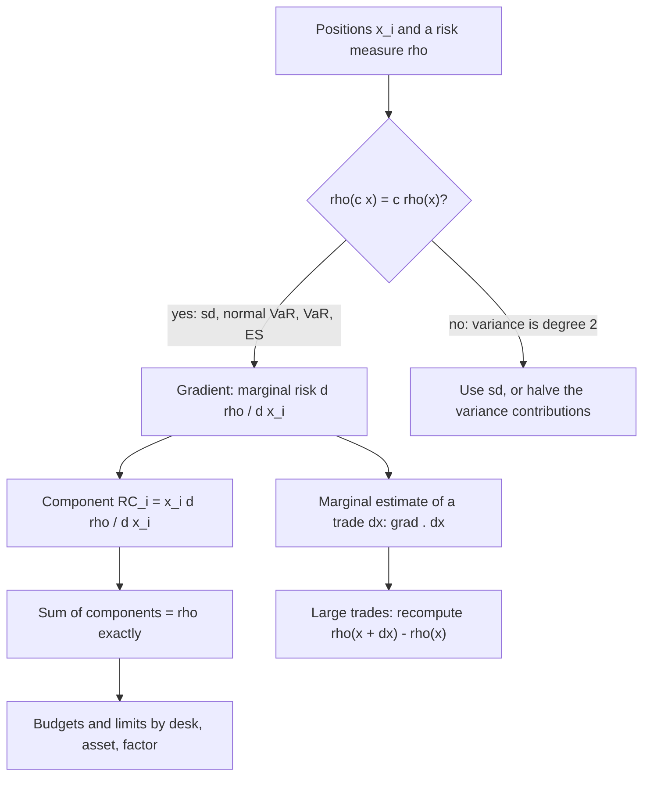

# Risk Decomposition and Attribution

## TL;DR

- A risk measure that is homogeneous of degree one in position sizes (volatility, normal VaR, VaR and ES of any loss distribution) splits exactly into Euler contributions $x_i\,\partial\rho/\partial x_i$; for a continuously differentiable measure they are the only contributions compatible with return-on-risk-capital (RORAC) performance measurement (Tasche 2008, Proposition 2.1, proved in Tasche 1999).
- Marginal VaR is the gradient (per dollar), component VaR the Euler contribution (sums to the total), incremental VaR the before-and-after difference of a finite trade (does not sum, and differs from the marginal estimate for large trades: 5.20m against 1.99m for a 50m add).
- Beyond the normal, the Euler contributions are conditional expectations: $E[L_i \mid L = \text{VaR}]$ for VaR and $E[L_i \mid L \ge \text{VaR}]$ for ES; ES contributions are stable in simulation, VaR contributions are noisy.
- Equal risk contribution (risk parity) weights solve a strictly convex problem; with two assets they are inverse-volatility for any correlation.
- Factor decomposition splits the same total along factor exposures plus specific risk and shows concentrations an asset list hides.

## Learning objectives

- Apply Euler's allocation theorem to linearly decompose homogeneous risk measures into component contributions.
- Calculate Marginal VaR, Component VaR, and percentage risk contributions across multi-asset portfolios.
- Differentiate Marginal VaR (instantaneous partial derivative) from Incremental VaR (discrete finite difference).
- Estimate VaR and ES contributions by simulation for non-normal and nonlinear books and check them against brute force.
- Construct Risk Parity portfolios where each asset or factor contributes an equal share to total portfolio volatility.
- Decompose portfolio risk along risk factor dimensions using factor betas and residual variance.
- Establish risk budgeting limits to enforce capital discipline across decentralized trading desks.

## Core concepts

### Euler allocation

Let $x = (x_1, \dots, x_N)$ be position sizes (dollars, or scale factors on sub-portfolios) and $\rho(x)$ a risk measure.
If $\rho(cx) = c\,\rho(x)$ for $c > 0$ and $\rho$ is differentiable, Euler's theorem for homogeneous functions gives

$$\rho(x) = \sum_{i=1}^N x_i\,\frac{\partial\rho}{\partial x_i}(x).$$

Proof in one line: differentiate $\rho(cx) = c\rho(x)$ with respect to $c$ and set $c = 1$.
The contribution $RC_i = x_i\,\partial\rho/\partial x_i$ is the Euler or component risk; the sum is exact, with no unexplained residual.
Why this allocation and not another: call contributions RORAC compatible if, whenever a sub-portfolio's expected return divided by its risk contribution beats the portfolio's RORAC, adding a small enough amount of that sub-portfolio raises the portfolio's RORAC.
Tasche (2008, Proposition 2.1, citing Theorem 4.4 of Tasche 1999) shows that if $\rho(x)$ is continuously differentiable and contributions are to be RORAC compatible for arbitrary expected returns, they must be $\partial\rho/\partial x_i$ per unit, that is the Euler contributions; that is what a capital allocation used for performance measurement needs.
For a measure that is also subadditive (volatility, ES), each Euler contribution is at most the position's standalone risk, and the with-and-without (incremental) contributions sum to at most the total (Tasche 2008, (2.9b) and Proposition 2.2): Example 1 shows both.

Which measures qualify: volatility $\sqrt{x^\top\Sigma x}$; normal VaR $z_\alpha\sqrt{x^\top\Sigma x}$ (with zero mean); VaR and ES of any loss distribution as functions of the position scales, because scaling every position scales the loss.
Variance is homogeneous of degree two, so $\sum_i x_i\,\partial\sigma^2/\partial x_i = 2\sigma^2$ (checked with finite-difference gradients in the code): use $\sigma$, or halve the variance contributions.
A measure with a fixed add-on or a nonlinear transformation (for example a VaR floor) is not homogeneous and has no exact Euler split.

### Marginal, component and incremental VaR

With dollar positions $x$, covariance $\Sigma$ of returns and $\sigma_P = \sqrt{x^\top\Sigma x}$ the dollar volatility, normal VaR is $z_\alpha\sigma_P$ and

$$\frac{\partial \text{VaR}}{\partial x_i} = z_\alpha\,\frac{(\Sigma x)_i}{\sigma_P} = z_\alpha\,\frac{\text{Cov}(r_i, P)}{\sigma_P}, \qquad \text{CVaR}_i = x_i\,\frac{\partial \text{VaR}}{\partial x_i},$$

where $P = x^\top r$ is the dollar P&L.
In weight terms with portfolio return $r_p$, $\partial\sigma_p/\partial w_i = \text{Cov}(r_i, r_p)/\sigma_p = \beta_i\sigma_p$, so the marginal VaR per dollar is $\beta_i$ times the VaR per dollar of the whole portfolio and the component share is $w_i\beta_i$, with $\sum_i w_i\beta_i = 1$.

| Quantity | Definition | Adds up? | Use |
| :--- | :--- | :--- | :--- |
| Standalone VaR | VaR of position $i$ alone | no, overstates by the diversification benefit | limits per book in isolation |
| Marginal VaR | $\partial\text{VaR}/\partial x_i$ | not a contribution | which position to cut or grow at the margin |
| Component VaR | $x_i\,\partial\text{VaR}/\partial x_i$ | yes, exactly | risk budgets, capital allocation |
| Incremental VaR | $\text{VaR}(x + \Delta x) - \text{VaR}(x)$ | no | pre-trade approval of a finite trade |

For a small trade, $\text{IVaR} \approx \nabla\text{VaR}^\top\Delta x$; the error is second order in $\Delta x$, so large trades must be recomputed.
A component is negative when the position's covariance with the portfolio is negative: it is a hedge at the margin.
The best hedge in instrument $j$ (Litterman 1996) is the holding that minimises variance, $x_j^* = -\text{Cov}(r_j, P_{\text{rest}})/\sigma_j^2$, where at that point the marginal VaR of $j$ is zero.

### Euler beyond the normal: simulation

For a general loss $L = \sum_i L_i$ with a continuous distribution, Gourieroux, Laurent and Scaillet (2000) show

$$\frac{\partial\,\text{VaR}_\alpha}{\partial x_i}\,x_i = E[L_i \mid L = \text{VaR}_\alpha], \qquad \frac{\partial\,\text{ES}_\alpha}{\partial x_i}\,x_i = E[L_i \mid L \ge \text{VaR}_\alpha]$$

(the ES version in Scaillet 2004), where $L_i$ is the loss of position $i$ at its current size.
In a simulation, the ES contribution is the average of position $i$'s loss over the tail scenarios, and the contributions sum to the simulated ES exactly.
The VaR contribution conditions on a single quantile, so it is estimated from the scenarios nearest the VaR order statistic and is much noisier.

On 1,000,000 simulated days of a Student $t_4$ (elliptical) linear book of 60m equities, 40m bonds and 10m gold (daily volatilities 1.25%, 0.40% and 0.90%, correlations $-0.15$ equity-bond, 0.10 equity-gold and 0.30 bond-gold, the $t_4$ scaled to unit variance), the 97.5% ES was about 2.161m and the equity ES share about 0.946, equal to its covariance share 0.946: for elliptical distributions every homogeneous measure allocates in proportion to $x_i(\Sigma x)_i$.
Adding a short put changes that, as the second worked example shows.

### Risk budgeting and risk parity

A risk budget sets target shares $b_i$ of total risk, $x_i(\Sigma x)_i/x^\top\Sigma x = b_i$; equal risk contribution (ERC) is $b_i = 1/N$.
Maillard, Roncalli and Teiletche (2010) show the ERC portfolio exists, is unique, and lies between the minimum-variance and equal-weight portfolios in volatility.
It can be computed by minimising the strictly convex

$$f(y) = \tfrac12 y^\top\Sigma y - \sum_i \ln y_i, \qquad y > 0,$$

whose first-order condition $(\Sigma y)_i = 1/y_i$ says $y_i(\Sigma y)_i = 1$ for every $i$, then normalising $w = y/\sum_i y_i$.
The code solves it by Newton's method and checks against cyclical coordinate descent (Griveau-Billion, Richard and Roncalli 2013), which solves $\Sigma_{ii}y_i^2 + c_i y_i - 1 = 0$ one coordinate at a time.
With two assets, ERC weights are inverse-volatility for any correlation: $w_1\sigma_1(w_1\sigma_1 + \rho w_2\sigma_2) = w_2\sigma_2(w_2\sigma_2 + \rho w_1\sigma_1)$ forces $w_1\sigma_1 = w_2\sigma_2$.
With three or more assets correlations matter: for equities 18%, bonds 5% and commodities 20% with correlations $-0.2$ (equity-bond), 0.3 (equity-commodity) and 0 (bond-commodity), ERC weights are 0.1712, 0.6931 and 0.1357, while inverse-volatility weights give risk shares of 0.34375, 0.25 and 0.40625.
ERC says nothing about expected returns; any claim that it improves the Sharpe ratio is an empirical claim about a specific period and asset set.

### Factor risk attribution

With returns $r = Bf + \epsilon$, factor covariance $\Sigma_f$ and diagonal specific variances $D$, a portfolio with weights $w$ has factor exposures $x = B^\top w$ and

$$\sigma_P^2 = x^\top\Sigma_f x + w^\top D w, \qquad RC_k = x_k\,\frac{(\Sigma_f x)_k}{\sigma_P}, \qquad RC_{\text{spec}} = \frac{w^\top D w}{\sigma_P}.$$

The factor contributions plus the specific contribution sum to $\sigma_P$, the same total as the asset-level Euler split computed from $\Sigma = B\Sigma_f B^\top + D$: one number, two axes.
In the code's four-stock long-short example (market and value factors), the exposures are 0.82 and $-0.24$, the volatility 20.25%, and the shares 0.4290 market, 0.0143 value and 0.5567 specific.
A desk manager reads it as: half the risk is stock-specific, almost all the systematic risk is the market, and the value tilt costs nothing in risk.

## Worked examples

All numbers are printed and asserted by `python 11-Risk-and-Trading/code/risk_decomposition.py`.

### Example 1: marginal and component VaR, two assets

60m equities (20% vol) and 40m bonds (6% vol), correlation $-0.15$, one-year 95% VaR with $z_{0.95} = 1.644854$.

1. Weights 0.6 and 0.4: $\sigma_p^2 = 0.36 \times 0.04 + 0.16 \times 0.0036 + 2 \times 0.6 \times 0.4 \times (-0.15) \times 0.2 \times 0.06 = 0.014112$, $\sigma_p = 11.8794\%$.
2. VaR $= 1.644854 \times 0.118794 \times 100\text{m} = 19{,}539{,}864$.
   (Using $z = 1.6449$ rounded gives 19,540,415; carry full precision.)
3. Betas: $\text{Cov}(r_1, r_p)/\sigma_p^2 = 0.02328/0.014112 = 1.649660$ and $0.00036/0.014112 = 0.025510$; check $0.6 \times 1.649660 + 0.4 \times 0.025510 = 1$.
4. Marginal VaR per dollar: 0.322341 for equities, 0.004985 for bonds; brute-force central differences of VaR in each position (bump 1,000) agree to $10^{-9}$.
5. Components: 19,340,478 and 199,386, summing to the VaR; equities carry 98.98%.
6. Standalone VaRs are 19,738,244 and 3,947,649, so diversification is worth 4,146,028.
7. Incremental VaRs of removing each position (full recomputation) are 15,592,215 and $-198{,}379$: the bonds add to VaR at the margin (their marginal VaR is positive: the book holds more bonds than their variance-minimising amount) yet removing them entirely raises VaR, and the two incremental numbers sum to 15,393,836, not to the VaR.

### Example 2: a trade, its marginal estimate and the best hedge

Add gold (15% vol, correlation 0.10 with equities, 0.30 with bonds) to Example 1.

1. $\text{Cov}(r_{\text{gold}}, P) = 60\text{m} \times 0.003 + 40\text{m} \times 0.0027 = 0.288\text{m}$, so the marginal VaR of gold is $1.644854 \times 0.288\text{m}/\sigma_P = 0.039877$ per dollar.
2. Adding 5m: marginal estimate 199,386; recomputed incremental VaR 236,893 (the trade's own variance, a second-order term, is already visible at 5% of the book).
3. Adding 50m: marginal estimate 1,993,864; recomputed 5,197,006.
4. The best hedge in gold is $-0.288\text{m}/0.0225 = -12{,}800{,}000$ (short gold), which lowers VaR to 19,282,961; a grid search over holdings from $-30$m to $+10$m in 1,000 steps finds the same minimiser to within half a step.

### Example 3: ES and VaR contributions with a short put

The simulated $t_4$ book of the core concepts (60m equities, 40m bonds, 10m gold, one-day horizon) plus a short position of 4,000 one-month at-the-money puts on the equity index (multiplier 100, index 100, implied vol 20% held fixed, zero rates, premium 2.3030 per index point), revalued in full after one trading day with the index moving by the simulated equity return.

| Position | ES contribution (97.5%) | VaR contribution, $\pm 500$ scenarios | VaR contribution, $\pm 50$ scenarios |
| :--- | ---: | ---: | ---: |
| Equities | about 2,082,000 | | |
| Bonds | about 14,500 | about 17,400 | about $-3{,}000$ |
| Gold | about 57,200 | | |
| Short put | about 824,000 | about 746,000 | about 755,000 |
| Total | about 2,978,000 | about 2,765,000 (VaR 99%) | |

1. ES contributions are tail averages and sum to the ES exactly; a brute-force check (central differences of the simulated ES in each position's scale, bump 1%) agrees within 0.6% for every position.
2. The short put is 27.7% of the ES but its delta-equivalent is a modest equity position: the extra share is gamma risk that a covariance-based split would miss.
3. VaR contributions depend on how many neighbours of the VaR scenario are averaged: the bond contribution flips sign between the two windows, a reminder that simulated VaR contributions need large samples or smoothing before anyone sets limits on them.

## Pitfalls

- Summing standalone VaRs: overstates risk by the diversification benefit (4.15m of 23.69m in Example 1).
- Applying Euler to a non-homogeneous measure, or to variance without halving.
- Using marginal VaR for big trades: for a 50m gold trade the linear estimate was 1.99m against a recomputed 5.20m.
- Treating incremental VaRs as contributions: they do not sum to the total.
- Dropping negative components from percentage tables: a hedge's negative share is real and the positive shares then exceed 100%.
- Covariance-based contributions for option books: they miss gamma; use simulated ES contributions.
- Setting limits on simulated VaR contributions without checking their noise.
- Solving ERC by minimising squared differences of contributions with a general optimiser: non-convex and slow; use the convex log-barrier form.
- Reading factor contributions from a model with stale or missing factors: the specific share absorbs whatever the factors miss.

## Interview questions

> [!question]- risk-euler-allocation-theorem | State Euler's allocation theorem and explain why it is essential for risk capital budgeting.
> If $\rho(cx) = c\rho(x)$ and $\rho$ is differentiable, then $\rho(x) = \sum_i x_i\,\partial\rho/\partial x_i$ (differentiate the homogeneity identity in $c$ at $c = 1$).
> So allocated risk adds up to the total with no residual, which capital allocation needs.
> Tasche (2008, Proposition 2.1; proof in Tasche 1999) adds the reason to prefer it: for a continuously differentiable measure the Euler contributions are the only ones that are RORAC compatible, meaning that growing a sub-portfolio whose return on its contribution beats the portfolio's RORAC by a small enough amount raises the portfolio's RORAC.

> [!question]- risk-marginal-vs-component-var | Distinguish between Marginal VaR and Component VaR.
> Marginal VaR is $\partial\text{VaR}/\partial x_i$, the change in VaR per extra dollar in position $i$: 0.322341 for the equities in Example 1.
> Component VaR is $x_i\,\partial\text{VaR}/\partial x_i$, the position's share of the total: 19,340,478 of 19,539,864.
> Marginal guides the next trade; components sum to the VaR and feed budgets.

> [!question]- risk-beta-relationship-marginal-var | Prove that under joint normality, Marginal VaR is proportional to the position's beta relative to the portfolio.
> $\text{VaR} = z\sigma_P$ and $\partial\sigma_P/\partial x_i = (\Sigma x)_i/\sigma_P = \text{Cov}(r_i, P)/\sigma_P$.
> In weights, $\text{Cov}(r_i, r_p)/\sigma_p = \beta_i\sigma_p$, so marginal VaR per dollar is $\beta_i \cdot \text{VaR}/W$ and the component share is $w_i\beta_i$.
> Example 1: $\beta = 1.649660$ and 0.025510, shares 98.98% and 1.02%.

> [!question]- risk-60-40-equity-risk-concentration | Why does a conventional 60/40 equity/bond portfolio have most of its risk in equities?
> Risk scales with weight times volatility, and contributions with $w_i(\Sigma w)_i$, which is quadratic in volatility.
> With 18% and 5% vols the equity share of risk is 96.7% at zero correlation and 93.6% at correlation 0.2; in Example 1 (20% and 6%, correlation $-0.15$) it is 98.98%.
> Capital weights say little about risk weights.

> [!question]- risk-parity-definition | What is the mathematical condition for a Risk Parity (Equal Risk Contribution) portfolio?
> $w_i(\Sigma w)_i = w^\top\Sigma w/N$ for all $i$: equal Euler contributions to volatility.
> Compute it from the convex problem $\min \tfrac12 y^\top\Sigma y - \sum\ln y_i$, whose solution satisfies $y_i(\Sigma y)_i = 1$, then normalise.
> For equities 18%, bonds 5%, commodities 20% (correlations $-0.2$, 0.3, 0) the weights are 0.1712, 0.6931 and 0.1357.

> [!question]- risk-incremental-var-formula | How does Incremental VaR differ from Marginal VaR, and when should the linear approximation be rejected?
> Incremental VaR is the full before-and-after difference $\text{VaR}(x + \Delta x) - \text{VaR}(x)$; the marginal estimate is $\nabla\text{VaR}^\top\Delta x$, accurate to first order.
> The neglected term grows with the square of the trade: adding 5m gold gave 199,386 linear against 236,893 recomputed, and 50m gave 1,993,864 against 5,197,006.
> Recompute whenever the trade is material relative to the book; it is cheap.

> [!question]- risk-negative-component-var-meaning | What does it mean if an asset has a negative Component VaR?
> Its covariance with the portfolio P&L is negative, so increasing it lowers VaR at the margin: it is a hedge of the current book.
> It does not mean removing it lowers VaR: in Example 1 the bonds' component is positive but small, while removing them raises VaR by 198,379; a negative component works the other way only locally.
> Keep negative shares in reports; dropping them overstates the others.

> [!question]- risk-budgeting-framework | How does a chief risk officer enforce risk budgeting across trading desks?
> Allocate the firm's risk (VaR, ES or capital) to desks by Euler contributions, set each desk a budget, and monitor contributions daily alongside standalone limits.
> Euler contributions add to the total and reward desks that diversify the firm, which standalone limits do not.
> Pre-trade, large trades are checked by incremental (recomputed) risk; contributions from simulation are smoothed (ES rather than VaR) so limits do not chase noise.

> [!question]- risk-factor-risk-decomposition-advantage | Why is factor-based risk decomposition useful for multi-asset funds?
> It splits the same total along economic drivers: $RC_k = x_k(\Sigma_f x)_k/\sigma_P$ for factor exposures $x = B^\top w$ plus a specific term.
> In the four-stock long-short example the shares are 0.4290 market, 0.0143 value and 0.5567 specific: a book that looks like four stock bets is half a market bet.
> Concentrations in a common factor across nominally different assets show up only on this axis.

> [!question]- risk-expected-shortfall-euler-decomposition | Does Expected Shortfall satisfy Euler's allocation theorem?
> Yes: ES is homogeneous of degree one in position sizes, and its Euler contribution is $E[L_i \mid L \ge \text{VaR}]$ (Scaillet 2004), the average loss of position $i$ in the tail scenarios.
> In simulation these sum to ES exactly; with a short put in the book the put's contribution was about 824,000 of 2,978,000, and brute-force differences of ES agreed within 0.6%.

> [!question]- risk-erc-two-asset-inverse-vol | Two assets with vols 18% and 5%. What are the equal-risk-contribution weights if the correlation is 0.5? And -0.3?
> The same in both cases: inverse-volatility, $w = (0.05, 0.18)/0.23$, so 0.217391 in the 18% asset.
> Equal contributions $w_1\sigma_1(w_1\sigma_1 + \rho w_2\sigma_2) = w_2\sigma_2(w_2\sigma_2 + \rho w_1\sigma_1)$ hold only when $w_1\sigma_1 = w_2\sigma_2$.
> With three or more assets correlations matter.

> [!question]- risk-best-hedge-position | What is the best hedge of a portfolio in a given instrument, and what is its marginal VaR there?
> The holding that minimises portfolio variance, $x^* = -\text{Cov}(r_j, P)/\sigma_j^2$, where the marginal VaR of instrument $j$ is zero (Litterman 1996).
> For the 60/40 book in gold: $-0.288\text{m}/0.0225 = -12.8\text{m}$, lowering VaR from 19,539,864 to 19,282,961.
> A small reduction means the instrument is a poor hedge; the residual is what no position in it can remove.

> [!question]- risk-component-var-simulation-noise | Why are simulated VaR contributions noisy while ES contributions are not?
> The VaR contribution is $E[L_i \mid L = \text{VaR}]$, a conditional expectation on a single quantile, estimated from the few scenarios near it.
> The ES contribution averages over the whole tail, so the 2.5% tail of 1,000,000 scenarios gives 25,000 points.
> In the example the bond VaR contribution was about 17,400 with $\pm 500$ neighbours and about $-3{,}000$ with $\pm 50$.

> [!question]- risk-euler-var-gradient-conditional-expectation | For a non-normal portfolio, what is the derivative of VaR with respect to a position's scale?
> $x_i\,\partial\text{VaR}/\partial x_i = E[L_i \mid L = \text{VaR}]$ (Gourieroux, Laurent and Scaillet 2000), for continuous loss distributions.
> Under normality this reduces to $x_i z(\Sigma x)_i/\sigma_P$, because $E[L_i \mid L]$ is linear in $L$ with slope $\text{Cov}(L_i, L)/\sigma_L^2$.

> [!question]- risk-incremental-vs-component-not-additive | A risk manager sums the incremental VaRs of every position (VaR with minus VaR without). Why does the total not equal the VaR?
> Each incremental VaR measures a finite removal with everything else held, so the interaction terms are counted differently in each.
> In Example 1 they were 15,592,215 and $-198{,}379$, summing to 15,393,836 against a VaR of 19,539,864.
> Only the Euler (component) split adds up.

> [!question]- risk-variance-euler-degree-two | Can you allocate portfolio variance with Euler contributions?
> Variance is homogeneous of degree two, so $\sum_i x_i\,\partial\sigma^2/\partial x_i = 2\sigma^2$, not $\sigma^2$ (checked with finite-difference gradients in the code).
> Halving the contributions gives $x_i(\Sigma x)_i$, which sum to $\sigma^2$ and are proportional to the volatility contributions, so the shares are the same; only the units differ.

> [!question]- risk-factor-euler-contributions | How do you allocate volatility to factors and to specific risk, and does it agree with the asset-level split?
> $RC_k = x_k(\Sigma_f x)_k/\sigma_P$ for exposures $x = B^\top w$, plus $w^\top Dw/\sigma_P$ for specific risk; they sum to $\sigma_P$.
> The asset-level Euler split from $\Sigma = B\Sigma_f B^\top + D$ sums to the same $\sigma_P$ (20.25% in the example): one total, two axes, both exact.

> [!question]- risk-euler-decomposition-sum-proof | Prove that the sum of Component VaRs across all assets equals total portfolio VaR.
> With weights $w$, $\text{CVaR}_i = w_i\beta_i\,\text{VaR}_p$ and $\sum_i w_i\beta_i = \sum_i w_i\text{Cov}(r_i, r_p)/\sigma_p^2 = \text{Cov}(r_p, r_p)/\sigma_p^2 = 1$.
> More generally Euler's theorem gives it for any degree-one homogeneous measure; in Example 1 the components 19,340,478 and 199,386 sum to the VaR 19,539,864.

> [!question]- risk-risk-parity-coordinate-descent | How does cyclical coordinate descent solve Risk Parity weights when asset correlations are non-zero?
> Minimise the convex $f(y) = \tfrac12 y^\top\Sigma y - \sum\ln y_i$ one coordinate at a time: holding the others, $\partial f/\partial y_i = 0$ is the quadratic $\Sigma_{ii}y_i^2 + c_iy_i - 1 = 0$ with $c_i = \sum_{j \ne i}\Sigma_{ij}y_j$, whose positive root is the update (Griveau-Billion, Richard and Roncalli 2013); normalise $w = y/\sum y$ at the end.
> On the three-asset example it agreed with Newton's method to $10^{-10}$ (weights 0.1712, 0.6931, 0.1357) and every risk share equalled 1/3 to $10^{-12}$.

> [!question]- risk-incremental-vs-marginal-var-derivation | Derive the linear relationship connecting Incremental VaR to Marginal VaR for small trades.
> First-order Taylor expansion: $\text{VaR}(x + \Delta x) - \text{VaR}(x) \approx \nabla\text{VaR}^\top\Delta x = \sum_i \text{MVaR}_i\,\Delta x_i$, with error of second order in $\Delta x$.
> For gold (marginal VaR 0.039877 per dollar) a 5m trade gives 199,386 against a recomputed 236,893, and a 50m trade 1,993,864 against 5,197,006.

> [!question]- risk-factor-euler-decomposition-formula | State the Euler risk decomposition formula across systematic risk factors and idiosyncratic variance.
> With $r = Bf + \epsilon$, exposures $x = B^\top w$, factor covariance $\Sigma_f$ and specific variances $D$: $\sigma_p = \sum_k x_k(\Sigma_f x)_k/\sigma_p + w^\top Dw/\sigma_p$.
> In the four-stock example the shares are 0.4290 (market), 0.0143 (value) and 0.5567 (specific) of a 20.25% volatility.

> [!question]- risk-negative-beta-hedging-asset-cvar | Explain why an asset with negative covariance to the portfolio produces a negative Component VaR.
> $\text{CVaR}_i = x_i\,z\,(\Sigma x)_i/\sigma_P$ has the sign of $x_i\text{Cov}(r_i, P)$, so a long position with negative covariance has a negative component: increasing it lowers VaR at the margin.
> The best hedge pushes this to its limit: in gold, $-12.8\text{m}$ makes the marginal VaR zero and lowers VaR from 19,539,864 to 19,282,961; beyond it the hedge starts adding risk.

> [!question]- risk-expected-shortfall-euler-risk-contribution | Formulate the Component Expected Shortfall of a position as a conditional tail expectation.
> $\text{CES}_i = x_i\,\partial\text{ES}/\partial x_i = E[L_i \mid L \ge \text{VaR}_\alpha]$ (Scaillet 2004): the position's average loss in the tail scenarios, summing exactly to ES.
> In the simulated book with a short put, the put's 97.5% contribution was about 824,000 of about 2,978,000, confirmed by brute-force differences of ES within 0.6%.

## In this repo and SDE-Interview-Prep

- [risk_decomposition.py](code/risk_decomposition.py): Examples 1 and 2 with brute-force gradients, simulated ES and VaR contributions with a short put, ERC by Newton and coordinate descent, factor decomposition; every number above.
- Definitions and component VaR in brief: [VaR and Expected Shortfall](03-VaR-and-Expected-Shortfall.md); covariance inputs: [Risk Factor Modelling](10-Risk-Factor-Modelling.md); sensitivities for nonlinear books: [Sensitivities and Revaluation](12-Sensitivities-and-Revaluation.md).
- Portfolio construction side: [Mean-Variance Portfolio Construction](../09-Alpha-Research-and-Portfolio/10-Mean-Variance-Portfolio-Construction.md), [Covariance Estimation and Shrinkage](../09-Alpha-Research-and-Portfolio/11-Covariance-Estimation-and-Shrinkage.md); limits: [Drawdowns and Risk Limits](05-Drawdowns-and-Risk-Limits.md).

## Further reading

- D. Tasche, "Risk contributions and performance measurement", working paper, Technische Universitat Munchen, 1999.
- D. Tasche, "Capital allocation to business units and sub-portfolios: the Euler principle", in A. Resti (ed.), *Pillar II in the New Basel Accord*, Risk Books 2008, 423-453 (arXiv 0708.2542).
- C. Gourieroux, J.-P. Laurent and O. Scaillet, "Sensitivity analysis of values at risk", *Journal of Empirical Finance* 7(3-4), 225-245, 2000.
- O. Scaillet, "Nonparametric estimation and sensitivity analysis of expected shortfall", *Mathematical Finance* 14(1), 115-129, 2004.
- R. Litterman, "Hot spots and hedges", *Journal of Portfolio Management* 23, December 1996 special issue, 52-75.
- P. Jorion, *Value at Risk*, 3rd edition, McGraw-Hill 2006, chapter 7.
- S. Maillard, T. Roncalli and J. Teiletche, "The properties of equally weighted risk contribution portfolios", *Journal of Portfolio Management* 36(4), 60-70, 2010.
- T. Roncalli, *Introduction to Risk Parity and Budgeting*, Chapman and Hall/CRC 2013.
- R. Grinold and R. Kahn, *Active Portfolio Management*, 2nd edition, McGraw-Hill 2000, chapter 3.
