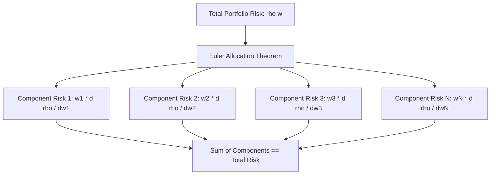

# Risk Decomposition and Attribution

## TL;DR

Risk decomposition breaks down aggregate portfolio risk into exact, non-overlapping contributions attributable to individual positions, asset classes, or systematic risk factors.
For any risk measure satisfying Euler's homogeneity condition (such as portfolio standard deviation, Value at Risk, or Expected Shortfall), total portfolio risk equals the sum of its component risks: $\rho(\mathbf{w}) = \sum_{i=1}^N w_i \frac{\partial \rho}{\partial w_i}$.
Marginal VaR measures the sensitivity of portfolio VaR to an incremental allocation in asset $i$, scaling directly with asset beta $\beta_i$.
Component VaR isolates the dollar amount of total VaR contributed by each position, enabling risk budgeting and the construction of Risk Parity (Equal Risk Contribution) portfolios.
Incremental VaR quantifies the finite before-and-after change in risk resulting from executing a discrete block trade or adding a new alpha strategy.

## Learning objectives

- Apply Euler's allocation theorem to linearly decompose homogeneous risk measures into component contributions.
- Calculate Marginal VaR, Component VaR, and percentage risk contributions across multi-asset portfolios.
- Differentiate Marginal VaR (instantaneous partial derivative) from Incremental VaR (discrete finite difference).
- Construct Risk Parity portfolios where each asset or factor contributes an equal share to total portfolio volatility.
- Decompose portfolio risk along orthogonal risk factor dimensions using factor betas and residual variance.
- Establish risk budgeting limits to enforce capital discipline across decentralized trading desks.

## Core concepts

### Euler's Allocation Principle for Coherent Risk Measures

Let $\mathbf{w} = [w_1, w_2, \dots, w_N]^T$ represent portfolio dollar or weight allocations across $N$ assets, and let $\rho(\mathbf{w})$ be a risk measure (such as standard deviation $\sigma_p$, Parametric VaR, or Expected Shortfall).
A risk measure is **linearly homogeneous of degree 1** if scaling all portfolio holdings by a constant scalar $c > 0$ scales total portfolio risk by the exact same proportion:

$$\rho(c \mathbf{w}) = c \, \rho(\mathbf{w})$$

By Euler's Homogeneous Function Theorem, any continuously differentiable function homogeneous of degree 1 can be decomposed as:

$$\rho(\mathbf{w}) = \sum_{i=1}^N w_i \frac{\partial \rho(\mathbf{w})}{\partial w_i} = \mathbf{w}^T \nabla \rho(\mathbf{w})$$

This mathematical identity guarantees that:
- Total portfolio risk is fully exhausted by the sum of its components with zero unexplained residual.
- It provides an axiomatic, economically sound foundation for attributing risk and allocating regulatory capital across desks.

### Marginal, Component, and Incremental VaR

To manage risk dynamically, quants track three distinct formulations of risk attribution:

#### 1. Marginal VaR ($\text{MVaR}$)
Marginal VaR is the instantaneous partial derivative of portfolio VaR with respect to position weight or dollar allocation $w_i$:

$$\text{MVaR}_i = \frac{\partial \text{VaR}_p}{\partial w_i}$$

For a portfolio governed by joint normality where $\text{VaR}_p = z_{\alpha} \sigma_p$ (with portfolio variance $\sigma_p^2 = \mathbf{w}^T \mathbf{\Sigma} \mathbf{w}$):

$$\frac{\partial \sigma_p}{\partial w_i} = \frac{(\mathbf{\Sigma} \mathbf{w})_i}{\sigma_p} = \frac{\text{Cov}(r_i, r_p)}{\sigma_p} = \beta_i \sigma_p$$

$$\text{MVaR}_i = z_{\alpha} \frac{\text{Cov}(r_i, r_p)}{\sigma_p} = \beta_i \text{VaR}_p$$

Marginal VaR is proportional to the asset's beta $\beta_i$ relative to the total portfolio:
- If $\beta_i > 1.0$, increasing position $i$ expands portfolio VaR at a rate higher than the current average.
- If $\beta_i = 1.0$, increasing position $i$ expands VaR at exactly the portfolio's average rate.
- If $\beta_i < 0.0$ (a hedge), increasing position $i$ reduces total portfolio VaR.

#### 2. Component VaR ($\text{CVaR}$)
Component VaR multiplies position weight $w_i$ by its Marginal VaR:

$$\text{CVaR}_i = w_i \cdot \text{MVaR}_i = w_i \frac{\partial \text{VaR}_p}{\partial w_i} = w_i \beta_i \text{VaR}_p$$

By Euler's theorem, the sum of all Component VaRs equals total portfolio VaR:

$$\sum_{i=1}^N \text{CVaR}_i = \sum_{i=1}^N w_i \beta_i \text{VaR}_p = \text{VaR}_p \sum_{i=1}^N w_i \beta_i = \text{VaR}_p$$

The Percentage Contribution to Risk ($\% \text{RC}_i$) is:

$$\% \text{RC}_i = \frac{\text{CVaR}_i}{\text{VaR}_p} = w_i \beta_i \quad \text{such that} \quad \sum_{i=1}^N \% \text{RC}_i = 100\%$$

#### 3. Incremental VaR ($\text{IVaR}$)
Incremental VaR measures the finite discrete change in portfolio VaR resulting from adding or removing a specific block of trades $\Delta \mathbf{w}$:

$$\text{IVaR} = \text{VaR}(\mathbf{w} + \Delta \mathbf{w}) - \text{VaR}(\mathbf{w})$$

For small reallocations ($\Delta \mathbf{w} \to 0$), Incremental VaR is approximated by the first-order Taylor expansion:

$$\text{IVaR} \approx \sum_{i=1}^N \Delta w_i \cdot \text{MVaR}_i = \Delta \mathbf{w}^T \nabla \text{VaR}_p$$

For large block trades, full recomputation of $\text{VaR}(\mathbf{w} + \Delta \mathbf{w})$ is mandatory to capture non-linear diversification changes.

### Risk Parity and Equal Risk Contribution (ERC)

Traditional mean-variance portfolios allocated 60% to equities and 40% to bonds (60/40 asset allocation).
However, because equities exhibit substantially higher volatility than bonds ($\sigma_{\text{equity}} \approx 18\%$ vs. $\sigma_{\text{bond}} \approx 5\%$), equities account for over 90% of total portfolio variance, exposing the fund to unhedged equity crash risk.

The Risk Parity (Equal Risk Contribution) framework allocates capital such that every asset contributes an identical amount to total portfolio risk:

$$\text{CVaR}_i = \text{CVaR}_j \iff w_i \frac{\partial \sigma_p}{\partial w_i} = w_j \frac{\partial \sigma_p}{\partial w_j} = \frac{\sigma_p}{N} \quad \forall i, j$$

In the absence of correlation between assets, the risk parity weights simplify to inverse-volatility weighting:

$$w_i \propto \frac{1}{\sigma_i}$$

When assets are correlated, finding risk parity weights requires numerical optimization.
While the formulation minimizing pairwise squared differences $\sum_{i=1}^N \sum_{j=1}^N \left( w_i (\mathbf{\Sigma} \mathbf{w})_i - w_j (\mathbf{\Sigma} \mathbf{w})_j \right)^2$ is non-convex (Maillard, Roncalli and Teïletche 2010), the problem can be reformulated into an equivalent strictly convex log-barrier optimization:

$$\min_{\mathbf{y}} \frac{1}{2} \mathbf{y}^T \mathbf{\Sigma} \mathbf{y} - c \sum_{i=1}^N \ln(y_i) \quad \text{subject to} \quad y_i > 0$$

where normalizing the unconstrained positive solution vector $\mathbf{w} = \mathbf{y} / \sum_{i=1}^N y_i$ yields the unique Equal Risk Contribution portfolio weights.
Risk parity portfolios achieve superior Sharpe ratios and drawdown resilience across economic cycles by leveraging lower-volatility assets to balance risk contributions.

### Factor Risk Attribution

Rather than decomposing risk by individual securities, institutional allocators decompose risk into macroeconomic factors (e.g., Market, Value, Momentum, Quality, Term, Credit):

$$\mathbf{r} = \mathbf{B} \mathbf{f} + \mathbf{\epsilon}$$

Portfolio variance decomposes into systematic factor variance and idiosyncratic specific variance.
The systematic part depends on factor exposures $\mathbf{x} = \mathbf{B}^T \mathbf{w}$, not on the realized factor returns $\mathbf{f}$:

$$\sigma_p^2 = \mathbf{x}^T \mathbf{\Sigma}_f \mathbf{x} + \mathbf{w}^T \mathbf{D}_{\epsilon} \mathbf{w}$$

The risk contribution of factor $k$ is the Euler term in that exposure:

$$\text{RC}_{\text{factor } k} = x_k \frac{\partial \sigma_p}{\partial x_k} = x_k \frac{(\mathbf{\Sigma}_f \mathbf{x})_k}{\sigma_p}$$

This decomposition reveals whether a portfolio's risk is genuinely diversified across independent economic drivers or concentrated in a single latent factor (e.g., hidden tech growth momentum).

## Worked examples

### Example 1: Calculating Marginal and Component VaR

A fund manages $\$100,000,000$ split across two asset classes:
- Equities ($w_1 = \$60,000,000$, weight $0.60$): $\sigma_1 = 20.0\%$ per annum.
- Bonds ($w_2 = \$40,000,000$, weight $0.40$): $\sigma_2 = 6.0\%$ per annum.
- Correlation between equities and bonds: $\rho = -0.15$.
Confidence level is 95% ($z_{0.95} = 1.6449$).
Compute total portfolio volatility, 95% annual VaR, Marginal VaRs, and Component VaRs.

**Solution:**

Step 1: Compute portfolio variance and standard deviation:

$$\sigma_p^2 = w_1^2 \sigma_1^2 + w_2^2 \sigma_2^2 + 2 w_1 w_2 \rho \sigma_1 \sigma_2$$

$$w_1^2 \sigma_1^2 = 0.60^2 \times 0.20^2 = 0.36 \times 0.0400 = 0.014400$$

$$w_2^2 \sigma_2^2 = 0.40^2 \times 0.06^2 = 0.16 \times 0.0036 = 0.000576$$

$$2 w_1 w_2 \rho \sigma_1 \sigma_2 = 2 \times 0.60 \times 0.40 \times (-0.15) \times 0.20 \times 0.06 = -0.072 \times 0.012 = -0.000864$$

$$\sigma_p^2 = 0.014400 + 0.000576 - 0.000864 = 0.014112$$

$$\sigma_p = \sqrt{0.014112} \approx 0.1187939 \quad (11.88\%)$$

Total portfolio VaR:

$$\text{VaR}_p = \$100,000,000 \times 1.6449 \times \sqrt{0.014112} \approx \$19,540,415 \quad (19.54\%)$$

Step 2: Compute covariances with portfolio:

$$\text{Cov}(r_1, r_p) = w_1 \sigma_1^2 + w_2 \rho \sigma_1 \sigma_2 = (0.60 \times 0.0400) + (0.40 \times -0.15 \times 0.20 \times 0.06) = 0.0240 - 0.00072 = 0.02328$$

$$\text{Cov}(r_2, r_p) = w_2 \sigma_2^2 + w_1 \rho \sigma_1 \sigma_2 = (0.40 \times 0.0036) + (0.60 \times -0.15 \times 0.20 \times 0.06) = 0.00144 - 0.00108 = 0.00036$$

Step 3: Compute Betas:

$$\beta_1 = \frac{\text{Cov}(r_1, r_p)}{\sigma_p^2} = \frac{0.02328}{0.014112} \approx 1.64966$$

$$\beta_2 = \frac{\text{Cov}(r_2, r_p)}{\sigma_p^2} = \frac{0.00036}{0.014112} \approx 0.02551$$

Check weighted beta: $0.60(1.64966) + 0.40(0.02551) = 0.9898 + 0.0102 = 1.0000$.

Step 4: Compute Marginal VaRs:

$$\text{MVaR}_1 = \beta_1 \times \text{VaR}_p = 1.64966 \times \$19,540,415 \approx \$32,235,038 \quad (32.24\%)$$

$$\text{MVaR}_2 = \beta_2 \times \text{VaR}_p = 0.02551 \times \$19,540,415 \approx \$498,480 \quad (0.50\%)$$

Step 5: Compute Component VaRs:

$$\text{CVaR}_1 = w_1 \times \text{MVaR}_1 = 0.60 \times \$32,235,038 \approx \$19,341,023$$

$$\text{CVaR}_2 = w_2 \times \text{MVaR}_2 = 0.40 \times \$498,480 \approx \$199,392$$

$$\text{Total VaR} = \$19,341,023 + \$199,392 = \$19,540,415$$

Risk shares:
- Equity contributes: $\$19,341,023 / \$19,540,415 = 98.98\%$ of total risk.
- Bonds contribute: $\$199,392 / \$19,540,415 = 1.02\%$ of total risk.
Despite a 60/40 capital allocation, equities represent 99% of total portfolio risk.

### Example 2: Sizing an Incremental Trade

Using the portfolio from Example 1 ($\text{VaR}_p = \$19,540,415$), the trader considers adding a $\$5,000,000$ block position in a gold ETF ($i=3$).
Gold has annual volatility $\sigma_3 = 15.0\%$.
Its correlation with equities is $\rho_{31} = 0.10$ and with bonds is $\rho_{32} = 0.30$.
Estimate the Incremental VaR ($\text{IVaR}$) using Marginal VaR.

**Solution:**

Step 1: Compute covariance of Gold with the existing portfolio:

$$\text{Cov}(r_3, r_p) = w_1 \text{Cov}(r_3, r_1) + w_2 \text{Cov}(r_3, r_2)$$

$$\text{Cov}(r_3, r_1) = 0.10 \times 0.15 \times 0.20 = 0.00300$$

$$\text{Cov}(r_3, r_2) = 0.30 \times 0.15 \times 0.06 = 0.00270$$

$$\text{Cov}(r_3, r_p) = (0.60 \times 0.00300) + (0.40 \times 0.00270) = 0.00180 + 0.00108 = 0.00288$$

Step 2: Compute Gold's portfolio beta:

$$\beta_3 = \frac{\text{Cov}(r_3, r_p)}{\sigma_p^2} = \frac{0.00288}{0.014112} \approx 0.20408$$

Step 3: Compute Gold's Marginal VaR:

$$\text{MVaR}_3 = \beta_3 \times \text{VaR}_p = 0.20408 \times \$19,540,415 \approx \$3,987,840 \quad (3.9878\%)$$

Step 4: Compute Incremental VaR for a $\$5,000,000$ addition:

$$\text{IVaR} \approx \Delta w_3 \times \frac{\text{MVaR}_3}{W} = \$5,000,000 \times 0.0398784 \approx +\$199,392$$

Adding $\$5\text{M}$ of gold expands portfolio 95% VaR by approximately $\$199,392$ (from $\$19.540\text{M}$ to $\$19.740\text{M}$).

## Pitfalls

- **Confusing Standalone VaR with Component VaR:** Standalone VaR evaluates an asset in isolation; summing standalone VaRs ignores diversification and overstates total portfolio risk.
- **Applying Euler Allocation to Non-Homogeneous Measures:** Attempting Euler decomposition on risk measures that are not degree-1 homogeneous (e.g., semi-variance or tracking error with fixed benchmark constraints) violates the additive summation property.
- **Using Marginal VaR for Giant Trades:** Linear Marginal VaR approximations ($\text{IVaR} \approx \mathbf{\delta}^T \Delta \mathbf{w}$) fail for large block trades because executing a giant trade alters the portfolio's covariance structure and beta weights.
- **Ignoring Negative Component VaR:** A hedging asset with negative beta exhibits negative Component VaR; failing to account for negative signs distorts percentage risk budgeting calculations.
- **Instability of Covariance Inverses in ERC Optimization:** Solving Risk Parity weights using ill-conditioned sample covariance matrices produces unstable, extreme allocations.

## Interview questions

> [!question]- risk-euler-allocation-theorem | State Euler's allocation theorem and explain why it is essential for risk capital budgeting.
> For any risk measure $\rho(\mathbf{w})$ that is linearly homogeneous of degree 1 ($\rho(c\mathbf{w}) = c\rho(\mathbf{w})$), Euler's theorem states that $\rho(\mathbf{w}) = \sum_{i=1}^N w_i \frac{\partial \rho}{\partial w_i}$. This is essential for capital budgeting because it guarantees that the sum of risk allocated to individual desks, positions, or business units equals total firm risk exactly, eliminating arbitrary overhead allocation or residual surplus.

> [!question]- risk-marginal-vs-component-var | Distinguish between Marginal VaR and Component VaR.
> Marginal VaR is the partial derivative $\frac{\partial \text{VaR}}{\partial w_i} = \beta_i \text{VaR}_p$, measuring the rate of change in total risk per dollar added to position $i$. Component VaR is the dollar risk contribution of the position: $\text{CVaR}_i = w_i \cdot \text{MVaR}_i = w_i \beta_i \text{VaR}_p$. Marginal VaR guides position sizing decisions at the margin, while Component VaR sums to total portfolio VaR.

> [!question]- risk-beta-relationship-marginal-var | Prove that under joint normality, Marginal VaR is proportional to the position's beta relative to the portfolio.
> For $\text{VaR}_p = z_{\alpha}\sigma_p$, the derivative is $\frac{\partial \text{VaR}_p}{\partial w_i} = z_{\alpha}\frac{\partial \sigma_p}{\partial w_i}$. Because $\sigma_p = (\mathbf{w}^T\mathbf{\Sigma}\mathbf{w})^{1/2}$, its derivative is $\frac{\partial \sigma_p}{\partial w_i} = \frac{(\mathbf{\Sigma}\mathbf{w})_i}{\sigma_p} = \frac{\text{Cov}(r_i, r_p)}{\sigma_p}$. Multiplying by $\sigma_p/\sigma_p$ gives $\frac{\text{Cov}(r_i, r_p)}{\sigma_p^2} z_{\alpha}\sigma_p = \beta_i \text{VaR}_p$.

> [!question]- risk-60-40-equity-risk-concentration | Why does a conventional 60/40 equity/bond portfolio have approximately 90% of its risk concentrated in equities?
> Equity volatility is typically 3 to 4 times higher than bond volatility ($\sigma_E \approx 18\%$ vs $\sigma_B \approx 5\%$). Because variance scales quadratically with volatility, $(18/5)^2 \approx 13$ times bond variance. In the risk decomposition $\text{CVaR}_i = w_i \beta_i \text{VaR}_p$, the 60% equity weight combined with an equity beta near 1.6 accounts for roughly $96\%$ to $99\%$ of total portfolio volatility (as shown in Example 1 where equity contributes $98.98\%$).

> [!question]- risk-parity-definition | What is the mathematical condition for a Risk Parity (Equal Risk Contribution) portfolio?
> A Risk Parity portfolio requires every asset to have an identical Component Risk: $w_i \frac{\partial \sigma_p}{\partial w_i} = w_j \frac{\partial \sigma_p}{\partial w_j} = \frac{\sigma_p}{N}$ for all $i, j$. In terms of covariance, this requires $w_i (\mathbf{\Sigma}\mathbf{w})_i = w_j (\mathbf{\Sigma}\mathbf{w})_j = \frac{\sigma_p^2}{N}$, ensuring no single asset or factor dominates total portfolio risk.

> [!question]- risk-incremental-var-formula | How does Incremental VaR differ from Marginal VaR, and when should the linear approximation be rejected?
> Incremental VaR is the finite discrete change in risk $\text{VaR}(\mathbf{w} + \Delta\mathbf{w}) - \text{VaR}(\mathbf{w})$. The linear approximation $\text{IVaR} \approx \Delta\mathbf{w}^T \text{MVaR}$ assumes the trade does not alter portfolio beta or covariance. When executing a large block trade that shifts portfolio weights significantly (e.g., adding 10% to a single position), the linear approximation must be rejected in favor of full re-computation.

> [!question]- risk-negative-component-var-meaning | What does it mean if an asset has a negative Component VaR?
> A negative Component VaR ($\text{CVaR}_i < 0$) occurs when an asset has a negative covariance and beta with the existing portfolio ($\beta_i < 0$). Economically, the asset acts as a portfolio hedge: holding it actively reduces total portfolio VaR below what the portfolio would have risked without it.

> [!question]- risk-budgeting-framework | How does a chief risk officer enforce risk budgeting across trading desks?
> The risk committee allocates a fixed percentage budget of total firm VaR or Expected Shortfall to each desk (e.g., 40% Rates, 35% Equities, 25% Credit). Desks are monitored daily using Component VaR. If a desk's Component VaR exceeds its allocated risk budget, it must reduce gross leverage or hedge exposures, preventing individual units from consuming excessive firm capital.

> [!question]- risk-factor-risk-decomposition-advantage | Why is factor-based risk decomposition superior to asset-based risk decomposition for multi-asset funds?
> Asset-based decomposition groups risk by nominal tickers or asset classes, masking hidden common exposures. A portfolio holding emerging market equities, high-yield credit, and copper futures appears diversified by asset class, but factor decomposition reveals that all three holdings share high exposure to a single global cyclical growth factor.

> [!question]- risk-expected-shortfall-euler-decomposition | Does Expected Shortfall satisfy Euler's allocation theorem?
> Yes. Expected Shortfall is a coherent risk measure and is strictly positive homogeneous of degree 1 ($\text{ES}(c\mathbf{w}) = c\text{ES}(\mathbf{w})$). Its component risk is given by $\text{CES}_i = w_i \frac{\partial \text{ES}}{\partial w_i} = w_i \mathbb{E}[-r_i \mid r_p \le -\text{VaR}_p]$, representing the expected loss of asset $i$ conditional on the portfolio experiencing a tail loss.

## Further reading

- Philippe Jorion, *Value at Risk: The New Benchmark for Managing Financial Risk*, Chapter 7: "Portfolio Risk: Analytical Methods".
- Carol Alexander, *Market Risk Analysis, Volume IV: Value at Risk Models*, Chapter 2: "Parametric VaR and Risk Attribution".
- Thierry Roncalli, *Introduction to Risk Parity and Budgeting*, Chapters 1-3.
- Dirk Tasche (2008), "Euler Allocation Method for Risk Capital", in *Mathematical Modeling and Information Technology*.
- Edward Qian (2005), "Risk Parity Portfolios: Efficient Portfolios Through True Diversification", *PanAgora Asset Management*.

## In this repo and SDE-Interview-Prep

- Value at Risk and Expected Shortfall mathematics: [VaR and Expected Shortfall](03-VaR-and-Expected-Shortfall.md).
- Risk factor taxonomy and covariance modeling: [Risk Factor Modelling](10-Risk-Factor-Modelling.md).
- Python reference implementation of risk analytics and scenarios: [risk_analytics.py](code/risk_analytics.py).
- Drawdown management and risk thresholds: [Drawdowns and Risk Limits](05-Drawdowns-and-Risk-Limits.md).
