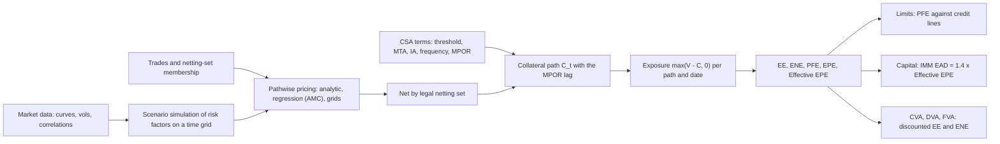

# Counterparty Credit Risk Analytics

## TL;DR

- Counterparty credit risk is the risk that a derivative counterparty defaults while the netting set is worth something to you; exposure is $\max(V_t - C_t, 0)$ for the netted value $V$ and collateral $C$, and it is a random process, not a number.
- The profile measures are EE (mean exposure), PFE (a high quantile, for limits), EPE (time average of EE), Effective EE (running maximum) and Effective EPE (first-year average of Effective EE, CRE53.12 to CRE53.13); IMM EAD is $1.4 \times$ Effective EPE.
- A forward's EE grows with time and has a closed form; a swap's EE is humped because the remaining annuity shrinks, and its discounted EE at a reset date is exactly a swaption price (checked here against Jamshidian's formula).
- Netting and collateral cut exposure: in the example the 2-year receiver swap cut the 5-year payer's EE at one year from about 200,200 (sum) to about 121,500; daily margin with a 10-day MPOR cut a forward's EE to 0.2003 of the uncollateralised value, rising by $\sqrt 2$ for 20 days.
- Wrong-way risk (exposure rising as the counterparty weakens) is identified and stressed (CRE53.47) and, when specific with a legal connection between counterparty and underlying issuer, taken out of the netting set (CRE53.48); its pricing effect is in [XVA](15-XVA.md).

## Learning objectives

- Differentiate Counterparty Credit Risk from traditional loan credit risk and directional market risk.
- Compute exposure profiles: Current Exposure (CE), Expected Exposure (EE), Potential Future Exposure (PFE), and Expected Negative Exposure (ENE), by Monte Carlo and in closed form where one exists.
- Formulate Basel regulatory metrics: Effective EE and Effective EPE (the non-decreasing envelope) and compare IMM with SA-CCR.
- Contrast the exposure geometries of forward contracts, vanilla interest rate swaps, cross-currency swaps, and options.
- Quantify close-out netting benefits under ISDA Master Agreements using the Net-to-Gross Ratio (NGR).
- Model dynamic collateralization under CSAs, including Thresholds, MTAs, and the Margin Period of Risk (MPOR).
- Differentiate Specific Wrong-Way Risk (SWWR) from General Wrong-Way Risk (GWWR).

## Core concepts

### What makes counterparty risk different

A loan's exposure is its principal; a derivative's exposure is its replacement cost at the default date, which depends on the market path up to then.
Three features follow:

1. Bilateral: either side can be in the money, so each party has exposure to the other at different times (the mirror image is DVA).
2. Stochastic: exposure is a function of market factors, so it needs a simulation of the netting set's value through time.
3. Default and exposure interact: the loss is $\text{LGD} \cdot \max(V_\tau - C_\tau, 0)$ at the default time $\tau$, and if $\tau$ and $V$ are dependent (wrong-way risk) the expected loss is not the product of the expectations.

### The exposure engine

Production engines run on the order of thousands of paths and tens to hundreds of grid dates, price trades pathwise with closed forms or American Monte Carlo regressions, and aggregate per netting set as they go so the full path cube is never stored; see [XVA Engine](../18-Pricing-and-Risk-Systems/11-XVA-Engine.md) for the architecture.

### Exposure measures

With $E_t = \max(V_t - C_t, 0)$:

| Measure | Definition | Used for |
| :--- | :--- | :--- |
| CE | $\max(V_0 - C_0, 0)$ | current replacement cost |
| EE$(t)$ | $E[E_t]$ | capital (IMM), CVA (discounted: $E[D(t)E_t]$) |
| ENE$(t)$ | $E[\max(C_t - V_t, 0)]$ | DVA, funding benefit |
| PFE$_\alpha(t)$ | $\alpha$-quantile of $E_t$ | credit limits |
| EPE | $\frac{1}{T}\int_0^T \text{EE}(t)\,dt$ | summary, loan equivalent |
| Effective EE | $\text{EEE}_{t_k} = \max(\text{EEE}_{t_{k-1}}, \text{EE}_{t_k})$, $\text{EEE}_{t_0} = $ CE | IMM capital (CRE53.12) |
| Effective EPE | $\sum_{t_k \le \min(1, M)} \text{EEE}_{t_k}\Delta t_k / \min(1, M)$ | IMM capital (CRE53.13) |

The running maximum stops a short-dated book from showing falling exposure when trades roll off, because in practice they are replaced.
EAD under IMM is $\alpha \cdot$ Effective EPE with $\alpha = 1.4$ (CRE53.11, CRE53.14); supervisors may require more (CRE53.15) and approved banks may estimate their own alpha with a floor of 1.2 (CRE53.16).
The Basel text says the expectation should in theory be under the real-world distribution, but supervisors do not mandate which (CRE53.12 footnote 236): many banks simulate PFE for limits under real-world calibrations and CVA under risk-neutral ones, and the choice must be documented.

### Exposure of a forward: closed form

For a par forward on a lognormal asset with value $V_t = N(S_t/S_0 - e^{rt})$,

$$\text{EE}(t) = N e^{rt}\left(2\Phi\!\left(\tfrac12\sigma\sqrt t\right) - 1\right), \qquad \text{PFE}_\alpha(t) = N e^{rt}\left(e^{-\sigma^2 t/2 + \sigma\sqrt t\, z_\alpha} - 1\right).$$

With $N = 1\text{m}$, $\sigma = 20\%$, $r = 3\%$: EE(1) = 82,082 and EE(5) = 205,571; PFE$_{95}$(1) = 373,048 and PFE$_{95}$(5) = 1,031,891; 200,000 simulated paths agree within their standard error.
For small $\sigma\sqrt t$, $2\Phi(\tfrac12\sigma\sqrt t) - 1 \approx \sigma\sqrt t/\sqrt{2\pi} \approx 0.4\,\sigma\sqrt t$: exposure grows like $\sqrt t$, with a drift correction.

### Exposure of a swap: the hump, and EE as a swaption

A payer swap's value at a reset date $t$ is $V_t = N\left[1 - P(t, T) - K\sum_{t_i > t}\tau_i P(t, t_i)\right]$: roughly the swap rate move times the remaining annuity.
Rate uncertainty grows like $\sqrt t$ while the annuity shrinks like $T - t$, so EE behaves like $\sqrt t\,(T - t)$, which peaks at $T/3$ (1.6667 years for $T = 5$).
And $E[D(t)\max(V_t, 0)]$ is by definition the price today of a payer swaption expiring at $t$ on the remaining swap, so in a model with closed-form swaptions the discounted EE profile needs no simulation.

The code simulates a 10m 5-year quarterly payer swap at its par rate 3.2091% under a one-factor Hull-White model (mean reversion 5%, volatility 1%, fitted to an upward-sloping zero curve), simulating the short rate and its integral exactly, and checks the discounted EE at every reset date against Jamshidian's (1989) decomposition of the swaption into zero-coupon bond options.
A martingale test, $E[D(5)]/P(0, 5) = 1.000178$, confirms the discounting.

| $t$ (years) | discounted EE, closed form | PFE$_{95}$ (about) |
| ---: | ---: | ---: |
| 0.5 | 129,704 | 471,600 |
| 1.0 | 171,439 | 617,000 |
| 1.5 | 187,394 | |
| 2.0 | 186,310 | 669,600 |
| 3.0 | 149,934 | 566,000 |
| 4.0 | 84,065 | 337,700 |
| 4.75 | 22,317 | |

The discounted EE peaks at 1.75 years (188,641); the undiscounted EE peaks at about 199,300, also at 1.75 years, and PFE$_{95}$ peaks at about 676,800.
Because the curve slopes up, the payer swap is expected to move into the money, so its EE exceeds its ENE; on a flat curve the two would coincide at reset dates (payer and receiver swaptions struck at the forward have equal prices).

Other geometries:

- Cross-currency swaps exchange notional at maturity, so FX diffusion on the final exchange keeps exposure rising to the end.
- A bought option's exposure is its value, always non-negative; a sold option with premium paid upfront has no exposure to the buyer (CRE52.1 FAQ1 lets SA-CCR set its EAD to zero outside netting and margin agreements).
- A netting set's profile is not the sum of its trades' profiles: $E[\max(\sum_i V_i, 0)] \le \sum_i E[\max(V_i, 0)]$.

### Netting

Close-out netting under an ISDA Master Agreement terminates all transactions on default and nets them into one amount, which removes the administrator's ability to cherry-pick (pay out on contracts in its favour and default on the rest).
Netting is recognised for capital only with a legally enforceable agreement and legal opinions (CRE52.7 to CRE52.8).
Today's netting benefit is measured by the net-to-gross ratio $\text{NGR} = \max(\sum_i V_i, 0)/\sum_i\max(V_i, 0)$, which the BCBS-IOSCO standardised initial margin schedule uses to scale gross margin: net IM $= (0.4 + 0.6 \cdot \text{NGR}) \times$ gross IM (MGN20.17).

Adding a 10m 2-year receiver swap (par rate 2.7337%) to the 5-year payer:

- EE at one year: about 121,500 netted against about 200,200 for the sum of the two trades' EEs, an expected net-to-gross of about 0.607.
- Effective EPE: about 87,900 netted, against about 139,300 for the payer alone.
- After the 2-year swap matures the netted EE equals the payer's alone (the code checks equality at 3 years).

### Collateral and the margin period of risk

A CSA sets a threshold (exposure below it is not collateralised), a minimum transfer amount, independent amounts or initial margin, eligible collateral and haircuts, and the call frequency.
For covered entities under the BCBS-IOSCO framework, variation margin is exchanged with a zero threshold (MGN20.4), initial margin may have a threshold of up to €50m (MGN20.5), transfers may have an MTA of up to €500,000 (MGN20.6), and initial margin is a one-tailed 99% 10-day potential future exposure calibrated to include stress (MGN20.9), exchanged gross and not rehypothecated except under strict conditions (MGN20.40 to MGN20.41); national rules implement these with their own dates and thresholds.

Collateral never removes exposure, because after the last successful margin call it takes time to declare default, stop paying, and close out or re-hedge: the margin period of risk.
Modelling collateral as $C_t = V_{t - \delta}$ for MPOR $\delta$, the exposure is $\max(V_t - V_{t-\delta}, 0)$.
For the forward with $r = 0$ this has a closed form: $E[\max(V_t - V_{t-\delta}, 0)] = N\left(2\Phi\!\left(\tfrac12\sigma\sqrt\delta\right) - 1\right)$ for every $t \ge \delta$, flat in time.

| $N = 1\text{m}$, $\sigma = 20\%$, exposure at 1 year | EE | PFE$_{95}$ (about) |
| :--- | ---: | ---: |
| Uncollateralised | 79,656 | |
| Daily VM, MPOR 10 business days | 15,957 | 67,760 |
| Daily VM, MPOR 20 business days | 22,565 | 96,400 |
| MPOR 10, symmetric threshold 50,000 | about 23,900 | |
| MPOR 20, symmetric threshold 50,000 | about 28,000 | |

The collateralised EE is 0.2003 of the uncollateralised one ($\approx\sqrt{\delta/t}$) and grows by a factor 1.4141 from 10 to 20 days.
Regulatory floors: under IMM, at least 5 business days for netting sets of only repo-style transactions and 10 for others with daily margining, 20 for netting sets above 5,000 trades or containing illiquid collateral or hard-to-replace OTC derivatives, and double the floor for two quarters after more than two disputes longer than the MPOR in the previous two quarters (CRE53.24 to CRE53.25); with re-margining every $N$ days the IMM MPOR is at least the floor $F$ plus $N - 1$ days (CRE53.26).
SA-CCR floors the MPOR of non-centrally cleared netting sets at 10 business days for daily margining and $9 + N$ for margining every $N$ days (CRE52.50), with the same 20-day exceptions (CRE52.51).

### IMM against SA-CCR on the same trade

For the 5-year swap: Effective EPE is about 139,300, so IMM-style EAD is about 195,000.
SA-CCR at inception: supervisory duration $(1 - e^{-0.25})/0.05 = 4.4240$, add-on $0.5\% \times 10\text{m} \times 4.4240 = 221,199$, RC 0 and multiplier 1, so $\text{EAD} = 1.4 \times 221{,}199 = 309{,}679$, about 1.59 times the simulated number.
SA-CCR is calibrated to be conservative across portfolios and recognises no model-specific diversification; see [Counterparty Credit Risk: SA-CCR](../17-Regulatory-Capital-Basel-and-FRTB/04-Counterparty-Credit-Risk-SA-CCR.md).

### Wrong-way risk

General wrong-way risk: exposure and the counterparty's default probability move together through common market factors (for example, receiving a hard currency from a counterparty whose local currency and credit both deteriorate in the same crisis).
Banks must identify it, stress test for it and report it to senior management (CRE53.47).
Specific wrong-way risk: future exposure to a specific counterparty is highly correlated with that counterparty's probability of default, typically through a legal or structural link; the Basel text's example is a company writing put options on its own stock (CRE53.48).
For capital, trades with a legal connection between counterparty and underlying issuer and identified specific wrong-way risk are taken out of the netting set; such single-name CDS take EAD equal to the full expected loss on the underlying assuming the issuer is in liquidation, and such equity derivatives, bond options and securities financing transactions take EAD equal to their value assuming the underlying jumps to default, both with LGD 100% (CRE53.48).
Right-way risk is the opposite (exposure falls as the counterparty weakens, as for a commodity producer hedging its output).
The CVA effect of wrong-way risk, with the default curve held fixed, is computed in [XVA](15-XVA.md).

## Worked examples

All numbers are printed and asserted by `python 11-Risk-and-Trading/code/risk_ccr_analytics.py`.

### Example 1: netting set and net-to-gross ratio

Three swaps with one counterparty under an enforceable ISDA agreement: MtM $+12\text{m}$, $-8.5\text{m}$ and $+1.5\text{m}$, notionals 100m, 80m and 50m in the 5+, 2 to 5 and 0 to 2 year duration buckets of the standardised margin schedule (4%, 2% and 1%, MGN20.16).

1. Gross replacement cost $12 + 1.5 = 13.5\text{m}$; net $\max(12 - 8.5 + 1.5, 0) = 5\text{m}$.
2. NGR $= 5/13.5 = 0.370370$: netting removes 0.629630 of current exposure.
3. Gross standardised IM $= 4\text{m} + 1.6\text{m} + 0.5\text{m} = 6.1\text{m}$.
4. Net standardised IM $= (0.4 + 0.6 \times 0.370370) \times 6.1\text{m} = 0.622222 \times 6.1\text{m} = 3{,}795{,}556$.

### Example 2: the swap profile and regulatory numbers

1. Discounted EE at one year from Jamshidian: 171,439; the 50,000-path Monte Carlo agrees within 3.5 standard errors at every reported date.
2. Undiscounted EE rises to a peak of about 199,300 at 1.75 years and falls to zero at maturity; EPE over the life is about 136,800.
3. Effective EE is the running maximum starting from CE $= 0$; over the first year it equals EE because EE is still rising, so Effective EPE (CRE53.13 weights) is about 139,300.
4. IMM-style EAD about 195,000 against SA-CCR EAD 309,679.
5. PFE$_{95}$ peaks at about 676,800 at 1.75 years: that, not EE, is what a credit officer compares with the counterparty's line.

### Example 3: what daily margining buys

Forward, $N = 1\text{m}$, $\sigma = 20\%$, $r = 0$, one-year horizon.

1. Uncollateralised: $\text{EE} = N(2\Phi(0.1) - 1) = 79{,}656$.
2. Daily VM with a 10-day MPOR: $\text{EE} = N(2\Phi(\tfrac12 \times 0.2\sqrt{10/250}) - 1) = 15{,}957$, a ratio of 0.2003, close to $\sqrt{(10/250)/1} = 0.2$.
3. A 20-day MPOR (more than 5,000 trades, or illiquid collateral): 22,565, up by 1.4141.
4. A 50,000 threshold each way: about 23,900, because exposure up to the threshold is never collateralised.
5. PFE$_{95}$ with a 10-day MPOR is about 67,760, about 4.25 times the EE: collateralised exposure is a gap risk with a fat right tail.

## Pitfalls

- Summing trade-level exposures in a netting set, or netting across sets without enforceable agreements.
- Treating a collateralised set as riskless: the MPOR leaves about 20% of the one-year uncollateralised EE in the forward example, more with thresholds.
- Modelling the MPOR in calendar days or ignoring the regulatory floors (5, 10, 20 business days, and doubling after disputes).
- Using a $\sqrt t$ profile for amortising products: swaps hump and cross-currency swaps keep rising.
- Evaluating exposure only at reset dates when cash flows happen in between: exposure jumps at payments, and coarse grids miss peaks.
- Using trapezoid weights for Effective EPE; CRE53.13 is a sum of Effective EE times $\Delta t_k$ over the grid dates in the first year.
- Mixing measures without saying so: real-world PFE against risk-neutral CVA exposure.
- Ignoring wrong-way risk because the model assumes independence; independence is an assumption to be stressed, not a fact.

## Interview questions

> [!question]- risk-ccr-vs-loan-credit-risk | What are the three fundamental differences between Counterparty Credit Risk (CCR) and traditional loan credit risk?
> Exposure is bilateral (either side can be in the money), stochastic (it is the future value of the netting set, not a fixed principal), and the loss depends jointly on default time and market path, $\text{LGD} \cdot \max(V_\tau - C_\tau, 0)$.
> So it needs a simulation of exposure through time, and dependence between default and exposure (wrong-way risk) changes the expected loss.

> [!question]- risk-swap-exposure-hump-shape | Why does the Expected Exposure (EE) profile of an interest rate swap exhibit a hump shape over time?
> Value is roughly rate change times remaining annuity: the rate dispersion grows like $\sqrt t$, the annuity shrinks like $T - t$, so EE behaves like $\sqrt t\,(T - t)$, peaking at $T/3$ (1.67 years for 5 years).
> In the Hull-White example the 5-year payer's discounted EE peaks at 1.75 years (188,641 from Jamshidian swaption prices) and is zero at maturity.

> [!question]- risk-potential-future-exposure-definition | Define Potential Future Exposure (PFE) and explain how it is used by credit risk officers.
> The $\alpha$-quantile (typically 95% or 99%) of exposure at a future date; the peak over the life is compared with the counterparty's credit line before a trade is approved.
> For a par forward ($N = 1\text{m}$, $\sigma = 20\%$, $r = 3\%$), PFE$_{95}$ is 373,048 at one year against an EE of 82,082: limits are about tails, capital and CVA about means.

> [!question]- risk-effective-epe-basel-rationale | Why did the Basel Committee mandate the Effective Expected Exposure non-decreasing envelope?
> Short-dated trades mature and are usually replaced, so a falling EE profile would understate the exposure of a continuing relationship; the running maximum $\text{EEE}_{t_k} = \max(\text{EEE}_{t_{k-1}}, \text{EE}_{t_k})$ prevents that (CRE53.12).
> Effective EPE averages it over the first year (CRE53.13) and EAD is $1.4\times$ that: about 195,000 for the 5-year swap example.

> [!question]- risk-close-out-netting-cherry-picking | How does ISDA close-out netting protect a solvent bank against bankruptcy cherry-picking?
> On default all transactions are terminated and their values combined into one net amount, so the administrator cannot enforce the contracts it wins on while defaulting on those it loses.
> In Example 1 that turns 13.5m of gross exposure into 5m; capital recognises it only with enforceable agreements and legal opinions (CRE52.7 to CRE52.8).

> [!question]- risk-margin-period-of-risk-mpor | What is the Margin Period of Risk (MPOR), and what are its standard regulatory horizons?
> The time from the last successful margin exchange to close-out and re-hedging of a defaulting counterparty, during which the portfolio moves without new collateral.
> IMM floors with daily margining: 5 business days for repo-style netting sets, 10 for others, 20 for sets above 5,000 trades or with illiquid collateral or hard-to-replace derivatives, doubled after repeated disputes (CRE53.24 to CRE53.25); SA-CCR floors are 10 days or $9 + N$ (CRE52.50).
> Exposure scales roughly with $\sqrt{\text{MPOR}}$: 15,957 at 10 days and 22,565 at 20 in the forward example.

> [!question]- risk-wrong-way-risk-classification | Differentiate Specific Wrong-Way Risk (SWWR) from General Wrong-Way Risk (GWWR) with concrete examples.
> Specific: a legal or structural link makes exposure rise as the counterparty fails, as when a company writes puts on its own stock (CRE53.48); such trades leave the netting set, and linked single-name CDS take EAD equal to the loss assuming the issuer is in liquidation.
> General: common market factors drive both, as when a counterparty's credit and the currency it pays you both weaken in one crisis; banks must identify and stress it (CRE53.47).

> [!question]- risk-net-to-gross-ratio-ngr | What is the Net-to-Gross Ratio (NGR), and what does an NGR of zero indicate?
> $\text{NGR} = \max(\sum V_i, 0)/\sum\max(V_i, 0)$, today's net replacement cost over gross; 0.370370 in Example 1.
> NGR 0 means the netting set is out of the money as a whole: no current exposure, though future exposure remains.
> The standardised margin schedule scales gross IM by $0.4 + 0.6\,\text{NGR}$ (MGN20.17).

> [!question]- risk-simm-initial-margin-framework | What is the regulatory standard for initial margin on non-cleared derivatives, and where does ISDA SIMM fit?
> Covered entities exchange IM equal to a one-tailed 99% 10-day potential future exposure calibrated to include stress (MGN20.9), computed either by an approved quantitative model or by the standardised schedule (MGN20.10); IM is exchanged gross and segregated, with rehypothecation only under strict conditions (MGN20.40 to MGN20.41).
> ISDA SIMM is the industry's sensitivity-based model used as that quantitative model; it is not a Basel formula.

> [!question]- risk-simulation-measure-pfe-vs-cva | Why is PFE often simulated under the physical measure while CVA is simulated under the risk-neutral measure?
> PFE is a risk measure for limits: it should reflect how the market can actually move, so real-world drifts and volatilities are natural.
> CVA is a price that is hedged, so it uses risk-neutral dynamics calibrated to market prices.
> For IMM capital the Basel text prefers the real-world distribution in theory but leaves the choice to the bank (CRE53.12 footnote 236).

> [!question]- risk-forward-ee-closed-form | Derive the EE of a par forward on a lognormal asset.
> $V_t = N(S_t/S_0 - e^{rt})$, so $E[\max(V_t, 0)]$ is a call on $S_t$ struck at its forward: $N e^{rt}(2\Phi(\tfrac12\sigma\sqrt t) - 1)$.
> With $N = 1\text{m}$, $\sigma = 20\%$, $r = 3\%$: 82,082 at one year and 205,571 at five; for small $\sigma\sqrt t$ it is about $0.4\,N\sigma\sqrt t$.

> [!question]- risk-swap-ee-equals-swaption | Why is the discounted EE of a swap at a reset date a swaption price, and how do you use that?
> $E[D(t)\max(V_t, 0)]$ is the risk-neutral price of the right to enter the remaining swap at $t$, a payer swaption expiring at $t$.
> In models with closed-form swaptions (Hull-White via Jamshidian) the discounted EE needs no simulation, which makes it the natural unit test for an exposure engine: here the Monte Carlo matched it within 3.5 standard errors at every date.

> [!question]- risk-collateralised-ee-sqrt-mpor | With daily margin and a 10-day MPOR, how does a forward's EE compare with the uncollateralised EE at one year?
> With $C_t = V_{t-\delta}$ and $r = 0$, $\text{EE} = N(2\Phi(\tfrac12\sigma\sqrt\delta) - 1)$, flat in $t$: 15,957 against 79,656 for $N = 1\text{m}$ and $\sigma = 20\%$, a ratio of 0.2003, about $\sqrt{\delta/t}$.
> Doubling the MPOR to 20 days multiplies it by 1.4141.

> [!question]- risk-threshold-effect-on-exposure | How does a CSA threshold change collateralised exposure?
> Exposure up to the threshold is never called, so the collateralised EE is roughly the threshold-capped uncollateralised exposure plus the MPOR gap: in the forward example a 50,000 threshold raised the 10-day EE from 15,957 to about 23,900.
> This is why MGN20.4 requires zero-threshold VM between covered entities and SA-CCR adds TH + MTA - NICA to margined RC.

> [!question]- risk-imm-vs-saccr-ead | For an at-the-money 5-year swap, how does SA-CCR EAD compare with an IMM-style EAD, and why?
> SA-CCR: $1.4 \times 0.5\% \times 10\text{m} \times 4.4240 = 309{,}679$; simulated Effective EPE about 139,300 gives about 195,000, so SA-CCR is about 1.59 times higher here.
> SA-CCR uses supervisory factors calibrated across portfolios, a one-year horizon for trades over a year and no model-specific diversification; IMM banks must still compute SA-CCR for the output floor.

> [!question]- risk-ee-discounted-vs-undiscounted | When do you use discounted and when undiscounted EE?
> CVA, DVA and FVA integrate the discounted EE $E[D(t)E_t]$ (a price); capital and limits use undiscounted EE and PFE (amounts at the future date).
> For the 5-year swap at 2 years the discounted EE is 186,310; the undiscounted EE at its 1.75-year peak is about 199,300.

> [!question]- risk-exposure-engine-design | Sketch the data flow of a counterparty exposure engine and say where it usually breaks.
> Market data and calibrations feed a factor simulation on a time grid; trades are priced pathwise (closed forms, regression for callables); values are netted by legal netting set; collateral is simulated with CSA terms and the MPOR lag; exposure statistics are aggregated as the paths stream.
> It breaks on data (netting-set and CSA reference data out of sync with legal), on pricing coverage (exotics without fast pathwise pricers), and on grids too coarse to see payment-date jumps; unit-test it on products with closed-form exposures (forwards, swaps via swaptions).

> [!question]- risk-ccr-effective-eepe-regulatory-multiplier | What is the Basel regulatory multiplier $\alpha = 1.4$ applied to Effective EPE, and what does it compensate for?
> $\text{EAD} = \alpha \cdot$ Effective EPE with $\alpha = 1.4$ (CRE53.11, CRE53.14); alpha is defined as economic capital from a full joint simulation of exposures across counterparties divided by economic capital treating each counterparty's EPE as a fixed loan (CRE53.16).
> So it corrects for exposure randomness, correlation of exposures across counterparties and dependence between exposure and defaults; supervisors may raise it for low granularity, high general wrong-way risk or high correlation of market values (CRE53.15), and own estimates are floored at 1.2.

> [!question]- risk-cross-currency-swap-exposure-diffusion | Contrast the exposure profile of a cross-currency swap with that of a single-currency interest rate swap.
> The single-currency swap's exposure is humped (rate dispersion grows like $\sqrt t$, the remaining annuity shrinks) and ends at zero: the 5-year example peaks at 1.75 years.
> A cross-currency swap exchanges notionals at maturity, so FX dispersion on the final exchange keeps EE rising towards maturity, like an FX forward; its peak exposure is near the end and much larger per unit notional.

> [!question]- risk-specific-wrong-way-risk-treatment | How does the Basel framework treat transactions with Specific Wrong-Way Risk (SWWR)?
> Banks must identify and control it from inception (CRE53.48).
> For capital, instruments with a legal connection between counterparty and underlying issuer and identified SWWR are taken out of the netting set; for such single-name CDS the EAD is the full expected loss on the underlying assuming the issuer is in liquidation, with LGD 100% under IRB; for equity derivatives, bond options or SFTs on a single legally connected company, EAD is the value assuming jump to default of the underlying, again with LGD 100% (CRE53.48).

> [!question]- risk-mpor-margin-period-of-risk-regulatory-windows | What are the regulatory MPOR floors for margined netting sets?
> IMM with daily margining: at least 5 business days for netting sets of only repo-style transactions and 10 for all others; 20 when a netting set exceeds 5,000 trades in a quarter or contains illiquid collateral or hard-to-replace OTC derivatives (CRE53.24); doubled for two quarters after more than two long margin disputes (CRE53.25).
> IMM with margining every $N$ days: the floor plus $N - 1$ days (CRE53.26).
> SA-CCR floors: 10 business days with daily margining or $9 + N$ for margining every $N$ days (CRE52.50), 20 in the CRE52.51 cases; cleared exposures follow CRE54.

> [!question]- risk-isda-simm-mva-sensitivities-driver | How does a sensitivity-based initial margin model such as ISDA SIMM work, and why does it drive MVA?
> It weights delta and vega sensitivities (plus a curvature term) by prescribed risk weights, aggregates them with prescribed correlations within buckets, across buckets and across risk classes, and serves as the quantitative model allowed by MGN20.10 for the 99% 10-day IM of MGN20.9.
> Because IM must be posted gross and segregated, it is funded for the trade's life: in the 10m 5-year swap example a delta-normal stand-in starts near 191,334 and the MVA at 80bp is about 3,871.

> [!question]- risk-close-out-netting-bankruptcy-cherry-picking | Why is enforceable close-out netting essential against cherry-picking?
> Without it an administrator could enforce the contracts in the defaulter's favour and default on the rest; close-out netting terminates everything into one net amount.
> In Example 1, 13.5m of gross positive value becomes a 5m net claim (NGR 0.370370), and capital recognises the netting only with enforceable agreements and legal opinions (CRE52.7 to CRE52.8).

## In this repo and SDE-Interview-Prep

- [risk_ccr_analytics.py](code/risk_ccr_analytics.py): forward EE and PFE in closed form and by simulation, Hull-White swap exposure checked against Jamshidian swaption prices, Effective EE and EPE, netting, MPOR and thresholds, SA-CCR comparison, NGR and standardised IM; every number above except the initial margin and MVA figures in card risk-isda-simm-mva-sensitivities-driver, which are asserted by [risk_xva_pricing.py](code/risk_xva_pricing.py).
- Pricing the exposure: [XVA](15-XVA.md); capital: [Counterparty Credit Risk: SA-CCR](../17-Regulatory-Capital-Basel-and-FRTB/04-Counterparty-Credit-Risk-SA-CCR.md), [CVA Capital Charge](../17-Regulatory-Capital-Basel-and-FRTB/05-CVA-Capital-Charge-SA-CVA-and-BA-CVA.md); production: [XVA Engine](../18-Pricing-and-Risk-Systems/11-XVA-Engine.md).
- Rates background: [Short Rate Models](../06-Fixed-Income-and-Asset-Classes/04-Short-Rate-Models.md), [Rates Options, Caps and Swaptions](../06-Fixed-Income-and-Asset-Classes/05-Rates-Options-Caps-and-Swaptions.md), [Multi-Curve and CSA Discounting](../06-Fixed-Income-and-Asset-Classes/13-Multi-Curve-and-CSA-Discounting.md), [Credit and CDS](../06-Fixed-Income-and-Asset-Classes/06-Credit-and-CDS.md).

## Further reading

- J. Gregory, *The xVA Challenge: Counterparty Risk, Funding, Collateral, Capital and Initial Margin*, 4th edition, Wiley 2020 (exposure, netting, collateral and wrong-way risk chapters).
- M. Pykhtin and S. Zhu, "A guide to modelling counterparty credit risk", *GARP Risk Review*, July/August 2007, 16-22.
- E. Canabarro and D. Duffie, "Measuring and marking counterparty risk", in L. Tilman (ed.), *Asset/Liability Management of Financial Institutions*, Euromoney 2003.
- D. Brigo and F. Mercurio, *Interest Rate Models: Theory and Practice*, 2nd edition, Springer 2006, chapter 3 (Hull-White bond prices and options).
- F. Jamshidian, "An exact bond option formula", *Journal of Finance* 44(1), 205-209, 1989.
- Basel Committee on Banking Supervision, Basel Framework CRE52, CRE53 and MGN20.
