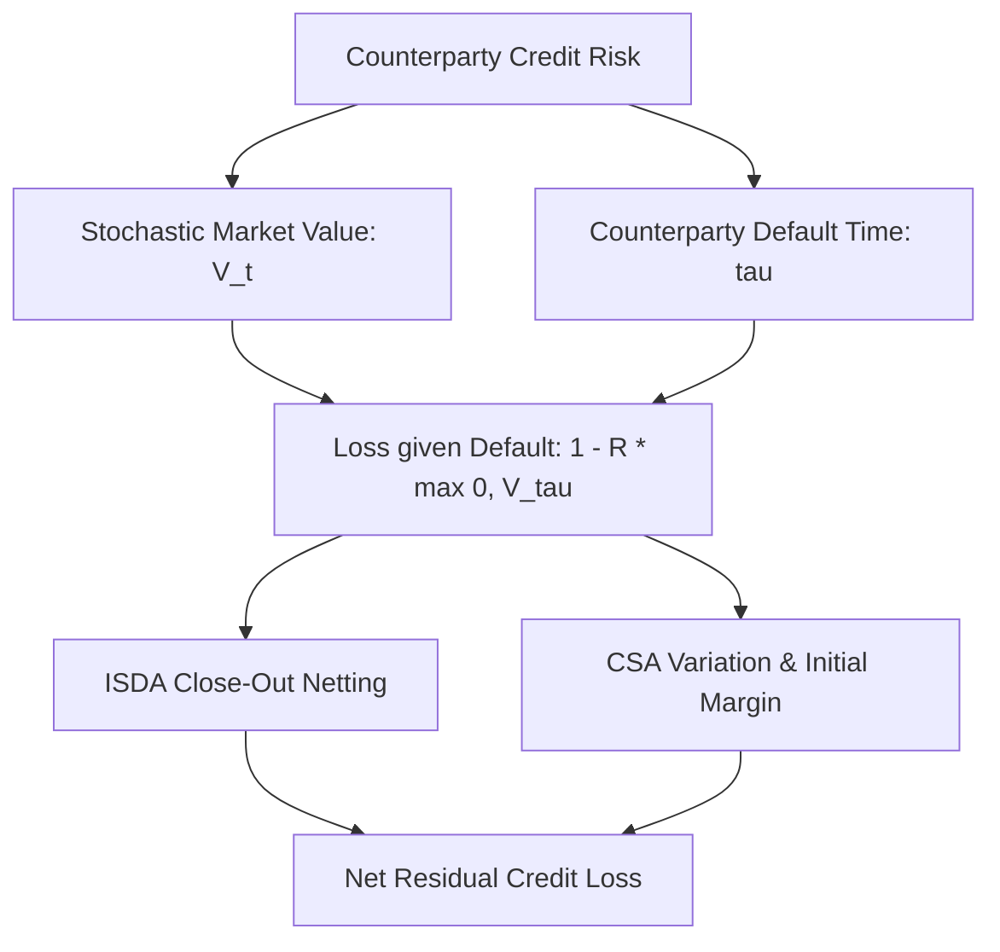
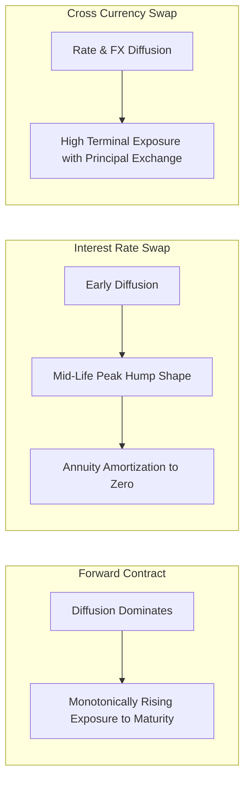

# Counterparty Credit Risk Analytics

## TL;DR

Counterparty Credit Risk (CCR) is the risk that a counterparty defaults on an over-the-counter (OTC) derivative contract prior to final contractual settlement.
Unlike standard loans where credit risk is unilateral and fixed to the principal balance, CCR is bilateral, dynamic, and market-driven: exposure fluctuates stochastically with market risk factors and can alternate between an asset and a liability.
CCR analytics generates exposure profiles over time: Expected Exposure (EE), Potential Future Exposure (PFE), Expected Positive Exposure (EPE), and Effective EPE (the non-decreasing Basel capital metric).
Exposure geometry reflects contract mechanics: forward contracts exhibit monotonically growing exposure, while interest rate swaps display a characteristic "hump shape" resulting from the battle between diffusion and remaining annuity amortization.
CCR is mitigated through close-out netting under ISDA Master Agreements and dynamic collateralization under Credit Support Annexes (CSAs) governed by Thresholds, Minimum Transfer Amounts (MTAs), and the Margin Period of Risk (MPOR).

## Learning objectives

- Differentiate Counterparty Credit Risk from traditional loan credit risk and directional market risk.
- Compute mathematical exposure profiles: Current Exposure (CE), Expected Exposure (EE), Potential Future Exposure (PFE), and Expected Negative Exposure (ENE).
- Formulate Basel regulatory metrics: Effective EE and Effective EPE (the non-decreasing envelope).
- Contrast the exposure geometries of forward contracts, vanilla interest rate swaps, cross-currency swaps, and options.
- Quantify close-out netting benefits under ISDA Master Agreements using the Net-to-Gross Ratio (NGR).
- Model dynamic collateralization mechanics under modern CSAs, including Thresholds, MTAs, and Margin Period of Risk (MPOR).
- Differentiate Specific Wrong-Way Risk (SWWR) from General Wrong-Way Risk (GWWR) and analyze its pricing impact.

## Core concepts

### The Nature of Counterparty Credit Risk

Counterparty Credit Risk (CCR) arises in bilateral, uncleared over-the-counter derivatives contracts (e.g., interest rate swaps, FX forwards, cross-currency swaps, swaptions).
CCR differs fundamentally from cash bond or loan credit risk:

1. **Bilateral Uncertainty:** A bank holding a corporate bond has unilateral credit exposure equal to par value plus accrued coupon. In an interest rate swap, if interest rates rise, the swap may have positive value to the bank (credit risk to the counterparty); if rates fall, it becomes a liability (counterparty has credit risk to the bank).
2. **Stochastic Exposure:** Future exposure is not fixed; it is an endogenous stochastic process coupled directly to market rates, equities, and FX.
3. **Double Default Interplay:** Default occurs only if the counterparty defaults at a future time $t$ when the market value of the contract is positive to the surviving bank ($V(t) > 0$).

### Exposure Profile Taxonomy

Let $V(t)$ represent the replacement value (mark-to-market) of a derivative portfolio with a specific counterparty at future date $t \in [0, T]$:

- **Current Exposure (CE):** The replacement cost of the transaction if the counterparty defaults today ($t = 0$):

$$\text{CE} = \max(V(0), 0)$$

- **Expected Exposure ($\text{EE}(t)$):** The expected positive value of the contract at future date $t$ under the risk-neutral or real-world simulation measure:

$$\text{EE}(t) = \mathbb{E}[\max(V(t), 0)]$$

- **Expected Negative Exposure ($\text{ENE}(t)$):** The expected value from the counterparty's perspective (the bank's liability):

$$\text{ENE}(t) = \mathbb{E}[\max(-V(t), 0)]$$

- **Potential Future Exposure ($\text{PFE}_{\alpha}(t)$):** A high-confidence statistical upper quantile $\alpha$ (typically $95\%$ or $99\%$) of exposure at future date $t$:

$$\text{PFE}_{\alpha}(t) = \inf \{ x \ge 0 \mid P(\max(V(t), 0) \le x) \ge \alpha \}$$

$\text{PFE}$ represents a peak credit line metric used by risk officers to set counterparty credit limits.

- **Maximum PFE ($\text{MaxPFE}$):** The highest peak of the $\text{PFE}$ curve over the entire life of the transaction:

$$\text{MaxPFE} = \sup_{0 \le t \le T} \text{PFE}_{\alpha}(t)$$

- **Expected Positive Exposure ($\text{EPE}$):** The time-weighted average of Expected Exposure over the life of the contract:

$$\text{EPE} = \frac{1}{T} \int_0^T \text{EE}(t) \, dt$$

- **Effective Expected Exposure ($\text{EEE}(t)$):** Under the Basel framework, a non-decreasing envelope is enforced to prevent banks from artificially understating capital as short-dated contracts roll off:

$$\text{EEE}(t_k) = \max(\text{EEE}(t_{k-1}), \text{EE}(t_k)) \quad \text{with} \quad \text{EEE}(0) = \text{EE}(0)$$

- **Effective EPE ($\text{EEPE}$):** The time-weighted average of Effective Expected Exposure over the first year (or contract maturity if shorter):

$$\text{EEPE} = \frac{1}{\min(1, T)} \int_0^{\min(1, T)} \text{EEE}(t) \, dt$$

Under the Internal Model Method (IMM), regulatory Exposure at Default is computed as:

$$\text{EAD} = \alpha \times \text{EEPE} \quad \text{where} \quad \alpha = 1.4$$

### Contract Exposure Geometries

Different derivative payoff structures produce distinct exposure profiles over time:

#### 1. Forward / FX Forward Contracts
A forward contract has no interim cash flows; all uncertainty accumulates until settlement date $T$.
Under lognormal diffusion, the dispersion of underlying asset price grows proportional to $\sqrt{t}$.
Consequently, **Expected Exposure and PFE grow monotonically**, peaking at final maturity $T$.

#### 2. Vanilla Interest Rate Swaps
A par interest rate swap exhibits a classic **"hump-shaped" exposure profile**:
- **Early Phase ($t \to 0$):** Market rates diffuse away from the par strike with standard deviation proportional to $\sqrt{t}$, expanding the dispersion of possible swap rates.
- **Late Phase ($t \to T$):** Although rate dispersion remains high, the remaining coupon annuity $A(t) = \sum_{t_i > t} \tau_i P(t, t_i) \to 0$ amortizes toward zero as fewer coupon payments remain.
- The product of expanding rate diffusion and declining annuity creates a peak exposure typically occurring around one-third to one-half of the swap's total tenor (e.g., Year 2 to 2.5 for a 5-year swap).

#### 3. Cross-Currency Swaps
In a cross-currency swap, counterparties exchange notional principal in different currencies at inception and maturity.
Because the terminal principal exchange is subject to cumulative foreign exchange diffusion, the exposure profile does not amortize to zero; it grows continuously, displaying massive terminal exposure risk.

#### 4. Options
- **Long Option:** Begins with exposure equal to the paid premium and evolves with underlying asset price; exposure is always non-negative.
- **Short Option:** Because the option seller cannot receive positive replacement value from the option, **the short option generates zero counterparty credit risk** to the seller (the counterparty bears 100% of the CCR).

### Mitigants: Netting and Collateralization

Bilateral OTC counterparty risk is managed through legally enforceable documentation:

#### 1. Close-Out Netting (ISDA Master Agreement)
Under the ISDA Master Agreement, if a counterparty defaults, all outstanding transactions within the covered netting set are terminated immediately and marked to market.
Instead of settling each winning and losing trade separately (which would expose the bank to "cherry-picking" by bankruptcy administrators), all positive and negative values are legally summed into a single net payment:

$$\text{Net Exposure}(t) = \max\left( \sum_{i=1}^N V_i(t), 0 \right) \le \sum_{i=1}^N \max(V_i(t), 0) = \text{Gross Exposure}(t)$$

The efficiency of netting is quantified by the **Net-to-Gross Ratio (NGR)**:

$$\text{NGR} = \frac{\text{Net Exposure}}{\text{Gross Exposure}} \in [0, 1]$$

#### 2. Credit Support Annex (CSA) Collateral Mechanics
A CSA obligates counterparties to post collateral (cash or high-quality sovereign bonds) against mark-to-market fluctuations:
- **Threshold ($TH$):** The uncollateralized credit buffer granted to a counterparty; collateral is posted only for net exposure exceeding $TH$. Modern post-2016 CSAs enforce a **zero threshold** ($TH = 0$).
- **Minimum Transfer Amount (MTA):** A operational friction buffer (typically $\$50,000$ to $\$500,000$) to prevent daily cash transfers for trivial market fluctuations.
- **Independent Amount (IA) / Initial Margin (IM):** Upfront collateral posted to cover extreme market moves during the close-out window (governed by the BCBS-IOSCO framework and calculated via the ISDA SIMM model).
- **Margin Period of Risk (MPOR):** The time elapsed between the last successful collateral call and the date the defaulting counterparty's portfolio is successfully closed out or re-hedged:

$$MPOR = \text{Call Frequency} + \text{Cure Period} + \text{Liquidation Window}$$

Under Basel regulations, standard MPOR is **10 business days** for bilateral OTC derivatives, **20 business days** for large or illiquid netting sets, and **5 business days** for cleared repo transactions.

### Wrong-Way Risk (WWR)

Wrong-Way Risk occurs when exposure to a counterparty is positively correlated with the probability of default of that counterparty:

$$\text{Cov}(\text{Exposure}(t), \text{Hazard Rate}(t)) > 0$$

- **Specific Wrong-Way Risk (SWWR):** Arises from structural, legal, or financial relationships between the counterparty and the underlying reference asset. Example: Purchasing a Credit Default Swap (CDS) protection on Company A from Bank B, where Bank B is the parent company of Company A.
- **General (Systematic) Wrong-Way Risk (GWWR):** Arises when macro-economic market factors simultaneously drive up portfolio exposure and counterparty credit spreads. Example: A domestic bank holding a large out-of-the-money cross-currency swap receiving foreign currency from a foreign counterparty whose home currency undergoes an acute sovereign balance-of-payments crisis.

Wrong-way risk amplifies expected losses, requiring explicit exposure add-ons or copula-coupled default simulation.

## Worked examples

### Example 1: Netting Set and Net-to-Gross Ratio (NGR) Calculation

A bank executes three bilateral OTC interest rate swaps with a single hedge fund counterparty under an enforceable ISDA Master Agreement.
On the valuation date, the mark-to-market replacement values of the three trades are:
- Trade 1 (10y Payer Swap): $V_1 = +\$12,000,000$
- Trade 2 (5y Receiver Swap): $V_2 = -\$8,500,000$
- Trade 3 (2y Basis Swap): $V_3 = +\$1,500,000$

1. Compute Gross Exposure and Net Exposure.
2. Calculate the Net-to-Gross Ratio (NGR).
3. Compute the Basel standardized netting factor $0.4 + 0.6 \times \text{NGR}$.

**Solution:**

Step 1: Compute Gross Exposure:

$$\text{Gross Exposure} = \sum_{i=1}^3 \max(V_i, 0) = \max(12, 0) + \max(-8.5, 0) + \max(1.5, 0) = 12.0 + 0 + 1.5 = \$13,500,000$$

Step 2: Compute Net Exposure under ISDA Netting:

$$\text{Net Exposure} = \max\left( \sum_{i=1}^3 V_i, 0 \right) = \max(12.0 - 8.5 + 1.5, 0) = \max(5.0, 0) = \$5,000,000$$

Step 3: Compute Net-to-Gross Ratio (NGR):

$$\text{NGR} = \frac{\text{Net Exposure}}{\text{Gross Exposure}} = \frac{\$5,000,000}{\$13,500,000} \approx 0.37037 \quad (37.04\%)$$

The netting agreement reduces current uncollateralized credit exposure by $62.96\%$.

Step 4: Basel Netting Factor:

$$\text{Netting Factor} = 0.4 + 0.6 \times \text{NGR} = 0.4 + 0.6(0.37037) = 0.4 + 0.22222 = 0.6222 \quad (62.22\%)$$

### Example 2: Exposure Profile Simulation and Effective EPE

Using the reference implementation in `code/exposure_xva.py`, analyze a 5-year payer interest rate swap with notional $\$10,000,000$, normal rate volatility $100 \text{ bps/year}$, and swap rate $4.00\%$.
The simulation generates the following profile over 50 time steps:
- Time $t = 0.0$: $EE(0) = \$0.00$
- Time $t = 1.0$: $EE(1.0) = \$115,240$, $PFE_{95}(1.0) = \$264,800$
- Time $t = 2.5$ (Peak Hump): $EE(2.5) = \$153,457$, $PFE_{95}(2.5) = \$358,120$
- Time $t = 5.0$ (Maturity): $EE(5.0) = \$0.00$, $PFE_{95}(5.0) = \$0.00$

Compute Expected Positive Exposure (EPE), construct the Effective EE profile at Year 1.0 and Year 2.5, and evaluate the Effective EPE.

**Solution:**

Step 1: Expected Positive Exposure (EPE):
EPE is the time-weighted average of EE over the full 5-year horizon:
From numerical integration in `exposure_xva.py`:

$$\text{EPE} = \frac{1}{5.0} \int_0^{5.0} \text{EE}(t) dt \approx \$111,327.61$$

Step 2: Effective Expected Exposure (EEE):
Under the Basel envelope rule, $\text{EEE}(t) = \max(\text{EEE}(t - \Delta t), \text{EE}(t))$:
- At $t = 1.0$: Because EE has been rising monotonically from 0, $\text{EEE}(1.0) = \text{EE}(1.0) = \$115,240$.
- At $t = 2.5$ (Peak): $\text{EEE}(2.5) = \text{EE}(2.5) = \$153,457$.
- Beyond Year 2.5, as swap annuity amortizes and EE drops toward $\$0$, **Effective EE is pinned at the historical peak**:

$$\text{EEE}(t) = \$153,457 \quad \forall t \ge 2.5$$

Step 3: Effective EPE (over 1-year capital horizon):
Evaluating average EEE over the interval $[0, 1.0]$:

$$\text{EEPE} = \frac{1}{1.0} \int_0^{1.0} \text{EEE}(t) dt \approx \$109,591.94$$

Step 4: Regulatory Exposure at Default (EAD):

$$\text{EAD} = \alpha \times \text{EEPE} = 1.4 \times \$109,591.94 \approx \$153,428.72$$

## Pitfalls

- **Ignoring Negative Replacement Values in Netting Sets:** Computing exposure as the sum of positive values when a legally valid ISDA Master Agreement is in place severely overstates exposure by ignoring the liability offsets.
- **Assuming CSA Collateral Eliminates 100% of Exposure:** Assuming a collateralized trade has zero credit risk ignores the Margin Period of Risk (MPOR). If the counterparty defaults, asset prices move during the 10-20 day liquidation window, creating significant uncollateralized gap risk.
- **Applying Forward Diffusion Curves to Swaps:** Assuming swap exposure expands with $\sqrt{t}$ until maturity fails to account for annuity amortization, massively overstating long-dated swap exposure.
- **Neglecting Wrong-Way Risk in FX and Emerging Markets:** Modeling counterparty default intensity as independent of FX exchange rates during sovereign balance-of-payments crises leads to catastrophic CVA losses.
- **Confusing Risk-Neutral with Real-World Simulation Measure:** Simulating PFE under the risk-neutral measure ($\mathbb{Q}$) rather than the physical real-world measure ($\mathbb{P}$) distorts tail quantiles due to risk-neutral drift bias.

## Interview questions

> [!question]- ccr-vs-loan-credit-risk | What are the three fundamental differences between Counterparty Credit Risk (CCR) and traditional loan credit risk?
> First, CCR is bilateral: exposure can alternate between an asset and a liability depending on market movements, whereas loans are strictly unilateral. Second, exposure is stochastic and dynamic, coupled to underlying market variables rather than fixed principal balances. Third, CCR is subject to double-default conditioning: a loss occurs only if the counterparty defaults when portfolio mark-to-market is positive to the bank.

> [!question]- swap-exposure-hump-shape | Why does the Expected Exposure (EE) profile of an interest rate swap exhibit a "hump shape" over time?
> The hump shape is produced by two competing mathematical forces. Early in the swap's life, rate diffusion dominates, expanding the variance of swap rates proportional to $\sqrt{t}$. Late in the swap's life, the remaining annuity amortization $A(t) = \sum \tau_i P(t, t_i) \to 0$ dominates because fewer coupon cash flows remain. The product of expanding rate variance and contracting annuity produces a mid-life peak.

> [!question]- potential-future-exposure-definition | Define Potential Future Exposure (PFE) and explain how it is used by credit risk officers.
> PFE is a high-confidence upper quantile (typically 95% or 99%) of the simulated exposure distribution at future date $t$: $\text{PFE}_{\alpha}(t) = \text{Quantile}_{\alpha}(\max(V(t), 0))$. Risk officers use PFE profiles to establish pre-deal credit limits, ensuring that the maximum peak exposure over the transaction's life does not exceed the counterparty's authorized credit capacity.

> [!question]- effective-epe-basel-rationale | Why did the Basel Committee mandate the Effective Expected Exposure (EEE) non-decreasing envelope?
> Under standard Expected Exposure, short-dated derivative contracts roll off as they mature, causing the aggregate EE curve to decline over time. In reality, banks routinely roll over maturing trades to maintain commercial client hedges. Basel introduced the non-decreasing envelope $\text{EEE}(t_k) = \max(\text{EEE}(t_{k-1}), \text{EE}(t_k))$ to prevent banks from artificially understating regulatory capital via roll-off effects.

> [!question]- close-out-netting-cherry-picking | How does ISDA close-out netting protect a solvent bank against bankruptcy "cherry-picking"?
> Without an enforceable netting agreement, a bankruptcy administrator could "cherry-pick" contracts: demanding full payment on trades where the solvent bank owes money, while defaulting on trades where the bankrupt entity owes money. Close-out netting terminates all transactions simultaneously into a single net balance, preventing selective enforcement.

> [!question]- margin-period-of-risk-mpor | What is the Margin Period of Risk (MPOR), and what are its standard regulatory horizons?
> MPOR is the time elapsed between the final unfulfilled collateral call and the date when the defaulting counterparty's portfolio is legally closed out and re-hedged. During this window, market prices move without fresh collateral posting. Standard regulatory horizons under Basel are 10 business days for bilateral OTC derivatives, 20 business days for illiquid netting sets, and 5 business days for cleared repo.

> [!question]- wrong-way-risk-classification | Differentiate Specific Wrong-Way Risk (SWWR) from General Wrong-Way Risk (GWWR) with concrete market examples.
> Specific Wrong-Way Risk arises when counterparty default and exposure are linked by a direct legal or structural tie (e.g., selling put options on a bank's own stock, or buying CDS on a corporate from its own parent company). General Wrong-Way Risk arises when macroeconomic factors systematically degrade creditworthiness while expanding exposure (e.g., holding a cross-currency swap receiving USD from a Turkish bank during a severe Turkish lira currency crisis).

> [!question]- net-to-gross-ratio-ngr | What is the Net-to-Gross Ratio (NGR), and what does an NGR of zero indicate?
> NGR is the ratio of net credit exposure under netting to gross credit exposure: $\text{NGR} = \frac{\max(\sum V_i, 0)}{\sum \max(V_i, 0)}$. An NGR of 1.0 indicates zero netting benefit (all trades are positive). An NGR of 0 indicates perfect netting (portfolio net value is negative or zero, eliminating current credit exposure).

> [!question]- simm-initial-margin-framework | What is ISDA SIMM, and how does it protect counterparties beyond Variation Margin?
> Variation Margin covers daily mark-to-market changes. ISDA SIMM (Standard Initial Margin Model) is an industry-standard parametric sensitivity-based model that calculates upfront Initial Margin (IM) to cover potential liquidation losses over the 10-day Margin Period of Risk at a 99% confidence level. IM is held in segregated third-party custody, protecting against counterparty default during liquidation.

> [!question]- simulation-measure-pfe-vs-cva | Why is Potential Future Exposure (PFE) simulated under the physical measure $\mathbb{P}$ while CVA is simulated under the risk-neutral measure $\mathbb{Q}$?
> PFE measures actual real-world potential credit risk for capital and limit allocation, requiring historical drift and realistic economic dynamics (the physical measure $\mathbb{P}$). CVA is an accounting valuation adjustment and pricing deduction that must be actively hedged with financial derivatives in market markets, requiring risk-neutral pricing expectations (the pricing measure $\mathbb{Q}$).

## Further reading

- Jon Gregory, *Counterparty Credit Risk and Credit Value Adjustment: A Continuing Challenge for Global Financial Markets*, Chapters 1-8.
- Michael Pykhtin, *Counterparty Credit Risk Modelling: Risk Management, Pricing and Regulation*, Risk Books.
- Basel Committee on Banking Supervision, *CRE50 to CRE54: Counterparty Credit Risk Standards*.
- ISDA, *ISDA SIMM Methodology: Standard Initial Margin Model for Non-Cleared Derivatives*.
- Eduardo Canabarro and Darrell Duffie (2003), "Measuring and Marking Counterparty Risk", *Citigroup Quantitative Credit Research*.

## In this repo and SDE-Interview-Prep

- Multi-curve and CSA discounting: [Multi-Curve and CSA Discounting](../06-Fixed-Income-and-Asset-Classes/13-Multi-Curve-and-CSA-Discounting.md).
- Credit default swaps and hazard rates: [Credit and CDS](../06-Fixed-Income-and-Asset-Classes/06-Credit-and-CDS.md).
- Python reference implementation of exposure profiles and netting: [exposure_xva.py](code/exposure_xva.py).
- Credit Value Adjustment and XVA framework: [XVA](15-XVA.md).
