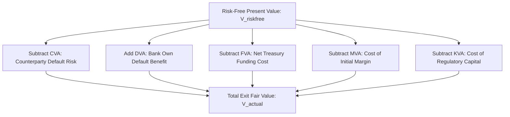
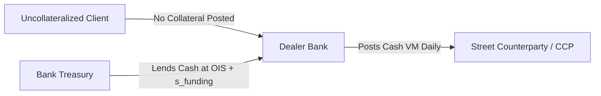

# XVA: Credit, Funding, Margin, and Capital Valuation Adjustments

## TL;DR

Total Valuation Adjustments (XVA) represent the suite of market-calibrated pricing deductions applied to uncollateralized or partially collateralized over-the-counter (OTC) derivatives to reconcile theoretical risk-free valuation with the real-world costs of counterparty default, funding asymmetries, regulatory margin posting, and capital allocation.
The master fair-value equation is: $V_{\text{actual}} = V_{\text{risk-free}} - \text{CVA} + \text{DVA} - \text{FVA} - \text{MVA} - \text{KVA}$.
Credit Valuation Adjustment (CVA) prices the expected loss from counterparty default; Debit Valuation Adjustment (DVA) reflects the counterparty's loss from the bank's own default (creating the accounting paradox where a deteriorating bank books paper profits).
Funding Valuation Adjustment (FVA) prices the uncollateralized treasury borrowing costs incurred when funding collateral requirements on offsetting street hedges.
Under Uncleared Margin Rules (UMR), Margin Valuation Adjustment (MVA) charges for funding segregated initial margin, while Capital Valuation Adjustment (KVA) prices the return demanded by bank shareholders for holding regulatory capital over the trade lifetime.

## Learning objectives

- Formulate the unified master XVA valuation equation across CVA, DVA, FVA, MVA, and KVA.
- Derive unilateral and bilateral CVA integrals using risk-neutral discount factors, Expected Exposure profiles, and hazard rates.
- Explain the Debit Valuation Adjustment (DVA) paradox and analyze the practical limits of hedging own credit risk.
- Structure Funding Valuation Adjustment (FVA), differentiating Funding Cost Adjustment (FCA) from Funding Benefit Adjustment (FBA).
- Formulate Margin Valuation Adjustment (MVA) based on forward-simulated ISDA SIMM initial margin profiles.
- Formulate Capital Valuation Adjustment (KVA) as the lifetime hurdle cost of holding regulatory capital (SA-CCR and CVA capital).
- Architect an enterprise XVA desk workflow, including pre-trade incremental pricing, internal transfer charges, and Greek hedging.

## Core concepts

### The Master XVA Fair-Value Equation

Prior to the 2008 financial crisis, derivatives were valued under the single-curve Black-Scholes or Libor framework, implicitly assuming that financial institutions were default-free and possessed unlimited funding at the risk-free rate.
In modern post-crisis markets, uncollateralized derivative transactions are priced by adjusting the idealized risk-free value $V_{\text{risk-free}}$ by the full spectrum of valuation adjustments:

$$V_{\text{actual}} = V_{\text{risk-free}} - \text{CVA} + \text{DVA} - \text{FVA} - \text{MVA} - \text{KVA} - \text{LVA}$$

| Valuation Adjustment | Economic Driver | Sign | Hedging Instrument |
| :--- | :--- | :--- | :--- |
| **CVA (Credit)** | Expected loss from counterparty default | Negative (cost) | Single-name CDS, CDX index |
| **DVA (Debit)** | Benefit from bank's own default option | Positive (benefit) | Cannot legally short own debt |
| **FVA (Funding)** | Uncollateralized funding spread over OIS | Net negative (cost) | Floating debt, Treasury repo |
| **MVA (Margin)** | Cost to fund segregated Initial Margin (SIMM) | Negative (cost) | Term funding lines |
| **KVA (Capital)** | Cost of equity hurdle on regulatory capital | Negative (cost) | Structural balance-sheet optimization |
| **LVA (Liquidity)** | Collateral basis spread (e.g., SOFR vs FedFunds) | Variable | Collateral switch agreements |

### Credit Valuation Adjustment (CVA)

Credit Valuation Adjustment is the expected present value of the loss caused by counterparty default over the transaction lifetime $[0, T]$.
Under the risk-neutral pricing measure $\mathbb{Q}$, assuming independence between market exposure and counterparty default:

$$\text{CVA} = (1 - R_C) \int_0^T P(0, t) \, \text{EE}^*(t) \, d\text{PD}_C(t)$$

where:
- $R_C$ is the counterparty recovery rate (standard corporate recovery $R_C = 0.40 \implies \text{LGD} = 0.60$).
- $P(0, t)$ is the risk-free discount factor to time $t$.
- $\text{EE}^*(t) = \mathbb{E}^{\mathbb{Q}}[\max(V(t), 0)]$ is the risk-neutral Expected Exposure.
- $d\text{PD}_C(t) = -\frac{d Q_C(t)}{dt} dt = \lambda_C(t) e^{-\int_0^t \lambda_C(s) ds} dt$ is the marginal probability density of counterparty default between $t$ and $t + dt$, calibrated to liquid single-name CDS spreads:

$$\lambda_C(t) \approx \frac{S_{\text{CDS}}(t)}{1 - R_C}$$

In discrete implementation over a time grid $0 = t_0 < t_1 < \dots < t_N = T$:

$$\text{CVA} \approx (1 - R_C) \sum_{i=1}^N P(0, t_i^*) \left( \frac{\text{EE}(t_{i-1}) + \text{EE}(t_i)}{2} \right) [Q_C(t_{i-1}) - Q_C(t_i)]$$

### Debit Valuation Adjustment (DVA) and the Accounting Paradox

Bilateral contracts recognize that the bank itself may default before the counterparty.
Debit Valuation Adjustment (DVA) is the expected present value of the gain to the bank (loss to the counterparty) if the bank defaults while the contract has negative value:

$$\text{DVA} = (1 - R_B) \int_0^T P(0, t) \, \text{ENE}^*(t) \, d\text{PD}_B(t)$$

where $\text{ENE}^*(t) = \mathbb{E}^{\mathbb{Q}}[\max(-V(t), 0)]$ is Expected Negative Exposure, and $\text{PD}_B(t)$ is the bank's own cumulative default probability calibrated to its senior unsecured bond or CDS spreads.
Under IFRS 13 and US GAAP (ASC 820), fair-value accounting mandates the inclusion of non-performance risk, requiring banks to book DVA as an asset.

#### The DVA Paradox
When a bank's own creditworthiness deteriorates (its CDS spread widens from 50 bps to 300 bps):
- $\text{PD}_B(t)$ surges, causing **DVA to increase**.
- The bank records an **accounting mark-to-market gain** in its quarterly earnings, artificially boosting reported profits during acute institutional distress.
- Conversely, when a bank strengthens and its credit spreads tighten, it must record a DVA accounting loss.
- Furthermore, **DVA cannot be effectively hedged**: a bank cannot legally short its own stock or buy CDS protection on itself to hedge DVA delta without triggering insider trading and insolvency violations.

### Funding Valuation Adjustment (FVA)

Funding Valuation Adjustment accounts for the funding costs incurred when an uncollateralized client trade is hedged in the interdealer market under a collateralized CSA:

Consider a dealer who sells an uncollateralized swap to an corporate client and hedges with an offsetting swap against a street dealer under a standard zero-threshold CSA.
If market rates move such that the hedge has negative value to the street:
1. The street requires the dealer to post cash Variation Margin equal to the mark-to-market liability.
2. Because the corporate client posts zero collateral, the dealer must borrow cash from its bank treasury at unsecured funding rate $r_{\text{funding}} = r_{\text{OIS}} + s_{\text{funding}}$.
3. The dealer posts this borrowed cash to the street, earning only the collateral interest rate (SOFR / OIS).
4. The dealer incurs a continuous cash drag equal to the funding spread $s_{\text{funding}} = r_{\text{funding}} - r_{\text{OIS}}$.

FVA decomposes into:
- **Funding Cost Adjustment (FCA):** The cost of borrowing cash to fund positive exposure:

$$\text{FCA} = \int_0^T s_{\text{borrow}}(t) \, P(0, t) \, \mathbb{E}^{\mathbb{Q}}[\max(V(t), 0)] \, dt$$

- **Funding Benefit Adjustment (FBA):** The benefit of receiving cash from the street and redeploying it into treasury operations:

$$\text{FBA} = \int_0^T s_{\text{lend}}(t) \, P(0, t) \, \mathbb{E}^{\mathbb{Q}}[\max(-V(t), 0)] \, dt$$

$$\text{FVA} = \text{FCA} - \text{FBA}$$

Under modern treasury conventions, many banks view FBA and DVA as overlapping accounting concepts for the same underlying funding option, leading to asymmetric pricing where dealers charge FCA on positive exposure but refuse to credit FBA on liabilities.

### Margin Valuation Adjustment (MVA)

Under the global Uncleared Margin Rules (UMR) mandated by BCBS-IOSCO, non-cleared derivatives between financial entities require the bilateral posting of segregated **Initial Margin (IM)**.
Initial Margin is calculated via the ISDA SIMM model to cover 10-day liquidation risk at a 99% confidence level.
Unlike Variation Margin, Initial Margin is segregated in third-party custodian accounts and cannot be rehypothecated to fund ongoing operations.
Margin Valuation Adjustment (MVA) is the expected cost of borrowing cash or pledging unencumbered securities to fund this regulatory initial margin over the trade life:

$$\text{MVA} = \int_0^T s_{\text{funding}}(t) \, P(0, t) \, \mathbb{E}^{\mathbb{Q}}[\text{IM}(t)] \, dt$$

Because SIMM IM is a non-linear function of portfolio sensitivities at each future time step, computing $\mathbb{E}[\text{IM}(t)]$ requires simulating nested Monte Carlo exposures or training fast neural network approximations.

### Capital Valuation Adjustment (KVA)

Under the Basel regulatory capital framework (Basel III / Basel IV), banks must maintain Common Equity Tier 1 (CET1) capital against derivative exposures:
- Credit Risk Capital (via SA-CCR)
- CVA Risk Capital (under the standard or basic CVA capital charge)
- Market Risk Capital (FRTB)

Bank equity shareholders demand a return on equity (Cost of Capital, $\text{CoC}$, typically $8\%$ to $12\%$ per annum) that exceeds the risk-free rate.
Capital Valuation Adjustment (KVA) is the cumulative discounted hurdle cost of holding regulatory capital over the entire life of the transaction:

$$\text{KVA} = \text{CoC} \int_0^T P(0, t) \, \mathbb{E}[\text{Capital}(t)] \, dt$$

Because regulatory capital depends on future net exposure, netting set composition, and counterparty credit rating migration, KVA represents a long-term capital charge passed directly to clients during pre-trade pricing.

### Enterprise XVA Desk Architecture and Hedging

To manage these complex multi-factor valuation adjustments, global investment banks establish centralized **XVA Desks**:

1. **Pre-Trade Pricing (Internal Transfer Pricing):** When a corporate sales desk quotes a 10-year uncollateralized swap, the pricing engine queries the central XVA engine to calculate incremental XVA:

$$\Delta \text{XVA} = \text{XVA}(\text{Netting Set} \cup \text{New Trade}) - \text{XVA}(\text{Netting Set})$$

The sales desk adds $\Delta \text{XVA}$ to the client quote and transfers the credit/funding risk to the XVA desk.
2. **CVA Market Risk Hedging:** As interest rates or asset prices move, Expected Exposure fluctuates, altering CVA.
The XVA desk delta-hedges market Greeks ($\frac{\partial \text{CVA}}{\partial S}$, $\frac{\partial \text{CVA}}{\partial r}$) in the liquid swap and equity futures markets.
3. **CVA Credit Risk Hedging:** As counterparty credit spreads widen, CVA increases.
The XVA desk hedges credit delta ($\frac{\partial \text{CVA}}{\partial S_{\text{CDS}}}$) by buying single-name CDS or proxy index baskets (CDX IG, iTraxx Europe).

## Worked examples

### Example 1: Bilateral CVA and DVA Numerical Evaluation

Using the reference implementation in `code/exposure_xva.py`, evaluate the Bilateral CVA and DVA for a 5-year interest rate swap with notional $\$10,000,000$.
Parameters:
- Flat risk-free discount rate: $r = 3.50\%$ ($P(0, t) = e^{-0.035 t}$).
- Counterparty hazard rate: $\lambda_C = 2.50\%$ per annum (par CDS spread $\approx 150$ bps), recovery rate $R_C = 40\%$ ($LGD_C = 0.60$).
- Bank own hazard rate: $\lambda_B = 1.50\%$ per annum (bank CDS spread $\approx 90$ bps), recovery rate $R_B = 40\%$ ($LGD_B = 0.60$).
- Swap exposure profile generated with $1,000$ paths and seed 42 exhibits peak Expected Exposure of $\$159,124.02$ at Year 2.3 (and $\$153,456.89$ at Year 2.5).
Evaluate CVA, DVA, and Net Bilateral Adjustment.

**Solution:**

Step 1: Compute marginal default probabilities:
Over each interval $[t_i, t_{i+1}]$:

$$d\text{PD}_C(t) = e^{-\lambda_C t_i} - e^{-\lambda_C t_{i+1}}$$

$$d\text{PD}_B(t) = e^{-\lambda_B t_i} - e^{-\lambda_B t_{i+1}}$$

Over 5 years:
- Counterparty 5-year cumulative default probability: $1 - e^{-0.025 \times 5} = 1 - e^{-0.125} \approx 1 - 0.8825 = 11.75\%$.
- Bank 5-year cumulative default probability: $1 - e^{-0.015 \times 5} = 1 - e^{-0.075} \approx 1 - 0.9277 = 7.23\%$.

Step 2: Numerical integration of CVA:
From trapezoidal quadrature in `exposure_xva.py`:

$$\text{CVA} = 0.60 \sum_{i=1}^{50} e^{-0.035 t_i^*} \left( \frac{\text{EE}_{i-1} + \text{EE}_i}{2} \right) d\text{PD}_C(t_i) = \$7,336.14$$

Step 3: Numerical integration of DVA:
Because the payer swap has symmetric receiver value under negative rate shocks, Expected Negative Exposure mirrors EE:

$$\text{DVA} = 0.60 \sum_{i=1}^{50} e^{-0.035 t_i^*} \left( \frac{\text{ENE}_{i-1} + \text{ENE}_i}{2} \right) d\text{PD}_B(t_i) = \$4,457.21$$

Step 4: Net Bilateral Adjustment:

$$\text{Net Adjustment} = \text{DVA} - \text{CVA} = \$4,457.21 - \$7,336.14 = -\$2,878.93$$

The bank deducts $\$2,878.93$ from the risk-free mark-to-market value of the swap to reflect net counterparty default exposure.

### Example 2: Pre-Trade Incremental MVA and FVA Pricing

A corporate client requests a 5-year uncollateralized interest rate swap with an expected positive exposure of $\text{EPE} = \$200,000$ and notional $N = \$10,000,000$.
The dealer must hedge the trade in the interdealer market under a collateralized CSA requiring daily variation margin.
Parameters:
- Bank unsecured borrowing funding spread: $s_{\text{funding}} = 80 \text{ bps/year} = 0.0080$.
- Average discount factor: $P(0, 2.5) \approx 0.916$.
- Average initial margin required by street clearing broker: $\mathbb{E}[\text{IM}] = \$150,000$.
- Cost of funding initial margin: $s_{\text{margin}} = 100 \text{ bps/year} = 0.0100$.
- Trade tenor $T = 5.0$ years.

Compute the incremental FVA and MVA charges that must be added to the trade price.

**Solution:**

Step 1: Compute Funding Valuation Adjustment (FVA / FCA):

$$\text{FCA} \approx s_{\text{funding}} \times \text{EPE} \times P(0, T/2) \times T$$

$$\text{FCA} \approx 0.0080 \times \$200,000 \times 0.916 \times 5.0 = \$1,600 \times 4.580 \approx \$7,328.00$$

Step 2: Compute Margin Valuation Adjustment (MVA):

$$\text{MVA} \approx s_{\text{margin}} \times \mathbb{E}[\text{IM}] \times P(0, T/2) \times T$$

$$\text{MVA} \approx 0.0100 \times \$150,000 \times 0.916 \times 5.0 = \$1,500 \times 4.580 \approx \$6,870.00$$

Step 3: Total Funding and Margin Charge:

$$\text{Total Funding Cost} = \text{FCA} + \text{MVA} = \$7,328 + \$6,870 = \$14,198.00$$

For a swap notional of $N = \$10,000,000$ and the midpoint annuity proxy $A = T \times P(0, T/2) = 5.0 \times 0.916 = 4.58$, this upfront fee translates to a running spread of $\frac{\$14,198}{\$10,000,000 \times 4.58} \approx 0.000310$ or $3.10 \text{ bps}$ added to the fixed rate paid by the client.

## Pitfalls

- **Double Counting DVA and FBA:** Booking both full DVA and full Funding Benefit Adjustment (FBA) double counts the bank's own default option, as funding liabilities cannot be defaulted on independently of derivative obligations.
- **Treating Unilateral CVA as Sufficient Under Accounting Standards:** US GAAP (ASC 820) and IFRS 13 mandate bilateral pricing including non-performance risk (DVA); ignoring DVA produces non-compliant regulatory audits.
- **Ignoring Incremental Netting Effects in Pre-Trade Pricing:** Quoting XVA on a standalone trade basis rather than calculating incremental impact on the existing netting set ($\Delta \text{XVA}$) causes the desk to turn away valuable risk-reducing trades.
- **Static Exposure Profiling in MVA Simulation:** Using initial day-1 SIMM margin for all 5 years of an amortizing trade severely overcharges MVA by ignoring portfolio decay.
- **Overlooking Unhedged Jump-to-Default in CVA Greeks:** Delta-hedging CVA using infinitesimal CDS spread sensitivities without hedging jump-to-default risk leaves the desk exposed to massive losses when a counterparty unexpectedly defaults.

## Interview questions

> [!question]- risk-xva-master-equation-components | State the master XVA valuation equation and define the economic rationale for each adjustment term.
> $V_{\text{actual}} = V_{\text{risk-free}} - \text{CVA} + \text{DVA} - \text{FVA} - \text{MVA} - \text{KVA}$. CVA deducts expected losses from counterparty default. DVA adds the benefit from the bank's own default option on negative mark-to-market liabilities. FVA prices the funding spread incurred borrowing collateral for street hedges against uncollateralized clients. MVA prices the cost of funding segregated initial margin (SIMM). KVA charges for the shareholder cost of holding regulatory equity capital over the trade life.

> [!question]- risk-dva-paradox-explanation | What is the DVA paradox, and why can banks not easily hedge DVA?
> The DVA paradox arises because DVA increases when a bank's own credit spread widens. Under fair-value accounting (IFRS 13), this generates paper mark-to-market profits during acute distress. DVA cannot be dynamically hedged in practice because doing so would require the bank to buy CDS protection on its own debt, which is legally prohibited and market-infeasible.

> [!question]- risk-fva-piterbarg-debate | What is the core economic debate surrounding Funding Valuation Adjustment (FVA) initiated by Piterbarg (2010)?
> Piterbarg proved that uncollateralized derivatives must be discounted at the dealer's unsecured borrowing rate rather than OIS. Modern finance academics argued that under Modigliani-Miller, individual projects should be discounted based on their asset risk rather than the firm's funding costs. Practitioners demonstrated that in real dealer banks, treasury operates under hard cash constraints: funding costs cannot be diversified away and must be priced to avoid negative cash flow bleeding.

> [!question]- risk-mva-calculation-driver | Why did Margin Valuation Adjustment (MVA) become a major pricing driver following Uncleared Margin Rules (UMR)?
> UMR mandated that financial counterparties exchange bilateral, segregated Initial Margin (IM) calculated via ISDA SIMM. Because IM is locked in third-party custodian accounts and cannot be rehypothecated to fund operations, dealers must raise dedicated term debt or pledge unencumbered cash. Over a 10-year trade, funding hundreds of millions in regulatory margin creates a massive cash drag that must be priced upfront via MVA.

> [!question]- risk-kva-cost-of-capital-driver | How is Capital Valuation Adjustment (KVA) formulated, and what is the typical Cost of Capital hurdle rate?
> KVA is formulated as $\text{KVA} = \text{CoC} \int_0^T P(0, t) \mathbb{E}[\text{Capital}(t)] dt$, where $\text{Capital}(t)$ is the regulatory capital required under Basel standards (SA-CCR, CVA capital, and FRTB). The Cost of Capital ($\text{CoC}$) reflects the return on equity demanded by bank shareholders, historically calibrated between $8\%$ and $12\%$ per annum.

> [!question]- risk-incremental-xva-pricing | Why must XVA be priced incrementally at the netting set level rather than on a standalone trade basis?
> XVA is deeply non-linear due to netting and collateralization. Adding a new trade that opposes existing positions reduces aggregate Expected Exposure, producing negative incremental CVA ($\Delta \text{CVA} < 0$). Pricing on a standalone basis would treat the trade as an additional cost, leading the bank to uncompetitively overprice trades that actually reduce overall firm risk.

> [!question]- risk-cva-greeks-market-vs-credit | Differentiate CVA market risk Greeks from CVA credit risk Greeks.
> CVA market risk Greeks ($\frac{\partial \text{CVA}}{\partial S}$, $\frac{\partial \text{CVA}}{\partial r}$) measure sensitivity to changes in the underlying market variables that drive Expected Exposure; they are hedged using standard vanilla swaps, futures, and options. CVA credit risk Greeks ($\frac{\partial \text{CVA}}{\partial S_{\text{CDS}}}$) measure sensitivity to counterparty hazard rates and credit spreads; they are hedged using single-name CDS and index tranches.

> [!question]- risk-unilateral-vs-bilateral-cva | Contrast unilateral CVA with bilateral CVA.
> Unilateral CVA assumes the bank is default-free ($\text{PD}_B = 0$) and equals $(1 - R_C) \int_0^T P(0, t) \, \text{EE}^*(t) \, d\text{PD}_C(t)$. The bilateral charge in this note is that unilateral CVA minus DVA, with DVA equal to $(1 - R_B) \int_0^T P(0, t) \, \text{ENE}^*(t) \, d\text{PD}_B(t)$. Neither integral is multiplied by the survival of the other party.

> [!question]- risk-fca-vs-fba-asymmetry | Why do many bank XVA desks charge clients for FCA but refuse to credit clients for FBA?
> FCA is an actual cash outflow paid to treasury when borrowing cash to post collateral. FBA represents a hypothetical funding benefit when receiving collateral from the street. However, in practice, a bank cannot readily monetize this liquidity unless treasury has an immediate commercial use for it. To prevent speculative dependency on unmonetizable liabilities, desks price FCA conservatively while damping or zeroing FBA.

> [!question]- risk-nested-monte-carlo-mva-challenge | Why does computing MVA pose a massive nested Monte Carlo computational challenge?
> Calculating MVA requires knowing the Expected Initial Margin $\mathbb{E}[\text{IM}(t)]$ at future dates $t$. Under ISDA SIMM, Initial Margin at time $t$ is calculated from portfolio sensitivities (Greeks) at time $t$. Computing future Greeks traditionally requires an inner simulation across the yield surface for every outer scenario path, creating an $O(N_{\text{outer}} \times N_{\text{inner}})$ nested simulation bottleneck that necessitates AAD or machine learning regression.

> [!question]- risk-xva-unilateral-vs-bilateral-integral | Contrast the mathematical integrals for unilateral CVA versus bilateral CVA and DVA.
> Unilateral CVA integrates counterparty default loss assuming the bank is default-free: $\text{CVA} = (1 - R_C) \int_0^T P(0, t) \text{EE}(t) d\text{PD}_C(t)$. Bilateral accounting introduces the bank's own default option through Debit Valuation Adjustment: $\text{DVA} = (1 - R_B) \int_0^T P(0, t) \text{ENE}(t) d\text{PD}_B(t)$. Net bilateral fair value adjustment equals $\text{DVA} - \text{CVA}$, directly deducting net credit exposure from risk-free mark-to-market.

> [!question]- risk-fca-vs-fba-asymmetric-pricing | Why do institutional dealers routinely charge clients FCA while zeroing or dampening FBA credits?
> Funding Cost Adjustment (FCA) is an actual cash outflow paid to corporate treasury when borrowing uncollateralized funds to post variation margin on street hedges. Funding Benefit Adjustment (FBA) represents a hypothetical treasury saving from receiving street collateral. In practice, dealers cannot reliably monetize incoming collateral unless treasury has an immediate commercial borrowing deficit, leading risk committees to conservatively price FCA while heavily haircutting FBA.

> [!question]- risk-kva-capital-hurdle-coc | Formulate the lifetime KVA integral and identify the typical shareholder Cost of Capital hurdle rate.
> Capital Valuation Adjustment prices the shareholder return demanded for holding regulatory equity capital: $\text{KVA} = \text{CoC} \int_0^T P(0, t) \mathbb{E}[\text{Capital}(t)] dt$. Here, $\mathbb{E}[\text{Capital}(t)]$ reflects forward-simulated Basel regulatory capital requirements (SA-CCR, CVA capital, and FRTB market risk), and $\text{CoC}$ represents the hurdle rate above the risk-free return demanded by equity investors (historically calibrated between 8% and 12%).

> [!question]- risk-pre-trade-incremental-xva-workflow | How does an enterprise XVA desk compute incremental XVA for new client quotes at the netting set level?
> The XVA engine simulates future portfolio exposure across the existing counterparty netting set, computing base XVA. It then inserts the prospective trade and re-evaluates the entire netting set, calculating incremental charge $\Delta \text{XVA} = \text{XVA}(\text{Netting Set} \cup \text{New Trade}) - \text{XVA}(\text{Netting Set})$. If the new trade offsets existing market delta, $\Delta \text{XVA}$ can be negative, allowing sales to offer an aggressive, risk-reducing quote.

> [!question]- risk-cva-credit-spread-delta-hedging | How does an XVA desk hedge counterparty credit spread risk, and what instruments are used?
> The sensitivity of CVA to counterparty credit spreads is credit delta: $\frac{\partial \text{CVA}}{\partial S_{\text{CDS}}} \approx (1 - R_C) \int_0^T P(0, t) \text{EE}(t) \frac{\partial d\text{PD}_C(t)}{\partial S_{\text{CDS}}}$. The XVA desk hedges this risk by purchasing single-name CDS protection on the counterparty or, when illiquid, shorting liquid credit index tranches (CDX Investment Grade or iTraxx Europe) weighted by sector and rating betas.

> [!question]- risk-jump-to-default-cva-risk | What is jump-to-default risk in CVA management, and why is infinitesimal delta hedging insufficient?
> Infinitesimal CDS spread delta hedging protects against continuous, small credit spread fluctuations. If a counterparty suddenly defaults without warning (a jump-to-default), the CDS spread jumps to infinity and the full replacement exposure $\text{LGD} \times \max(V, 0)$ is immediately realized. A continuous delta hedge sized only for local spread moves suffers a catastrophic loss, requiring the desk to hold jump-to-default notional protection.

## Further reading

- Jon Gregory, *The xVA Challenge: Counterparty Credit Risk, Funding, Collateral and Capital*, 4th Edition.
- Andrew Green, *XVA Desks: A New Order for Derivatives*, Palgrave Macmillan.
- Vladimir Piterbarg (2010), "Funding Beyond Discounting: Collateral Agreements and Derivatives Pricing", *Risk Magazine*.
- Leif Andersen and Mark Piterbarg, *Interest Rate Modeling, Volume I: Foundations and Vanilla Models*, Chapters 18-20.
- Darrell Duffie and Kenneth J. Singleton, *Credit Risk: Pricing, Measurement, and Management*, Chapter 8.

## In this repo and SDE-Interview-Prep

- Counterparty credit risk analytics: [Counterparty Credit Risk Analytics](14-Counterparty-Credit-Risk-Analytics.md).
- Multi-curve and CSA discounting: [Multi-Curve and CSA Discounting](../06-Fixed-Income-and-Asset-Classes/13-Multi-Curve-and-CSA-Discounting.md).
- Python reference implementation of bilateral CVA and DVA: [exposure_xva.py](code/exposure_xva.py).
- Numerical verification of bilateral XVA, FVA, MVA, and KVA: [risk_xva_pricing.py](code/risk_xva_pricing.py).
- Risk-neutral Monte Carlo simulation: [Scenario Generation](11-Scenario-Generation.md).
