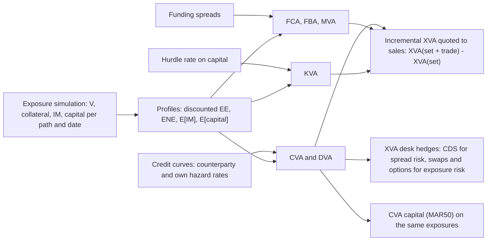

# XVA: Credit, Funding, Margin, and Capital Valuation Adjustments

## TL;DR

- XVA adjusts the collateralised, default-free value of a derivative for counterparty default (CVA), own default (DVA), funding of uncollateralised positions (FVA), funding of initial margin (MVA) and the cost of regulatory capital (KVA); which of them enter accounting fair value, which only pricing, is a policy choice that must be stated.
- Unilateral CVA is $\text{LGD}_C\int_0^T E[D(t)E_t]\,dPD_C(t)$; on a 10m 5-year payer swap with a 150bp counterparty it is 8,994 (semi-analytic, from swaption prices), with the Monte Carlo within 0.4%; the spread-times-exposure shortcut gives 9,491.
- Bilateral CVA subtracts DVA (2,925 here), with or without first-to-default survival weighting (5,934 against 6,069); DVA rises when your own credit worsens (by 6,149 here if your hazard went from 1.5% to 5%) and is derecognised from CET1 (CAP30.15).
- Wrong-way risk changes CVA at an unchanged default curve: in a Hull-White hazard model that only moves the dependence parameter, CVA went from about 8,990 (independent) to about 20,310 (strong wrong-way) and about 4,870 (right-way).
- FVA, MVA and KVA are funding and capital costs over the trade's life: here about 2,379, 3,871 and 18,130, so capital dominates; the total of about 30,450 is about 6.58bp a year on the swap rate.

## Learning objectives

- Formulate the master XVA valuation equation across CVA, DVA, FVA, MVA, and KVA, and say which terms are prices and which are costs.
- Derive unilateral and bilateral CVA integrals using discount factors, Expected Exposure profiles, and hazard rates.
- Explain the DVA paradox, its regulatory treatment and the limits of hedging own credit risk.
- Structure FVA as FCA and FBA and explain its overlap with DVA.
- Formulate MVA from simulated initial margin and KVA from simulated regulatory capital.
- Quantify wrong-way risk with a model that holds the default curve fixed.
- Price incrementally at the netting-set level and describe the XVA desk's workflow and hedges.

## Core concepts

### The XVA stack

$$V = V_{\text{rf}} - \text{CVA} + \text{DVA} - \text{FVA} - \text{MVA} - \text{KVA},$$

where $V_{\text{rf}}$ is the value of the trade under perfect collateralisation (discounted at the collateral rate) and $\text{FVA} = \text{FCA} - \text{FBA}$.

| Adjustment | Economic driver | Exposure input | Typical hedge |
| :--- | :--- | :--- | :--- |
| CVA | counterparty default | discounted EE | single-name or index CDS, plus market-risk hedges of the exposure |
| DVA | own default | discounted ENE | cannot sell protection on itself; proxies only |
| FCA, FBA | unsecured funding of uncollateralised positions or their collateralised hedges | discounted EE and ENE | treasury funding, not hedged in the market |
| MVA | funding segregated initial margin | expected discounted IM | IM optimisation (compression, clearing, collateral choice) |
| KVA | return required on regulatory capital held for the trade | expected discounted capital | capital relief trades, netting, clearing |

CVA and DVA are fair-value adjustments under IFRS 13, which requires the fair value of a liability to reflect non-performance risk including the entity's own credit (IFRS 13 paragraph 42).
Whether FVA belongs in fair value is an accounting policy question on which banks have differed (fair value is an exit price, and funding costs are specific to the holder), while KVA is a pricing and performance charge rather than an accounting entry; say which convention a number uses.

### CVA

With counterparty default time $\tau_C$, recovery $R_C$ and exposure $E_t = \max(V_t - C_t, 0)$, and assuming default is independent of exposure,

$$\text{CVA} = (1 - R_C)\,E\left[D(\tau_C)E_{\tau_C}1\{\tau_C \le T\}\right] = \text{LGD}_C\int_0^T E[D(t)E_t]\,dPD_C(t).$$

A flat hazard $\lambda$ gives $PD(t) = 1 - e^{-\lambda t}$, and the credit triangle $s \approx \lambda\,\text{LGD}$ ties it to the CDS spread: $\lambda = 2.5\%$ with LGD 60% is a 150bp spread, and a 5-year default probability of 0.117503.
Discretised on the exposure grid,

$$\text{CVA} \approx \text{LGD}_C\sum_k \tfrac12\left(\text{DEE}_{t_{k-1}} + \text{DEE}_{t_k}\right)\left(e^{-\lambda t_{k-1}} - e^{-\lambda t_k}\right).$$

The quick approximation $\text{CVA} \approx s\int_0^T \text{DEE}(t)\,dt$ ignores survival and overstates slightly.

### DVA and bilateral CVA

DVA is the same integral on the negative side, with the bank's own default: $\text{DVA} = \text{LGD}_B\int_0^T E[D(t)\max(C_t - V_t, 0)]\,dPD_B(t)$.
Two conventions for the bilateral adjustment:

- Simple: $\text{CVA} - \text{DVA}$ with each integral ignoring the other party's default.
- First-to-default: each integrand is weighted by the other party's survival, because only the first default triggers the close-out.

DVA rises when the bank's own spread widens, so a weakening bank reports gains; it cannot be hedged directly (a bank cannot buy meaningful protection on itself), and proxies such as indices of peer banks leave basis risk.
Regulators remove it from capital: all accounting valuation adjustments on derivative liabilities from the bank's own credit risk are derecognised from CET1, and offsetting own-credit adjustments against counterparty CVA is not allowed (CAP30.15).
Regulatory CVA for capital also excludes DVA (MAR50.3), as covered in [CVA Capital Charge](../17-Regulatory-Capital-Basel-and-FRTB/05-CVA-Capital-Charge-SA-CVA-and-BA-CVA.md).

### Wrong-way risk without moving the default curve

Independence is the assumption that breaks first.
Hull and White (2012) model the hazard as $\lambda(t) = \exp(a(t) + b\,V_t)$: $a(t)$ is recalibrated so the unconditional survival curve still matches the CDS curve, and $b$ alone controls the dependence ($b > 0$ wrong-way, $b < 0$ right-way).
That is a one-change-at-a-time experiment: the code changes only $b$, re-solves $a(t)$ interval by interval (survival curve reproduced to $10^{-10}$), and reruns the same paths; $b = 0$ reproduces the independent CVA exactly.

### FVA and its overlap with DVA

When a dealer trades uncollateralised with a client and hedges with a collateralised trade in the market, the hedge's variation margin must be funded when the client trade is in the money (the hedge is out of the money) and is received when it is not.
If the dealer borrows at the collateral rate plus a spread $s_b$ and lends excess cash at the collateral rate plus $s_l$,

$$\text{FCA} = \int_0^T s_b(t)\,\text{DEE}(t)\,dt, \qquad \text{FBA} = \int_0^T s_l(t)\,\text{DENE}(t)\,dt$$

(optionally weighted by both parties' survival).
Two debates: whether FVA belongs in value at all (Hull and White 2012 argue that funding costs should not affect the valuation of a derivative, by the same reasoning as Modigliani-Miller; Andersen, Duffie and Song 2019 show that funding costs are a real transfer from shareholders to creditors, so they belong in pricing to shareholders but not in a market value), and how FBA overlaps DVA.
If the bank's funding spread is its own credit spread, $s_l = \lambda_B\,\text{LGD}_B$ and FBA weighted by own survival equals DVA to first order: in the example it is 2,925 against a DVA of 2,925 (ratio 1.000), so booking both counts the same benefit twice.
Burgard and Kjaer (2011) derive the combined adjustment from a replication argument in which the outcome depends on how the bank funds and what it can repurchase on default.

### MVA

Initial margin on non-cleared trades between covered entities is a 99% 10-day potential future exposure, exchanged gross and segregated (MGN20.9, MGN20.40 to MGN20.41), so it must be funded for the life of the trade:

$$\text{MVA} = \int_0^T s_{IM}(t)\,E[D(t)\,\text{IM}_t]\,dt,$$

where $s_{IM}$ is the funding spread net of what posted IM earns.
$\text{IM}_t$ is a nonlinear function of the portfolio's sensitivities at $t$, so $E[\text{IM}_t]$ needs IM computed on every path and date: by nested simulation, by regression of IM on path state, or with pathwise sensitivities (AAD) fed into a SIMM-style formula.
The code uses a labelled delta-normal stand-in: $\text{IM}_t = z_{0.99}\,|\partial V_t/\partial x_t|\,\text{sd}(\Delta x \text{ over 10 days})$ on each path.

### KVA

Capital held against the trade (counterparty credit capital from SA-CCR or IMM, CVA capital, market risk capital on hedges) must earn a hurdle rate $h$ in excess of what it earns invested:

$$\text{KVA} = \int_0^T h\,E[D(t)\,K_t]\,dt.$$

$K_t$ depends on the future state (SA-CCR replacement cost and multiplier depend on the future value), so it is simulated pathwise; in the example $K_t$ is SA-CCR EAD times an 8% charge at a 100% risk weight plus reduced BA-CVA with $RW = 3\%$ (MAR50.16, consumer goods and services, IG) and the 0.65 discount scalar (MAR50.14).
KVA is not a market price: the hurdle rate is a management choice, so KVA belongs to pricing and performance measurement.

### The XVA desk

- Pricing: sales request a quote, the engine prices the incremental $\Delta\text{XVA} = \text{XVA}(\text{set} + \text{trade}) - \text{XVA}(\text{set})$ against the existing netting set, and the charge is added to the client price.
- Hedging: CVA moves with the counterparty spread (hedged with CDS) and with every market factor that moves exposure (hedged with swaps, FX forwards, options); CVA sensitivities come from AAD or bump-and-revalue of the whole simulation with common random numbers, and SA-CVA capital uses the same sensitivities (MAR50.47 FAQ1).
- Jump to default is not hedged by spread delta: when a counterparty defaults the CVA becomes a realised loss in one step.

## Worked examples

All numbers are printed and asserted by `python 11-Risk-and-Trading/code/risk_xva_pricing.py`; the exposure model is the Hull-White swap of [Counterparty Credit Risk Analytics](14-Counterparty-Credit-Risk-Analytics.md): 10m 5-year quarterly payer at the par rate, 50,000 paths.

### Example 1: unilateral and bilateral CVA

Counterparty hazard 2.5% (150bp), bank hazard 1.5% (90bp), both LGD 60%.

1. Discounted EE from the Jamshidian swaption prices, integrated against the default probabilities on the quarterly grid: CVA 8,994.
2. The same integral on the simulated profile: about 8,965, a relative gap of $-0.0032$.
3. DVA from the receiver swaptions (discounted ENE): 2,925 (simulation about 2,934).
4. Simple bilateral adjustment: $8{,}994 - 2{,}925 = 6{,}069$; first-to-default: $8{,}712 - 2{,}778 = 5{,}934$.
5. Shortcut $s\int\text{DEE}\,dt$ with $s = 150$bp: 9,491, 5.5% high because it ignores survival.
6. CS01: a 1bp wider counterparty spread raises CVA by 56.74, the notional of 5-year CDS protection the desk would buy is the amount whose CS01 matches it.
7. As a running spread: with annuity $\sum\tau_i P(0, t_i) = 4.6295$, the bilateral 6,069 is 1.31bp a year on 10m.
8. DVA paradox: if the bank's own hazard rose to 5%, DVA would be 9,074, a gain of 6,149 from its own deterioration.

### Example 2: wrong-way risk at a fixed default curve

Hazard $\lambda_t = \exp(a_t + b\,V_t/N)$ on each quarter, $a_t$ recalibrated so the survival curve stays $e^{-0.025t}$; exposure at the end of each interval.

| $b$ | CVA (about) |
| ---: | ---: |
| $-20$ (right-way) | 4,870 |
| 0 (independent) | 8,990 |
| $+20$ (wrong-way) | 14,510 |
| $+40$ (wrong-way) | 20,310 |

The payer swap is in the money when rates have risen, so $b > 0$ describes a counterparty that weakens as rates rise.
With $b = 40$ the CVA is 2.26 times the independent value although the counterparty's spread curve, the exposure paths and the recovery are identical: the difference is only the dependence.

### Example 3: FVA, MVA, KVA and the all-in charge

1. Funding spread 80bp both ways: FCA 5,062, FBA 2,683, FVA 2,379; weighting by both survivals cuts FCA to 4,647.
2. FBA at the bank's own credit spread (90bp) weighted by its survival: 2,925, equal to DVA (ratio 1.000), which is the double-counting argument.
3. Initial margin today from the delta-normal stand-in: 191,334, close to the MGN20.16 schedule's 2% of notional, 200,000 (the swap's annuity of 4.6295 years puts it in the 2 to 5 year duration bucket); expected discounted IM at 2.5 years about 97,300; MVA at 80bp about 3,871.
4. Capital today: SA-CCR EAD 309,679, counterparty credit capital 24,774, BA-CVA capital 19,082; KVA at a 10% hurdle about 18,130.
5. Total XVA $\approx 6{,}069 + 2{,}379 + 3{,}871 + 18{,}130 \approx 30{,}450$, about 6.58bp a year: capital, not credit, is the largest cost of this trade.
6. Incrementally, adding a 2-year receiver swap to the netting set lowers CVA from 8,994 to about 7,870, an incremental CVA of about $-1{,}100$ although the receiver's stand-alone CVA is about 528.

## Pitfalls

- Mixing conventions: unilateral or bilateral, first-to-default or not, survival-weighted funding or not; state them.
- Booking FBA and DVA in full when the funding spread is own credit: the same benefit twice.
- Pricing XVA trade by trade: a risk-reducing trade gets a positive charge instead of a credit (incremental CVA $-1{,}100$ in Example 3).
- Using today's IM or capital for the whole life: both decay with the trade and move with the market, so use simulated profiles.
- Assuming independence of default and exposure: in Example 2 the dependence alone more than doubled CVA.
- Hedging CVA spread delta and calling it hedged: jump to default remains.
- Using credit-triangle shortcuts for limits or capital: they ignore survival and the shape of the profile.
- Treating KVA as a market price: the hurdle rate is internal, so KVA numbers from two banks are not comparable.

## Interview questions

> [!question]- risk-xva-master-equation-components | State the master XVA valuation equation and the economic rationale for each adjustment term.
> $V = V_{\text{rf}} - \text{CVA} + \text{DVA} - \text{FVA} - \text{MVA} - \text{KVA}$, with $V_{\text{rf}}$ the fully collateralised value.
> CVA: expected loss from counterparty default; DVA: the mirror for own default; FVA: funding uncollateralised exposure (FCA minus FBA); MVA: funding segregated initial margin; KVA: return required on capital held for the trade.
> CVA and DVA are IFRS 13 fair value; FVA in fair value is an accounting policy choice; KVA is a pricing charge only.

> [!question]- risk-dva-paradox-explanation | What is the DVA paradox, and why can banks not easily hedge DVA?
> DVA rises when the bank's own credit worsens, so a weakening bank books gains: in the example DVA goes from 2,925 to 9,074 if its hazard rises from 1.5% to 5%.
> It cannot be hedged directly because a bank cannot meaningfully buy protection on itself; peer-bank proxies leave basis risk.
> CET1 derecognises it and forbids netting it against CVA (CAP30.15).

> [!question]- risk-fva-piterbarg-debate | What is the core debate around Funding Valuation Adjustment?
> Piterbarg (2010) showed that collateral terms change the discounting rate, so a collateralised trade discounts at the collateral rate and funding spreads enter uncollateralised pricing; that put funding into derivative valuation.
> Hull and White (2012) argued that funding costs should not affect a derivative's value, by Modigliani-Miller reasoning; Andersen, Duffie and Song (2019) showed funding costs are a real transfer from shareholders to creditors, so they belong in the price a dealer charges but not in the market value.
> Whatever the policy, the FBA-DVA overlap must be handled consistently.

> [!question]- risk-mva-calculation-driver | Why did Margin Valuation Adjustment (MVA) become a major pricing driver following the uncleared margin rules?
> Covered entities must exchange initial margin equal to a 99% 10-day potential future exposure (MGN20.9), gross and segregated, with rehypothecation only under strict conditions (MGN20.40 to MGN20.41), so it has to be funded for the trade's life.
> For the 10m 5-year swap example, IM starts near 191,334 and MVA at an 80bp funding spread is about 3,871.

> [!question]- risk-kva-cost-of-capital-driver | How is Capital Valuation Adjustment (KVA) formulated, and what drives it?
> $\text{KVA} = \int_0^T h\,E[D(t)K_t]\,dt$, with $K_t$ the simulated regulatory capital (counterparty credit, CVA, market risk on hedges) and $h$ the hurdle rate in excess of what capital earns.
> In the example (SA-CCR capital plus reduced BA-CVA, $h = 10\%$) KVA is about 18,130, the largest component of a total of about 30,450.
> $h$ is a management choice, so KVA is a pricing charge, not a market price.

> [!question]- risk-incremental-xva-pricing | Why must XVA be priced incrementally at the netting set level rather than on a standalone trade basis?
> Exposure, collateral and capital are computed per netting set, so a trade's cost is $\text{XVA}(\text{set} + \text{trade}) - \text{XVA}(\text{set})$, which can be negative.
> Adding a 2-year receiver to the 5-year payer lowered CVA by about 1,100 although the receiver's stand-alone CVA was about 528.

> [!question]- risk-cva-greeks-market-vs-credit | Differentiate CVA market risk Greeks from CVA credit risk Greeks.
> Market Greeks are sensitivities of CVA to the factors that move exposure (rates, FX, vols), hedged with swaps, forwards and options; credit Greeks are sensitivities to the counterparty's spread curve, hedged with CDS.
> In the example the CVA CS01 is 56.74 per bp; cross-gamma between spread and exposure (wrong-way risk) and jump to default are what the simple hedges miss.

> [!question]- risk-unilateral-vs-bilateral-cva | Contrast unilateral CVA with bilateral CVA.
> Unilateral: the bank is default-free; $\text{LGD}_C\int\text{DEE}\,dPD_C$, 8,994 in the example.
> Bilateral: subtract DVA, either ignoring the other party's default (6,069 here) or weighting each side by the other's survival because only the first default matters (5,934 here).
> Regulatory CVA for capital is unilateral (no DVA, MAR50.3).

> [!question]- risk-fca-vs-fba-asymmetry | Why do many bank XVA desks charge clients for FCA but give little or no credit for FBA?
> FCA is a cash cost when the bank funds hedge margin at its unsecured spread; FBA assumes excess cash can be deployed at that spread, which treasury may not be able to do.
> And if the funding spread is the bank's own credit spread, FBA overlaps DVA: in the example FBA at 90bp with own-survival weighting is 2,925, equal to DVA, so booking both double counts.

> [!question]- risk-nested-monte-carlo-mva-challenge | Why does computing MVA pose a nested Monte Carlo challenge?
> IM at a future date is a function of the portfolio's sensitivities there, which in principle need an inner valuation on every outer path and date.
> Engines avoid the nesting with pathwise sensitivities (AAD) fed into the IM formula, regressions of IM on path state, or proxies such as the delta-normal IM used in the example.

> [!question]- risk-cva-semi-analytic-check | How would you validate the CVA of a simple swap produced by a Monte Carlo XVA engine?
> Replace the simulated discounted EE by closed-form swaption prices at each grid date (Jamshidian under Hull-White) and redo the integral: 8,994 semi-analytic against about 8,965 from the simulation.
> A gap well outside Monte Carlo error points at discounting, grid or payment-timing bugs.

> [!question]- risk-credit-triangle-cva | What is the quick CVA approximation, and how good is it?
> $\text{CVA} \approx s\int_0^T\text{DEE}(t)\,dt$ with $s = \lambda\,\text{LGD}$, which drops the survival probability from the default density.
> For the 5-year swap with $s = 150$bp it gives 9,491 against 8,994, 5.5% high; the error grows with spread and maturity.

> [!question]- risk-wwr-hull-white-control | How would you measure the effect of wrong-way risk on CVA without changing the counterparty's credit curve?
> Use a hazard model $\lambda_t = \exp(a_t + bV_t)$ and recalibrate $a_t$ so the unconditional survival curve is unchanged (Hull and White 2012); then only $b$ moves.
> In the example CVA was about 4,870 at $b = -20$, about 8,990 at $b = 0$ and about 20,310 at $b = 40$, with the survival curve reproduced to $10^{-10}$.

> [!question]- risk-fba-dva-overlap | Show that FBA and DVA can be the same number.
> If the bank lends at its own credit spread $s = \lambda_B\,\text{LGD}_B$ and weights by its own survival, $s\int\text{DENE}\,e^{-\lambda_B t}dt = \text{LGD}_B\int\text{DENE}\,\lambda_B e^{-\lambda_B t}dt = \text{DVA}$.
> Numerically 2,925 against 2,925 in the example.

> [!question]- risk-xva-running-spread | How do you turn an upfront XVA charge into a spread on a swap rate?
> Divide by notional times the swap annuity: here $\sum\tau_i P(0, t_i) = 4.6295$, so a 30,450 total charge on 10m is about 6.58bp a year and the bilateral CVA alone (6,069) is 1.31bp.

> [!question]- risk-dva-cet1-derecognition | How does Basel treat DVA in regulatory capital?
> CET1 derecognises unrealised gains and losses from changes in own credit on fair-valued liabilities and all accounting valuation adjustments on derivative liabilities from own credit, with no offset against counterparty CVA (CAP30.15).
> Regulatory CVA for the CVA capital charge excludes DVA too (MAR50.3).

> [!question]- risk-cva-cs01-hedge | Your CVA on a counterparty is 8,994 and rises by 56.74 for a 1bp wider spread. How do you hedge it, and what is left?
> Buy CDS protection on the counterparty (or a proxy) with a matching CS01 of 56.74 per bp, and hedge the exposure's market sensitivities with swaps.
> Left: jump to default (the CVA becomes a realised loss of the exposure at default), basis to proxies, the cross-gamma between spread and exposure, and the change in CS01 as exposure moves.

> [!question]- risk-xva-unilateral-vs-bilateral-integral | Contrast the integrals for unilateral CVA and for bilateral CVA and DVA.
> Unilateral: $\text{CVA} = \text{LGD}_C\int_0^T E[D(t)E_t]\,dPD_C(t)$, 8,994 in the swap example.
> DVA is the same on the negative side with the bank's default: $\text{LGD}_B\int_0^T E[D(t)\max(-V_t, 0)]\,dPD_B(t)$, 2,925.
> The bilateral deduction from the default-free value is $\text{CVA} - \text{DVA} = 6{,}069$, or 5,934 if each side is weighted by the other's survival (first-to-default).

> [!question]- risk-fca-vs-fba-asymmetric-pricing | Why do dealers often charge FCA in full but haircut FBA?
> FCA is a real cost of funding hedge margin at the bank's unsecured spread; FBA assumes excess cash can be redeployed at that spread, which treasury may not be able to do, and it overlaps DVA when the spread is the bank's own credit.
> In the example, at 80bp both ways, FCA is 5,062 and FBA 2,683; a desk that credits no FBA charges 5,062 instead of the symmetric 2,379.

> [!question]- risk-kva-capital-hurdle-coc | Formulate the lifetime KVA integral and say what sets the hurdle rate.
> $\text{KVA} = \int_0^T h\,E[D(t)K_t]\,dt$, with $K_t$ the simulated regulatory capital (SA-CCR counterparty credit, CVA capital, market risk on hedges) and $h$ the return required on capital in excess of what it earns.
> $h$ is set by management from the bank's cost of equity, so KVA is a pricing charge, not a market price; at a labelled 10% the swap example's KVA is about 18,130.

> [!question]- risk-pre-trade-incremental-xva-workflow | How does an XVA desk compute incremental XVA for a new client quote?
> Re-simulate the existing netting set with and without the trade on the same paths (common random numbers) and charge $\text{XVA}(\text{set} + \text{trade}) - \text{XVA}(\text{set})$; fast engines reuse the stored set profile and add the trade pathwise.
> The charge can be negative: adding a 2-year receiver to the 5-year payer lowered CVA by about 1,100.

> [!question]- risk-cva-credit-spread-delta-hedging | How does an XVA desk hedge counterparty credit spread risk, and with what instruments?
> Compute CS01 by bumping the counterparty's spread curve (or by AAD) and buy single-name CDS protection with matching CS01, or index CDS as a proxy for names without a liquid CDS.
> In the example CS01 is 56.74 per bp of spread; proxies leave basis risk, and the exposure side is hedged separately with swaps.

> [!question]- risk-jump-to-default-cva-risk | What is jump-to-default risk in CVA management, and why is spread delta hedging insufficient?
> On default the CVA is replaced by a realised loss of $\text{LGD} \cdot \max(V_\tau, 0)$, a discrete jump that a hedge sized to small spread moves does not match.
> A CDS bought to match CS01 pays LGD times its notional on default, which generally differs from the realised exposure loss; desks monitor and limit jump-to-default separately.

## In this repo and SDE-Interview-Prep

- [risk_xva_pricing.py](code/risk_xva_pricing.py): semi-analytic and simulated CVA and DVA, first-to-default weighting, the credit-triangle shortcut, CS01, Hull-White wrong-way risk with recalibrated survival, FCA, FBA, the FBA-DVA overlap, delta-normal IM and MVA, SA-CCR and BA-CVA capital and KVA, incremental CVA; every number above. Exposures come from [risk_ccr_analytics.py](code/risk_ccr_analytics.py).
- Exposure: [Counterparty Credit Risk Analytics](14-Counterparty-Credit-Risk-Analytics.md); capital: [CVA Capital Charge](../17-Regulatory-Capital-Basel-and-FRTB/05-CVA-Capital-Charge-SA-CVA-and-BA-CVA.md), [Counterparty Credit Risk: SA-CCR](../17-Regulatory-Capital-Basel-and-FRTB/04-Counterparty-Credit-Risk-SA-CCR.md), [Capital-Aware Trading, KVA and RWA Limits](../17-Regulatory-Capital-Basel-and-FRTB/20-Capital-Aware-Trading-KVA-and-RWA-Limits.md); production: [XVA Engine](../18-Pricing-and-Risk-Systems/11-XVA-Engine.md).
- Discounting and credit background: [Multi-Curve and CSA Discounting](../06-Fixed-Income-and-Asset-Classes/13-Multi-Curve-and-CSA-Discounting.md), [Credit and CDS](../06-Fixed-Income-and-Asset-Classes/06-Credit-and-CDS.md).

## Further reading

- J. Gregory, *The xVA Challenge*, 4th edition, Wiley 2020.
- A. Green, *XVA: Credit, Funding and Capital Valuation Adjustments*, Wiley 2015.
- V. Piterbarg, "Funding beyond discounting: collateral agreements and derivatives pricing", *Risk* 23(2), 97-102, 2010.
- C. Burgard and M. Kjaer, "Partial differential equation representations of derivatives with bilateral counterparty risk and funding costs", *Journal of Credit Risk* 7(3), 75-93, 2011.
- J. Hull and A. White, "The FVA debate", *Risk* 25(7), 83-85, 2012; and "CVA and wrong-way risk", *Financial Analysts Journal* 68(5), 58-69, 2012.
- L. Andersen, D. Duffie and Y. Song, "Funding value adjustments", *Journal of Finance* 74(1), 145-192, 2019.
- IFRS Foundation, IFRS 13 *Fair Value Measurement*, paragraph 42; Basel Framework CAP30.15 and MAR50.
