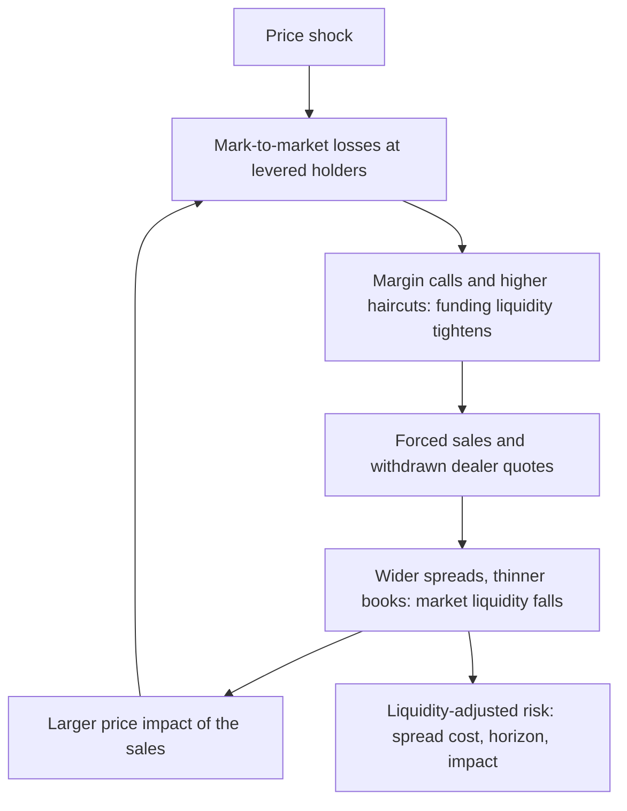
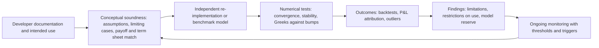

# Liquidity and Model Risk

## TL;DR

- Risk numbers assume you can exit at mid in a day and that the pricing model is right; liquidity risk and model risk are the costs of those two assumptions failing, and both are largest exactly when markets are stressed.
- Exogenous liquidity cost is half the spread at a stressed level (Bangia et al. 1999); endogenous cost comes from your own size and speed (Almgren-Chriss); liquidating over $L$ days by equal daily sales scales the 1-day sd by $\sqrt{(L+1)(2L+1)/(6L)}$, 1.3693 for $L = 4$, not $\sqrt L$.
- A liquidation schedule has a cost distribution: on the example, TWAP had expected shortfall 300,000 but sd 1,095,445, while selling everything at once cost 1,000,000 with no risk, and $E + z_{0.99}\,\text{sd}$ was lowest for the fastest schedule.
- Funding and market liquidity feed each other (Brunnermeier and Pedersen 2009): in a stylised margin spiral, forced sales amplified a price shock by 1.0991 at 10% margin and 1.2270 at 5%.
- US model risk guidance changed on 17 April 2026: SR 26-2 (Federal Reserve, OCC, FDIC) superseded SR 11-7 and is risk-based and non-binding; validation still means conceptual soundness, outcomes analysis and ongoing monitoring, and model reserves quantify what validation finds (0.246 per unit for continuous against daily barrier monitoring in the example).

## Learning objectives

- Differentiate exogenous liquidity risk (bid-ask spread and market depth) from endogenous liquidity risk (order size and market impact).
- Analyze the Brunnermeier-Pedersen liquidity spiral linking market liquidity to funding liquidity.
- Formulate the Almgren-Chriss optimal liquidation framework and use its cost distribution as a risk measure.
- Compute Liquidity-Adjusted Value at Risk (L-VaR) with spread costs and multi-day liquidation horizons, and relate it to FRTB liquidity horizons.
- Classify model risk failure modes across conceptual unsoundness, implementation errors, calibration and misuse.
- State the current US supervisory guidance on model risk management (SR 26-2) and what changed from SR 11-7.
- Design a validation plan and quantify a model reserve.

## Core concepts

### Liquidity risk: two kinds, one feedback loop

- Exogenous (market) liquidity: spread, depth and resiliency of the market, the same for every participant; it widens in stress.
- Endogenous liquidity: the cost of your own trade, which grows with size relative to volume and with urgency; the square-root law and the Almgren-Chriss model in [Market Impact Models](../07-Market-Microstructure/06-Market-Impact-Models.md) and [Optimal Execution](../07-Market-Microstructure/07-Optimal-Execution-Almgren-Chriss.md) are the working tools.
- Funding liquidity: the ability to meet margin and cash obligations.
  Brunnermeier and Pedersen (2009) show that the two reinforce each other: when margins rise with volatility, losses force sales that reduce market liquidity, which raises volatility and margins again (a margin spiral), and losses on existing positions force further deleveraging (a loss spiral).

A stylised spiral: a fund holds $Q$ units at price $p$ at its margin limit $Qp \le E/m$; an exogenous shock lowers the price, it sells just enough to restore the limit, and each unit sold moves the price by $\lambda$.
Linearising, the total price fall is the shock times $1/(1 - \lambda Q(1/m - 1)/p)$, and it diverges when $\lambda Q(1/m - 1)/p \to 1$.
With $Q = 1\text{m}$, $p = 100$, $\lambda = 10^{-6}$ and a shock of 1: amplification 1.0989 at $m = 10\%$ (iterating the nonlinear process round by round, each round's sales executed at that round's pre-impact price: 1.0991, selling 99,101 units) and 1.2346 at $m = 5\%$ (nonlinear 1.2270); at $m = 5\%$ a spiral needs $\lambda Q/p = 1/19 = 0.052632$.
Leverage, not the shock, sets the amplification.
LTCM in 1998 is the standard reference: the President's Working Group report records total assets of 129 billion dollars and balance-sheet leverage of 28 to 1 at the end of 1997, over 125 billion dollars of assets on 31 August 1998 against the 1 January 1998 equity of 4.8 billion (more than 25 to 1), losses of 1.8 billion in August 1998 alone, and a recapitalisation of about 3.6 billion by a consortium of fourteen firms.

### Liquidity-adjusted VaR

Exogenous cost of liquidation (Bangia, Diebold, Schuermann and Stroughair 1999): selling at the bid costs half the relative spread, and in a stressed tail the spread is wider, so

$$\text{COL} = \tfrac12\,V\left(\bar s + a\,\sigma_s\right), \qquad \text{L-VaR} = \text{VaR} + \text{COL},$$

with $\bar s$ and $\sigma_s$ the mean and volatility of the relative spread and $a$ chosen for the tail probability (Bangia et al. calibrate it empirically because spreads are not normal; the example uses the normal quantile $z_{0.99} = 2.326348$ as a labelled assumption).

Liquidation horizon: if a position needs $L$ days and is sold in equal amounts at the end of each day, the exposure on day $k$ is $(L - k + 1)/L$ of the position, so with i.i.d. returns

$$\text{Var} = \sigma_1^2\sum_{k=1}^{L}\left(\tfrac{L - k + 1}{L}\right)^2 = \sigma_1^2\,\frac{(L + 1)(2L + 1)}{6L}.$$

| Convention, $L = 4$ | sd multiplier |
| :--- | ---: |
| Equal sales at the end of each day | 1.3693 |
| One full day, then continuous linear selling over 3 days | 1.4142 |
| Hold the whole position for 4 days | 2 |

For $L = 16$ (a position of 400% of ADV sold at 25% participation) the first multiplier is 2.4174.
State the convention; they differ by up to 46% here.
FRTB builds the horizon into the internal-model ES directly: each risk factor gets a liquidity horizon of 10, 20, 40, 60 or 120 days (MAR33.12) and the 10-day ES is scaled up by the factors with longer horizons (MAR33.4); see [FRTB Internal Model Approach: ES](../17-Regulatory-Capital-Basel-and-FRTB/10-FRTB-Internal-Model-Approach-ES.md).

### Liquidation cost as a risk measure

In the discrete Almgren-Chriss (2000) model, selling $n_k$ shares in interval $k$ of length $\tau$ moves the price permanently by $\gamma n_k$ and costs a temporary $\eta n_k/\tau$ per share, so the implementation shortfall has

$$E[\text{IS}] = \tfrac12\gamma X^2 + \frac{\tilde\eta}{\tau}\sum_k n_k^2, \qquad \text{Var}[\text{IS}] = \sigma^2\tau\sum_k x_k^2, \qquad \tilde\eta = \eta - \tfrac12\gamma\tau,$$

(ignoring fixed costs), with $x_k$ the holdings.
Minimising $E + \lambda\,\text{Var}$ gives $x_k = X\sinh(\kappa(T - t_k))/\sinh(\kappa T)$ with $\cosh(\kappa\tau) = 1 + \tfrac12\tilde\kappa^2\tau^2$ and $\tilde\kappa^2 = \lambda\sigma^2/\tilde\eta$.
Permanent impact costs $\tfrac12\gamma X^2$ whatever the schedule; temporary impact rewards patience; price risk rewards speed.
Almgren and Chriss also propose evaluating a schedule by $E + z\,\text{sd}$, a liquidity-adjusted VaR of the shortfall; for a risk manager the point is that the cost of exiting a position is a distribution, and the schedule chosen sets both its mean and its spread.

### Model risk and its management

A model is a quantitative method that applies statistical, economic or financial theory to turn inputs into estimates; model risk is the potential for adverse consequences from decisions based on model output, from errors in the model or from using it wrongly.

| Failure mode | Example |
| :--- | :--- |
| Conceptual | a lognormal model for a price that can go negative |
| Implementation | the system monitors a barrier continuously, the term sheet daily |
| Calibration and data | parameters fitted to a calm regime used in stress |
| Use outside scope | a VaR model used to size a position it was never validated for |
| Aggregate | many models sharing one flawed curve or proxy |

US supervisory guidance as of 2026-10, verified on federalreserve.gov: on 17 April 2026 the Federal Reserve, the OCC and the FDIC issued SR 26-2, "Revised Guidance on Model Risk Management", which supersedes SR 11-7 (2011) and SR 21-8 (2021).
What it says:

- It is risk-based and tailored: most relevant to banking organisations with more than 30 billion dollars of total assets, and it "does not set forth enforceable standards or prescriptive requirements".
- The model definition excludes simple arithmetic such as spreadsheet calculations and deterministic rule-based processes; generative and agentic AI are outside its scope.
- Model risk depends on a model's inherent risk (assumptions, complexity, inputs, data) and its materiality (exposure and purpose), assessed individually and in aggregate.
- Effective challenge is critical analysis by objective experts with the expertise, independence, and standing to effect change.
- Validation evaluates conceptual soundness, outcomes (back-testing, outlier analysis) and ongoing monitoring; it generally precedes first use, and urgent use before validation calls for extra controls and limits.
- The quality of validation depends on the rigour of the review rather than on the organisational structure; internal audit evaluates the framework rather than duplicating validation; banks keep an inventory and documentation and validate vendor models.

SR 11-7 had defined model risk as the potential for adverse consequences from decisions based on incorrect or misused model outputs and reports, arising from fundamental errors or from incorrect or inappropriate use; the three-lines organisation (developers and users, independent validation, internal audit) common in banks grew up under it and remains a way to provide effective challenge, but SR 26-2 does not prescribe a structure.

What a validator actually does on a pricing or risk model:

## Worked examples

All numbers are printed and asserted by `python 11-Risk-and-Trading/code/risk_liquidity_model.py`.

### Example 1: liquidity-adjusted VaR of a high-yield ETF position

50m position, 1-day 99% VaR 2.2m, mean relative spread 0.80% with sd 0.40%, $a = z_{0.99} = 2.326348$, position 400% of ADV.

1. Stressed relative spread $0.008 + 2.326348 \times 0.004 = 0.017305$; cost of liquidation $\tfrac12 \times 50\text{m} \times 0.017305 = 432{,}635$, 19.67% of the VaR.
2. Exogenous L-VaR $= 2{,}632{,}635$.
3. Selling at 100% of ADV takes $L = 4$ days; the equal-sales multiplier is $\sqrt{5 \times 9/24} = 1.3693$, so the horizon VaR is 3,012,474 (a simulation of the four-day P&L gives a variance factor of about 1.874 against 1.875).
4. Total 3,445,109, 56.6% above the 1-day VaR.
5. At 25% participation, $L = 16$ and the multiplier is 2.4174: liquidation policy, not just the market, sets the number.

### Example 2: the cost distribution of selling 1m shares in 5 days

$\sigma = 1$ dollar per share per $\sqrt{\text{day}}$, $\gamma = 2.5 \times 10^{-7}$, $\eta = 10^{-6}$, daily intervals, risk aversion $\lambda = 10^{-6}$, solved in discrete time.

1. $\tilde\eta = 8.75 \times 10^{-7}$, $\tilde\kappa^2 = 1.142857$, so $\kappa = \cosh^{-1}(1 + 0.571429) = 1.0237$ per day, 2.4% above the continuous $\sqrt{\lambda\sigma^2/\eta} = 1$; the sinh trajectory matches the solution of the first-order linear system to $10^{-6}$ shares.
2. Sales: 640,841 on day 1 and 230,374 on day 2, so 87.1% is sold in two days.
3. Moments: optimal $E = 537{,}867$ and sd 384,538 (a simulation of the price process gives about 537,300 and 384,400); TWAP $E = 300{,}000$ and sd 1,095,445; selling everything on day 1 costs 1,000,000 for certain.
4. As a risk number, $E + z_{0.99}\,\text{sd}$ with $z_{0.99} = 2.326348$ is 2,848,386 for TWAP, 1,432,436 for the $\lambda = 10^{-6}$ schedule and 1,000,000 for an immediate sale; across the whole frontier up to $\lambda = 10^{-3}$ nothing beats the immediate sale (the best is 505 above it).
   With these inputs one day's 99% price risk on the full block exceeds the impact cost of dumping it, which is the regime a stressed market puts you in.

### Example 3: Black against Bachelier near zero

Futures at 20, one month, Black volatility 80%.

1. ATM put 1.8385; the Bachelier volatility that matches it is 15.96 dollars a year, 0.9978 of $F\sigma_{\text{Black}}$.
2. Out-of-the-money puts: strike 10 is worth 0.0012 under Black and 0.0245 under Bachelier; strike 5 is 0.0000 against 0.0007; strike 0 is worth nothing under Black, by construction.
3. If the futures fall to 5 with the same normal volatility, the Bachelier probability of a negative price in a month is 0.1390 and the zero-strike put is worth 0.3258.

On 20 April 2020 the May 2020 NYMEX WTI contract settled at $-37.63$ a barrel (CFTC interim staff report, 23 November 2020).
CME Clearing had announced on 8 April 2020 a plan to move certain energy options to the Bachelier model if prices kept falling (Clearing Advisory 20-152) and switched effective 22 April 2020 (Clearing Advisory 20-171), so that negative underlying prices and negative strikes could be handled.
A lognormal model is not wrong near zero by a small amount: it assigns zero probability to an outcome that happened.

### Example 4: implementation against the term sheet

A down-and-out call ($S = K = 100$, barrier 90, $r = 5\%$, $\sigma = 20\%$, one year) whose term sheet monitors the barrier on daily closes, priced by a system that assumes continuous monitoring.

1. Continuous closed form: 8.6655.
2. Broadie, Glasserman and Kou (1997): a daily-monitored barrier is approximately a continuous one shifted away from spot by $e^{-0.5826\,\sigma\sqrt{\Delta t}}$, here to 89.3418, giving 8.9139.
3. Monte Carlo with 252 daily closes and the vanilla call as control variate: about 8.912 (standard error about 0.0084), consistent with the correction.
4. The system underprices by about 0.246 per unit; the validator's finding is an implementation mismatch, and the remedy is a fix, or until then a model reserve of that size and a restriction on new trades.

## Pitfalls

- Valuing at mid and calling it realisable: the exit price includes half the stressed spread and impact.
- Scaling VaR by $\sqrt L$ for a position being sold down: that is the hold-everything case and overstates; scaling by 1 ignores the horizon.
- Calibrating impact in calm markets and using it in stress, when depth disappears.
- Ignoring the funding side: a hedged book can still fail on margin calls before it is allowed to wait.
- Model use outside its domain: positive-price models near zero, calm-regime calibrations in stress.
- Term sheet and model mismatches (monitoring frequency, day counts, fixing sources): they survive testing that only compares a model with itself.
- Benchmarking a model only against variants of itself rather than an independent implementation.
- Treating every incident as a model failure: Knight Capital (below) was a software deployment failure, which SR 26-2's model definition excludes; it needs change management, not model validation.

## Interview questions

> [!question]- risk-exogenous-vs-endogenous-liquidity | What is the distinction between exogenous liquidity risk and endogenous liquidity risk?
> Exogenous: the market's spread, depth and resiliency, the same for everyone and wider in stress; measured by cost-of-liquidation terms such as $\tfrac12 V(\bar s + a\sigma_s)$, 432,635 on the 50m example.
> Endogenous: the cost caused by your own size and speed (impact), which depends on the liquidation schedule; Almgren-Chriss or the square-root law model it.

> [!question]- risk-almgren-chriss-permanent-vs-temporary | Contrast permanent price impact with temporary price impact in the Almgren-Chriss framework.
> Permanent impact shifts the price by $\gamma$ per share sold and costs $\tfrac12\gamma X^2$ whatever the schedule (125,000 in the example); temporary impact is a concession $\eta v$ on each trade at rate $v$ and costs $(\tilde\eta/\tau)\sum n_k^2$, which slower trading reduces.
> Only temporary impact and price risk shape the optimal schedule.

> [!question]- risk-brunnermeier-pedersen-spiral | Explain the mechanism of the Brunnermeier-Pedersen liquidity spiral.
> Funding and market liquidity reinforce each other: losses and rising margins force levered holders to sell, the sales reduce market liquidity and move prices, which creates more losses and margin calls (Brunnermeier and Pedersen 2009).
> In a stylised version the shock is amplified by $1/(1 - \lambda Q(1/m - 1)/p)$: 1.0991 at 10% margin and 1.2270 at 5% in the example, so leverage sets the amplification.

> [!question]- risk-sr-11-7-definition-model-risk | How did Federal Reserve SR 11-7 define model risk, and what is the current US guidance?
> SR 11-7 (2011) defined it as the potential for adverse consequences from decisions based on incorrect or misused model outputs and reports, arising from fundamental errors in the model or from using it incorrectly or inappropriately.
> Since 17 April 2026 SR 26-2 (Federal Reserve, OCC, FDIC) supersedes it: model risk is the potential for adverse financial consequences associated with models, assessed by inherent risk and materiality (exposure and purpose), and the guidance is risk-based, non-binding and most relevant to banks above 30 billion dollars of assets.

> [!question]- risk-three-lines-of-defense-model-risk | Describe the Three Lines of Defense in institutional Model Risk Management.
> First line: developers and users who build, run and own the models and their limitations; second line: model risk management and validation, providing effective challenge and the inventory; third line: internal audit, assessing whether the framework works.
> It is a common way to organise effective challenge; SR 26-2 asks for clear roles and independence sufficient for objectivity and says validation quality depends on rigour rather than structure, with internal audit evaluating rather than duplicating validation.

> [!question]- risk-london-whale-model-failure | What was the model failure in the JPMorgan London Whale episode?
> The CIO's synthetic credit portfolio lost at least 6.2 billion dollars in 2012 (Senate Permanent Subcommittee on Investigations report, 15 March 2013).
> A new VaR model introduced for that portfolio in early 2012 ran on manually updated spreadsheets and contained calculation errors involving hazard rates and correlation estimates that, according to the bank's own task force report as quoted by the Subcommittee, likely muted volatility by a factor of two and lowered the VaR; the bank reverted to the old model in May 2012 and the revised first-quarter CIO VaR was twice the amount first reported.
> The lesson is implementation control and effective challenge of a model change that conveniently lowered a limit metric.

> [!question]- risk-negative-oil-options-failure | What happened to option models when WTI futures went negative on 20 April 2020?
> The May 2020 NYMEX WTI contract settled at $-37.63$ (CFTC interim staff report); lognormal (Black-type) models cannot represent a negative underlying or strike at all.
> CME Clearing had announced a contingency plan (Advisory 20-152) and moved certain energy options to the Bachelier model effective 22 April 2020 (Advisory 20-171).
> In the example, at a futures price of 5 the Bachelier model gives a 0.1390 chance of a negative price within a month; Black gives exactly zero.

> [!question]- risk-effective-challenge-definition | What constitutes effective challenge in model risk management?
> Critical analysis by objective experts who have the expertise to find problems, enough independence to be objective, and the standing and influence to get changes made, applied across the model lifecycle (SR 26-2, as in SR 11-7).
> In practice: independent re-implementation, limiting-case and convergence tests, benchmarking against a different model, and outcomes analysis, with findings that can restrict use or require reserves.

> [!question]- risk-liquidity-adjusted-var-formulation | How does Bangia's exogenous Liquidity-Adjusted VaR adjust for spread volatility?
> It adds the cost of crossing half a stressed spread: $\text{L-VaR} = \text{VaR} + \tfrac12 V(\bar s + a\sigma_s)$, with $a$ calibrated to the spread's tail (Bangia et al. 1999).
> With $V = 50\text{m}$, $\bar s = 0.8\%$, $\sigma_s = 0.4\%$ and $a = z_{0.99} = 2.326348$ the cost is 432,635 on a 2.2m VaR; add the liquidation horizon separately.

> [!question]- risk-twap-vs-almgren-chriss-risk | Under what risk-aversion condition does the Almgren-Chriss optimal execution schedule reduce to linear TWAP?
> Zero risk aversion: $\lambda = 0$ gives $\kappa = 0$ and a straight line, which minimises expected temporary cost.
> In the example TWAP has the lowest expected shortfall (300,000) but sd 1,095,445; $\lambda = 10^{-6}$ front-loads 87.1% into two days and cuts the sd to 384,538 for an expected 537,867.

> [!question]- risk-liquidation-horizon-variance-factor | A position takes 4 days to sell in equal daily amounts. By how much should the 1-day VaR be scaled?
> $\sqrt{(L+1)(2L+1)/(6L)} = \sqrt{45/24} = 1.3693$, since day $k$ carries $(L - k + 1)/L$ of the position.
> Not $\sqrt 4 = 2$, which assumes the whole position is held all four days; another common convention (one full day, then continuous selling) gives 1.4142.

> [!question]- risk-lvar-almgren-chriss | How can an execution model turn liquidation into a risk number, and what does it say in a stressed market?
> Evaluate a schedule by $E[\text{IS}] + z\,\text{sd}[\text{IS}]$ (Almgren and Chriss 2000) and choose the schedule that minimises it.
> In the example TWAP scores 2,848,386 and an immediate sale 1,000,000, and no schedule on the frontier beats the immediate sale: when price risk per day is large relative to impact, the risk-minimising exit is the fast one.

> [!question]- risk-spiral-amplification | A fund at 20x leverage (5% margin) faces a shock. What determines whether forced selling spirals?
> Linearised, the price fall is multiplied by $1/(1 - \lambda Q(1/m - 1)/p)$, which explodes as $\lambda Q(1/m - 1)/p \to 1$: at $m = 5\%$ that happens when the position's impact $\lambda Q/p$ reaches $1/19 = 0.052632$ of the price.
> With $\lambda Q/p = 0.01$ the amplification is 1.2346 (1.2270 iterating the full process); at 10% margin it is only 1.0989.

> [!question]- risk-model-reserve-black-bachelier | Your desk prices options on a product whose price is near zero with Black. How would you size a model reserve?
> Price the book under an alternative model that fits the same liquid quotes (Bachelier calibrated to the ATM price: 15.96 normal vol for futures at 20, Black 80%) and reserve the difference on the exposures that differ.
> The differences are in the wings: a strike-10 put is 0.0012 under Black and 0.0245 under Bachelier, and strikes at or below zero are worth nothing under Black.

> [!question]- risk-barrier-monitoring-validation | A barrier option's term sheet monitors daily closes but the system assumes continuous monitoring. What do you find and how do you fix it?
> Continuous monitoring knocks out more often, so it underprices a knock-out: 8.6655 against about 8.912 by daily Monte Carlo for a down-and-out call (barrier 90, vol 20%).
> The Broadie-Glasserman-Kou shift of the barrier by $e^{-0.5826\sigma\sqrt{\Delta t}}$ (to 89.3418) gives 8.9139; fix the pricer, and until then hold a reserve of about 0.246 per unit.

> [!question]- risk-sr-26-2-changes | What changed in US model risk guidance in April 2026?
> SR 26-2 (17 April 2026, Federal Reserve, OCC and FDIC) superseded SR 11-7 and SR 21-8.
> It is explicitly risk-based and non-binding, aimed mainly at banks above 30 billion dollars of assets, excludes simple spreadsheet arithmetic, deterministic rule-based processes and generative or agentic AI from scope, ties rigour to materiality, and says validation quality depends on rigour rather than organisational structure.
> Conceptual soundness, outcomes analysis, ongoing monitoring, effective challenge, inventory and vendor-model validation remain.

> [!question]- risk-knight-capital-lesson | What happened at Knight Capital on 1 August 2012, and is it a model risk event?
> One of eight servers did not receive new code, and a repurposed flag activated retired Power Peg code that sent child orders without tracking fills: in about 45 minutes 212 parent orders produced 4 million executions in 154 stocks for more than 397 million shares, and Knight lost about 460 million dollars (SEC order, 16 October 2013).
> It was a software deployment and change-control failure; SR 26-2's model definition excludes deterministic rule-based software, so the controls that would have caught it are deployment review, kill switches and pre-trade limits, not model validation.

> [!question]- risk-frtb-liquidity-horizons | How does FRTB put liquidity into the internal-model capital number?
> Each risk factor is assigned a liquidity horizon of 10, 20, 40, 60 or 120 days (MAR33.12), and the 10-day ES is scaled up by the ES of the factors with longer horizons, each scaled by the square root of its extra horizon over 10 days (MAR33.4).
> It is a horizon adjustment for market liquidity only; spread costs and the bank's own impact are not in it.

> [!question]- risk-validation-plan-new-model | You must validate a new exposure model for an XVA engine. What is in your plan?
> Conceptual soundness: dynamics, calibration targets, collateral and MPOR logic against the CSAs, intended use.
> Independent tests: closed-form benchmarks (swap EE equals swaption prices, forward EE formula), martingale tests of discount factors, convergence in paths and time steps, Greeks against bumps.
> Outcomes: backtests of exposure distributions against realised values, P&L explain of XVA; then limitations, restrictions and reserves, and monitoring triggers.

> [!question]- risk-almgren-chriss-permanent-cost-independence | Show that permanent impact cost in Almgren-Chriss depends essentially only on the total size.
> Each sale $n_k$ is executed after the permanent impact of earlier sales, so the permanent cost is $\sum_k n_k\,\gamma\sum_{j<k}n_j = \tfrac12\gamma\left(X^2 - \sum_k n_k^2\right)$.
> The first term is fixed at $\tfrac12\gamma X^2$ (125,000 in the example); the schedule-dependent remainder $-\tfrac12\gamma\sum n_k^2$ is folded into the temporary cost through $\tilde\eta = \eta - \tfrac12\gamma\tau$ (Almgren and Chriss 2000).

> [!question]- risk-liquidation-horizon-square-root-derivation | Where do the liquidation-horizon multipliers $\sqrt{(L+1)(2L+1)/(6L)}$ and $\sqrt{1 + (L-1)/3}$ come from?
> Equal sales at the end of each of $L$ days leave $(L - k + 1)/L$ of the position exposed on day $k$, so the variance factor is $\sum_k((L - k + 1)/L)^2 = (L + 1)(2L + 1)/(6L)$: 1.3693 in sd for $L = 4$.
> Holding the full position for one day and then selling continuously and linearly over $L - 1$ days gives $1 + (L - 1)/3$: 1.4142 for $L = 4$; state which convention a number uses.

> [!question]- risk-sr11-7-conceptual-soundness-pillar | What does validating conceptual soundness involve?
> Assessing and documenting the model's design (key modelling choices, assumptions, qualitative judgements, data selection), its construction and its developmental testing, and subjecting them to critical analysis (SR 26-2, which superseded SR 11-7 on 17 April 2026; the element was also in SR 11-7).
> For a pricing model: do the dynamics allow the outcomes that matter (negative prices, jumps), does the payoff match the term sheet (monitoring dates), and do limiting cases and benchmarks agree.

> [!question]- risk-knight-capital-dead-code-failure | What were the system and operational failures in the 2012 Knight Capital incident?
> A technician did not copy new code to one of eight servers and no second review caught it; a repurposed flag activated retired Power Peg code whose fill tracking had been moved, so 212 parent orders generated child orders without regard to executions: 4 million executions in 154 stocks, more than 397 million shares, in about 45 minutes (SEC order, 16 October 2013).
> Knight took net long positions of about 3.5 billion dollars and net short of about 3.15 billion and lost more than 460 million; dead code left callable, no deployment verification and inadequate controls on the resulting exposure were the failures.

> [!question]- risk-model-inventory-tiering-governance | How does a model risk management framework tier models in its inventory?
> SR 26-2 ties rigour to materiality, which combines model exposure (for example portfolio size) and purpose (regulatory and risk management uses count as higher risk), assessed alongside inherent risk, individually and in aggregate.
> Banks typically map this to a few tiers that set validation depth, monitoring and re-review frequency, and record enough in the inventory to understand each model's risks; the guidance does not prescribe the tiers or frequencies.

> [!question]- risk-bachelier-vs-black76-negative-prices | Contrast the Bachelier model with Black-76 when commodity prices can turn negative.
> Black-76 makes the futures price lognormal, so it can never reach zero and options struck at or below zero are worth nothing; Bachelier makes it normal, so negative prices and negative strikes are priced.
> Calibrated to the same ATM price at futures 20 (Black 80%, Bachelier 15.96), a strike-10 put is 0.0012 against 0.0245; after WTI settled at $-37.63$ on 20 April 2020, CME moved certain energy options to Bachelier effective 22 April 2020 (Clearing Advisory 20-171).

## In this repo and SDE-Interview-Prep

- [risk_liquidity_model.py](code/risk_liquidity_model.py): cost of liquidation, horizon multipliers with simulation checks, discrete Almgren-Chriss with a linear-system check and a price-process simulation, the margin spiral, Black against Bachelier, discrete barrier monitoring with the BGK correction; every number above.
- Execution and impact: [Market Impact Models](../07-Market-Microstructure/06-Market-Impact-Models.md), [Optimal Execution: Almgren-Chriss](../07-Market-Microstructure/07-Optimal-Execution-Almgren-Chriss.md), [Kyle Model](../07-Market-Microstructure/04-Kyle-Model-and-Informed-Trading.md).
- Stress and limits: [Stress Testing and Scenario Analysis](04-Stress-Testing-and-Scenarios.md), [Drawdowns and Risk Limits](05-Drawdowns-and-Risk-Limits.md); regulatory liquidity: [Leverage Ratio and Liquidity Ratios](../17-Regulatory-Capital-Basel-and-FRTB/15-Leverage-Ratio-and-Liquidity-Ratios-LCR-and-NSFR.md); governance in systems: [Model Governance](../18-Pricing-and-Risk-Systems/15-Model-Governance.md).

## Further reading

- A. Bangia, F. X. Diebold, T. Schuermann and J. D. Stroughair, "Modeling liquidity risk, with implications for traditional market risk measurement and management", Wharton Financial Institutions Center working paper 99-06, 1999.
- R. Almgren and N. Chriss, "Optimal execution of portfolio transactions", *Journal of Risk* 3(2), 5-39, 2000.
- M. K. Brunnermeier and L. H. Pedersen, "Market liquidity and funding liquidity", *Review of Financial Studies* 22(6), 2201-2238, 2009.
- M. Broadie, P. Glasserman and S. Kou, "A continuity correction for discrete barrier options", *Mathematical Finance* 7(4), 325-349, 1997.
- Board of Governors of the Federal Reserve System, OCC and FDIC, SR 26-2, "Revised Guidance on Model Risk Management", 17 April 2026, https://www.federalreserve.gov/supervisionreg/srletters/SR2602.htm.
- President's Working Group on Financial Markets, *Hedge Funds, Leverage, and the Lessons of Long-Term Capital Management*, April 1999.
- US Senate Permanent Subcommittee on Investigations, *JPMorgan Chase Whale Trades: A Case History of Derivatives Risks and Abuses*, 15 March 2013.
- US Securities and Exchange Commission, Order Instituting Proceedings, Knight Capital Americas LLC, Release No. 34-70694, 16 October 2013.
- CFTC Division of Market Oversight and Office of the Chief Economist, interim staff report on NYMEX WTI crude oil futures trading on 20 April 2020, 23 November 2020.
