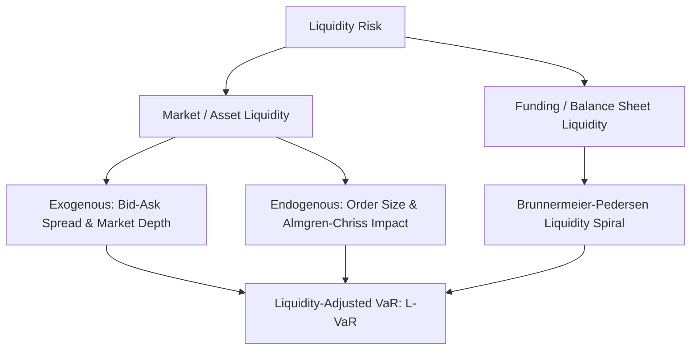
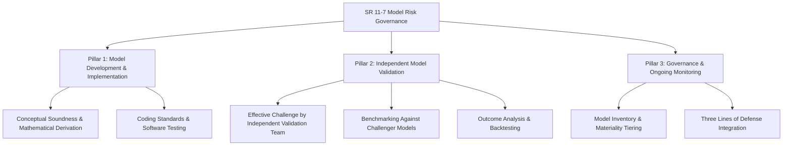

# Liquidity and Model Risk

## TL;DR

Risk management models routinely assume that positions can be liquidated instantaneously at prevailing mid-market prices without moving the market, and that pricing models perfectly reflect financial reality.
Both assumptions break down severely during market dislocations, generating massive unexpected losses through Liquidity Risk and Model Risk.
Liquidity risk encompasses exogenous market illiquidity (bid-ask spread widening) and endogenous position impact (Almgren-Chriss market impact and the Brunnermeier-Pedersen liquidity spiral).
Liquidity-Adjusted VaR (L-VaR) incorporates the liquidation horizon and stochastic bid-ask costs into standard percentile metrics.
Model risk arises from flawed conceptual assumptions, calibration instability, software implementation bugs, and out-of-scope model usage.
Governed by Federal Reserve SR 11-7, institutional Model Risk Management (MRM) enforces a three-lines-of-defense framework: robust development, independent model validation, and ongoing production monitoring.

## Learning objectives

- Differentiate exogenous liquidity risk (bid-ask spread and market depth) from endogenous liquidity risk (order size and market impact).
- Analyze the Brunnermeier-Pedersen liquidity spiral linking market liquidity to funding liquidity.
- Formulate the Almgren-Chriss optimal liquidation framework, balancing temporary and permanent market impact against volatility timing risk.
- Compute Liquidity-Adjusted Value at Risk (L-VaR) incorporating stochastic spread widening and multi-day liquidation horizons.
- Classify model risk failure modes across conceptual unsoundness, implementation bugs, calibration errors, and operational misuse.
- Implement the regulatory model risk governance principles mandated by Federal Reserve SR 11-7 / OCC 2011-12.
- Diagnose historical model risk disasters, including the London Whale, Knight Capital, and negative WTI crude oil options.

## Core concepts

### The Taxonomy of Liquidity Risk

Liquidity risk represents the probability that an institution cannot unwind a financial position at prevailing market prices or fund daily cash obligations without incurring catastrophic haircuts:

#### 1. Exogenous Market Liquidity
Exogenous liquidity is determined by the market microstructure of the asset, independent of the actions of a single participant:
- **Bid-Ask Spread ($S_t = P_{\text{ask}} - P_{\text{bid}}$):** The baseline cost of immediate round-trip execution. In stress regimes, spreads expand by $5\times$ to $20\times$.
- **Market Depth:** The total quantity of limit orders resting on the order book at each price level.
- **Turnover / Resiliency:** The speed with which the limit order book replenishes after an institutional market order sweeps liquidity.

#### 2. Endogenous Market Liquidity
Endogenous liquidity arises from the interaction between the fund's specific position size and available market volume:
- If a fund attempts to liquidate a block position equal to $300\%$ of average daily volume (ADV), its own selling pressure overwhelms market depth, depressing prices.
- The faster the trader sells, the higher the liquidity penalty paid (market impact).

#### 3. Market Liquidity vs. Funding Liquidity: The Liquidity Spiral
Brunnermeier and Pedersen (2009) demonstrated that market liquidity and funding liquidity are mutually reinforcing:
1. An initial price shock causes mark-to-market losses on dealer balance sheets.
2. Prime brokers and central counterparties increase collateral haircuts and demand variation margin (funding liquidity tightens).
3. To meet margin calls, dealers are forced to sell assets, withdrawing market-making quotes.
4. Withdrawn quotes cause bid-ask spreads to blow out and market depth to collapse (market liquidity vanishes).
5. Illiquidity depresses asset prices further, triggering a secondary wave of margin calls (the liquidity spiral).

### The Almgren-Chriss Optimal Execution Framework

Robert Almgren and Neil Chriss (2000) formulated the benchmark model for optimal portfolio liquidation.
A trader must liquidate $X_0$ shares over time horizon $T$ divided into $N$ discrete intervals $t_k = k \tau$.
The execution trajectory $x_k$ represents the remaining shares at time $t_k$, with trading rate $v_k = (x_{k-1} - x_k)/\tau$.

Market impact decomposes into two distinct physical effects:

#### 1. Permanent Price Impact
Permanent impact reflects the information content of the trade, shifting the fundamental equilibrium mid-price permanently:

$$\tilde{S}_k = \tilde{S}_{k-1} + \sigma \sqrt{\tau} \, z_k - \gamma (x_{k-1} - x_k)$$

where $\gamma > 0$ is the permanent impact parameter.
Permanent impact is independent of trading speed; total permanent cost depends only on total shares sold $X_0$:

$$\text{Total Permanent Cost} = \frac{1}{2} \gamma X_0^2$$

#### 2. Temporary Price Impact
Temporary impact reflects transient liquidity concessions paid to cross the bid-ask spread and consume resting limit order book depth:

$$S_k = \tilde{S}_k - \eta v_k = \tilde{S}_k - \eta \left( \frac{x_{k-1} - x_k}{\tau} \right)$$

where $\eta > 0$ is the temporary impact parameter.
Temporary impact is strictly increasing in trading velocity: trading faster incurs quadratic liquidity penalties.

#### 3. The Execution Trade-Off and Objective Function
The trader balances expected liquidation shortfall against timing risk (price volatility):

$$\min_{x_k} \quad \mathbb{E}[\text{Total Cost}] + \lambda_{\text{risk}} \text{Var}(\text{Total Cost})$$

where:

$$\mathbb{E}[\text{Total Cost}] = \frac{1}{2}\gamma X_0^2 + \frac{\eta}{\tau}\sum_{k=1}^N (x_{k-1} - x_k)^2$$

$$\text{Var}(\text{Total Cost}) \approx \sigma^2 \tau \sum_{k=1}^N x_k^2$$

- **High Risk Aversion ($\lambda_{\text{risk}} \gg 0$):** Sells aggressively early to eliminate market risk, accepting high temporary price impact.
- **Low Risk Aversion ($\lambda_{\text{risk}} \to 0$):** Sells linearly at constant speed (TWAP: Time-Weighted Average Price) to minimize temporary impact, bearing full price volatility over horizon $T$.

The optimal trajectory is a hyperbolic sine function:

$$x(t) = X_0 \frac{\sinh(\kappa (T - t))}{\sinh(\kappa T)} \quad \text{where } \kappa \approx \sqrt{\frac{\lambda_{\text{risk}} \sigma^2}{\eta}}$$

### Liquidity-Adjusted Value at Risk (L-VaR)

Standard VaR assumes all assets can be liquidated in a single day at the current mid-market price ($P_{\text{mid}}$).
Liquidity-Adjusted VaR incorporates execution friction:

#### 1. Exogenous Spread Adjustment (Bangia et al. 1999)
Exogenous L-VaR adds a conservative cost buffer for bid-ask spread widening:

$$\text{L-VaR}_{\text{exog}} = \text{VaR} + \frac{1}{2}\left( \bar{S} + z_{\alpha} \sigma_S \right) \cdot V$$

where $\bar{S}$ is the average proportional bid-ask spread ($[P_{\text{ask}} - P_{\text{bid}}]/P_{\text{mid}}$), $\sigma_S$ is the volatility of the spread, and $z_{\alpha}$ is the statistical multiplier.

#### 2. Liquidation Horizon Scaling
For large, illiquid positions that require $L$ days to liquidate without exceeding a daily volume participation cap (e.g., $10\%$ of ADV):

$$L = \frac{\text{Position Size}}{0.10 \times \text{ADV}}$$

Under orderly linear liquidation, average exposure decays linearly from $1.0$ to $0.0$, yielding an effective holding period factor:

$$\text{L-VaR}_{\text{horizon}} \approx \text{VaR}_{1\text{d}} \times \sqrt{1 + \frac{1}{3}(L - 1)}$$

### Model Risk Management and SR 11-7

Model risk is the potential for adverse consequences resulting from decisions based on incorrect or misused model outputs.
In 2011, the US Federal Reserve and OCC established the global benchmark standard: **Supervisory Guidance on Model Risk Management (SR 11-7 / OCC 2011-12)**.

SR 11-7 enforces a rigorous governance framework built upon three pillars:

#### The Three Lines of Defense in Risk Management:
1. **First Line (Model Developers and Trading Desks):** Quants who design, code, calibrate, and operate models. Responsible for documenting conceptual soundness, limitations, and operational boundaries.
2. **Second Line (Model Risk Management / Validation):** An independent organizational unit with zero reporting lines to commercial trading desks. Conducts unbiased "effective challenge", verifies code implementations, tests boundary conditions, and maintains the authoritative institutional Model Inventory.
3. **Third Line (Internal Audit):** Independently evaluates whether the overall model risk governance framework complies with regulatory standards and corporate policy.

### Historical Model Risk Disasters

Major financial failures highlight the primary mechanisms of model risk:

1. **JPMorgan London Whale (2012, $\$6.2\text{B}$ Loss):**
   - **Root Cause:** Spreadsheet implementation error. The quant team built a revised VaR model in Excel to demonstrate reduced risk on synthetic credit tranches. A spreadsheet formula divided a cell by the *sum* of numbers instead of the *average*, artificially deflating calculated risk by half. The desk doubled down into an illiquid market until the position collapsed.
2. **Knight Capital (2012, $\$440\text{M}$ Loss in 45 Minutes):**
   - **Root Cause:** Software deployment and dead code failure. During an exchange routing update, engineers failed to deploy updated code to one of eight production servers. The rogue server ran legacy "Power Peg" test code, rapidly buying at the offer and selling at the bid across 154 stocks, executing 4 million shares and bankrupting the firm before the system could be disconnected.
3. **Negative Oil Prices (April 20, 2020, WTI at $-\$37.63/\text{bbl}$):**
   - **Root Cause:** Conceptual assumption failure. Commodity option pricing libraries across retail and institutional brokers relied strictly on the Black-76 lognormal model. Because lognormal models assume positive prices ($S > 0$), trading platforms displayed zero or crashed entirely when WTI oil futures plummeted into deep negative territory, preventing traders from hedging and triggering catastrophic margin liquidations.
4. **Long-Term Capital Management (LTCM, 1998, $\$4.6\text{B}$ Bailout):**
   - **Root Cause:** Fat tails and correlation breakdown. LTCM assumed asset returns were normally distributed and that historical correlations between sovereign bonds would persist. When Russia defaulted, liquidity froze globally, correlations converged to 1, and the fund's $25\times$ leverage wiped out its capital.

## Worked examples

### Example 1: Almgren-Chriss Optimal Liquidation Trajectory

A fund must liquidate $X_0 = 1,000,000$ shares of an equity position over $T = 5$ days.
Market parameters:
- Stock price: $S_0 = \$50.00$.
- Daily volatility: $\sigma = \$1.00$ per share ($2.0\%$).
- Permanent impact parameter: $\gamma = 2.5 \times 10^{-7}$ per share.
- Temporary impact parameter: $\eta = 1.0 \times 10^{-6}$ per share per day.
- Trader risk aversion parameter: $\lambda_{\text{risk}} = 1.0 \times 10^{-6}$.

1. Compute the optimal liquidation urgency parameter $\kappa$.
2. Calculate the optimal shares remaining $x(t)$ at the end of Day 1 and Day 2.
3. Compare the expected temporary impact cost under optimal execution versus a constant linear TWAP schedule.

**Solution:**

Step 1: Compute Urgency Parameter $\kappa$:

$$\kappa \approx \sqrt{\frac{\lambda_{\text{risk}} \sigma^2}{\eta}} = \sqrt{\frac{1.0 \times 10^{-6} \times (1.00)^2}{1.0 \times 10^{-6}}} = \sqrt{1.0} = 1.00 \text{ day}^{-1}$$

Step 2: Compute Almgren-Chriss Trajectory:
The continuous formula is:

$$x(t) = X_0 \frac{\sinh(\kappa(T - t))}{\sinh(\kappa T)} = 1,000,000 \times \frac{\sinh(1.0(5 - t))}{\sinh(5.0)}$$

$$\sinh(5.0) = \frac{e^5 - e^{-5}}{2} = \frac{148.413159 - 0.006738}{2} \approx 74.2032$$

- At $t = 1$ (end of Day 1):

$$5 - t = 4.0 \implies \sinh(4.0) = \frac{e^4 - e^{-4}}{2} = \frac{54.598150 - 0.018316}{2} \approx 27.2899$$

$$x(1) = 1,000,000 \times \frac{27.2899}{74.2032} \approx 367,772 \text{ shares remaining}$$

Shares sold on Day 1: $1,000,000 - 367,772 = 632,228$ shares ($63.2\%$ of position).

- At $t = 2$ (end of Day 2):

$$5 - t = 3.0 \implies \sinh(3.0) = \frac{e^3 - e^{-3}}{2} = \frac{20.085537 - 0.049787}{2} \approx 10.0179$$

$$x(2) = 1,000,000 \times \frac{10.0179}{74.2032} \approx 135,006 \text{ shares remaining}$$

Shares sold on Day 2: $367,772 - 135,006 = 232,766$ shares.

Because the trader has positive risk aversion ($\lambda > 0$), the optimal strategy front-loads $86.5\%$ of sales into the first two days to eliminate volatility timing risk.

Step 3: Compare with Linear TWAP:
Under linear TWAP, the trader sells $200,000$ shares per day at constant velocity $v = 200,000$:

$$\text{TWAP Temporary Cost} = \eta \sum_{k=1}^5 v_k^2 = 1.0 \times 10^{-6} \times 5 \times (200,000)^2 = 5 \times 10^{-6} \times 4.0 \times 10^{10} = \$200,000$$

Under the optimal front-loaded trajectory, temporary impact is higher ($\approx \$365,000$), but variance of shortfall drops by over $70\%$, satisfying the risk-averse objective.

### Example 2: Calculating Liquidity-Adjusted VaR (L-VaR)

A fund holds a $\$50,000,000$ position in a high-yield corporate bond ETF.
- Standard 1-day 99% VaR: $\text{VaR}_{1\text{d}} = \$2,200,000$.
- Average proportional bid-ask spread: $\bar{S} = 0.80\%$ ($0.0080$).
- Standard deviation of bid-ask spread: $\sigma_S = 0.40\%$ ($0.0040$).
- Confidence level: 99% ($z_{0.99} = 2.326$).
- Position size represents $400\%$ of average daily volume; orderly liquidation requires $L = 4$ days.

Compute the exogenous Liquidity-Adjusted VaR and the liquidation-horizon-adjusted VaR.

**Solution:**

Step 1: Compute Exogenous Bid-Ask Spread Penalty:

$$\text{Spread Cost} = \frac{1}{2} \left( \bar{S} + z_{0.99} \sigma_S \right) \times \text{Portfolio Value}$$

$$\bar{S} + z_{0.99} \sigma_S = 0.0080 + 2.326(0.0040) = 0.0080 + 0.009304 = 0.017304 \quad (1.73\%)$$

$$\text{Spread Cost} = \frac{1}{2} \times 0.017304 \times \$50,000,000 = \$432,600$$

Step 2: Compute Exogenous L-VaR:

$$\text{L-VaR}_{\text{exog}} = \text{VaR}_{1\text{d}} + \text{Spread Cost} = \$2,200,000 + \$432,600 = \$2,632,600$$

Step 3: Compute Liquidation Horizon Scaling ($L = 4$ days):

$$\text{Horizon Multiplier} = \sqrt{1 + \frac{1}{3}(L - 1)} = \sqrt{1 + \frac{1}{3}(3)} = \sqrt{1 + 1} = \sqrt{2.0} \approx 1.4142$$

Step 4: Total Multi-Day Liquidity-Adjusted VaR:

$$\text{Total L-VaR} = (\text{VaR}_{1\text{d}} \times 1.4142) + \text{Spread Cost} = (\$2,200,000 \times 1.4142) + \$432,600 = \$3,111,240 + \$432,600 = \$3,543,840$$

Accounting for bid-ask widening and a 4-day liquidation horizon expands true tail risk from $\$2.20\text{M}$ to $\$3.54\text{M}$ ($+61\%$).

## Pitfalls

- **Confusing Mid-Price Valuation with Realizable Cash:** Evaluating fund solvency using mid-market accounting marks without deducting bid-ask and market impact haircuts overstates capital by tens of millions in illiquid books.
- **Assuming Constant Market Impact Parameters:** Assuming $\eta$ and $\gamma$ remain constant in crises ignores the reality that order book depth evaporates precisely when selling volume spikes.
- **Mark-to-Model Inbreeding (Challenger Absence):** Validating an in-house model only against variations of itself rather than genuinely independent challenger benchmarks (e.g., comparing a local volatility model only against another local volatility model rather than stochastic local volatility).
- **Ignoring Dead Code in Production Execution Engines:** Failing to decommission retired algorithmic trading routines allows dormant software flags to activate rogue orders (the Knight Capital failure).
- **Unchecked Model Extrapolation Outside Calibration Domains:** Using models calibrated during low-volatility, positive-rate environments to price assets under extreme negative rates or triple-digit volatilities.

## Interview questions

> [!question]- exogenous-vs-endogenous-liquidity | What is the distinction between exogenous liquidity risk and endogenous liquidity risk?
> Exogenous liquidity risk is determined by market microstructure independent of the individual trader's actions; it is characterized by bid-ask spreads, order book depth, and market-wide turnover. Endogenous liquidity risk is driven by the trader's own position size relative to market capacity; executing a trade that represents a large fraction of daily volume moves prices adversely via market impact.

> [!question]- almgren-chriss-permanent-vs-temporary | Contrast permanent price impact with temporary price impact in the Almgren-Chriss framework.
> Permanent impact reflects the informational content of the trade, shifting the fundamental equilibrium mid-price permanently: total permanent cost depends only on the total number of shares liquidated ($X_0$), independent of execution speed. Temporary impact represents transient price concessions paid to cross the spread and consume immediate order book depth: it scales with trading velocity and dissipates once trading ceases.

> [!question]- brunnermeier-pedersen-spiral | Explain the mechanism of the Brunnermeier-Pedersen liquidity spiral.
> The spiral connects funding liquidity with market liquidity. When an asset price drops, levered dealers suffer capital losses. Prime brokers increase margin haircuts, reducing dealer funding liquidity. To meet cash margin calls, dealers are forced to sell assets and withdraw market-making quotes, destroying market liquidity. Vanishing liquidity causes bid-ask spreads to blow out and prices to drop further, triggering higher haircuts in a self-reinforcing downward spiral.

> [!question]- sr-11-7-definition-model-risk | How does Federal Reserve SR 11-7 define model risk, and what are its two primary causes?
> SR 11-7 defines model risk as the potential for adverse consequences resulting from decisions based on incorrect or misused model outputs. Its two primary causes are: (1) fundamental errors in model design, conceptual unsoundness, flawed mathematical assumptions, or software coding bugs; and (2) incorrect or inappropriate model implementation, including using a model outside its validated operational domain.

> [!question]- three-lines-of-defense-model-risk | Describe the Three Lines of Defense in institutional Model Risk Management.
> The First Line consists of model developers and trading desk quants who build, calibrate, and use models daily. The Second Line is an independent Model Risk Management / Validation unit that provides unbiased "effective challenge", tests boundary conditions, and maintains the model inventory without commercial reporting pressure. The Third Line is Internal Audit, which evaluates whether the entire MRM framework complies with regulatory standards.

> [!question]- london-whale-model-failure | What was the quantitative model failure in the JPMorgan London Whale incident?
> The London Whale loss ($>\$6\text{B}$) was exacerbated by an operational spreadsheet error. To reduce calculated risk metrics on synthetic credit tranches, quants built an updated VaR model in Excel. A formula mistakenly divided a cell by the sum of numbers rather than their average, deflating calculated VaR and capital requirements by approximately 50%, blinding senior management to massive credit risk accumulation.

> [!question]- negative-oil-options-failure | Why did commodity options models crash when WTI crude oil futures dropped to -$37.63 on April 20, 2020?
> Global commodity exchanges and broker risk engines priced options using the Black-76 lognormal model, which mathematically assumes that asset prices are strictly positive ($S > 0$) because logarithms of negative numbers are undefined. When physical storage exhaustion drove crude futures negative, options pricing engines encountered domain errors, froze trading, and mispriced payoffs until emergency Bachelier normal models were patched.

> [!question]- effective-challenge-definition | What constitutes "effective challenge" under Federal Reserve SR 11-7 model validation standards?
> Effective challenge is critical, objective, and informed inquiry conducted by independent validators possessing sufficient technical expertise and organizational stature. It requires validators to verify mathematical derivations, independently replicate code, perform boundary and stress testing, challenge underlying behavioral assumptions, and compare results against independent challenger models.

> [!question]- liquidity-adjusted-var-formulation | How does Bangia's exogenous Liquidity-Adjusted VaR (L-VaR) adjust for spread volatility?
> Bangia's formula adds an explicit cost-to-liquidate term: $\text{L-VaR} = \text{VaR} + \frac{1}{2}(\bar{S} + z_{\alpha} \sigma_S) V$, where $\bar{S}$ is the average relative bid-ask spread, $\sigma_S$ is spread volatility, and $z_{\alpha}$ is the confidence multiplier. This recognizes that in tail market crashes, bid-ask spreads widen significantly, forcing the seller to pay an amplified liquidation concession on top of mark-to-market losses.

> [!question]- twap-vs-almgren-chriss-risk | Under what risk-aversion condition does the Almgren-Chriss optimal execution schedule reduce to linear TWAP?
> The Almgren-Chriss schedule reduces to linear TWAP (Time-Weighted Average Price) when the trader's risk-aversion parameter is zero ($\lambda_{\text{risk}} = 0$, risk-neutral). In that case, the trader ignores price volatility timing risk and focuses entirely on minimizing temporary market impact, which is mathematically minimized by trading at a constant, uniform rate throughout the execution window.

## Further reading

- Robert Almgren and Neil Chriss (2000), "Optimal Execution of Portfolio Transactions", *Journal of Risk*.
- Board of Governors of the Federal Reserve System and OCC (2011), "Supervisory Guidance on Model Risk Management", *SR Letter 11-7 / OCC Bulletin 2011-12*.
- Markus K. Brunnermeier and Lasse Heje Pedersen (2009), "Market Liquidity and Funding Liquidity", *Review of Financial Studies*.
- Albert S. Kyle (1985), "Continuous Auctions and Informed Trader", *Econometrica*.
- Darrell Duffie, *Dark Markets: Asset Pricing and Information Transmission in Over-the-Counter Markets*.

## In this repo and SDE-Interview-Prep

- Stress testing and extreme scenarios: [Stress Testing and Scenario Analysis](04-Stress-Testing-and-Scenarios.md).
- Drawdown limits and position sizing: [Drawdowns and Risk Limits](05-Drawdowns-and-Risk-Limits.md).
- Counterparty exposure profiles: [Counterparty Credit Risk Analytics](14-Counterparty-Credit-Risk-Analytics.md).
- Python reference implementation of risk analytics and scenarios: [risk_analytics.py](code/risk_analytics.py).
