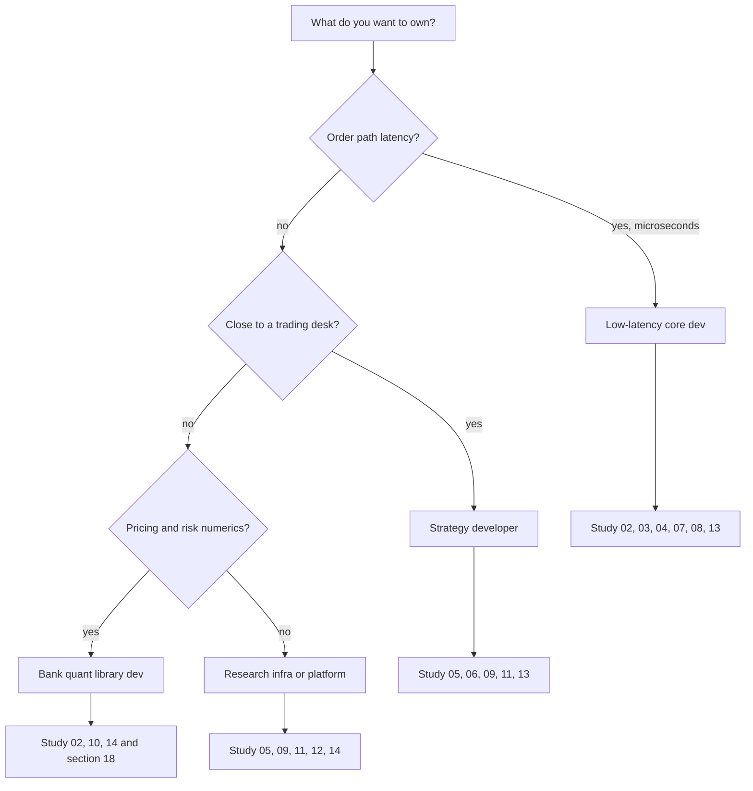

# The Quant Developer Role and Stack

## TL;DR

- "Quant developer" names at least five different jobs: low-latency core developer, strategy developer, research-infrastructure engineer, quant library developer at a bank, and data or platform engineer at a systematic fund.
- They differ along one axis more than any other: how much of the job is latency (nanoseconds to microseconds), throughput (millions of messages, thousands of cores) or correctness of numerics (prices, risk, P&L).
- The common core every interview tests: data structures and algorithms, one systems language (usually C++) in depth, Python fluency, Linux and networking basics, and system design specialised to trading.
- What separates tiers: juniors are tested on coding speed and language mechanics; seniors on design trade-offs, failure modes, measurement and ownership of production incidents.
- Pick the role first, then the study plan: the rest of this section maps each role to the notes that cover what it is interviewed on.

## Learning objectives

- Distinguish core-dev, strategy-dev, research-infra and low-latency roles.
- Map each role to the skills it is interviewed on and where to study them.
- Describe the standard quant-dev stack (C++, Python, kdb+/q, Linux, networking, protocols) and what each piece is used for.
- Explain what interviewers look for at junior, mid and senior level.

## Core concepts

### Where quant developers sit

Every trading firm has the same skeleton: data comes in, a decision is made, an order goes out, risk and P&L are tracked, and everything is recorded for research.
Quant developers build and own the software for each step; the role name depends on which step and on how fast it must be.

| Role | Typical employer | What you build | Dominant constraint | Main languages |
| :--- | :--- | :--- | :--- | :--- |
| Low-latency core developer | HFT and electronic market makers | Feed handlers, order books, order gateways, risk checks, the trading engine | Tail latency in microseconds or less, determinism | C++ (or another systems language), some FPGA-adjacent work |
| Strategy developer | Prop firms, market makers, hedge fund pods | Strategy code, signals, parameter handling, monitoring, the backtest of the strategy | Correctness and speed of iteration with traders and researchers | C++ for the live path, Python for research |
| Research infrastructure | Systematic funds, HFT | Tick-data stores, backtesters, simulation, feature pipelines, compute grids | Throughput, reproducibility, point-in-time correctness | Python, C++, kdb+/q, SQL |
| Quant library developer | Investment banks (often called strats or quant developers) | Pricing libraries, curve and volatility surface building, risk engines, XVA | Numerical correctness, scale of overnight and intraday risk | C++ cores with Python, Java or Excel bindings |
| Execution and platform | Buy side, agency brokers | OMS and EMS, execution algorithms, TCA, connectivity | Reliability, auditability, regulatory controls | Java, C++, Python, C# |

Two adjacent roles share interviews with these: the FPGA engineer (hardware feed handlers and order paths, interviewed on digital design) and the site reliability or trading-operations engineer (production support, interviewed on Linux and incident handling).

### How the latency regime changes the job

- Nanoseconds to a few microseconds (HFT core): you think in cache lines, branch mispredictions, kernel bypass and allocation-free steady states; see [Low-Latency Engineering](03-Low-Latency-Engineering.md) and [Concurrency, Lock-Free Queues and Memory Pools](04-Concurrency-Lock-Free-and-Memory-Pools.md).
- Tens of microseconds to milliseconds (strategy, execution, market making in slower products): clean architecture, deterministic replay and good tooling matter more than shaving cycles; see [System Design for Trading](06-System-Design-for-Trading.md).
- Seconds to hours (bank risk, research): throughput, numerical stability and data lineage dominate; see [Pricing Library Architecture](../18-Pricing-and-Risk-Systems/05-Pricing-Library-Architecture.md) and [Front-to-Back Architecture](../18-Pricing-and-Risk-Systems/01-Front-to-Back-Architecture.md).

### The stack and why each piece is there

| Layer | Tools | Used for |
| :--- | :--- | :--- |
| Systems language | C++20 (RAII, templates, move semantics, the memory model) | Anything on the order path or in a pricing core: predictable performance and control of memory layout |
| Scripting and research | Python with NumPy, pandas or polars, Numba, Jupyter | Research, analytics, tooling, glue, prototyping; bindings to C++ cores |
| Time-series data | kdb+/q, columnar formats (Parquet, Arrow), time-series databases | Tick capture and as-of joins over billions of rows; see the tick-data note in this section |
| Operating system | Linux: scheduling, cgroups, CPU affinity, huge pages, `perf`, `strace` | Running and tuning the trading processes; diagnosing latency |
| Networking | TCP for order entry, UDP multicast for market data, kernel bypass | Getting bytes in and out with low and predictable latency |
| Protocols | FIX (session and application layers), binary exchange protocols (Nasdaq ITCH for data, OUCH for orders), SBE | Talking to venues and brokers; the [ITCH 5.0 spec](protocol-specs/Nasdaq-Totalview-ITCH-5.0.pdf) is in this repo |
| Build and test | CMake or Bazel, sanitizers (ASan, UBSan, TSan), unit and replay tests | Catching undefined behaviour and races before production |
| Controls | Pre-trade risk checks, kill switches, audit logs | Regulatory and survival requirements; in the US, SEC Rule 15c3-5 requires brokers with market access to have pre-trade risk controls |

### What each interview tier tests

| Stage | Junior and graduate | Mid level | Senior and lead |
| :--- | :--- | :--- | :--- |
| Coding | LeetCode-medium DSA in C++ or Python, clean and fast | Same, plus a trading flavour: order book, rate limiter, streaming statistics | Usually lighter; often a design-heavy coding exercise |
| Language depth | Value vs reference, virtual functions, smart pointers, move semantics | Memory model, templates and CRTP, undefined behaviour, allocators | ABI, performance trade-offs with measurements, code review of real code |
| Systems | Processes vs threads, what a cache miss is | Cache hierarchy, false sharing, TCP vs UDP, multicast, kernel bypass | Latency budgets, tail latency, tuning a host end to end, NUMA |
| Design | Design a simple component (an LRU cache, a queue) | Design a market data handler or an order book | Design an exchange, a trading system, a risk platform; recovery and determinism |
| Quant content | Probability basics, expected value | Market microstructure: order types, matching, queue position | Enough to challenge researchers and traders on requirements |
| Behavioural | Motivation, learning | Ownership of a project | Incidents you owned, decisions you got wrong, how you lead |

At senior level the question behind every question is "would I trust this person with production at 9:30 on a volatile day".
Interviewers probe for measured claims ("we cut p99 from X to Y, measured with Z"), not adjectives.

### How the work is organised day to day

- Core developers own long-lived components with strict release processes: code review, replay tests against captured market data, canary deployment and kill switches.
- Strategy developers ship many small changes, often daily, under the same controls; they live in monitoring dashboards during the trading day.
- Research infrastructure teams serve internal users (researchers), so their success metric is research throughput and reproducibility, not latency.
- Bank quant developers work in large shared codebases with model validation and regulatory reporting downstream, so changes carry governance overhead (see [Model Governance](../18-Pricing-and-Risk-Systems/15-Model-Governance.md)).

## Worked examples

### Which role fits this job description?

"The ad says: build and maintain our market data handlers and order gateways in C++ on Linux; experience with kernel bypass and lock-free programming preferred."
This is the low-latency core role.
Expect a C++ deep dive (move semantics, memory model, virtual dispatch cost), a systems round (cache, false sharing, NUMA, networking) and a design round (feed handler with gap recovery, order book).
Study [C++ for Trading Systems](02-Cpp-for-Trading-Systems.md), [Low-Latency Engineering](03-Low-Latency-Engineering.md), [Concurrency](04-Concurrency-Lock-Free-and-Memory-Pools.md) and [Order Book and Matching Engine](07-Order-Book-and-Matching-Engine.md).

### The same question at two levels

"How would you make this order book faster?"
A junior answer lists techniques: use arrays instead of maps, avoid allocation, avoid virtual calls.
A senior answer starts with measurement: define the workload (message mix, book depth, burst rates), measure percentiles not means on the production-like hardware, find the dominant cost (cache misses on cancels deep in the book, for example), change one thing, re-measure, and keep a regression benchmark in CI.
Both answers mention the same techniques; only the second is trusted with production.

### Pitching your experience across roles

A candidate who built a Python backtester at a fund wants a strategy-developer role at a market maker.
The honest bridge: point-in-time correctness and replay determinism carry over directly; the gaps are C++ on the live path and latency awareness.
Close them visibly: a small C++ project with an order book, unit tests, sanitizer runs and a benchmark with percentiles (this section's [code/cpp](code/cpp/) is a template).

## Pitfalls

- Treating "quant developer" as one job and preparing generically; the low-latency and bank-library interviews overlap only in DSA and C++ basics.
- Claiming performance numbers you cannot explain: every number on a CV invites "how did you measure it, what was p99, on what hardware".
- Underestimating Python: even C++-heavy teams expect fluent Python for tooling and analysis.
- Ignoring the controls side: kill switches, risk limits and audit trails are interview topics because failures are expensive (the Knight Capital incident is the standard example; see [System Design for Trading](06-System-Design-for-Trading.md)).
- Over-indexing on brainteasers; for developer roles they are a filter, not the main event.
- Saying "I would use lock-free everything": interviewers want to hear when a mutex is the right answer.

## Interview questions

> [!question]- qd-role-five-roles | Name the main kinds of quant developer role and what distinguishes them.
> Low-latency core dev, strategy dev, research infrastructure, bank quant library dev, execution and platform. They differ mostly by the dominant constraint: tail latency, iteration speed with traders, research throughput, numerical correctness at scale, or reliability and auditability.

> [!question]- qd-role-low-latency-skills | What is a low-latency core developer interviewed on beyond DSA?
> C++ depth (move semantics, memory model, templates, UB), CPU and OS behaviour (caches, false sharing, branch prediction, NUMA, pinning), networking (TCP vs UDP multicast, kernel bypass), and design of feed handlers, order books and gateways.

> [!question]- qd-role-bank-vs-hft | How does a bank quant library role differ from an HFT core role?
> The bank role is about numerical correctness, model coverage and scale (pricing and risk across large portfolios, often overnight and intraday batches), under model governance. The HFT role is about microsecond tail latency and determinism on one order path. Both use C++, for different reasons.

> [!question]- qd-role-research-infra | What does a research-infrastructure developer optimise for?
> Research throughput and reproducibility: point-in-time correct data, fast as-of joins over tick data, deterministic backtests, and compute scheduling. Latency of a single event rarely matters; correctness of every timestamp does.

> [!question]- qd-role-why-cpp | Why is C++ still the default on the trading hot path?
> It gives control of memory layout and allocation, zero-cost abstractions resolved at compile time (templates, inlining), no garbage-collector pauses, and direct access to OS and hardware facilities. The cost is undefined behaviour and complexity, which teams manage with sanitizers, reviews and strict subsets.

> [!question]- qd-role-why-python | Why do C++-heavy teams still require strong Python?
> Research, analysis of captured data, test harnesses, deployment tooling and glue are written in Python; a developer who cannot analyse a latency capture or a fill log quickly is slow at debugging production.

> [!question]- qd-role-kdb | What is kdb+/q used for in trading firms?
> A columnar in-memory and on-disk time-series database with the q language, used for tick capture and analytics: as-of joins of trades to quotes, bar building, TCA. Its strength is vectorised queries over very large time-ordered tables.

> [!question]- qd-role-tcp-vs-udp | Why is market data usually UDP multicast while order entry is TCP?
> Market data is one-to-many and latency-critical, so multicast sends each packet once to all subscribers and lost packets are recovered by sequence-number gap detection and retransmission or snapshots. Orders are one-to-one and must be reliable and ordered per session, which TCP gives.

> [!question]- qd-role-15c3-5 | What is SEC Rule 15c3-5 and why does a developer care?
> The US Market Access Rule (17 CFR 240.15c3-5): a broker-dealer with market access must have risk management controls and supervisory procedures, including pre-trade financial controls (credit and capital thresholds, blocking erroneous orders by price, size or duplication) and regulatory controls (pre-order-entry requirements, restricted securities, authorised users only), under its direct and exclusive control. Developers build and test those checks on the order path, so their latency and correctness are part of the job.

> [!question]- qd-role-junior-vs-senior | What changes between a junior and a senior quant-dev interview?
> Juniors are judged on coding speed, correctness and language mechanics. Seniors are judged on design trade-offs, measurement discipline, failure handling and incident ownership; "how did you measure that" and "what happens when this fails" dominate.

> [!question]- qd-role-measured-claims | An interviewer asks how you made a system faster. What makes the answer credible?
> A baseline and an after, as percentiles (p50, p99, p99.9) on stated hardware and workload, the tool used to measure, the identified bottleneck, and what you would check next. Adjectives and averages are not credible.

> [!question]- qd-role-strategy-dev-day | What does a strategy developer's day look like during trading hours?
> Monitoring live strategies (P&L, fills, rejects, latency, risk usage), responding to trader requests and incidents, and shipping small reviewed changes behind feature flags and kill switches, with replay tests against captured data before release.

> [!question]- qd-role-fpga-boundary | When does work move from C++ to FPGA, and what does the C++ developer still own?
> When the required tick-to-trade latency is below what software on a general-purpose CPU can deliver consistently. Software usually still owns configuration, risk parameters, strategy logic that is too complex for hardware, monitoring and the slow path.

> [!question]- qd-role-protocols | Name the protocol families a quant developer meets and one example of each.
> Session and order-routing protocols such as FIX; binary exchange market-data protocols such as Nasdaq ITCH 5.0; binary order-entry protocols such as Nasdaq OUCH; encodings such as SBE. Internally, firms also define their own binary messages over shared memory or multicast.

> [!question]- qd-role-controls-interview | Why do controls (kill switches, limits, audit) come up in developer interviews?
> Because a software error on the order path can lose a large amount of money in minutes. Per SEC press release 2013-222, in the first 45 minutes after the open on 1 August 2012 Knight Capital sent more than 4 million orders while trying to fill 212 customer orders, and the firm eventually lost more than $460 million. Designing for safe failure is part of the role.

> [!question]- qd-role-lock-free-judgement | A candidate says they would make every queue lock-free. What is the senior response?
> Use lock-free structures only where contention or latency has been measured to matter and the design is simple and testable (an SPSC ring between two pinned threads). Elsewhere a mutex is simpler, correct and fast enough; the cost of a subtle memory-ordering bug is far higher than a few hundred nanoseconds.

## In this repo and SDE-Interview-Prep

- Section map: [C++](02-Cpp-for-Trading-Systems.md), [low latency](03-Low-Latency-Engineering.md), [concurrency](04-Concurrency-Lock-Free-and-Memory-Pools.md), [DSA](05-Data-Structures-and-Algorithms-for-Quant-Interviews.md), [system design](06-System-Design-for-Trading.md), [order book](07-Order-Book-and-Matching-Engine.md).
- Bank-side systems: [Pricing and Risk Systems](../18-Pricing-and-Risk-Systems/README.md).
- Interview process: [How Quant Interviews Work](../13-Interview-Playbook/01-How-Quant-Interviews-Work.md).
- [Quant developer role hub (SDE-Interview-Prep)](https://github.com/shreejitverma/SDE-Interview-Prep/blob/main/16-Interview-Command-Center/01-Roles/Quant-Dev/_Hub.md)
- [Quant developer skill matrix (SDE-Interview-Prep)](https://github.com/shreejitverma/SDE-Interview-Prep/blob/main/16-Interview-Command-Center/01-Roles/Quant-Dev/Skill-Matrix.md)
- [Quant developer question bank (SDE-Interview-Prep)](https://github.com/shreejitverma/SDE-Interview-Prep/blob/main/16-Interview-Command-Center/01-Roles/Quant-Dev/Question-Bank.md)
- [SDE roadmap (SDE-Interview-Prep)](https://github.com/shreejitverma/SDE-Interview-Prep/blob/main/00-Start-Here/Roadmap.md)

## Further reading

- Larry Harris, *Trading and Exchanges: Market Microstructure for Practitioners* (Oxford University Press, 2003), chapters 1 to 6: who trades, how markets are organised, order types.
- Rishi Narang, *Inside the Black Box*, 2nd edition (Wiley, 2013): the components of a systematic trading business and where software fits.
- Jean-Philippe Bouchaud, Julius Bonart, Jonathan Donier and Martin Gould, *Trades, Quotes and Prices* (Cambridge University Press, 2018), chapters 1 to 3: the limit order book as the object you will be building.
- Mark Joshi, *C++ Design Patterns and Derivatives Pricing*, 2nd edition (Cambridge University Press, 2008): the classic bridge from quant finance to C++ design, for bank roles.
- Michael Kerrisk, *The Linux Programming Interface* (No Starch Press, 2010): processes, threads, sockets and the system calls under every trading process.
- Carl Cook, "When a Microsecond Is an Eternity: High Performance Trading Systems in C++", CppCon 2017 talk.
