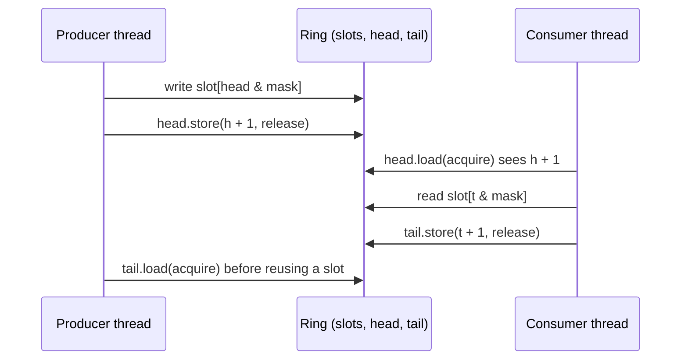

# Concurrency, Lock-Free Queues and Memory Pools

## TL;DR

- A data race (two threads, one writing, no happens-before between them, not both atomic) is undefined behaviour; atomics plus memory orders create the happens-before edges that make plain data safe to share.
- Release on the writer and acquire on the reader is enough for message passing (the pattern inside every queue); only `seq_cst` (operations or fences) forbids the store-buffering outcome that breaks Dekker-style flags.
- The SPSC ring buffer is the workhorse between pinned threads: one writer per index, release to publish, acquire to consume, cached copies of the other side's index, indices padded onto separate cache lines.
- Lock-free structures that recycle nodes must solve ABA (tags, or never-freed index pools) and reclamation (hazard pointers, epochs, RCU); bounded index-based designs sidestep both.
- Steady state must not allocate: object pools and arenas measured about 2.0 and 1.3 ns per allocate-and-free on the test machine, against 11.9 ns for `new`/`delete`, and their latency does not depend on allocator state.
- Prove lock-free code with ThreadSanitizer, not with passing tests: weakening one acquire to relaxed in the SPSC ring passed its functional checksum in 10 of 20 runs on the test machine, while TSan reported the race on every run.

## Learning objectives

- Implement an SPSC ring buffer with correct memory orders.
- Build an allocation-free steady state with pools and arenas.
- Explain the C++ memory model precisely.
- Explain ABA and compare hazard pointers, epoch-based reclamation and RCU.
- State the progress guarantees (wait-free, lock-free, obstruction-free) and which ones real queues give.

## Core concepts

### The C++ memory model in five definitions

- Sequenced-before: the order of evaluations within one thread.
- Synchronizes-with: a release store (or stronger) to an atomic synchronizes with an acquire load (or stronger) that reads the value it wrote, or any later value in its release sequence (since C++20, the unbroken run of read-modify-writes that follow it in modification order); a release fence followed by any store, read by any load followed by an acquire fence, synchronizes the two fences the same way.
- Happens-before: the transitive closure of sequenced-before and synchronizes-with (plus inter-thread rules); if A happens-before B, B sees A's effects.
- Data race: two conflicting accesses (same location, at least one write) in different threads, at least one not atomic, neither happening before the other; a program with a data race has undefined behaviour ([intro.races]).
- Modification order: every atomic object has a single total order of writes that all threads agree on, even with `relaxed`.

| Order | Guarantees | Typical use |
| :--- | :--- | :--- |
| `relaxed` | Atomicity and per-object modification order only | Statistics counters, a thread's own index |
| `acquire` (loads) | Later reads and writes in this thread cannot move before it; sees everything before the matching release | Consumer reading a published index |
| `release` (stores) | Earlier reads and writes cannot move after it | Producer publishing a slot |
| `acq_rel` (read-modify-write) | Both | CAS that both takes and publishes |
| `seq_cst` | Acquire/release plus one total order over all `seq_cst` operations | Flags where store-then-load ordering matters (Dekker, Peterson); the default |
| `consume` | Intended dependency ordering; discouraged since P0371R1 (C++17), implemented as `acquire` by mainstream compilers, deprecated in C++26 (P3475) | Do not use |

### Two litmus tests every interviewer knows

Message passing: thread 1 writes `data = 42` then `ready.store(true, release)`; thread 2 spins on `ready.load(acquire)` then reads `data`.
The release-acquire pair makes the write of `data` happen-before the read, so thread 2 sees 42.
With `relaxed` on either side there is no happens-before edge, the access to `data` is a data race, and on weakly ordered hardware (ARM, POWER) thread 2 can really see the old value.

Store buffering: `x = y = 0`; thread 1 does `x = 1; r1 = y;`, thread 2 does `y = 1; r2 = x;`.
With release stores and acquire loads, `r1 == 0 && r2 == 0` is allowed, and it happens on x86 too, because each core's store sits in its store buffer while the following load executes.
Only `seq_cst` on all four operations forbids it, by putting them in one total order (equivalently, a `seq_cst` fence between the store and the load in each thread).

Hardware: x86 is TSO (total store order); the only reordering it shows is a store followed by a later load, so acquire loads and release stores compile to plain `mov`, while a `seq_cst` store needs `xchg` or `mfence`.
ARMv8 is weakly ordered; release stores map to `STLR` and acquire loads to `LDAR`, or to the weaker `LDAPR` on cores with ARMv8.3 RCpc support (Apple clang emits `LDAPR` for the SPSC ring on the test machine); `LDAR` and `STLR` together also satisfy `seq_cst`.
Code that is correct only because x86 is strong breaks when it is ported, which is one reason to test on ARM too.

### Progress guarantees

| Guarantee | Meaning | Example |
| :--- | :--- | :--- |
| Blocking | A stalled thread can stop others forever | Mutex-protected queue |
| Obstruction-free | A thread running alone finishes in bounded steps | Some STM designs |
| Lock-free | Some thread always makes progress | Treiber stack, CAS loops |
| Wait-free | Every thread finishes in bounded steps | SPSC ring (each operation is a few loads and stores, no retry loop) |

Vyukov's bounded MPMC queue is fast but not strictly lock-free: a producer suspended after claiming a cell and before publishing it blocks the consumer that reaches that cell.
For trading systems "lock-free" is less important than "bounded and predictable in the common case", which is why pinned threads on isolated cores with SPSC rings are the standard design.

### The SPSC ring buffer

Design of `SpscQueue` in [lock_free.hpp](code/cpp/lock_free.hpp):

- `head` is written only by the producer, `tail` only by the consumer; each index has a single writer, so no CAS is needed.
- Indices are 64-bit counters that only increase; the slot is `index & (N - 1)` with `N` a power of two, and the queue is full when `head - tail == N`, so all `N` slots are usable.
- The producer's release store of `head` publishes the slot write; the consumer's acquire load of `head` sees it.
- The consumer's release store of `tail` hands the slot back; the producer's acquire load of `tail` guarantees the consumer's read finished before the slot is overwritten (no write-after-read race).
- Each side caches the other side's index and re-reads it only when the queue looks full (producer) or empty (consumer), so in steady state neither touches the other's cache line.
- Producer state and consumer state are each `alignas(128)`, so they never share a line.

The LMAX Disruptor (Thompson et al., 2011) generalises the same ideas to one ring with many consumers tracking their own sequence numbers.

### Spin locks and seqlocks

`SpinLock` in [lock_free.hpp](code/cpp/lock_free.hpp) is test-and-test-and-set: `lock()` tries `exchange(true, acquire)` and, if the lock was taken, spins on a relaxed load until it looks free before trying again; `unlock()` is `store(false, release)`.
The acquire RMW pairs with the previous owner's release, so everything done inside one critical section happens-before the next one.
Spinning on a plain load keeps a shared copy of the line in each waiter's cache instead of bouncing it with failed exchanges, and a `pause` (x86) or `yield` (ARM) hint in the loop eases the spin.
A spin lock only makes sense for critical sections of a few dozen nanoseconds on dedicated cores: if the owner is preempted, every waiter burns its whole time slice.

`Seqlock<T>` publishes a small snapshot (top of book, a limit set) from one writer to many readers without ever blocking the writer.
The writer makes the sequence odd, writes the data, then stores the next even value with release; a reader loads the sequence with acquire, copies the data, re-reads the sequence, and keeps the copy only if both reads returned the same even value.
The data must be atomics (relaxed or stronger), not plain memory: a reader that overlaps a write would otherwise be in a data race, which is undefined behaviour even though the torn copy is thrown away.
Ordering is the subtle part (Boehm, 2012): the reader's re-read of the sequence must not move before its data loads, and a reader that sees any new data must also see the odd sequence that preceded it.
The repo version makes the data stores release and the data loads acquire, which gives both properties without fences (free on x86, `STLR` and `LDAPR` per word on ARM); Boehm's fence-based variant is cheaper on ARM.
Writers are wait-free, readers can retry indefinitely under a continuous stream of writes, so seqlocks suit small, frequently read, less frequently written data.
In [tests/test_lock_free.cpp](code/cpp/tests/test_lock_free.cpp) three readers check an invariant across four words of every snapshot while the writer publishes 100,000 versions; removing the reader's second sequence check made that test report torn snapshots in each of three runs on the test machine.

### Memory reclamation and ABA

A Treiber stack pops by reading `head = A` and `next(A) = B`, then `CAS(head, A, B)`.
ABA: between the read and the CAS another thread pops A, pops B, and pushes A back; the CAS still sees A and installs B, which is no longer on the stack.
The deterministic replay in [tests/test_lock_free.cpp](code/cpp/tests/test_lock_free.cpp) shows exactly this: without a tag the stale CAS succeeds and the next pop hands out index 1 while another thread still holds it; with a 32-bit tag in the same 64-bit word the CAS fails and the stack stays intact.
`TaggedIndexStack` keeps nodes as indices into a fixed array that is never freed, so reading `next` of a node popped by someone else is a stale read, never a use-after-free; the tag only wraps after $2^{32}$ operations between a read and its CAS.

When nodes are heap-allocated, freeing them is the hard part:

| Scheme | Idea | Cost profile |
| :--- | :--- | :--- |
| Hazard pointers (Michael 2004) | Each reader publishes the pointer it is about to dereference; a node is freed only when no hazard pointer names it | Per-access store and fence; bounded unreclaimed memory |
| Epoch-based reclamation (Fraser 2004) | Readers enter and leave epochs; memory retired in epoch $e$ is freed once every thread has moved past $e$ | Cheap reads; a stalled reader blocks all reclamation |
| RCU (read-copy-update) | Readers run without writes; writers publish a new version and free the old after a grace period | Very cheap reads, suited to read-mostly data such as configuration and reference data |

C++26 adds `<hazard_pointer>` (P2530R3) and `<rcu>` (P2545R4) to the standard library, both with production implementation experience in Meta's Folly library (P2545R4 notes that Folly implements a near-superset of the RCU proposal).
As of 2026-10 neither GCC 16's libstdc++ nor Apple clang 21's libc++ ships them (the feature-test macros `__cpp_lib_hazard_pointer` and `__cpp_lib_rcu` are undefined on the test machine), so production code still uses Folly or the userspace RCU library liburcu.
Trading systems often avoid the problem entirely: bounded rings of values, preallocated index pools, and single-writer ownership.

### Memory pools and arenas

General-purpose allocators are fast on average but their latency depends on state: size-class lookup, thread-cache refills, page faults on fresh memory, and occasional returns to the OS.
`ObjectPool<T>` in [memory_pool.hpp](code/cpp/memory_pool.hpp) preallocates blocks of slots and threads a free list through the free slots; `create` pops, `destroy` pushes, both O(1), and the last freed slot is the next used (cache-warm, LIFO).
`create` unlinks the slot only after the constructor succeeds (and restores the link the constructor may have overwritten if it throws), so a throwing constructor leaks nothing; the test suite checks this.
`Arena` bumps a pointer through one buffer and frees everything at once with `reset()`, for per-message or per-batch scratch data; it never runs destructors, so it only accepts trivially destructible types and returns `nullptr` when exhausted instead of growing.
`std::pmr::monotonic_buffer_resource` is the standard-library arena (see [C++ for Trading Systems](02-Cpp-for-Trading-Systems.md)).
A pool is single-threaded by design; share one across threads only through a lock-free free list such as `TaggedIndexStack` over slot indices, or give each thread its own.

### Measured on the test machine

[concurrency_bench.cpp](code/cpp/concurrency_bench.cpp), one run on an Apple M3 Pro (6 performance and 6 efficiency cores) under macOS, Apple clang 21 at `-O2`, threads not pinned (macOS does not expose hard affinity), machine-dependent:

| Benchmark | Result |
| :--- | :--- |
| SPSC ring, 1 producer and 1 consumer, 5,000,000 items | 6.26 ns per item (159.8 M items/s) |
| Vyukov MPMC, same transfer | 6.68 ns per item (149.8 M items/s) |
| Mutex plus `std::deque`, same transfer | 26.06 ns per item (38.4 M items/s) |
| Ping-pong round trip through two SPSC rings | median 89.2 ns, p99 98.3 ns (means of batches of 100) |
| `new` plus `delete`, 32-byte object | 11.88 ns per pair |
| `ObjectPool` create plus destroy | 2.04 ns per pair |
| `Arena` allocate plus reset | 1.29 ns per allocation |

Across five runs in one session the SPSC transfer ranged from 3.35 to 11.73 ns per item, the MPMC from 6.32 to 6.68 ns and the mutex queue from 23.51 to 26.06 ns, so the mutex queue was 2.1 to 7.6 times slower than the SPSC ring and 3.7 to 3.9 times slower than the MPMC queue.
In a pure throughput test the two lock-free queues are within run-to-run noise of each other: when the consumer keeps up, the ring runs nearly empty and both sides touch the same slot lines, so thread placement dominates.
The ping-pong median ranged from 81.2 to 89.2 ns; on a tuned Linux host you pin both threads to isolated performance cores on the same socket and most of the variation disappears.

## Worked examples

### Prove the SPSC ring has no data race

Take a slot written by the producer at index $h$ and read by the consumer.
The producer writes the slot, then stores `head = h + 1` with release (sequenced-before, then release).
The consumer loads `head` with acquire and reads $h + 1$, so the release synchronizes-with the acquire, and the slot write happens-before the slot read.
For reuse, the consumer's read of the slot is sequenced-before its release store of `tail = h + 1`; the producer, before writing that slot again one lap later, acquire-loads `tail` and sees at least $h + 1$, so the read happens-before the overwrite.
Every pair of conflicting accesses is ordered by happens-before: no data race.

### A test that passes on broken code

Change the consumer's `head.load(acquire)` to `relaxed` and run the demo [lock_free_spsc_queue.cpp](code/cpp/lock_free_spsc_queue.cpp), which transfers 200,000 updates and checks sequence numbers and a price checksum.
On the test machine (ARM, so weakly ordered) the `-O2` build passed in 10 of 20 runs ("received 200000 updates, 0 sequence gaps, price checksum ok") and failed in the other 10 with 2 to 16 sequence gaps: the consumer really did read slots before the producer's writes were visible.
The ThreadSanitizer build reported `data race` in `SpscQueue::try_pop` on every one of 5 runs.
A single passing stress run proves nothing, and on x86, where the hardware never reorders loads with loads, the stress test can pass every time while the program still has undefined behaviour; only a happens-before checker finds the bug reliably.

### ABA, step by step

Stack: 0, then 1, then 2 (head is 0).
Thread 1 begins a pop: reads head = 0 and next(0) = 1, and is preempted.
Thread 2 pops 0, pops 1 (keeps 1 in use), pushes 0 back: head = 0, next(0) = 2.
Thread 1 resumes: `CAS(head, 0, 1)` succeeds without a tag, so head becomes 1, a node thread 2 owns; the next pop hands out 1 twice.
With a tag packed next to the index, each of thread 2's three operations advanced the tag, so head no longer equals the 64-bit value thread 1 observed although the index is 0 again: the CAS fails and thread 1 retries with fresh values.

### Store buffering with acquire and release

"Two threads each set their own flag and then check the other's flag, to decide who enters a critical section. Is acquire/release enough?"
No: each thread's load may be satisfied before its own store leaves the store buffer, so both can read 0 and both enter.
The outcome is allowed by the model with acquire/release and observed on x86; making all four operations `seq_cst` (which on x86 emits `xchg` or `mfence` for the stores) forbids it, or use a mutex.

### Estimating one-way core-to-core latency

A ping-pong round trip is two one-way hand-offs, so one-way latency is about half the round trip: about 45 ns from the 89.2 ns median on the test machine.
That is the floor for handing a message from a feed-handler thread to a strategy thread on another core, and the reason latency-critical pipelines keep the hot path on one core where they can.

## Pitfalls

- Using `volatile` for synchronization: it prevents some compiler optimisations but provides neither atomicity nor ordering between threads.
- Making everything `relaxed` because "x86 is strongly ordered": the compiler can still reorder, and ARM will.
- Using `compare_exchange_weak` outside a loop: it may fail spuriously.
- Computing `size()` of a concurrent queue and acting on it; it is stale the moment it is read.
  Reading two counters non-atomically can be worse than stale: `head - tail` with head read first can pair an old head with a newer tail and wrap to about $2^{64}$, so `SpscQueue::size()` reads tail first and clamps the result to the capacity.
Because of the clamp no test can observe the wrap; the unit test only calls `size()` from a third thread so that ThreadSanitizer checks the reads are race-free.
- Putting the producer and consumer indices in the same cache line, or next to the payload array.
- Using modulo with a non-power-of-two capacity on the hot path, or wrapping 32-bit indices.
- Freeing nodes in a lock-free structure without a reclamation scheme.
- Busy-spinning without isolation; on an oversubscribed machine a spinning thread can stop the thread it is waiting for from running.
- Trusting stress tests instead of TSan, and running TSan only on x86.
- Letting an object pool's destructor run with live objects, or returning an object to a different pool.

## Interview questions

> [!question]- qd-conc-data-race-def | Define a data race in C++. What happens if a program has one?
> Two conflicting accesses (same memory location, at least one write) in different threads, at least one non-atomic, with no happens-before order between them. The program has undefined behaviour, not merely a stale value.

> [!question]- qd-conc-acquire-release | What do acquire and release guarantee?
> A release store keeps earlier reads and writes before it; an acquire load keeps later ones after it. If the acquire reads the value written by the release, everything before the release happens-before everything after the acquire.

> [!question]- qd-conc-seq-cst-why | Give a case where acquire/release is not enough and `seq_cst` is required.
> Store buffering (Dekker): each thread stores its flag then loads the other's. With acquire/release both can read 0; only `seq_cst` on all four operations (or a `seq_cst` fence between each thread's store and load) puts them in one total order and forbids it.

> [!question]- qd-conc-x86-vs-arm | Which reorderings does x86 allow, and how does that affect compiled atomics?
> x86-TSO only lets a later load pass an earlier store to a different address. Acquire loads and release stores are plain `mov`; a `seq_cst` store needs `xchg` or `mfence`. ARMv8 is weak and uses `LDAR`/`STLR`.

> [!question]- qd-conc-relaxed-use | When is `memory_order_relaxed` correct?
> When only atomicity is needed and no other data is published through the variable: statistics counters, a thread reading its own index. It never creates happens-before edges.

> [!question]- qd-conc-spsc-orders | In an SPSC ring, which operations need which memory orders?
> Producer: relaxed load of its own head, acquire load of tail (when checking for space), release store of head after writing the slot. Consumer: relaxed load of its own tail, acquire load of head, release store of tail after reading the slot.

> [!question]- qd-conc-spsc-cached-index | Why does a good SPSC ring cache the other side's index?
> Reading the other thread's index pulls its cache line across cores. With a cached copy refreshed only when the ring looks full or empty, steady-state operations touch only local lines.

> [!question]- qd-conc-power-of-two | Why make the ring capacity a power of two and the indices monotonic 64-bit counters?
> The slot is `index & (N - 1)`, a single AND instead of a division; full is `head - tail == N`, so no slot is sacrificed to tell full from empty; 64-bit counters never wrap in practice.

> [!question]- qd-conc-progress | Define wait-free and lock-free and give an example of each.
> Lock-free: some thread always completes in a finite number of steps (Treiber stack). Wait-free: every thread completes in a bounded number of its own steps (an SPSC ring's push and pop).

> [!question]- qd-conc-vyukov-not-lock-free | Is Vyukov's bounded MPMC queue lock-free?
> Not strictly: a producer that claims a cell with its CAS and is suspended before publishing the sequence number blocks consumers that reach that cell. It is fast and widely used, with one CAS per operation.

> [!question]- qd-conc-aba | What is the ABA problem and two ways to prevent it?
> A CAS succeeds because the value returned to A after changing to B and back, though the structure changed. Prevent it with a version tag next to the pointer or index (double-width CAS or packed index plus tag), or with safe reclamation so a node cannot be reused while referenced.

> [!question]- qd-conc-hazard-vs-epoch | Compare hazard pointers and epoch-based reclamation.
> Hazard pointers: readers publish what they dereference, reclamation scans them; bounded garbage, but a store and fence per access. Epochs: cheap reads, memory freed when all threads pass an epoch; one stalled thread blocks all reclamation.

> [!question]- qd-conc-cpp26-reclamation | What does C++26 add for safe memory reclamation?
> `<hazard_pointer>` (P2530R3) and `<rcu>` (P2545R4): standard hazard pointers and read-copy-update, both with implementation experience in Folly. As of 2026-10 libstdc++ (GCC 16) and Apple's libc++ do not ship them yet, so production code uses Folly or liburcu.

> [!question]- qd-conc-volatile | Does `volatile` make a variable safe to share between threads?
> No. It forbids the compiler from eliding or merging accesses but gives no atomicity and no inter-thread ordering; concurrent non-atomic access is still a data race. Use `std::atomic`.

> [!question]- qd-conc-cas-weak | When do you use `compare_exchange_weak` versus `strong`?
> `weak` may fail spuriously (LL/SC hardware), so use it in a retry loop where a spurious failure just loops; use `strong` when a single attempt's result is acted on.

> [!question]- qd-conc-pool-why | Why use an object pool on the hot path, and what are its limits?
> O(1) allocate and free with no allocator state dependence, no system calls, cache-warm LIFO reuse. Measured: 2.04 ns per create-destroy pair vs 11.88 ns for new/delete. Limits: fixed object size, single-threaded unless paired with a lock-free free list, capacity planned up front.

> [!question]- qd-conc-arena | What is an arena allocator and when is it the right choice?
> Bump-pointer allocation from one buffer, freed all at once by `reset()`. Ideal for scratch data with a common lifetime (one message, one batch, one request); it cannot free individual objects and must not hold types with non-trivial destructors.

> [!question]- qd-conc-tsan | What does ThreadSanitizer catch that a stress test does not?
> Data races that did not cause a visible failure in that run: it tracks happens-before and reports conflicting accesses without an ordering edge. Weakening one acquire in the SPSC ring passed the functional checks in 10 of 20 runs on the ARM test machine (and can pass every time on x86), while TSan reported the race on every run.

> [!question]- qd-conc-mutex-vs-lockfree | When is a mutex the better choice than a lock-free queue?
> When contention is low, critical sections are short, there are many producers and consumers, or simplicity and auditability matter more than a few hundred nanoseconds. Uncontended mutexes are cheap; the cost appears under contention, when threads block in the kernel.

> [!question]- qd-conc-spinlock | Write a spin lock. Which memory orders, and why test-and-test-and-set?
> `lock`: loop on `exchange(true, acquire)`; while it returns true, spin on `load(relaxed)` with a pause hint until the lock looks free. `unlock`: `store(false, release)`. Acquire on lock and release on unlock order consecutive critical sections; spinning on a load keeps a shared copy of the line in each waiter's cache instead of hammering it with failed RMWs.

> [!question]- qd-conc-seqlock | How does a seqlock work, and what makes it correct in C++?
> One writer makes the sequence odd, writes the data, then stores the next even value with release; readers load the sequence (acquire), copy the data, re-read the sequence, and retry unless both reads were the same even value. The data must be atomics (relaxed or stronger) to avoid a data race, and the orders must keep the re-read after the data loads and make any new data imply the odd sequence: release data stores and acquire data loads, or Boehm's fence recipe. Writer is wait-free; readers may retry.

> [!question]- qd-conc-release-sequence | A Treiber stack's pop CAS is acquire-only, yet a later pop that reads the head it installed still sees the `next` field written by an earlier push. Why?
> Release sequences: a release operation heads the run of read-modify-writes that follow it in the atomic's modification order, and an acquire that reads any value in that run synchronizes with the release. Every write to the head is a CAS, so each push's release covers all later pops.

> [!question]- qd-conc-core-to-core | How would you measure core-to-core latency, and what did it come to here?
> Ping-pong a value between two threads through two SPSC rings and halve the round trip. On the test machine the median round trip was 89.2 ns, about 45 ns one way, with thread placement changing it run to run (81.2 to 89.2 ns over five runs).

## In this repo and SDE-Interview-Prep

- Code: [lock_free.hpp](code/cpp/lock_free.hpp) (`SpscQueue`, `MpmcQueue`, `TaggedIndexStack`, `SpinLock`, `Seqlock`), [memory_pool.hpp](code/cpp/memory_pool.hpp) (`ObjectPool`, `Arena`), demos [lock_free_spsc_queue.cpp](code/cpp/lock_free_spsc_queue.cpp) and [memory_pool.cpp](code/cpp/memory_pool.cpp), benchmark [concurrency_bench.cpp](code/cpp/concurrency_bench.cpp), tests [tests/test_lock_free.cpp](code/cpp/tests/test_lock_free.cpp) (CI runs them under TSan), and [multithreaded_monte_carlo.cpp](code/cpp/multithreaded_monte_carlo.cpp) (task-parallel Monte Carlo with one seeded engine per task and no shared mutable state, checked against Black-Scholes).
- Related: [Low-Latency Engineering](03-Low-Latency-Engineering.md), [System Design for Trading](06-System-Design-for-Trading.md).
- [C++ memory model and memory orders (SDE-Interview-Prep)](https://github.com/shreejitverma/SDE-Interview-Prep/blob/main/14-Low-Latency-Systems/08%20-%20Low-Latency%20Programming/C%2B%2B%20Memory%20Model%20and%20Memory%20Orders.md)
- [Lock-free SPSC ring buffer design (SDE-Interview-Prep)](https://github.com/shreejitverma/SDE-Interview-Prep/blob/main/14-Low-Latency-Systems/08%20-%20Low-Latency%20Programming/Lock-Free%20SPSC%20Ring%20Buffer%20Design.md)
- [Lock-free MPMC queue mechanics (SDE-Interview-Prep)](https://github.com/shreejitverma/SDE-Interview-Prep/blob/main/14-Low-Latency-Systems/08%20-%20Low-Latency%20Programming/Lock-Free%20MPMC%20Queue%20Mechanics.md)
- [Atomic operations and lock-free primitives (SDE-Interview-Prep)](https://github.com/shreejitverma/SDE-Interview-Prep/blob/main/14-Low-Latency-Systems/08%20-%20Low-Latency%20Programming/Atomic%20Operations%20and%20Lock-Free%20Primitives.md)
- [The LMAX Disruptor architecture (SDE-Interview-Prep)](https://github.com/shreejitverma/SDE-Interview-Prep/blob/main/14-Low-Latency-Systems/09%20-%20Messaging%20%26%20IPC/The%20LMAX%20Disruptor%20Architecture.md)

## Further reading

- Anthony Williams, *C++ Concurrency in Action*, 2nd edition (Manning, 2019), chapter 5 (memory model and atomics) and chapter 7 (lock-free data structures).
- Maurice Herlihy, Nir Shavit, Victor Luchangco and Michael Spear, *The Art of Multiprocessor Programming*, 2nd edition (Morgan Kaufmann, 2020), chapters 3 (correctness and progress) and 10 (queues and ABA).
- Hans Boehm and Sarita Adve, "Foundations of the C++ Concurrency Memory Model", PLDI 2008.
- Hans Boehm, "Can Seqlocks Get Along with Programming Language Memory Models?", MSPC 2012.
- Peter Sewell, Susmit Sarkar, Scott Owens, Francesco Zappa Nardelli and Magnus Myreen, "x86-TSO: A Rigorous and Usable Programmer's Model for x86 Multiprocessors", *Communications of the ACM* 53(7), 2010.
- Maged Michael, "Hazard Pointers: Safe Memory Reclamation for Lock-Free Objects", *IEEE Transactions on Parallel and Distributed Systems* 15(6), 2004.
- Keir Fraser, *Practical Lock-Freedom*, PhD thesis, University of Cambridge, technical report UCAM-CL-TR-579, 2004.
- Dmitry Vyukov, "Bounded MPMC queue", 1024cores.net.
- Martin Thompson, Dave Farley, Michael Barker, Patricia Gee and Andrew Stewart, "Disruptor: High performance alternative to bounded queues for exchanging data between concurrent threads", LMAX technical paper, 2011.
