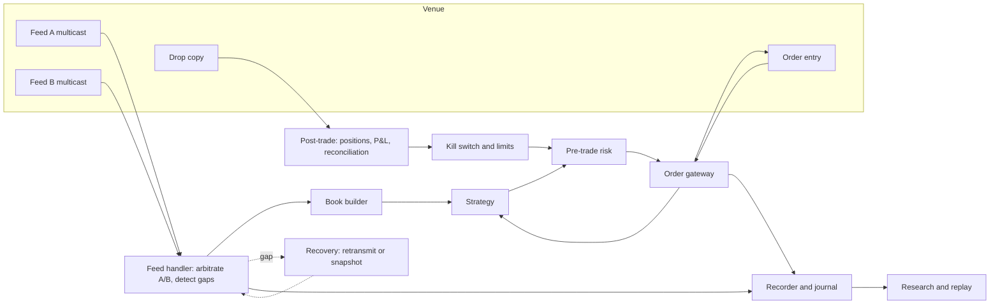
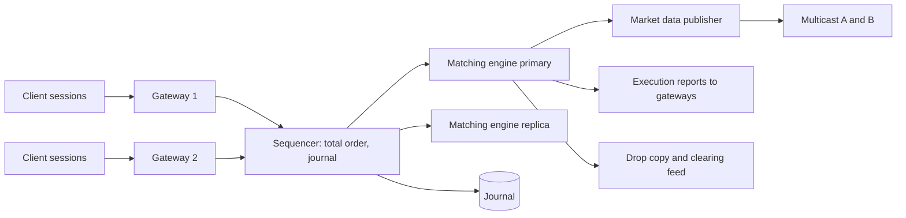
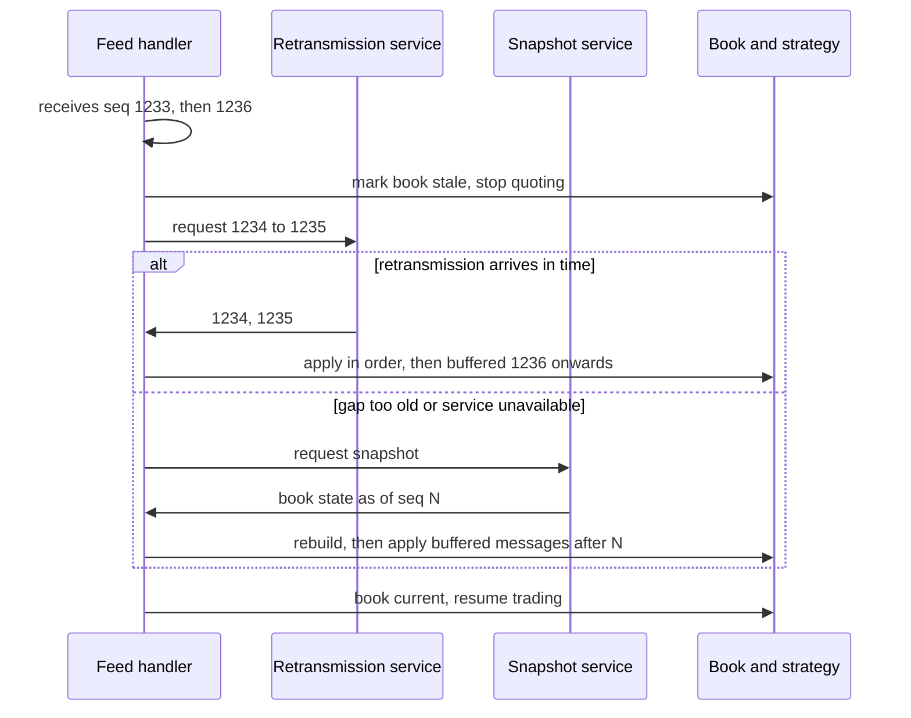

# System Design for Trading

## TL;DR

- Every trading system is the same pipeline: market data in, book building, strategy, pre-trade risk, order gateway, exchange, with drop copy, journaling and monitoring alongside; design the critical path for latency and everything else for correctness and auditability.
- Put a sequencer in front of a deterministic state machine: one total order of inputs, a journal of that order, and logic that depends on nothing else (no wall clock, no unordered iteration, no uninitialised memory) gives replicas that agree, replay that reproduces bugs, and recovery from snapshot plus journal tail.
- Market data is lossy UDP multicast made reliable by sequence numbers: arbitrate A and B feeds, detect gaps, recover from retransmission or a snapshot, and never trade on a book you know is stale.
- Pre-trade risk checks sit on the order path and must be both fast and fail-safe; SEC Rule 15c3-5 requires them for broker-dealers with market access, and Knight Capital's 2012 runaway router (about 45 minutes of erroneous orders, then a $460 million loss) is the standard lesson in why.
- Size everything from stated assumptions and show the arithmetic: at 5 million messages per second one thread has 200 ns per message, a 32-bit sequence number wraps in 859 seconds, and a day of 1 million messages per second is 889.2 GB raw.

## Learning objectives

- Design an exchange, a market data distribution system and a risk system.
- Reason about sequencing, determinism, replay and recovery.
- Lay out the components of an HFT trading system and of a bank's front-to-back flow, and say which are on the latency-critical path.
- Derive capacity and latency numbers from explicit assumptions.
- Explain failure modes (gaps, failover, split brain, runaway algorithms) and the controls that contain them.

## Core concepts

### Start from requirements

Before boxes and arrows, pin down:

- Latency target and which path it applies to (tick-to-trade p99, order acknowledgement, risk update).
- Throughput at peak, not average: market data bursts at the open, the close and on news are several times the daily mean.
- Correctness: what must never happen (duplicate orders, trading on a stale book, breaching limits) and what may degrade (dashboards, analytics).
- Availability and recovery objectives: how long can the system be down, and how much state may be lost (for an exchange, none).
- Auditability: every order, cancel, fill and risk decision reconstructable afterwards, for regulators and for debugging.

### An HFT trading system

- Feed handler: receives the A and B copies of each multicast channel, takes whichever copy of each sequence number arrives first (arbitration), detects gaps, and recovers missing messages from a retransmission service or rebuilds from a snapshot (Nasdaq offers GLIMPSE 5.0 for the current state of the book alongside TotalView-ITCH).
- Book builder: applies add, execute, cancel, delete and replace messages per order to maintain the venue's book (see [Order Book and Matching Engine](07-Order-Book-and-Matching-Engine.md)).
- Strategy: computes fair value and decides quotes or orders; owns its inventory state.
- Pre-trade risk: price bands (fat-finger), maximum order size and notional, position and credit limits, order and message rate limits, self-trade prevention, and the kill switch; it is on the critical path, so it is engineered like the rest of it.
  Rule 15c3-5(c)(1) itself requires two families, pre-set credit or capital thresholds and erroneous-order controls (price or size parameters, duplicative orders), plus regulatory controls in (c)(2); the rest is firm practice and venue rules.
- Order gateway: speaks the venue protocol (FIX or a binary protocol such as Nasdaq OUCH), manages the session (logon, sequence numbers, resend on reconnect, throttles), and tracks order state from acknowledgements and fills.
- Drop copy: an independent copy of executions sent by the venue or broker to post-trade systems; reconciling it against the gateway's own view catches lost messages and runaway behaviour.
- Recorder: captures every inbound and outbound message with timestamps, so any session can be replayed through the same code.

The latency-critical path is feed handler, book, strategy, risk, gateway; it usually runs as a few pinned threads, or one, connected by SPSC rings (see [Concurrency, Lock-Free Queues and Memory Pools](04-Concurrency-Lock-Free-and-Memory-Pools.md)).
Everything else consumes copies asynchronously and must never be able to block it.

### OMS and EMS

An order management system (OMS) owns the order lifecycle from the portfolio manager's or trader's intent: orders, allocations, positions, compliance checks and the books and records.
An execution management system (EMS) owns how orders are worked in the market: algorithms, smart order routing, venue connectivity and real-time transaction-cost feedback.
Buy-side firms often run both; HFT firms collapse them into the trading engine; banks have both plus client-facing order flow.
Risk checks, order state machines and their design are covered in [Risk Checks and Order Management Systems](13-Risk-Checks-and-Order-Management.md).

### An exchange

- Gateways authenticate sessions, validate messages, apply per-session throttles and risk checks, and forward to the sequencer.
- The sequencer assigns every inbound event a gap-free sequence number and journals it; that order is the truth.
- Matching engines are deterministic state machines partitioned by instrument; replicas apply the same sequenced stream and hold identical state, so failover loses nothing that was journaled.
- The market data publisher turns engine output into the public feed, itself sequenced, sent on redundant multicast channels with retransmission and snapshot services.
- The same pattern (sequenced input, deterministic business logic, replicated by replaying the log) underlies the LMAX architecture, and consensus-replicated logs (Raft, as used by Aeron Cluster) make the sequencer itself fault-tolerant.

### Sequencing, determinism and replay

State machine replication (Schneider 1990): replicas that start in the same state and apply the same inputs in the same order end in the same state, provided the logic is deterministic.
Determinism rules for trading code:

- Time is an input: stamp it on the event at the edge and read it from the event, never from the clock inside the logic.
- No iteration over unordered containers where the order affects output.
- No uninitialised memory, no data races, no dependence on pointer values or thread scheduling.
- Random numbers come from seeded generators whose seeds are part of the input.
- Floating-point results depend on evaluation order and compiler flags; prices and quantities are integers.

[qd_system_design.py](code/python/qd_system_design.py) demonstrates the consequences with a small price-time matcher fed by two gateways (8000 events, 4172 fills, seeded):

- A replica that receives the sequencer's journal serialized, as a second host would, reaches the primary's state digest.
- An independently written reference matcher (one flat list of resting orders, searched linearly) replays the same journal and produces the same 4172 fills and the same resting orders, so the digest is checked against more than the code that produced it.
- A replica restored from a snapshot at sequence 5000 (76,492 bytes of serialized state) and replaying the remaining 3000 events reaches the same digest.
- A consumer that lost sequence numbers 1234, 1235 and 6000 detects the two gaps, retransmits the 3 missing events from the journal, and reaches the same digest.
- Without a sequencer, two replicas that receive the same three orders in different arrival orders disagree about who bought the last 100 shares: replica 1 filled order 2, replica 2 filled order 3.

### Recovery and failover

- Detection: a missing sequence number on market data, a missing heartbeat on a session or between primary and backup.
  With 100 ms heartbeats and failure declared after 3 misses, detection takes 300 ms, during which a 5 million messages per second feed produces 1,500,000 messages that the backup must have or recover.
- Failover without split brain: a backup must not act as primary while the old primary may still be alive; use fencing (the venue or a coordinator accepts only one session) or consensus.
- Idempotency: client order ids make resends safe, and venue cancel-on-disconnect limits exposure when a session drops.
- Snapshots bound recovery time: with a snapshot every 300 s, the worst case is 1,500,000,000 events at peak, 75 s to replay at 20,000,000 events per second, against 1,170 s (19.5 min) to replay a full day.

### Capacity planning by explicit assumption

From [qd_system_design.py](code/python/qd_system_design.py); the assumptions (peak 5,000,000 messages per second, 36-byte messages, 20 messages per packet, average 1,000,000 messages per second over a 6.5-hour session, 4x compression, 70% target utilization) are illustrative inputs, not facts about any venue:

| Quantity | Derivation | Result |
| :--- | :--- | :--- |
| MoldUDP64 packet payload | 20-byte header (session 10, sequence 8, count 2) + 20 x (2-byte length + 36) | 780 bytes |
| Bytes on the wire per packet | + 28 IP and UDP + 38 Ethernet header, FCS, preamble and gap | 846 bytes |
| Packets per second at peak | 5,000,000 / 20 | 250,000 |
| Wire bandwidth at peak | 250,000 x 846 x 8 | 1.692 Gbit/s |
| Per-message budget, one thread | 1 s / 5,000,000 | 200 ns (140 ns at 70% utilization) |
| Messages per day | 1,000,000 x 23,400 s | 23,400,000,000 |
| Raw capture per day | x 38 bytes | 889.2 GB |
| Compressed per day, and per 252-day year | / 4 | 222.3 GB, 56.0 TB |
| 32-bit sequence number wrap at peak | 2^32 / 5,000,000 | 859 s (14.3 min) |
| 64-bit counter at 1e9 per second | 2^64 / 1e9 | 585 years |

The useful habits: separate peak from average, count framing overhead, convert rates into per-message budgets, and check every counter's width against the peak rate.

### A bank's front to back

A bank's trading stack has the same shape at a different timescale: trade capture and pricing in the front office, risk and P&L in the middle office, confirmation, settlement and accounting in the back office, with market and reference data feeding everything.
Its hard problems are consistency across systems (one trade representation, one curve per as-of time), scale of revaluation for risk, and regulatory reporting; see [Front-to-Back Architecture](../18-Pricing-and-Risk-Systems/01-Front-to-Back-Architecture.md) and [Intraday Risk and Pre-Trade Limits](../18-Pricing-and-Risk-Systems/08-Intraday-Risk-and-Pre-Trade-Limits.md).

### Controls: the Knight Capital lesson

According to the SEC's order (Release No. 34-70694, 2013), on 1 August 2012 Knight's router had new code on seven of its eight servers; a repurposed flag reactivated dormant "Power Peg" code on the eighth, which sent child orders without regard to executions already received.
For 212 incoming parent orders it produced 4 million executions in 154 stocks for more than 397 million shares in approximately 45 minutes, and Knight realized a $460 million loss.
The SEC found violations of the Market Access Rule (Rule 15c3-5).
Design lessons: automated, verified deployment to every host; delete dead code rather than repurposing its switches; pre-trade limits on order rate, position and notional that do not depend on the strategy being correct; drop-copy reconciliation; and a kill switch that someone is authorised and able to use within seconds.

## Worked examples

### "Design a market data distribution system for an exchange"

Requirements: one-to-many, lowest latency to all subscribers fairly, recoverable, auditable.
Design: the matching engine emits sequenced events; a publisher packs them into MoldUDP64-style packets on two multicast channels (A and B) through separate network paths; a retransmission service answers requests for ranges of sequence numbers from the journal; a snapshot service publishes full book state periodically for late joiners and long gaps.
Sizing: at the assumed peak, 250,000 packets per second of 846 bytes is 1.692 Gbit/s per channel, comfortably within 10 GbE with burst headroom; sequence numbers are 64-bit because 32 bits would wrap in 859 s at that rate.
Fairness: identical cable lengths and switch paths per subscriber in the colocation facility, measured with hardware timestamps.
Slow consumers: multicast never waits for a receiver, so a subscriber that falls behind sees gaps and must recover itself; inside a firm, where data is re-distributed over TCP or shared memory, the publisher must never block on its slowest reader, so a lagging consumer either gets conflated data (only the latest state per instrument, which suits a risk dashboard but not a book builder) or is disconnected and told to resynchronise from a snapshot.

### "Our strategy and our risk system disagree about our position"

Sources of truth: the gateway's view from execution reports, the drop copy from the venue, and the clearing records at end of day.
Reconcile drop copy against gateway state continuously; a mismatch means a lost or duplicated message, a bug in order-state handling, or a fill on a session the strategy does not know about.
Until reconciled, the risk system should use the more conservative position and the strategy should reduce or stop.

### "How do you reproduce a production bug from yesterday?"

Replay the recorded, sequenced inputs through the same build in a test harness; determinism guarantees the same outputs, and the digest after each event finds the first divergence if a code change is being tested.
In the demonstration, restoring the snapshot at sequence 5000 and replaying the remaining 3000 events reproduces the live digest exactly.

### "The feed handler detects a gap. What does the strategy do?"

Mark the book stale and stop quoting or pull quotes immediately, because orders priced off a stale book are the textbook way to be picked off.
Request retransmission of the missing range; in the demonstration, gaps at 1234 to 1235 and at 6000 were repaired with 3 retransmitted events and the state digest matched the primary's.
If retransmission is too slow or unavailable, rebuild from a snapshot and replay the buffered messages after it, then resume.

## Pitfalls

- Drawing boxes before agreeing on latency, throughput, recovery and correctness requirements.
- Sizing for average load; bursts at the open and on news set the requirement.
- Letting logging, monitoring or persistence share a thread or a lock with the order path.
- Using wall-clock time or unordered iteration inside logic that must replay deterministically.
- Treating UDP market data as reliable, or continuing to trade through a gap.
- Failover designs where the backup can become primary while the old primary still trades (split brain).
- Risk checks that are skipped "temporarily" for latency, or that fail open when their limits service is down.
- 32-bit counters for sequence numbers, order ids or message counts.
- Manual, unverified deployments to a fleet; configuration flags reused for new meanings.

## Interview questions

> [!question]- qd-sysdesign-hft-components | Name the components of an HFT trading system and mark the latency-critical path.
> Feed handler, book builder, strategy, pre-trade risk, order gateway (critical path); drop copy, post-trade, recorder and journal, monitoring, research replay (off the critical path, fed asynchronously). The kill switch is operated from off the path, but its flag is checked inside pre-trade risk on every order.

> [!question]- qd-sysdesign-ab-arbitration | What is A/B feed arbitration?
> Venues publish the same sequenced feed on two multicast channels over separate paths. The handler takes the first copy of each sequence number from either feed and discards the duplicate, so a drop on one path is covered by the other without waiting for retransmission.

> [!question]- qd-sysdesign-gap-handling | Your feed handler sees sequence 1233 then 1236. What happens?
> Buffer 1236 onwards, mark the book stale and stop quoting, request 1234 to 1235 from the retransmission service, apply them in order then drain the buffer; if recovery fails or is too slow, rebuild from a snapshot and replay buffered messages after it.

> [!question]- qd-sysdesign-sequencer | Why put a sequencer in front of a matching engine?
> It defines one total order of all inputs and journals it. Deterministic engines replicated from that order hold identical state, failover loses nothing journaled, and any incident can be replayed exactly.

> [!question]- qd-sysdesign-determinism-rules | List the rules that make trading logic deterministic.
> Time comes from the event, not the clock; no iteration over unordered containers that affects output; no uninitialised memory or data races; seeded random numbers with seeds as inputs; integer prices and quantities instead of order-dependent floating point.

> [!question]- qd-sysdesign-no-sequencer | Two replicas process the same orders without a sequencer. What can go wrong?
> They may see them in different arrival orders and diverge: in the demonstration two buyers raced for the last 100 shares and each replica filled a different buyer. Without a single order of inputs there is no single truth.

> [!question]- qd-sysdesign-snapshot | Why take snapshots if the journal already allows full replay?
> To bound recovery time: replaying a whole day at the assumed 23.4 billion messages and 20 million per second takes 1,170 s, while replaying from a 300 s snapshot takes at most 75 s at peak.

> [!question]- qd-sysdesign-slow-consumer | One consumer of your internal market data bus falls behind. What do you do?
> Never let it slow the publisher or the other consumers. Either conflate for it (keep only the latest state per instrument, acceptable for dashboards and risk views, not for a book builder that needs every order message) or cut it off and make it resynchronise from a snapshot plus the sequenced stream; bound every per-consumer queue and alert on lag.

> [!question]- qd-sysdesign-seq-width | Why must sequence numbers be 64-bit?
> At 5 million messages per second a 32-bit counter wraps after 859 s (14.3 minutes); a 64-bit counter at a billion per second lasts 585 years.

> [!question]- qd-sysdesign-per-message-budget | A feed peaks at 5 million messages per second. What is the per-message budget for one thread?
> 200 ns to keep up, and about 140 ns if you want 70% utilization so bursts do not build queues; more than that means partitioning by instrument across threads.

> [!question]- qd-sysdesign-bandwidth | Estimate wire bandwidth for 5 million 36-byte messages per second packed 20 per MoldUDP64 packet.
> Payload 20 + 20 x 38 = 780 bytes, plus 28 IP and UDP and 38 Ethernet framing = 846 bytes per packet; 250,000 packets per second x 846 x 8 = 1.692 Gbit/s.

> [!question]- qd-sysdesign-drop-copy | What is a drop copy and why reconcile against it?
> An independent copy of executions sent by the venue or broker to post-trade systems. Comparing it to the gateway's own order state detects lost or duplicated messages and runaway order flow that the trading system itself may not see.

> [!question]- qd-sysdesign-oms-ems | Distinguish an OMS from an EMS.
> The OMS manages the order lifecycle and books and records: orders, allocations, positions, compliance. The EMS manages execution in the market: algorithms, routing, connectivity, real-time TCA.

> [!question]- qd-sysdesign-pretrade-checks | Which pre-trade risk checks sit on the order path?
> Price bands, maximum order size and notional, position and credit limits, order and message rate limits, duplicate-order checks, self-trade prevention, and the kill switch. In the US, Rule 15c3-5(c)(1) requires broker-dealers with market access to reject orders that breach pre-set credit or capital thresholds and erroneous orders (price or size parameters, duplicates); rate limits, self-trade prevention and kill switches are firm practice and venue rules on top.

> [!question]- qd-sysdesign-knight | What happened at Knight Capital and what controls would have contained it?
> Per the SEC order, new code was not deployed to one of eight servers, and a repurposed flag reactivated dormant code that sent child orders endlessly: 4 million executions, 397 million shares, about 45 minutes, a $460 million loss. Automated verified deployment, removal of dead code, hard order-rate and position limits, drop-copy reconciliation and a usable kill switch.

> [!question]- qd-sysdesign-split-brain | How do you fail over an order gateway without split brain?
> The backup only becomes active after the primary is fenced: the venue or a coordinator accepts only one session, or a consensus protocol elects the leader. Combine with cancel-on-disconnect and idempotent client order ids so resends cannot double orders.

> [!question]- qd-sysdesign-heartbeat-tradeoff | What is the trade-off in choosing heartbeat interval and miss count?
> Shorter intervals and fewer misses detect failure faster but raise false failovers on transient jitter. 100 ms with 3 misses detects in 300 ms, during which a 5 million per second feed carries 1.5 million messages that must be recovered.

> [!question]- qd-sysdesign-exchange-partition | How would you scale a matching engine to many instruments?
> Partition by instrument: each engine owns a disjoint set of symbols with its own sequenced stream, so books never need cross-engine locking. Cross-instrument features (spreads, implied orders) need either co-location of related instruments or a coordinating layer.

> [!question]- qd-sysdesign-storage | Estimate daily capture storage for 1 million 38-byte framed messages per second over a 6.5-hour session.
> 23.4 billion messages x 38 bytes = 889.2 GB raw, 222.3 GB at 4x compression, about 56.0 TB per 252-day year.

## In this repo and SDE-Interview-Prep

- Code: [qd_system_design.py](code/python/qd_system_design.py) (capacity arithmetic and the sequenced, replayable state machine).
- Related: [Order Book and Matching Engine](07-Order-Book-and-Matching-Engine.md), [Market Data Feed Handlers and Protocols](08-Market-Data-Feed-Handlers-and-Protocols.md), [Backtester and Simulator Design](09-Backtester-and-Simulator-Design.md), [Risk Checks and Order Management Systems](13-Risk-Checks-and-Order-Management.md).
- Front-to-back trading and risk systems: [Front-to-Back Architecture](../18-Pricing-and-Risk-Systems/01-Front-to-Back-Architecture.md).
- Senior systems design interview cases: [Systems Design Problem Set](../18-Pricing-and-Risk-Systems/18-Systems-Design-Problem-Set.md).
- Market-making stack: [Market Making Systems Architecture](../08-Market-Making/11-Market-Making-Systems-Architecture.md).
- [Sequenced-stream architecture (SDE-Interview-Prep)](https://github.com/shreejitverma/SDE-Interview-Prep/blob/main/14-Low-Latency-Systems/02%20-%20Exchange%20Architecture/The%20Sequenced-Stream%20Architecture.md)
- [Replicated state machines in exchanges (SDE-Interview-Prep)](https://github.com/shreejitverma/SDE-Interview-Prep/blob/main/14-Low-Latency-Systems/02%20-%20Exchange%20Architecture/Replicated%20State%20Machine%20Pattern%20in%20Exchanges.md)
- [Drop copy and clearing feeds (SDE-Interview-Prep)](https://github.com/shreejitverma/SDE-Interview-Prep/blob/main/14-Low-Latency-Systems/02%20-%20Exchange%20Architecture/Drop%20Copy%20and%20Clearing%20Feeds.md)
- [Pre-trade risk checks at wire speed (SDE-Interview-Prep)](https://github.com/shreejitverma/SDE-Interview-Prep/blob/main/14-Low-Latency-Systems/02%20-%20Exchange%20Architecture/Pre-Trade%20Risk%20Checks%20at%20Wire%20Speed.md)
- [The 2012 Knight Capital disaster (SDE-Interview-Prep)](https://github.com/shreejitverma/SDE-Interview-Prep/blob/main/14-Low-Latency-Systems/02%20-%20Exchange%20Architecture/War%20Story%20-%20The%202012%20Knight%20Capital%20Disaster.md)
- [UDP multicast market data and A-B feed arbitration (SDE-Interview-Prep)](https://github.com/shreejitverma/SDE-Interview-Prep/blob/main/14-Low-Latency-Systems/06%20-%20Networking/UDP%20Multicast%20Market%20Data%20and%20A-B%20Feed%20Arbitration.md)
- [Deterministic replay and packet injection testing (SDE-Interview-Prep)](https://github.com/shreejitverma/SDE-Interview-Prep/blob/main/14-Low-Latency-Systems/13%20-%20Reliability%2C%20Ops%20%26%20Testing/Deterministic%20Replay%20and%20Packet%20Injection%20Testing.md)
- [System design (SDE-Interview-Prep)](https://github.com/shreejitverma/SDE-Interview-Prep/blob/main/04-System-Design/README.md)

## Further reading

- Martin Kleppmann, *Designing Data-Intensive Applications* (O'Reilly, 2017): replication (ch 5), the trouble with distributed systems (ch 8), consistency and consensus (ch 9), stream processing (ch 11).
- Fred Schneider, "Implementing Fault-Tolerant Services Using the State Machine Approach: A Tutorial", *ACM Computing Surveys* 22(4), 1990.
- Leslie Lamport, "Time, Clocks, and the Ordering of Events in a Distributed System", *Communications of the ACM* 21(7), 1978.
- Diego Ongaro and John Ousterhout, "In Search of an Understandable Consensus Algorithm", USENIX ATC 2014 (Raft).
- Martin Fowler, "The LMAX Architecture" (martinfowler.com, 2011), and the LMAX Disruptor technical paper (2011).
- Larry Harris, *Trading and Exchanges: Market Microstructure for Practitioners* (Oxford University Press, 2003), chapters 5 (Market Structures) and 6 (Order-Driven Market Mechanisms).
- SEC, *In the Matter of Knight Capital Americas LLC*, Release No. 34-70694, 2013.
