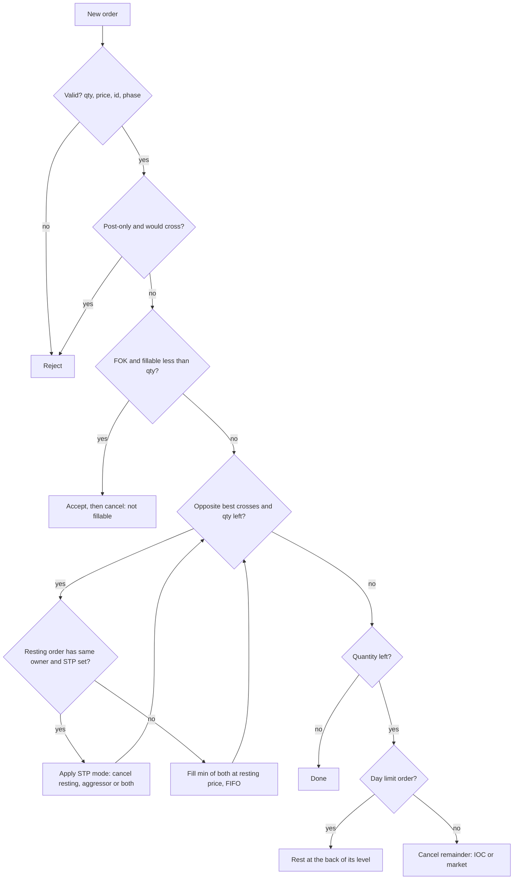
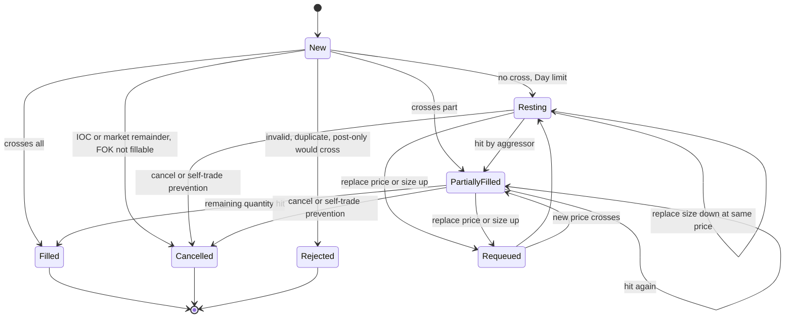

# Order Book and Matching Engine Implementation

## TL;DR

- A limit order book is two sorted sides of price levels, each level a FIFO queue of orders; price-time priority means best price first, then earliest arrival at that price.
- The standard implementation: orders in a preallocated pool, each level an intrusive doubly linked list through the pool (O(1) cancel), an order-id hash map to find an order, and a price-ordered container of levels (a tree for generality, a tick-indexed array for speed).
- Matching walks the opposite side from the best level, filling FIFO until the incoming order is done or no longer crosses; IOC and market orders cancel the remainder, FOK checks fillable quantity first, post-only rejects anything that would cross, and self-trade prevention decides what to cancel when both sides belong to one owner.
- Cancel/replace keeps queue priority only for a size reduction at the same price; any price change or size increase re-enters at the back.
- Measured on an Apple M3 Pro (machine-dependent), the repo's engine processed a synthetic flow at 62.4 ns per operation on average, and a tick-indexed array served level updates at 3.69 ns against 20.28 ns for `std::map`; correctness is checked by differential testing against a naive reference over 20,000 random adds, cancels, replaces, IOC, FOK and market orders.

## Learning objectives

- Implement a price-time priority limit order book with O(1) cancel.
- Choose data structures for levels and orders and justify them with cache behaviour.
- Implement limit, market, IOC, FOK and post-only orders, cancel/replace and self-trade prevention.
- Compute a call-auction clearing price.
- Build a book from an order-by-order feed (Nasdaq ITCH 5.0) and handle its error cases.

## Core concepts

### Invariants

The book's microstructure (order types, queue position, why priority matters) is covered in [Limit Order Books and Order Types](../07-Market-Microstructure/01-Limit-Order-Books-and-Order-Types.md); this note is about building it.
A correct engine maintains, after every event:

- In continuous trading the book is never crossed: best bid < best ask.
- Each level's total equals the sum of its orders' open quantities, and no resting order has zero quantity.
- Within a level, orders are in arrival order (modified only by priority-losing amendments).
- Quantity is conserved: incoming quantity = filled + rested + cancelled.
- Every order id maps to exactly one resting order or to none.

### Data structure choices

| Component | Option | Cost | Trade-off |
| :--- | :--- | :--- | :--- |
| Levels per side | Balanced tree (`std::map`) | O(log L) insert or erase, O(1) best via cached iterator | General, handles any price; node allocation and pointer chasing |
| Levels per side | Sorted vector, best at the back | O(log L) search, O(distance from back) insert | Contiguous; activity concentrates near the touch, so shifts are short |
| Levels per side | Array indexed by tick offset | O(1) access, scan to the next non-empty level when the best empties | Fastest; needs a bounded price band and a rebase strategy |
| Orders in a level | Intrusive doubly linked list through a pool | O(1) append, O(1) remove anywhere | Needs the order's index; no allocation |
| Orders in a level | `std::deque` with lazy deletion | O(1) append, cancel marks a tombstone | Simple; tombstones accumulate and must be skipped |
| Order lookup | Hash map from order id to pool index | O(1) expected | `std::unordered_map::reserve` only presizes buckets and every insert still allocates a node; use open addressing, or a plain array when the id space is dense |

Complexity of the repo's engine ([lob_engine.hpp](code/cpp/lob_engine.hpp)), with $L$ levels on a side and $k$ resting orders filled or skipped:

| Operation | Cost |
| :--- | :--- |
| Add at an existing level | O(1) plus O(log L) to find the level |
| Add creating a level | O(log L) |
| Cancel by id | O(1) expected to find and unlink, O(1) amortised to erase an emptied level via its stored iterator |
| Aggressive order | O(k + levels crossed) |
| Best bid or ask | O(1): `begin()` of each side |
| FOK pre-check | O(orders inspected until the quantity is covered) |

The bid map is keyed in descending price order so that `begin()` is the best level on both sides.
Keying bids ascending and reading `std::prev(end())` is O(1) in libstdc++, which caches the rightmost node, but O(log L) in libc++, which caches only the leftmost.
The engine's commands are `noexcept`: the only failures left are allocations (map and hash-map nodes, the caller's event vector), a half-applied command leaves no consistent book to recover, so `std::bad_alloc` terminates instead of corrupting state.

### Why cache behaviour decides the design

A cancel deep in a large book touches the hash bucket, the order node and its two neighbours: four potential cache misses at around 100 ns each when the book is large and cold (see the measured ladder in [Low-Latency Engineering](03-Low-Latency-Engineering.md)).
32-bit pool indices instead of 64-bit pointers halve the size of the link fields, contiguous pools keep neighbouring orders close, and arrays of levels avoid the per-node allocations and pointer chasing of trees.
Measured by [lob_bench.cpp](code/cpp/lob_bench.cpp) for 2,000,000 add-or-remove operations near the touch on one side (Apple M3 Pro, Apple clang 21, `-O2`, median of three runs, machine-dependent):

| Level container | ns per operation |
| :--- | ---: |
| `std::map` | 20.28 |
| Sorted `std::vector`, best at the back | 15.61 |
| Tick-indexed array | 3.69 |

All three agreed on the best price after every operation.

### Matching algorithm

Fills execute at the resting order's price: the aggressor gets any price improvement.
The engine allocates FIFO within a level; other allocation rules exist.
CME Globex documents several, among them FIFO, pro-rata (each resting order receives a share of the incoming quantity proportional to its size, fractional lots rounded down and the residual allocated FIFO), and variants that first give a percentage to the order that set the price or to lead market makers.
Pro-rata rewards size over speed, so participants over-quote (show more than they want filled) and queue position matters less; an interviewer at a futures firm will expect you to know both.
The engine emits events (accepted, fill, cancelled, replaced, rejected) into a caller-owned vector and performs no I/O.

### Order types

| Type | Behaviour in the engine |
| :--- | :--- |
| Limit, Day | Match while crossing, rest the remainder |
| Limit, IOC | Match while crossing, cancel the remainder |
| Limit, FOK | Fill completely now or cancel entirely; needs a pre-check that walks the opposite side exactly as matching would |
| Market | Match against any price until filled or the side is empty; never rests |
| Post-only | Reject if it would cross on arrival (some venues reprice instead); guarantees maker status |

Venues add stops, icebergs, pegs, minimum quantities and more; each is a state machine layered on the same book.

### Cancel, replace and priority

A cancel removes the order and erases its level if it empties.
A replace that reduces quantity at the same price amends in place and keeps queue position; a price change or a size increase is a cancel plus a new order at the back of the queue (and may trade immediately if the new price crosses).
This is the common rule, and the reason market makers reduce rather than cancel-and-replace when they want to keep their place; exact rules are venue-specific.

### Self-trade prevention

When an incoming order would match a resting order with the same owner (trader, account or firm identifier), wash trading is avoided by one of:

- Cancel resting: cancel the resting order and continue matching against others.
- Cancel aggressor: cancel the remainder of the incoming order.
- Cancel both: cancel the resting order and the incoming remainder.

Venues also offer decrement variants; the FOK pre-check must apply the same rule, or a FOK could partially fill and then be cancelled by STP.

### Call auctions

During a pre-open phase orders rest without matching, and the book may be crossed.
At the uncross a single clearing price is chosen; the common rule set is:

1. Maximise executable volume, where at price $p$ buy volume is $B(p) = \sum_{\text{bids} \ge p} q$, sell volume is $S(p) = \sum_{\text{asks} \le p} q$, and executable volume is $\min(B(p), S(p))$.
2. Then minimise the absolute imbalance $\lvert B(p) - S(p)\rvert$.
3. Then choose the price closest to a reference price (for example the previous close); the engine finally breaks remaining ties with the lower price.

Some venues insert a market-pressure step between 2 and 3 (Cboe Europe's Periodic Auctions list maximum executable volume, minimum surplus, market pressure, reference price): with a surplus on the buy side take the highest remaining candidate, with a surplus on the sell side the lowest.

Candidates are the limit prices present in the book.
Orders then execute at that one price in price-time priority.
Real venues publish their own exact rules and indicative prices during the call (Nasdaq disseminates the Net Order Imbalance Indicator in ITCH); see [Exchange Mechanics, Auctions and Fees](../07-Market-Microstructure/02-Exchange-Mechanics-Auctions-and-Fees.md).

### Building a book from ITCH 5.0

Participants rebuild the venue's book from an order-by-order feed.
Nasdaq TotalView-ITCH 5.0 messages are fixed-length, big-endian, with prices as Price(4) integers; every message starts with type (offset 0), stock locate (1, 2 bytes), tracking number (3, 2 bytes) and a 6-byte nanosecond timestamp (5):

| Type | Message | Length | Book effect |
| :--- | :--- | ---: | :--- |
| A | Add Order, no MPID | 36 | New order: reference (offset 11, 8 bytes), side (19), shares (20, 4 bytes), stock (24, 8 bytes), price (32, 4 bytes) |
| F | Add Order with MPID | 40 | As A plus a 4-byte attribution at offset 36 |
| E | Order Executed | 31 | Subtract executed shares (19) from the order |
| C | Order Executed With Price | 36 | Subtract executed shares; execution price at offset 32 |
| X | Order Cancel | 23 | Subtract cancelled shares (19) |
| D | Order Delete | 19 | Remove the order |
| U | Order Replace | 35 | Remove the original reference (11); add the new reference (19) with shares (27) and price (31), same side |

Modify messages carry only the order reference, so the builder must remember each order's side and price from its Add.
Messages arrive as MoldUDP64 message blocks, each prefixed by a 2-byte length, so unknown types can be skipped and the format can grow.
[lob_itch_book.hpp](code/cpp/lob_itch_book.hpp) parses these messages with bounds checks, filters one stock locate, and reports truncated blocks, unknown references, duplicate adds and over-fills instead of corrupting the book.
Feed handling end to end (sessions, gaps, arbitration) is the subject of [Market Data Feed Handlers and Protocols](08-Market-Data-Feed-Handlers-and-Protocols.md).

### Engine throughput

[lob_bench.cpp](code/cpp/lob_bench.cpp) drives the engine with a seeded synthetic flow (45% passive adds near the touch, 45% cancels of random live orders, 10% marketable IOC orders) of 2,000,000 operations.
Median of three runs on the Apple M3 Pro (machine-dependent): 62.4 ns per operation on average (16.0 million operations per second).
Per-operation latency read with the raw counter, which reports 1 GHz but advances in steps of about 42 ns on this machine (the bench measures and prints the step), so the low percentiles are quantised; the three runs agreed on every percentile:

| Operation | p50 | p99 | p99.9 |
| :--- | ---: | ---: | ---: |
| Passive add | 42 ns | 84 ns | 125 ns |
| Cancel | 42 ns | 84 ns | 125 ns |
| Marketable IOC | 42 ns | 125 ns | 167 ns |

The slowest single operation varied between runs from about 6 to 12 microseconds, far above p99.9: on an untuned desktop that is most likely an interrupt or a descheduling, which is why production engines pin cores and isolate them from the OS.

### Testing the engine

- Unit tests for each rule: validation, market orders on an empty book, cancel in the middle of a queue, every replace variant, every STP mode, FOK with STP, auction phase rules.
- Differential testing: [tests/test_lob_engine.cpp](code/cpp/tests/test_lob_engine.cpp) runs 20,000 seeded random adds, cancels, cancel/replaces (size down, size up, reprice), IOC, FOK and market orders through the engine and through a deliberately naive reference (linear scans, obviously correct), and requires identical event streams and identical depth at every price after every operation, plus an uncrossed book.
  The test also asserts that replaces, FOK kills and fills actually occurred, so it cannot pass vacuously; seeded bugs (a size increase keeping priority, fills at the aggressor's price, a missing FOK pre-check) each make it fail.
- Sanitizers: the engine, demo and tests run clean under ASan and UBSan (they are single-threaded, so TSan has nothing to check).

## Worked examples

All outputs are printed and checked by [order_matching_engine.cpp](code/cpp/order_matching_engine.cpp); prices are integer cents.

### Walking the book

Book: asks 300 @ 101.00 (order 1), 200 @ 101.00 (order 2), 500 @ 102.00 (order 3); bid 400 @ 99.00 (order 4).
A buy limit for 600 @ 102.00 (order 5) fills 300 @ 101.00 against order 1 (earlier at that price), 200 @ 101.00 against order 2, then 100 @ 102.00 against order 3.
Notional 60,700.00, average price 101.1667; order 3 keeps 400 at 102.00, which is now the best ask.

### Priority under replace

Three bids of 100 at 100.00 queue as 10, 11, 12.
Reducing 10 to 60 at the same price keeps the queue 10, 11, 12.
Increasing 11 to 150 sends it to the back: 10, 12, 11, and the level total is 60 + 100 + 150 = 310.

### IOC, FOK and post-only

With 400 offered at 102.00, a FOK buy for 500 @ 102.00 is accepted and immediately cancelled as not fillable, touching nothing.
An IOC buy for 500 @ 102.00 fills 400 and cancels the remaining 100.
After a new offer of 100 @ 103.00, a post-only buy at 103.00 is rejected because it would cross.

### Self-trade prevention

Offers: 100 @ 100.00 from trader 7 (order 30), then 100 @ 100.00 from trader 8 (order 31).
Trader 7 sends a buy for 150 @ 100.00 with cancel-resting STP: order 30 is cancelled for self-trade, the buy fills 100 against order 31, and the remaining 50 rests as the best bid.

### Opening auction

Bids 10 @ 102.00, 20 @ 101.00, 30 @ 100.00; offers 15 @ 99.00, 25 @ 100.00, 20 @ 102.00.

| Price | Buy volume | Sell volume | Executable |
| ---: | ---: | ---: | ---: |
| 99.00 | 60 | 15 | 15 |
| 100.00 | 60 | 40 | 40 |
| 101.00 | 30 | 40 | 30 |
| 102.00 | 10 | 60 | 10 |

The clearing price is 100.00 with 40 shares and a buy imbalance of 20, executed as 4 fills; afterwards 20 remain bid at 100.00 and the best offer is 102.00.
Tie-break: one bid of 10 @ 101.00 and one offer of 10 @ 99.00 execute 10 at either candidate with zero imbalance, so the reference price decides: 101.00 with a reference of 101.00, 99.00 with a reference of 98.00.

### Building a book from ITCH messages

Seven framed messages for stock locate 7 and one for another stock: adds of 300 and 200 to buy at 100.0100 and 500 to sell at 100.0300, an execution of 100 against the first buy, a cancel of 50 from the second, a replace of the sell to 400 @ 100.0200 under a new reference, a delete of the first buy.
The 268-byte stream applies 7 messages, skips 1 (other stock), with 0 errors; the book is bid 150 @ 100.0100 and offered 400 @ 100.0200, with 2 live orders.

## Pitfalls

- Using `std::list` of `shared_ptr<Order>` per level: an allocation per order, atomic reference counts and pointer chasing on every fill.
- Lazy cancellation that marks quantity zero but leaves the node, so matching later "fills" zero-quantity orders or the level total drifts.
- Erasing a map entry or a list node while iterating it, and then using the invalidated iterator.
- Executing at the aggressor's price instead of the resting order's price.
- Letting a replace keep priority on a size increase or price change.
- Treating FIX `OrderQty` (tag 38) on a cancel/replace as the new open quantity: FIX defines it as the total intended quantity including what has already executed, so open quantity is `OrderQty - CumQty`, and a replace that races a fill can leave nothing open.
- Reading the best bid as `std::prev(bids.end())` and assuming O(1): true in libstdc++, O(log L) in libc++; order the bid side descending.
- Assuming `reserve` makes `std::unordered_map` allocation-free: it presizes buckets, but each insert still allocates a node.
- A FOK pre-check that counts liquidity STP would skip or stop at.
- Floating-point prices as map keys.
- Trusting feed messages: a replace for an unknown reference, an execution larger than the order, or a truncated block must be reported, not applied.
- Benchmarking with a book that grows without bound (adds outnumbering cancels), which measures memory growth, not the engine.

## Interview questions

> [!question]- qd-lobimpl-structure | Describe the data structures of a fast limit order book.
> Orders in a preallocated pool; each price level an intrusive doubly linked FIFO through the pool; an id-to-index hash map; levels in a sorted container per side (tree for generality, tick-indexed array for speed) with the best level cached.

> [!question]- qd-lobimpl-o1-cancel | How do you make cancel O(1)?
> Look the order up by id in a hash map to get its node, unlink it from its level's doubly linked list using its prev and next links, update the level total, and erase the level through a stored iterator or index if it is now empty.

> [!question]- qd-lobimpl-map-vs-array | `std::map` of levels or an array indexed by tick: which and why?
> An array gives O(1) level access and contiguous memory (measured 3.69 vs 20.28 ns per operation here, machine-dependent) but needs a bounded price band, a rebase when price drifts, and a scan to find the next level when the best empties. A tree handles any price range with O(log L) operations.

> [!question]- qd-lobimpl-fill-price | At what price does an aggressive order execute?
> At each resting order's price, level by level, so the aggressor receives any price improvement; a buy limit at 102.00 against offers at 101.00 pays 101.00.

> [!question]- qd-lobimpl-walk-book | Offers: 300 @ 101.00, 200 @ 101.00, 500 @ 102.00. A buy for 600 @ 102.00 arrives. Fills and average price?
> 300 and 200 at 101.00 in time order, then 100 at 102.00: notional 60,700.00, average 101.1667; 400 remain offered at 102.00.

> [!question]- qd-lobimpl-replace-priority | Which amendments keep queue priority?
> Typically only a quantity reduction at the same price. A price change or a quantity increase is treated as cancel plus new order and goes to the back of the queue.

> [!question]- qd-lobimpl-fix-replace-qty | A FIX cancel/replace lowers OrderQty on a partly filled order. How is the new open quantity computed, and what if a fill races the replace?
> Open quantity is OrderQty minus CumQty, because FIX defines OrderQty on a replace as the total intended quantity including what has already executed. If fills arrive first and CumQty reaches the new OrderQty, nothing is left open and the order is done; a gateway that passes OrderQty straight through as open quantity over-sizes the order.

> [!question]- qd-lobimpl-pro-rata | How does pro-rata matching differ from FIFO, and how does it change participant behaviour?
> Pro-rata splits an incoming order across the resting orders at a price in proportion to their size (fractional lots rounded down, residual allocated FIFO), instead of filling the earliest first. Size is rewarded rather than speed, so participants over-quote and queue position matters less; CME Globex uses FIFO, pro-rata and hybrid allocation algorithms depending on the product.

> [!question]- qd-lobimpl-best-bid-libcxx | Your bids are a `std::map` keyed ascending and you read the best bid as `std::prev(bids.end())`. What is the cost?
> O(1) in libstdc++, which caches the rightmost node, but O(log L) in libc++, which caches only the leftmost and walks down from the root. Key the bid side descending (a comparator) so the best level is `begin()` on both sides.

> [!question]- qd-lobimpl-fok | How do you implement fill-or-kill correctly?
> Before matching, walk the opposite side in priority order exactly as matching would, applying self-trade rules, and sum fillable quantity; cancel the whole order if it falls short, otherwise match. Never match first and roll back.

> [!question]- qd-lobimpl-post-only | What does post-only do and why do market makers use it?
> It rejects (or on some venues reprices) an order that would take liquidity on arrival, guaranteeing maker status and its fee or rebate, and protecting against crossing a book that moved since the quote was computed.

> [!question]- qd-lobimpl-stp-modes | Name the self-trade prevention modes.
> Cancel resting (cancel the resting order, keep matching), cancel aggressor (cancel the incoming remainder), cancel both; venues also offer decrement variants that reduce both by the smaller quantity.

> [!question]- qd-lobimpl-auction-rule | How is a call-auction clearing price chosen?
> Maximise executable volume $\min(B(p), S(p))$ over candidate prices; break ties by minimum absolute imbalance, then by closeness to a reference price; venues publish their exact rules.

> [!question]- qd-lobimpl-auction-numeric | Bids 10 @ 102, 20 @ 101, 30 @ 100; offers 15 @ 99, 25 @ 100, 20 @ 102. Clearing price and volume?
> 100 with 40 shares: buy volume 60 and sell volume 40 there; 99 gives 15, 101 gives 30, 102 gives 10. Buy imbalance 20.

> [!question]- qd-lobimpl-itch-modify | An ITCH Order Executed message carries no price or side. How does a book builder apply it?
> It looks up the order reference from the earlier Add Order, which recorded side, price and shares, subtracts the executed shares, and removes the order if none remain.

> [!question]- qd-lobimpl-itch-lengths | What are the lengths of ITCH 5.0 Add Order, Order Executed, Order Cancel, Order Delete and Order Replace?
> 36, 31, 23, 19 and 35 bytes (Add with MPID is 40, Executed With Price 36).

> [!question]- qd-lobimpl-itch-replace | How does an ITCH Order Replace change the book?
> The original reference is removed entirely; a new order with a new reference, the given shares and price, and the original side (plus stock and attribution, which the message omits) is added. The spec calls it a cancel-replace, so a book builder places the new reference at the back of its level's queue.

> [!question]- qd-lobimpl-invariants | Which invariants would you assert after every event in a test build?
> Book not crossed in continuous trading, level totals equal the sum of open quantities, no zero-quantity resting orders, FIFO order within each level, and quantity conservation per order.

> [!question]- qd-lobimpl-differential | How do you gain confidence that an optimised matching engine is correct?
> Differential testing against a simple reference model on many seeded random sequences, comparing every event and the depth at every price after every step, plus unit tests per rule and sanitizer runs. Here 20,000 operations, including replaces and FOK orders, matched exactly; check the test can fail by seeding a bug into the engine.

> [!question]- qd-lobimpl-hot-cancel | Why can cancels be the slowest operation in a large book?
> A cancel of a random order touches cold memory: the hash bucket, the order node and both neighbours, each a potential DRAM miss of around 100 ns, while adds and executions mostly touch the hot top of the book.

> [!question]- qd-lobimpl-benchmark-numbers | What did the repo's engine measure, and what should you not conclude from it?
> 62.4 ns per operation on average on an Apple M3 Pro for a synthetic flow, with p99.9 between 125 and 167 ns by operation type (machine-dependent). Do not conclude production latency: the clock was quantised to 42 ns, the machine untuned, the flow synthetic, and the book small and cache-resident.

## In this repo and SDE-Interview-Prep

- Code: [lob_engine.hpp](code/cpp/lob_engine.hpp) (engine), [lob_itch_book.hpp](code/cpp/lob_itch_book.hpp) (ITCH 5.0 book builder and encoders), [order_matching_engine.cpp](code/cpp/order_matching_engine.cpp) (the worked examples), [lob_bench.cpp](code/cpp/lob_bench.cpp) (throughput and level-container comparison), [tests/test_lob_engine.cpp](code/cpp/tests/test_lob_engine.cpp) (rules and differential test), and the spec [Nasdaq TotalView-ITCH 5.0](protocol-specs/NASDAQ-TotalView-ITCH-5.pdf).
- Related: [Limit Order Books and Order Types](../07-Market-Microstructure/01-Limit-Order-Books-and-Order-Types.md), [Order Book Imbalance and Microprice](../07-Market-Microstructure/11-Order-Book-Imbalance-and-Microprice.md), [System Design for Trading](06-System-Design-for-Trading.md), [Backtester and Simulator Design](09-Backtester-and-Simulator-Design.md).
- [Order book data structures (SDE-Interview-Prep)](https://github.com/shreejitverma/SDE-Interview-Prep/blob/main/14-Low-Latency-Systems/03%20-%20Matching%20Engine%20Internals/Order%20Book%20Data%20Structures.md)
- [Matching algorithms (SDE-Interview-Prep)](https://github.com/shreejitverma/SDE-Interview-Prep/blob/main/14-Low-Latency-Systems/03%20-%20Matching%20Engine%20Internals/Matching%20Algorithms.md)
- [Self-match prevention mechanisms (SDE-Interview-Prep)](https://github.com/shreejitverma/SDE-Interview-Prep/blob/main/14-Low-Latency-Systems/03%20-%20Matching%20Engine%20Internals/Self-Match%20Prevention%20Mechanisms.md)
- [Lab: intrusive LOB (SDE-Interview-Prep)](https://github.com/shreejitverma/SDE-Interview-Prep/blob/main/14-Low-Latency-Systems/03%20-%20Matching%20Engine%20Internals/Lab%20-%2003%20High-Performance%20Intrusive%20LOB.md)
- [Participant-side order book reconstructors (SDE-Interview-Prep)](https://github.com/shreejitverma/SDE-Interview-Prep/blob/main/14-Low-Latency-Systems/Participant-Side%20Order%20Book%20Reconstructors.md)

## Further reading

- Larry Harris, *Trading and Exchanges* (Oxford University Press, 2003), chapters 5 (Market Structures) and 6 (Order-Driven Market Mechanisms): precedence rules, continuous and call auctions.
- CME Group Client Systems Wiki, *CME Globex Matching Algorithms*: FIFO, pro-rata, allocation and lead-market-maker variants.
- Jean-Philippe Bouchaud, Julius Bonart, Jonathan Donier and Martin Gould, *Trades, Quotes and Prices* (Cambridge University Press, 2018), chapter 3: the limit order book.
- Martin Gould, Mason Porter, Stacy Williams, Mark McDonald, Daniel Fenn and Sam Howison, "Limit Order Books", *Quantitative Finance* 13(11), 2013.
- Nasdaq, *TotalView-ITCH 5.0* specification (in [protocol-specs](protocol-specs/)), and the MoldUDP64 protocol specification.
- Thomas Cormen et al., *Introduction to Algorithms*, 4th edition (MIT Press, 2022): linked lists (ch 10) and red-black trees (ch 13), the structures behind `std::list` and `std::map`.
