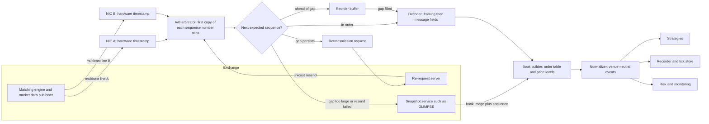
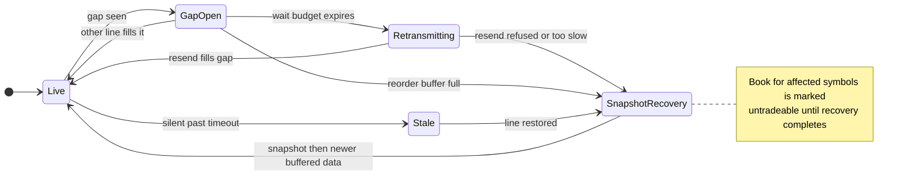

# Market Data Feed Handlers and Protocols

## TL;DR

- A feed handler turns exchange packets into a correct, timestamped, venue-neutral book: receive on redundant multicast lines, arbitrate by sequence number, detect gaps, decode, rebuild the book, normalize, publish.
- Exchanges publish the same sequenced stream on lines A and B; the first copy of each sequence number wins, packets ahead of a gap are buffered, and a gap neither line fills is recovered by a retransmission request or, failing that, a snapshot.
- Nasdaq TotalView-ITCH 5.0 is a sequenced stream of fixed-length big-endian binary messages (Add Order `A` is 36 bytes) carried over MoldUDP64 (20-byte header, 2-byte length per message, count 0 is a heartbeat, 0xFFFF is end of session) or SoupBinTCP.
- ITCH is order-by-order: modify messages are deltas against an order reference number, so the handler keeps an order table and aggregates price levels; one missed message corrupts the book until recovery.
- Know the families: ITCH and OUCH (Nasdaq binary feed and order entry), FIX tag=value (session and order entry), FAST (compressed FIX for market data), SBE (fixed-offset binary, CME MDP 3.0 and many others).
- Validate every length before reading, deliver a packet only after the whole packet validates, and mark a book untradeable while it is recovering.

## Learning objectives

- Parse ITCH, OUCH, FIX and SBE messages and rebuild books from incremental feeds.
- Handle gaps, A/B arbitration, snapshots and recovery.
- Explain multicast delivery, MoldUDP64 and SoupBinTCP framing, and how each supports loss detection.
- Lay out an ITCH 5.0 message byte by byte from the spec and decode it without undefined behaviour.
- Normalize prices, symbols and timestamps from several venues into one internal event format.
- Size a feed: message rates, bytes per packet and line-rate limits from stated assumptions.

## Core concepts

### What a feed handler is

A feed handler sits between the network card and every consumer of market data (strategies, risk, recorders).
Its job, in order:

1. Receive packets from one or more multicast groups, ideally with a hardware receive timestamp.
2. Arbitrate redundant lines into one stream ordered by exchange sequence number.
3. Detect gaps and recover them (wait for the other line, request a retransmission, or rebuild from a snapshot).
4. Decode the framing layer, then each message, checking every length against the buffer.
5. Apply messages to an order-level book and derive price levels and top of book.
6. Normalize into venue-neutral events (internal instrument id, integer price in ticks, side, size, timestamps) and publish them, typically through shared memory or a lock-free queue.

At HFT firms each feed usually runs on a dedicated, isolated core with kernel-bypass networking (see [Low-Latency Engineering](03-Low-Latency-Engineering.md)), and the handler is the first stage of the tick-to-trade latency budget.
At banks and slower funds the same logic runs inside a market data platform that fans normalized ticks out to pricing, risk and storage ([Tick Data Storage](12-Tick-Data-Storage-and-Time-Series-Databases.md)).



### Transport: multicast, redundancy and sequencing

Exchanges disseminate market data by UDP multicast: the publisher sends each packet once to a group address and the network replicates it to every subscriber that joined the group (IGMP).
UDP gives no retransmission, no ordering and no flow control, so a slow receiver or a congested switch drops packets silently.
Three mechanisms make it usable:

- **Sequence numbers** on every message (or packet) so loss is detectable.
- **Redundant lines**: the same sequenced stream on two multicast groups, usually over physically separate networks, so a packet lost on one line almost always arrives on the other.
- **Recovery services**: a retransmission (re-request) server for small gaps and a snapshot or replay service for large ones or for a late start.

Order entry and recovery sessions use TCP instead, because they need reliable, ordered, point-to-point delivery.

### The receive path: where packets are actually lost

Many gaps are created on your side of the wire, so know every place a packet can die between the exchange and the handler:

- **Switch buffers**: a microburst from many ports into one egress port overflows the switch queue; the drop happens before your host sees anything, and only the other line or a resend can repair it.
- **NIC receive ring**: if the core draining the ring falls behind (a context switch, a page fault, a burst longer than the ring), new frames find no free descriptor and are dropped; the NIC's drop counters show it.
- **Socket receive buffer**: with the kernel stack, a datagram that does not fit in `SO_RCVBUF` is discarded and counted as a UDP receive buffer error (`RcvbufErrors` in `/proc/net/snmp` on Linux); the requested size is capped by `net.core.rmem_max`.
- **Reverse-path filtering**: with Linux `rp_filter` in strict mode (1), a packet arriving on an interface that is not the best route back to its source is discarded, which silently kills one line when A and B arrive on different NICs; feed hosts use loose mode (2) or 0 on those interfaces.
- **The handler itself**: if decode and book building cannot keep up with the burst rate, every buffer above eventually fills.

The fixes are the low-latency toolkit: a dedicated isolated core that busy-polls, kernel bypass (the application reads the NIC rings directly), large rings and buffers sized for the worst burst rather than the average, and drop counters exported to monitoring so a rising count pages someone before a gap does.

### MoldUDP64 framing

Nasdaq's MoldUDP64 (Protocol Specification V1.00) is a thin layer over UDP that lets listeners detect and re-request missed messages.
All its integers are big-endian.

| Field | Offset | Length | Meaning |
| :--- | ---: | ---: | :--- |
| Session | 0 | 10 | Alphanumeric session the packet belongs to |
| Sequence Number | 10 | 8 | Sequence number of the first message in the packet |
| Message Count | 18 | 2 | Number of message blocks; 0 is a heartbeat, 0xFFFF is end of session |
| Message Length | 20 (first block) | 2 | Bytes of message data that follow, not counting this field |
| Message Data | 22 (first block) | variable | One higher-level message, here one ITCH message |

Messages after the first are numbered implicitly: a packet with sequence number $s$ and count $k$ carries $s, s+1, \dots, s+k-1$.
Heartbeats are typically sent once per second and carry the next expected sequence number, which is how a receiver notices that the last packet before a quiet period was lost.
End-of-session packets also carry the next expected sequence number and replace heartbeats for a short while, the last chance to re-request.
A Request Packet (Session 10, Sequence Number 8, Requested Message Count 2) sent unicast to a re-request server returns a normal downstream packet; if the requested messages do not fit in one UDP packet, only those that fit are returned.
The spec's example receiver flow is the single-line core of the arbitration logic below: check the session, compare the sequence number with the next expected one, re-request on a mismatch, and handle end of session.

### SoupBinTCP

SoupBinTCP (Specification Version 3.00) is Nasdaq's TCP session layer for ITCH snapshots and replays and for OUCH order entry.
Every packet is a 2-byte big-endian length (bytes that follow) and a 1-byte packet type, for example `S` sequenced data, `H` server heartbeat, `L` login request, `A` login accepted, `J` login rejected, `Z` end of session.
Sequenced data packets carry no explicit sequence number: both sides count messages, starting at 1 for each session.
After a disconnect the client logs in again with the session and its next expected sequence number and receives everything from there, so it never misses a sequenced message.
The server sends a heartbeat whenever more than 1 second passes without data; the client must do the same, and the server typically closes the socket after about 15 seconds of silence.

### Nasdaq TotalView-ITCH 5.0

ITCH 5.0 is outbound only (no order entry) and order-by-order: every displayed order is added, modified and removed individually, with the market participant attribution where the order is attributed.
From the spec's data types section: all integers are big-endian and unsigned unless noted, alpha fields are ASCII left-justified and space-padded, prices are integers with implied decimals (Price(4) has four, and its maximum is 200,000.0000, hex 77359400), and timestamps are nanoseconds since midnight in 6 bytes.
Every message starts with the same 11 bytes: Message Type (1), Stock Locate (2), Tracking Number (2), Timestamp (6).
The stock locate is a small integer assigned each day from 1 through the Stock Directory messages and meant to be used as an array index; it never changes intraday but must not be assumed stable across days, and it is 0 for messages not tied to a stock.

| Type | Message | Length | Fields after the common header | Book effect |
| :---: | :--- | ---: | :--- | :--- |
| `S` | System Event | 12 | Event Code | none (start of messages `O`, market hours `Q`, ...) |
| `R` | Stock Directory | 39 | Stock, Market Category, Round Lot Size, ... | symbol map |
| `H` | Stock Trading Action | 25 | Stock, Trading State, Reserved, Reason | trading state |
| `A` | Add Order | 36 | Order Ref 8, Buy/Sell 1, Shares 4, Stock 8, Price 4 | add order |
| `F` | Add Order with MPID | 40 | as `A` plus Attribution 4 | add order |
| `E` | Order Executed | 31 | Order Ref 8, Executed Shares 4, Match Number 8 | reduce |
| `C` | Order Executed With Price | 36 | as `E` plus Printable 1, Execution Price 4 | reduce |
| `X` | Order Cancel | 23 | Order Ref 8, Canceled Shares 4 | reduce |
| `D` | Order Delete | 19 | Order Ref 8 | remove |
| `U` | Order Replace | 35 | Original Ref 8, New Ref 8, Shares 4, Price 4 | remove and re-add |
| `P` | Trade (non-cross) | 44 | Order Ref 8, Buy/Sell 1, Shares 4, Stock 8, Price 4, Match 8 | none |
| `Q` | Cross Trade | 40 | Shares 8, Stock 8, Cross Price 4, Match 8, Cross Type 1 | none |
| `B` | Broken Trade | 19 | Match Number 8 | none (trade statistics only) |

Rules from the spec that a book builder must honour:

- Modify messages (`E`, `C`, `X`, `D`, `U`) carry the order reference of the original Add; executed and canceled shares are deducted cumulatively, and an order whose display shares reach zero is dead and must be removed.
- `U` removes the old order entirely and introduces a new reference number used for all later updates; side, stock and attribution are not repeated, so the handler copies them from the original order.
- `C` executes at a price different from the display price and carries a Printable flag; non-printable executions are counted later in a bulk print, so time-and-sales and volume must skip them to avoid double counting.
- `P` reports matches against non-displayed orders; it does not change the displayed book.
  The spec states the Order Reference Number in `P` has been populated as zero since December 6, 2010, and the Buy/Sell Indicator is always `B` since 07/14/2014.
- Each Add carries a day-unique order reference number, so one hash table keyed by reference serves every stock.

### Book building from an order-level feed

The handler keeps two structures:

- An **order table** keyed by order reference: locate, side, price, remaining shares.
- Per stock, two **price-level maps** (bids best-first descending, asks ascending) with aggregated shares and, if needed, order counts and queue order.

Each message is $O(1)$ on the order table plus one level update.
In production the order table is an open-addressing hash map or a direct-indexed array sized from the day's peak reference numbers, price levels are arrays indexed by ticks from a reference price, and nothing allocates on the hot path; [Order Book and Matching Engine](07-Order-Book-and-Matching-Engine.md) covers those data structures.
Consistency checks pay for themselves: an execute or cancel for an unknown reference, a reduction larger than the remaining shares, or a duplicate Add all mean the book is wrong and the stock should be flagged and recovered.

### A/B arbitration and gap detection

The arbitrator keeps `next_expected` and a small reorder buffer keyed by sequence number.
For a packet carrying $[s, e)$:

- $e \le$ `next_expected`: duplicate (the other line already delivered it), drop.
- $s \le$ `next_expected` $< e$: deliver from `next_expected` onward, advance, then drain any buffered packets that have become contiguous.
- $s >$ `next_expected`: a gap is open; copy the packet into the reorder buffer and wait.
  If a packet with the same first sequence is already buffered, keep whichever reaches further: a resend may be packetised differently from the multicast copy.

A heartbeat whose next expected sequence exceeds `next_expected` also opens a gap, even with nothing buffered.
The gap policy is a latency trade-off: waiting about as long as the measured A/B skew fills almost every single-line loss, while waiting longer stalls every consumer of the book.
Firms tune the wait from the measured skew distribution and fall back to a retransmission request, then to a snapshot when the buffer overflows or the request is refused.
On a MoldUDP64 channel an unrecoverable gap taints every instrument on the channel, because you cannot know which stock locates the missing messages touched; feeds that also carry a per-instrument sequence number (CME's `RptSeq`, below) let a handler limit recovery to the instruments that actually skipped.



### Recovery: retransmission, snapshot, replay

- **Retransmission** fixes small gaps: a MoldUDP64 Request Packet for (first missing sequence, count) to the re-request server; the reply is an ordinary downstream packet, so it goes through the same arbitrator.
- **Snapshot** fixes large gaps and late starts: the ITCH 5.0 spec names GLIMPSE 5.0 as the service for obtaining the current state of the book.
  A snapshot is only usable if it identifies the stream sequence number it is consistent with; the handler loads it, discards buffered live messages at or below that number and applies the rest.
- **Replay** from the start of the session over SoupBinTCP (log in with sequence 1) is the slow, exact path, used for a cold start or to rebuild a day for research.

During recovery the affected books are stale; strategies must not quote off them, and the stale flag should be part of the normalized event stream.

### Slow consumers and conflation

The exchange will not slow down for you, so a feed handler can never apply back-pressure: if a consumer falls behind, something else must give.
Consumers that need every event (the book builder itself, the recorder) get a dedicated core or a queue sized for the worst burst, and an overflow is an error that forces recovery.
Consumers that only need the current state (a slower strategy, a GUI, risk) get a conflated view: the handler overwrites a per-instrument latest-value slot (top of book or a depth snapshot plus a version counter) and the consumer reads the newest value when it is ready, skipping intermediate updates.
Conflation bounds memory and latency for slow readers at the price of losing the event history, so it is wrong for anything that counts trades or volume.

### Order entry: OUCH

OUCH (Version 4.2) is Nasdaq's native binary order entry protocol, fixed-length messages carried over SoupBinTCP.
Inbound: Enter Order `O`, Replace Order `U`, Cancel Order `X` (and Modify Order).
Outbound: System Event `S`, Accepted `A`, Replaced `U`, Canceled `C`, Executed `E`, Broken Trade `B`, Rejected `J`, and others.
Each Enter Order carries a 14-byte Order Token that must be day-unique per account; an Enter Order with a previously used token is ignored, so the spec designs host-bound messages to be safely resent after a disconnect.
Cancel Order specifies the new intended order size, so 0 cancels the whole order and a positive number reduces it.

### FIX, FAST and SBE

- **FIX tag=value** is ASCII `tag=value` fields separated by the SOH byte, framed by BeginString (8), BodyLength (9) and a trailing CheckSum (10, the byte sum modulo 256 as three digits).
  It dominates order entry, drop copies and post-trade; market data messages exist (MsgType `W` snapshot, `X` incremental refresh) but text parsing is too slow for high-rate feeds.
- **FAST** (FIX Adapted for STreaming) compresses FIX-style market data with templates: a presence map says which fields are on the wire, integers are stop-bit encoded (7 data bits per byte, the high bit marks the last byte), and field operators (constant, default, copy, increment, delta, tail) remove redundancy between consecutive messages.
  Decoding is stateful and branchy, so one lost packet can break the dictionary state until a reset.
- **SBE** (Simple Binary Encoding, FIX Trading Community v1.0) puts fixed-length fields at fixed offsets so a decoder can read them in place with no parsing loop.
  A message is a header, a root block of fixed-length fields, then repeating groups (each with a group dimension of block length and count), then variable-length data, in that order.
  The header layout is the schema's `messageHeader` composite; the v1.0 spec recommends blockLength, templateId, schemaId, version, numGroups and numVarDataFields, six uint16 fields in 12 octets.
  Byte order is a schema attribute, default little-endian, while the optional Simple Open Framing Header (uint32 message length, uint16 encoding type) is always big-endian.
  CME MDP 3.0 uses SBE.

CME MDP 3.0 is the standard contrast to ITCH over MoldUDP64, per CME's Client Systems Wiki (as of 2026-10):

- Every UDP packet starts with a 12-byte technical header: MsgSeqNum (uint32) and SendingTime (uint64, nanoseconds since the Unix epoch).
- MsgSeqNum numbers packets, not messages, separately per channel, and resets weekly; MoldUDP64 numbers messages.
- Each message is a uint16 MsgSize followed by the 8-byte SBE header blockLength, templateId, schemaId and version (the first four of the six recommended fields), then the body; everything is little-endian.
- Book entries carry a per-instrument sequence number `RptSeq`, so a handler can tell which instruments a packet gap actually affected and recover them individually.
- Prices are integer mantissas with a constant exponent (for example $-9$) declared in the schema rather than sent on the wire.

| Protocol | Encoding | Byte order | Framing and sequencing | Typical use |
| :--- | :--- | :--- | :--- | :--- |
| ITCH 5.0 | fixed-length binary per type | big-endian | MoldUDP64 or SoupBinTCP | Nasdaq order-by-order feed |
| OUCH 4.2 | fixed-length binary per type | big-endian | SoupBinTCP | Nasdaq order entry |
| FIX 4.x | ASCII tag=value | n/a | FIX session layer, MsgSeqNum (34) | order entry, drop copy |
| FAST | templates, stop-bit, operators | n/a | venue packet header | legacy compressed feeds |
| SBE 1.0 | fixed offsets, groups, var data | schema, default little | venue packet header or SOFH | CME MDP 3.0 and many others |

### Normalization and timestamps

A normalized event carries an internal instrument id (mapped from the stock locate via the day's Stock Directory), side, size, an integer price in a per-instrument tick scale (never a double: $100.01$ has no exact binary representation), the venue sequence number, and several timestamps:

- exchange timestamp from the message (ITCH: nanoseconds since midnight);
- NIC hardware receive timestamp;
- software timestamps at decode and at publish.

The differences are the latency budget: wire and switch time, then handler time per stage.
Comparing exchange and local timestamps needs synchronized clocks (PTP, hardware timestamping), otherwise the difference is offset plus latency.

## Worked examples

### 1. Decode an Add Order from raw bytes

"Here are 36 bytes off the wire. Walk me through them."
The demo encodes sequence 2 of its session and prints:

```text
41 0001 0000 1F1ACED9F3E8 0000000000000001 42 0000012C 515044454D4F2020 000F4240
```

Read it against the spec offsets: `41` is `A` (Add Order, 36 bytes); Stock Locate `0001` is 1; Tracking Number 0; Timestamp `1F1ACED9F3E8` is 34,200,000,001,000 ns after midnight, one microsecond after 09:30:00; Order Reference 1; `42` is `B`; Shares `0000012C` is 300; Stock is ASCII `QPDEMO` padded with two spaces; Price `000F4240` is 1,000,000, so with four implied decimals 100.0000.
In C++ read each field with `memcpy` into a local plus a byte swap (at `-O2` that is one load and one byte-swap instruction, `bswap` on x86 and `rev` on ARM; byte-shift loops are equally correct but the compiler does not always merge them, so check the assembly on the hot path), never by casting the buffer to a struct pointer: no object of that type lives in the buffer, so the access breaks the aliasing and object-lifetime rules (C++23 adds `std::start_lifetime_as` for exactly this), `#pragma pack` is a compiler extension whose misaligned members cannot safely be bound to pointers or references, and the host is little-endian anyway.

### 2. Two lines, three losses, one retransmission

Sixteen messages (sequence 1 to 16: a start-of-messages event, adds, an attributed add, executions, a cancel, a replace, a non-displayed trade, a delete) go out in six MoldUDP64 packets of at most three messages: 1..3, 4..5, 6..8, 9..10, 11..13, 14..16.
Line A loses 4..5, line B loses 6..8, and both lose 11..13; B trails A.

| Arrival | Packet | Action | Delivered | Next expected after |
| :---: | :--- | :--- | ---: | ---: |
| A | 1..3 | delivered | 3 | 4 |
| B | 1..3 | duplicate | 0 | 4 |
| A | 6..8 | buffered (gap 4..5 opens) | 0 | 4 |
| B | 4..5 | delivered, then 6..8 drained | 5 | 9 |
| A | 9..10 | delivered | 2 | 11 |
| B | 9..10 | duplicate | 0 | 11 |
| A | 14..16 | buffered (gap 11..13 opens) | 0 | 11 |
| B | 14..16 | duplicate of a buffered packet | 0 | 11 |
| A, B | heartbeat 17, end of session 17 | no data | 0 | 11 |

Neither line had 11..13, so the handler sends a Request Packet for sequence 11, count 3; the reply delivers 11..13 and drains the buffered 14..16, 6 messages.
Totals: 2 gaps detected, 2 packets buffered, 3 duplicate packets dropped, 5 messages delivered while processing line A arrivals (1..3 and 9..10), 5 while processing the line B arrival that filled the first gap (4..5 plus the A copy of 6..8 it unblocked), 6 on the retransmission (11..13 plus the buffered 14..16), and 16 delivered exactly once in order.
The 510 bytes of ITCH payload equal the spec lengths summed: $12 + 6 \times 36 + 40 + 2 \times 31 + 2 \times 23 + 35 + 36 + 44 + 19$.
The rebuilt book has bids 100.0100 x 200 (order 2 replaced into order 6, then 50 executed), 100.0000 x 200 (order 1 after 100 executed with price; order 5 deleted), 99.9900 x 100, and one ask level 100.0200 x 450 (order 3 after a 150 cancel plus order 7 after a 100 cancel); 5 orders are live.
The demo asserts that this book is identical to the one built from the loss-free stream.

### 3. Why 6 bytes of nanoseconds, and why Price(4) fits in 4 bytes

A day has $86{,}400 \times 10^9 = 86{,}400{,}000{,}000{,}000$ ns, which needs 47 bits; 48 bits reach 281,474,976,710,655 ns, about 78.2 hours, so 6 bytes cover a day with room to spare and save 2 bytes per message over a 64-bit field.
The Price(4) maximum 200,000.0000 is the integer 2,000,000,000 (hex 77359400), below $2^{32}$, so a 4-byte unsigned field suffices for every equity price the venue accepts.

### 4. Packing efficiency and line rate

With MoldUDP64, $k$ Add Orders per packet cost $20 + 38k$ bytes (2-byte length per message), so payload efficiency is $36k/(20 + 38k)$: 0.6207 for one message and 0.9000 for ten.
On Ethernet each frame also pays 66 bytes (UDP 8, IPv4 20, Ethernet header 14, FCS 4, preamble 8, inter-frame gap 12), so one Add Order per frame is 124 bytes on the wire and a 10 Gb/s link carries at most 10.08 million such packets per second.
Batching several messages per packet is why feeds survive bursts; the burst rate, not the daily average, sizes the NIC, the switch buffers and the handler.

### 5. The silent tail gap

A packet carrying 1..2 arrives, then nothing; the next heartbeat says the next expected sequence is 6.
Without heartbeats the handler would sit on a book missing 3..5 indefinitely; with them it opens gap 3..5 (size 3) and requests it.
The unit test `test_heartbeat_reveals_tail_gap` asserts this case.

## Pitfalls

- Casting the receive buffer to a packed struct: aliasing and lifetime undefined behaviour in ISO C++, misaligned member pointers, plus host-endian reads of big-endian fields.
- Trusting length fields: read a block length, then check it against the bytes remaining before touching the data; deliver a packet only after the whole packet validates.
- Treating modify messages as absolute sizes: `E`, `C`, `X` are deltas, and `U` needs the side and stock copied from the original order.
- Applying `P` trades or non-printable `C` executions to volume twice, or `P` to the displayed book at all.
- Assuming stock locate codes are stable across days.
- Arbitrating by arrival time instead of sequence number, or dropping a packet that overlaps the next expected sequence instead of delivering its new tail.
- Waiting forever for line B: every consumer of the book stalls; bound the wait and escalate to retransmission and snapshot.
- Leaving Linux reverse-path filtering strict on the feed NICs, or `SO_RCVBUF` at its default: one line or a whole burst disappears before the handler sees it.
- Letting a slow consumer block the handler; give it a conflated latest-value view instead.
- Quoting from a book that is recovering; publish a stale flag.
- Converting prices to `double` at the handler: keep integer ticks until the last possible moment.
  Going the other way, scale with rounding, never truncation: `int(0.57 * 10000)` is 5699 because the product is 5699.999999999999, and truncation mis-scales 5,228 of the 99,999 cent prices from 0.01 to 999.99 ([itch_parser_mock.py](code/python/itch_parser_mock.py) asserts the count).
- Measuring feed latency as local time minus exchange timestamp without synchronized clocks.

## Interview questions

> [!question]- qd-feed-why-multicast | Why do exchanges publish market data over UDP multicast rather than TCP?
> One send reaches every subscriber with no per-client state, retransmission or head-of-line blocking, so all receivers get data at the same time with minimal latency. Loss is handled above UDP with sequence numbers, redundant A/B lines and recovery services.

> [!question]- qd-feed-ab-arbitration | Describe A/B line arbitration.
> Both lines carry the same sequenced packets; keep `next_expected`, deliver the first copy of each sequence number, drop later copies, buffer packets that arrive ahead of a gap, and drain the buffer when the gap fills. Arbitrate on sequence numbers, never on arrival time.

> [!question]- qd-feed-overlap | A packet arrives carrying sequences 8 to 12 while you expect 10. What do you do?
> Deliver 10, 11 and 12 and set next expected to 13. Dropping the whole packet as a duplicate would lose 10 to 12; replaying 8 and 9 would apply them twice.

> [!question]- qd-feed-mold-header | Lay out a MoldUDP64 downstream packet.
> 20-byte header: Session 10 bytes, Sequence Number 8 (of the first message), Message Count 2; then message blocks of a 2-byte length followed by that many bytes. Count 0 is a heartbeat and 0xFFFF end of session; both carry the next expected sequence number.

> [!question]- qd-feed-heartbeat-gap | Why do heartbeats carry the next expected sequence number?
> So a receiver detects loss of the last packet before a quiet period. If the latest heartbeat says 6 and you have up to 2, messages 3 to 5 are missing even though no later data packet arrived.

> [!question]- qd-feed-itch-add-layout | Give the ITCH 5.0 Add Order layout.
> 36 bytes: Type `A` 1, Stock Locate 2, Tracking Number 2, Timestamp 6 (ns since midnight), Order Reference 8, Buy/Sell 1, Shares 4, Stock 8, Price 4 as Price(4). All integers big-endian; `F` adds a 4-byte MPID for 40 bytes.

> [!question]- qd-feed-itch-replace | How do you apply an ITCH Order Replace `U`?
> Look up the original reference, remove all its remaining shares, then add a new order under the new reference with the new shares and price, copying side and stock from the original because `U` omits them. Later messages use the new reference.

> [!question]- qd-feed-itch-deltas | An order for 300 gets `E` 100 then `X` 150. What is displayed, and when is it removed?
> 50 shares. Modify messages are cumulative deltas against the Add; the order is removed when display shares reach zero or on `D` or `U`.

> [!question]- qd-feed-itch-trade-p | Should a book builder apply ITCH Trade `P` messages?
> No. `P` reports executions against non-displayed orders, which were never added to the displayed book; use it for time-and-sales and volume only.

> [!question]- qd-feed-non-printable | What is a non-printable execution and why does it matter?
> An `Order Executed With Price` marked Printable `N`: its shares are included in a later bulk print such as a cross, so counting it in volume or time-and-sales double counts.

> [!question]- qd-feed-timestamp-bits | ITCH timestamps are 6 bytes of nanoseconds since midnight. Is that enough?
> Yes. A day is 86,400,000,000,000 ns, which needs 47 bits; 48 bits reach about 78.2 hours. It saves 2 bytes per message over a 64-bit field.

> [!question]- qd-feed-price-type | Why keep prices as integers in the handler?
> Exchange prices are fixed-point integers (ITCH Price(4) has four implied decimals); doubles cannot represent most decimal prices exactly, so equality, level lookup and aggregation by price break. Convert only at the edge that needs a float.

> [!question]- qd-feed-struct-cast | What is wrong with `auto* m = reinterpret_cast<const AddOrder*>(buf);` on a packed struct?
> No `AddOrder` object exists in the buffer, so reading through the pointer is undefined behaviour under the aliasing and lifetime rules (C++23 `std::start_lifetime_as` is the sanctioned route); packing is a compiler extension and its misaligned members cannot be bound to references or pointers; and the fields are big-endian, so a little-endian host reads garbage. Read each field with `memcpy` into a local and convert from network order; at `-O2` that is one load plus one byte-swap instruction.

> [!question]- qd-feed-validate-first | Why validate a whole packet before delivering any message in it?
> A corrupt later block means the packet cannot be trusted; delivering the first half would advance the sequence and apply messages you then cannot account for. Validate all lengths, then deliver, so a packet is all or nothing.

> [!question]- qd-feed-gap-policy | How long should you wait for line B before requesting a retransmission?
> Long enough to cover the tail of the measured A/B skew distribution and no longer, because every consumer of the book stalls while you wait. Then request a resend, and fall back to a snapshot when the reorder buffer fills or the request fails.

> [!question]- qd-feed-snapshot-merge | How do you merge a snapshot with live data?
> Keep buffering live messages, load the snapshot and its sequence number, discard buffered messages at or below that number, apply the rest in order, then mark the book live. Without the sequence number you cannot know which live messages the snapshot already contains.

> [!question]- qd-feed-packet-rate | One Add Order per packet on 10 GbE: what is the maximum packet rate?
> About 10.08 million packets per second. The frame is 124 bytes: 36 message + 2 length + 20 MoldUDP64 header + 8 UDP + 20 IPv4 + 18 Ethernet header and FCS + 20 preamble and inter-frame gap; $10^{10}/(124 \times 8)$.

> [!question]- qd-feed-soupbintcp | How does SoupBinTCP let a client resume without missing messages?
> Sequenced data packets are numbered implicitly from 1 per session; after a disconnect the client logs in with the session and its next expected sequence number and the server resends from there.

> [!question]- qd-feed-ouch-token | In OUCH, what happens if you resend an Enter Order with the same Order Token?
> It is ignored. Tokens are day-unique per account, so host-bound messages can be benignly resent after a connection failure without creating duplicate orders.

> [!question]- qd-feed-sbe-vs-fast | Why did SBE displace FAST for high-rate feeds?
> SBE fields sit at fixed offsets in native-width integers, so decoding is a few loads with no branches or state; FAST needs bit-level stop-bit decoding, presence maps and stateful operators, which are slower, branchy and fragile after packet loss. FAST saves bandwidth, which matters less than CPU latency today.

> [!question]- qd-feed-sbe-layout | What is the order of elements in an SBE message?
> Message header, root block of fixed-length fields, repeating groups (each with block length and count dimensions, nested groups inside), then variable-length data. That order keeps every fixed field at a known offset.

> [!question]- qd-feed-locate | What is the ITCH stock locate code and what must you not assume about it?
> A small integer assigned daily from 1 via Stock Directory messages, at the same offset in every message so it can index an array directly. It is stable intraday but must not be assumed stable across days.

> [!question]- qd-feed-where-lost | Your handler reports gaps that the exchange says it never had. Where do you look?
> On your own side of the wire: switch microburst drops, NIC ring overruns, socket receive buffer overflows (`RcvbufErrors` in `/proc/net/snmp`), strict `rp_filter` discarding one line on a multi-NIC host, and a handler too slow for the burst. Check each drop counter before blaming the venue.

> [!question]- qd-feed-conflation | A risk process cannot keep up with the full feed. What do you do?
> Give it a conflated view: the handler overwrites a per-instrument latest-value slot with a version counter and the consumer reads the newest state when ready. Never let it back-pressure the handler, since the exchange will not slow down; conflation is wrong only for consumers that must count every event.

> [!question]- qd-feed-mdp3-seq | How does CME MDP 3.0 sequencing differ from MoldUDP64, and why does it matter for recovery?
> MDP 3.0 numbers packets per channel (uint32 MsgSeqNum in a 12-byte packet header, reset weekly) and adds a per-instrument `RptSeq`; MoldUDP64 numbers messages and has no per-instrument counter. With `RptSeq` a handler can recover only the instruments that skipped, while an unrecoverable MoldUDP64 gap taints every instrument on the channel.

## In this repo and SDE-Interview-Prep

- Code: [itch50_feed_handler.hpp](code/cpp/itch50_feed_handler.hpp) (ITCH 5.0 decode and encode, MoldUDP64 framing, `LineArbitrator` with a bounded reorder buffer that reports `BufferFull` for escalation to a snapshot, `BookBuilder`), the worked session in [itch50_feed_handler.cpp](code/cpp/itch50_feed_handler.cpp), and tests including fuzzing in [test_itch50_feed_handler.cpp](code/cpp/tests/test_itch50_feed_handler.cpp).
- Earlier code: [itch_parser_mock.py](code/python/itch_parser_mock.py) (a simplified mock format, not real ITCH) and [udp_receiver_mock.cpp](code/cpp/udp_receiver_mock.cpp).
- Protocol guides in this repo: [ITCH](../08-Market-Making/Quant-Dev-MM-Guide/07_ITCH_Protocol_Mastery_Guide.md), [OUCH](../08-Market-Making/Quant-Dev-MM-Guide/08_OUCH_Protocol_Mastery_Guide.md), [FIX](../08-Market-Making/Quant-Dev-MM-Guide/09_FIX_Protocol_Mastery_Guide.md); specs in [protocol-specs](protocol-specs/).
- Related notes: [Order Book and Matching Engine](07-Order-Book-and-Matching-Engine.md), [Low-Latency Engineering](03-Low-Latency-Engineering.md), [Testing Trading and Numerical Code](14-Testing-Trading-and-Numerical-Code.md), [Quant Dev Problem Set](15-Quant-Dev-Problem-Set.md).
- [UDP multicast and A/B arbitration (SDE-Interview-Prep)](https://github.com/shreejitverma/SDE-Interview-Prep/blob/main/14-Low-Latency-Systems/06%20-%20Networking/UDP%20Multicast%20Market%20Data%20and%20A-B%20Feed%20Arbitration.md)
- [Lab: zero-loss multicast feed arbitrator (SDE-Interview-Prep)](https://github.com/shreejitverma/SDE-Interview-Prep/blob/main/14-Low-Latency-Systems/06%20-%20Networking/Lab%20-%2006%20Zero-Loss%20Multicast%20Feed%20Arbitrator.md)
- [Lab: zero-copy ITCH parser (SDE-Interview-Prep)](https://github.com/shreejitverma/SDE-Interview-Prep/blob/main/14-Low-Latency-Systems/10%20-%20Protocols%20%26%20Codecs/Lab%20-%2010%20Zero-Copy%20NASDAQ%20ITCH%205.0%20Parser.md)
- [CME MDP 3.0 and SBE (SDE-Interview-Prep)](https://github.com/shreejitverma/SDE-Interview-Prep/blob/main/14-Low-Latency-Systems/10%20-%20Protocols%20%26%20Codecs/CME%20MDP%203.0%20and%20Simple%20Binary%20Encoding%20SBE.md)
- [FIX and FAST (SDE-Interview-Prep)](https://github.com/shreejitverma/SDE-Interview-Prep/blob/main/14-Low-Latency-Systems/10%20-%20Protocols%20%26%20Codecs/FIX%20Protocol%20and%20Fast%20Encoding%20FAST.md)
- [Clock sources and hardware timestamping (SDE-Interview-Prep)](https://github.com/shreejitverma/SDE-Interview-Prep/blob/main/14-Low-Latency-Systems/07%20-%20Time%20%26%20Measurement/Clock%20Sources%20and%20Hardware%20Timestamping.md)

## Further reading

- Nasdaq, *Nasdaq TotalView-ITCH 5.0* interface specification (in [protocol-specs](protocol-specs/)): data types, every message layout, and the order-tracking rules.
- Nasdaq, *MoldUDP64 Protocol Specification* V1.00 and *SoupBinTCP* Version 3.00, from nasdaqtrader.com technical specifications.
- Nasdaq, *O\*U\*C\*H Version 4.2*, nasdaqtrader.com trading products specifications.
- FIX Trading Community, *Simple Binary Encoding* technical specification v1.0 (github.com/FIXTradingCommunity/fix-simple-binary-encoding), sections Message Structure and Message Schema.
- CME Group Client Systems Wiki, *MDP 3.0 - SBE Technical Headers* and *MDP 3.0 - SBE Decoding Example* (cmegroupclientsite.atlassian.net): packet header, message header and a byte-by-byte decode.
- Linux kernel documentation, *IP Sysctl* (`rp_filter`), docs.kernel.org/networking/ip-sysctl.html.
- W. Richard Stevens, Bill Fenner and Andrew Rudoff, *UNIX Network Programming, Volume 1*, 3rd edition, chapter 21 (multicasting).
