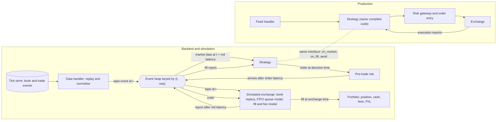

# Backtester and Exchange Simulator Design

## TL;DR

- A serious backtester is an event-driven simulation: one event heap keyed by (timestamp, sequence number), a simulated exchange that sees tape events at exchange time, and a strategy that sees them only after market-data latency and whose orders arrive only after order latency.
- Fill realism comes from three models: a market order walks the book; a passive limit order fills only after the FIFO queue ahead of it is consumed by trades or cancellations, or when the market trades through its price; fees and rebates depend on which side of the trade you were.
- Determinism is a design requirement, not a nicety: no wall clock, no unseeded randomness, no unordered iteration, ties broken by sequence number, and a hash of the fill log as the regression artifact.
- The classic simulator lies are look-ahead (filling at the print that generated the signal), ignoring latency and queue position, and assuming your orders do not move the market; each turns a losing strategy into a winning one on paper.
- The strategy object must be the same code in backtest and production, behind an interface (`on_market`, `on_fill`, `send`) with time and order entry injected.

## Learning objectives

- Design an event-driven backtester shared with production strategy code.
- Model fills, queue position, latency and fees realistically.
- Make a simulation deterministic and replayable, and test it against a hand-computed known answer.
- Recognise and quantify look-ahead, survivorship and market-impact errors in a simulator.
- Choose between vectorised research backtests, market replay and agent-based exchange simulation.

## Core concepts

### Where this sits

The research view of backtesting (information sets, costs, walk-forward, purging) is in [Backtesting Methodology and Pitfalls](../09-Alpha-Research-and-Portfolio/07-Backtesting-Methodology-and-Pitfalls.md).
This note is the engineering view: how to build the simulator that a market-making or execution desk trusts enough to put capital behind.
The tape it replays comes from a feed handler ([Market Data Feed Handlers and Protocols](08-Market-Data-Feed-Handlers-and-Protocols.md)) and a tick store ([Tick Data Storage and Time-Series Databases](12-Tick-Data-Storage-and-Time-Series-Databases.md)).

| Style | What it is | Good for | Breaks on |
| :--- | :--- | :--- | :--- |
| Vectorised | Signals, positions and returns as arrays | Daily or slower cross-sectional alpha research | Path dependence, limit orders, partial fills, latency |
| Event-driven market replay | Historical events replayed through strategy, risk and a simulated exchange | Intraday strategies, execution algorithms, market making | Your own impact on other participants |
| Agent-based simulation | Synthetic market of reactive agents plus a matching engine | Stress testing, impact and feedback, exchange conformance | Calibration; results are only as good as the agents |

### Architecture

Components and their contracts:

- **Data handler**: reads the tape (order-by-order, depth snapshots or trades) in exchange-time order and schedules each event once; it never lets a consumer peek ahead.
- **Event heap**: a priority queue of `(timestamp, seq, kind, payload)`; `seq` is a global insertion counter, so equal timestamps resolve in scheduling order and the run is reproducible.
- **Simulated exchange**: a replica of the venue's book plus your resting orders, with a queue model, a fill model and a fee model; it sees tape events at their exchange timestamps.
- **Strategy**: receives market data at exchange time plus market-data latency and fill reports at fill time plus report latency (the repo's simulator reuses the market-data latency for reports); it can only act through `send`, which stamps the order with the current simulated time.
- **Risk**: the same pre-trade checks as production ([Risk Checks and Order Management](13-Risk-Checks-and-Order-Management.md)), because a strategy that only works when limits are ignored does not work.
- **Portfolio**: position, cash, fees and marks; it is updated from fills, never from the strategy's intentions.

### Clocks and latency

There are at least three clocks: exchange time (matching engine stamp), receive time (when your feed handler saw the packet) and decision time.
The simulator schedules market data to the strategy at $t_{\text{exch}} + L_{\text{md}}$ and orders to the exchange at $t_{\text{dec}} + L_{\text{ord}}$, so a round trip from an event to your order reaching the book costs $L_{\text{md}} + L_{\text{ord}}$ plus compute.
Latencies should be distributions measured from production (receive minus exchange stamp, acknowledgement minus send), sampled with a seeded generator, and should preserve the venue's FIFO ordering of your own orders.
Latency matters twice: you trade against a book that has moved since you saw it, and you join a queue later and therefore further back.

### Queue position and the limit-order fill model

At a price level the exchange fills resting orders in time priority (on price-time venues).
When your order arrives, the displayed size of other orders at that price is the quantity ahead of you.
What happens next depends on the data:

- With order-by-order data (for example Nasdaq TotalView-ITCH, where every add, execute, cancel and delete carries an order reference number) you know exactly which orders are ahead, so cancellations ahead and behind are distinguishable and queue position is exact up to hidden liquidity.
- With aggregated depth you only see level sizes, so a decrease not explained by trades is a cancellation of unknown position, and you need a rule.

| Cancellation rule | Update to shares ahead $A$ when $c$ shares cancel at a level holding $L$ others | Bias |
| :--- | :--- | :--- |
| Pessimistic | $A$ unchanged (all cancels come from behind) | Understates fills |
| Pro rata | $A \leftarrow A - cA/L$ | Neutral if cancels are uniform in the queue |
| Optimistic | $A \leftarrow \max(0, A - c)$ | Overstates fills |

The repo's simulator uses pro rata; a trade at your price consumes $A$ first and only the excess fills you; a size increase joins behind you; a trade strictly through your price fills all of your remaining quantity at your limit.
A book update that shows an opposite quote at or through your resting price also means you would have traded (the incoming order would have matched you); a simulator must either fill you there or flag the tape as inconsistent with your order, and the repo's known-answer tape is built so this never happens.
Calibrate the rule by comparing simulated fill rates with live fill rates on the same orders: this "sim versus live" reconciliation is the single most valuable test a trading-simulation team runs.

### Market orders, marketable limits and impact

A market order walks the opposite side of the current book replica level by level; a marketable limit walks only up to its limit and the remainder rests at the back of the queue.
Replaying history assumes your orders do not change what other participants did afterwards.
That is acceptable when your size is small relative to the displayed liquidity and false when it is not.
Two standard ways to put impact back:

- **Square-root rule of thumb**: the price impact of a metaorder of $Q$ shares in a stock with daily volume $V$ and daily volatility $\sigma$ is about $Y\sigma\sqrt{Q/V}$ with $Y$ of order 1 (Bouchaud, Bonart, Donier and Gould, *Trades, Quotes and Prices*, the chapter on the square-root law).
  This is the price move by the end of the metaorder; if impact grows as the square root of the quantity executed so far, the average execution cost per share is $\frac{1}{Q}\int_0^Q Y\sigma\sqrt{q/V}\,dq = \tfrac{2}{3}Y\sigma\sqrt{Q/V}$, so practitioners treat the formula as a cost estimate up to an order-one factor.
- **Almgren and Chriss (2000)**: permanent impact linear in trading rate shifts the price for all later trades; temporary impact linear in rate affects only the current trade; the optimal schedule trades off expected cost against variance of cost.

In a simulator, impact is applied by shifting the replayed book after your fills (permanent part) and by worsening your own execution price (temporary part); both are parameters to calibrate, not facts.

### Adverse selection and markouts

A passive fill is not a random event: you are filled when someone wants to trade with you, which is disproportionately just before the price moves against you.
The trade-through rule makes this visible: in the known-answer tape below the second passive fill at 100.00 happens as the market trades at 99.99, so the order is filled exactly when it is worst to own.
A simulator that fills passive orders whenever the price touches the level, or at a fixed probability, misses this and overstates market-making PnL.
The diagnostic is the markout: the mid a fixed horizon after each fill minus the fill price (signed by side), averaged per order type and horizon; compare simulated and live markout curves, not only fill rates.

### Fees and rebates

Maker-taker venues pay a rebate per share to the passive side and charge a fee to the aggressive side, so the same round trip can cost or earn money depending on which side you were.
Fee schedules change and are tiered by volume, so they belong in versioned configuration with an effective date, never in code.
The example below uses illustrative values of a 0.0020 dollar per share rebate and a 0.0030 dollar per share fee.

### Determinism and replay

A simulation is deterministic when the same inputs (tape, configuration, code version, seed) produce a bit-identical event log.
Requirements:

- simulated time only: the strategy and risk code read time from an injected clock, never from the system clock;
- a total order on events: `(timestamp, seq)` and never a comparison of payload objects;
- seeded random number generators, one per component, so adding randomness in one place does not shift another's stream;
- no iteration over hash-ordered containers where order affects output;
- floating-point reductions in a fixed order (parallel sums are not associative).

The regression artifact is a hash of the fill log: if it changes, either the tape, the configuration or the code changed, and the diff of the logs says which event first diverged.
Day-level independence (reset state at the open) makes a multi-year backtest embarrassingly parallel across days.

### Look-ahead and survivorship, engineering edition

- Filling at the print or bar that produced the signal (same-bar fill) is look-ahead; the worked example below shows it manufacturing an edge out of bid-ask bounce.
- Using exchange timestamps as if they were receive timestamps hides latency; using a consolidated tape's ordering for a single-venue strategy hides venue latency differences.
- Adjusted prices, index membership and symbol mappings must be point-in-time; a universe built from today's constituents is survivorship bias (Lopez de Prado, *Advances in Financial Machine Learning*, chapter 11).
- Forward-filling a field across a gap, or sorting by a column that is only known later, silently imports the future.

### Sharing code with production

The strategy, its parameters and the risk checks compile into one library used by both the simulator and the live engine.
Only the adapters differ: the simulator supplies market data, fills and a clock from the event heap; production supplies them from the feed handler, the order gateway and the hardware clock.
Every `if backtest:` branch inside strategy code is a place where the two diverge and a bug can hide.

## Worked examples

All numbers come from [event_backtester.py](code/python/event_backtester.py).

### 1. Known-answer test: queue position, trade-through and a round trip

"Walk me through what your simulator does with this tape."
Configuration: market-data latency 5 us, order latency 10 us, maker rebate 0.0020 dollars per share, taker fee 0.0030 dollars per share.
The strategy joins the best bid with 100 shares on the first book it sees and sells 100 at market once fully filled.

| Time (us) | Event | Shares ahead | Our fills |
| ---: | :--- | ---: | :--- |
| 0 | Book: bid 100.00 x 500, 99.99 x 800; ask 100.01 x 300 | - | |
| 5 | Strategy sees the book and sends buy 100 at 100.00 | - | |
| 15 | Order arrives; 500 shares of others at 100.00 | 500 | |
| 20 | Bid size 700: 200 joined behind us | 500 | |
| 30 | Bid size 560: 140 cancelled, pro rata $140 \times 500/700 = 100$ were ahead | 400 | |
| 40 | Sell trade 300 at 100.00 | 100 | |
| 50 | Sell trade 150 at 100.00: 100 clear the queue, 50 reach us | 0 | 50 at 100.00, maker |
| 58 | The 100.00 bid level disappears | 0 | |
| 60 | Sell trade 400 at 99.99, through our bid | - | 50 at 100.00, maker |
| 65 | Strategy sees the full fill and sends a market sell 100 | - | |
| 70 | Book: bid 99.99 x 60, 99.98 x 500 | - | |
| 75 | Market sell arrives and walks the bids | - | 60 at 99.99 and 40 at 99.98, taker |

PnL: the buy costs $10{,}000.00$; the sell legs bring $5{,}999.40 + 3{,}999.20 = 9{,}998.60$; gross $-1.40$.
Fees: rebate $0.20$ on 100 passive shares, fee $0.30$ on 100 aggressive shares, net fees $0.10$; net PnL $-1.50$.
The script asserts every queue value, every fill and the PnL, so any change to the queue or fill model that alters this tape fails CI.

### 2. What latency cost on the same tape

Rerun with both latencies set to zero.
The passive fills are unchanged (the book did not move between 0 and 15 us), but the exit now happens at 60 us against the 58 us book, selling all 100 at 99.99: gross $-1.00$, net $-1.10$.
Five plus ten microseconds of latency cost $0.40$ on this round trip because the bid was thinner by the time the exit order arrived.

### 3. Look-ahead manufactured from bid-ask bounce

Trades print at the bid or the ask with equal probability around a random-walk mid (half-spread $h = 0.005$, mid step standard deviation $0.001$, 200,000 prints, seed 11).
A contrarian rule buys after a down-tick and sells after an up-tick.
Filled at the print that generated the signal and marked at the next mid, it earns about $+0.0025$ per trade (printed $+0.00249$).
Why: half the time consecutive prints sit on opposite sides, the down-tick is a bid print and buying at the bid earns $h$; otherwise the signal is noise; so the expectation is about $h/2$.
Filled realistically at the next event by crossing the spread and held for one print, it earns about $-h = -0.0050$ per trade: it pays the half-spread, and the next mid step is independent of the signal.
The edge was the bounce, which you cannot capture by crossing the spread.

### 4. Square-root impact sizing

With $Y = 1$: daily volatility 2% and participation $Q/V = 1\%$ give $0.02 \times \sqrt{0.01} = 20.0$ bp; quadrupling the participation to 4% only doubles the cost to $40.0$ bp; volatility 1.5% and participation 10% give $47.4$ bp.
Use this to decide whether a strategy's size is small enough for no-impact replay; if the impact estimate is comparable to the edge per trade, replay alone is not credible.

### 5. Determinism check

The script runs a quoting strategy on a 5,000-event seeded random tape twice and hashes both fill logs with SHA-256: the digests are equal, and a different seed gives a different digest.
That is the test to keep in CI: it catches unordered iteration, wall-clock reads and unseeded randomness the day they are introduced.

## Pitfalls

- Filling limit orders whenever the price touches your level; without queue position you overstate passive fills and ignore adverse selection.
- Letting the strategy read simulator state (the exchange's book, its own resting order objects) instead of only the messages it would receive in production.
- Using a heap of `(timestamp, event)`: equal timestamps then compare event objects, which either raises or orders them arbitrarily.
- Applying latency to market data but not to orders, or to orders but not to cancels; a cancel that arrives instantly never gets picked off.
- Removing your own fills from the replayed book in some places but not others, so later tape events become inconsistent; choose one convention (the repo's: the tape is never altered) and document it.
- Hard-coding fees, tick sizes or lot sizes; they change over time and must be point-in-time configuration.
- A strategy class with backtest-only branches, so the code that made money in simulation is not the code that trades.
- Calibrating fill and impact models on the same period you evaluate the strategy on.
- Trusting a simulator that has never been reconciled against live fills.
- Ignoring a book update that shows an opposite quote at or through your resting price, so your order sits locked or crossed against the tape without trading.

## Interview questions

> [!question]- qd-bt-event-heap-key | Why key the event queue by (timestamp, sequence number) rather than timestamp alone?
> It gives a total, reproducible order. Equal timestamps are common (one packet carries many messages); with timestamp alone a heap compares payloads (which may be incomparable or arbitrary) and two runs can differ. The sequence is a global insertion counter, so ties resolve in scheduling order.

> [!question]- qd-bt-three-clocks | Which clocks does a trading simulator need to model, and why?
> Exchange time (when the venue matched or published), receive time (when your handler saw it, exchange time plus market-data latency) and decision or send time (plus order latency to reach the venue). Collapsing them hides that you trade against a book that has moved and join queues later than the event you reacted to.

> [!question]- qd-bt-queue-ahead-init | Your buy limit arrives at a level showing 500 shares. Later the level grows to 700 and then drops to 560 with no trades. With a pro rata cancellation rule, how many shares are ahead of you?
> 400. Growth joins behind you, so 500 stay ahead; 140 cancelled from 700 others, pro rata $140 \times 500/700 = 100$ of them were ahead, leaving 400.

> [!question]- qd-bt-cancel-rules | Compare pessimistic, pro rata and optimistic cancellation rules for queue position on aggregated depth data.
> Pessimistic keeps shares ahead unchanged (cancels come from behind) and understates fills; optimistic subtracts all cancels from ahead and overstates fills; pro rata scales ahead by the fraction cancelled. Pick by calibrating simulated fill rates against live fills; with order-by-order data you need no rule.

> [!question]- qd-bt-trade-through | A sell trade prints at 99.99 while your buy rests at 100.00. What should the simulator do?
> Fill all of your remaining quantity at 100.00. A trade through your price means the aggressor exhausted better-priced liquidity, which would have included your order, unless the trade is an off-book print (auction, odd condition), which must be filtered by trade condition.

> [!question]- qd-bt-l3-vs-l2 | What does order-by-order (L3) data give a simulator that depth (L2) data does not?
> Exact queue position: each add, execute, cancel and delete carries an order reference, so you know whether a cancel was ahead of or behind you and exactly when the orders ahead are consumed. With L2 you see only level sizes and must assume where cancels came from.

> [!question]- qd-bt-latency-cost | In the repo's known-answer tape the round trip nets $-1.50$ with 5 us market-data and 10 us order latency and $-1.10$ with zero latency. Where does the difference come from?
> The exit. With zero latency the market sell hits the 58 us book and sells 100 at 99.99; with latency it arrives at 75 us when only 60 shares remain at 99.99 and 40 fill at 99.98, costing $40 \times 0.01 = 0.40$.

> [!question]- qd-bt-maker-taker-arith | You buy 100 passively and later sell 100 aggressively. Rebate is 0.0020 dollars per share and fee 0.0030 dollars per share. What are the net fees?
> $0.10$: rebate $0.20$ earned, fee $0.30$ paid. Fees in a simulator must depend on the liquidity flag of each fill, not on the order type.

> [!question]- qd-bt-bounce-lookahead | A contrarian rule on trade prints shows a positive edge when filled at the triggering print. Why is that likely look-ahead, and what is the expected fake edge?
> Prints bounce between bid and ask; a down-tick usually means a bid print, so "buying at the print" is buying at the bid, which you cannot do by crossing the spread. With prints equally likely on either side the fake edge is about half the half-spread per trade; realistic next-event fills pay the half-spread instead.

> [!question]- qd-bt-sqrt-impact | A metaorder is 4% of daily volume in a stock with 2% daily volatility. What does the square-root rule (with $Y = 1$) predict, and how does the cost scale with size?
> About $0.02\sqrt{0.04} = 40$ bp. Cost grows as $\sqrt{Q}$, so quadrupling the size doubles the per-share cost and the total cost grows as $Q^{3/2}$.

> [!question]- qd-bt-almgren-chriss | What do permanent and temporary impact mean in Almgren and Chriss, and how would you put them into a replay simulator?
> Permanent impact shifts the price for all later trades (linear in trading rate in the base model); temporary impact affects only the current trade's price. In replay, shift the replayed book after your fills for the permanent part and worsen your own fill price for the temporary part, with calibrated coefficients.

> [!question]- qd-bt-replay-no-impact | When is pure market replay (no impact) acceptable?
> When your orders are small relative to displayed liquidity and your activity would not change other participants' behaviour, so the historical continuation is still plausible. Check by estimating impact against the edge per trade; if they are comparable, add an impact model or use an agent-based simulator.

> [!question]- qd-bt-determinism-recipe | List what you must control to make a backtest bit-for-bit deterministic.
> Simulated clock only; total event order with a sequence tie-breaker; seeded per-component random generators; no output-dependent iteration over hash-ordered containers; fixed-order floating-point reductions; pinned tape, configuration and code version. Then hash the fill log and compare across runs.

> [!question]- qd-bt-fill-log-hash | Why store a hash of the fill log as a regression artifact rather than just final PnL?
> PnL can match by coincidence while fills differ; a hash of every fill (time, order, quantity, price, liquidity flag) changes on any behavioural difference, and diffing the two logs finds the first diverging event.

> [!question]- qd-bt-shared-code | How do you make strategy code identical in backtest and production?
> Put the strategy behind an interface (`on_market`, `on_fill`, `send`, injected clock and configuration) and compile it once into a library; the simulator and the live engine are adapters that feed it events and route its orders. Ban backtest-only branches inside the strategy.

> [!question]- qd-bt-strategy-reads-sim | What is wrong with a strategy that checks `exchange.resting_orders` to decide whether its order is still live?
> It reads simulator state it would not have in production, at a time it would not have it; it is look-ahead. The strategy must track its own orders from the acknowledgements and fills it receives, with their latency.

> [!question]- qd-bt-sim-vs-live | How do you validate a fill model?
> Run the simulator on the same days and orders as live trading and compare fill rates, time to fill, slippage and markouts per order type and venue. Systematic gaps calibrate the queue and impact parameters; never calibrate on the evaluation period.

> [!question]- qd-bt-agent-based | When would you use an agent-based exchange simulator instead of market replay?
> When your own actions change the market (large size, market-making feedback, stress scenarios, new venue rules) or to test order-handling logic against a matching engine. The cost is calibration: agent behaviour is a model, so results are only as good as that model.

> [!question]- qd-bt-parallel-days | How do you make a multi-year tick-level backtest fast without breaking determinism?
> Make days independent (state reset or carried positions passed explicitly), run days in parallel, each with its own seed derived from (base seed, date), and merge results in date order. Speed comes from parallelism, not from relaxing the event order within a day.

> [!question]- qd-bt-markout | Your simulated market-making strategy has the same passive fill rate as live trading but far better PnL. What do you check?
> Markouts: the signed mid move a fixed horizon after each fill, simulated versus live. Matching fill rates says nothing about which fills you got; live fills are adversely selected (you are filled just before the price moves through you), and a touch-based or random fill model fills you on benign moves too. Fix the queue and trade-through model until the markout curves agree.

> [!question]- qd-bt-fees-config | Why should fees, tick sizes and lot sizes live in point-in-time configuration?
> They change (fee tiers, tick-size regimes, round-lot definitions), so a backtest of 2019 must use 2019 values; hard-coding today's values is a form of look-ahead and silently changes PnL.

## In this repo and SDE-Interview-Prep

- Code: [event_backtester.py](code/python/event_backtester.py) (event heap, latency, FIFO queue model, book-walking fills, fees, known-answer, look-ahead and determinism tests) and [simple_event_driven.py](../09-Alpha-Research-and-Portfolio/code/simple_event_driven.py) (bar-level event loop skeleton).
- Run: `uv run --no-project --with numpy python 12-Quant-Development/code/python/event_backtester.py`.
- Research view: [Backtesting Methodology and Pitfalls](../09-Alpha-Research-and-Portfolio/07-Backtesting-Methodology-and-Pitfalls.md); testing the simulator itself: [Testing Trading and Numerical Code](14-Testing-Trading-and-Numerical-Code.md).
- [Order queue position tracking and fill probability (SDE-Interview-Prep)](https://github.com/shreejitverma/SDE-Interview-Prep/blob/main/14-Low-Latency-Systems/11%20-%20Participant-Side%20Systems/Order%20Queue%20Position%20Tracking%20and%20Fill%20Probability.md)
- [Exchange simulators and conformance harnesses (SDE-Interview-Prep)](https://github.com/shreejitverma/SDE-Interview-Prep/blob/main/14-Low-Latency-Systems/13%20-%20Reliability%2C%20Ops%20%26%20Testing/Exchange%20Simulators%20and%20Conformance%20Harnesses.md)
- [Deterministic replay and packet injection testing (SDE-Interview-Prep)](https://github.com/shreejitverma/SDE-Interview-Prep/blob/main/14-Low-Latency-Systems/13%20-%20Reliability%2C%20Ops%20%26%20Testing/Deterministic%20Replay%20and%20Packet%20Injection%20Testing.md)

## Further reading

- Marcos Lopez de Prado, *Advances in Financial Machine Learning* (Wiley, 2018), chapters 11 to 13 on the dangers of backtesting and backtesting through cross-validation and synthetic data.
- Robert Almgren and Neil Chriss, "Optimal Execution of Portfolio Transactions", *Journal of Risk* 3(2) (2000).
- Jean-Philippe Bouchaud, Julius Bonart, Jonathan Donier and Martin Gould, *Trades, Quotes and Prices: Financial Markets Under the Microscope* (Cambridge University Press, 2018), on the square-root impact law and order-book dynamics.
- Larry Harris, *Trading and Exchanges: Market Microstructure for Practitioners* (Oxford University Press, 2003), on order precedence rules and the bid-ask spread.
- Nasdaq, *TotalView-ITCH 5.0 Specification* (2015), for what order-by-order data contains; a copy is in [protocol-specs](protocol-specs/).
