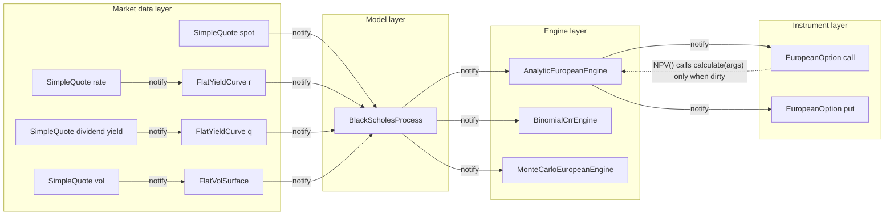
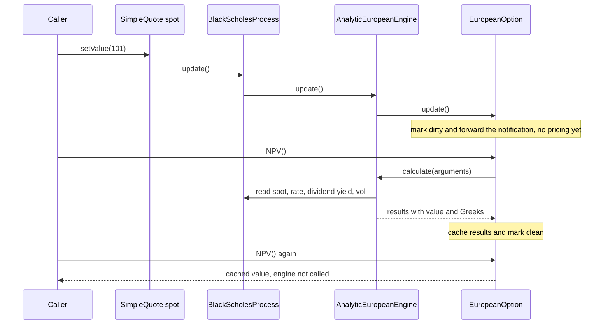

# Pricing Library Design

## TL;DR

- Separate four things that change at different rates: the **instrument** (contract terms, fixed at trade time), **market data** (quotes, curves, surfaces, changing every tick), the **model** (dynamics and parameters, changing at calibration) and the **engine** (numerical method, chosen per use case).
- Market data objects are observables; a quote change notifies curve, process, engine and instrument, and the instrument only marks itself dirty, so nothing is repriced until someone asks (lazy evaluation with a cache).
- Greeks come three ways: closed form, bump-and-reprice (forward error $\approx \Gamma h/2$, central error $O(h^2)$, plus a round-off floor that grows like $\epsilon V/h$), and adjoint algorithmic differentiation, which returns every first-order sensitivity from one backward sweep at a small constant multiple of one pricing.
- Lazy caches, observer lists, global evaluation dates and in-place bumps are shared mutable state: a pricing graph is not thread-safe unless you give each thread its own graph or make engines pure functions of an immutable market snapshot.
- Reproducibility is a design requirement: record library version, market snapshot, model parameters and seeds with every number, and use random streams whose output the standard specifies.

## Learning objectives

- Separate instruments, market data, models and pricers cleanly.
- Explain calibration, caching and algorithmic differentiation for Greeks.
- Describe QuantLib's actual object model (Instrument, LazyObject, PricingEngine, Observer and Observable, Handle, term structures, processes) and its trade-offs.
- Choose a bump size for finite-difference Greeks from the truncation and round-off error terms, and know when to use AAD instead.
- Identify the thread-safety, lifetime and reproducibility hazards of a pricing object graph.

## Core concepts

### The four layers and why they are separate

| Layer | Holds | Changes when | QuantLib examples | This repo's demo |
| :--- | :--- | :--- | :--- | :--- |
| Instrument | contract terms: payoff, strike, schedule, notional | booked or amended (rarely) | `VanillaOption`, `FixedRateBond`, `VanillaSwap` | `EuropeanOption` |
| Market data | quotes and the objects built from them | every tick or snapshot | `SimpleQuote`, `YieldTermStructure`, `BlackVolTermStructure` | `SimpleQuote`, `FlatYieldCurve`, `FlatVolSurface` |
| Model | dynamics and parameters | at calibration | `GeneralizedBlackScholesProcess`, `HestonModel` | `BlackScholesProcess` |
| Engine | numerical method | per use case (speed vs accuracy) | `AnalyticEuropeanEngine`, `BinomialVanillaEngine`, `MCEuropeanEngine` | `AnalyticEuropeanEngine`, `BinomialCrrEngine`, `MonteCarloEuropeanEngine` |

The separation pays for itself in four ways.
One instrument can be priced by several engines (analytic for the risk batch, Monte Carlo to validate it, a PDE for the American variant) without touching the trade.
One curve object is shared by thousands of instruments, so a rate tick is one update, not thousands of copies.
Models are calibrated against market data and then consumed by engines, so calibration code never knows about payoffs.
Trade representation is stable and serialisable for booking and lifecycle systems, while the maths evolves behind it ([Trade Representation and Lifecycle](../18-Pricing-and-Risk-Systems/02-Trade-Representation-and-Lifecycle.md)).

The common anti-pattern is a `price()` method on the trade class that reads global market data: it couples booking to maths, makes every model change a trade-class change, and hides which market state produced a number.

### How QuantLib actually does it

QuantLib is the reference open-source design and interviewers often ask about it by name.

- **Observer and Observable.** `Observable::notifyObservers()` calls `update()` on every registered `Observer`; objects register with `registerWith(...)`.
  Quotes, term structures, processes, engines and instruments are all observables, and most are also observers.
- **Quote and Handle.** `SimpleQuote` holds a number and notifies on `setValue`.
  Objects hold market data through `Handle<T>`, a shared pointer to a shared pointer, so many objects see the same slot.
  `RelinkableHandle<T>::linkTo(...)` swaps what the slot points to (for example from one curve to a bumped curve) and notifies everything that holds the handle.
- **Term structures.** `YieldTermStructure` exposes `discount(t)`, `zeroRate(...)` and `forwardRate(...)`; `BlackVolTermStructure` exposes `blackVol(t, K)` and `blackVariance(t, K)`.
  Curves built from quotes (bootstrapped curves) observe their quotes and rebuild lazily.
- **Process.** `GeneralizedBlackScholesProcess` takes handles to the spot quote, dividend curve, risk-free curve and Black vol surface; `BlackScholesMertonProcess` is the usual subclass.
- **LazyObject and Instrument.** `Instrument` derives from `LazyObject`.
  `NPV()` calls `calculate()`, which runs `performCalculations()` only if the object is not already calculated; `update()` marks it dirty and forwards the notification.
  With the build option `QL_FASTER_LAZY_OBJECTS` (on by default in the current CMake and autotools builds, as of 2026-10) a lazy object forwards only the first notification after each calculation and drops the rest until it is recalculated; `alwaysForwardNotifications()` restores forwarding of every notification for one object.
  `freeze()` and `unfreeze()` suspend recalculation, `recalculate()` forces it.
- **PricingEngine.** An engine owns an `arguments` and a `results` structure.
  `Instrument::setPricingEngine(engine)` registers the instrument with the engine; at pricing time the instrument's `setupArguments(...)` fills the engine's arguments, the engine's `calculate()` fills its results and the instrument's `fetchResults(...)` copies them back.
  `AnalyticEuropeanEngine(process)` is the closed-form engine for European vanillas.
- **Global evaluation date.** `Settings::instance().evaluationDate()` is a singleton that defines "today" for every object in the process; changing it notifies everything that depends on it.
  QuantLib can be compiled with a sessions option (`QL_ENABLE_SESSIONS`) that makes singletons, the evaluation date among them, per-thread.
- **Bulk updates.** `ObservableSettings::instance().disableUpdates(true)` defers notifications while many quotes are set, and `enableUpdates()` then updates each affected observer once.

Term structures carry design choices that interviewers probe.
A bootstrapped `PiecewiseYieldCurve<Discount, LogLinear>` interpolates log discount factors linearly, which is the same as piecewise-constant instantaneous forwards: positive discount factors and no forward overshoot, at the price of a forward curve with jumps at the pillars.
Linear interpolation on zero rates gives a sawtooth forward curve; smooth splines give smooth forwards but let one quote move rates far from its pillar, which makes bucketed risk non-local.
Curves also need a day counter, a calendar, a reference date tied to the evaluation date, and an explicit extrapolation policy; the production version of this service is in [Curve and Surface Service](../18-Pricing-and-Risk-Systems/04-Curve-and-Surface-Service.md).

The repo's [pricing_library.hpp](code/cpp/pricing_library.hpp) rebuilds this graph in a single header of standard C++20.
It differs from QuantLib in two deliberate ways: engines are pure (`calculate(args) const` returns results instead of mutating member structures), and instruments take time to expiry as a year fraction instead of dates, so there is no global evaluation date.

### Lazy evaluation, caching and notification cost

Notification is eager and cheap; calculation is lazy and expensive.
A quote that ticks many times a second must not reprice thousands of instruments that nobody reads; it only flips flags.
Two refinements matter in practice:

- **Notify only on change.** `setValue` with the same value should not notify, or every snapshot replay invalidates the world.
- **Forward only when calculated.** A dirty object has already told its observers; forwarding again turns a deep graph into a notification storm.
  The demo's `LazyObject` forwards only on the transition from calculated to dirty.

The costs: every notification is a virtual call per edge, fan-out is unbounded (a discount curve may be observed by every trade in its currency), and observer lists are mutable shared state.
Production risk systems therefore often replace live observer graphs with explicit dependency graphs evaluated in batches: snapshot market data, compute which curves changed, reprice only the affected trades.

### Engines: analytic, lattice, Monte Carlo

Engines trade speed for generality.
Closed form is exact and fast but exists only for simple payoffs and models.
A CRR binomial tree with $N$ steps sets $u = e^{\sigma\sqrt{\Delta t}}$, $d = 1/u$, $p = (e^{(r-q)\Delta t} - d)/(u - d)$ and rolls back the payoff; its error for vanillas is $O(1/N)$ but oscillates with the parity of $N$ because the strike moves relative to the terminal nodes ([Binomial Trees](../05-Derivatives-and-Volatility/03-Binomial-Trees.md)).
Monte Carlo handles path dependence and many factors at $O(1/\sqrt{n})$ error ([Monte Carlo Pricing](../05-Derivatives-and-Volatility/10-Monte-Carlo-Pricing-and-Variance-Reduction.md)).
A good library prices the same instrument with two independent engines in its test suite; disagreement beyond the stated numerical error is a bug in one of them.

### Greeks by bump-and-reprice

Bump a market input, reprice, difference.
For delta with spot bump $h$, Taylor expansion gives

$$
\frac{V(S+h) - V(S)}{h} = \Delta + \tfrac12\Gamma h + O(h^2), \qquad \frac{V(S+h) - V(S-h)}{2h} = \Delta + \tfrac16 V'''(S)h^2 + O(h^4).
$$

Each price carries a rounding error of order $\epsilon\lvert V\rvert$ with $\epsilon = 2^{-52} \approx 2.220 \times 10^{-16}$, and differencing divides it by $h$, so the total error of the forward difference is roughly $\tfrac12\lvert\Gamma\rvert h + 2\epsilon\lvert V\rvert/h$.
Minimising over $h$ gives $h^\ast \propto \sqrt{\epsilon}$ times the scale of $S$ for forward differences and $h^\ast \propto \epsilon^{1/3}$ times the scale for central differences: $\sqrt{\epsilon} \approx 1.49 \times 10^{-8}$ and $\epsilon^{1/3} \approx 6.06 \times 10^{-6}$ in relative terms.
Trading desks bump by market-meaningful amounts instead (1% or 1 currency unit of spot, 1 vol point, 1 bp of rate) because the Greek they want is the P&L of that move, which includes convexity.

Cost: $n$ inputs need $n + 1$ prices (forward) or $2n$ (central); a curve with dozens of pillars plus a vol surface with hundreds of points means hundreds of full Monte Carlo revaluations.
With Monte Carlo, bumped and base runs must use the same random numbers (common random numbers), or the difference is dominated by noise of order $\text{SE}/h$.

### Greeks by adjoint algorithmic differentiation

Write the pricer as a sequence of elementary operations $v_k = \phi_k(v_{i}, v_{j})$.
The forward pass computes values and records on a tape, for each node, its parents and the local partials $\partial\phi_k/\partial v_i$.
The reverse pass seeds $\bar V = 1$ and walks the tape backwards, accumulating adjoints by the chain rule:

$$
\bar v_i = \sum_{k:\, i \in \text{parents}(k)} \bar v_k \frac{\partial \phi_k}{\partial v_i}.
$$

After one sweep, $\bar v_i = \partial V/\partial v_i$ for every input at once.
The cheap gradient principle (Griewank and Walther) bounds the cost of the full gradient by a small constant multiple of one function evaluation, independent of the number of inputs; bumping costs grow linearly with the number of inputs.
Forward-mode AD (dual numbers) is the opposite trade: one sweep per input, cheap when there are few inputs and many outputs.

What makes AAD hard in production:

- **Memory.** The tape holds every operation; a Monte Carlo pricer records per path, so libraries tape one path at a time and accumulate adjoints (Giles and Glasserman's pathwise adjoint), or checkpoint.
- **Discontinuities.** Pathwise derivatives of digital or barrier payoffs are zero almost everywhere; smooth the payoff (call spread) or use likelihood-ratio methods.
- **Engineering.** Operator-overloading AAD (a custom number type, as in the demo) is simple but slows the forward pass; source transformation and expression templates (Savine) recover much of that.
- **Calibration.** Greeks with respect to market quotes need derivatives through the calibration, via the implicit function theorem, not just through the pricer with model parameters held fixed.

### Calibration as a graph operation

Calibration solves for model parameters so that model prices match market prices.
In an observer design it is a loop that sets a parameter quote, lets the notification invalidate dependants and reprices, so the instruments being calibrated are just more consumers of the graph.
The demo calibrates a single Black vol by Newton's method using the engine's vega; real calibrations (SABR, Heston, local vol) minimise a weighted least-squares error over many quotes, and their Jacobian is exactly where AAD pays off.

### Thread safety

A pricing graph is shared mutable state in several places:

- the cached results and `calculated` flag of every lazy object (logically const, physically mutable);
- observer lists, which change when objects are created, destroyed or relinked;
- in-place bumps of shared quotes, which make bump-and-reprice inherently single-threaded per graph;
- QuantLib's global evaluation date, and engines whose `arguments` and `results` are members.

QuantLib's `QL_ENABLE_THREAD_SAFE_OBSERVER_PATTERN` build option does not change this: its documented purpose is safe observer deregistration when objects are destroyed on another thread, as with the asynchronous garbage collectors behind the Java and .NET bindings, and it is slower than the default.

Two calls to `NPV()` on one instrument from two threads race on the cache even though `NPV()` is const.
Standard remedies, in order of preference:

1. **Process or graph per thread.** Grid workers each build their own graph from a serialised market snapshot ([Pricing at Scale](../18-Pricing-and-Risk-Systems/06-Pricing-at-Scale.md)).
2. **Immutable snapshots and pure engines.** `price(trade, snapshot) -> results` with no hidden state parallelises trivially and is easy to test; bumps create a new snapshot instead of mutating a shared one.
3. **Locks** around lazy calculation, as a last resort: they serialise exactly the work you wanted to parallelise.

### Lifetime and ownership

Observer links are raw back-pointers, so destruction order matters.
The demo removes both directions of the link in both destructors, and the instrument holds its engine through `std::shared_ptr`.
With a raw `PricingEngine*` the demo's engine-swap loop, which hands the instrument a temporary engine per step count, would dangle as soon as each temporary died; AddressSanitizer reports that as a use-after-free, which is why the examples run under ASan in CI.
QuantLib uses shared pointers (and `Handle`) throughout for the same reason.

### Versioning and reproducibility

A number in a risk report must be reproducible years later for audit, model validation and P&L explain.
Record with every result: library version and build, model and engine identifiers with parameters, the market snapshot identifier, the evaluation date, and the random seed and generator.
Random streams must be specified bit-for-bit: the output sequence of `std::mt19937_64` is fixed by the C++ standard, but `std::normal_distribution`'s algorithm is implementation-defined, so the demo maps raw 64-bit outputs to uniforms and applies Box-Muller itself.
Compiler flags such as `-ffast-math` and parallel reductions in a varying order change results in the last bits; pin them and test that two identical runs agree exactly.
Library upgrades go through a regression suite of stored prices and Greeks with explicit tolerances, the subject of [Testing Trading and Numerical Code](14-Testing-Trading-and-Numerical-Code.md).

## Worked examples

All numbers below are printed and asserted by [pricing_library.cpp](code/cpp/pricing_library.cpp); market inputs are $S = 100$, $K = 100$, $r = 5\%$, $q = 0$, $\sigma = 20\%$, $T = 1$.

### 1. Known answers and parity through the graph

"Price the at-the-money call and put through the analytic engine and check parity."
Call $10.4506$, put $5.5735$.
Parity: $C - P = S e^{-qT} - K e^{-rT} = 100 - 100e^{-0.05} = 4.8771$, matching to $10^{-12}$.
Analytic Greeks: delta $0.6368$, gamma $0.01876$, vega $37.524$ per unit vol, rho $53.232$ per unit rate.

### 2. Caching trace

"Show that the library reprices only when it must."
The first `NPV()` triggers one calculation; two more calls leave the counter at 1.
Setting spot to 101 marks the option dirty without pricing; the next `NPV()` reprices once (counter 2) and returns $11.0967$.
Setting spot to 101 again sends no notification, and the counter stays at 2.
The observer graph at that point: the spot quote has 1 observer (the process), the process has 1 (the analytic engine), the engine has 2 (call and put).

### 3. Swapping engines on the same instrument

| CRR steps $N$ | Price | Error vs analytic |
| ---: | ---: | ---: |
| 50 | 10.4107 | -0.0399 |
| 51 | 10.4850 | +0.0344 |
| 100 | 10.4306 | -0.0200 |
| 101 | 10.4680 | +0.0174 |
| 500 | 10.4466 | -0.0040 |
| 1000 | 10.4486 | -0.0020 |

Even $N$ undershoots and odd $N$ overshoots; for even $N$, $N \times \text{error}$ is $-1.995$, $-1.997$, $-1.999$, $-1.999$, the $O(1/N)$ signature.
Averaging adjacent $N$ (or smoothing the payoff at the last step) cancels most of the oscillation.
Monte Carlo with 100,000 antithetic pairs and seed 42 gives $10.4372 \pm 0.0231$, a z-score of $-0.58$ against the analytic price.

### 4. Choosing the bump size

"Compute delta by finite differences and pick $h$."

| $h$ | Forward error | Central error | $\tfrac12\Gamma h$ |
| ---: | ---: | ---: | ---: |
| 1 | 9.294e-3 | -8.596e-5 | 9.381e-3 |
| 0.1 | 9.372e-4 | -8.599e-7 | 9.381e-4 |
| 0.01 | 9.380e-5 | -8.60e-9 | 9.381e-5 |
| 1e-3 | 9.381e-6 | -7.741e-11 | 9.381e-6 |
| 1e-4 | 9.38e-7 | 2.384e-11 | 9.381e-7 |
| 1e-5 | 9.341e-8 | -2.959e-10 | 9.381e-8 |
| 1e-6 | 1.169e-8 | 3.701e-9 | 9.381e-9 |
| 1e-8 | -5.070e-7 | -4.182e-7 | 9.381e-11 |
| 1e-10 | 1.104e-5 | 3.768e-5 | 9.381e-13 |

Reading it as you would in an interview:
the forward error tracks $\tfrac12\Gamma h$ within 1% from $h = 1$ down to $h = 10^{-4}$, and to three figures from $h = 0.01$ down, so it is first order;
the central error falls 100 times per decade of $h$ until about $h = 10^{-3}$, so it is second order;
below that both are swamped by round-off, which grows like $1/h$, and at $h = 10^{-10}$ the "derivative" is wrong in the fifth decimal.
The best forward error here is about $10^{-8}$ near $h = 10^{-6}$, and the best central error is of order $10^{-11}$ near $h = 10^{-3}$ to $10^{-4}$, consistent with $\sqrt\epsilon$ and $\epsilon^{1/3}$ times a spot of 100.
The forward column from $h = 10^{-5}$ down and the central column from $h = 10^{-3}$ down sit at the round-off floor, so their exact digits depend on the platform's `exp` and `erfc` and on the order of operations (these were printed on macOS arm64); the program asserts only their size.
Two entries are quoted to three figures because one ulp of price round-off, divided by the bump, already approaches their fourth figure (about $10^{-13}$ for the central difference at $h = 0.01$ and $1.8 \times 10^{-11}$ for the forward difference at $h = 10^{-4}$); every other entry is asserted at the four figures shown.
With market-standard bumps, central vega with a 1 vol point bump is $37.5210$ against $37.5240$ analytic, and central rho with a 1 bp bump is $53.2325$, equal to analytic at four decimals.

### 5. AAD on the Black-Scholes formula

The formula is written once as a template in the number type.
Instantiated with `double` it prices; instantiated with the tape type it records 28 nodes (4 inputs and 24 operations).
One backward sweep returns delta $0.6368306512$, vega $37.524035$, rho $53.232482$ and the dividend sensitivity $-63.683065$, which is $-S T e^{-qT}N(d_1) = -100 \times 0.6368$.
They agree with the analytic Greeks to better than $10^{-13}$, with no step size to choose: AAD is exact to machine precision, while bumping is an approximation whose accuracy depends on $h$.

### 6. Calibrating a vol to a market price

"The market quotes this call at 12.
What Black vol does the library imply?"
Newton on the vol quote, $\sigma_{k+1} = \sigma_k - (V(\sigma_k) - 12)/\mathcal{V}(\sigma_k)$, starting from 20%, converges to $0.241117$ in 3 steps.
The instrument repriced 4 times (the initial price plus one per step), each time through the quote, surface, process and engine notifications, with no calibration-specific code in the instrument.

## Pitfalls

- Putting `price()` on the trade class and reading global market data: couples booking to maths and hides which market state produced a number.
- Holding a reference to an internal cache (`const Results& r = option.results()`) and reading it after the market moved: the reference now shows the new results.
  The demo copies results for exactly this reason.
- Raw back-pointers between observers and observables with no deregistration, or an instrument holding a raw engine pointer: use-after-free when either side dies first.
- Re-forwarding notifications from already-dirty objects, or notifying on unchanged values: notification storms that cost more than the pricing.
- Calling a const `NPV()` from several threads on one graph: data race on the lazy cache.
- Bumping a shared quote in place inside a parallel risk run: other threads price with the bumped value.
- Bump too small: round-off dominates (at $h = 10^{-10}$ the delta above is wrong in the fifth decimal).
  Bump too large: forward differences are biased by $\tfrac12\Gamma h$.
- Monte Carlo Greeks by bumping with different random numbers in the base and bumped runs: the difference is noise.
- Pathwise or AAD Greeks of discontinuous payoffs without smoothing: zero almost everywhere, wrong in expectation.
- Using `std::normal_distribution` or unseeded generators in a regression-tested engine: results differ across standard libraries and runs.
- Treating AAD sensitivities to model parameters as sensitivities to market quotes, forgetting the calibration step in between.

## Interview questions

> [!question]- qd-pricelib-four-layers | What are the four layers of a pricing library, and why separate them?
> Instrument (contract terms), market data (quotes, curves, surfaces), model (dynamics and parameters) and engine (numerical method). They change at different rates and for different reasons: trades rarely, market data every tick, models at calibration, engines per use case. Separation lets one trade use several engines, one curve serve many trades, and calibration ignore payoffs.

> [!question]- qd-pricelib-quantlib-npv-flow | Walk through what happens inside QuantLib when you call `option.NPV()`.
> `NPV()` calls `LazyObject::calculate()`; if the object is dirty, `performCalculations()` runs, which calls `setupArguments` to fill the engine's arguments, `engine->calculate()` to fill its results, and `fetchResults` to copy them back, then the result is cached. If nothing upstream notified since the last call, the cached value returns immediately.

> [!question]- qd-pricelib-handle | What is a QuantLib `Handle`, and why does `RelinkableHandle` exist?
> A shared pointer to a shared pointer: many objects hold the same slot, so they all see whatever the slot points to. `RelinkableHandle::linkTo` swaps the pointee (for example, a base curve for a bumped or scenario curve) and notifies every holder, without rebuilding instruments or engines.

> [!question]- qd-pricelib-lazy-why | Why is calculation lazy but notification eager?
> Notifications are cheap flag flips; pricing is expensive. A quote that ticks often must not reprice thousands of instruments nobody reads, so updates only mark dependants dirty, and work happens on the next `NPV()`. In the demo three `NPV()` calls cost one calculation, and a spot change costs one more only when asked.

> [!question]- qd-pricelib-notification-storm | What causes a notification storm, and how do you prevent it?
> Re-forwarding notifications from objects that are already dirty, and notifying on unchanged values, across a deep, high fan-out graph. Forward only when transitioning from calculated to dirty (QuantLib's default `QL_FASTER_LAZY_OBJECTS` behaviour), compare before notifying in `setValue`, freeze objects or defer notifications (`ObservableSettings::disableUpdates(true)`) during bulk updates, or replace the live graph with batch dependency evaluation.

> [!question]- qd-pricelib-fd-error | Give the error terms of forward and central finite-difference delta.
> Forward: $\tfrac12\Gamma h$ truncation plus about $2\epsilon\lvert V\rvert/h$ round-off. Central: $\tfrac16 V'''h^2$ truncation plus round-off of the same $1/h$ order. Optimal $h$ scales like $\sqrt\epsilon \approx 1.49 \times 10^{-8}$ (forward) and $\epsilon^{1/3} \approx 6.06 \times 10^{-6}$ (central) times the input's scale.

> [!question]- qd-pricelib-fd-numbers | For the 1-year ATM call ($\Gamma = 0.01876$), what is the forward-difference delta error with $h = 0.01$, and what happens at $h = 10^{-10}$?
> About $\tfrac12 \times 0.01876 \times 0.01 = 9.38 \times 10^{-5}$ (the demo measures $9.380 \times 10^{-5}$). At $h = 10^{-10}$ round-off dominates and the error is of order $10^{-5}$ ($1.104 \times 10^{-5}$ on macOS arm64; the digits are platform-dependent), worse than $h = 10^{-3}$ ($9.381 \times 10^{-6}$) or $h = 10^{-4}$ ($9.38 \times 10^{-7}$).

> [!question]- qd-pricelib-desk-bump | Why do desks bump spot by 1% and vol by 1 point instead of using the optimal tiny $h$?
> They want the P&L of a realistic move, convexity included, and a bump that is robust to model noise and numerical engines (trees, Monte Carlo). Tiny bumps measure a pure derivative that is fragile under Monte Carlo noise and non-smooth engines.

> [!question]- qd-pricelib-crn | Why must bumped Monte Carlo runs reuse the base run's random numbers?
> With independent draws, the difference $V(S+h) - V(S)$ carries Monte Carlo noise of order the standard error, and dividing by $h$ amplifies it to $\text{SE}/h$, which swamps the Greek. Common random numbers make the noise in the two runs nearly cancel.

> [!question]- qd-pricelib-aad-cost | How does the cost of AAD Greeks scale with the number of inputs, compared with bumping?
> AAD gives the full gradient from one forward pass plus one backward sweep, a small constant multiple of one pricing regardless of the number of inputs (the cheap gradient principle). Bumping needs $n + 1$ (forward) or $2n$ (central) full repricings for $n$ inputs.

> [!question]- qd-pricelib-aad-reverse-sweep | State the reverse-sweep recurrence of AAD.
> Seed $\bar V = 1$ and walk the tape backwards: $\bar v_i = \sum_k \bar v_k\,\partial\phi_k/\partial v_i$ over the nodes $k$ that used $v_i$. The local partials are recorded during the forward pass; after one sweep every input's adjoint is its sensitivity.

> [!question]- qd-pricelib-forward-vs-reverse | When is forward-mode AD better than reverse mode?
> When there are few inputs and many outputs: forward mode costs one sweep per input and needs no tape. Reverse mode costs one sweep per output and wins for a scalar price with many inputs, the usual risk case.

> [!question]- qd-pricelib-aad-pitfalls | Name three practical difficulties with AAD in a production Monte Carlo library.
> Tape memory (tape per path and accumulate, or checkpoint); discontinuous payoffs (digitals and barriers give zero pathwise derivatives, so smooth them or use likelihood ratios); and Greeks with respect to market quotes require differentiating through calibration, not only the pricer. Operator-overloading tapes also slow the forward pass.

> [!question]- qd-pricelib-crr-oscillation | Why does a CRR binomial price oscillate between even and odd step counts, and what is its convergence order?
> The strike's position relative to the terminal nodes alternates with the parity of $N$, so the payoff kink is sampled differently. The error is $O(1/N)$: in the demo even-$N$ errors are $-0.0399$, $-0.0200$, $-0.0040$, $-0.0020$ for $N = 50, 100, 500, 1000$, with $N \times \text{error} \approx -2$.

> [!question]- qd-pricelib-thread-safety | Is it safe to call a const `NPV()` on one instrument from two threads?
> No. The lazy cache and `calculated` flag are mutable state written by a const method, so two threads race. Give each thread its own graph, make engines pure functions of an immutable snapshot, or lock around the calculation.

> [!question]- qd-pricelib-global-date | What is the problem with QuantLib's global evaluation date in a multi-threaded risk server?
> `Settings::instance().evaluationDate()` is process-wide, so two threads valuing as of different dates interfere, and changing it notifies every dependent object. Options are one process per valuation date, or building with QuantLib's sessions option (`QL_ENABLE_SESSIONS`) so each thread gets its own singletons.

> [!question]- qd-pricelib-reference-trap | A colleague writes `const auto& r = option.results();`, then bumps spot and reprices, then reads `r.delta`. What do they get?
> The delta at the bumped spot, not the original: `r` refers to the instrument's cache, which the reprice overwrote. Copy the results when you need a stable snapshot; the repo's demo does exactly that.

> [!question]- qd-pricelib-reproducibility | What must you store with a risk number so you can reproduce it a year later?
> Library version and build flags, model and engine identifiers and parameters, the market data snapshot identifier, the evaluation date, and the random generator and seed, plus the trade version. Use generators whose output is specified (for example raw `std::mt19937_64` output) rather than implementation-defined distributions.

> [!question]- qd-pricelib-engine-validation | How do you test a new pricing engine?
> Against known answers (closed form where it exists), against an independent engine on the same instrument within the stated numerical error, against model-free identities (put-call parity, bounds, monotonicity in strike and vol), and with convergence tests in steps or paths. Freeze the results as a regression suite with explicit tolerances.

> [!question]- qd-pricelib-curve-interp | You bootstrap a discount curve. Why is log-linear interpolation on discount factors a common default, and what does it cost?
> It is equivalent to piecewise-constant instantaneous forwards between pillars, so discount factors stay positive and decreasing whenever the forwards are positive, and each quote's effect stays local to its own interval, which keeps bucketed risk clean. The cost is a forward curve with jumps at the pillars, which matters for products sensitive to forward smoothness; splines smooth the forwards but spread one quote's bump across distant maturities.

> [!question]- qd-pricelib-calibration-graph | How does calibration fit into an observer-based design?
> The solver sets model-parameter quotes; notifications invalidate the dependent process, engines and calibration instruments; the solver reads their repriced values and iterates. In the demo, Newton on the vol quote reaches $0.241117$ for a call price of 12 in 3 steps with 4 reprices.

## In this repo and SDE-Interview-Prep

- Code: [pricing_library.hpp](code/cpp/pricing_library.hpp) (observer graph, lazy instrument, three engines, bump and AAD Greeks, calibration), [pricing_library.cpp](code/cpp/pricing_library.cpp) (every number above, printed and asserted), [tests/test_pricing_library.cpp](code/cpp/tests/test_pricing_library.cpp) (known answers including the textbook $S = 42$, $K = 40$ case, parity, AAD vs FD vs analytic, cache invalidation, engine swaps, observer lifetime, calibration).
- Code: [compile_time_greeks.cpp](code/cpp/compile_time_greeks.cpp) (compile-time normal CDF table for hot pricing paths).
- Production pricing library architecture: [Pricing Library Architecture](../18-Pricing-and-Risk-Systems/05-Pricing-Library-Architecture.md).
- Distributed grid compute and cloud pricing: [Pricing at Scale](../18-Pricing-and-Risk-Systems/06-Pricing-at-Scale.md).
- Background: [The Greeks](../05-Derivatives-and-Volatility/05-The-Greeks.md), [Black-Scholes Formula and Intuition](../05-Derivatives-and-Volatility/04-Black-Scholes-Formula-and-Intuition.md), [Implied Volatility and the Smile](../05-Derivatives-and-Volatility/07-Implied-Volatility-and-the-Smile.md).

## Further reading

- Luigi Ballabio, *Implementing QuantLib* (Leanpub): the instrument, pricing engine, observer and term structure chapters.
- Mark Joshi, *C++ Design Patterns and Derivatives Pricing*, 2nd edition, Cambridge University Press, 2008.
- Michael Giles and Paul Glasserman, "Smoking Adjoints: Fast Monte Carlo Greeks", *Risk*, January 2006.
- Luca Capriotti, "Fast Greeks by Algorithmic Differentiation", *Journal of Computational Finance* 14(3), 2011.
- Antoine Savine, *Modern Computational Finance: AAD and Parallel Simulations*, Wiley, 2018.
- Andreas Griewank and Andrea Walther, *Evaluating Derivatives: Principles and Techniques of Algorithmic Differentiation*, 2nd edition, SIAM, 2008.
- QuantLib source: `ql/patterns/observable.hpp`, `ql/patterns/lazyobject.hpp`, `ql/instrument.hpp`, `ql/pricingengine.hpp`.
