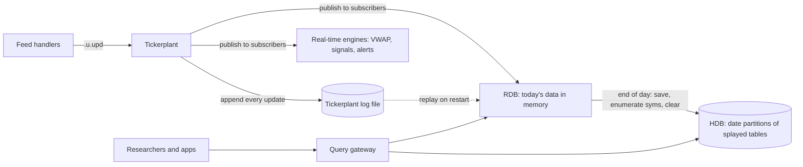
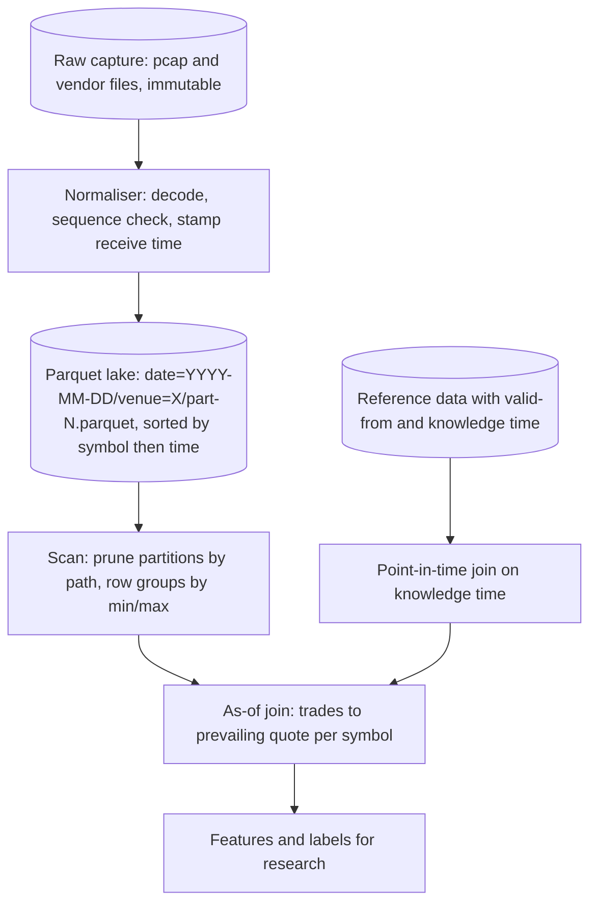

# Tick Data Storage and Time-Series Databases

## TL;DR

- Tick data is append-only, time-ordered and queried by symbol and time range, so it belongs in columnar storage partitioned by date and sorted by (symbol, time) within each partition.
- kdb+tick is the reference design: feed handlers publish to a tickerplant that logs every update and fans it out to a real-time database (today, in memory) and real-time engines; at end of day the RDB writes a date partition of splayed, symbol-enumerated, `p#`-attributed tables to the historical database.
- Parquet (on disk) and Arrow (in memory) are the open-source equivalents: row groups and column chunks with encodings, compression and min/max statistics let a reader skip most of a file.
- The workhorse query is the as-of join: for each trade, the last quote at or before its time for the same symbol; joining forward instead (the next quote) is look-ahead and biases every microstructure statistic.
- Point-in-time correctness needs two timestamps on every fact, when it was true and when you could have known it, and joins on the second.

## Learning objectives

- Store and query tick data with columnar formats (Parquet) and kdb+/q.
- Design partitioning and as-of joins for research workloads.
- Implement an as-of join and prove it against a brute-force reference.
- Estimate storage and ingest capacity from stated assumptions.
- Keep research joins point-in-time and free of look-ahead.

## Core concepts

### Workload shape

Market data is written once, in time order, at rates that spike at the open, the close and on news, and is read mostly as "these symbols, this time range, these columns".
That favours column stores: a query that touches 3 of 20 columns reads about 3/20 of the bytes, sorted columns compress well, and vectorised scans run at memory bandwidth (Kleppmann, *Designing Data-Intensive Applications*, chapter 3).
Row stores and B-trees, which serve point lookups and updates, are the wrong default.

Store at least two timestamps per event: the exchange (or matching engine) timestamp and your receive timestamp, plus the feed sequence number; research that needs latency realism uses the receive time, and gap or ordering forensics use the sequence.
Store prices as integers in tick or implied-decimal units and timestamps as int64 nanoseconds.

### kdb+tick architecture

- **Tickerplant (TP)**: receives updates from feed handlers through `.u.upd`, appends each one to an on-disk log, and publishes to subscribers registered with `.u.sub`, either per update or in timer-driven batches; it keeps little or no data itself.
- **Log file**: the recovery mechanism; a restarted RDB replays the day's log (the `-11!` streaming replay) to rebuild its tables.
- **RDB (real-time database)**: holds today's tables in memory for intraday queries; at end of day the TP calls `.u.end` and the RDB writes the day to the HDB and clears its tables.
- **Real-time engines**: subscribers that compute derived data (bars, VWAP, signals) as updates arrive.
- **HDB (historical database)**: a directory per date; under each, one directory per table; under each table, one file per column (a splayed table, with a `.d` file giving column order).
  Symbol columns are enumerated against a single `sym` file at the HDB root, so they are stored as integer indexes.
  `.Q.dpft` saves a table to a partition sorted by a chosen column (usually `sym`) and applies the parted attribute `p#` to it; the sort is stable, so rows that arrived in time order stay in time order within each symbol.

Attributes are what make q queries fast:

| Attribute | Meaning | Typical use |
| :--- | :--- | :--- |
| `s#` sorted | values ascending; enables binary search | `time` in a single-symbol table |
| `p#` parted | equal values stored contiguously; keeps start offsets | `sym` in HDB partitions |
| `g#` grouped | hash index from value to row positions | `sym` in the RDB, which is in arrival order |
| `u#` unique | values unique; hash lookup | keys |

Joins: `aj[`sym`time;trade;quote]` is the as-of join (for each trade row, the quote columns from the last quote with the same `sym` and time at or before the trade's time); `aj0` is the same but takes the time from the matched quote; `wj` (window join) applies aggregations to the quotes inside a time window around each trade.
Query the HDB with the date constraint first, so only the needed partitions are mapped.

### Parquet and Arrow

A Parquet file is a sequence of **row groups**; each row group holds one **column chunk** per column; each column chunk is a sequence of **pages** (an optional dictionary page, then data pages); a footer holds the schema and, for every column chunk, offsets, encodings, codec and statistics (min, max, null count).
Encodings include PLAIN, dictionary (RLE_DICTIONARY), the RLE/bit-packing hybrid used for dictionary indices and definition and repetition levels, DELTA_BINARY_PACKED for integers, and BYTE_STREAM_SPLIT for floats; compression codecs include SNAPPY, GZIP, ZSTD and LZ4_RAW.
Nested data uses definition and repetition levels from Google's Dremel paper (Melnik et al., VLDB 2010).

Two pruning mechanisms make it fast:

- **Partition pruning**: with Hive-style paths such as `date=2024-03-01/venue=XNAS/part-0.parquet`, a filter on `date` or `venue` never opens other directories.
- **Statistics pruning (predicate pushdown)**: a reader skips row groups (and, with the optional page index, pages) whose min/max range excludes the filter value; this only helps if the data is sorted or clustered on the filter column.

Arrow is the in-memory counterpart: a columnar layout of buffers (validity bitmap, offsets for variable-length types, values) with a standard specification, so processes and languages share data without serialisation; its IPC stream and file formats (the file format is also known as Feather version 2) can be memory-mapped and read with zero copies.
Many engines implement as-of joins on these formats: pandas `merge_asof`, Polars `join_asof` and DuckDB's `ASOF JOIN`.
For the risk and enterprise side of the same storage questions see [Storage and Compute](../18-Pricing-and-Risk-Systems/14-Storage-and-Compute.md).

### Research data lake layout

Design rules:

- Keep the raw capture immutable and re-derivable outputs versioned; a parser bug fix means re-normalising, not patching.
- Partition by date (the natural unit of loading, deletion and parallelism), then sort by symbol and time inside each file; add a coarse second key (venue or a symbol hash bucket) only if a single day is too large for one file set.
- Avoid many small files: per-file open and footer costs dominate scans of tiny files.
- Corporate actions, symbol changes and reference data are separate tables with validity intervals, joined at query time, never baked into the ticks.

### The as-of join

For trade $i$ with symbol $s_i$ and time $t_i$, the backward as-of join returns the quote $j$ with $s_j = s_i$ and the largest $t_j \le t_i$.
With quotes sorted by (symbol, time), the per-symbol implementation is one binary search per trade:

$$
j(i) = \text{searchsorted}(t^{q}_{s_i}, t_i, \text{side} = \text{right}) - 1,
$$

with $j(i) = -1$ meaning no prior quote; the cost is $O(m\log n)$ for $m$ trades and $n$ quotes, or $O(m + n)$ as a merge when both sides are sorted.
Variants:

- `side = right` includes a quote stamped exactly at the trade time; whether that quote was really in force before the trade depends on feed ordering, which is why the sequence number matters.
- A **tolerance** rejects matches older than a maximum age, so a stale quote from before a halt is not used as the prevailing price.
- The **forward** join (first quote at or after the trade) uses information published after the trade: look-ahead.

### Point-in-time joins

Reference and fundamental data are bitemporal: a value describes a period (valid time) and becomes known at a later time (knowledge or transaction time), and it can be restated.
A point-in-time query "as of day $d$" selects, for each key, the latest version with knowledge time $\le d$.
Joining on the period a value describes, or keeping only the latest version, uses restated numbers that were not known at the time; see [Point-in-Time Data and Survivorship](../09-Alpha-Research-and-Portfolio/02-Point-in-Time-Data-and-Survivorship.md).

### Capacity planning

Capacity is arithmetic on assumptions, and the assumptions must be written down:

$$
\text{bytes per day} = \text{events per day} \times \text{bytes per row}, \qquad \text{peak rate} = \frac{\text{events per day}}{\text{session seconds}} \times \text{peak multiple}.
$$

Size the ingest path for the peak, not the average; size storage for the compressed volume times retention plus replicas and rebuild headroom.

## Worked examples

All numbers come from [tick_storage_asof.py](code/python/tick_storage_asof.py).

### 1. As-of join by hand

Quotes for AAA at times 100, 200, 300 and for BBB at 150, 250; trades AAA at 50, 200, 250, 400 and BBB at 260.

| Trade | Backward match | Forward match | Backward, tolerance 60 |
| :--- | :--- | :--- | :--- |
| AAA 50 | none (no prior quote) | 100 | none |
| AAA 200 | 200 (exact time counts) | 200 | 200 |
| AAA 250 | 200 | 300 | 200 |
| AAA 400 | 300 | none | none (quote is 100 old) |
| BBB 260 | 250 | none | 250 |

The script also checks the `searchsorted` join against a brute-force scan on 3,000 quotes and 600 trades over five symbols (one with no quotes): 600 of 600 agree in both directions.

### 2. How a forward join biases an effective-spread study

Each trade hits the prevailing quote (half-spread 0.05) and the next quote moves 0.02 toward the trade (impact), plus noise; 50,000 trades, seed 6.
The effective half-spread $\text{sign}\times(p - \text{mid})$ measured with the backward join is about 0.050, the truth.
With the forward join the "mid" is the post-trade quote, so the measured half-spread is about 0.030: the study understates trading costs by 40% because it used the price impact of the very trade it was measuring.

### 3. Point-in-time EPS

A quarter ending on day 90 is first published on day 120 with EPS 1.00 and restated on day 200 to 0.80.
Point-in-time, as of days 100, 150 and 250 you knew nothing, 1.00 and 0.80.
A naive join that keeps the latest version gives 0.80 on all three days, so a backtest on day 150 trades on a number nobody had.

### 4. Row-group pruning

Two million rows with 500 symbols in 20 row groups of 100,000; one symbol has 4,009 rows.
In arrival order every row group's [min, max] symbol range covers the target, so a query for that symbol reads all 20 row groups.
Sorted by symbol, it reads 1.
Sorting within a partition is what turns statistics into an index.

### 5. Compression of three layouts (zlib-version dependent)

200,000 synthetic ticks (int64 nanosecond time with exponential gaps, int64 Price(4) moving in one-cent steps, int32 size, one side byte) are 4,200,000 bytes at 21 bytes per row.
With zlib level 6 (zlib 1.2.12 on the author's machine): row-oriented records compress 3.27x, the same data stored column by column 4.02x, and columns delta-encoded first (time gaps as int32, price changes as int8) 4.89x.
Columns put similar values together, and deltas turn slowly varying series into small repeated integers, which is what Parquet's DELTA_BINARY_PACKED and kdb+'s compressed files exploit; the script asserts only the ordering and that the delta layout beats 3x, because the exact sizes depend on the zlib version.

### 6. Capacity estimate

Assumptions (illustrative, not facts about any feed): 500 million normalised events per day, a 36-byte row (int64 time, int32 symbol id, int64 order id, int64 price, int32 size, int8 side, int8 message type, int16 venue), 252 trading days, 10 years of retention, a 6.5-hour session and a busiest second at 20 times the average.

| Quantity | Value |
| :--- | :--- |
| Raw per day | 18.0 GB |
| Raw per year | 4.54 TB |
| Raw for 10 years | 45.4 TB |
| Compressed for 10 years at an assumed 5x (in line with the measured 4.89x) | 9.07 TB |
| Average rate | 21,368 events per second |
| Peak rate | 427,350 events per second, 15.4 MB/s |

An 18 GB day fits in the memory of one large RDB host, the peak rate sets the ingest and network budget, and the 10-year number sets the storage tier; a different feed or schema changes every row, which is why the assumptions sit next to the result.

## Pitfalls

- Joining forward (next quote) or with `nearest`, which mixes post-trade information into pre-trade quantities.
- Treating a quote from before a halt or the open as prevailing hours later; set a staleness tolerance.
- Losing the receive timestamp and the sequence number at normalisation, which makes latency studies and gap forensics impossible.
- Storing prices as float32 or timestamps as float seconds; both lose the resolution the data was captured at.
- Partitioning by symbol for a date-range workload (millions of tiny files) or not sorting within partitions (min/max statistics prune nothing).
- Applying today's symbol mapping, corporate actions or index membership to history.
- Mutating the raw capture instead of re-deriving outputs from it.
- In q, querying an HDB without the date constraint first, or saving partitions without sorting and applying `p#` to `sym`.

## Interview questions

> [!question]- qd-tick-why-columnar | Why is columnar storage the default for tick data?
> Writes are append-only in time order and reads scan a few columns over a symbol and time range, so a column store reads only the needed columns, compresses sorted homogeneous values well and scans them with vectorised code. Row stores optimise point lookups and updates, which tick workloads rarely need.

> [!question]- qd-tick-kdb-tick-components | Describe the kdb+tick architecture.
> Feed handlers call `.u.upd` on a tickerplant, which appends every update to a log file and publishes it to subscribers. The RDB holds today in memory; real-time engines compute derived data; at end of day `.u.end` makes the RDB write a date partition to the HDB and clear. A restarted RDB replays the tickerplant log.

> [!question]- qd-tick-tp-log | What is the tickerplant log for?
> Recovery and replay: every update is appended before or as it is published, so a subscriber that restarts (typically the RDB) rebuilds today's state by replaying the log, and the day can be replayed for testing.

> [!question]- qd-tick-hdb-layout | How is a kdb+ HDB laid out on disk?
> One directory per date partition; inside, one directory per table; inside, one file per column (splayed) plus a `.d` file with column order. Symbol columns are enumerated against a single `sym` file at the root, so they are stored as integers.

> [!question]- qd-tick-attributes | What do the `s#`, `p#`, `g#` and `u#` attributes mean, and where would you use `p#`?
> Sorted (binary search), parted (equal values contiguous, start offsets stored), grouped (hash index to row positions) and unique (hash lookup). `p#` goes on `sym` in HDB partitions saved sorted by symbol; the RDB, in arrival order, uses `g#` instead.

> [!question]- qd-tick-aj-semantics | What does `aj[`sym`time;trade;quote]` return?
> The trade table with quote columns from, for each trade, the last quote with the same `sym` and time at or before the trade's time. `aj0` returns the matched quote's time instead of the trade's; `wj` aggregates all quotes in a window around each trade.

> [!question]- qd-tick-asof-algorithm | Implement an as-of join on sorted arrays. What is the complexity?
> Per symbol, `j = searchsorted(quote_times, trade_times, side="right") - 1`, with $-1$ meaning no prior quote: $O(m\log n)$ for $m$ trades and $n$ quotes, or $O(m + n)$ as a merge when both sides are sorted. Validate against a brute-force scan.

> [!question]- qd-tick-asof-exact-time | A quote and a trade carry the same timestamp. Does a backward as-of join use that quote, and is that right?
> With `side="right"` (q's `aj`, pandas' default `allow_exact_matches=True`) it does. Whether the quote was in force before the trade depends on feed order, so break ties with the sequence number, or exclude exact matches when the quote may be the trade's own consequence.

> [!question]- qd-tick-forward-join-bias | You measure effective spreads with the next quote after each trade instead of the prevailing one. What happens?
> The next quote has already moved toward the trade (impact), so the measured half-spread shrinks. In the repo's simulation with half-spread 0.05 and impact 0.02 it fell from about 0.050 to about 0.030, understating costs by 40%.

> [!question]- qd-tick-staleness | Why add a tolerance to an as-of join?
> Without it a trade after a halt, an auction or a feed outage joins to a quote that is hours old. A tolerance returns null when the matched quote is older than the limit, which is the honest answer.

> [!question]- qd-tick-pit-restatement | EPS for a quarter is published on day 120 as 1.00 and restated on day 200 as 0.80. What should a backtest see on day 150, and what does a naive join give?
> 1.00, the latest version with knowledge time on or before day 150. A naive join on the fiscal period (keeping the latest version) gives 0.80, a number nobody knew on day 150.

> [!question]- qd-tick-two-timestamps | Which timestamps should every stored market-data event carry, and why?
> Exchange time and receive time, plus the feed sequence number. Exchange time orders market events; receive time is what your strategy could have known (latency realism); the sequence number orders ties and proves completeness.

> [!question]- qd-tick-parquet-anatomy | Describe the physical layout of a Parquet file.
> Row groups, each with one column chunk per column, each chunk a series of pages (optional dictionary page, then data pages), and a footer with the schema and per-chunk offsets, encodings, codec and min/max/null statistics. The footer lets a reader plan which byte ranges to read.

> [!question]- qd-tick-predicate-pushdown | When does min/max statistics pruning in Parquet help, and when is it useless?
> It helps when data is sorted or clustered on the filter column, so most row groups' [min, max] ranges exclude the value. In arrival order every row group spans all symbols: in the repo's example a symbol query reads 20 of 20 row groups unsorted and 1 of 20 sorted by symbol.

> [!question]- qd-tick-arrow-vs-parquet | How do Arrow and Parquet differ?
> Parquet is an on-disk storage format optimised for compression and selective reads (encodings, codecs, statistics). Arrow is an in-memory columnar format optimised for computation and zero-copy sharing across processes and languages, with an IPC format that can be memory-mapped. A typical stack reads Parquet into Arrow.

> [!question]- qd-tick-partitioning | How would you partition a multi-year tick lake, and what goes wrong with partitioning by symbol?
> By date (and a coarse second key such as venue if a day is too large), sorted by symbol and time within files. Partitioning by symbol creates millions of small files for a date-range workload, where per-file open and footer costs dominate.

> [!question]- qd-tick-delta-encoding | Why do delta encodings compress timestamps and prices so well?
> Consecutive timestamps and prices differ by small, repetitive amounts, so deltas fit in a few bits and repeat often. In the repo's example zlib compressed row records 3.27x, plain columns 4.02x and delta-encoded columns 4.89x (zlib-version dependent).

> [!question]- qd-tick-capacity-estimate | Assume 500 million events per day at 36 bytes, 252 days and 10 years. What raw storage do you need, and what is the peak rate if the busiest second is 20 times the 6.5-hour average?
> 18.0 GB per day, 4.54 TB per year, 45.4 TB over 10 years (9.07 TB at 5x compression). Average $5 \times 10^8/23{,}400 = 21{,}368$ events per second, peak 427,350 per second, about 15.4 MB/s.

> [!question]- qd-tick-raw-immutable | Why keep the raw packet capture after normalising it?
> Normalisers have bugs and schemas change; with an immutable raw layer you re-derive every downstream table after a fix and can audit any number back to the packet. Patching normalised data in place destroys that lineage.

> [!question]- qd-tick-hdb-query-order | Why must a q query against a date-partitioned HDB put the date constraint first?
> The where clause is applied left to right and the date constraint selects which partitions are mapped; putting it later makes q touch every partition before filtering.

## In this repo and SDE-Interview-Prep

- Code: [tick_storage_asof.py](code/python/tick_storage_asof.py), run with `uv run --no-project --with numpy python 12-Quant-Development/code/python/tick_storage_asof.py`.
- Vectorised building blocks used here (`searchsorted`, dtypes, overflow): [Numerical Python](11-Numerical-Python-NumPy-and-Numba.md); the feed that produces the ticks: [Market Data Feed Handlers and Protocols](08-Market-Data-Feed-Handlers-and-Protocols.md); replaying them: [Backtester and Simulator Design](09-Backtester-and-Simulator-Design.md).
- Enterprise storage for risk and pricing: [Storage and Compute](../18-Pricing-and-Risk-Systems/14-Storage-and-Compute.md).
- [Object storage (SDE-Interview-Prep)](https://github.com/shreejitverma/SDE-Interview-Prep/blob/main/04-System-Design/05-Data-Stores/Amazon-S3-and-Object-Storage.md)
- [Apache Spark (SDE-Interview-Prep)](https://github.com/shreejitverma/SDE-Interview-Prep/blob/main/04-System-Design/08-Big-Data/Apache-Spark.md)

## Further reading

- Jeffry A. Borror, *Q for Mortals*, version 3 (KX, code.kx.com), chapters on tables, joins and splayed and partitioned tables.
- KX documentation (code.kx.com): kdb+tick architecture, the `.Q` namespace (`.Q.dpft`), and the reference pages for `aj`, `aj0` and `wj`.
- Martin Kleppmann, *Designing Data-Intensive Applications* (O'Reilly, 2017), chapter 3 on storage engines and column-oriented storage.
- Apache Parquet format specification (parquet.apache.org and the apache/parquet-format repository): file layout, encodings, compression and the page index.
- Apache Arrow columnar format specification (arrow.apache.org): physical layout and the IPC format.
- Sergey Melnik et al., "Dremel: Interactive Analysis of Web-Scale Datasets", *Proceedings of the VLDB Endowment* 3(1) (2010).
