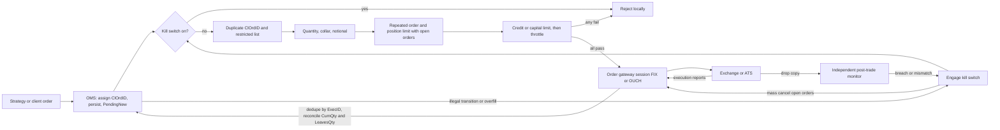
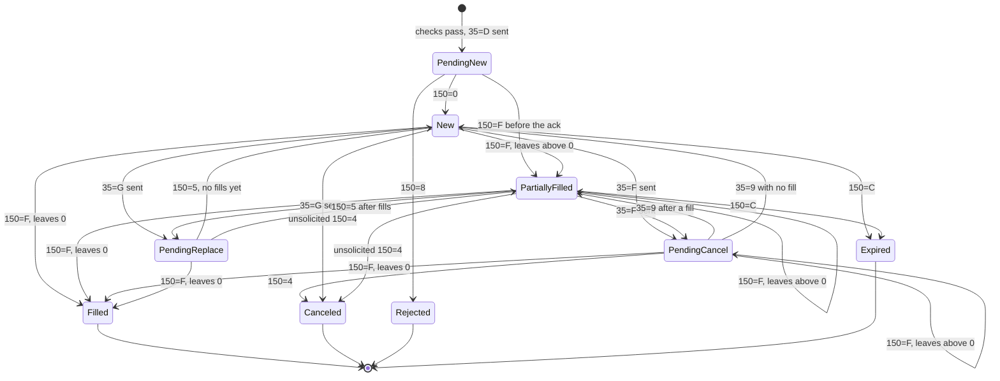

# Risk Checks and Order Management Systems

## TL;DR

- The order management system (OMS) owns the truth about every order: a state machine driven by FIX execution reports (35=8), keyed by ClOrdID (11), with the invariant CumQty (14) + LeavesQty (151) = OrderQty (38) for every live order.
- Pre-trade risk checks sit in-line between the strategy and the venue and reject an order before it leaves: kill switch, duplicate and restricted checks, fat-finger quantity and notional limits, a price collar against a trusted reference price, position limits that count open orders in the worst case, credit or capital limits, and message throttles.
- SEC Rule 15c3-5 requires broker-dealers with market access to have such controls "reasonably designed" to prevent orders that breach credit or capital thresholds and erroneous orders that exceed price or size parameters or "indicate duplicative orders", under the broker's "direct and exclusive control".
- Fail safe, not fail open: a missing reference price, an unknown execution report, an overfill or a CumQty mismatch must block new risk and trigger cancels, while cancels themselves are never throttled or blocked.
- Process every execution report idempotently (dedupe by ExecID (17)), reconcile it against your own book, and run an independent post-trade monitor on the drop copy.

## Learning objectives

- Model the order lifecycle as a state machine.
- Implement pre-trade risk checks, throttles and kill switches that fail safe.
- Quote what SEC Rule 15c3-5 requires and map each clause to a concrete control.
- Read FIX execution reports: the messages, tags, ExecType and OrdStatus values, and the races between fills, cancels and replaces.
- Make execution-report handling idempotent and reconcile positions against the venue and the drop copy.

## Core concepts

### Where the controls sit

A typical electronic trading stack, from decision to venue:

- **Strategy or client flow** decides what to trade.
- **OMS** assigns a unique ClOrdID, persists the order, tracks its state, fills and position.
  Agency desks often split OMS (orders, allocations, compliance) from EMS (execution, algorithms, routing); in a proprietary HFT stack both collapse into the trading engine.
- **Pre-trade risk gateway** checks every outbound new order and replace, in-line and synchronously, before the order reaches the venue session.
- **Order entry session** (FIX, or a native binary protocol such as OUCH) talks to the venue.
- **Post-trade controls** consume execution reports and an independent drop copy from the venue or clearing firm, reconcile positions and P&L, and can engage the kill switch.

In HFT the gateway is on the critical path, so checks are written as allocation-free integer arithmetic against state owned by one thread, or pushed into FPGA or exchange-provided risk layers; in agency trading the same checks may also run in the OMS with richer data.
Either way the checks must be deterministic, cheap and impossible to bypass: a strategy that can send around the gateway makes every limit decorative.

### SEC Rule 15c3-5, the market access rule

Text as published at 17 CFR 240.15c3-5, adopted at 75 FR 69825 (Nov. 15, 2010); checked as of 2026-10.

Paragraph (b), the general requirement:

> "A broker or dealer with market access, or that provides a customer or any other person with access to an exchange or alternative trading system through use of its market participant identifier or otherwise, shall establish, document, and maintain a system of risk management controls and supervisory procedures reasonably designed to manage the financial, regulatory, and other risks of this business activity."

Paragraph (c)(1), financial controls, which must be "reasonably designed to systematically limit the financial exposure of the broker or dealer that could arise as a result of market access, including being reasonably designed to":

> "(i) Prevent the entry of orders that exceed appropriate pre-set credit or capital thresholds in the aggregate for each customer and the broker or dealer and, where appropriate, more finely-tuned by sector, security, or otherwise by rejecting orders if such orders would exceed the applicable credit or capital thresholds; and
>
> (ii) Prevent the entry of erroneous orders, by rejecting orders that exceed appropriate price or size parameters, on an order-by-order basis or over a short period of time, or that indicate duplicative orders."

Paragraph (c)(2), regulatory controls, which must be "reasonably designed to ensure compliance with all regulatory requirements, including being reasonably designed to":

> "(i) Prevent the entry of orders unless there has been compliance with all regulatory requirements that must be satisfied on a pre-order entry basis;
>
> (ii) Prevent the entry of orders for securities for a broker or dealer, customer, or other person if such person is restricted from trading those securities;
>
> (iii) Restrict access to trading systems and technology that provide market access to persons and accounts pre-approved and authorized by the broker or dealer; and
>
> (iv) Assure that appropriate surveillance personnel receive immediate post-trade execution reports that result from market access."

Paragraph (d) requires these controls to be "under the direct and exclusive control of the broker or dealer", with a narrow allowance to allocate specific regulatory controls by written contract to a registered broker-dealer customer, which does not relieve the broker of its overall responsibility.
Paragraph (e) requires regular review of their effectiveness, a review "no less frequently than annually", and an annual certification by the Chief Executive Officer (or equivalent officer).

How each clause becomes code:

| Rule text | Control | In the repo's gateway |
| :--- | :--- | :--- |
| (c)(1)(i) credit or capital thresholds, "in the aggregate" | gross credit limit across all open orders and positions; per-account and per-symbol sub-limits | `CreditLimit`, `PositionLimit` |
| (c)(1)(ii) "price or size parameters, on an order-by-order basis" | price collar, max quantity, max notional | `PriceCollar`, `MaxQuantity`, `MaxNotional` |
| (c)(1)(ii) "or over a short period of time" | message and volume throttles | `Throttle` |
| (c)(1)(ii) "indicate duplicative orders" | unique ClOrdID, repeated identical order detection | `DuplicateClOrdId`, `RepeatedOrder` |
| (c)(2)(ii) restricted persons or securities | restricted list | `RestrictedSymbol` |
| (c)(2)(iv) immediate post-trade reports | drop copy to an independent monitor | outside the gateway |

The EU analogue for firms engaged in algorithmic trading is Commission Delegated Regulation (EU) 2017/589 (RTS 6 under MiFID II); the detailed requirements of both regimes are covered in [Intraday Risk and Pre-Trade Limits](../18-Pricing-and-Risk-Systems/08-Intraday-Risk-and-Pre-Trade-Limits.md).

The SEC's order against Knight Capital (Release No. 34-70694, October 16, 2013) found violations of Rule 15c3-5 after an August 1, 2012 router malfunction in which, per the order, 212 parent orders produced more than 4 million executions in 154 stocks in about 45 minutes; what the order says about controls, deployment and testing is summarised in [Testing Trading and Numerical Code](14-Testing-Trading-and-Numerical-Code.md).

### The check catalogue

| Check | Rejects | Design detail | Failure mode it prevents |
| :--- | :--- | :--- | :--- |
| Kill switch | everything new | latched; re-armed only by a human; cancels still flow | runaway strategy, unreconciled state |
| Duplicate ClOrdID | reused ids | burn ids even when the order is rejected | ambiguous execution reports |
| Restricted list | listed symbols or accounts | loaded before the open, versioned | trading restricted names |
| Max quantity | qty above limit | per symbol and per account | fat finger (extra zeros) |
| Price collar | buys above ref $\times (1 + c)$, sells below ref $\times (1 - c)$ | reference from a trusted feed; reject if missing or stale | fat finger on price, stale strategy state |
| Max notional | qty $\times$ price above limit | integer arithmetic, overflow-guarded | large erroneous orders at plausible prices |
| Repeated order | identical symbol, side, qty, price inside a window | the "duplicative orders" clause | resend loops |
| Throttle | messages over $N$ per rolling window | count only orders that would go out; never throttle cancels | order storms, exchange penalties |
| Position limit | worst-case position beyond limit | position + all open orders on that side + new order | many small orders that each pass |
| Credit or capital | gross exposure beyond limit | absolute positions at reference plus open order notional | aggregate exposure across symbols and sides |

Design principles that interviews probe:

- **Worst case, not expected case.** Every open buy might fill, so the long-side check uses position + open buys + new quantity.
  Netting open buys against open sells understates risk because both sides can fill.
- **Gross, not net, for credit.** A buy and a sell in different names do not offset each other's capital usage in this check.
- **Fail closed.** No reference price, a reference older than its staleness bound, or a missing limit means reject.
- **Reducing risk is always allowed.** Cancels bypass throttles and the kill switch; blocking a cancel during an incident is how losses compound.
- **One owner of risk state.** The gateway's view of open orders and positions is updated by the same thread, in the same order, as the messages that change it, so a check never sees a half-applied fill.

### FIX order messages and execution reports

| MsgType (35) | Message | Direction |
| :--- | :--- | :--- |
| D | NewOrderSingle | to venue |
| F | OrderCancelRequest | to venue |
| G | OrderCancelReplaceRequest | to venue |
| 8 | ExecutionReport | from venue |
| 9 | OrderCancelReject | from venue |

Key tags: ClOrdID (11) is the client's id for each request (every cancel and replace gets a new one), OrigClOrdID (41) points to the request being cancelled or replaced, OrderID (37) is the venue's id, ExecID (17) is unique per execution report, OrderQty (38), Price (44), Side (54), Symbol (55), LastQty (32) and LastPx (31) describe the latest fill, CumQty (14) and LeavesQty (151) the totals, and AvgPx (6) the average fill price.

ExecType (150) says what this report is about; OrdStatus (39) says what state the order is in afterwards.
FIX 4.4 values of ExecType: 0 New, 3 Done for day, 4 Canceled, 5 Replaced, 6 Pending Cancel, 7 Stopped, 8 Rejected, 9 Suspended, A Pending New, B Calculated, C Expired, D Restated, E Pending Replace, F Trade (partial fill or fill), G Trade Correct, H Trade Cancel, I Order Status; the older values 1 and 2 (partial fill, fill) were replaced by F.
FIX 4.4 values of OrdStatus: 0 New, 1 Partially filled, 2 Filled, 3 Done for day, 4 Canceled, 5 Replaced (retired in FIX 4.3), 6 Pending Cancel, 7 Stopped, 8 Rejected, 9 Suspended, A Pending New, B Calculated, C Expired, D Accepted for bidding, E Pending Replace.

The transitions that bite in production:

- **Fill racing a cancel.** A fill can arrive after you sent 35=F; the order stays Pending Cancel with the fill booked, and if the fill completes the order the venue answers your cancel with an OrderCancelReject (35=9).
  Pending states are reported in preference to Partially filled.
- **Cancel reject.** 35=9 returns the order to its pre-pending state, updated by any fills that arrived meanwhile.
- **Replace in flight.** Until 150=5 arrives, either the old or the new terms can execute, so exposure is max(old leaves, new leaves) at the worse price.
  A replace cannot reduce quantity below CumQty.
- **Unsolicited cancels and expiries.** IOC remainders, end of day, venue-side risk or cancel-on-disconnect produce 150=4 or 150=C with no request from you.
- **Fill before acknowledgement.** Some flows deliver a fill before the New ack; treat it as an implicit acknowledgement.
- **Terminal means terminal.** A report that moves a Filled, Canceled, Rejected or Expired order is not a state change you apply; it is evidence that your book and the venue's disagree.

### Idempotency and reconciliation

Execution reports are delivered at least once: FIX resend requests (35=2) after a sequence gap replay messages with PossDupFlag (43) set, and drop copies duplicate everything again.
Applying a fill twice doubles your position, so:

1. Keep the set of processed ExecIDs and ignore repeats before touching state.
2. Recompute CumQty and LeavesQty yourself and compare with the report; any mismatch, overfill (LastQty above LeavesQty), unknown ClOrdID or illegal transition is a reconciliation failure.
3. On failure, fail safe: latch the kill switch, cancel live orders, and page a human.
   Do not try to "fix up" the book automatically.
4. Persist the order and its state before sending (write-ahead), so a restart can rebuild the book from the log and the venue's order status replies.
5. Reconcile positions against the drop copy intraday and against clearing at end of day.

## Worked examples

All numbers below are printed and asserted by [pretrade_risk_oms.cpp](code/cpp/pretrade_risk_oms.cpp).
Limits: max order 1000 shares, max notional USD 80,000, collar 5% (500 bps) around a reference of USD 100.00, position limit 1500 shares worst case, gross credit limit USD 200,000, throttle 3 orders per rolling 1000 ms, repeated-order window 50 ms.

### 1. One order through each check

| Time | Order | Result | Why |
| ---: | :--- | :--- | :--- |
| 0 ms | O1 buy 500 at 100.00 | accepted | all checks pass |
| 0 ms | O1 buy 10 at 100.00 | duplicate ClOrdID | id already used |
| 0 ms | O2 buy 1200 at 100.00 | max order quantity | 1200 above 1000 |
| 0 ms | O3 buy 100 at 105.01 | price collar | above 100.00 $\times$ 1.05 = 105.00 |
| 1 ms | O3b buy 100 at 105.00 | accepted | exactly at the collar edge |
| 2 ms | O4 sell 100 at 94.99 | price collar | below 100.00 $\times$ 0.95 = 95.00 |
| 2 ms | O5 buy RST | restricted symbol | on the restricted list |
| 2 ms | O5b buy NOREF | no reference price | fail closed |
| 3 ms | O5c buy 900 at 100.00 | max notional | USD 90,000 above USD 80,000 |
| 10 ms | O6 buy 500 at 100.00 | repeated identical order | same as O1 within 50 ms |
| 100 ms | O7 buy 800 at 100.00 | accepted | worst-case long 500 + 100 + 800 = 1400 |
| 150 ms | O8 buy 300 at 99.00 | position limit | 1400 + 300 = 1700 above 1500 |
| 150 ms | O9 sell 700 at 101.00 | credit limit | gross USD 140,500 + 70,700 = 211,200 above 200,000 |
| 200 ms | O10 sell 100 at 100.50 | message throttle | fourth order inside one second |
| 1000 ms | O10b sell 100 at 100.50 | accepted | O1 left the window at 1000 ms |

Note that O9 is a sell while the open orders are buys: the gross credit check does not let one side offset the other, and the short-side position check passes independently (0 - 0 - 700 is within -1500).
The throttle runs last, so orders rejected for other reasons do not consume rate.

### 2. Fills, duplicates and AvgPx

"O1 is acknowledged, fills 200 at 100.00, the same report is replayed after a reconnect, then 300 fill at 99.98."
E1 (150=0) moves O1 to New with LeavesQty 500.
E2 (150=F) books 200: Partially filled, CumQty 200, LeavesQty 300.
The replayed E2 has an ExecID already seen, so it is ignored and CumQty stays 200.
E3 books 300: Filled, CumQty 500, LeavesQty 0, AvgPx $(200 \times 100.00 + 300 \times 99.98)/500 = 99.988$, and the XYZ position is 500.

### 3. A fill racing a cancel

O7 is acknowledged and we send a cancel with ClOrdID C7 (OrigClOrdID O7): Pending Cancel.
Before the venue processes it, 100 shares fill: the order stays Pending Cancel with CumQty 100 and LeavesQty 700.
The cancel confirmation (150=4, ClOrdID C7, OrigClOrdID O7) arrives: Canceled, LeavesQty 0.
The position is 600, not 500: dropping fills that arrive in a pending state is a classic position break.

### 4. A replace checked on its worst case

O3b (100 at 105.00) is replaced by 300 at 104.00 with ClOrdID R3.
While the replace is in flight either set of terms can trade, so the gateway counts max(100, 300) = 300 shares at the worse price 105.00.
Worst-case long becomes 600 + 300 = 900, within 1500, and gross exposure becomes $600 \times 100.00 + 100 \times 100.50 + 300 \times 105.00$ = USD 101,550, within 200,000.
The confirmation (150=5, ClOrdID R3, OrigClOrdID O3b) applies the new terms: quantity 300, price 104.00, status New, and subsequent reports are keyed by R3.

### 5. An impossible report trips the kill switch

A report arrives saying the already Filled O1 was Canceled.
The state machine rejects the transition as illegal and latches the kill switch with the reason "execution report does not reconcile with the order book".
The gateway returns cancels for the 2 live orders (O10b and O3b), rejects the new order O11 with "kill switch", and still accepts the cancel request for O3b.
Re-arming is a separate, deliberate human action.

## Pitfalls

- Checking each order against the limit in isolation: many small orders each pass a per-order check while the open total breaches the position limit.
  Count open orders, worst case.
- Netting open buys against open sells for position or credit: both sides can fill.
- Using the strategy's own price as the collar reference: a strategy with a corrupted view passes its own collar.
  Use an independent, fresh reference and fail closed when it is stale.
- Throttling cancels or blocking them under the kill switch.
- Counting rejected orders against the throttle, so a burst of bad orders blocks good ones; or not counting replaces, which are new risk.
- Reusing a ClOrdID after a reject, or keying fills by ClOrdID alone across cancel and replace chains.
- Applying a replayed execution report twice; ignoring PossDupFlag and resend semantics.
- Dropping fills that arrive in Pending Cancel or Pending Replace.
- Treating an overfill or CumQty mismatch as a warning instead of a stop.
- Floating-point prices in limit checks: in IEEE double, $100.0 \times (1 + 0.15)$ evaluates to 114.99999999999999, so a 15% collar wrongly rejects a buy at exactly 115.00, while the integer-cent comparison accepts it.
  Use integer ticks or cents.
- Unchecked integer overflow in qty $\times$ price for absurd inputs: validate ranges first.
- A kill switch that only stops the strategy but leaves resting orders live, or that unlatches automatically.
- Post-trade monitoring that depends on a human watching a screen; the control has to stop order entry automatically.

## Interview questions

> [!question]- qd-oms-15c3-5-summary | What does SEC Rule 15c3-5 require, in one breath?
> Broker-dealers with market access must establish, document and maintain risk management controls and supervisory procedures reasonably designed to manage the financial, regulatory and other risks of that access: reject orders exceeding pre-set credit or capital thresholds, reject erroneous orders exceeding price or size parameters or indicating duplicative orders, enforce regulatory pre-order requirements and restrictions, keep the controls under the broker's direct and exclusive control, review them at least annually, and have the CEO certify annually.

> [!question]- qd-oms-15c3-5-c1ii | Quote the erroneous-order clause of Rule 15c3-5 and name the controls it implies.
> (c)(1)(ii): "Prevent the entry of erroneous orders, by rejecting orders that exceed appropriate price or size parameters, on an order-by-order basis or over a short period of time, or that indicate duplicative orders." Controls: price collar, max quantity and notional per order, throttles and volume limits over short windows, duplicate ClOrdID and repeated-order detection.

> [!question]- qd-oms-direct-exclusive | What does "direct and exclusive control" in Rule 15c3-5(d) mean for system design?
> The broker-dealer, not its customer, must control the risk checks on orders sent under its market access: a customer cannot configure or bypass them. Allocation of specific regulatory controls to a registered broker-dealer customer is allowed only by written contract after due diligence, and does not remove the broker's overall responsibility.

> [!question]- qd-oms-worst-case-position | Position 0, open buys 500 and 100, open sells none, limit 1500. Can you send a buy of 800? Then a buy of 300?
> 800: yes, worst-case long 0 + 600 + 800 = 1400. Then 300: no, 1400 + 300 = 1700 exceeds 1500. Every open buy might fill, so the check uses position plus all open orders on that side plus the new order.

> [!question]- qd-oms-gross-credit | Open buys total USD 140,500 of notional. Credit limit USD 200,000 gross. Can you send a sell of 700 at 101.00?
> No. Gross exposure would be 140,500 + 70,700 = 211,200, above 200,000. A gross limit does not let opposite-side orders offset each other, because both can fill.

> [!question]- qd-oms-collar-design | How do you design a price collar, and what must it do when the reference price is missing?
> Reject buys above ref $\times (1 + c)$ and sells below ref $\times (1 - c)$, with the reference from an independent, fresh source (NBBO, last trade or a fair value, not the strategy's own price) and $c$ per instrument and volatility regime. With no reference or a stale one, reject: fail closed. Use integer cents so the boundary is exact (105.00 accepted, 105.01 rejected for a 5% collar on 100.00).

> [!question]- qd-oms-throttle-order | Where does the throttle go in the check sequence, and should cancels count?
> After the content checks, so only orders that would actually go out consume rate; a burst of rejected orders should not block valid ones. Cancels must never be throttled or blocked, because they reduce risk; replaces count because they can add risk.

> [!question]- qd-oms-kill-switch | Describe a kill switch that fails safe.
> Latched on manual action or automatically on reconciliation failures, limit breaches or loss of drop copy; when on it rejects all new orders and replaces, sends cancels for every live order (or relies on venue mass cancel and cancel-on-disconnect), still allows cancels, keeps the first reason, and is re-armed only by a human after review.

> [!question]- qd-oms-cum-leaves | State the quantity invariant of an execution report and what to do if it fails.
> For a live order CumQty (14) + LeavesQty (151) = OrderQty (38), and CumQty increases by LastQty (32) on each fill. If a report breaks it, or LastQty exceeds LeavesQty (overfill), your book and the venue's disagree: stop sending new risk, cancel, and reconcile by hand.

> [!question]- qd-oms-idempotent | How do you make execution-report processing idempotent?
> Keep the set of processed ExecIDs (17) and ignore repeats before touching state; reports are replayed after resend requests (with PossDupFlag 43) and arrive again on drop copies. Applying a fill twice doubles the position.

> [!question]- qd-oms-exectype-vs-ordstatus | What is the difference between ExecType (150) and OrdStatus (39)?
> ExecType is the event this report announces (New, Trade, Canceled, Replaced, Pending Cancel and so on); OrdStatus is the order's resulting state. A fill on an order with a cancel pending has ExecType F (Trade) and OrdStatus 6 (Pending Cancel).

> [!question]- qd-oms-fix44-trade | In FIX 4.4, how is a fill reported in ExecType?
> ExecType F (Trade), for both partial fills and fills; OrdStatus then says 1 (Partially filled) or 2 (Filled). The pre-4.3 ExecType values 1 and 2 were replaced by F.

> [!question]- qd-oms-fill-during-cancel | You sent a cancel, then receive a fill for 100 of the remaining 800. What state is the order in, and what is the position impact?
> Still Pending Cancel, with CumQty up by 100 and LeavesQty 700; the 100 shares are a real position. When the cancel confirms, leaves go to 0 and the order is Canceled. If the fill had completed the order, the venue would reject the cancel (35=9).

> [!question]- qd-oms-replace-exposure | How should a cancel/replace from 100 at 105.00 to 300 at 104.00 be risk-checked?
> On the worst case while it is in flight: either set of terms can execute, so count max(old leaves, new leaves) = 300 shares at the worse price 105.00. The repo's gateway then reports a worst-case long of 900 and gross exposure of USD 101,550 for the example book.

> [!question]- qd-oms-clordid-chain | Why does every cancel and replace need its own ClOrdID, and how do you key the order?
> FIX requires each request to carry a unique ClOrdID (11) with OrigClOrdID (41) pointing at the previous one, so replies can be matched to the request. Key the order internally by its first ClOrdID and keep an alias map from every id in the chain, or use the venue's OrderID (37).

> [!question]- qd-oms-avgpx | O1 fills 200 at 100.00 and 300 at 99.98. What is AvgPx (6)?
> 99.988: $(200 \times 100.00 + 300 \times 99.98)/500$.

> [!question]- qd-oms-integer-prices | Why should limit checks use integer prices?
> Binary floating point cannot represent most decimal prices exactly: $100.0 \times (1 + 0.15)$ is 114.99999999999999 in double, so a 15% collar on 100.00 rejects a buy at exactly 115.00. Integer cents (11500 $\times$ 10000 against 10000 $\times$ 11500) make every comparison exact; guard qty $\times$ price against overflow by bounding inputs first.

> [!question]- qd-oms-fail-safe | Give three situations where a risk gateway must fail closed.
> No fresh reference price for a collar; an execution report for an unknown order, an overfill, an illegal transition or a CumQty mismatch; loss of the risk state or drop copy. In each case block new risk and cancel live orders rather than continue with unknown exposure.

> [!question]- qd-oms-knight-lesson | Per the SEC's order in Release No. 34-70694, which Rule 15c3-5 controls did Knight lack?
> The order finds Knight lacked controls reasonably designed to prevent erroneous orders immediately before orders reached the market from its router ((c)(1)(ii)), and lacked automated firm-wide capital thresholds that would prevent order entry ((c)(1)(i)); its post-execution position monitor relied on human monitoring and did not stop order entry.

> [!question]- qd-oms-hot-path | How do you keep pre-trade checks fast enough for an HFT order path?
> One thread owns the risk state and processes orders and execution reports in sequence, so there are no locks; integer arithmetic on preallocated per-symbol state; constant-time checks (running totals of open quantity and notional instead of scans); no allocation or I/O on the path, with logging off-thread. Hardware or venue-provided risk layers take the same checks further.

## In this repo and SDE-Interview-Prep

- Code: [pretrade_risk_oms.hpp](code/cpp/pretrade_risk_oms.hpp) (gateway, checks, state machine, idempotent reports, kill switch), [pretrade_risk_oms.cpp](code/cpp/pretrade_risk_oms.cpp) (every number above, printed and asserted), [tests/test_pretrade_risk_oms.cpp](code/cpp/tests/test_pretrade_risk_oms.cpp) (each check at its boundary, illegal transitions, duplicates, overfills, fill and cancel races, replace exposure, kill switch).
- Intraday risk and pre-trade limits: [Intraday Risk and Pre-Trade Limits](../18-Pricing-and-Risk-Systems/08-Intraday-Risk-and-Pre-Trade-Limits.md).
- Enterprise risk engine architecture: [Risk Engine Architecture](../18-Pricing-and-Risk-Systems/07-Risk-Engine.md).
- Order types and venue mechanics: [Limit Order Books and Order Types](../07-Market-Microstructure/01-Limit-Order-Books-and-Order-Types.md).
- [Order types and state transitions (SDE-Interview-Prep)](https://github.com/shreejitverma/SDE-Interview-Prep/blob/main/14-Low-Latency-Systems/01%20-%20Market%20%26%20Microstructure%20Fundamentals/Order%20Types%20and%20State%20Transitions.md)
- [Order state management and position tracking (SDE-Interview-Prep)](https://github.com/shreejitverma/SDE-Interview-Prep/blob/main/14-Low-Latency-Systems/11%20-%20Participant-Side%20Systems/Order%20State%20Management%20and%20Position%20Tracking.md)
- [Participant-side pre-trade risk gates (SDE-Interview-Prep)](https://github.com/shreejitverma/SDE-Interview-Prep/blob/main/14-Low-Latency-Systems/11%20-%20Participant-Side%20Systems/Participant-Side%20Pre-Trade%20Risk%20Gates.md)
- [Drop copy and clearing feeds (SDE-Interview-Prep)](https://github.com/shreejitverma/SDE-Interview-Prep/blob/main/14-Low-Latency-Systems/02%20-%20Exchange%20Architecture/Drop%20Copy%20and%20Clearing%20Feeds.md)
- [FIX protocol and FAST (SDE-Interview-Prep)](https://github.com/shreejitverma/SDE-Interview-Prep/blob/main/14-Low-Latency-Systems/10%20-%20Protocols%20%26%20Codecs/FIX%20Protocol%20and%20Fast%20Encoding%20FAST.md)
- [War story: Knight Capital (SDE-Interview-Prep)](https://github.com/shreejitverma/SDE-Interview-Prep/blob/main/14-Low-Latency-Systems/02%20-%20Exchange%20Architecture/War%20Story%20-%20The%202012%20Knight%20Capital%20Disaster.md)

## Further reading

- 17 CFR 240.15c3-5, Risk management controls for brokers or dealers with market access, 75 FR 69825 (Nov. 15, 2010).
- SEC, Risk Management Controls for Brokers or Dealers with Market Access, final rule release, 75 Fed. Reg. 69792 (Nov. 15, 2010).
- SEC, In the Matter of Knight Capital Americas LLC, Securities Exchange Act Release No. 70694 (Oct. 16, 2013).
- FIX Trading Community, FIX 4.4 specification: the order handling messages, the ExecutionReport and the order state change matrices.
- Commission Delegated Regulation (EU) 2017/589 (RTS 6) on organisational requirements for investment firms engaged in algorithmic trading.
