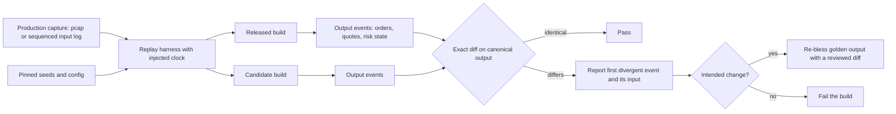

# Testing Trading and Numerical Code

## TL;DR

- Trading code fails in ways ordinary tests miss: no exact oracle for floating-point results, hidden nondeterminism (seeds, summation order, hash order, threads, wall-clock time), stateful protocols, and code paths that only run in production.
- Compare floats with a tolerance derived from the computation: relative for well-scaled values, an absolute floor near zero, ulps for bit-level kernels, and $k$ standard errors for Monte Carlo; `0.1 + 0.2` is 1 ulp from `0.3`.
- Reproducibility is engineered: pin seeds and the generator algorithm, fix reduction order, inject the clock, and make the core a single-threaded deterministic event loop so any run can be replayed exactly.
- Layer the tests: unit and known-answer, property-based and metamorphic (with shrinking), golden files, fuzzing of every parser under sanitizers, simulation, and replay regression that diffs a candidate build against the released one on captured production input.
- Knight Capital (SEC Release No. 34-70694): an incomplete deployment left dead Power Peg code reachable through a repurposed flag on one of eight servers, and in about 45 minutes 212 parent orders became millions of child orders, over 4 million executions and a loss of more than $460 million.

## Learning objectives

- Write golden-file, property-based and replay tests for pricing and strategy code.
- Make simulations deterministic and tests non-flaky.
- Design floating-point tolerances (absolute, relative, ulp, statistical) and justify them.
- Fuzz binary parsers and run them under sanitizers.
- Explain, from the SEC order, how the Knight Capital incident happened and which controls and tests address each finding.

## Core concepts

### Why this code is hard to test

- **No exact oracle.** A pricer's answer is a rounded floating-point number; the "right" value is known only to a tolerance, and Monte Carlo answers are random.
- **Hidden nondeterminism.** Unseeded generators, summation order that changes with thread count, hash-map iteration order, wall-clock reads, and thread scheduling all make two runs differ.
- **State and protocols.** Feed handlers, order managers and matching engines are state machines driven by long message sequences; bugs live in rare orderings (gaps, replaces after partial fills, reconnects).
- **Rare paths with large consequences.** Recovery, kill-switch and disaster-recovery code runs seldom, and the cost of a wrong order is real money within seconds.

### The test layers

| Layer | What it checks | Oracle | Typical target |
| :--- | :--- | :--- | :--- |
| Unit and known-answer | one function, fixed inputs | closed form, textbook value, hand calculation | pricing formulas, day counts, parsers |
| Property-based | invariants over generated inputs | a property, not a value | splitters, books, encoders |
| Metamorphic | relations between outputs | parity, symmetry, scaling, monotonicity | pricers, risk aggregators |
| Model-based (differential) | fast implementation vs simple reference | the reference implementation | optimized book vs naive book |
| Golden file | whole output of a deterministic run | reviewed stored output | reports, curves, P&L explain |
| Fuzzing | no crash or undefined behaviour on hostile input | sanitizers and assertions | wire decoders, config loaders |
| Simulation | strategy plus exchange simulator | invariants and expected behaviour | order logic, risk limits |
| Replay regression | new build vs released build on recorded production input | the released build | the whole trading stack |

The cheapest layer that can catch a bug is the right place for its test; replay catches what nothing else does, but it tells you only that behaviour changed, not that it is right.

### Floating-point comparison

Doubles have a 53-bit significand: the gap between adjacent doubles (one ulp) is $2^{-52}$ at 1.0, i.e. `2.220446049250313e-16`, and the unit roundoff is $u = 2^{-53} \approx 1.11 \times 10^{-16}$, so every correctly rounded operation has relative error at most $u$.
The ulp grows with magnitude: `1.4210854715202004e-14` at 100 and `1.1641532182693481e-10` at $10^6$.

- **Absolute** tolerance $|a - b| \le \epsilon_{abs}$ is right for quantities with a natural scale (a price in ticks, a probability) and is the only option near zero.
- **Relative** tolerance $|a - b| \le \epsilon_{rel}\max(|a|, |b|)$ is right for well-scaled results; it fails near zero, where any nonzero difference is infinitely large relative to 0.
- **Ulp** tolerance counts representable doubles between $a$ and $b$ (map each double's bits to an ordered integer and subtract); it suits kernels that should be accurate to a few roundings.
- **Statistical** tolerance for Monte Carlo: $|\hat{V} - V| \le k \cdot \text{SE}$ with $\text{SE} = s/\sqrt{n}$; a two-sided test at $k$ fails falsely with probability $2(1 - \Phi(k))$.

Library traps:

- Python `math.isclose(a, b)` uses `abs(a - b) <= max(rel_tol * max(abs(a), abs(b)), abs_tol)` with defaults `rel_tol=1e-09`, `abs_tol=0.0`, so it is symmetric but `math.isclose(1e-20, 0.0)` is `False` until you pass an `abs_tol`.
- NumPy `np.isclose(a, b)` uses $|a - b| \le \text{atol} + \text{rtol}\,|b|$ with defaults `rtol=1e-05`, `atol=1e-08`: it is asymmetric (`np.isclose(1, 2, rtol=0.5, atol=0)` is `True`, swapped it is `False`), and the default `atol` makes every pair of quantities below about $10^{-8}$ "equal", for example `1e-9` and `2e-9`; set `atol` explicitly for small quantities such as discount-factor sensitivities or probabilities of default.

A tolerance should come from an error analysis, not from loosening until the test passes: the condition number of the problem times the algorithm's error bound (for recursive summation, $|\hat{s} - s| \le (n-1)u\sum|x_i|$ to first order, Higham chapter 4), the truncation error of a finite difference, or the standard error of a simulation.
Kahan's compensated summation carries each addition's rounding error into the next term, and its bound $|\hat{s} - s| \le (2u + O(nu^2))\sum|x_i|$ (Higham chapter 4) no longer grows with $n$ to first order; it is the cheap fix when a long running total (P&L, position notional, a Monte Carlo accumulator) must not drift.

### Reproducibility and determinism

Sources of run-to-run difference, and the fix for each:

- **Random numbers.** Seed explicitly and pin the algorithm, not just the seed.
  Python guarantees that `random.random()` reproduces for a given seed across versions, but not its other methods.
  NumPy's NEP 19 guarantees stream compatibility for bit generators' core methods and the frozen legacy `RandomState`, while `Generator` distribution methods may change in feature releases.
  In C++ the standard fixes the output of engines such as `std::mt19937` (its 10000th output from default construction is 4123659995) but not the algorithms of distributions such as `std::uniform_int_distribution`, so libstdc++ and libc++ can draw different values from the same engine.
  Tests that pin exact counts therefore use a self-contained generator (this note's code uses SplitMix64).
  For parallel streams spawn independent children (`np.random.SeedSequence(seed).spawn(k)`), never seed workers with `seed + i` ad hoc.
- **Summation order.** Floating-point addition is not associative, so a parallel reduction whose chunking depends on thread count gives different bits on different machines.
  Fix the chunking (a deterministic reduction tree), or use compensated (Kahan) or exact summation (`math.fsum`) where it matters.
  Compilers do not reassociate floating-point sums unless allowed to (`-ffast-math` or `-fassociative-math`), which is one more reason to keep those flags off code with golden outputs.
- **Compiler and platform.** FMA contraction, `-ffast-math`, vectorized reductions and different `libm` implementations change the last bits; pin flags, and keep cross-platform golden tolerances above that noise.
- **Iteration order.** Python randomizes `str` hashes per process (`PYTHONHASHSEED`), so iterating a `set` of strings can change order between runs; C++ `unordered_map` order depends on the implementation.
  Sort before emitting output.
- **Time.** Code that reads the wall clock cannot be replayed; inject a clock interface and drive it from event timestamps in simulation and replay.
- **Threads.** Run the trading core as a single-threaded event loop over a sequenced input log; then any session is a pure function of its input and can be replayed bit for bit.

### Property-based and metamorphic testing

A property-based test states an invariant, generates many inputs, and on failure shrinks the input to a minimal counterexample.
QuickCheck (Claessen and Hughes, ICFP 2000) introduced the style; Hypothesis is the Python library (`@given` with strategies such as `st.integers()`, automatic shrinking, and a local database that replays previously failing examples), RapidCheck is a C++ equivalent.
Good properties for trading code:

- conservation: child order quantities sum to the parent and none is zero or above the cap; cumulative quantity plus leaves quantity equals order quantity;
- round trips: `decode(encode(m)) == m` for every message type;
- model-based: the optimized component agrees with a naive reference on random input (the feed handler test rebuilds the book through random losses and compares it with the loss-free book);
- metamorphic relations for pricers: put-call parity $C - P = S - Ke^{-rT}$, homogeneity $C(\lambda S, \lambda K) = \lambda C(S, K)$, monotonicity in $S$ and $\sigma$, and no-arbitrage bounds $\max(S - Ke^{-rT}, 0) \le C \le S$.

Metamorphic relations need tolerances too: an exact monotonicity check on a correct pricer still fails on rounding noise.

### Golden files and known-answer tests

A golden test runs a deterministic computation and compares its output with a stored, reviewed copy.
Store numbers with a tolerance comparison, or serialize canonically (sorted keys, fixed rounding, no timestamps or hostnames) and compare a hash.
Re-blessing a golden file must be a reviewed diff that explains why each number moved; blessing whatever the new build prints turns the test into a recorder of bugs.

### Fuzzing

Fuzzing feeds a program huge numbers of malformed inputs; coverage-guided fuzzers such as libFuzzer (an in-process entry point `LLVMFuzzerTestOneInput(const uint8_t*, size_t)`) and AFL mutate inputs that reach new code.
Run fuzzers with AddressSanitizer and UndefinedBehaviorSanitizer so a one-byte overread fails loudly instead of returning garbage.
Every decoder that touches network bytes (feed handlers, order-entry gateways, drop-copy parsers) should be fuzzed, seeded with real captured packets.
In Python an unchecked parser fails differently: slicing past the end of a `bytes` object silently returns a shorter slice, so a length-trusting parser returns truncated messages instead of raising.

### Simulation and replay regression

A simulator runs the real strategy against an exchange model (matching, queue position, latency, fees) on recorded or synthetic market data; see [Backtester and Simulator Design](09-Backtester-and-Simulator-Design.md).
Replay regression records production input (packet captures or the sequenced input log), replays it into the released build and the candidate build with the same seeds and configuration, and diffs their canonical outputs.
The first divergent output event, with the input that caused it, is what the reviewer needs.

### Flaky tests

A flaky test passes and fails on the same code; causes are unseeded randomness, tolerances tighter than the noise, timing and sleeps, shared state between tests, ordering assumptions, and live external dependencies.
Fix the cause (seed, derive the tolerance, inject time, isolate state) rather than retrying; a retried flaky test trains the team to ignore red builds.
For statistical tests, budget false failures explicitly: at 3 standard errors a suite of 1000 independent Monte Carlo checks fails falsely 2.7 times per run on average, at 4 standard errors about 0.06 times.

### Case study: Knight Capital, August 1, 2012 (SEC Release No. 34-70694)

Everything in this section is from the SEC's order of October 16, 2013, in which Knight Capital Americas LLC settled without admitting or denying the findings.

- Knight changed its automated equity router, SMARS, to support the NYSE Retail Liquidity Program starting August 1, 2012.
  The new RLP code replaced unused "Power Peg" code that Knight had stopped using in 2003 but that remained present and callable, and it repurposed the flag that used to activate Power Peg.
- In 2005 Knight had moved Power Peg's cumulative quantity function, which stopped child orders once the parent was filled, to an earlier point in the code, and did not retest Power Peg.
- Deployment began on July 27, 2012, in stages; a technician did not copy the new code to one of the eight SMARS servers, no second technician reviewed the deployment, and Knight had no written procedures requiring such a review.
- On August 1 the seven updated servers processed RLP orders correctly; orders with the repurposed flag reaching the eighth server triggered Power Peg, which sent child orders continuously without regard to executions already received.
- For 212 incoming parent orders, SMARS sent millions of child orders, resulting in 4 million executions in 154 stocks for more than 397 million shares in approximately 45 minutes; Knight assumed a net long position of about $3.5 billion in 80 stocks and a net short position of about $3.15 billion in 74 stocks, and lost more than $460 million.
- Before the open, an internal system sent 97 automated "BNET reject" e-mails referencing SMARS and "Power Peg disabled"; they were not designed as alerts and were not acted on.
- While responding, Knight uninstalled the new RLP code from the seven correctly deployed servers, which made incoming parent orders activate Power Peg on those servers too.
- The order finds that Knight lacked controls to prevent erroneous orders at the router and automated firm-wide capital thresholds, among other violations of Rule 15c3-5, and also violations of Regulation SHO Rules 200(g) and 203(b); Knight was censured and paid a $12 million civil penalty.

Engineering lessons, mapped to those findings (the mapping is this note's, not the SEC's): treat deployment as a tested artifact (automated verification that every server runs the intended build), delete dead code instead of leaving it callable, never repurpose a flag whose old meaning is still deployed anywhere, rerun regression tests on every path a code change can reach, route anomaly messages to alerting rather than e-mail lists, and enforce pre-trade capital and order-rate limits that stop order flow automatically (see [Risk Checks and Order Management](13-Risk-Checks-and-Order-Management.md)).

## Worked examples

All numbers below come from [testing_numerical_code.py](code/python/testing_numerical_code.py), which prints and asserts each one; the C++ examples come from [test_itch50_feed_handler.cpp](code/cpp/tests/test_itch50_feed_handler.cpp).

### 1. Choosing a float comparison

"Your test asserts `price == 0.3` and fails; the computed value is `0.1 + 0.2`."
It is `0.30000000000000004`, exactly 1 ulp above the double nearest 0.3, so `==` is the wrong tool and any relative tolerance of a few $u$ passes; `math.isclose(0.1 + 0.2, 0.3)` is `True`.
Near zero switch to an absolute floor: `math.isclose(1e-20, 0.0)` is `False`, with `abs_tol=1e-12` it is `True`.
The ulp distance between `0.0` and `-0.0` is 0, and between the smallest positive and negative subnormals it is 2, which is why an ulp comparison must map the sign-magnitude bit pattern onto a single ordered integer line.

### 2. Why two machines disagree on a sum

Sum 100,000 uniforms on $[-1000, 1000]$ (SplitMix64 seed 14).
The correctly rounded sum (`math.fsum`) is `-18009.51879856792`; a left-to-right loop is 179 ulps away, the reversed loop 103 ulps, and splitting into 1, 2, 4, 8 or 16 chunks (as a parallel reduction would) gives 5 different results, the worst 533 ulps away.
None of them is a bug; a test that compares bits across thread counts is.
A Kahan compensated loop over the same data lands exactly on the `math.fsum` result, 0 ulps away.
The extreme case: a loop over `[1e16, 1.0, -1e16]` returns `0.0` while `math.fsum` returns `1.0`, and from Python 3.12 the built-in `sum()` of floats also returns `1.0` because it uses compensated summation.

### 3. Monte Carlo tolerance and the false-failure budget

Black-Scholes call, $S = K = 100$, $r = 5\%$, $\sigma = 20\%$, $T = 1$: analytic $10.4506$.
With 200,000 paths the estimate is 10.3970 with standard error 0.0328, a z-score of -1.63, comfortably inside a 4-SE tolerance.
The normals come from the raw PCG64 stream (seed 2024) through a Box-Muller transform, so the estimate is fixed by the algorithm and the seed; `Generator.standard_normal` is a distribution method that NEP 19 allows to change in a NumPy feature release, so a test that pins an exact estimate must not use it.
A two-sided 4-SE test fails falsely with probability $6.33 \times 10^{-5}$, a 3-SE test with $2.70 \times 10^{-3}$; with 1000 such tests per CI run, 3 SE gives 2.7 false failures per run on average, which is a flaky suite by construction.
Use 4 to 5 SE and enough paths that the tolerance is still tight enough to catch real bugs.

### 4. A property test that finds and shrinks a bug

A child-order splitter returns `[max_child] * (qty // max_child) + [qty % max_child]`.
Property: children sum to `qty` and each satisfies `0 < child <= max_child`.
Random generation (SplitMix64 seed 5) finds a failure on the 10th case, `qty=7400, max_child=100`, whose last children are `[100, 100, 0]`: a zero-size child order that a venue would reject or, worse, a downstream system might count.
Greedy shrinking (halve both, halve one, decrement) reaches `qty=1, max_child=1` in 14 steps, output `[1, 0]`, which makes the cause obvious: the remainder is appended even when it is 0.
The fixed version passes 2000 random cases.

### 5. Metamorphic tests on a pricer, and why they need tolerances

On 10,000 random parameter sets (SplitMix64 seed 6) the Black-Scholes implementation satisfies put-call parity to a relative error below the asserted $10^{-13}$ (the author's run prints a maximum of 5.6e-16) and homogeneity to the same level, with no bound violations.
An exact monotonicity check (bump $S$ or $\sigma$ by 1% and require the price not to fall) can report a handful of violations, all rounding noise: with a tolerance of $10^{-12}S$ there are 0.
The count of strict violations is machine-dependent because it depends on the platform's `libm` (6 on the macOS machine used to write this note, and another `libm` may give 0), so the script asserts only the tolerant count, which is itself a lesson: assert the tolerant version.

### 6. Fuzzing a length-prefixed parser

Mutate a valid two-block packet 20,000 times (byte flips, truncation, random bytes; SplitMix64 seed 8).
A parser that trusts the declared lengths silently returns a short block for 3089 inputs and raises an uncontrolled `struct.error` for 12,737; the checked parser rejects 15,835 inputs with a clean `ValueError` and raises nothing else.
In C++ the same bug is an out-of-bounds read; the feed handler's test fuzzes `decode` with 20,000 random buffers and the packet parser and arbitrator with 5,000 mutated packets, and runs under ASan and UBSan in CI so an overread fails the build.

### 7. Replay regression catches a "harmless" refactor

A lead-lag strategy buys BBB when it trades more than 0.80 below the last AAA price.
On 500 synthetic events (SplitMix64 seed 9) where 241 events share a timestamp with their predecessor, the released version, which processes ties in arrival order, emits 48 orders, and rerunning it reproduces them exactly.
A refactor that breaks timestamp ties by symbol changes the output hash and first diverges at order index 2: `29:46:BBB:BUY@99.63` versus `29:44:BBB:BUY@99.36`, because the AAA price seen by BBB at timestamp 29 depends on the tie order.
The diff points straight at the cause: event ordering, not strategy logic.

## Pitfalls

- `assert a == b` on floats, or one global tolerance for every quantity regardless of scale.
- NumPy's default `atol=1e-8` hiding errors in small quantities, and its asymmetry in `b`.
- Seeding the global generator in one test and depending on test execution order.
- Pinning exact values drawn from a library distribution whose stream is not guaranteed across versions.
- Comparing bit-exact results across thread counts or platforms instead of fixing the reduction order or using a tolerance.
- Re-blessing golden files without reviewing the diff.
- Fuzzing without sanitizers, so out-of-bounds reads go unnoticed.
- Tests that read the wall clock or sleep, and simulations that call live services.
- Retrying flaky tests instead of fixing them.
- Testing the code but not the deployment: the Knight order describes one server of eight running different code.

## Interview questions

> [!question]- qd-testing-float-equality | Why does `0.1 + 0.2 == 0.3` fail, and how far apart are they?
> The sum is `0.30000000000000004`, exactly 1 ulp above the double nearest 0.3. Neither 0.1 nor 0.2 is representable in binary, and the rounding errors do not cancel.

> [!question]- qd-testing-ulp-size | What is one ulp at 1.0, and what is the unit roundoff?
> $2^{-52} \approx 2.22 \times 10^{-16}$ and $u = 2^{-53} \approx 1.11 \times 10^{-16}$. A correctly rounded operation has relative error at most $u$; the ulp scales with magnitude, about $1.16 \times 10^{-10}$ at $10^6$.

> [!question]- qd-testing-abs-vs-rel | When do you use an absolute tolerance rather than a relative one?
> Near zero and for quantities with a natural scale (ticks, probabilities). A relative tolerance is meaningless when the expected value is 0, and an absolute one is meaningless across magnitudes; combine them as $|a-b| \le \max(\epsilon_{rel}\max(|a|,|b|), \epsilon_{abs})$.

> [!question]- qd-testing-np-isclose | What two traps does `np.isclose` have?
> It is asymmetric, $|a-b| \le \text{atol} + \text{rtol}|b|$, so swapping arguments can change the answer; and the default `atol=1e-8` makes any two values below about $10^{-8}$ compare equal. Pass `atol` explicitly.

> [!question]- qd-testing-mc-tolerance | How do you set the tolerance for a Monte Carlo pricing test?
> $|\hat V - V| \le k\,\text{SE}$ with $\text{SE} = s/\sqrt{n}$ from the same run. At $k = 4$ the false-failure probability is about $6.3 \times 10^{-5}$ per test; at $k = 3$ it is $2.7 \times 10^{-3}$, which across 1000 tests is 2.7 false failures per run.

> [!question]- qd-testing-sum-order | Why can a parallel sum give different bits on different machines, and what do you do?
> Floating-point addition is not associative and the chunking follows the thread count. Fix the reduction tree, use compensated or exact summation where it matters, or compare with a tolerance derived from $(n-1)u\sum|x_i|$.

> [!question]- qd-testing-kahan | How does Kahan summation work, and why use it for a long running total?
> Keep a compensation term: `y = x - c; t = s + y; c = (t - s) - y; s = t`, so each addition's rounding error is subtracted from the next term. Its error bound is about $2u\sum|x_i|$, independent of $n$ to first order, versus $(n-1)u\sum|x_i|$ for a plain loop; on 100,000 uniforms the plain loop is 179 ulps from the correctly rounded sum and Kahan is 0. It breaks under `-ffast-math`, which may simplify `(t - s) - y` to zero.

> [!question]- qd-testing-seed-portability | You seeded `std::mt19937` and used `std::uniform_int_distribution`; why do Linux and macOS builds disagree?
> The standard fixes the engine's output sequence but not the distribution's algorithm, so libstdc++ and libc++ map the same engine output to different integers. Use your own mapping (or your own small generator) when exact values matter.

> [!question]- qd-testing-numpy-streams | What does NumPy guarantee about reproducing random streams across versions?
> Per NEP 19, bit generators' core streams and the frozen legacy `RandomState` are stable, while `Generator` distribution methods may change in feature releases. Pin the NumPy version, or assert statistical properties rather than exact draws.

> [!question]- qd-testing-parallel-seeds | How do you seed 64 Monte Carlo workers reproducibly and independently?
> Spawn child seeds from one root: `np.random.SeedSequence(root).spawn(64)`, one per worker, and assign work to workers deterministically. Ad hoc `seed + i` risks correlated streams and ties results to scheduling.

> [!question]- qd-testing-property-based | What is property-based testing and what does shrinking buy you?
> State an invariant, generate many random inputs, and on failure reduce the input to a minimal counterexample. Shrinking turns `qty=7400, max_child=100` into `qty=1, max_child=1`, which shows the bug (an appended zero remainder) at a glance.

> [!question]- qd-testing-metamorphic | Give three metamorphic tests for an option pricer.
> Put-call parity $C - P = S - Ke^{-rT}$, homogeneity $C(\lambda S, \lambda K) = \lambda C(S,K)$, and monotonicity of the call in $S$ and $\sigma$, plus bounds $\max(S - Ke^{-rT}, 0) \le C \le S$. Each needs a tolerance: exact monotonicity checks fail on rounding noise.

> [!question]- qd-testing-golden | What makes a golden-file test trustworthy rather than a recorder of bugs?
> Canonical, deterministic output (sorted, fixed rounding, no timestamps), a tolerance or hash chosen deliberately, and re-blessing only through a reviewed diff explaining every changed number.

> [!question]- qd-testing-fuzz-sanitizer | Why run a fuzzer with ASan and UBSan?
> Many parser bugs are silent out-of-bounds reads or undefined behaviour that return plausible garbage; sanitizers turn the first bad access into a crash with a stack trace, so the fuzzer can report it.

> [!question]- qd-testing-python-slice | Why is a length-trusting parser in Python dangerous even though it rarely raises?
> Slicing past the end of `bytes` returns a shorter slice instead of an error, so truncated messages flow downstream silently. Check every declared length against the bytes remaining and raise a specific error.

> [!question]- qd-testing-replay | What is replay regression testing and what does it not tell you?
> Replay recorded production input into the released and candidate builds with identical seeds, config and injected clock, and diff canonical outputs, reporting the first divergent event. It detects any behaviour change but not whether the old behaviour was correct.

> [!question]- qd-testing-tie-order | A refactor changed only how events with equal timestamps are sorted, and replay diverged. Is that a real problem?
> Usually yes: with cross-instrument state, the order of simultaneous events changes what the strategy sees. Process ties in exchange or arrival sequence order, which is the order production sees, and make the tie-break explicit.

> [!question]- qd-testing-deterministic-core | How do you make a trading engine replayable bit for bit?
> Single-threaded event loop over a sequenced input log, clock injected from event timestamps, seeded generators with pinned algorithms, fixed reduction orders, deterministic container iteration, and all external responses recorded as inputs.

> [!question]- qd-testing-flaky | A Monte Carlo test fails about once a week. What do you do?
> Do not add a retry. Check the tolerance against the standard error and the number of such tests; fix the seed for the CI run or widen to 4 to 5 SE with more paths, and confirm nothing else (time, ordering, shared state) is nondeterministic.

> [!question]- qd-testing-knight-facts | Summarize the Knight Capital incident as the SEC order describes it.
> On August 1, 2012, one of eight SMARS servers lacked the new RLP code, so orders carrying a repurposed flag triggered old Power Peg code that ignored fills; 212 parent orders produced millions of child orders and over 4 million executions in 154 stocks in about 45 minutes, and Knight lost more than $460 million. The SEC found Rule 15c3-5 violations and imposed a $12 million penalty.

> [!question]- qd-testing-knight-tests | Which engineering controls address the Knight findings?
> Automated deployment verification so every server runs the intended build; removing dead code rather than repurposing its flag; regression tests on every path a change can reach; real alerting on anomaly messages; and automated pre-trade capital and order-rate limits that stop flow without humans. The order notes, for example, that the cumulative quantity function was moved in 2005 without retesting Power Peg.

> [!question]- qd-testing-knight-response | During the incident Knight uninstalled the new code from seven servers. What happened, and what is the lesson?
> Per the SEC order it made things worse: incoming parent orders then activated Power Peg on those servers too. Incident response needs procedures and a kill switch that stops order flow first, before diagnosis in a live market.

## In this repo and SDE-Interview-Prep

- Code: [testing_numerical_code.py](code/python/testing_numerical_code.py) (tolerances, summation order, seeds, Monte Carlo tolerance, property test with shrinking, metamorphic pricer tests, golden values, fuzzing, replay regression) and [test_itch50_feed_handler.cpp](code/cpp/tests/test_itch50_feed_handler.cpp) (spec conformance, property-based arbitration test, seeded fuzzing under sanitizers).
- Related notes: [Market Data Feed Handlers and Protocols](08-Market-Data-Feed-Handlers-and-Protocols.md), [Backtester and Simulator Design](09-Backtester-and-Simulator-Design.md), [Risk Checks and Order Management](13-Risk-Checks-and-Order-Management.md), [Quant Dev Problem Set](15-Quant-Dev-Problem-Set.md).
- [Deterministic replay and packet injection testing (SDE-Interview-Prep)](https://github.com/shreejitverma/SDE-Interview-Prep/blob/main/14-Low-Latency-Systems/13%20-%20Reliability%2C%20Ops%20%26%20Testing/Deterministic%20Replay%20and%20Packet%20Injection%20Testing.md)
- [Exchange simulators and conformance harnesses (SDE-Interview-Prep)](https://github.com/shreejitverma/SDE-Interview-Prep/blob/main/14-Low-Latency-Systems/13%20-%20Reliability%2C%20Ops%20%26%20Testing/Exchange%20Simulators%20and%20Conformance%20Harnesses.md)
- [War story: Knight Capital (SDE-Interview-Prep)](https://github.com/shreejitverma/SDE-Interview-Prep/blob/main/14-Low-Latency-Systems/02%20-%20Exchange%20Architecture/War%20Story%20-%20The%202012%20Knight%20Capital%20Disaster.md)

## Further reading

- U.S. Securities and Exchange Commission, *In the Matter of Knight Capital Americas LLC*, Exchange Act Release No. 70694 (October 16, 2013), sec.gov/litigation/admin/2013/34-70694.pdf.
- 17 CFR 240.15c3-5, *Risk management controls for brokers or dealers with market access* (75 FR 69825, Nov. 15, 2010).
- Koen Claessen and John Hughes, "QuickCheck: A Lightweight Tool for Random Testing of Haskell Programs", *ICFP* 2000.
- David Goldberg, "What Every Computer Scientist Should Know About Floating-Point Arithmetic", *ACM Computing Surveys* 23(1), 1991.
- Nicholas Higham, *Accuracy and Stability of Numerical Algorithms*, 2nd edition, SIAM 2002, chapter 2 (floating point) and chapter 4 (summation).
- Paul Glasserman, *Monte Carlo Methods in Financial Engineering*, Springer 2003, chapter 1 (standard errors and confidence intervals).
- NumPy Enhancement Proposal 19, *Random Number Generator Policy*.
- Hypothesis documentation (hypothesis.readthedocs.io) and LLVM libFuzzer documentation (llvm.org/docs/LibFuzzer.html).
