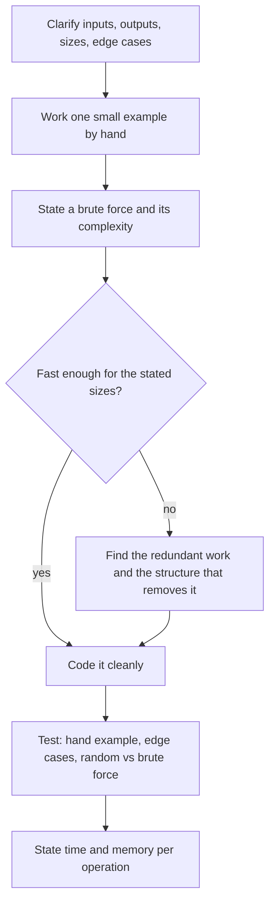

# Coding Interviews for Quants

## TL;DR

- Run every problem through the same loop out loud: clarify, small example, brute force, optimise, code, test, state complexity.
- Quant coding rounds reuse a small set of patterns: streaming statistics (Welford), monotonic deques for windows, two heaps for medians, hash map plus FIFO queues for order books, and seeded simulation to check a closed form.
- Test the way you would on a desk: write the obvious $O(n^2)$ or sort-based reference first, then compare the fast version on many seeded random inputs.
- Use integer ticks and integer sizes for prices and quantities so running sums stay exact; floats drift and break equality tests.
- Say the complexity of every operation, not just the whole algorithm: an order book is judged on add, cancel, match and best-price separately.

## Learning objectives

- Solve quant-flavoured coding problems: simulations, streaming statistics, order books, parsers.
- Write clean, tested code under time pressure.
- State and defend time and memory complexity per operation, and name the data structure that achieves it.
- Test a fast solution against a brute-force reference on randomized inputs.

## Core concepts

### What the round is scoring

Quant coding rounds look like software interviews but are scored with a trading-systems lens.
The interviewer wants working code, but also wants to see that you think about the data (streams, ticks, timestamps), numerical behaviour (cancellation, exact arithmetic), and per-operation latency.
A correct $O(n \log n)$ answer explained cleanly beats a half-finished clever one.
For the role split, see [How Quant Interviews Work](01-How-Quant-Interviews-Work.md).

### The loop



- **Clarify.** Sizes (one day of ticks or a billion), streaming or batch, integer or float prices, ties, empty input, what to return on invalid input.
- **Example.** Work 4 to 6 elements by hand; it catches misunderstandings before any code is written.
- **Brute force.** Say it and its complexity even if you will not code it; it becomes your test oracle.
- **Optimise.** Ask what work the brute force repeats; the answer names the data structure (a deque drops dominated elements, a heap keeps an order statistic, a hash map gives $O(1)$ lookup by id).
- **Test.** Run the hand example, the edge cases, then randomized comparison against the brute force.

### The pattern catalogue

| Problem family | Structure | Per-update cost | Memory | Trap |
| :--- | :--- | :--- | :--- | :--- |
| Running mean and variance | Welford recurrence | $O(1)$ | $O(1)$ | Naive $\sum x^2 - (\sum x)^2/n$ cancels catastrophically |
| Sliding-window max or min | Monotonic deque of indices | $O(1)$ amortised | $O(k)$ | Storing values instead of indices loses the expiry test |
| Streaming median | Max-heap of lower half, min-heap of upper half | $O(\log n)$ | $O(n)$ | Forgetting to rebalance after each push |
| Time-window VWAP | Deque of trades plus running $\sum pq$, $\sum q$ | $O(1)$ amortised | trades in window | Float running sums drift; use integer ticks |
| Maximum drawdown | Running peak | $O(1)$ | $O(1)$ | Reporting peak minus trough in price instead of return |
| Order book | Price-level FIFOs, heap or sorted map of prices, id index | add $O(\log L)$, cancel $O(1)$ | $O(\text{orders})$ | Linear scan to cancel; losing time priority on modify |
| FIX message | Split on SOH, validate tags 9 and 10 | $O(\text{bytes})$ | $O(\text{fields})$ | Repeating groups break a plain dict |
| Puzzle check | Seeded Monte Carlo | - | - | Quoting a simulation without its standard error |

### Streaming statistics

Welford's update keeps the mean and the sum of squared deviations $M_2$:

$$
\delta = x_n - \bar x_{n-1}, \qquad \bar x_n = \bar x_{n-1} + \frac{\delta}{n}, \qquad M_{2,n} = M_{2,n-1} + \delta\,(x_n - \bar x_n),
$$

with sample variance $M_2/(n-1)$.
It never forms $\sum x^2$, so it does not subtract two huge, nearly equal numbers.
On the data $10^9 + \{4, 7, 13, 16\}$, whose sample variance is 30, Welford returns 30.0 while the naive formula in double precision returns 0.0; with an offset of $10^{10}$ the naive formula returns 21845.33.
Prices quoted in raw units with large offsets (timestamps in nanoseconds, index levels, notional in cents) hit exactly this case.

### Windows: the monotonic deque

For the maximum of each length-$k$ window, keep a deque of indices whose values are strictly decreasing.
On each new element pop from the back every index with a value $\le$ the new one (they can never be a window maximum again), push the new index, and pop the front if it has left the window.
Each index is pushed and popped at most once, so the total cost is $O(n)$, against $O(nk)$ for re-scanning each window.
The same structure gives rolling minimum, the "stock span" problem, and the next-greater-element family.

### Order statistics: two heaps

Keep the lower half in a max-heap (Python's `heapq` is a min-heap, so store negatives) and the upper half in a min-heap, with the lower half allowed one extra element.
Insert is $O(\log n)$ and the median is read from the tops in $O(1)$.
A sliding-window median needs deletions as well: use lazy deletion (a counter of pending removals checked when an element reaches a heap top) or a balanced tree or sorted container.

### Exact arithmetic

Represent prices as integer ticks and sizes as integers.
Then a running $\sum p q$ that is incremented and decremented stays exact forever, and the windowed VWAP from the deque equals the brute-force recomputation bit for bit; with floats it drifts by rounding error after millions of updates.
Convert to decimal prices only at the edges (display, reports).

## Worked examples

### The fully solved problem: a price-time-priority order book

"Implement a limit order book for one instrument.
Support `add(id, side, price, qty)`, which matches against the opposite side and rests any remainder, and `cancel(id)`.
Return fills as (aggressor id, resting id, price, quantity)."

**Clarify (said aloud).**
"Prices are integer ticks and quantities integers.
Matching is price-time priority: best price first, and at the same price the earliest order first.
An aggressive order trades at the resting order's price.
Cancel of an unknown or already filled id returns false.
I will assume no modify for now, and say how it would work at the end."

**Hand example.**
Sell 10 at 101 (id 1), sell 5 at 101 (id 2), sell 7 at 102 (id 3), buy 3 at 99 (id 4), cancel id 2, then buy 15 at 102 (id 5).
Id 5 takes all 10 of id 1 at 101 (id 2 was cancelled), then 5 of id 3 at 102, leaving id 3 with 2 at 102 and the book at 99 bid, 102 offered.
The fill VWAP is $(10 \times 101 + 5 \times 102)/15 = 101.3333$.

**Brute force.**
"Keep a list of resting orders; for each fill scan for the best (price, arrival) on the other side.
That is $O(\text{book})$ per fill, which is fine as a test oracle but not as a book."

**Optimise.**
"The work repeated is finding the best price and the oldest order at it.
A FIFO queue per price level gives the oldest order in $O(1)$; a heap of prices per side gives the best price in $O(1)$ to read and $O(\log L)$ to add a new level; a hash map from id to order lets cancel find the order in $O(1)$.
To avoid an $O(\text{queue})$ removal on cancel, I only delete the id from the map and skip dead ids lazily when they reach the front of a queue; each id is popped once, so it is amortised $O(1)$."

```python
class OrderBook:
    def __init__(self) -> None:
        self.levels = {"B": {}, "S": {}}   # side -> price -> deque of order ids (time priority)
        self.heaps = {"B": [], "S": []}    # each live price once; bids stored negated
        self.orders = {}                   # id -> Order(oid, side, price, qty), live orders only

    def best(self, side):
        heap, levels = self.heaps[side], self.levels[side]
        while heap:
            price = -heap[0] if side == "B" else heap[0]
            queue = levels[price]
            while queue and queue[0] not in self.orders:   # skip cancelled ids lazily
                queue.popleft()
            if queue:
                return price
            heapq.heappop(heap)                            # level is empty: drop it
            del levels[price]
        return None

    def add(self, oid, side, price, qty):
        opp, fills = ("S" if side == "B" else "B"), []
        while qty > 0:
            best = self.best(opp)
            if best is None or (best > price if side == "B" else best < price):
                break
            resting = self.orders[self.levels[opp][best][0]]
            traded = min(qty, resting.qty)
            fills.append((oid, resting.oid, best, traded))
            qty -= traded
            resting.qty -= traded
            if resting.qty == 0:
                del self.orders[resting.oid]
                self.levels[opp][best].popleft()
        if qty > 0:
            if price not in self.levels[side]:
                self.levels[side][price] = deque()
                heapq.heappush(self.heaps[side], -price if side == "B" else price)
            self.levels[side][price].append(oid)
            self.orders[oid] = Order(oid, side, price, qty)
        return fills

    def cancel(self, oid):
        return self.orders.pop(oid, None) is not None
```

**Complexity.**

| Operation | Time | Why |
| :--- | :--- | :--- |
| `add` that rests at an existing level | $O(1)$ | append to a deque and a dict |
| `add` that creates a level | $O(\log L)$ | heap push, $L$ live levels |
| `add` that matches $F$ orders | $O(F + \log L)$ amortised | each fill is $O(1)$; emptied levels are popped from the heap |
| `cancel` | $O(1)$ | dict delete; the queue slot is reclaimed lazily |
| best bid or offer | $O(1)$ amortised | heap top after skipping dead ids, each skipped once |

Memory is $O(\text{orders ever added})$ until dead ids are skipped; a production book (see [Order Book and Matching Engine](../12-Quant-Development/07-Order-Book-and-Matching-Engine.md)) uses intrusive doubly linked lists per level so cancel unlinks in $O(1)$ with no tombstones, preallocated order pools, and an array indexed by price tick when the price range is bounded.

**Test.**
The script replays the hand example, then compares the book with the brute-force scan on 300 seeded random sessions (8499 random adds with cancels interleaved): every fill list and every best bid and offer match exactly.
Say what else you would test: an order that sweeps several levels, a cancel of an already-filled id, self-match rules if the venue has them, and a modify that loses priority when size increases or the price changes.

### Time-window VWAP, traced

Trades (time, ticks, size): (0, 10000, 100), (2, 10010, 300), (5, 10020, 200), (6, 9990, 100), window 5 seconds, so a trade at $t$ includes trades with time in $(t-5, t]$.
At $t = 5$ the trade at time 0 has expired: VWAP $= (10010 \times 300 + 10020 \times 200)/500 = 10014.0$.
At $t = 6$ the window holds the last three trades: $(3003000 + 2004000 + 999000)/600 = 10010.0$.
The deque pops expired trades from the front and subtracts them from integer running sums, so each trade is touched twice: $O(1)$ amortised per trade.

### Maximum drawdown in one pass

Prices 100, 120, 90, 130, 80, 110.
Track the running peak and the worst ratio to it: the drop from 120 to 90 is $-25.00\%$, but the drop from 130 to 80 is worse at $-38.46\%$, which is the answer, with peak index 3 and trough index 4.
"It is $O(n)$ time and $O(1)$ memory; the brute force over all pairs is $O(n^2)$, and I compared the two on 300 random paths."

### Parsing a FIX message

A FIX tag=value message is a sequence of `tag=value` fields separated by the SOH byte (ASCII 1), with `8` (BeginString) first, `9` (BodyLength) second and `10` (CheckSum) last.
BodyLength counts the bytes after the SOH that ends field 9 up to and including the SOH before `10=`; CheckSum is the sum of every byte before `10=`, modulo 256, written as three digits.
For a NewOrderSingle (`35=D`) buying 100 XYZ at a limit of 101.25 with the fields in the script, the BodyLength is 96 and the CheckSum is 013, and changing the price to 101.26 is rejected by the checksum.
A dict of tag to value is fine for a header-level parser; repeating groups (for example several parties or legs) need an ordered list of fields and the group's count tag.

### Checking a puzzle answer by simulation

"Expected number of die rolls to see two sixes in a row?"
First-step equations with states "no trailing six" and "one trailing six": $E_0 = 1 + \tfrac56 E_0 + \tfrac16 E_1$ and $E_1 = 1 + \tfrac56 E_0$, which solve to $E_0 = 42.0$.
A seeded simulation of 100,000 paths gives about 41.99 with standard error 0.13, so the gap from 42 is $-0.04$ standard errors.
Quote a simulation with its standard error, and fix the seed so the number is reproducible.

## Pitfalls

- Coding before clarifying: the classic misses are inclusive versus exclusive window ends, ties at a price level, and what an empty window returns.
- Computing variance as $E[x^2] - E[x]^2$ on raw prices or timestamps; on $10^9 + \{4, 7, 13, 16\}$ it returns 0.0 instead of 30.
- Floats for prices in an order book or VWAP; equality tests and running sums break; use integer ticks.
- A cancel that scans the price level, which turns a busy level into $O(n)$ per cancel.
- Forgetting to drop empty price levels, so "best bid" points at a level with no orders.
- Testing only the example from the prompt; randomized comparison against a brute force finds the off-by-one errors that hand tests miss.
- Unseeded simulations whose answer changes on every run, and simulation results quoted without a standard error.
- Stating only total complexity; for streaming and book problems the interviewer wants per-operation cost and memory.
- Rewriting library functionality badly; in Python say "I would use `heapq`, `bisect`, `collections.deque`", and in C++ name the container and its iterator-invalidation rules.

## Interview questions

> [!question]- int-code-loop | What is the step order you follow for an interview coding problem?
> Clarify, hand example, brute force with its complexity, optimise by removing repeated work, code, test (hand case, edge cases, random comparison with the brute force), then state per-operation time and memory. Narrate each step so partial progress earns credit.

> [!question]- int-code-welford-update | Write Welford's update for a running mean and variance.
> $\delta = x - \bar x$, $\bar x \mathrel{+}= \delta/n$, $M_2 \mathrel{+}= \delta(x - \bar x_{\text{new}})$, sample variance $M_2/(n-1)$. It avoids forming $\sum x^2$, so there is no catastrophic cancellation.

> [!question]- int-code-welford-cancellation | What does the naive one-pass variance formula return for $10^9 + \{4, 7, 13, 16\}$ in double precision, and why?
> 0.0 instead of 30. $\sum x^2$ is about $4 \times 10^{18}$, where the spacing between doubles is 512, so $\sum x^2 - (\sum x)^2/n$ subtracts two nearly equal rounded numbers and loses every significant digit.

> [!question]- int-code-window-max | Give an $O(n)$ algorithm for the maximum of every length-$k$ window.
> A deque of indices with decreasing values: pop from the back while the new value is at least the back value, push the index, pop the front if it is out of the window, read the front. Each index enters and leaves once, so $O(n)$ total and $O(k)$ memory.

> [!question]- int-code-streaming-median | How do you maintain the median of a stream?
> Two heaps: a max-heap for the lower half and a min-heap for the upper half, sizes differing by at most one. Push to the correct side, rebalance by moving one top across, read the median from the tops: $O(\log n)$ insert, $O(1)$ query.

> [!question]- int-code-sliding-median | What changes for a sliding-window median?
> You must delete the element leaving the window. Use lazy deletion (a hash map of pending removals, discarded when they reach a heap top, with size bookkeeping) or a sorted container or balanced tree; either gives $O(\log k)$ per step.

> [!question]- int-code-vwap-exact-sums | Why keep VWAP running sums in integer ticks and integer sizes?
> Adding and subtracting the same products then cancels exactly, so the windowed VWAP equals a fresh recomputation forever. With floats each add and subtract leaves rounding error that accumulates over millions of updates and breaks equality tests.

> [!question]- int-code-vwap-window | Trades (0, 10000, 100), (2, 10010, 300), (5, 10020, 200) in (time, ticks, size). VWAP over the 5 seconds ending at $t = 5$, window $(0, 5]$?
> 10014.0 ticks. The trade at time 0 has expired, so $(10010 \times 300 + 10020 \times 200)/500$.

> [!question]- int-code-max-drawdown | Maximum drawdown of the price path 100, 120, 90, 130, 80, 110?
> $-38.46\%$, from the peak 130 to the trough 80. Track the running peak and the minimum of price over peak minus 1 in one pass; the earlier 120 to 90 drop is only $-25\%$.

> [!question]- int-code-lob-structures | Which data structures give an order book $O(1)$ cancel and $O(1)$ best price?
> A hash map from order id to order (or to its list node), a FIFO per price level for time priority, and a heap or sorted map of prices per side (or an array indexed by tick when the range is bounded). Cancel deletes through the id map; best price reads the heap top or the cached best index.

> [!question]- int-code-lob-trade-price | An aggressive buy limit at 102 meets resting offers at 101 and 102. At what prices does it trade?
> At the resting prices: first 101, then 102. The resting order set the price; the aggressor's limit is only a bound, and it receives price improvement on the 101 fill.

> [!question]- int-code-lob-lazy-cancel | Why is lazy deletion on cancel still amortised $O(1)$?
> Cancel only removes the id from the map. The dead id is skipped when it reaches the front of its level queue, and each id can be popped at most once, so total skipping work is bounded by the number of orders ever added.

> [!question]- int-code-lob-modify | How should a modify interact with time priority?
> A size decrease usually keeps priority; a price change or size increase usually loses it and is treated as cancel plus new order. Rules are venue specific, so ask; implement decrease in place and the rest as cancel and re-add.

> [!question]- int-code-randomized-test | How do you test a fast algorithm under interview time pressure?
> Write the obvious brute force (scan, sort, or all pairs), generate many small seeded random inputs including edge cases, and assert the fast and slow outputs are identical. Small inputs make failures easy to read and shrink.

> [!question]- int-code-fix-checksum | How are the FIX BodyLength (9) and CheckSum (10) fields computed?
> BodyLength is the byte count from after the SOH ending field 9 up to and including the SOH before `10=`. CheckSum is the sum of all bytes before `10=` modulo 256, as three digits.

> [!question]- int-code-mc-check-two-sixes | Expected number of rolls of a fair die to get two sixes in a row, and how would you check it by simulation?
> 42. From $E_0 = 1 + \tfrac56 E_0 + \tfrac16 E_1$ and $E_1 = 1 + \tfrac56 E_0$. A seeded simulation of 100,000 paths gives about 41.99 with standard error 0.13, consistent with 42.

> [!question]- int-code-complexity-per-op | Why state complexity per operation for a streaming or book problem?
> Because the workload is a mix of operations at very different rates (cancels and adds dominate, matches are rarer), and latency is judged per message. An algorithm that is $O(n)$ overall can still hide an $O(n)$ cancel.

> [!question]- int-code-numpy-vs-loop | When should a quant coding answer use a vectorised NumPy expression instead of a Python loop?
> For batch transforms over arrays (returns, rolling sums with cumsum, Monte Carlo paths) vectorise, since the loop runs in C. For stateful streaming logic with branches per event (an order book, a parser) a clear loop is correct and the interviewer is scoring the data structure, not the constant factor.

## In this repo and SDE-Interview-Prep

- Code: [coding_problems.py](code/coding_problems.py) implements and tests every pattern above and asserts each number quoted in this note.
- Data structures in depth: [Data Structures and Algorithms for Quant Interviews](../12-Quant-Development/05-Data-Structures-and-Algorithms-for-Quant-Interviews.md).
- Production order books: [Order Book and Matching Engine](../12-Quant-Development/07-Order-Book-and-Matching-Engine.md); protocols: [Market Data Feed Handlers and Protocols](../12-Quant-Development/08-Market-Data-Feed-Handlers-and-Protocols.md).
- Testing numerical code: [Testing Trading and Numerical Code](../12-Quant-Development/14-Testing-Trading-and-Numerical-Code.md).
- [LeetCode quant set (C++) (SDE-Interview-Prep)](https://github.com/shreejitverma/SDE-Interview-Prep/blob/main/02-Programming-Languages/C%2B%2B/LeetCode-Quant-Complete-CPP-Full.md)
- [LeetCode quant set (Python) (SDE-Interview-Prep)](https://github.com/shreejitverma/SDE-Interview-Prep/blob/main/02-Programming-Languages/Python/LeetCode-Quant-Complete-Python-Full.md)

## Further reading

- B. P. Welford, "Note on a Method for Calculating Corrected Sums of Squares and Products", *Technometrics* 4(3) (1962).
- Donald Knuth, *The Art of Computer Programming, Vol. 2: Seminumerical Algorithms*, 3rd edition (1997), section 4.2.2 on floating-point accuracy.
- Thomas Cormen, Charles Leiserson, Ronald Rivest and Clifford Stein, *Introduction to Algorithms*, 3rd edition (2009), chapter 6 (heaps).
- Gayle Laakmann McDowell, *Cracking the Coding Interview*, 6th edition (2015), for the general interview loop.
- FIX Trading Community, FIX 4.2 specification, standard message header and trailer (BodyLength and CheckSum).
- Larry Harris, *Trading and Exchanges* (2003), chapter 6 on order precedence rules.
