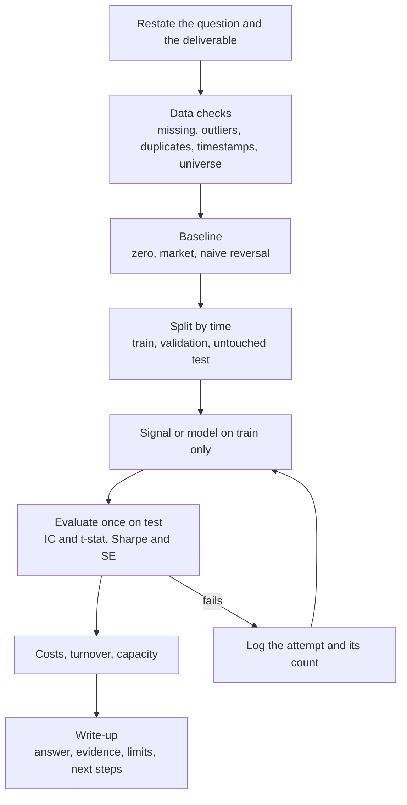

# Research Case Studies and Take-Homes

## TL;DR

- A take-home is graded on process and judgement: data checks, a baseline, an honest out-of-sample test, costs, and a write-up that says what would break the result.
- Spend the first hour on the data, not the model; every defect you find and fix is a point scored, every defect you miss can invalidate the whole submission.
- Validate in time order: fit on the past, test once on a later period, and report how many things you tried.
- Quote every Sharpe with its standard error (about $1/\sqrt{\text{years}}$ annualised) and every IC with its $t$-stat; a number without its uncertainty reads as naive.
- In the mini example below a real signal (true IC 0.03) shows a test Sharpe of 5.50 gross and $-0.56$ net of 5 bp costs: the write-up that says so is the one that gets the offer.

## Learning objectives

- Structure a take-home: data checks, baseline, validation, write-up.
- Present research findings and limitations clearly.
- Compute and interpret the statistics graders check: IC and its $t$-stat, Sharpe and its standard error, turnover and break-even cost, multiple-testing hurdles.
- Recognise and demonstrate look-ahead leakage.

## Core concepts

### What the grader is reading for

A research take-home ("here is a dataset, find something predictive, write it up, you have a few days") or an onsite case is a sample of how you would work on the job.
The deep worked cases (residual reversal, time-series momentum, critiquing a flawed backtest) are in [Alpha Research Case Studies](../09-Alpha-Research-and-Portfolio/15-Alpha-Research-Case-Studies.md); this note is the interview-facing playbook and problem set.
Graders typically look for:

1. **Data hygiene:** you found the defects that were planted or that exist naturally (missing values, bad prints, duplicates, survivorship, timestamps in the wrong zone).
2. **A baseline:** a trivial model to beat, so the reader knows the result is not just the market or noise.
3. **Causal validation:** nothing at time $t$ uses information after $t$; the test period was touched once.
4. **Economic sense:** a mechanism for why the signal should work, and costs and capacity that decide whether it matters.
5. **Communication:** the answer on page one, the uncertainty next to every number, limitations stated before the reader finds them.

### The take-home loop

### Data checks that score points

| Check | How | What it catches |
| :--- | :--- | :--- |
| Missing values | Count per column and per date | Holes from listings, delistings, feed gaps |
| Outliers | Returns beyond a hard bound, or many robust deviations | Bad prints, unadjusted splits, unit errors |
| Duplicates | Count duplicate (id, timestamp) keys | Joins that multiply rows and double count P&L |
| Timestamps | Time zone, close versus open, publication versus period end | Look-ahead from data stamped before it was known |
| Universe | Count of names per date over time | Survivorship (only today's constituents) |
| Units | Price levels, currency, per-share versus per-position | Silent scale errors |

A single bad print (one price recorded 10 times too high) creates two outlier returns: $+900\%$ into it and $-90\%$ out of it.
Fix both, or the round trip leaks into whatever signal uses past returns.

### Baselines

Report at least one trivial baseline with the same pipeline: predicting zero, the market or sector return, or a one-day reversal.
If the baseline's IC is indistinguishable from zero and yours is not, the comparison carries the argument; if the baseline also "works", your pipeline probably leaks.

### Validation in time order

- Split by time, never randomly, for any time-series prediction: random splits put tomorrow in the training set.
- Fit and select on the training period; touch the test period once.
- With overlapping labels (5-day forward returns sampled daily), purge training samples whose label windows overlap the test period and add an embargo after it ([Time-Series Cross-Validation](../10-Machine-Learning-for-Finance/02-Time-Series-Cross-Validation-Purging-Embargo.md), Lopez de Prado 2018 chapter 7).
- Keep a count of every variant tried; it is the $N$ that multiple-testing corrections and the deflated Sharpe ratio need ([Overfitting and Deflated Sharpe](../09-Alpha-Research-and-Portfolio/08-Overfitting-and-Deflated-Sharpe.md)).

### The statistics graders check

- **IC $t$-stat:** $t = \overline{\text{IC}}/\text{sd}(\text{IC}) \cdot \sqrt{T}$ over $T$ daily cross-sectional ICs.
- **Sharpe $t$-stat:** with annualised Sharpe $SR$ over $Y$ years of data, $t \approx SR\sqrt{Y}$, so reaching $t = 2$ needs $Y = (2/SR)^2$ years.
- **Sharpe standard error (Lo 2002):** for iid returns, $\text{SE}(\widehat{SR}) \approx \sqrt{(1 + SR^2/2)/T}$ per period; with daily data this is close to $1/\sqrt{\text{years}}$ annualised.
- **Fundamental law (Grinold 1989):** $\text{IR} \approx \text{IC}\sqrt{\text{BR}}$, breadth BR being independent bets per year; correlated bets shrink effective breadth to $N/(1 + (N-1)\rho)$.
- **Multiple testing:** with $m$ independent tests at level $\alpha$, $P(\text{at least one false positive}) = 1 - (1-\alpha)^m$; Bonferroni tests each at $\alpha/m$; Harvey, Liu and Zhu (2016) argue a new factor should clear $t > 3.0$.
- **Costs:** annual cost $=$ daily turnover $\times$ cost per unit traded $\times 252$; break-even cost $=$ gross return per unit of turnover.
- **Selection:** the best of $N$ zero-skill strategies has an expected Sharpe of about $\text{SE}\times E[\max_N Z]$, with $E[\max_{100} Z] \approx 2.5306$ by the Bailey and Lopez de Prado (2014) approximation.

### The write-up skeleton

1. **Summary (five lines).** The question, the answer, the key number with its uncertainty, the main caveat, the recommendation.
2. **Data.** Source, universe, period, every defect found and how it was fixed, with counts.
3. **Hypothesis and method.** The mechanism, the signal definition, why this construction.
4. **Results.** Baseline versus signal; train versus test; IC with $t$-stat; Sharpe with standard error; turnover and net-of-cost results; one chart of cumulative P&L and one of IC by period.
5. **Robustness.** Subperiods, parameter neighbours, the number of variants tried.
6. **Limitations and next steps.** What could make this wrong, what you would test with more time or data.
7. **Appendix.** How to reproduce: environment, seed, one command.

Write the summary last but put it first.
Keep the main text to a few pages; graders read many submissions.

## Worked examples

### Example 1: the mini take-home, end to end

Setup (synthetic, so the truth is known): 200 stocks, 750 trading days, a signal whose true daily information coefficient is 0.03, idiosyncratic volatility 2% a day, a common market factor, and injected defects.
All numbers come from [take_home_mini.py](code/take_home_mini.py).

**Step 1, data checks.**
"I count 1500 missing returns and 10 returns beyond $\pm 50\%$.
The 10 come in pairs, one up about $+900\%$ and the next down about $-90\%$, which is the signature of 5 bad prints, so I set both returns of each pair to missing.
That leaves 98.99% of cells usable."

**Step 2, baseline.**
"A one-day reversal baseline has a mean daily rank IC of 0.0019 with $t = 0.73$: nothing.
So the pipeline itself is not manufacturing predictability."

**Step 3, the signal, train then test.**
"On the first 450 days the signal's mean rank IC is 0.0295 with $t = 8.25$.
On the untouched last 300 days it is 0.0263 with $t = 5.96$, and the IC's own mean-to-sd ratio is 0.34 a day.
The test IC is a little lower than train, as expected, and still highly significant."

**Step 4, backtest, costs and capacity.**
"A dollar-neutral portfolio with rank weights and gross exposure 1 earns 6.08 bp a day on the test period, an annualised Sharpe of 5.50 with a Lo standard error of 0.94.
The fundamental law predicts about $0.0263 \times \sqrt{200 \times 252} = 5.90$, consistent.
But the signal is redrawn every day, so daily turnover is 1.34 times gross exposure.
Break-even cost is 4.53 bp per unit traded, and at 5 bp the net Sharpe is $-0.56$.
My recommendation is not to trade it as is; the next step is to slow the signal (smooth it, or trade only large changes) and re-measure net Sharpe on the test period, counting that as a new trial."

**Step 5, leakage check.**
"A 5-day momentum feature built correctly, from returns $t-5$ to $t-1$, has IC 0.0011.
If its window wrongly ends at $t+1$ it contains the target return, and the IC jumps to 0.4290, close to the $1/\sqrt5 = 0.4472$ that a sum of five iid returns has with one of them.
Any IC that large on daily equity returns is a bug until proven otherwise."

### Example 2: how long a track record or test must be

"Your strategy has a Sharpe of 1.0. How long before it is significant?"
$t \approx SR\sqrt{Y}$: Sharpe 1.0 over 4 years gives $t = 2.00$.
For $t = 2$ a Sharpe of 0.5 needs $(2/0.5)^2 = 16.0$ years, 1.0 needs 4.0, 2.0 needs 1.0.
A six-month test of a Sharpe-2 strategy has $t = 2\sqrt{0.5} = 1.41$: not significant on its own.

### Example 3: standard error of a Sharpe ratio

From 10 annual returns with Sharpe 1: $\text{SE} = \sqrt{1.5/10} = 0.3873$.
From 5 years of daily returns with an annualised Sharpe of 1: the per-day Sharpe is $1/\sqrt{252}$, $T = 1260$, and the annualised SE is $\sqrt{(1 + SR_d^2/2)/1260}\cdot\sqrt{252} = 0.4477$, essentially $1/\sqrt5$.
More frequent sampling does not shrink the uncertainty of the mean; only more calendar time does.

### Example 4: multiple testing

"You tried 20 independent signals at the 5% level. Chance of at least one false positive?"
$1 - 0.95^{20} = 0.6415$.
Bonferroni tests each at $0.05/20 = 0.0025$, a two-sided $z$ hurdle of 3.02.
With 100 zero-skill strategies over 5 years of daily data, the best one has an expected Sharpe of about $2.5306/\sqrt5 = 1.13$; a seeded simulation of the maximum of 100 standard normals gives about 2.51, slightly below the approximation.

### Example 5: fundamental law and breadth

IC 0.02 on 500 stocks rebalanced monthly: $\text{IR} = 0.02\sqrt{6000} = 1.55$, if the bets are independent.
If the 500 residuals have pairwise correlation 0.1, effective breadth per rebalance is $500/(1 + 499 \times 0.1) = 9.82$ bets, and the law's promise collapses.

### Example 6: costs

Daily turnover 0.5 at 5 bp per unit traded costs $0.5 \times 5\text{ bp} \times 252 = 6.30\%$ a year, which at 10% annual volatility is 0.63 of Sharpe.
A strategy with 8% gross alpha and annual turnover of 100 times capital breaks even at $8\% / 100 = 8.0$ bp per unit traded.

## Pitfalls

- Modelling before checking data; a planted bad print or a duplicated key then drives the headline result.
- Random train/test splits on time series, or tuning on the test period and then calling it out-of-sample.
- No baseline, so the reader cannot tell signal from market beta or a leaky pipeline.
- Gross-only results for a fast signal; the mini example is a highly significant IC that loses money after 5 bp.
- Quoting Sharpe and IC without standard errors or $t$-stats, and without the number of variants tried.
- Full-sample normalisation, winsorisation thresholds or universe selection computed with future data.
- A 30-page notebook dump instead of a write-up; the reader wants the answer, the evidence and the limitations, in that order.
- Overclaiming: "this strategy will make Sharpe 5" from 300 days; say what the interval is and what would change your mind.
- Unreproducible submissions: no seed, no environment, no single command that rebuilds every number.

## Interview questions

> [!question]- int-takehome-first-hour | You receive a take-home dataset. What do you do in the first hour?
> Data checks before any modelling: missing values, outliers, duplicate keys, timestamps and time zones, universe size through time, units. Write down every defect with counts; they go in the write-up and often decide the grade.

> [!question]- int-takehome-bad-print-two-returns | One price in a daily series is recorded 10 times too high. How many bad returns does it create, and what are they?
> Two: about $+900\%$ into the bad day and about $-90\%$ out of it. Both must be fixed, or the round trip leaks into any feature built from past returns.

> [!question]- int-takehome-baseline-why | Why report a baseline in a research take-home?
> It shows what the pipeline produces without your idea. If a trivial baseline also looks predictive, the pipeline is leaking or you are measuring market exposure; if it is flat and yours is not, the comparison is the evidence.

> [!question]- int-takehome-random-split | Why is a random train/test split wrong for daily return prediction?
> It puts future observations in the training set and lets serially correlated or overlapping samples straddle the split, so test performance is inflated. Split by time and purge overlapping labels.

> [!question]- int-takehome-purge-embargo | What are purging and embargo?
> Purging removes training samples whose label windows overlap the test period; embargo also drops a short span after the test period, so serial correlation cannot leak test information back into training.

> [!question]- int-takehome-test-once | Why should the test period be used only once?
> Every look at the test set and every change made in response is selection on it, so the test set becomes a second training set. Count every look as a trial if you cannot avoid it.

> [!question]- int-takehome-leak-five-day | A 5-day momentum feature's window accidentally ends one day late and includes the target return. What IC do you expect on iid returns?
> About $1/\sqrt5 = 0.4472$ (Pearson): the sum of five iid returns has that correlation with each of them. The mini example measures a rank IC of 0.4290; any daily IC that large is a bug until proven otherwise.

> [!question]- int-takehome-ic-tstat | Mean daily IC 0.02 with standard deviation 0.10 over 250 days. $t$-stat?
> $3.16$. $t = 0.02/0.10 \times \sqrt{250}$.

> [!question]- int-takehome-sharpe-tstat | An annualised Sharpe of 1.0 measured over 4 years. Approximate $t$-stat?
> $2.00$. $t \approx SR\sqrt{\text{years}}$ because the annualised Sharpe's standard error is about $1/\sqrt{\text{years}}$.

> [!question]- int-takehome-years-to-significance | How many years does a Sharpe-0.5 strategy need to reach $t = 2$?
> 16. Years $= (t/SR)^2 = (2/0.5)^2$; a Sharpe of 1 needs 4 and a Sharpe of 2 needs 1.

> [!question]- int-takehome-six-month-holdout | A strategy shows Sharpe 2 on a six-month holdout. Is that significant?
> No: $t \approx 2\sqrt{0.5} = 1.41$. Six months of data cannot distinguish Sharpe 2 from a much lower true Sharpe.

> [!question]- int-takehome-lo-se-annual | Standard error of a Sharpe of 1 estimated from 10 annual returns (Lo 2002, iid)?
> $0.3873$. $\sqrt{(1 + SR^2/2)/T} = \sqrt{1.5/10}$.

> [!question]- int-takehome-lo-se-daily | Annualised standard error of a Sharpe of 1 from 5 years of daily returns?
> About $0.4477$, essentially $1/\sqrt5$. The per-day Sharpe is tiny so the $SR^2/2$ term is negligible; sampling more often does not reduce the uncertainty, only more years do.

> [!question]- int-takehome-family-wise-error | You test 20 independent signals at 5%. Probability of at least one false positive?
> $0.6415$. $1 - 0.95^{20}$.

> [!question]- int-takehome-bonferroni | What per-test level and two-sided $z$ hurdle does Bonferroni give for 20 tests at a 5% family-wise level?
> Level $0.0025$ and $z \approx 3.02$. Bonferroni divides $\alpha$ by the number of tests; it is conservative when tests are correlated.

> [!question]- int-takehome-hlz-hurdle | What $t$-stat hurdle did Harvey, Liu and Zhu (2016) propose for new factors, and why?
> $t > 3.0$. Hundreds of factors have been tested on the same data, so the conventional 2.0 hurdle admits too many false discoveries.

> [!question]- int-takehome-expected-max-noise | You backtest 100 zero-skill strategies on 5 years of daily data. Expected Sharpe of the best one?
> About 1.13. Each Sharpe has standard error about $1/\sqrt5$, and $E[\max$ of 100 standard normals$] \approx 2.5306$ (Bailey and Lopez de Prado), so $2.5306/\sqrt5$; a simulation of the maximum gives about 2.51.

> [!question]- int-takehome-fundamental-law | IC 0.02, 500 stocks, monthly rebalance, independent bets. Information ratio?
> $1.55$. $\text{IR} = \text{IC}\sqrt{\text{BR}}$ with breadth $500 \times 12 = 6000$.

> [!question]- int-takehome-effective-breadth | 500 stocks whose residuals have pairwise correlation 0.1: how many independent bets per rebalance?
> About 9.82. $N/(1 + (N-1)\rho) = 500/50.9$; correlation is why breadth is the fragile input of the fundamental law.

> [!question]- int-takehome-fundamental-law-check | In the mini example the test IC is 0.0263 on 200 stocks daily. What Sharpe does the fundamental law predict, and what was measured?
> About 5.90 predicted ($0.0263\sqrt{200 \times 252}$) against 5.50 measured gross. Agreement within the 0.94 standard error is a sanity check that the backtest and the IC are consistent.

> [!question]- int-takehome-cost-drag | Daily turnover 0.5 at 5 bp per unit traded. Annual cost, and Sharpe lost at 10% volatility?
> $6.30\%$ a year and $0.63$ of Sharpe. $0.5 \times 5\text{ bp} \times 252$, divided by 10%.

> [!question]- int-takehome-break-even | Gross alpha 8% a year with annual turnover 100 times capital. Break-even cost per unit traded?
> $8.0$ bp. Gross return divided by turnover.

> [!question]- int-takehome-significant-but-unprofitable | Your signal's test IC has $t = 5.96$ but the strategy loses money net of 5 bp. What do you write?
> That the signal is real but untradeable as constructed: break-even cost is 4.53 bp because turnover is 1.34 a day. Recommend slowing the signal (smoothing, trading only large changes, combining with slower signals) and re-testing net, counting each variant as a trial.

> [!question]- int-takehome-train-test-drop | Train IC 0.0295 and test IC 0.0263. Is the drop a worry?
> No. Some decay is expected from selection and noise, the drop is small relative to the IC's standard error, and the test $t$-stat (5.96) is still large. A collapse to zero, or a sign flip, would be the worry.

> [!question]- int-takehome-summary-first | What goes in the first five lines of a take-home write-up?
> The question, the answer, the key number with its uncertainty, the main caveat, and the recommendation. The reader should be able to stop there and act.

> [!question]- int-takehome-limitations | Why state limitations explicitly, and which ones?
> Graders are testing judgement; naming the weaknesses before they do shows you understand them. State sample length, number of variants tried, cost and capacity assumptions, regime dependence, and any data you could not verify.

> [!question]- int-takehome-reproducible | What makes a take-home reproducible?
> A fixed environment, fixed seeds, raw data untouched, every transformation in code, and one command that regenerates every number and chart in the write-up.

> [!question]- int-takehome-too-good | Your backtest shows Sharpe 8 on daily equities. First three things to check?
> Position timing (weights at $t$ must earn returns from $t$ to $t+1$), features or normalisation using future data, and survivorship or bad prints in the universe. Then costs. A Sharpe like that is a bug until each is ruled out.

## In this repo and SDE-Interview-Prep

- Code: [take_home_mini.py](code/take_home_mini.py) builds the synthetic panel, runs the mini take-home, and prints and asserts every number in this note.
- Full research cases with deflated Sharpe and a flaw catalogue: [Alpha Research Case Studies](../09-Alpha-Research-and-Portfolio/15-Alpha-Research-Case-Studies.md).
- Statistics behind the cards: [Performance Metrics and the Fundamental Law](../09-Alpha-Research-and-Portfolio/09-Performance-Metrics-and-Fundamental-Law.md), [Overfitting and Deflated Sharpe](../09-Alpha-Research-and-Portfolio/08-Overfitting-and-Deflated-Sharpe.md), [Backtesting Methodology and Pitfalls](../09-Alpha-Research-and-Portfolio/07-Backtesting-Methodology-and-Pitfalls.md), [Transaction Costs and Turnover](../09-Alpha-Research-and-Portfolio/13-Transaction-Costs-and-Turnover.md).

## Further reading

- Michael Isichenko, *Quantitative Portfolio Management* (Wiley, 2021).
- Andrew Lo, "The Statistics of Sharpe Ratios", *Financial Analysts Journal* 58(4) (2002).
- Richard Grinold, "The Fundamental Law of Active Management", *Journal of Portfolio Management* 15(3) (1989); Grinold and Kahn, *Active Portfolio Management*, 2nd edition (1999).
- David Bailey and Marcos Lopez de Prado, "The Deflated Sharpe Ratio", *Journal of Portfolio Management* 40(5) (2014).
- Campbell Harvey, Yan Liu and Heqing Zhu, "...and the Cross-Section of Expected Returns", *Review of Financial Studies* 29(1) (2016).
- Marcos Lopez de Prado, *Advances in Financial Machine Learning* (Wiley, 2018), chapter 7 on purged cross-validation.
