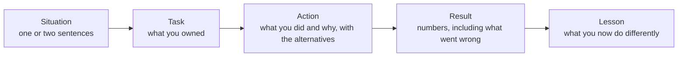

# Behavioral and Fit for Trading Firms

## TL;DR

- Behavioural rounds at trading firms test the same traits as the technical rounds: decisions under uncertainty, honesty about mistakes, calibrated confidence, and how you work with others under pressure.
- Answer with a structure (Situation, Task, Action, Result, plus what you learned) in about two minutes, with numbers where you have them and "I" for what you did.
- "Why trading" and "why this firm" need specific, true reasons tied to what the job actually is: fast feedback, measurable decisions, and the problems that firm works on.
- For "a risk you took", show the expected-value reasoning before the outcome: the decision quality, the sizing, what you would have done if it had gone wrong.
- Calibration is checked directly: if you say 90% you should be right about 9 times in 10; being right 6 times in 10 at a stated 90% has probability 0.0128 if you were truly calibrated.

## Learning objectives

- Answer 'why trading', 'why this firm' and 'tell me about a risk you took'.
- Show intellectual honesty and calibrated confidence.
- Structure any behavioural answer so it is short, specific and checkable.
- Handle mistake, conflict and failure questions without deflecting.

## Core concepts

### What is being assessed

Trading and research are team activities where a single person's error can cost money quickly, so firms look for people who:

- reason in expected value and separate decision quality from outcome;
- admit mistakes immediately and fix them, because hidden errors compound;
- state uncertainty honestly ("I think 70%") rather than projecting false certainty;
- collaborate: share information, ask for help early, give and take blunt feedback;
- are motivated by the problems themselves, since the work is repetitive and the feedback harsh.

Individual firms describe their own values on their careers pages; read them before the interview and connect your examples to them, but do not recite slogans back.
For pipeline structure see [How Quant Interviews Work](01-How-Quant-Interviews-Work.md).

### The answer structure

STAR (Situation, Task, Action, Result) is the standard skeleton; add the lesson, because trading firms care most about how you update.
Spend most of the time on Action and the reasoning behind it, which is the part that reveals judgement.
Keep it to about two minutes and let the interviewer pull on threads.

### The question bank and what each one tests

| Question | What it tests | What a strong answer contains |
| :--- | :--- | :--- |
| Why trading (or research, or this role) | Real motivation | Specific experiences that show you like fast, measurable, probabilistic decisions |
| Why this firm | Preparation and fit | Facts about what the firm does (products, style, team structure) from its own materials, linked to what you want |
| Tell me about a risk you took | Expected-value thinking | Odds and payoff estimated before, sizing, downside plan, outcome, and whether you would repeat it |
| Tell me about a mistake | Honesty and learning | A real mistake you owned, how fast you surfaced it, the fix, the process change |
| A disagreement with a colleague | Collaboration | How you tested who was right with data, how you disagreed and then committed |
| A time you failed | Resilience | What failed, what you controlled, what you changed |
| A time you worked under pressure | Composure | Prioritisation, communication, staying accurate when rushed |
| What would you do if you lost money on day one | Risk discipline | Follow the limits, cut or hedge as the plan says, report immediately, review the decision process |
| How confident are you in that answer | Calibration | A probability, and what would change it |

### Decision quality versus outcome

A good decision is one with positive expected value given what you knew, sized so a bad outcome is survivable.
Interviewers often probe this by asking about a decision that worked out: if the only justification is that it worked, it reads as luck.
Say the odds and payoffs you estimated before, how you sized it, and what would have counted as being wrong (Duke 2018 develops this separation at length).

### Calibration and the Brier score

Calibration means your stated probabilities match frequencies: of the claims you make at 70%, about 70% are true.
The Brier score (Brier 1950) for forecasts $p_i$ of binary outcomes $o_i$ is

$$
B = \frac1n\sum_{i=1}^n (p_i - o_i)^2,
$$

lower is better, and always saying 50% scores $0.2500$.
It rewards both calibration and sharpness, and it punishes confident misses heavily: one call stated at 99% that turns out wrong costs $0.99^2 = 0.9801$.
Tetlock and Gardner (2015) use Brier scores to evaluate forecasters; the habit of putting numbers on beliefs and checking them is what interviewers are probing with "how sure are you?".

## Worked examples

The answers below are templates for a fictional candidate; build yours from your own true experiences, because interviewers probe details.

### Example 1: "Why trading?"

"Three things.
First, I like decisions where the feedback is fast and measurable; in my poker and in the estimation markets I ran for my maths society I enjoyed seeing my estimates scored the same day.
Second, the core skill is reasoning under uncertainty with real stakes, which is what I enjoyed most in my probability courses and in my internship, where I built a model whose forecasts were checked against outcomes every week.
Third, I want to work in a team where my P&L is visible and my mistakes surface quickly, so I learn faster than in a role where feedback takes a year."
Why it works: three specific, checkable reasons tied to the actual job, each with evidence, no clichés about "fast-paced environments".

### Example 2: "Why this firm?"

"From your website and your talks I understand you are primarily a market maker in listed options across many venues, and that traders work closely with developers on the pricing and quoting systems.
That combination of options theory and systems is what I want: in my internship I worked on a volatility model and I want to see how it is used in live quoting.
I also spoke with two people who joined from my university; both described learning by trading early with small risk, which matches how I learn."
Why it works: facts from the firm's own materials and conversations, connected to the candidate's experience; no flattery.
Do not state facts about a firm you have not verified.

### Example 3: "Tell me about a risk you took."

"In my second year I left a guaranteed summer job to build a sports-betting model with a friend.
I estimated a 30% chance it would produce something good enough to show employers, against a sure but less relevant internship; the downside was a weaker summer, which I judged survivable because I still had a year of applications ahead.
I sized it: I kept a part-time tutoring income and set a mid-summer checkpoint at which we would stop if the model had no edge out of sample.
At the checkpoint the model had no edge after the bookmaker's margin, so we stopped and wrote up why.
The write-up got me two research interviews.
I would take the same risk again, and I would set the checkpoint earlier."
Why it works: odds and payoff stated before, sizing and a stop rule, an honest outcome (the model failed), and a lesson.

### Example 4: "Tell me about a mistake."

"In my internship I shipped a data pipeline change that silently dropped every trade with a missing currency field.
I noticed two days later when a daily total did not reconcile, told my manager within the hour, fixed it, and backfilled the two days.
Then I added a check that fails the job when row counts drop more than a threshold, and since then I write reconciliation checks before I change a pipeline."
Why it works: a real mistake with a cost, fast disclosure, a fix, and a process change.
Never offer a disguised strength ("I work too hard").

### Example 5: "How confident are you?" and checking yourself

An interviewer asks ten factual or estimation questions and you say "90% confident" on each, but six are right.
If you were truly 90% calibrated, getting 6 or fewer right has probability 0.0128, so this is strong evidence of overconfidence.
Scoring a set of eight stated probabilities (0.9, 0.9, 0.8, 0.7, 0.6, 0.3, 0.2, 0.1) against outcomes (yes, yes, yes, no, yes, no, no, no) gives a Brier score of 0.1062.
The same eight calls stated as 99% or 1% score 0.1226, worse, because the single confident miss costs 0.9801 on its own: overstating confidence is penalised even when most calls are right.
Numbers from [track_record.py](code/track_record.py).

### Example 6: a disagreement

"My teammate wanted to add a feature that improved our backtest; I thought it leaked future data because it used a revised economic series.
Instead of arguing, I proposed we test it with the first-release vintage of the series; the improvement disappeared.
He agreed to drop it, and we added vintage data to our checklist.
If the test had gone his way, I would have committed to his version."
Why it works: the disagreement was settled with evidence, and the candidate shows disagree-then-commit.

## Pitfalls

- Generic motivation ("I love finance and fast-paced environments") that could be said by anyone about any firm.
- Stating facts about the firm that are wrong or out of date; use the firm's own materials and say where you heard something.
- Justifying a risk by its outcome; interviewers want the reasoning before the outcome.
- Fake mistakes, or real ones blamed on others.
- "We" throughout, so the interviewer cannot tell what you did.
- Answers that run five minutes; aim for two and let them ask.
- False certainty, or refusing to give a number when asked how confident you are.
- Inconsistency between the resume, earlier rounds and this answer; interviewers compare notes.

## Interview questions

> [!question]- int-beh-star | What is the STAR structure and what should you add for a trading-firm interview?
> Situation, Task, Action, Result; add the Lesson (what you now do differently). Spend most of the time on Action and its reasoning.

> [!question]- int-beh-why-trading | What makes a "why trading" answer strong?
> Specific, true experiences showing you enjoy fast, measurable, probabilistic decisions and team feedback, each with evidence. Generic enthusiasm for markets or money scores poorly.

> [!question]- int-beh-why-firm | How do you prepare "why this firm"?
> Learn what the firm actually does from its own materials and from people who work there (products, style, team structure), and connect it to your experience and goals. Never state unverified facts about a firm.

> [!question]- int-beh-risk-structure | What must a "risk you took" answer contain?
> The odds and payoffs you estimated before, how you sized it so the downside was survivable, the stop rule, the actual outcome, and whether you would repeat it. It shows decision quality separate from outcome.

> [!question]- int-beh-decision-vs-outcome | Why do trading firms care about separating decision quality from outcome?
> Because outcomes are noisy: a good bet loses often and a bad bet sometimes wins. Judging by outcomes rewards luck and punishes sound risk-taking; desks review decisions on information available at the time.

> [!question]- int-beh-mistake | How should you answer "tell me about a mistake"?
> A real mistake with real cost, owned in the first person, disclosed quickly, fixed, and followed by a process change. Speed of disclosure is the trait most firms weigh heavily.

> [!question]- int-beh-fake-weakness | Why is "I work too hard" a bad answer to a weakness or mistake question?
> It is evasive and reads as a lack of self-awareness or honesty, the opposite of what the question tests.

> [!question]- int-beh-disagreement | What does a strong disagreement answer show?
> That you resolved it with evidence or a test rather than authority or persistence, stayed respectful, and committed to the decision once made, even if it went the other way.

> [!question]- int-beh-lose-day-one | "You lose a significant amount on your first day of trading. What do you do?"
> Follow the risk limits and the plan for the position (cut or hedge as specified), tell your lead immediately with the facts, then review whether the decision was bad or the outcome unlucky. Do not double down to win it back.

> [!question]- int-beh-calibration-binomial | You say "90% confident" on 10 answers and get 6 right. Is that evidence of overconfidence?
> Yes. If you were truly right 90% of the time, 6 or fewer correct has probability 0.0128.

> [!question]- int-beh-brier-score | Define the Brier score and give the score of always saying 50%.
> $B = \frac1n\sum(p_i - o_i)^2$ over binary outcomes; lower is better. Always forecasting 0.5 scores 0.2500 whatever happens.

> [!question]- int-beh-overconfidence-cost | Eight calls scored 0.1062 at the stated probabilities; restated at 99% or 1% they score 0.1226. Why worse, when the same calls are right?
> One of the eight calls was wrong, and a miss at 99% costs $0.99^2 = 0.9801$ on its own, more than the small gains from sharpening the seven right calls. The Brier score punishes overconfidence.

> [!question]- int-beh-how-sure | The interviewer asks "how sure are you?" after an estimate. What is the right form of answer?
> A probability or interval and what would change it, for example "about 70%; I would update if the volume figure is off by more than a factor of two". Refusing to give a number, or saying 100%, both score badly.

> [!question]- int-beh-dont-know | What should you say when you do not know the answer to a factual question?
> Say so, then reason towards an estimate out loud and state your confidence. Bluffing is the worst option: interviewers usually know the answer and treat bluffing as a red flag for how you would report risk.

> [!question]- int-beh-we-vs-i | Why use "I" rather than "we" in behavioural answers?
> The interviewer is assessing you; "we" hides what you personally did. Credit the team briefly, then describe your own actions and decisions.

> [!question]- int-beh-consistency | Why must behavioural answers match your resume and earlier rounds?
> Interviewers compare notes, and inconsistencies read as exaggeration. Every claim should be one you can expand on in detail.

## In this repo and SDE-Interview-Prep

- Code: [track_record.py](code/track_record.py) section 5 computes and asserts the calibration and Brier numbers in this note.
- Expected value and sizing behind the risk answers: [Expected Value and Betting Decisions](../11-Risk-and-Trading/02-Expected-Value-and-Betting-Decisions.md), [Trading Intuition and Judgement](../11-Risk-and-Trading/09-Trading-Intuition-and-Judgement.md).
- Firm facts with sources: [14-Firms](../14-Firms/README.md).
- [STAR method (SDE-Interview-Prep)](https://github.com/shreejitverma/SDE-Interview-Prep/blob/main/06-Interview-Prep/01-Behavioral/star_method.md)

## Further reading

- Glenn Brier, "Verification of Forecasts Expressed in Terms of Probability", *Monthly Weather Review* 78(1) (1950).
- Philip Tetlock and Dan Gardner, *Superforecasting: The Art and Science of Prediction* (Crown, 2015).
- Annie Duke, *Thinking in Bets* (Portfolio, 2018).
- Agustin Lebron, *The Laws of Trading* (Wiley, 2019).
