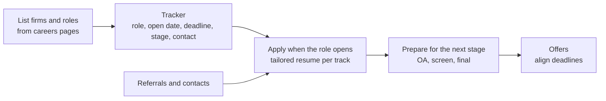

# Resume and Application Strategy

## TL;DR

- One page, reverse chronological, plain layout that survives copy-paste into an applicant tracking form: education, experience, projects, skills, achievements.
- Every bullet follows one formula: action verb, what you built or decided, how, and a measured result with its scale.
- Tailor the top third of the page to the track: traders lead with quantitative competitions and decision-making evidence, researchers with statistical and modelling work, developers with systems, languages and performance numbers.
- Everything on the page is interview material; list only what you can explain in depth, including the numbers.
- Treat applications as a pipeline: a tracker per firm and role, applications as soon as roles open, referrals where you genuinely know someone, and preparation timed to the stages.

## Learning objectives

- Write a one-page quant resume with quantified impact.
- Plan application timing and referrals across firms.
- Tailor the same experience for trader, researcher and developer applications.
- Prepare to defend every line of the resume in an interview.

## Core concepts

### Who reads it and how

Resumes are usually screened quickly by recruiters and then read in more depth by the interviewers, who pick questions from it.
So the page has two jobs: pass a fast screen on clear signals (education, results, relevant experience, skills), and give interviewers good threads to pull.
A layout that a parser can read matters because many firms take applications through online forms: single column, standard section headings, no text inside images or tables, a PDF with selectable text.

### The structure

| Section | Contents | Notes |
| :--- | :--- | :--- |
| Header | Name, email, phone, city, GitHub or personal site | No photo, no full address, no objective statement |
| Education | Degree, institution, dates, grades or rank where strong, relevant courses | Recent graduates put this first |
| Experience | Role, organisation, dates, 2 to 4 bullets each | Reverse chronological; bullets follow the formula |
| Projects and research | Title, one-line description, method, result, link | Strongest substitute for experience |
| Skills | Languages with depth (for example "C++20, Python with NumPy and pandas"), tools, frameworks | Only what you would be happy to be tested on |
| Achievements | Competitions, olympiads, scholarships, publications | Include rank and field size where meaningful |

### The bullet formula

**Action verb + what + how + measured result and scale.**

| Weak | Strong |
| :--- | :--- |
| Worked on an order book project | Built a price-time-priority limit order book in Python (heap of price levels, FIFO queues, O(1) cancel) and verified it against a brute-force matcher on 8499 random orders with interleaved cancels |
| Did research on trading signals | Tested a cross-sectional signal on a 200-stock synthetic panel with a time split; found test IC 0.0263 ($t$ = 5.96) but negative net Sharpe at 5 bp because of 1.34x daily turnover, and wrote up the cost analysis |
| Responsible for data pipelines | Rewrote a daily trade-reconciliation job in [language]; cut runtime from [X] to [Y] minutes and added row-count checks that caught [N] silent data drops |
| Helped with risk reports | Automated the [desk]'s daily VaR report in Python, replacing a manual spreadsheet process of [X] hours a day |

The first two rows quote real numbers from this repo's examples ([coding_problems.py](code/coding_problems.py), [take_home_mini.py](code/take_home_mini.py)); in the others, the brackets stand for your own measured values.
Every number on your resume must be one you measured and can explain; interviewers ask how you measured it.

### Tailoring by track

- **Trader:** lead with evidence of fast quantitative decisions and competition: maths olympiads, estimation or trading competitions, poker or bridge at a serious level if true, a trading-game record, mental-maths results.
  Keep code projects short.
- **Researcher:** lead with statistics, machine learning and research: theses, papers, Kaggle-style competitions with rank, research projects with honest validation, the methods you used.
- **Developer:** lead with systems: languages with depth, performance and latency numbers, concurrency, open-source contributions, low-level projects (allocators, lock-free queues, network stacks).
- **Risk and strats:** pricing models, numerical methods, regulatory or risk projects, and the programming used to build them.

### Application strategy

- **Tracker.** One row per firm and role: open date, deadline, stage, contacts, notes from each round.
  Opening dates and deadlines vary by firm and year, so read them from each firm's careers page rather than from forums.
- **Timing.** Apply as soon as a role opens; if a firm reviews applications on a rolling basis, later applicants compete for fewer remaining slots.
  Sequence so that the firms you care most about come after a few practice processes but before your earliest offer deadline.
- **Referrals.** A referral from someone who knows your work gets your resume read; one from a stranger adds little and costs goodwill.
  Ask current or former employees you have actually worked or studied with, send them your resume and the exact role, and make it easy for them.
- **Volume versus depth.** Apply broadly enough that one bad day does not end the season, but prepare specifically for each firm's format (see [14-Firms](../14-Firms/README.md) for reported formats, which change).
- **Consistency.** Use the same facts everywhere (resume, online profiles, application forms); discrepancies are noticed.

## Worked examples

### Example 1: rewriting a vague bullet

Original: "Worked on machine learning models for stock prediction."
Questions to ask yourself: which model, which data, what validation, what result, what was hard?
Rewrite: "Built a gradient-boosted model of next-day returns for [N] stocks with purged walk-forward validation; out-of-sample rank IC [value] ($t$ = [value]); showed the gain disappeared after [X] bp costs and documented why."
The rewrite gives the interviewer four threads (features, validation, costs, why it failed) and shows honest evaluation, which matters more for a research role than a positive result.

### Example 2: the same internship, three tracks

An internship building a volatility surface tool, described for each track:

- Trader: "Built a tool that flagged options quotes deviating from a fitted volatility smile; used daily by [team] to review quoting."
- Researcher: "Fitted SVI smiles to [N] expiries per day with arbitrage checks; measured fit error and stability across [period]."
- Developer: "Implemented the smile-fitting service in C++ with a Python interface; cut fit time per surface from [X] to [Y] ms by [method]."

The experience is the same; the emphasis follows what the reader will test.

### Example 3: deciding what to cut

A candidate has two pages.
Cut in this order: objective statements and generic soft skills, coursework a grader assumes from the degree, school-era items once at university (unless exceptional, such as olympiad medals), duplicate bullets that show the same skill, and any project you could not defend in depth today.

## Pitfalls

- Two pages for a student or early-career candidate.
- Listing skills you cannot be tested on; "proficient in C++" invites a hard C++ question.
- Numbers you cannot explain or did not measure; interviewers ask how each one was computed.
- Duties instead of results ("responsible for...").
- Fancy templates, columns, icons and skill bars that break parsers and waste space.
- Unexplained jargon from a previous employer; describe what the system did.
- Proprietary details from a previous employer (strategy parameters, client names, P&L by strategy); see [Senior-Level Expectations](12-Senior-Level-Expectations.md).
- Spelling and formatting errors, which read as carelessness in a job that rewards attention to detail.
- Mass referrals from strangers, and applying to many roles at one firm with different stories.

## Interview questions

> [!question]- int-resume-one-page | Why one page for most quant applicants?
> The first screen is fast and the interviewers pick threads from it; one page forces you to keep only the strongest, defensible items.
> Long experienced-hire records may justify more, but density still wins.

> [!question]- int-resume-bullet-formula | What is the formula for a strong resume bullet?
> Action verb + what you built or decided + how (method, tools) + measured result with scale.
> Results, not duties.

> [!question]- int-resume-numbers-rule | What rule applies to every number on your resume?
> You measured it and can explain how.
> Interviewers ask, and an unexplained number damages the credibility of everything else.

> [!question]- int-resume-skills-section | How should you list programming languages?
> With honest depth and context ("C++20 for latency-sensitive services, Python with NumPy for research"), only languages you are happy to be tested on.
> Expect to be tested in any language you list.

> [!question]- int-resume-trader-tailoring | What goes at the top of a trader resume?
> Evidence of fast quantitative decision-making and competition: olympiads, estimation or trading competitions, strong mental maths, serious game play if true, then relevant experience.

> [!question]- int-resume-researcher-tailoring | What goes at the top of a researcher resume?
> Statistical and modelling work with honest validation: theses, papers, research projects, competition ranks, and the methods used, with out-of-sample results and their uncertainty.

> [!question]- int-resume-dev-tailoring | What goes at the top of a developer resume?
> Systems work with measurable performance: languages with depth, latency or throughput improvements, concurrency, low-level or open-source projects.

> [!question]- int-resume-negative-result | Should a project that failed go on a research resume?
> Yes, if it shows sound method and you can explain why it failed (for example a real signal that does not survive costs).
> Honest negative results demonstrate the judgement researchers are hired for.

> [!question]- int-resume-ats | What layout choices keep a resume readable by online application systems?
> Single column, standard section headings, no text in images or tables, standard fonts, PDF with selectable text.

> [!question]- int-resume-referral | When is a referral worth asking for, and how?
> When the person knows your work.
> Send them the resume and the exact role, and make it easy; a referral from a stranger adds little and spends goodwill.

> [!question]- int-resume-timing | How do you decide when to apply to each firm?
> From each firm's careers page, apply as soon as roles open, since rolling review means fewer remaining slots later, and order processes so that top choices come after some practice but before your earliest offer deadline.

> [!question]- int-resume-tracker | What fields belong in an application tracker?
> Firm, role, open date, deadline, stage, next step and date, contacts, notes after each round, and offer deadline.
> It prevents missed deadlines and lets you align offers.

> [!question]- int-resume-proprietary | What must you leave off a resume from a previous trading job?
> Proprietary details: strategy parameters, signals, client names, non-public P&L by strategy, internal system names that reveal them.
> Describe scope, role, methods in general terms and public or approved metrics.

> [!question]- int-resume-defend-every-line | How should you prepare your resume for interviews?
> For every line, prepare a two-minute explanation, the hardest technical question it invites, and the numbers behind it.
> Interviewers use the resume as a question bank.

> [!question]- int-resume-what-to-cut | You have two pages. What do you cut first?
> Objective statements and generic soft skills, coursework implied by the degree, old school-era items unless exceptional, duplicate bullets, and anything you could not defend in depth.

> [!question]- int-resume-consistency | Why must your resume match your online profiles and application forms?
> Recruiters and interviewers compare them; inconsistent dates, titles or claims read as exaggeration.

## In this repo and SDE-Interview-Prep

- The example bullets quote numbers asserted by [coding_problems.py](code/coding_problems.py) (8499 random orders) and [take_home_mini.py](code/take_home_mini.py) (IC 0.0263, $t$ = 5.96, turnover 1.34).
- Pipeline and rounds: [How Quant Interviews Work](01-How-Quant-Interviews-Work.md); firm formats: [14-Firms](../14-Firms/README.md).
- [Resume guide (SDE-Interview-Prep)](https://github.com/shreejitverma/SDE-Interview-Prep/blob/main/06-Interview-Prep/02-Resume/resume_guide.md)

## Further reading

- Gayle Laakmann McDowell, *Cracking the Coding Interview*, 6th edition (2015), "Before the Interview" chapter on resumes.
- Gayle Laakmann McDowell, *The Google Resume* (Wiley, 2011).
