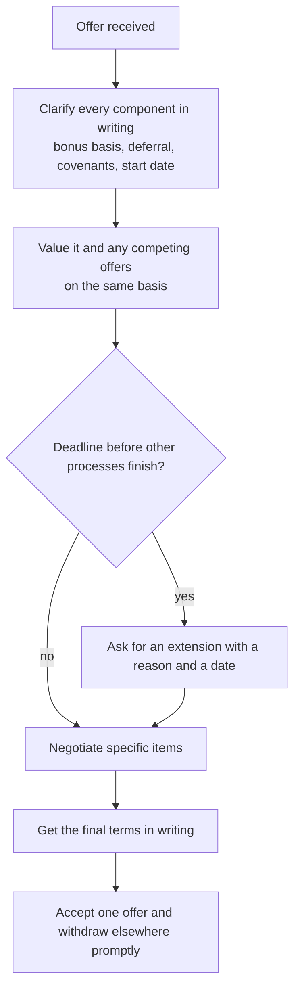

# Offers, Compensation and Negotiation

## TL;DR

- An offer is a bundle: base salary, bonus (discretionary or guaranteed), sign-on, deferred awards with vesting, a buyout of pay you forfeit by leaving, and restrictive terms (notice period, garden leave, non-compete, non-solicit) that change what the bundle is worth.
- Value the bundle like a cash-flow problem: discount deferred pieces, apply the probability you leave before they vest, and price the months a non-compete keeps you out of work.
- Guaranteed money is worth more than the same expected discretionary money; ask which parts are contractual and which are "target" or "eligible".
- Negotiate on facts: competing written offers, forfeited deferred pay, and specific terms; be candid, be specific, and ask for time rather than letting a good offer lapse.
- This note gives structure and arithmetic only, in abstract units; it states no market pay levels, and restrictive-covenant law differs by jurisdiction and changes, so get advice on the actual contract.

## Learning objectives

- Understand base, bonus, sign-on and deferred compensation structures.
- Negotiate with competing offers and handle non-compete and garden-leave terms.
- Compute the present value of a deferred award with forfeiture risk, a pro-rata clawback and a buyout.
- Know which contract terms to read before signing.

## Core concepts

### The components

| Component | What it is | Questions to ask |
| :--- | :--- | :--- |
| Base salary | Fixed pay, usually paid monthly or semi-monthly | Review cycle; whether it changes with title |
| Bonus | Variable pay, usually annual | Discretionary or contractual; what it depends on (firm, team, individual P&L or formula); payment date; whether you must be employed (and not under notice) on that date |
| Guaranteed bonus | A contractual first-year (sometimes second-year) bonus | Exact amount, payment date, conditions |
| Sign-on | One-off payment on joining | Clawback period and whether repayment is pro-rata or all-or-nothing |
| Deferred award | Part of a bonus paid later in cash, fund units or stock | Vesting schedule, what it is invested in, forfeiture on resignation, malus and clawback |
| Buyout | New employer replaces deferred pay you forfeit by leaving | Cash or new deferred award; timing; clawback if you leave |
| Benefits | Pension or retirement matching, health insurance | Match formula and vesting |
| Restrictive covenants | Notice period, garden leave, non-compete, non-solicit, non-dealing | Length, whether paid, geography and scope, governing law |

In P&L-linked roles the bonus may be tied to a formula on the individual or team P&L; ask how it is determined and get the formula in writing if one exists.
Never infer a pay level from a forum; the structure and the contractual wording are what you can verify.

### Deferral, vesting, malus and clawback

- **Deferral** pays part of a bonus later, often in instruments whose value depends on the firm or fund.
- **Vesting** is when it becomes yours: cliff (all at once) or graded (for example a third per year).
- **Forfeiture** usually applies to unvested awards if you resign; read whether "good leaver" terms (redundancy, retirement) differ.
- **Malus** reduces unvested awards; **clawback** recovers paid amounts, typically for misconduct or material losses.
- For banks in the EU, Directive (EU) 2019/878 amended Article 94(1)(m) of the Capital Requirements Directive so that at least 40% of the variable pay of staff in scope is deferred over not less than four to five years, at least 60% where the variable amount is particularly high, vesting no faster than pro rata.
  Non-bank trading firms set their own terms, so read the plan documents.

### Notice, garden leave and non-competes

- **Notice period:** time between resigning and leaving, during which you are still employed and paid.
- **Garden leave:** the employer keeps you employed and paid during notice but removes you from work and clients, so your information goes stale before you join a competitor.
- **Non-compete:** a post-employment restriction on working for competitors for a period, sometimes paid, sometimes not.
- **Non-solicit and non-dealing:** restrictions on approaching or dealing with former clients or hiring former colleagues.

The cost to you is the time out of work, the pay during it (full, base only, or nothing), and your skills going stale.
Enforceability depends on the jurisdiction and the contract's governing law, and the rules change, so check current law for your case.
Two primary-source examples, as of 2026-10:

- California Business and Professions Code section 16600 makes contracts that restrain anyone from a lawful profession, trade or business void, subject to statutory exceptions; section 16600.5 (added by SB 699, effective 2024-01-01) makes such contracts unenforceable regardless of where and when they were signed, bars employers from entering into or attempting to enforce them, and gives employees a private right of action with attorney's fees.
- The US Federal Trade Commission's Non-Compete Clause Rule was set aside by the US District Court for the Northern District of Texas in Ryan, LLC v. FTC in August 2024, and on 2025-09-05 the FTC announced it was dismissing its appeals (Ryan, LLC v. FTC, No. 24-10951, 5th Cir., and Properties of the Villages v. FTC, No. 24-13102, 11th Cir.) and acceding to the vacatur; the FTC said it would continue to act against non-competes case by case.

### Valuing an offer

Put every component on a timeline and compute an expected present value:

$$
V = \sum_k \frac{c_k\,P(\text{still employed and vested at } t_k)}{(1+r)^{t_k}} - \text{expected clawbacks} - \text{value of time lost to restrictions}.
$$

Use a discount rate that reflects the risk of the instrument (a deferred award in a volatile fund is riskier than cash), and a realistic probability that you leave before vesting.
Then compare offers on the same horizon, and separately on what you will learn and who you will work with, which usually dominates over a career.

### Negotiation mechanics

- **Be specific.** Ask for named items (sign-on to cover forfeited deferred pay, a guaranteed first-year bonus, a shorter or paid non-compete, a start date) rather than "more".
- **Use facts.** A competing written offer, or documentation of the deferred pay you forfeit, is a reason the other side can take to its approvers; a vague "I have other interest" is not.
- **Do not bluff.** Firms talk, offers get verified, and a discovered bluff ends the process.
- **Separate interests from positions.** The firm may be unable to move base because of bands but able to move sign-on or a guarantee (Fisher, Ury and Patton, *Getting to Yes*).
- **Exploding offers.** A short deadline is a negotiating tactic as well as a constraint; ask for a specific extension with a reason; the worst outcome of asking politely is usually a no.
- **Accept once.** Reneging on an accepted offer damages your reputation in a small industry.

## Worked examples

All amounts are in abstract units (U) chosen to make the arithmetic visible; they are not market data and do not describe any firm's pay.
Numbers from [offer_math.py](code/offer_math.py).

### Example 1: a deferred award with forfeiture risk

A deferred award of 90 U vests in thirds at 1, 2 and 3 years; discount at 6%.
Present value if you are sure to stay: $30(1.06^{-1} + 1.06^{-2} + 1.06^{-3}) = 80.19$ U.
If each year there is a 10% chance you leave and forfeit what is unvested, multiply tranche $k$ by $0.9^k$: expected PV $= 65.46$ U, and a seeded simulation of leaving times gives about 65.5.
So the "90" in the offer letter is worth about 65 in expected present value under these assumptions; the gap is why a cash sign-on of the same size is worth more.

### Example 2: sign-on clawback

A 30 U sign-on with a 24-month pro-rata clawback, and you leave after 9 months: repay $30 \times 15/24 = 18.75$ U.
Under a cliff clawback (repay all if you leave within 12 months) you would repay 30.00 U.
Ask which applies, and whether it is gross or net of tax.

### Example 3: a buyout of forfeited deferred pay

Leaving your current employer forfeits 40 U vesting in 6 months and 40 U vesting in 18 months.
Their present value at 6% is $40 \times 1.06^{-0.5} + 40 \times 1.06^{-1.5} = 75.50$ U, so a cash buyout today should be measured against 75.50, not the 80 face value (a 4.50 U time-value discount).
If the new firm instead offers a replacement award on a schedule that vests each tranche a year later than the original, it is worth 73.34 U, a shortfall of 2.17, before counting the extra year of forfeiture risk and the instrument's riskiness.
Bring the vesting schedule documents; buyouts are negotiated on evidence.

### Example 4: guaranteed versus discretionary

Offer A guarantees a 50 U first-year bonus.
Offer B's discretionary bonus is 0, 60 or 100 U with probabilities 0.2, 0.5 and 0.3: expected 60.00 U, standard deviation 34.64 U, and a 0.20 probability of paying less than A's guarantee.
B is better in expectation; whether it is better for you depends on how much the downside matters, and on whether you trust the stated distribution, which you usually cannot verify.

### Example 5: an exploding offer

Offer A is worth 100 U to you and expires before offer B's process ends.
You estimate B arrives with probability 0.5 and is then worth somewhere uniform between 80 and 140 U; if B does not arrive your fallback is worth 70.
Letting A lapse to wait: $0.5 \times 110 + 0.5 \times 70 = 90.00 < 100$, so accept A.
With an extension that keeps A open until B resolves, you take the better of the two if B arrives: expected value 106.67 U.
The extension is worth 6.67 U over accepting immediately, which is why asking for one, with a concrete date, is almost always right.

## Pitfalls

- Comparing headline totals that mix guaranteed cash with discretionary targets and deferred awards.
- Ignoring forfeiture: unvested deferred pay is not yours, and leaving costs it unless bought out.
- Not reading the restrictive covenants until you want to leave; a long unpaid non-compete can cost more than the sign-on was worth.
- Negotiating with vague claims or bluffs; firms verify.
- Accepting and then reneging.
- Treating an exploding deadline as non-negotiable without asking.
- Relying on forum pay figures, which are self-reported, selected and out of date.
- Taking legal conclusions from a note like this; covenants depend on the governing law and current statutes.

## Interview questions

> [!question]- int-offer-components | Name the components of a typical quant offer.
> Base, bonus (discretionary or guaranteed), sign-on, deferred awards with vesting, buyout of forfeited deferred pay, benefits, and restrictive terms: notice, garden leave, non-compete, non-solicit.

> [!question]- int-offer-discretionary-vs-guaranteed | What is the difference between a guaranteed and a discretionary bonus?
> A guaranteed bonus is a contractual amount payable if the conditions (usually still employed on the payment date) are met; a discretionary bonus is decided by the employer and may be zero. Equal expected amounts are worth less when discretionary.

> [!question]- int-offer-deferred-pv | A 90 U award vests in thirds at 1, 2 and 3 years. PV at 6%, and with a 10% annual chance of leaving and forfeiting?
> $80.19$ U and $65.46$ U. Discount each 30 U tranche, then multiply tranche $k$ by $0.9^k$.

> [!question]- int-offer-malus-clawback | What is the difference between malus and clawback?
> Malus reduces or cancels awards before they vest or are paid; clawback recovers amounts already paid. Both are typically triggered by misconduct, errors or material losses.

> [!question]- int-offer-crd-deferral | What does EU law require for deferral of bank bonuses for staff in scope?
> Under Article 94(1)(m) of Directive 2013/36/EU as amended by Directive (EU) 2019/878: at least 40% of variable pay deferred over not less than four to five years, at least 60% for particularly high amounts, vesting no faster than pro rata.

> [!question]- int-offer-sign-on-clawback | 30 U sign-on, 24-month pro-rata clawback, you leave after 9 months. How much do you repay?
> $18.75$ U. $30 \times (24-9)/24$; under a 12-month cliff it would be all 30.

> [!question]- int-offer-buyout-pv | You forfeit 40 U vesting in 6 months and 40 U in 18 months. What should a cash buyout today be compared with, at 6%?
> $75.50$ U, the present value, not the 80 face value. A replacement award that vests each tranche a year later is worth only 73.34.

> [!question]- int-offer-buyout-evidence | What do you need to negotiate a buyout?
> Documentation of the awards you forfeit: amounts, instruments, vesting dates and forfeiture terms. The new firm's approvers need evidence, not a verbal estimate.

> [!question]- int-offer-garden-leave | What is garden leave and why do trading firms use it?
> Paid notice during which you are kept off work and away from clients and information. It lets your market knowledge go stale before you join a competitor.

> [!question]- int-offer-noncompete-cost | How do you value a non-compete in an offer?
> As the time you would be out of work if you left, times the pay you would lose (it may be paid in full, base only, or unpaid), plus skill decay and lost opportunities, weighted by the chance you leave. Then negotiate length, scope and pay.

> [!question]- int-offer-california-16600 | What does California Business and Professions Code section 16600.5 add to section 16600?
> It makes contracts void under 16600 unenforceable regardless of where and when signed, bars employers from entering into or attempting to enforce them, and gives employees a private right of action with attorney's fees (added by SB 699, effective 2024-01-01).

> [!question]- int-offer-ftc-rule | What happened to the US FTC Non-Compete Clause Rule?
> A federal district court in Texas set it aside in Ryan, LLC v. FTC in August 2024, and on 2025-09-05 the FTC moved to dismiss its appeals and accede to the vacatur. Non-competes remain governed by state law and case-by-case enforcement.

> [!question]- int-offer-guarantee-vs-discretionary | Guaranteed 50 U, or discretionary 0, 60 or 100 U with probabilities 0.2, 0.5, 0.3?
> The discretionary bonus has the higher mean (60.00 U) but a standard deviation of 34.64 and a 0.20 chance of paying less than the guarantee. The choice depends on risk tolerance and on trusting a distribution you usually cannot verify.

> [!question]- int-offer-exploding-deadline | Offer A worth 100 expires before offer B resolves; B arrives with probability 0.5 and is then uniform on 80 to 140; fallback 70. What do you do?
> Accept A rather than let it lapse (waiting is worth 90.00), but first ask for an extension: keeping A open while B resolves is worth 106.67.

> [!question]- int-offer-competing-offer | How do you use a competing offer?
> Share the facts (written offer, components and deadline) with the firm you prefer, ask for specific changes, and never invent or exaggerate it; firms may verify.

> [!question]- int-offer-what-to-ask | Which items are often movable when base is fixed by a band?
> Sign-on, a guaranteed first-year bonus, a buyout of forfeited pay, start date, covenant length or pay, and title. Ask for named items with reasons.

> [!question]- int-offer-renege | Why should you not renege on an accepted offer?
> The industry is small and firms share information informally; reneging damages your reputation with both firms. Negotiate and resolve competing processes before you accept.

## In this repo and SDE-Interview-Prep

- Code: [offer_math.py](code/offer_math.py) computes and asserts every number in the worked examples and cards.
- Pipeline context: [How Quant Interviews Work](01-How-Quant-Interviews-Work.md); experienced hires: [Senior-Level Expectations](12-Senior-Level-Expectations.md).
- Expected value and risk preferences behind the comparisons: [Expected Value and Betting Decisions](../11-Risk-and-Trading/02-Expected-Value-and-Betting-Decisions.md).

## Further reading

- Directive (EU) 2019/878 (CRD V), Article 1 amending Article 94 of Directive 2013/36/EU on variable remuneration.
- California Business and Professions Code sections 16600 and 16600.5 (California Legislative Information).
- US Federal Trade Commission, "Federal Trade Commission Files to Accede to Vacatur of Non-Compete Clause Rule", press release, 2025-09-05.
- Roger Fisher, William Ury and Bruce Patton, *Getting to Yes*, 3rd edition (2011).
- Deepak Malhotra and Max Bazerman, *Negotiation Genius* (Bantam, 2007).
