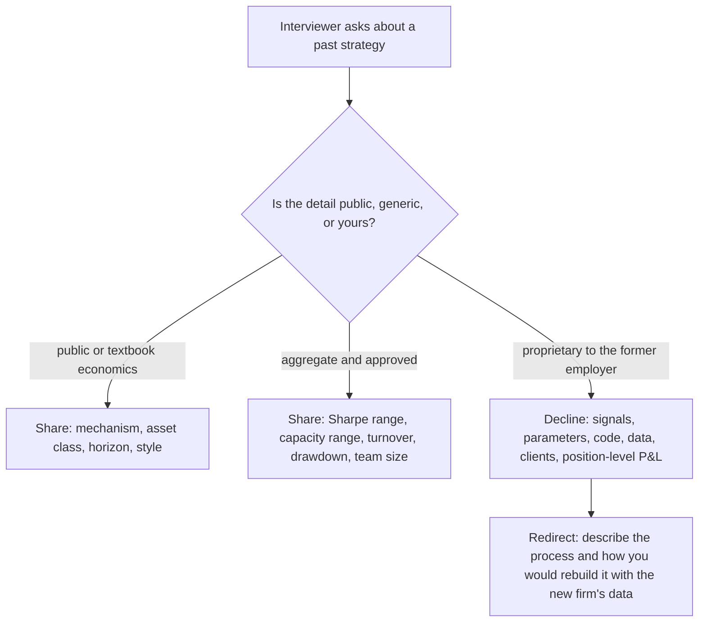

# Senior-Level Expectations

## TL;DR

- Experienced hires are assessed less on puzzles and more on what they have already done: a track record, how it was earned, whether it transfers, and how they lead and own outcomes.
- A track record is a noisy estimate: an annualised Sharpe has a standard error of about $1/\sqrt{\text{years}}$, so a Sharpe of 1.0 needs about 4.0 years to reach $t = 2$, and among 1000 zero-skill managers about 4.7 show a 3-year Sharpe above 1.5 by luck.
- Attribute returns before you claim them: in the worked example a headline Sharpe of 1.08 is mostly market beta, and the alpha estimate has $t = 0.75$.
- Capacity is part of the answer: when impact grows with the square root of size, dollar P&L peaks where net alpha has fallen to one third of gross.
- Discuss past strategies at the level of economics, process and aggregate statistics; never disclose a former employer's signals, parameters, code, data or client information, and bring nothing with you.

## Learning objectives

- Explain what changes for senior hires: track record, P&L attribution, ownership, leadership.
- Prepare to discuss past strategies without disclosing proprietary information.
- Quantify how much a track record proves, including luck across many managers.
- Attribute a track record to market, factor and residual alpha, and reason about capacity.

## Core concepts

### What changes for a senior hire

| Dimension | Junior hire | Senior hire |
| :--- | :--- | :--- |
| Evidence | Potential: grades, competitions, puzzles, coding | Results: P&L, systems shipped, research adopted, people developed |
| Technical rounds | Generic probability, statistics, coding | Deep dives into your own work, design of systems at scale, critique of your methods |
| Judgement | Small decisions under uncertainty | Risk taken with real capital, decisions under drawdown, saying no |
| Scope | A task | A book, a strategy, a platform or a team, and the outcome |
| Leadership | Not expected | Hiring, mentoring, setting standards, cross-team work |
| Commercial | Not discussed | Capacity, costs, infrastructure needs, compensation tied to P&L |

Interviewers try to separate three things: was it you (attribution within a team), was it skill (statistics and attribution to known factors), and will it work here (dependence on the old firm's data, infrastructure, financing or flow).

### How much a track record proves

With annualised Sharpe $SR$ estimated over $Y$ years of returns, the $t$-stat is about $SR\sqrt{Y}$ (Lo 2002 gives the standard error; with daily data it is close to $1/\sqrt{Y}$ annualised).

| Sharpe | $t$ after 3 years | Years to reach $t = 2$ |
| ---: | ---: | ---: |
| 0.5 | 0.87 | 16.0 |
| 0.75 | - | 7.1 |
| 1.0 | 1.73 | 4.0 |
| 1.5 | 2.60 | 1.8 |
| 2.0 | 3.46 | 1.0 |

Selection makes it worse.
Among 1000 managers with zero skill and 3-year records, the annualised Sharpe has standard error $1/\sqrt3 = 0.58$, so each has a 0.0047 chance of showing a Sharpe above 1.5 and about 4.7 of them are expected to; a seeded simulation of 1000 such managers produced 4.
Interviewers know they see the survivors, so they ask about the full history, the strategies that did not work, and the capital behind the record.

### Attribution

Regress the return series on the factors it could be getting for free, for example the market (Fama and French 1993 for size and value, Carhart 1997 for momentum):

$$
r_t = \alpha + \beta\,m_t + \gamma\,f_t + \varepsilon_t.
$$

With an intercept, OLS fitted values average exactly to the sample mean, so the mean return splits into $\hat\alpha + \hat\beta\bar m + \hat\gamma\bar f$.
Report alpha with its $t$-stat and the information ratio of the residual, not the headline Sharpe.
Also attribute within the team: which decisions were yours, what the risk limits were, what the infrastructure and data did for you.

### Capacity

If gross alpha at small size is $a_0$ and impact costs grow like $c\sqrt{A}$ with assets $A$, dollar P&L is $A(a_0 - c\sqrt A)$.
Setting the derivative to zero, $a_0 - \tfrac32 c\sqrt{A} = 0$, gives $\sqrt{A^*} = 2a_0/(3c)$ and a net alpha at $A^*$ of $a_0/3$.
So a strategy run at the dollar-P&L-maximising size earns only a third of its small-size return; a senior candidate should know roughly where their strategy sits on this curve and say what the old book's size was relative to it.

### Ownership and leadership

- **Ownership:** you own outcomes, not tasks; you found and fixed problems no one assigned, and you can say what you would do differently.
- **Risk:** you can describe your worst drawdown, what you did during it, and what you changed.
- **People:** you hired, mentored, gave hard feedback, and raised the bar; you can name what your team did without you.
- **Influence:** you changed how a group works (a research standard, a review process, a platform adopted by others).

### What you may and may not disclose

- Your former employer's confidential information is usually protected by your contract and by trade-secret law; in the US, 18 U.S.C. 1836 gives an owner of a misappropriated trade secret a civil action (Defend Trade Secrets Act of 2016).
- Interviewers at reputable firms do not want proprietary details, and asking for them is a test: a candidate who discloses a former employer's secrets will disclose theirs too.
- Bring nothing: no code, data, documents or models, in any form, including personal email or cloud storage.
- Check your own contract (confidentiality, non-solicit, non-compete, notice) before interviews; see [Offers, Compensation and Negotiation](11-Offers-Compensation-and-Negotiation.md).

## Worked examples

### Example 1: "Your Sharpe was 1.5 over 3 years. Why should we believe it?"

"The $t$-stat is about $1.5\sqrt3 = 2.60$, so on its own it is significant at conventional levels, but not overwhelmingly.
Selection matters: if 1000 people with no skill ran strategies for 3 years, about 4.7 would show 1.5 or better by luck.
What should persuade you is that the record was predicted: the strategy was designed with a stated mechanism before it ran, the live Sharpe was in line with the pre-launch research estimate, returns are not explained by standard factors, and the drawdowns occurred in the conditions the mechanism predicts.
I can walk through each of those at the level of economics without disclosing the signals."

### Example 2: attribution of a track record

A synthetic 60-month record was generated with true monthly alpha of 0.25% (3% a year), market beta 0.5 and a style-factor loading 0.4 (numbers from [track_record.py](code/track_record.py), seed 12).
Headline: 10.09% a year with a Sharpe of 1.08.
Regression: beta 0.47 and factor loading 0.42; of the 10.09%, market beta contributes 7.68% a year, the factor 0.55% and alpha 1.85%, with an alpha $t$-stat of 0.75, an $R^2$ of 0.70 and a residual information ratio of 0.35.
"Most of this headline is market exposure you could buy cheaply; the alpha is not distinguishable from zero over five years, even though the generating process had 3% of true alpha.
A candidate presenting this record should lead with the residual, not the headline."

### Example 3: capacity

A strategy earns 6% gross alpha at tiny size, and impact eats all of it at 1000 units of assets (illustrative units).
Dollar P&L $A(0.06 - c\sqrt{A})$ with $c = 0.06/\sqrt{1000}$ peaks at $A^* = (2/3)^2 \times 1000 = 444.4$, where net alpha is 2.00% and P&L is 8.89 units.
At 500 units net alpha is 1.76%.
"If my old book was run at about 450 on this scale, doubling it would not double P&L; it would reduce it."

### Example 4: discussing a past strategy safely

Question: "Walk me through the signal that drove most of your P&L."
Answer: "It was a short-horizon relative-value strategy in liquid futures; the mechanism was temporary dislocations from hedging flows around known events.
I can share that it held positions for days, ran at a volatility target, that live and backtest Sharpe were consistent, and how we sized and risk-managed it.
I cannot share the specific features, parameters or data sources, which belong to my former employer.
What I can bring is the research process: how I would find and validate this kind of effect with your data, and the infrastructure it needs."

## Pitfalls

- Presenting gross, beta-heavy returns as alpha.
- Claiming a team's P&L as yours; interviewers check references and ask detailed questions about who did what.
- Quoting a short track record without its uncertainty, or omitting the strategies that failed.
- Ignoring capacity and dependence on the old firm's data, financing, infrastructure or client flow.
- Disclosing proprietary details to impress, or bringing code or data; it ends the process and can create legal liability.
- Treating leadership as title; interviewers want specific people developed and standards changed.
- Not knowing your own contract's restrictive covenants before the start date is negotiated.

## Interview questions

> [!question]- int-senior-what-changes | What changes in interviews for an experienced hire?
> Fewer puzzles and generic rounds, more deep dives into your record: was it you, was it skill (statistics and factor attribution), will it transfer (data, infrastructure, capacity), plus leadership and ownership.

> [!question]- int-senior-sharpe-tstat | What $t$-stat does an annualised Sharpe of 1.5 over 3 years have, and how many years does a Sharpe of 1.0 need for $t = 2$?
> About 2.60, and 4.0 years. $t \approx SR\sqrt{\text{years}}$ and years $= (2/SR)^2$.

> [!question]- int-senior-sharpe-075 | How many years does a Sharpe of 0.75 need to reach $t = 2$?
> About 7.1. $(2/0.75)^2$.

> [!question]- int-senior-lucky-managers | 1000 zero-skill managers each run a strategy for 3 years. How many show an annualised Sharpe above 1.5?
> About 4.7 in expectation. The Sharpe standard error is $1/\sqrt3 = 0.58$, so each has probability 0.0047 of exceeding 1.5 by luck.

> [!question]- int-senior-attribution-why | Why regress a track record on market and factor returns?
> To separate returns available cheaply (beta, known styles) from residual alpha. With an intercept the mean return splits exactly into alpha plus loadings times factor means, and alpha's $t$-stat measures skill.

> [!question]- int-senior-attribution-alpha | A 5-year record has a Sharpe of 1.08, beta 0.47, and alpha 1.85% a year with $t = 0.75$. How do you describe it?
> Mostly market exposure: beta contributes 7.68% of the 10.09% a year, and the alpha is not statistically distinguishable from zero. Lead with the residual and its uncertainty, not the headline Sharpe.

> [!question]- int-senior-capacity-one-third | If impact grows with $\sqrt{A}$, what is net alpha at the AUM that maximises dollar P&L?
> One third of the small-size gross alpha. $A(a_0 - c\sqrt A)$ is maximised where $a_0 = \tfrac32 c\sqrt A$, leaving $a_0 - \tfrac23 a_0$.

> [!question]- int-senior-capacity-example | Gross alpha 6% at tiny size, fully eaten by impact at 1000 units. Optimal size and net alpha there?
> About 444.4 units, $(2/3)^2 \times 1000$, with net alpha 2.00% and dollar P&L 8.89 units.

> [!question]- int-senior-transfer | What makes a track record not transferable to a new firm?
> Dependence on the old firm's data, execution infrastructure, financing terms, client flow, risk capital or colleagues. Say what you need to rebuild it and how long it would take.

> [!question]- int-senior-disclosure-allowed | What can you usually discuss about a past strategy?
> Public economics and mechanism, asset class, horizon and style, approved aggregate statistics (Sharpe and capacity ranges, turnover, drawdowns), and your research and risk process.

> [!question]- int-senior-disclosure-forbidden | What must you not disclose or bring?
> Signals, parameters, code, data, models, documents, client information and position-level P&L belonging to the former employer, in any form. In the US, misappropriated trade secrets support a civil action under 18 U.S.C. 1836.

> [!question]- int-senior-asked-for-secrets | An interviewer presses for your old firm's exact signal. What do you do?
> Decline politely and redirect to the mechanism and your process. Reputable firms do not want it, and disclosure signals you would leak their secrets too.

> [!question]- int-senior-drawdown-story | How should you answer "tell me about your worst drawdown"?
> Size and duration, what you knew at the time, what you did (followed limits, reduced, hedged, or held with reasons), the outcome, and what changed in your process afterwards.

> [!question]- int-senior-team-credit | How do you present results earned by a team?
> State the team's result, then your specific role, decisions and contributions, with names of what others owned. Interviewers and references will probe it.

> [!question]- int-senior-leadership-evidence | What counts as leadership evidence for a senior quant?
> Specific people hired or developed, standards or processes you changed (research review, risk checks, code quality), platforms others adopted, and decisions you made that others followed.

> [!question]- int-senior-failed-strategies | Why mention strategies that failed?
> They show the denominator: how many things you tried, how you decided to stop, and that the successful record is not the only survivor of many attempts.

## In this repo and SDE-Interview-Prep

- Code: [track_record.py](code/track_record.py) sections 1 to 4 compute and assert every number in this note.
- Statistics and attribution in depth: [Performance Metrics and the Fundamental Law](../09-Alpha-Research-and-Portfolio/09-Performance-Metrics-and-Fundamental-Law.md), [Overfitting and Deflated Sharpe](../09-Alpha-Research-and-Portfolio/08-Overfitting-and-Deflated-Sharpe.md), [PnL Attribution and Greek Risk](../11-Risk-and-Trading/06-PnL-Attribution-and-Greek-Risk.md).
- Capacity and costs: [Transaction Costs and Turnover](../09-Alpha-Research-and-Portfolio/13-Transaction-Costs-and-Turnover.md), [Market Impact Models](../07-Market-Microstructure/06-Market-Impact-Models.md).
- Offers and covenants: [Offers, Compensation and Negotiation](11-Offers-Compensation-and-Negotiation.md).

## Further reading

- Andrew Lo, "The Statistics of Sharpe Ratios", *Financial Analysts Journal* 58(4) (2002).
- Eugene Fama and Kenneth French, "Common Risk Factors in the Returns on Stocks and Bonds", *Journal of Financial Economics* 33(1) (1993).
- Mark Carhart, "On Persistence in Mutual Fund Performance", *Journal of Finance* 52(1) (1997).
- Richard Grinold and Ronald Kahn, *Active Portfolio Management*, 2nd edition (1999).
- 18 U.S.C. 1836, civil proceedings (Defend Trade Secrets Act of 2016), Legal Information Institute text.
